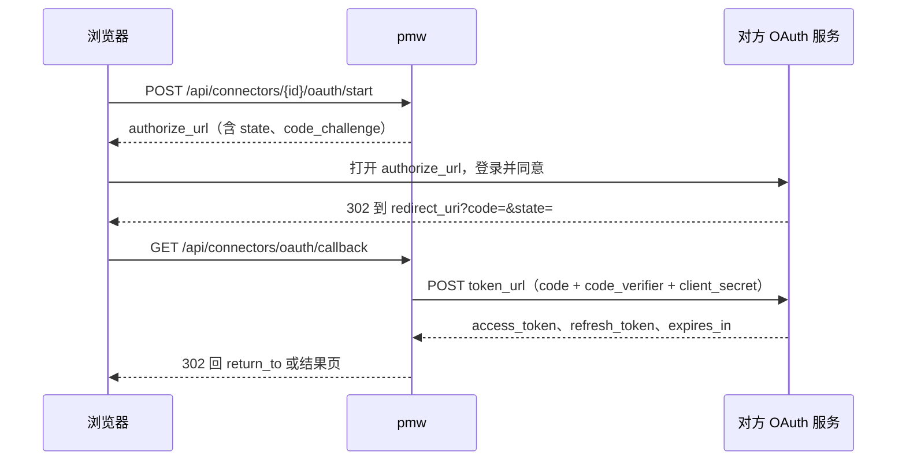

# REST API 契约 v1

所有接口前缀 `/api`。请求与响应均为 JSON（UTF-8）。此文件是前后端唯一契约，改动需同时改 `internal/domain/domain.go` 与 `web/src/lib/types.ts`。

> **给 `domain.ObjectFilter` 加字段时必须同步更新下面的 query 参数表。**
> API 层是照这张表实现解析的——表里没有的参数，即使 domain 和 store 都实现了，
> HTTP 层也会静默丢弃，端到端表现为「参数没生效」，而且不报错。
> `due_after` 就是这么漏掉的：domain 有字段、sqlite 有实现、store 有测试，唯独表里没写。

## 响应信封

成功：
```json
{ "data": <payload>, "meta": { "total": 86, "limit": 50, "offset": 0 } }
```
`meta` 仅列表接口返回。

失败（HTTP 4xx/5xx）：
```json
{ "error": { "code": "not_found", "message": "object not found" } }
```
错误码：`validation` 400 · `not_found` 404 · `conflict` 409 · `readonly` 403 · `internal` 500。
另有 `rate_limited` 429，只在运行异常上报超频时回（见「运行异常 incidents」）。

## 通用

| 方法 | 路径 | 说明 |
|---|---|---|
| GET | `/api/health` | `{"data":{"ok":true,"version":"..."}}` |
| GET | `/api/stats` | 状态栏：db 路径、体积、对象数、最后写入时间 |
| GET | `/api/counts` | 侧栏徽标，返回 `Counts` |
| GET | `/api/today?type={typeID}` | 今日页聚合，返回 `Today`，见下方「今日聚合」 |

### 今日聚合

`GET /api/today` 一次请求返回今日页的卡片列表 `{"cards": TodayCard[]}`，按 `order` 排好。
`type` 的语义和 `/api/counts` 相同：不传是全局，传了收窄到该类型；前端比对徽标时两边传同一个 `type`。

`TodayCard`：`{key, title, order, total, items}`。`total` 是全量条数，`items` 最多 50 条（`domain.TodayCardLimit`）；没有内容时 `items` 是 `[]`，卡片照常返回。

| `key` | 标题 | `order` | `items` | 口径 |
|---|---|---|---|---|
| `review` | 等确认 | 10 | `Object[]`，最近更新的在前 | 待办类型（`task`）状态为 `review`（0013）且未归档、未删除。`type` 传了别的类型时为空 |
| `overdue` | 逾期 | 20 | `Object[]`，截止早的在前 | 与 `counts.overdue` 同一份条件，`total` 恒等于 `counts.overdue` |
| `due_today` | 今天到期 | 30 | `Object[]`，按截止时间 | 与 `counts.today` 同一份条件，`total` 恒等于 `counts.today` |
| `running` | 运行中 | 40 | `TodayRun[]`，最近开始的在前 | `task_runs` 里 `finished_at` 为空的执行（`pending` / `running`）。`type` 按所属对象的类型收窄 |

`TodayRun`：`{id, object_id, object_ref, object_title, object_type, workdir, status, started_at}`，不带 `output`，
看过程走 `GET /api/runs/{id}`。所属对象在回收站里也照样列出：进程还在跑。

逾期、今天到期和 `/api/counts` 在 store 里共用同一段条件（`focusConds`），今天、逾期都按服务端本地日期切，
改口径只改那一处，两边一起变。

等回答的 Agent 问题暂不返回：Agent 会话目前没有「等用户回答」这个状态（`agent_sessions` 无状态列，
消息也没有提问标记），要等会话加上这个状态再补一张卡片。
插件卡片（TODAY-01b）：已启用并在跑的插件按 `provides.today_cards` 登记的卡片，在不传 `type` 时合进来，和内核卡片一起按 `order` 排（插件没写 order 时为 100）。`key` 以 `<插件id>_` 开头，不和上面四个撞。`items` 的形状由插件定。单张卡片加载超过 800ms、出错或没有内容时不返回这张卡。插件停用后卡片消失。

## 工作对象类型 object-types

| 方法 | 路径 | body / query |
|---|---|---|
| GET | `/api/object-types` | 返回 `ObjectType[]`，按 sort_order |
| POST | `/api/object-types` | `{id,name,plural,ref_prefix,icon,color,sort_order,statuses}`，id 为小写英文短名 |
| PATCH | `/api/object-types/{id}` | `ObjectTypePatch`，builtin 类型仅允许改 icon/color/sort_order/statuses |

状态 `{key,label,color,terminal,description?}`：`description` 是给人看的说明（PR-13，设置的枚举值页里改），可省，空时不返回；0041 给任务的待验收、受阻、已完成、已取消补了说明。

内置类型 `task` 的 `name`、`plural` 是「任务」（0042 从「待办」「待办事项」改过来，PR-20），key 和前缀 `TSK` 不变；MCP 的 `pmw_list_types` 读的是同一份。
| DELETE | `/api/object-types/{id}` | builtin 返回 403；下挂对象非空返回 409 |

## 分类 categories

| 方法 | 路径 | 说明 |
|---|---|---|
| GET | `/api/categories?type={typeID}&tree=true&counts=true` | `tree=true` 返回嵌套 `children`，否则扁平；`counts=true` 填充 `count`/`total_count` |
| POST | `/api/categories` | `{type_id,parent_id?,name,slug?,color?,description?,sort_order?}`，slug 省略时由 name 生成 |
| PATCH | `/api/categories/{id}` | `CategoryPatch` |
| POST | `/api/categories/{id}/move` | `{parent_id: string\|null, sort_order: number}`，禁止移到自己的子孙下（409） |
| DELETE | `/api/categories/{id}?reassign_to={catID}` | 不传 reassign_to 则下挂对象置为未分类 |

## 工作对象 objects

`GET /api/objects` query 参数：

| 参数 | 示例 | 说明 |
|---|---|---|
| `type` | `requirement,task` | 逗号分隔多选 |
| `category` | `cat_req_prod` | 分类 ID |
| `subtree` | `true` | 含子分类 |
| `uncategorized` | `true` | 只看未分类的对象，与 `category` 互斥（同时给时以本参数为准） |
| `status` | `doing,blocked` | 逗号分隔 |
| `priority` | `P0,P1` | 逗号分隔 |
| `tag` | `云端平台` | 可重复传多个，AND 语义 |
| `owner` / `project` | | 精确匹配 |
| `q` | `多租户` | 标题+正文模糊匹配 |
| `source` | `webhook,im` | 按 `objects.source` 精确匹配，逗号分隔多选。任务来源取值见下方「任务来源」 |
| `stage` | `designing,none` | 按 `props.stage`（任务阶段，见「任务阶段与提出人」）筛，逗号分隔多选；`none` 是没设阶段 |
| `requester_id` | `stk_…` | 按 `props.requester.contact_id`（提出人的联系人）精确匹配 |
| `requester_channel` / `requester_sender_id` | `slack` / `U04LIN` | 按 `props.requester` 里的 IM 发送者匹配，两个必须成对给，只给一个回 400 |
| `source_message_id` | `imm_…` | 按 `props.source_ref.message_id`（来源 IM 消息）精确匹配 |
| `due_after` | `2026-09-15` | 到期日下界。RFC3339 或 YYYY-MM-DD，纯日期补 **00:00:00** |
| `due_before` | `2026-09-15` | 到期日上界。RFC3339 或 YYYY-MM-DD，纯日期补 **23:59:59** |
| `stalled` | `true` | N 天未更新且未进终态（口径与 `counts.stalled` 一致） |
| `not_terminal` | `true` | 排除处于终态的对象 |
| `overdue` / `inbox` / `archived` / `deleted` | `true` | 布尔开关 |
| `sort` | `-updated_at` | `-` 前缀为倒序，支持 updated_at/created_at/due_at/priority/title |
| `limit` / `offset` | `50` / `0` | 默认 50，最大 200 |

**两端补时的语义**：`due_after` 与 `due_before` 传同一个纯日期时，正好圈出「当天到期」。
两端都补成当天末尾的话，`due_after=2026-09-15` 会把当天上午到期的全滤掉，窗口直接空掉。

**「今日」「本周」「停滞」的口径必须与 `/api/counts` 对应的计数器逐字一致**：

| 聚焦 | 查询参数 | 对应计数器 |
|---|---|---|
| 今日 | `due_after=今天00:00` + `due_before=今天23:59:59` + `not_terminal=true` | `counts.today` |
| 本周 | `due_after=今天00:00` + `due_before=+7天23:59:59` + `not_terminal=true` | `counts.week` |
| 逾期 | `overdue=true` | `counts.overdue` |
| 停滞 | `stalled=true` | `counts.stalled` |

这几个徽标就贴在列表旁边，口径一旦分叉就会出现「徽标 2 / 列表 20 行」，而这类错误
**不会崩溃、只会让人用错的数字做判断**，很难被发现。改动任何一侧都要同步另一侧。
`/api/today` 的逾期、今天到期卡片直接复用 counts 的条件，不走这张表的参数，但三者必须对得上（`TestTodayMatchesCounts` 盯着）。

| 方法 | 路径 | 说明 |
|---|---|---|
| GET | `/api/objects` | 返回 `Object[]` + `meta.total` |
| POST | `/api/objects` | `{type_id,title,...}`，ref 由后端按类型前缀自增生成 |
| GET | `/api/objects/{id}` | 单个对象（含 tags/category_name/link_count） |
| PATCH | `/api/objects/{id}` | `ObjectPatch`，未出现的字段不改；`category_id: null` 表示置空 |
| DELETE | `/api/objects/{id}?hard=true` | 默认软删除 |
| POST | `/api/objects/{id}/restore` | 从回收站恢复 |
| GET | `/api/objects/{id}/links` | `LinkView[]`，含 in/out 两个方向 |
| POST | `/api/objects/{id}/links` | `{to_id,relation,note?}` |
| GET | `/api/objects/{id}/revisions?limit=50` | `Revision[]` |
| GET | `/api/objects/{id}/progress?limit=100` | `Progress[]`，**最近** N 条，最近的在前；limit 省略取 100，上限 500。对象不存在 404 |
| POST | `/api/objects/{id}/progress` | `ProgressInput`，**服务端追加**；`status` 非空时状态切换与这条进展同一事务落库。201 |
| POST | `/api/objects/{id}/claim` | `ClaimInput`，领取任务。领到 201；同一会话重复领 200（`already=true`，什么都不写）；被占用 409 |
| PUT | `/api/objects/{id}/stage` | `{stage}`，改任务阶段：服务端读当前 `props`、只换 `stage` 一个键再写回（不冲掉别的 props）；`stage: ""` 清掉阶段。不是任务、`stage` 缺省或不在阶段表里回 400；和当前阶段相同时原样回、不写修订。回 200 + `Object` |
| GET | `/api/task-stages` | 阶段表 `TaskStage[]`（`{key,label}`），顺序即看板列序 |

状态不在该类型状态集里（新建、PATCH、进展带 `status`、领取）回 400 `validation`，message 带上合法的 key（TSK-0480）：
`status is not allowed for type task: planning (allowed: todo, doing, review, blocked, done, cancelled)`，括号里按类型的状态顺序列出。Agent 的 `create_object` / `update_object` 把它原样回给模型。
| GET | `/api/tasks/stages` | 按来源消息或提出人查任务阶段（给 IM 插件「问进度」用）。query：`message_id`、`requester_id`、`channel` + `sender_id`（成对），至少给一种，多种是「且」；都没给、`channel` / `sender_id` 不成对回 400。只看没删、没归档的任务，最近更新的在前，最多 200 条。回 `TaskStageRow[]` + `meta.total`。`TaskStageRow`：`{id, ref, title, status, stage, stage_label, requester, message_id, updated_at}`；`stage` 没设为 `""`、`stage_label` 为 `""`，`requester` 没有为 `null`，`message_id` 不是 IM 转来的为 `""` |

### props 约定（开发任务）

开发任务在 `props` 里约定这几个 key（常量见 `domain.PropAcceptance` / `domain.PropRepo` / `domain.PropSourceRef`）：

| key | 类型 | 说明 |
|---|---|---|
| `acceptance` | string，Markdown | 验收标准，建议写成 `- [ ] …` 清单 |
| `repo` | string | 关联仓库：远端地址或本机绝对路径，只放一个。多个仓库的任务拆成每个仓库一条子任务 |
| `source_ref` | object | 来源详情，见下方「任务来源」 |
| `stage` | string | 任务阶段（AUTO-05），取值见下方「任务阶段与提出人」；没设时没有这个键。改阶段用 `PUT /api/objects/{id}/stage` |
| `requester` | object | 提出人，见下方「任务阶段与提出人」 |

`POST /api/objects`、`PATCH /api/objects/{id}` 带 `props` 时校验：`props.stage` 要么不给、要么是阶段表里的 key（空串也行），否则 400；`props.requester` 要么不给、要么是对象且 `name` 或 `contact_id` 至少一个非空，否则 400。插件经 `ObjectWriter` 写入不走这层校验。

工作目录用 `workdir` 列（0008），不在 props 里重复。`PATCH` 的 `props` 是整体替换，
只改其中一个 key 时要先读回再拼（MCP 的 `pmw_update_object` 已经这么做）。

### 任务来源

来源种类写在 `source` 列（0001 就有，`POST` / `PATCH` 都可写），来源详情写在 `props.source_ref`。
取值与原型 `TaskSource.kind` 对应（常量见 `domain.TaskSource*` / `domain.PropSourceRef`）：

| `source` | 含义 | `props.source_ref` |
|---|---|---|
| `manual` | 手动新建 | 不填 |
| `im` | IM 消息转的 | `{message_id, channel?}` |
| `webhook` | Webhook 投递建的 | `{hook_id, delivery_id}` |
| `schedule` | 定时任务建的 | `{schedule_id, name}`，`name` 是建任务时定时任务的名字（定时任务删了也能显示） |
| `incident` | 异常转的 | `{incident_id, title}`，`title` 是转任务时异常的标题；运行异常巡检建的另有 `schedule_id`、`run_id`（见「运行异常 incidents」） |

`inbox` 不是任务来源：它是收件箱口径（`inbox=true`、`counts.inbox`）在用的值，新来源不要用它。
存量数据里还有 `''` 和 `import`（导入脚本写的），写入时不校验取值，`source=` 筛选按原值匹配。

### 任务阶段与提出人

AUTO-05。阶段和状态是两套：状态是负责人的工作状态，阶段是提出人在看板上看到的流程进度（`docs/auto-delivery-flow.md` 第 3 节），改一个不动另一个，状态集不变。两者都放 `props`，不加列、不加迁移（现有任务一行不动；查询用 `json_extract`）。常量见 `internal/domain/stage.go`。

| key | 显示名 |
|---|---|
| `received` | 已接收 |
| `confirm_project` | 待确认项目 |
| `designing` | 设计中 |
| `clarifying` | 待澄清 |
| `reviewing` | 评审中 |
| `need_human` | 需人工 |
| `developing` | 开发中 |
| `testing` | 测试中 |
| `accepting` | 待验收 |
| `releasing` | 待发布 |
| `released` | 已上线 |

`props.requester`：`{contact_id?, name, channel?, sender_id?, sender_name?}`。认到联系人时 `contact_id` 是联系人 id、`name` 是联系人名；认不上时存 IM 发送者快照，`name` 取 `sender_name`。IM 转来的两种情况都带 `channel`、`sender_id`。IM 插件「转任务」建任务时写 `props.requester` 和 `props.stage = "received"`。

阶段变化（任何写路径：`PUT …/stage`、`PATCH` 改 props、MCP）发事件 `object.stage_changed`，载荷 `{id, type_id, from, to}`（没设阶段为 `""`），同一次写照常发 `object.updated`；记一条审计 `kind=stage`、`action=stage_change`、`target_type=object`，`detail` 含 `ref`、`title`、`type_id`、`from`、`to`。

### id 前缀

实体 id 形如 `<前缀>_<16 位时间有序串>`，一律由后端生成（`idgen.Prefixed`），前端不生成实体 id。前缀登记在 `internal/idgen/prefixes.go`，一类实体一个，不许共用；新表要用新前缀先登记，重复登记或漏登记时测试失败。对象的 `ref`（REQ-0001 这类）另由后端按类型前缀自增。

| 前缀 | 实体 | 表 |
|---|---|---|
| obj | 对象（需求、任务、项目、文档、资源、笔记） | objects |
| cat | 分类 | categories |
| tag | 标签 | tags |
| lnk | 关联 | links |
| rev | 修订和进展 | revisions |
| stk | 干系人 | stakeholders |
| dit | 字典项 | dict_items |
| sgr | 快捷入口分组 | shortcut_groups |
| sct | 快捷入口 | shortcuts |
| apv | 模型供应商 | agent_providers |
| ags | Agent 会话 | agent_sessions |
| agm | Agent 消息 | agent_messages |
| q | ask_user 问题（存在消息里） | - |
| art | 产物 | artifacts |
| run | 任务执行记录 | task_runs |
| sec | 密钥 | vault_secrets |
| aud | 审计 | audits |
| ntf | 通知 | notifications |
| sch | 定时任务 | schedules |
| srn | 定时任务执行记录 | schedule_runs |
| wh | Webhook | webhooks |
| dl | Webhook 投递记录 | webhook_deliveries |
| ws | 工作台 | workspaces |
| inc | 运行异常 | incidents |
| dir | 挂载的本机目录 | local_dirs |
| idn | IM 身份 | contact_identities |
| cv | IM 会话 | conversations |
| cn | 连接器 | connectors |
| msg | IM 消息（IM 插件） | im_messages |
| ag | Agent 配置 | agents |
| sop | SOP 流程（SOP 插件） | sop_flows |
| spr | SOP 运行（SOP 插件；`sop_run_steps` 跟着运行 id，不另发前缀） | sop_runs |
| sk | 自定义技能（内置和插件技能的 id 也是 `sk_` 开头，不入库） | skills |
| kb | 知识库 | knowledge_bases |
| kd | 知识库来源（切块 `kb_chunks` 用整数 id） | kb_docs |
| atc | 要人确认的 Agent 工具调用 | agent_tool_calls |
| ar | Agent 执行记录 | agent_runs |
| dbg | 调试对话里要人确认的调用（只在进程内存里） | - |
| dm | 内网域名路由（内网域名插件） | domains_routes |
| vd | 视频（视频插件） | video_videos |
| sr | 系列（视频插件） | video_series |
| pb | 发布记录（视频插件；检查点按视频加阶段认，没有 id） | video_publishes |
| vaf | 视频产出物（视频插件；验收记录用整数 id） | video_artifacts |
| pa | 平台账号（视频插件；数据快照没有 id） | video_accounts |
| vct | 封面 A/B 测试（视频插件；分组没有 id） | video_cover_tests |
| bt | 浏览器标签页（浏览器插件） | browser_tabs |
| deal | 商单（视频插件） | video_deals |
| pn | 终端会话（终端插件，128 位随机串，不走 `idgen.Prefixed`，不入库） | - |

原型 `ids.ts` 和后端不一致的前缀：后端已经上线的不改，原型的前缀保留，不分给别的实体。

| 原型 | 后端 | 原因 |
|---|---|---|
| tk（task）、pj（project）、dc（doc） | obj | 都是 objects 里的类型 |
| ss（session） | ags | 已上线 |
| pv（provider） | apv | 已上线 |
| af（artifact） | art | 已上线 |
| sc（schedule） | sch | 已上线 |

原型里其余前缀（ct att rp mt pd pt ch sop ag ar op kb kd sk dm vd sr pb tp cl wl al ae st rl bk ac ps od rn bt tb pn）的实体后端还没建表，前缀已按原型登记占用。

## 进展与领取

开发任务闭环（领取 → 记进展 → 提交验收）的两个接口。没有为它建表：进展和会话标识落在 `revisions`，
验收标准和关联仓库落在 `objects.props`，代码类产物落在 `artifacts`（见「输出产物」）。
任务类型的「待验收」状态（`review`，非终态）由 0013 加上。

**为什么是服务端追加。** 进展如果写在正文里，调用方只能「读出正文、拼一段、整体 PATCH 回去」，
两个会话同时写，后写的会把先写的那段覆盖掉，而且不报错。`POST /progress` 只插入不更新，
并发追加互不影响（`internal/store/sqlite/progress_test.go` 有两个会话各追加 40 条、一条不丢的测试）。

**存储。** 一条进展 = `revisions` 里一行 `field='progress'`：`new_value` 是正文（Markdown），
`old_value` 是元数据 JSON（`{"kind":"note","commits":[...],"files":[...],"status":"..."}`）。
这类行的 `old_value` 不是「旧值」，是复用 revisions 的代价。所以：

- `GET /api/objects/{id}/revisions` 和 `GET /api/revisions` 里会出现 `field="progress"` 的行，
  渲染时不要按「从 old 改成 new」显示，显示 `new_value` 即可（旧前端 DetailDrawer 目前会显示成 JSON）。
- 读进展一律走 `GET /progress`，它已经把元数据拆成字段。

`ProgressInput`：

```json
{ "kind": "note", "text": "定位到原因：……", "commits": ["a1b2c3d"], "files": ["internal/x.go"], "status": "" }
```

| 字段 | 说明 |
|---|---|
| `kind` | `note`（默认）或 `review`。`claim` **只能**经由 `/claim` 写，这里传会 400——否则「谁领了这条任务」可以绕过占用检查伪造 |
| `text` | 必填，去首尾空白后不能为空，合法 UTF-8，上限 32KB |
| `commits` / `files` | 可选，去空白、去重、保序，各自最多 100 条 |
| `status` | 可选。非空时必须属于该对象类型的状态集，和进展同一事务切换（并维护 `started_at` / `completed_at`，规则同 PATCH） |

`Progress`（响应）：

```json
{
  "id": "rev_…", "object_id": "obj_…", "kind": "review",
  "text": "……", "commits": ["a1b2c3d"], "files": ["calc.py"], "status": "review",
  "actor": "claude-code#332d2cac-…", "actor_name": "claude-code", "session_id": "332d2cac-…",
  "source": "agent", "created_at": "2026-10-28T10:00:00Z"
}
```

`ClaimInput`：

```json
{ "owner_id": "stk_…", "status": "", "text": "", "takeover": false }
```

| 字段 | 说明 |
|---|---|
| `owner_id` | 必填，领取者在干系人名册里的 id |
| `status` | 领取后切到的状态 key。空串取该类型的 `doing`；类型里没有 `doing` 时 400，必须显式传。不能是终态 |
| `text` | 领取时记的一句话，空串默认「领取了任务」 |
| `takeover` | 接手被别人或别的会话占着的任务。默认 false |

领取在**一个写事务**里完成「检查占用 → 切状态 → 改负责人 → 记一条 `kind=claim` 的进展」。
检查和写入必须同事务，否则两个会话会同时看到「没人领」然后都写进去
（`TestClaimObjectConcurrentOnlyOneWins`：8 个会话并发领同一条，恰好 1 个成功）。

负责人确实变了时（TSK-0500），那条 `claim` 进展的正文后面另起一行写明：原来有负责人是「负责人由「张三」改为「Claude Code」」，原来没有是「负责人设为「Claude Code」」；负责人没变不加。
MCP 的 `pmw_claim_task` 领取者先认名册里 `ai_kind=cli`、`ai_ref=claude` 的 AI 成员（工作台自动维护的「Claude Code」），没有时才按名字「Claude Code」找、找不到再建；`pmw_next_task` 把负责人是这个成员的也算「可做」。

409 的情况（`takeover=true` 时放行，归档除外）：

| 情况 | 说明 |
|---|---|
| 负责人已是别人 | message 带上负责人姓名 |
| 另一个会话领了且仍在进行中 | 「仍在进行中」= 对象状态仍是那次领取切到的状态，且负责人仍是领取者。任务被退回初始状态、或提交到别的状态（如 `review`）之后，别的会话可以再领 |
| 对象处于终态 | |
| 对象已归档 | 不受 takeover 影响 |

响应 `ClaimResult`：`{ "object": Object, "progress": Progress | null, "already": bool }`。

## 标签 tags

| 方法 | 路径 | body / 说明 |
|---|---|---|
| GET | `/api/tags` | `Tag[]`，含每个标签的引用数 |
| POST | `/api/tags` | `{name, color?}` |
| PATCH | `/api/tags/{id}` | `{name?, color?}` |
| DELETE | `/api/tags/{id}` | 同时解除所有对象上的引用 |
| POST | `/api/tags/{id}/merge` | `{target_id}`，把本标签的引用并到 target 上再删除自己 |

## 关联 / 历史

| 方法 | 路径 | 说明 |
|---|---|---|
| DELETE | `/api/links/{id}` | |
| GET | `/api/revisions?limit=100` | 全局最近变更，日报数据源 |

## 快捷访问 shortcuts

| 方法 | 路径 | body / 说明 |
|---|---|---|
| GET | `/api/shortcuts?grouped=true` | `grouped=true` 时按分组嵌套返回，否则扁平 |
| POST | `/api/shortcuts` | `{group_id?,label,target_kind,url,nav,command,icon,color,description,open_in,pinned,sort_order}`；`target_kind` 决定 `url`/`nav`/`command` 里哪个生效 |
| PATCH | `/api/shortcuts/{id}` | 同上字段的可选版本 |
| DELETE | `/api/shortcuts/{id}` | 真删除，不进回收站 |
| POST | `/api/shortcuts/{id}/visit` | 记一次访问，用于最近使用排序 |
| POST | `/api/shortcuts/reorder` | `{group_id?, ids: string[]}`，ids 是该组内的完整新顺序 |
| GET | `/api/shortcut-groups` | `ShortcutGroup[]` |
| POST | `/api/shortcut-groups` | `{name, color?, collapsed?, sort_order?}` |
| PATCH | `/api/shortcut-groups/{id}` | |
| DELETE | `/api/shortcut-groups/{id}` | 组内快捷项落回未分组，不跟着删 |

## 枚举字典 dictionaries

设置页里所有可配置枚举走这一套。`key` 一经创建不可改——历史数据引用的是它。

| 方法 | 路径 | body / 说明 |
|---|---|---|
| GET | `/api/dictionaries?with_items=true` | `with_items=true` 时连同每本字典的条目一起返回 |
| GET | `/api/dictionaries/{id}/items` | `DictItem[]` |
| POST | `/api/dictionaries/{id}/items` | `{type_id?,key,label,color?,description?,sort_order?,meta?}`；`type_id` 用于按工作对象类型分套的字典（如状态） |
| PATCH | `/api/dict-items/{id}` | 可改 label/color/description/sort_order/meta，**不含 key** |
| POST | `/api/dict-items/{id}/archive` | `{archived: bool}`。归档而非删除：已经引用它的历史数据仍要显示得出来 |
| DELETE | `/api/dict-items/{id}` | 仅在无引用时允许，有引用返回 409 |
| GET | `/api/dict-items/{id}/usage` | 引用计数，删除前的确认依据 |
| POST | `/api/dictionaries/{id}/items/reorder` | `{type_id?, ids: string[]}` |

内置字典和 `usage` 的统计口径（没登记的字典 `usage` 恒为 0）：

| 字典 | 来源 | 落在 | `usage` |
|---|---|---|---|
| `priority` | 0005 | `objects.priority` | 没删的对象数 |
| `link_relation` | 0005 | `links.relation` | 关联数 |
| `artifact_platform` | 0012 | `artifacts.platform` | 产物数 |
| `artifact_kind` | 0031 | `artifacts.kind` | 产物数 |
| `contact_group` | 0041 | `stakeholders.contact_group` | 联系人数（含已归档）。分组按「、」（也认逗号、斜杠、分号）拆开各算一次，没填的算 `其他`；key 就是显示名，内置客户、合作伙伴、同事、供应商、其他（默认） |
| `msg_status` | 0041、0044 | im 插件的 `im_messages.status` | 消息数；im 插件没装（表不存在）时为 0。`pending`（默认）、`done`、`ignored` 由表的约束定死；`expired`（0044，IM-07）是待处理加 `expired_at`，按它单算，插件还没升级到有这一列时按旧口径算（都在 `pending` 里） |

任务状态（对象类型的 `statuses`）和文档分类（`/api/categories`）不进字典表，设置的枚举值页直接读写它们各自的接口。

## 干系人名册 stakeholders

负责人与参与人都指向这里。0010 之前 `objects.owner` 是自由文本，库里出现过
「示例甲、示例乙、示例丙」三个人挤在一个字段的值——没法筛选、没法统计、改名要全表替换。

一个对象**一个负责人 + 若干参与人**：一件事必须有唯一一个人对结果负责，
否则「这事该找谁」没有答案；参与人表达「还有谁在这件事里」，信息不丢但不承担「找谁」的语义。

| 方法 | 路径 | body / 说明 |
|---|---|---|
| GET | `/api/stakeholders?archived=true` | 默认只回在岗的；`archived=true` 才带上已归档的（名册管理页用）。每条带 `owned_count` / `participating_count` |
| POST | `/api/stakeholders` | `{name,role?,email?,note?,color?,sort_order?,group?,company?,title?,phone?,tags?,photo?,starred?,last_contact_at?}`，`name` 必填且**全局唯一**，撞名回 409 |
| PATCH | `/api/stakeholders/{id}` | `StakeholderPatch`：上面除 `name` 必填外的同一组字段，只改传了的；另含 `archived`（归档/复岗）；`last_contact_at: null` 清空 |
| DELETE | `/api/stakeholders/{id}` | 仅在零引用时允许；有引用返回 409，改走归档 |

**联系人字段（0026，CT-01a）。** 联系人沿用这张名册，不另建表；字段对照原型 `web-next/src/data.ts` 的 `Contact`：

| 字段 | 类型 | 说明 |
|---|---|---|
| `group` | string | 分组显示名（客户、合作伙伴、同事、供应商、其他，可在设置里新增），不约束取值，去首尾空白；库里列名 `contact_group`。一人可在多个分组，多个用「、」连接存成一个字符串（如 `Acme、Globex`），后端不拆，前端按「、」拆开（也认逗号、斜杠、分号）后按包含匹配筛选（PR-04） |
| `company` / `title` / `phone` | string | 公司、职位、电话，默认空串。`title` 是职位，和原有的 `role`（产品、研发这类角色）是两个字段 |
| `tags` | string[] | 去首尾空白、去空、去重后保存，默认 `[]` |
| `photo` | string | `data:image/` 开头的 data URL，1.4MB 以内（和工作台图标同一上限）；空串表示按名字生成头像 |
| `starred` | bool | 星标，默认 `false` |
| `last_contact_at` | RFC3339 \| null | 最近联系时间，`null` 表示没联系过 |

原型的 `im`（各渠道账号）不在这里，由 CT-01b 的 IM 身份表承接。`email`、`note`、`created_at` 沿用原有字段。

**name 全局唯一，联系人重名时名字要加区分**（如「王磊（北岸）」）。新建或改名撞上已有的人回 409 `conflict`，
message 形如 `stakeholder 王磊 already exists; add a qualifier to tell them apart, e.g. 王磊（公司）`。
是否放宽唯一约束记在 `docs/dev-decisions.md`「待用户决定」，放宽要用新迁移改索引。

**两个计数口径是不同的，不要合并：**

- `owned_count` / `participating_count` 是「他手上有多少事」，**排除回收站**里的软删对象。
- `DELETE` 的引用检查**算上**软删对象。`owner_id` 是 `ON DELETE SET NULL`——人删掉之后，
  那条对象从回收站恢复回来负责人就没了，**而这个丢失不报错**。

**MCP（`cmd/pmw-mcp`）这一层收的是人名，不是 id**，内部再换成 `owner_id`。调用方是模型，
它手上有「张三」没有 `stk_xxx`，强行要 id 只会逼出「先查一次再调一次」，而中间那步经常被省掉。

这里有一个必须守住的点，任何「名字解析失败就回退成空串」的实现都会踩：
**`owner_id` 传空串的语义是「清空负责人」。**把一个打错的名字变成空串，
结果是把别人的负责人抹掉，而调用方以为改成功了。名字查不到必须**报错**，
错误里列出现有名字（`pmw_list_stakeholders` 也能查）。

`objects.owner` 这一列**保留但只读**：迁移是单向的，留着原文本是兜底；
`owner_id` 为空而 `owner` 非空时，界面回退显示这段文本。新写入一律只写 `owner_id`。

**AI 成员（TSK-0500，内核迁移 0051）。** 负责人可以是工作台 Agent 或 CLI 执行器：名册里为每个工作台 Agent、每种 CLI 各维护一条「AI 成员」，负责人照旧是 `owner_id` 指向名册，
所以负责人筛选（`owner_id`）、`owned_count` 统计、MCP 按名字传 `owner` 都不变。`Stakeholder` 多两个字段：
`ai_kind`（string）：`""` 是人，`agent` 是工作台 Agent，`cli` 是命令行执行器；
`ai_ref`（string）：`agent` 时是 Agent id，`cli` 时是执行器 `claude` / `deepseek`（同 `TaskRun.harness`），人是 `""`。

- **谁来维护**：工作台启动时、Agent 新建 / 修改 / 删除后自动对齐，发起执行时取不到也先对齐一次。CLI 两条：「Claude Code」（`cli` / `claude`）、「DeepSeek」（`cli` / `deepseek`）。
  每个 Agent 一条，名字跟着 Agent 改；Agent 删掉时那条**归档**（不删，负责过的事项照样显示名字），再出现（同 id）时复岗；停用的 Agent 不归档。新建的分组是「AI 成员」，角色「工作台 Agent」/「CLI 执行器」。
- **收编**：名册里已有 pmw-mcp 第一次领任务时自建的「Claude Code」（角色 `AI Agent`、还不是 AI 成员）时直接标成 `cli` / `claude`，不另建，已有任务的负责人不变。
- **撞名**：名字仍全局唯一；Agent 和某个人同名时 AI 成员叫「名字（Agent）」（CLI 是「（CLI）」），再撞加 Agent id 末 4 位，不抢人的名字。
- **不能手工改的**：`POST` / `PATCH` 不收 `ai_kind` / `ai_ref`；AI 成员 `PATCH` 改 `name`（和现名不同）或 `archived`（和现状不同）回 409 `AI 成员的名字和在岗状态由工作台维护……`，其他字段（备注、颜色、分组等）照常改；`DELETE` 回 409 `AI 成员由工作台维护，不能删除……`。
- **手动选 AI 成员当负责人只是记录**，不发起执行；发起执行时负责人怎么改见「任务执行」下「负责人设为执行者」。
- `GET /api/agents/{id}/impact` 在负责人是这个 Agent 的事项数大于 0 时多一项 `{key: "owned", count, effect: "keep", text: "N 条事项的负责人是它，负责人保留，显示为已归档的 AI 成员"}`。

工作对象上的相关字段：`GET` 回 `owner_id` / `owner_name` / `participants[]`，负责人是 AI 成员时另有 `owner_ai_kind` / `owner_ai_ref`（同上两个字段，负责人是人或没有时不出现）；
`PATCH` 收 `owner_id`（空串 = 清空）与 `participant_ids`（**全量替换**：省略 = 不改，`[]` = 清空）。
列表 query 用 `owner_id` 筛负责人——原来的 `owner` 文本匹配已移除，一个语义只留一个定义。

## IM 身份 im-identities

联系人在各 IM 渠道的身份（CT-01b，0027，表 `contact_identities`，id 前缀 `idn`）。原型把它挂在
`Contact.im`（渠道 key → 编号）上，收消息时按 `channel + sender_id` 扫全部联系人认人；后端拆成独立的表，
**一个联系人多个身份，同一渠道同一编号只能属于一个联系人**，收消息按身份认人，不按名字。

| 方法 | 路径 | body / 说明 |
|---|---|---|
| GET | `/api/im-identities?stakeholder_id=&channel=` | `Identity[]`，两个条件都可省；按联系人、渠道、编号排序。前端建「渠道:编号 → 联系人」索引时一次拉全 |
| GET | `/api/im-identities/resolve?channel=&external_id=` | 按渠道和编号认人，回 `{identity, stakeholder}`；编号先按下面的规则规整再查。查不到回 404，已归档的联系人照样回（`stakeholder.archived_at` 非空） |
| GET | `/api/im-identities/{id}` | `Identity` |
| POST | `/api/im-identities` | `{stakeholder_id, channel, external_id, display_name?, account?}`，回 201。同一渠道同一编号已存在回 409：挂在别人身上时 message 写明是谁，挂在本人身上时说已存在；message 是中文、界面原样显示（SPEC-messages-2.29） |
| PATCH | `/api/im-identities/{id}` | 同一组字段，只改传了的；改 `stakeholder_id` 就是把身份改挂到另一个联系人（认错人时用），撞上已有身份同样回 409 |
| DELETE | `/api/im-identities/{id}` | 只删身份，不动联系人 |

`Identity`：

| 字段 | 类型 | 说明 |
|---|---|---|
| `id` | string | `idn_` 开头 |
| `stakeholder_id` | string | 干系人名册里的联系人，必须存在，否则 400 |
| `channel` | string | 渠道 key：`wechat`、`lark`、`slack`、`telegram`、`qq`（原型 `IM_CHANNELS`），可扩展；去空白转小写，只收小写字母开头的 `[a-z0-9_-]`，32 字以内 |
| `external_id` | string | 渠道里的编号（微信号、飞书用户 ID 或邮箱、Slack Member ID、Telegram 用户名、QQ 号），去首尾空白，`telegram` 去掉开头的 `@`；其余渠道保留大小写。200 字以内 |
| `display_name` | string | 在该渠道看到的名字（昵称），可空，100 字以内 |
| `account` | string | 在哪个自己的账号下认识的（同一渠道登了多个号时区分），可空，100 字以内 |
| `created_at` / `updated_at` | RFC3339 | |

**联系人删除时身份跟着删**（外键 `ON DELETE CASCADE`）：身份是联系人自己的属性，和电话、邮箱一样，
不是别处对他的引用，不该挡住删除；干系人删除本来就只在零对象引用时放行，有引用的走归档，归档不动身份。

审计照 CORE-08：删除一律记（`kind=delete`，`target_type=im_identity`）；新建、修改只在 Agent 来源时记（`kind=agent`），
和干系人一致；detail 只记 `stakeholder_id`、渠道和改了哪些字段，不记编号的新旧值。

## 会话 conversations

IM 里的群聊和私聊（CT-02，0028，表 `conversations`、`conversation_members`，id 前缀 `cv`）。原型的
`Message.conversation`、`ProjectChat` 按「渠道 + 群名」认群，改群名后项目绑定和消息归属就断了；后端给每个会话一个
**稳定 id**，项目绑定（PJ-02）、消息（IM 插件）都指向 id。**改名只改 `name`，id 和渠道里的编号不变**。
同一渠道同一编号只有一个会话；同名不同编号是两个会话。

一级路径 `/api/conversations` 是 IM 会话，和 Agent 对话（`/api/agent/sessions`）无关；前端模块 key `conversations`
目前是 Agent 会话页，两者只是同名。`conversations` 已加进插件保留 id（plugin-api.md 1.4）。

| 方法 | 路径 | body / 说明 |
|---|---|---|
| GET | `/api/conversations?channel=&kind=&identity_id=&stakeholder_id=` | `Conversation[]`，条件都可省；`identity_id` 查这个身份在的会话，`stakeholder_id` 查这个联系人任一身份在的会话。按渠道、名字、编号排序 |
| GET | `/api/conversations/resolve?channel=&external_id=` | 按渠道和编号找会话，回 `Conversation`；编号的规整规则同 IM 身份。查不到回 404，收消息时据此决定新建 |
| GET | `/api/conversations/{id}` | `Conversation` |
| POST | `/api/conversations` | `{channel, external_id, kind, name?, members?}`，回 201。同一渠道同一编号已存在回 409 |
| PATCH | `/api/conversations/{id}` | `{external_id?, name?, members?}`，只改传了的；`members` 整体替换，留下的成员保留原来的加入顺序。传 `channel`、`kind` 回 400：换了就是另一个会话。改编号（Telegram 群升级成超级群会换 chat id）id 不变，撞上已有会话回 409 |
| DELETE | `/api/conversations/{id}` | 删会话和它的成员关系，不动身份和联系人 |
| POST | `/api/conversations/{id}/members` | `{identity_id}` 加一个成员，回 `Conversation`；已在里面照样回 200（收消息见到新发言人就调，可重复） |
| DELETE | `/api/conversations/{id}/members/{identity_id}` | 移出一个成员，回 `Conversation`；不在里面回 404 |

`Conversation`：

| 字段 | 类型 | 说明 |
|---|---|---|
| `id` | string | `cv_` 开头 |
| `channel` | string | 渠道 key，和 IM 身份同一套规则（去空白转小写，小写字母开头的 `[a-z0-9_-]`，32 字以内），建好后不能改 |
| `external_id` | string | 渠道里的会话编号（Slack channel id、飞书 chat_id、Telegram chat id 或 `@群用户名`……），去首尾空白，`telegram` 去掉开头的 `@`，其余保留大小写，200 字以内 |
| `kind` | string | `group`（群聊、频道）或 `direct`（私聊），建好后不能改 |
| `name` | string | 群名或频道名，100 字以内；`group` 必填，`direct` 可空 |
| `members` | string[] | 成员的 IM 身份 id（`idn_`），按加入先后排；必须是已有身份且和会话同一渠道，否则 400；重复的自动去掉。`direct` 最多 2 个（对方，加上自己账号的身份），全部最多 500 个 |
| `created_at` / `updated_at` | RFC3339 | 改名、改编号、增减成员都会刷新 `updated_at` |

成员存在单独的表里，不存 JSON：要按身份反查所在会话；**身份删除时成员关系跟着删**（联系人删除时身份级联删，成员关系也一起删），
会话本身不动。以后项目绑定、消息这类按 id 引用会话的表，删除会话时怎么处理由那张表自己定（迁移里写明）。

审计照 CORE-08：删除一律记（`kind=delete`，`target_type=conversation`）；新建、修改、`add_member`、`remove_member` 只在 Agent 来源时记
（`kind=agent`），和 IM 身份一致。重复加同一成员不算修改，不记。detail 只记渠道、类型、成员数、改了哪些字段和增减的身份 id，不记名字和编号的新旧值。

## Agent 供应商 agent-providers

| 方法 | 路径 | body / 说明 |
|---|---|---|
| GET | `/api/agent-providers` | `AgentProvider[]`。**`api_key` 永远不出现在响应里**，只回一个是否已配置的标记 |
| POST | `/api/agent-providers` | `{name,kind,base_url,model,enabled?,api_key,extra?}`；`kind` 为 `openai`/`anthropic`/`gemini`/`ollama` |
| PATCH | `/api/agent-providers/{id}` | `api_key` 省略表示不改，传空串表示清空 |
| DELETE | `/api/agent-providers/{id}` | |
| POST | `/api/agent-providers/{id}/default` | 设为默认供应商，同时取消原默认 |
| POST | `/api/agent-providers/{id}/test` | 连通性探测，顺带拉回可用模型列表：`{ok,latency_ms,message,models?}`。探测失败也是 200 + `ok=false`，`message` 只有归类后的说法，不回显上游原文 |

- `AgentProvider` 带 `last_test`（内核迁移 0046）：最近一次 `/test` 的结论 `{ok, latency_ms, message, models?, at}`，没测过为 `null`。每次 `/test` 都覆盖它，不动 `updated_at`；PATCH 改了 `kind`、`base_url`、`api_key`、`extra` 或 `enabled` 时清成 `null`（结论不再作数），只改 `name`、`model` 不清。界面卡片的「连接正常 / 连接异常 / 未测试」以它为准，离开设置页、刷新后不丢。
- `extra.fallback_id`（TSK-0392）：「失败时改用」，值是另一个服务商的 id。这个服务商不可用（熔断中，或自动重试用完仍是 5xx / 连不上）时，后台补全（插件 `Complete`，含 SOP 的 AI 节点）改用它和它的默认模型再试一次；只改一跳，备用自己的 `fallback_id` 不再往下找；指向不存在、停用的或自己时当没设。后端不校验这个值，按 `extra` 原样存（改它和改别的 `extra` 一样清 `last_test`）。
- 服务商熔断（TSK-0392，内核 `internal/agent/breaker.go`，只在内存）：同一服务商 5 分钟内连续 5 次服务商级失败（5xx、连不上；一次补全自动重试 2 次）后暂停调用 30 秒，期间补全和 Agent 调用不打出去、直接报错「服务商「名称」暂停调用（熔断）：连续 N 次失败，最后一次是「原因」；HH:MM:SS 自动探测一次，通了就恢复。请到 设置 → 模型服务商 检查它的 base_url 能否访问、服务是否启动，或给它设「失败时改用」的备用服务商」；到点放一次探测，通了恢复，不通冷却翻倍，最长 10 分钟。限流、认证失败、其他 4xx 不计。重启后从头算。对话接口（`/api/agent/chat`）不经过熔断。

- `api_key` 存在凭证保险箱里（`agent_providers.api_key_secret_id` 指向条目，条目名 `模型服务商 <id>`），库里的 `api_key` 列只剩空串；0015 之前存的明文在服务启动时加密搬进保险箱后清空。
- `api_key_masked` 用保险箱的 `hint` 规则（见「凭证保险箱」一节）。换密钥会换一个新条目、删掉旧条目；删服务商连带删条目。
- 条目在 `/api/secrets` 被单独删掉时，该服务商按「未配置 API Key」处理（`has_api_key=false`）。

**`kind` 是协议，不是厂商。**四种协议各自的端点、鉴权和 `/test` 拉模型列表的方式：

| kind | 默认 base_url | 对话端点 | 鉴权 | `/test` 探测 |
|---|---|---|---|---|
| `openai` | `https://api.openai.com/v1` | `POST {base}/chat/completions`（SSE） | `Authorization: Bearer` | `GET {base}/models`，取 `data[].id` |
| `anthropic` | `https://api.anthropic.com` | `POST {base}/v1/messages`（SSE，Messages API） | `x-api-key` + `anthropic-version: 2023-06-01` | `GET {base}/v1/models?limit=1000`，取 `data[].id` |
| `gemini` | `https://generativelanguage.googleapis.com/v1beta` | `POST {base}/models/{model}:streamGenerateContent?alt=sse` | query 上的 `key` | `GET {base}/models`，取 `models[].name` 去掉 `models/` 前缀 |
| `ollama` | `http://localhost:11434` | `POST {base}/api/chat`（NDJSON） | 无，不要求 `api_key` | `GET {base}/api/tags`，取 `models[].name`（本机已拉取的模型） |

- `anthropic` 的 `base_url` 写成带 `/v1` 的形式也认，不会拼成 `/v1/v1`。
- **兼容 OpenAI 的厂商用 `kind=openai` 加 `extra.preset` 表示**，不单独占一个 kind。`preset` 的取值和原型
  `web-next/src/modeldata.ts` 的 `ProviderKind` 同名；后端目前只认 `deepseek`：没填 `base_url` 时补
  `https://api.deepseek.com`（建、或改 kind 时都按这条补）。不认识的 `preset` 只当标签存着，`base_url` 回落到 kind 的默认值。
- 原型 `ProviderKind` 到后端的对应：`anthropic` → `kind=anthropic`；`openai` → `kind=openai`；`deepseek` → `kind=openai` + `extra.preset=deepseek`；
  `gemini` → `kind=gemini`；`ollama` → `kind=ollama`。原型里其余 kind（azure、bedrock、moonshot 等）后端尚未接入；
  其中兼容 OpenAI 的（moonshot、qwen、siliconflow、vllm、lmstudio、custom 等）可以先按 `kind=openai` + 自填 `base_url` 接。
- `/test` 只返回模型 id 列表，不含原型 `CatalogModel` 的上下文长度、能力和价格；那些仍由前端的目录补齐。

## Agent 对话 agent

| 方法 | 路径 | body / 说明 |
|---|---|---|
| GET | `/api/agent/sessions?object_id=X` / `?unscoped=true` | **必须二选一**：`object_id` 给某个对象的会话（详情抽屉用），`unscoped=true` 给 `object_id IS NULL` 的全局会话（底部对话框用）。两个都不给返回空列表，不是全部；两个都给以 `object_id` 为准（不报 400——这俩是前端两处独立代码各自拼的，真撞上时给一批说得通的数据比让抽屉整个打不开好） |
| POST | `/api/agent/sessions` | `{title?,provider_id,model,workdir?,object_id?,agent_id?,source_ref?}`，`object_id` 省略即全局会话；`agent_id` 见下面「会话挂 Agent」；`source_ref` 见下面「会话来源」 |
| POST | `/api/agent/sessions/{id}/stop` | 停掉这个会话里正在跑的一轮（`/api/agent/chat` 发起的和确认、拒绝后接着跑的都算）。已经执行的工具调用不撤回，会话里记一句「已手动停止这一轮。上面已经执行的工具调用不会撤回，要接着做可以再发一句。」，流里发 `error`「已手动停止」；确认后接着跑的执行记录照常重算状态。回 `{session_id, stopped}`，`stopped` 是停了几轮，没在跑的为 0（不算错）；会话不存在 404。一轮对话和浏览器连接脱钩，关掉页面后要停只能靠它 |
| GET | `/api/agent/running` | 正在跑的会话 `{session_ids}`（按 id 排），界面据此在会话头部显示「停止」。只含会话里的对话（任务交给工作台 Agent 执行时正在跑模型的那一段也算，TSK-0460），触发器、Agent 执行记录起的 Agent 运行不在内 |
| PATCH | `/api/agent/sessions/{id}` | |
| DELETE | `/api/agent/sessions/{id}` | 消息级联删除；**产物保留**，只把它的 `session_id` 置空（见「输出产物」一节） |
| GET | `/api/agent/sessions/{id}/messages` | `AgentMessage[]`，**按时间正序**（最旧在前） |
| POST | `/api/agent/sessions/{id}/messages/remove` | 从会话里移除几条消息（SPEC-sessions-1.43）：body `{ids}`（1 到 500 条，去重、去空），只删属于这个会话的，别的 id 忽略；回 `{session_id, removed}`。移除后不再进模型的上下文，会话 `updated_at` 不变，已经执行的工具调用不撤回。空 ids 或超过 500 条 400，会话不存在 404，这一轮还在跑 409（先停止或等跑完）。删掉了的记一条审计「从 Agent 会话「<标题>」移除 N 条消息」 |
| GET | `/api/agent/sessions/{id}/artifacts` | `Artifact[]`，等价于 `/api/artifacts?session_id={id}`；会话不存在报 404（而不是回空列表） |
| POST | `/api/agent/workdir/check` | `{path}`，校验产物目录是否存在且可写 |
| POST | `/api/agent/chat` | `{session_id?,provider_id?,model?,workdir?,object_id?,agent_id?,message}`，**SSE 流式响应**，见下；`agent_id` 只在不带 `session_id`、新建会话时用 |

`/api/agent/chat` 的 SSE 事件在 `delta` / `tool_call` / `tool_result` / `artifact` / `done` / `error`
之外多一种 **`question`**——Agent 遇到拿不准的地方时反问用户，而不是自己猜一个答案继续做：

```json
{"type":"question","id":"q_...","question":"这个需求要不要拆成独立任务？",
 "options":[{"label":"拆成三个任务","detail":"按前端/后端/联调拆"},{"label":"先不拆","detail":"作为一个整体推进"}],
 "multi":false}
```

**一轮对话和连接脱钩。**页面刷新、切走、关掉对话框导致流断开时，这一轮照样跑完（最长 10 分钟）、回复照常落库，
重新打开会话就看得到；`POST /api/agent/tool-calls/{id}/confirm`、`reject` 接着跑的那一轮同样。这一轮出错时除了 `error` 事件，
还落一条 assistant 消息「这一轮没跑完：<原因>。上面已经执行的工具调用不会撤回……」，翻历史时看得出为什么停了。

**会话的归属一经创建不再改写。**`PATCH /api/agent/sessions/{id}` 改不了 `object_id`，
chat 带了不同的 `object_id` 也不会让已有会话搬家——搬走会让它从原来那个列表里消失，
而用户并没有要求移动它。换对象就换一条会话。

`object_id` 是「用户此刻打开的是哪个工作对象」。它不是给模型省一次查询——
没有它，用户说「这个需求怎么推进」时模型只能猜或者反问，而「任务详情里的助手」
这个场景下用户几乎不会报编号。后端把它注入系统提示词（「用户当前打开的是 REQ-0012」），
模型仍然通过 `get_object` 工具去取正文，指代和取数是两件事。

发出 `question` 后**本轮就结束**（后面跟 `done`），流不会挂在那里等。

挂了 Agent 的会话还有一种 **`confirm`**（AG-02a）：模型要调的工具实际档位是「需确认」，不执行，先记一条待确认的调用，
发出这条事件后本轮结束（后面跟 `done`），同 `question`。`id` 是待确认调用的 id，`args` 是参数 JSON 原文，`summary` 是给人看的一句话。
用户点确认、拒绝走 `POST /api/agent/tool-calls/{id}/confirm` / `reject`，见「Agent 工具授权」。

```json
{"type":"confirm","id":"atc_...","name":"create_object","args":"{\"type_id\":\"task\",\"title\":\"开通试点账号\"}","summary":"新建「开通试点账号」"}
```
用户的回答走下一条普通 `POST /api/agent/chat` 消息，没有单独的应答接口——
这样即使前端没渲染成按钮，问题也仍然是一段看得懂的文字，回答仍然是一句普通的话。

**一轮的工具往返上限与收尾（TSK-0480）。**有人在旁边的对话一轮最多 8 次「模型说话 → 调工具」，之后再给模型一次收尾：
发「已达到本轮工具调用上限……直接总结」的系统提示，这一次只说话，调了工具也不执行。以前第 8 次调完工具这一轮就结束了，
提示没发给模型，回复落到兜底的「好的，已经处理完了。」。无人值守（任务交给工作台 Agent）按步数上限，不受这条影响。

**回复如实写执行情况（TSK-0480）。**这一轮有调用没做成（工具失败、没有授权、同参重试被拦）时，执行器在 assistant 回复末尾补一段
（同时作为 `delta` 发出，落库的消息、Agent 执行记录的结论都带着）：
「【执行情况】本轮有 N 次调用没成功：<失败调用的 summary，去重，每条最多 160 字，最多列 5 条，多了写「等 N 条」>。」
后接「这一轮没有改动任何数据。」（没有成功的写操作）或「实际改动只有：<成功写操作的 summary>。」。写操作 = 归属能力 `write: true` 的内置工具、`write: true` 的连接器工具。
模型一个字没说时的兜底不再一律「好的，已经处理完了。」：有失败的只留上面那段；有成功写操作的「这一轮做了：<summary>。」；只调了只读工具的「查过了，这一轮没有改动任何数据。」；什么都没做的「（模型这一轮没有给出回复）」。
同一轮里同一个工具、规整后参数完全相同（键序不同也算）的调用失败过一次后再调，不执行，工具结果「错误：这次调用和前面失败的那次参数完全一样……」，`summary` 为「<工具> 执行失败：和这一轮前面失败的那次调用参数完全一样，没有再执行」。

`/api/agent/chat` 与 `/api/objects/{id}/run` 都是 SSE，而 `EventSource` 只能发 GET、带不了 body，
前端一律用 `fetch` + `ReadableStream` 自己按空行切块。

### 会话挂 Agent（AG-01b1，0032）

- 会话多两个字段：`agent_id`（挂的 Agent，`null` 是不挂 Agent 的会话，0032 之前的都是）和 `agent_deleted`（挂了 Agent 但 Agent 已删除时为 `true`，其余为 `false`）。`agent_id` 建的时候定下，PATCH 改不了。
- `POST /api/agent/sessions` 带 `agent_id` 时用这个 Agent 的 `provider_id` 和 `model`，请求里的这两项忽略；Agent 不存在 404。停用的 Agent 也能建会话，只是不能发消息。
- `POST /api/agent/chat`：会话挂了 Agent 时按 Agent **当前**的服务商和模型跑（和会话里的快照不同就先写回会话），请求里的 `provider_id`、`model` 不认；Agent 的名称、说明和 `instructions` 拼在系统提示词最后。Agent 停用回 409「Agent 已停用」，删了回 409「Agent 已删除」，都在开流之前、用户消息不落库。不带 `session_id` 但带 `agent_id` 时先查 Agent，再新建会话。
- 删除 Agent 不动会话：消息、产物都在，`agent_id` 原样留着，读出来 `agent_deleted: true`。不带 `agent_id` 的会话行为不变。

### 会话来源（0047）

- 会话多一个字段 `source_ref`：从哪条记录发起的会话，JSON 对象，存在 `agent_sessions.source_ref`（`TEXT NOT NULL DEFAULT ''`，空串表示没有）。只在 `POST /api/agent/sessions` 时给，之后不改，PATCH 不认；`/api/agent/chat` 不带 `session_id` 新建会话时也不认。没有来源时响应里不带这个键。
- 校验：`null` 或不给表示没有；不是 JSON 对象回 400「source_ref 必须是 JSON 对象」，超过 16KB 回 400「source_ref 太长了，最多 16384 字节」。空对象当没有。
- 内容由发起方定，内核只认三个键：`kind` 是来源种类（前端按它找插件登记的显示方式，扩展点 `sessionSources`），`label` 是给人看的一句（系统提示词里用），`project_id` 是缺省项目。现在 IM 插件用 `kind: "im_message"`，见「IM 消息插件 im」的「从消息发起会话」；任务交给工作台 Agent 执行建的会话用 `kind: "task_run"`（内核自己写，带 `object_id`、`ref`、`run_id`），见「任务执行」的「交给工作台 Agent」。
- 会话里 Agent 用 `create_object` 新建对象时：`props.source_ref` 缺省记为会话的 `source_ref`（原样复制）；来源里有 `project_id`、对象没指定项目、建的不是项目本身、并且这个项目在且没删时，对象挂到这个项目。`source` 仍是 `agent`。
- 有来源时系统提示词在「用户当前打开的对象」之后多一段「这个会话的来源」：「这个会话是从<label>发起的，内容见用户的第一条消息」，并说明新建的对象会自动记上来源、自动挂到来源所属的项目。

## Agent 配置 agents

AG-01b1。表 `agents`（0032），id 前缀 `ag`，字段对齐原型 `web-next/src/agentdata.ts` 的 `Agent`（`SPEC-settings-9` 数据）。工具权限 `abilities` 归 AG-02a，技能、知识库的接口在 AG-01b2、AG-01b3，触发和执行记录在 AG-01b4，这里只存挂载的 id。全量导出暂不含这张表。

| 方法 | 路径 | 说明 |
|---|---|---|
| GET | `/api/agents` | `Agent[]` + `meta.total`，不分页，新建的在前 |
| POST | `/api/agents` | 新建，body 是 `Agent` 去掉 `id` 和时间戳，除 `name`、`provider_id` 外都可省；回 201 + `Agent` |
| GET | `/api/agents/{id}` | 一个 `Agent`；不存在 404 |
| PATCH | `/api/agents/{id}` | 只传要改的字段，`null` 等于没传，不认的键（`id`、`abilities` 等）忽略；回 `Agent` |
| DELETE | `/api/agents/{id}` | 回删掉的那条 `Agent`；影响检查有拦截原因时回 409，message 为「不能删除：<原因>」 |
| GET | `/api/agents/{id}/impact` | 删除前的影响检查，只读，回 `AgentImpact`；不存在 404 |

`Agent`：`{id, name, desc, color, avatar, provider_id, model, thinking, instructions, skills, mcps, kbs, triggers, enabled, created_at, updated_at}`，`avatar` 是 `{kind, value}`，`triggers` 是 `{kind, detail, match?}[]`。

- **模型必须带服务商**：新建时 `provider_id` 必填且必须是存在的服务商，不带或不存在回 400；`model` 不给时取服务商的默认模型，服务商也没有默认模型回 400。`model` 不校验是否在模型列表里，服务商停用、模型下架由前端标红，不拦保存（`SPEC-settings-9.27`）；服务商删了 Agent 还在，`provider_id` 留着。PATCH 改 `provider_id` 同样要存在，`model` 不能改成空串。
- `name` 去首尾空白，必填，最多 100 字；`desc` 最多 500 字；`instructions` 最多 20000 字。
- `color` 是 `#rrggbb`，不给时从原型 `AGENT_COLORS` 里随机挑一个。
- `avatar.kind` 为 `text`（`value` 零到两个字，空就用名字第一个字）/ `icon`（`value` 是原型 `AVATAR_ICONS` 之一）/ `image`（`value` 是 `data:image/...;base64,...`，图片解码后 1MB 以内）；不给时 `{kind: "text", value: ""}`。
- `skills`、`mcps`、`kbs` 是 id 数组，去空白、去重，各最多 100 个；不查 id 是否存在（连接器的问题不拦保存，技能、知识库的表还没有）。
- `triggers` 至少一条，`kind` 为 `manual` / `im` / `schedule` / `task`，`detail` 最多 200 字；不给时 `[{kind: "manual", detail: ""}]`。`enabled` 不给时为 `true`。
- `thinking`（内核迁移 0045）是调模型时的思考档位：`default`（不带思考参数，交给模型默认，新建默认值）/ `off` / `low` / `medium` / `high`。POST、PATCH 可给，空串按 `default`，其他值 400 `思考只能是 default / off / low / medium / high`。会话、调试、触发、SOP 节点、场景默认都按它调模型。各家写法：Anthropic `off` 先 `thinking:{type:disabled}`、关不掉的退成 `output_config.effort:low`，开时新模型 `thinking:{type:adaptive}` 加 `output_config.effort`、老模型 `budget_tokens` 2048 / 8192 / 16384；OpenAI 兼容 `reasoning_effort`（`off` 先 `none` 再 `minimal`）；Ollama `think:false/true`（gpt-oss 给 `"low"` 等字符串）；Gemini `thinkingBudget` 0 / 1024 / 8192 / 24576。模型不认（上游 400，还没吐字）时按顺序换写法重来，最后去掉思考参数按 `default` 跑并记日志，不报错。Anthropic 开思考又调工具时，一轮内存里的 thinking 块原样回传，不存库。
- `match` 是结构化的触发条件（AG-01b4），见「Agent 执行记录」一节；没有时不出现这个键。
- 校验失败回 400，message 是中文整句（如「名称还没填」「服务商 apv_x 不存在」）。

`AgentImpact`：`{agent_id, blocks, items}`，口径同原型 `agentPlan`（`SPEC-settings-9.29`、`9.30`）。`blocks` 和 `items` 都是 `{key, count, text, effect?}[]`，没有的项不出现，`text` 前端原样显示。

| 放在 | key | 什么时候有 | text 例 |
|---|---|---|---|
| `blocks` | `schedules` | 有定时任务的 `action.kind` 为 `agent` 且 `action.agent_id` 是它 | `定时任务「周报」交给它执行，先改掉或删掉这些定时任务` |
| `items` | `sessions` | 有会话挂在它上面（`effect` 为 `keep`） | `2 个会话和它们的产出保留，显示为已删除的 Agent` |
| `items` | `scenarios` | 它是某个场景的默认 Agent（`effect` 为 `fallback`） | `「SOP 编排助手」的默认 Agent 是它，删了改回用默认服务商和模型` |
| `blocks` | `pending_calls` | 会话里还有它等确认的调用（AG-02a） | `还有 1 处操作等你确认（会话里），先处理完` |

- 原型里还有两项后端没有数据：执行记录里的待确认调用（AG-01b4）拦删除，「会从项目 X 里摘掉」（项目挂 Agent）是影响，等对应任务补。删 Agent 时它的工具授权一起删，待确认调用的记录留着。
- 影响检查不记审计。服务没接定时任务时不查 `schedules`。
- 审计按 `config` 记，`target_type` 为 `agent`，`action` 为 `create` / `update` / `delete`：新建、删除记 `detail.name`、`provider_id`、`model`（新建另记 `enabled`），修改只记 `detail.fields`（改了启停时另记新的 `detail.enabled`）。被拦下的删除不记。

### 场景默认 Agent agent-scenarios

没指定 Agent 的模型调用按场景用哪个 Agent（它的服务商、模型、思考档位和指令）。场景有 `sop_assist`（SOP 编排助手）、`task_run`（执行任务：任务交给工作台 Agent 执行时默认用哪个 Agent，没选用第一个启用的 Agent，TSK-0460；界面上排在最后）和 `background`（其他后台调用：插件经 `Complete` 调模型又没指定 Agent 和服务商的，包括没选 Agent 的 SOP 节点 `ai`、`extract`、`classifier`、`iterate`）。`agent_id` 空串是没选，用默认服务商、思考 `default`；选的 Agent 删了或停用了同样退回，记日志不报错。存在内核表 `agent_settings`（0045，key `scenario:<场景>`）。SOP 这四种节点另有配置项 `agent`：选了就用这个 Agent 的服务商、模型、思考档位，指令拼在节点系统提示前面，节点上的 `provider`、`model` 不看；明确选的 Agent 不存在或停用时这一步失败。

| 方法 | 路径 | 说明 |
|---|---|---|
| GET | `/api/agents/scenarios` | `{key, label, desc, agent_id}[]` + `meta.total`，按界面顺序 |
| PATCH | `/api/agents/scenarios` | body `{"<场景 key>": "<Agent id 或空串>"}`，只改给了的场景，回改完后的全部场景（同 GET）。400：body 为空「没有要改的场景」；不认识的场景「没有这个场景：<key>」；值是 null「场景 <key> 的值要是 Agent id 或空串」；Agent 不存在「Agent <id> 不存在」。审计 `config` / `update` / `agent_scenarios` |

## Agent 工具授权 agent-grants

AG-02a。表 `agent_tool_grants`（0035）存每个 Agent 自己的授权，`agent_tool_calls`（0035，id 前缀 `atc`）存要人确认的调用。连接器实例上的工具授权（「连接器」一节的 `tools[].mode`）是全局上限。

| 方法 | 路径 | 说明 |
|---|---|---|
| GET | `/api/agents/{id}/grants` | `AgentGrants`；Agent 不存在 404 |
| PUT | `/api/agents/{id}/grants` | body `{grants: {<key>: "off" \| "confirm" \| "auto"}}`，**整组换掉**，没给的 key 就是关闭；回 `AgentGrants` |
| POST | `/api/agent/tool-calls/{id}/confirm` | 确认一次待确认的调用，**SSE**：先执行，发 `tool_call`、`tool_result`，再让模型接着跑这一轮，事件同 `/api/agent/chat` |
| POST | `/api/agent/tool-calls/{id}/reject` | 拒绝，**SSE**：不执行，把「用户拒绝了」作为工具结果交回模型接着跑，先发一条 `tool_result`（`summary` 为「用户拒绝了：…，没有执行」） |

`AgentGrants`：`{agent_id, grants, effective}`。`grants` 是 Agent 自己的授权，含全部内置能力（没开的为 `off`）和存着的连接器工具；`effective` 是实际档位，key 是 `grants` 的加上挂着的连接器的全部工具。

- **key**：内置能力是原型 `ABILITIES` 的 key（`read_messages`、`reply_message`、`read_contacts`、`write_contacts`、`read_tasks`、`write_tasks`、`read_content`、`write_content`、`read_sop`、`write_sop`、`run_sop`；`read_sop` 只读、`write_sop` 写，TSK-0480 加，已有的 Agent 默认关闭，要用在「工具与权限」里打开）；连接器工具是 `conn:<连接器 id>:<工具名>`，连接器必须存在、工具必须在它的清单里（不要求已挂载，先配授权再挂也行）。别的 key、别的档位回 400。只读的（内置能力 `write: false`、连接器工具 `write: false`）设 `confirm` 回 400。
- **实际档位** = min(Agent 授权, 连接器上限)，顺序 关闭 < 需确认 < 自动；只读工具没有「需确认」，算出来是需确认的按自动。连接器工具只算挂着的（`mcps` 里有）、没暂停没断开、定义还在的实例，其余都是关闭。例：连接器上限是需确认、Agent 设成自动，按需确认处理。
- **新建 Agent** 按原型 `newAgent` 只开 `read_tasks`、`read_contacts`（自动）；0035 之前建的 Agent 迁移时同样补上这两项。没挂 Agent 的会话（`agent_id` 为 null）不受授权约束，行为不变。
- **内置工具归哪项能力**：

| 内置工具 | 能力 |
|---|---|
| `search_objects`、`get_object` | `read_tasks` |
| `create_object`、`update_object`、`append_progress` | `write_tasks` |
| `write_file` | `write_content` |
| `kb_search` | `read_content` |
| `run_sop` | `run_sop`（SOP-01d） |
| `list_sops`、`get_sop` | `read_sop`（TSK-0480） |
| `test_sop`、`explain_im_trigger` | `read_sop`（TSK-0491，只读） |
| `create_sop`、`update_sop` | `write_sop`（TSK-0480） |
| `ask_user`、`list_types` | 不需要授权（反问用户；只列类型和状态 key） |

  `read_messages`、`reply_message`、`read_contacts`、`write_contacts` 现在没有对应的内置工具，授权先存着。
  `run_sop`（SOP-01d）参数是 `{flow_id, input?}`：`flow_id` 是流程 id，也认流程名；`input` 是输入字段，没给的取默认值。流程不存在时（TSK-0480）不发起，`summary` 为「run_sop 执行失败：流程 X 不存在」，回给模型的结果后面接上现有流程的清单（每行 `flow_id`、名称、触发方式、步骤数、版本，最多 50 条），并要求它只从中选、不要编 id；一条流程都没有时提示用 `create_sop` 新建。经内核「发起 SOP」钩子起一条执行（同定时任务的 `sop` 动作，来源记 `agent`），不等它跑完，人工检查点照常停下；`summary` 为「发起了 SOP「周会」，执行记录 spr_…」。只给挂了 Agent 的会话，SOP 编排插件没启用时工具结果是「SOP 编排插件没启用……」。确认卡片写「发起 SOP <flow_id>」。
  SOP 流程的查询与编辑（TSK-0480）：只给挂了 Agent 的会话，经内核注册表交给 SOP 编排插件（插件实现了流程目录才有，见 plugin-api.md 2.7），插件没启用时三个工具都不出现在工具列表里。
  - `list_sops` `{query?, folder?}`：列流程（`query` 按名称、说明、id 不分大小写过滤），格式同上面的候选清单，每行多「文件夹=名字」（没放进文件夹的写「未分类」，TSK-0482）；有文件夹时开头一行「文件夹：产品经理（4 个）、视频博主（2 个）、未分类（10 个）」（顺序同流程库，未分类排最后）。`folder`（TSK-0482）只列这个文件夹里的：认文件夹名字（不分大小写）或 `sfd_` id，「未分类」列没放进文件夹的；对不上时工具失败「没有叫「X」的文件夹。文件夹：……」。`summary`「查看了 N 个 SOP 流程」，按文件夹列时「查看了文件夹「产品经理」里的 N 个 SOP 流程」/「查看了「未分类」里的 N 个 SOP 流程」；那个文件夹里一个都没有时「文件夹「X」里没有 SOP 流程」。
  - `test_sop` `{flow_id, message_id?, input?, skip_models?}`（TSK-0491）：同 `POST /api/sop/debug`（用已保存的版本），回给模型一段结论加逐步明细（每步真实执行 / 模拟 / 跳过调模型 / 失败 / 分支没走 / 没走到，模拟的写「将……」，分支写走向和每条条件的真实值，失败写原因，实际多返回的没声明字段列出来）；`summary`「调试了 SOP <flow_id>（不真写）」。只读，不建执行、不改数据。`explain_im_trigger` `{message_id}`：同 `POST /api/sop/im-explain`，回结论加每条 IM 流程的判定（会发起 / 已发起过 / 过滤不符 / 必填补不齐 / 被拦截 / 收不到）；`summary`「模拟了消息 <id> 触发 IM 流程（不真发起）」。两个工具 SOP 插件旧版本（没实现调试接口）时不给。`create_sop`、`update_sop` 的说明要求存上后先用 `test_sop` 调试一遍、把结论告诉用户；保存成功的结果末尾接「接着用 test_sop（flow_id=…）调试一遍，把调试结论告诉用户。」。
  - `get_sop` `{flow_id}`（id 或名称）：回 `flow_id`、名称、文件夹（TSK-0482）、触发方式、版本、说明、`fields`、`steps` 的 JSON 原文，后接能用的节点类型（内置的和在跑的插件登记的：kind、显示名、必填 config 项、分支出口）；`summary`「读取了 SOP「名称」」。不存在同 `run_sop` 回候选清单。
  - `create_sop` `{name, steps, desc?, trigger?, fields?, folder?}` 新建，没有 `flow_id` 参数（给了也不认，id 由插件生成）；`update_sop` `{flow_id, version, name?, desc?, trigger?, fields?, steps?, folder?}` 修改，`flow_id` 认 id 和名称，`version` 必填（缺了工具失败「version 是必填的：先用 get_sop 读出这条流程……」），只改给了的字段，`steps` 给了是整套替换。分成两个工具是因为合在一起时（`flow_id` 可选）模型会把「参照已有流程」做成「改已有流程」，新建时又自己编 `flow_id`（临时实例重放实测）。口径、校验同 `POST /api/sop/flows` / `PATCH /api/sop/flows/{id}`（含版本冲突、随流程管理的定时任务）；`fields`、`steps` 也认数组的 JSON 字符串；`steps` 里分支节点没写 `cases` 的补节点类型的默认出口（条件分支 `yes` 是 / `no` 否），有 `branch.of` 却没写 `after` 的补成 `[branch.of]`（编辑器画布本来就自动带这两样），别的照原样校验。`trigger` 是对象 `{type, rule?}`：`type` 为 `manual` / `im` / `schedule`（别的值工具失败），`rule` 只在 `schedule` 时用、即 `PATCH` 的 `schedule.rule`；也认一个字符串（当成 `type`）。`trigger` 还认 IM 触发的 `conversations`、`relevance`、`relevance_mode`、`order`、`stop`（TSK-0481），原样映射成保存请求的 `im`（见 SOP 插件「IM 触发」）；`conversation`、`conversation_id`、`conversation_ids` 当 `conversations`；`conversations`、`relevance` 写成字符串时按逗号、顿号拆开；一个都没给时不带 `im`（不清掉已有条件）。除此之外的键不认：照常保存，结果里写明这些键没存上、要如实告诉用户，`summary` 加「，触发条件 X 不支持没存上」。保存成功、触发方式是 `im` 时结果里接「IM 触发条件：会话 …（slack C0BNCBRL5C0，cv_…）；排除 @我；第 1 个判断；命中后不再触发后面的 IM 流程。」；`list_sops` 每行、`get_sop` 开头同样带这一句。保存校验没过时工具结果是「流程没存上：第 n 步：…；…」并附节点类型清单；版本冲突时后面接「用 get_sop 重新读出最新的版本号和内容……」；`update_sop` 流程不存在同 `run_sop` 回候选清单。存上了但结构多半写错时（条件分支没写 `rule` 会停下等人选、`rule` 写进了 `config`、第一步以外的步骤既没有 `after` 也不在分支下会和第一步同时开始），回给模型的结果后面接「存上了，但下面几处多半不是你想要的，用 update_sop（version=N）改掉：第 n 步「名称」…」，`summary` 不变。工具说明里写明 IM 触发的输入字段（`conversation_id` 是内核会话 id，`relevance` 为 `me` / `all` / `dm` / 空串）、过滤条件和顺序拦截的写法（「除了 @我」写 `relevance: [me]` 加 `relevance_mode: exclude`，「先于其他流程、别的流程不再管」写 `order: 1` 加 `stop: true`）和标为忽略用 `im_mark_message`。TSK-0490：条件分支只写结构化条件 `cond`（`{logic, items: [{field, op, value}]}`，见 SOP「结构化条件」），工具说明不再教 `rule`，`field` 只能用这一步拿得到的字段，`config` 只写节点声明了的配置项，`auto` 不做写操作；`steps` 里旧写法的 `rule` 保存前自动换成等价的 `cond`。`get_sop` 结果在定义后面列「这条流程现在的问题」（同 `GET /api/sop/flows/{id}` 的 `issues`，警告前标「（警告）」），末尾是**编排说明**（内核流程目录多 `SOPGuide`，SOP 插件生成，和编辑器 AI 协助的提示词是同一份：节点目录含配置项和输出字段、触发方式自动带入的字段、条件写法、IM 过滤顺序拦截、文件夹），SOP 插件给不出时退回只列节点类型和必填配置；保存没存上时同样附上，错误后面接「另有几处警告，改的时候一起改掉：…」；存上了但有警告时结果接「保存校验有这几处警告，多半不是用户想要的，用 update_sop（version=N）改掉，改不了的如实告诉用户：第 n 步：…」。`folder`（TSK-0482）是放进流程库的哪个文件夹：认文件夹名字（不分大小写）或 `sfd_` id；空串或「未分类」放回未分类；对不上已有文件夹时按这个名字新建一个（名字规则同 `POST /api/sop/folders`，不合规时工具失败），流程没存上时把为它新建、还空着的文件夹删掉；不给不放进文件夹（修改时不给不动）。给了就算一次修改，`version` 照常加 1。结果里写「文件夹=名字」，新建了文件夹时接「新建了文件夹「X」。」。`summary`「已新建 SOP「名称」（sop_…）」/「已修改 …」；确认卡片写「新建 SOP「名称」」/「修改 SOP <flow_id>」。
  `append_progress`（TSK-0460）参数 `{ref, text}`：给对象追加一条进展（`kind=note`，操作者 `agent`），只追加不改正文；`summary` 为「已给 TSK-0009 记了一条进展」，确认卡片写「给 <ref> 记进展」。`create_object` 多一个可选参数 `parent_ref`（父任务编号或 id）：先查父任务，查不到不建；建好后和父任务建 `parent` 关联（父 → 子），没指定项目时挂到父任务的项目；关联没建上不撤回新建的对象，`summary` 里写明。
- **执行时**：给模型的工具列表只有实际档位不是关闭的。连接器工具给模型的名字是 `<连接器定义 tool>__<工具名>`（非字母数字的字符换成 `_`，最长 64）；同一定义挂了多个实例（CONN-04）撞名时，按 `mcps` 的顺序第一个保持原名，后面的在定义 key 后加序号，如 `custom_mcp_2__search`。工具带参数 Schema（`tools[].schema`）时原样给模型，没有时给空对象。模型硬调关闭的工具不执行，工具结果是「错误：没有授权……」，`tool_result` 的 `summary` 为「<工具> 没有授权，没有执行」。需确认的发 `confirm` 事件后本轮结束，见「Agent 对话」。
- **连接器工具真正调用**：经连接器定义上可选的 `Call` 调对方，参数是模型给的 JSON 原文，对方错误里的凭证原文换成 `***`，单次 15 秒超时。定义没实现 `Call` 时工具结果是「这个连接器的工具还不能调用」。现在只有假连接器 `fake` 实现了：`list_items` 回两条固定条目，`get_item` / `create_item` / `delete_item` 回 `{tool, ok, args}`，`token` 含 `invalid` 时失败。
- **确认、拒绝**：只有 `pending` 的能处理，已经处理过回 409（两个页面同时点，只有一个执行）。会话删了、Agent 删了或停用回 409；确认时按当前授权再查一次，已经关闭的回 409「…已经没有授权了」，调用保持 `pending`，可以拒绝掉。这些都在开流之前。执行结果（或拒绝说明）记进 `agent_tool_calls.result`。执行记录里的调用（`run_id` 非空）同样记着它的会话，确认、拒绝走这两个接口，在那个会话里接着跑，跑完重算执行记录的状态，见「Agent 执行记录」。任务交给工作台 Agent 执行（TSK-0460）时停下的调用也走这两个接口：有在途的执行在等它时只记决定和审计、把决定交给执行，SSE 只回 `done`，见「任务执行」的「交给工作台 Agent」。
- **删除连接器**时，挂着它的 Agent 从 `mcps` 里摘掉、`conn:<id>:*` 授权清掉（同一个事务），影响检查里是 `agent_mounts` 一项，见「连接器」一节。
- 审计：PUT 按 `config` 记，`target_type` 为 `agent`，`action` 为 `set_tool_grants`，`detail.changed` 是改了的 `{<key>: 新档位}`（改成关闭记 `off`），没有改动不记。确认、拒绝按 `agent` 记，`target_type` 为 `agent_tool_call`，`action` 为 `confirm` / `reject`，`detail` 为 `{agent_id, session_id, tool, grant_key}`。

### 调试对话

AG-02c。设置页 Agent 配置右边的调试面板用（`SPEC-settings-9.31`、`9.42`）：用**当前没保存的配置**试，**不写 `agent_sessions`、不写消息**，产出照常落到数据上。

| 方法 | 路径 | body / 说明 |
|---|---|---|
| POST | `/api/agents/debug/chat` | `{agent_id?, <Agent 字段>, grants?, workdir?, messages}`，**SSE**，事件同 `/api/agent/chat` |

- **配置**：Agent 字段同 `PATCH /api/agents/{id}`（`name`、`desc`、`provider_id`、`model`、`instructions`、`skills`、`mcps`、`kbs` 起作用，其余照收不用）。带 `agent_id` 时以它存着的配置打底、body 里给了的字段覆盖，不存在 404；新建还没保存时不带。`provider_id` 最后为空 400「服务商还没选」，不存在 400；`model` 为空取服务商的默认模型。`name` 为空按「新 Agent」。
- **授权**：`grants` 同 `PUT /api/agents/{id}/grants` 的 body，校验也一样（错的 key、只读设 `confirm` 400），按「Agent 工具授权」的规则算实际档位；不给时用 `agent_id` 存着的，新建时同 `newAgent` 只开 `read_tasks`、`read_contacts`（自动）。
- **停用照常能调**（`9.42`）：不看 `enabled`，按启用处理。
- `messages` 是这次调试的对话 `{role, content}[]`，`role` 只能是 `user` / `assistant`，最后一条必须是非空的 `user`（就是这次要发的话），最多 200 条，喂给模型的截到最近 40 条；不合格 400。前端自己留着对话，每次整段带上，「清空」就是前端清掉。
- `workdir` 是 `write_file` 的产物目录，不给时写文件失败；登记的产物 `session_id` 为 `null`。
- `done` 事件只有 `type`，没有 `session_id`、`message_id`。
- **需确认的调用**：发 `confirm` 事件，`id` 前缀 `dbg_`（不是 `atc_`），**只存在进程内存里**，10 分钟有效，不进 `agent_tool_calls`、不拦删除 Agent。确认、拒绝同样走 `POST /api/agent/tool-calls/{id}/confirm` / `reject`，按调试时的配置快照接着跑（不看 Agent 现在的状态和授权）；过期、进程重启后、已经处理过的回 404，两个页面同时点时后到的 409。
- **审计**：调试里执行的写操作照常按 `agent` 记（新建、修改对象，登记产物等），`detail` 多一个 `debug: true`；确认、拒绝同「Agent 工具授权」，`target_id` 是 `dbg_` id，`detail` 为 `{agent_id, session_id: null, tool, grant_key, debug: true}`（新建没保存时 `agent_id` 为空串）。

## Agent 执行记录 agent-runs

AG-01b4。表 `agent_runs`（0036），id 前缀 `ar`，对应原型 `web-next/src/agentdata.ts` 的 `AgentRun`（`SPEC-sessions-2`）。Agent 被任务、IM 消息、定时任务触发后的每一次执行记一条。全量导出暂不含这张表。

| 方法 | 路径 | 说明 |
|---|---|---|
| GET | `/api/agent-runs` | `AgentRun[]` + `meta.total`（不含分页）。等确认的（`waiting`）在前，其余按开始时间倒序。query：`agent`（Agent id）、`status`（逗号分隔多选，别的值 400）、`since` / `until`（按开始时间，两端都含，RFC3339 或 YYYY-MM-DD）、`limit`（缺省 50、最大 500）、`offset` |
| GET | `/api/agent-runs/{id}` | `AgentRunDetail`；不存在 404 |

`AgentRun`：`{id, agent_id, trigger_kind, trigger, source_id, event_key, session_id, status, summary, started_at, finished_at, pending}`。

| 字段 | 说明 |
|---|---|
| `trigger_kind` | `task` / `im` / `schedule` |
| `trigger` | 给人看的触发说明，同原型 `AgentRun.trigger`：「任务分配给它 · TSK-0012」「任务带了标签「Agent」 · TSK-0012」「收到 slack 消息 · @我」「定时 · 写周报」 |
| `source_id` | 触发来源：任务的对象 id、IM 消息 id、定时任务 id |
| `event_key` | 去重键：`task:<对象 id>`、`im:<消息 id>`、`schedule:<定时任务执行记录 id>` |
| `session_id` | 这次执行建的会话；还没建出会话就失败了为 `null` |
| `status` | `running` 执行中 / `waiting` 等你确认 / `done` 已完成 / `rejected` 已拒绝 / `failed` 失败。`running` 原型没有：后端在后台跑，跑完才有结果 |
| `summary` | Agent 最后一条回复（500 字截断），失败时是原因 |
| `finished_at` | `running` 时为 `null`；`waiting` 也有值（这一轮已经跑完，停在等确认） |
| `pending` | 还在等确认的调用数 |

`AgentRunDetail`：`AgentRun` 的字段加 `calls`、`tool_calls`。`calls` 是会话里的工具调用记录 `{tool, args, summary, at}[]`，按时间正序（含「等待确认：…」那条）；`tool_calls` 是这次执行里要人确认的调用，结构同「Agent 工具授权」的 `agent_tool_calls`，先记的在前。

**触发**：订阅事件总线，命中的**启用中**的 Agent 各跑一次：建一条会话（挂 Agent，按 Agent 当前的服务商和模型）、记执行记录、在后台跑一轮（10 分钟上限），口径同「Agent 对话」（授权、技能、知识库都生效）。停用的 Agent 不触发。

- `task`：`object.created`，以及 `fields` 含 `props` 或 `tags` 的 `object.updated`，只看 `type_id = task`、没删没归档的。任务分配给 Agent 记在 `props.agent_id`（`owner_id` 是干系人的外键，放不了 Agent）。会话挂在这条任务下（`object_id` 为任务 id），交给模型的第一句是「任务 TSK-0012「…」分配给了你……」。
- `im`：IM 插件的 `im.message_received`。会话不挂对象；交给模型的第一句带渠道、消息 id、和我的关系、会话 id、联系人 id，正文要等读消息的工具（现在还没有）。
- `schedule`：不在 Agent 上配，由定时任务的 `agent` 动作指过来，见「定时任务 schedules」；`prompt` 为空时第一句是「定时任务「…」到点了……」。会话不挂对象。

`match`（`triggers[].match`）是结构化的条件，`detail` 仍是给人看的文字。`{assigned, tags, connector_id, channel, conversation_id, only_me}`，按 `kind` 只留自己的字段（其余存成零值），`manual`、`schedule` 给了也丢掉：

| kind | 字段 | 不给 `match` 时 |
|---|---|---|
| `task` | `assigned`：任务分配给它（`props.agent_id` 是它）；`tags`：任务带了其中任一标签（去空白、去重，最多 100 个）。两者任一满足即可，两样都没有 400「任务触发至少要选「分配给它」或者填标签」。**Agent 建的任务（`source = agent`）不认标签**，免得 Agent 之间互相派活停不下来 | 只看分配 |
| `im` | `connector_id`、`channel`、`conversation_id`：空串不限；`only_me`：只看与我相关的（`relevance` 为 `me` / `all` / `dm`，同 IM 消息列表的 `mine=any`） | 什么消息都算 |

- **去重**：同一事件对同一 Agent 只触发一次，(`agent_id`, `event_key`) 唯一，重放、重启都不会多跑。同一任务先按标签触发过，后来又分配给它，不再跑第二次。
- **需确认的调用**：发起时记进 `agent_tool_calls`，`run_id` 是这条执行记录、`session_id` 是它的会话，这一轮停下，记录为 `waiting`。确认、拒绝走「Agent 工具授权」的 `POST /api/agent/tool-calls/{id}/confirm` / `reject`，接着跑完后重算（同原型 `SPEC-sessions-2.5`）：还有等确认的为 `waiting`；都处理完了，有调用且全部拒绝为 `rejected`，其余为 `done`；接着跑出错为 `failed`。`summary` 换成最后一条回复。
- **失败**：建会话失败、服务商或模型不对记 `failed`「没跑起来：…」；模型出错、超时记 `failed`「执行失败：…」。服务退出时还在 `running` 的，下次启动记为 `failed`「执行中服务退出了，结果不确定，没有重跑」。
- 删除 Agent：执行记录保留；它还有等确认的调用（会话里或执行记录里）时删除被拦，见「Agent 配置」影响检查的 `pending_calls`。
- 执行记录不记审计；Agent 在执行里的写操作照常按 `agent` 记。

## 技能 skills

AG-01b2。字段对齐原型 `web-next/src/agentdata.ts` 的 `Skill`（`SPEC-settings-15`、`SPEC-settings-16`）。三种来源：内置技能写在代码里（`internal/agent`，原型 `SKILLS` 里来源为「内置」的 10 条），自定义技能存在表 `skills`（0033，id 前缀 `sk`），插件技能由插件在 `Register` 里调 `Registrar.Skill` 登记（`plugin-api.md` 2.6）。内置和插件技能只读。全量导出暂不含这张表。

| 方法 | 路径 | 说明 |
|---|---|---|
| GET | `/api/skills?source=` | `Skill[]` + `meta.total`，不分页；顺序是内置（原型顺序）、在跑的插件（按插件登记顺序）、自定义（新建的在前）。`source` 为 `builtin` / `custom` / 插件 id 时只给这一种，不给是全部 |
| POST | `/api/skills` | 新建自定义技能，body 是 `{name, desc?, instructions, when?, uses?, copy_from?}`；回 201 + `Skill` |
| GET | `/api/skills/{id}` | 一个 `Skill`；不存在、插件已停用 404 |
| PATCH | `/api/skills/{id}` | 只对自定义技能，只传要改的字段，`null` 等于没传，不认的键（`id`、`source`、`agents`）忽略；内置、插件技能回 409 |
| DELETE | `/api/skills/{id}` | 只对自定义技能，内置、插件技能回 409；从挂着它的 Agent 的 `skills` 里摘掉，回删掉的那条 `Skill`，`agents` 是被摘掉它的 Agent |

`Skill`：`{id, name, desc, source, uses, instructions, when, agents}`，自定义技能另有 `created_at`、`updated_at`。

- `source` 为 `builtin`（内置）、`custom`（自定义）或提供它的插件 id。前端按 `source` 显示来源标签，`builtin` 和插件 id 都按只读处理（`SPEC-settings-16.2`）。
- `agents` 是挂着它的 Agent `{id, name}[]`，按 Agent 新建的在前，没有是 `[]`（`SPEC-settings-15.5`「在用的 Agent」、`16.8`）。删除确认框的「<Agent 名> 挂着它，删除后会自动卸下」用它拼（`16.11`）。
- `created_at`、`updated_at` 只有自定义技能有，内置和插件技能的响应里不出现这两个键。
- 校验：`name` 去首尾空白、必填、最多 100 字；`instructions`（怎么做）必填、最多 20000 字；`desc` 最多 500 字；`when` 最多 500 字；`uses` 去空白、去空串、去重，最多 50 个、每个最多 100 字，只是说明，不校验工具是否存在。校验失败回 400，message 是中文整句（如「名称还没填」「怎么做还没填」）。
- **复制**（`SPEC-settings-16.9`）：带 `copy_from` 时，body 里没给的字段从那个技能复制，`name` 默认是原名加「（副本）」；给了的字段以 body 为准（前端要按原型写「（我的）」就自己传 `name`）。任何来源的技能都能复制，结果都是自定义技能；`copy_from` 不存在回 400。
- 删除不影响会话：已经跑过的对话不改，之后对话不再注入它。Agent 的 `updated_at` 跟着更新。
- **对话注入**：会话挂了 Agent 时，`POST /api/agent/chat` 按 Agent `skills` 的顺序把每个技能拼成一段「技能：<名称>」（说明、什么时候用、用到的工具、怎么做），放在 Agent 指令后面。取不到的技能（插件停用、技能已删）跳过，不报错。
- 插件技能的 id 必须在清单 `provides.skills` 里、以 `sk_` 开头，不能和内置技能重复（登记时检查，不对插件起不来）；两个插件登记同一个 id 时列表里只留先登记的那个。
- 审计按 `config` 记，`target_type` 为 `skill`，`action` 为 `create` / `update` / `delete`：新建记 `detail.name`（复制时另记 `copy_from`），修改只记 `detail.fields`，删除记 `detail.name` 和 `detached_agents`（被摘掉它的 Agent id）。被拦下的改、删不记。

## 知识库 knowledge-bases

AG-01b3。字段对齐原型 `web-next/src/agentdata.ts` 的 `KnowledgeBase` 和 `web-next/src/kbdata.ts` 的 `KbDoc`、`KbSettings`（`SPEC-settings-10` 到 `14`）。表 `knowledge_bases`（id 前缀 `kb`）、`kb_docs`（id 前缀 `kd`）、`kb_chunks`（0034）。检索只做关键词，打分口径和原型 `searchKb` 一致；嵌入模型的设置照存，**不做向量检索**。全量导出暂不含这几张表。

| 方法 | 路径 | 说明 |
|---|---|---|
| GET | `/api/knowledge-bases` | `KnowledgeBase[]` + `meta.total`，不分页，新建的在前 |
| POST | `/api/knowledge-bases` | `{name, desc?, sources?, settings?}`，回 201 + `KnowledgeBase`；选了的分类、挂了的目录里的文档当场收进来并索引 |
| GET | `/api/knowledge-bases/{id}` | 一个 `KnowledgeBase` |
| PATCH | `/api/knowledge-bases/{id}` | 只传要改的字段，`settings` 里也只传要改的；`settings.dirs` 整组替换：移除的目录连同从它收进来的文件一起移出，新挂的当场同步；`sources` 加了分类时把新分类里的文档收进来。改切分设置不自动重新索引（`SPEC-settings-13.11`） |
| DELETE | `/api/knowledge-bases/{id}` | 连同文档、切块、上传的原文件一起删，从挂着它的 Agent 的 `kbs` 里摘掉；回删掉的那条，`agents` 是被摘掉它的 Agent |
| GET | `/api/knowledge-bases/{id}/docs` | `KbDoc[]` + `meta.total`，新加的在前，带正文 |
| POST | `/api/knowledge-bases/{id}/docs` | 加一篇（见下），当场索引，回 201 + `KbDoc[]` |
| PATCH | `/api/knowledge-bases/{id}/docs/{doc_id}` | `{excluded?, title?, text?}`：排除或恢复；`title`、`text` 只有笔记和网页链接能改，改了当场重新索引，其他来源回 400 |
| DELETE | `/api/knowledge-bases/{id}/docs/{doc_id}` | 从库里移除这篇，原文档、目录里的文件不动，上传的原文件一起删；回删掉的那篇 |
| GET | `/api/knowledge-bases/{id}/missing` | 来源分类里还没收进来的工作台文档 `{id, ref, title, category_id}[]`（`SPEC-settings-11.5` 的提示） |
| POST | `/api/knowledge-bases/{id}/reindex` | `{doc_ids?}` 重新索引，不给是全部；工作台文档、目录文件重新取正文，按当前切分设置切；回索引后的 `KbDoc[]` |
| POST | `/api/knowledge-bases/{id}/sync` | `{path?}` 同步来源，回 `{result, knowledge_base}`；`path` 给了只同步这个目录（不在设置里回 404），不给是文档分类加全部目录 |
| GET | `/api/knowledge-bases/{id}/sync` | 正在跑的同步的进度 `{kb_id, dir, listed, done, listing, started_at}`，没在同步回 `null`；`dir` 空串是在收文档分类，`listing` 为 true 表示还在往下列、`listed` 还会涨。进度只在内存里 |
| POST | `/api/knowledge-bases/{id}/search` | `{q, top?}` 关键词检索，回 `{terms, hits, scope}`；`q` 为空回 400，`top` 默认取设置里的 `top`，1 到 20 |

`KnowledgeBase`：`{id, name, desc, sources, settings, counts, agents, created_at, updated_at}`。
- `sources` 是文档分类 id（`categories` 里 `type_id` 为 `doc` 的，原型用的是 `content_category` 枚举的 key），不存在或不是文档分类回 400。
- `settings`：`{auto_sync, dirs, chunk_size, overlap, top, embed}`。`chunk_size` 只能是 200、300、500、800、1200，`overlap` 只能是 0、30、50、100 且不超过段长一半，`top` 是检索返回几段（1 到 20），`embed` 是 `{provider_id, model}`，只存不用。新建默认 `auto_sync: true`、没有目录、300 字、重叠 50、`top` 5、`embed` 两个空串（原型默认 `pv_ollama` 的 `bge-m3`，后端没有这个服务商）。
- `settings.dirs`：`{path, auto_sync, synced_at?, files}[]`，`files` 是从这个目录收进来的篇数，`synced_at` 由同步写，传进来的忽略。新挂的目录边界和 `POST /api/local-dirs` 同一套：必须是绝对路径（否则 400「填绝对路径，以 / 开头」）、允许根内存在的目录（不存在 400「找不到这个目录」，没权限 400「没有读权限」），路径里有隐藏段、是或包住了工作台的数据目录、越出允许根回 **403** `forbidden`；存解析软链后的路径，去掉末尾斜杠；同一目录挂两次 400。
- `counts`：`{docs, indexed, pending, failed, excluded, searchable, chunks, last_doc_at}`，`searchable`、`chunks` 是已索引且没排除的篇数和段数，`last_doc_at` 是最近一篇的更新时间（没有文档为 `null`）。
- `agents` 是挂着它的 Agent `{id, name}[]`，按 Agent 新建的在前。
- `auto_sync`（来源分类有新文档时自动收进来）和目录的 `auto_sync` 只存：后端没有后台监听，收进来靠新建、改分类、挂目录时的同步和 `POST .../sync`。

`KbDoc`：`{id, kb_id, title, source: {type, ref?}, text, chunks, status, excluded, error?, created_at, updated_at}`。`status` 为 `indexed` / `pending` / `failed`，`error` 是失败原因；`chunks` 是上次索引的段数。加文档的 body：

| `type` | 字段 | 规则 |
|---|---|---|
| `library` | `ref`（对象 id）或 `refs`（多篇） | 只能是工作台文档（`type_id` 为 `doc`、没删的），标题和正文取自文档，重新索引时重新取；已在库里回 409；`refs` 先全部校验，有一篇不对就一篇都不加 |
| `upload` | `ref`（文件名）、`data`（base64）、`title?` | 扩展名只收 md、markdown、txt、csv、pdf、docx，原文件最多 1MB（请求体整体限 2MB），存在数据目录 `kb/<知识库 id>/<文档 id>/` 下。文本类按 UTF-8 读正文；pdf、docx 不提取，收进来后状态 `failed`，`error` 写原因 |
| `link` | `ref`（http 或 https 网址）、`title?`、`text?` | **不联网抓取**，正文是用户贴进来的；`title` 留空用网址；没有正文时状态 `failed` |
| `note` | `title`、`text` | 都必填 |
| `dir` | | 不能直接加，回 400：目录里的文件由挂目录和同步收进来 |

- 目录同步：用 `fsbrowse` 分页列目录（规则同 `GET /api/local-dirs/{id}/files`：跳过隐藏项和依赖目录，软链不跟，不限文件数），一批 500 个文件，列一批、索引一批；只收 md、markdown、txt、text；库文件和密钥证书类文件（`vault.key`、`.db`、`.db-wal`、`.db-shm`、`.sqlite`、`.key`、`.pem`、`.p12`、`.pfx`）、数据目录里的文件和 `/api/fs/read` 一样拦下，不收。新文件收进来，内容变了的重新索引，不在了的移出；修改时间不晚于这篇的 `updated_at` 且已索引的算没变，跳过不重读。列表触到防爆保护（`truncated`）时没列到的不移出，`errors[目录]` 写明原因和收进了几个。同一个知识库同时只能跑一次同步，第二次回 409「这个知识库正在同步，等这次同步完再试」（新建、改设置时触发的同步也算）；`POST .../sync` 和浏览器连接脱钩，断开照样跑完。`result` 是 `{added, updated, removed, unchanged, failed, errors}`，`errors` 是同步不了的目录 -> 原因。
- 切块按原型 `splitChunks`：每段 `chunk_size` 字，尽量在段长 60% 之后的换行、句号、分号处断开，相邻两段重叠 `overlap` 字；位置按字符（rune）算，原型按 UTF-16，只在 emoji 这类字符上有差别。
- 检索按原型 `searchKb`：问题拆词（英文按 `[a-z0-9][a-z0-9.-]+` 取词，中文两字一组，去掉停用的组合），每段的分数是命中词占比，标题命中任何一个词加 0.08，封顶 1，低于 0.15 不算；只算已索引、没排除的；分数相同按文档新加的在前、段序号。SQLite 有 FTS5 时用它（表 `kb_chunks_fts`，第一次用到时由代码建、补齐已有切块，不在迁移里）预筛含任一检索词的段，没有就逐块匹配，打分都在代码里，两条路结果一样。
- `hits`：`{kb_id, doc_id, title, source, index, start, end, text, score, terms}[]`，`index` 从 0 起，`start`、`end` 是正文里的字符位置，`terms` 是这段命中的词；`terms`（顶层）是问题拆出的检索词。`scope` 是 `{searchable, skipped}`：参与检索的篇数，和待索引、失败、已排除的篇数（`SPEC-settings-12.2`）。
- **Agent 工具 `kb_search`**：会话挂的 Agent 有 `kbs` 时，对话里给模型这个工具，参数 `{query, kb_id?, limit?}`，只搜这个 Agent 挂的知识库，`kb_id` 不在 `kbs` 里回失败说明；`limit` 默认 5、最多 10。权限归内置能力 `read_content`。
- 审计按 `config` 记：`target_type` 为 `knowledge_base`，`action` 为 `create`（`detail.name`、`sources`、`dirs` 个数）/ `update`（`detail.fields`）/ `delete`（`detail.name`、`detached_agents`）；加文档记 `target_type` 为 `kb_doc`、`action` 为 `create`、`target_id` 为知识库 id（`detail.source`、`docs`），移除记 `delete`、`target_id` 为文档 id。同步、重新索引、排除不记。

## 输出产物 artifacts

「这件事一共产出了什么」的唯一答案来源。一条产物 = 一件交付物，可能落在本地、
可能发到了云端，也可能两者都有。

| 方法 | 路径 | body / 说明 |
|---|---|---|
| GET | `/api/artifacts` | `Artifact[]` + `meta.total`，最近登记的在前。过滤见下 |
| GET | `/api/artifacts/stats` | `ArtifactStats`，走**同一套**过滤参数，忽略 `limit`/`offset` |
| GET | `/api/artifacts/by-object` | `ArtifactsByObject`，按归属对象汇总（TSK-0497），走同一套过滤参数，`kind` 按 `display_kind` 比；不分页，忽略 `limit`/`offset`；`unscoped=true` 报 400。见下「按对象汇总」 |
| POST | `/api/artifacts` | `ArtifactInput`。`source` 由**请求头** `X-Actor-Source` 判定，无条件覆盖请求体里的值 |
| GET | `/api/artifacts/{id}` | 单条 |
| PATCH | `/api/artifacts/{id}` | `{object_id?,title?,path?,base_dir?,url?,platform?,note?,kind?,status?,scope_type?,scope_id?,props?}`。`props` 整体替换；产出者 `actor_*` 不经 PATCH 改 |
| DELETE | `/api/artifacts/{id}` | 只删登记记录，**不删磁盘文件、不删云端页面** |

过滤参数（彼此是「与」）：

| 参数 | 说明 |
|---|---|
| `object_id` | 某个工作对象的产物 |
| `unscoped=true` | 只看没有归属对象的。与 `object_id` 同时给报 400——两者相与必然是空集，静默返回空会被读成「这个对象没有产物」 |
| `session_id` / `run_id` | 按出处过滤 |
| `platform` | 字典 `artifact_platform` 的 key |
| `source` | `manual` / `agent` / `run` / `mcp` |
| `kind` / `status` | 种类（字典 `artifact_kind` 的 key）、状态 |
| `actor_type` / `actor_id` | 按产出者过滤，`actor_id` 可单独用 |
| `scope_type` / `scope_id` | 按非对象归属过滤；`scope_id` 要和 `scope_type` 一起给，单给报 400（不同模块的 id 可能撞） |
| `has_url` / `has_path` | **三态**：不传=不过滤，`true`=该字段非空，`false`=该字段为空。`has_url=false` 就是「还没发出去的本地文件」 |
| `q` | 同时匹配 title / path / url / note |
| `since` / `until` | 登记时间（`created_at`）区间，含两端；RFC3339 或 `YYYY-MM-DD`（本地时区，`since` 补当天 00:00:00、`until` 补 23:59:59）。TSK-0497 |
| `object_type` | 归属对象的类型（如 `task`）。TSK-0497 |
| `project_id` | 归属对象所属的项目；`-` 表示归属对象不属于任何项目。未归属的产物不会命中。TSK-0497 |
| `limit` / `offset` | 默认 100，上限 500 |

`ArtifactStats` 另有 `by_kind`（未分类的计在 `""` 下），口径和其余分组一样只统计 artifacts。

### 显示种类 display_kind 与登记时补 kind（TSK-0497）

`Artifact` 响应多一个派生字段 `display_kind`，**不接受写入**：`kind` 非空时等于 `kind`；为空（历史登记）时按下面的规则推断，库里的 `kind` 不改。
登记（`POST /api/artifacts`、Agent 写盘、执行后扫目录、MCP 回写）时没给 `kind` 的，按同一套规则补上再入库；推出来的种类在字典里被停用了就留空，不因此拒掉登记。调用方明确给了 `kind` 的照旧校验。

推断规则（`internal/domain/artifactkind.go`，依次）：

1. 备注以 `[commit]` / `[branch]` / `[pr]` 开头 → 对应种类（同「代码类产物」）。
2. 只有链接：GitHub 的 `/pull/<n>` → `pr`，`/commit/<sha>` → `commit`，`/tree/` → `branch`；否则按平台，`confluence` / `feishu` / `gdrive` / `pagehub` → `doc`，`figma` → `prototype`；都不是 → `other`。
3. 有本地路径按扩展名：源码、样式、脚本、配置（`go`、`ts`、`tsx`、`js`、`css`、`py`、`sql`、`yaml` 等）→ `code`；`md`、`txt`、`pdf`、`docx`、`pptx`、`mmd` 等 → `doc`；`html`、`htm`、`fig`、`sketch` → `prototype`；`json`、`csv`、`xlsx`、`db`、`db-wal`、`sqlite`、`log` 等 → `data`。
4. 其余 → `other`，不返回空串。

2026-11-06 线上未分类的 116 条全部来自 `source=run`（Claude Code 执行后扫工作目录，`recordRunArtifacts` 从来没填 kind），按上面的规则显示为代码、文档、数据、其他。

### 按对象汇总（TSK-0497）

`GET /api/artifacts/by-object` 回答「哪些对象有产出、各有什么」：任务列表每行的产出数、任务模块「产出物」视图都用它，一次请求拿全，不受列表接口一页 500 条的限制。

- 只算挂在对象上、且对象不在回收站里的产物；未归属的不属于任何一行。手工登记的（`source=manual`）照样计入。
- `kind` 按 `display_kind` 比，所以历史上没填 kind 的也能按类型筛到。
- `by_kind` 不受 `kind` 条件影响、`by_source` 不受 `source` 条件影响（其余条件都生效），给类型、来源按钮上显示条数；`total` 和 `objects` 是全部条件都生效后的。
- `objects` 按 `last_at` 倒序（最近有产出的在前）。

`ArtifactsByObject`：

```json
{
  "objects": [
    {
      "object_id": "obj_…", "object_ref": "TSK-0497", "object_title": "任务产出物一览", "object_type": "task",
      "status": "done", "project_id": "obj_…", "project_title": "一人之下控制台", "completed_at": "2026-11-06T10:00:00Z",
      "total": 3, "by_kind": { "commit": 2, "doc": 1 }, "by_source": { "mcp": 3 }, "last_at": "2026-11-06T09:58:00Z"
    }
  ],
  "total": 3, "by_kind": { "commit": 2, "doc": 1 }, "by_source": { "mcp": 3 }
}
```

`ArtifactObjectSummary`（`objects` 的一行）：`project_id` 不属于项目时为 `null`、`project_title` 为空串；`completed_at` 没完成为 `null`；`last_at` 是这个对象下满足条件的最近一次登记时间。

### 溯源字段（AG-03b，0031）

方案见 `docs/file-artifact-model.md` 第 4 节。会话、执行、对象三个出处 0012 已有（`session_id` / `run_id` / `object_id`），0031 补齐以下列，`Artifact` 响应和 `ArtifactInput` 都带：

| 字段 | 取值 | 说明 |
|---|---|---|
| `kind` | 字典 `artifact_kind` 的 key，空=未分类 | 内置 `doc` / `prototype` / `code` / `commit` / `branch` / `pr` / `data` / `other`，插件可往字典里加；不在字典里或已停用的报 400 |
| `status` | `""` / `draft` / `review` / `final` / `published` | 空表示不跟踪 |
| `actor_type` | `user` / `agent` / `skill` / `sop` / `run` / `mcp` / `im` / `sync` | 产出者。不传时按 `source` 推：manual→user、agent→agent、run→run、mcp→mcp |
| `actor_id` / `actor_label` | 任意字符串 | 产出者 id（技能名、Agent id、SOP id）和当时的显示名快照 |
| `scope_type` / `scope_id` | 任意字符串，成对出现 | 不是工作对象的归属（`kb` 知识库、`video` 等），可与 `object_id` 同时有值；只给一半报 400 |
| `props` | JSON 对象，默认 `{}` | 种类特有的字段（视频的 `version`、`picked` 等） |

`source` 和 `actor_type` 两个都留：`source` 是登记途径，服务端判定、统计只认它；`actor_*` 可由调用方声明，只用来展示和筛选。

0031 迁移时按 `source` 回填了老数据的 `actor_type`，并把备注以 `[commit]` / `[branch]` / `[pr]` 开头的产物回填到 `kind`，备注原样保留。

### 一条产物可以同时有 `path` 和 `url`

先在本地写出方案、再发到 Confluence，那是同一份交付物的两个位置，不是两件产出。
拆成两条会让「一共产出了多少」翻倍。两者**至少有一个**非空，否则 400。

因此 `stats` 里 `local + remote` 可能大于 `total`——它回答的是「有多少落在本地」
和「有多少已经发出去了」，不是一次互斥划分。`total_size` 只累加有本地路径的那些
（云端产物的 `size` 恒为 0，混进去会让体积统计失真）。

### 路径存绝对值，相对路径是算出来的

`path` 是绝对路径，`base_dir` 是登记时的基准目录（可空），`rel_path` 是响应里
现算出来的派生字段，**不接受写入**。库里不存第二个路径字符串：存两个的话，
文件挪窝时改了一个漏了另一个，两边都不报错，而读的人无从判断该信哪个。

`base_dir` 为空、或文件已不在 `base_dir` 下时，`rel_path` 等于 `path`。

### `object_id` 的三态

`PATCH` 的 `object_id` 区分三种情况：字段不出现=不改，`null`=解除归属，
有值=改挂到那个对象。用 `""` 表达清空是不行的——它会被当成一个不存在的对象 id。

工作对象被**硬删**时产物不跟着删，只是 `object_id` 置空变成「未归属」
（`ON DELETE SET NULL`）。产物指向的是这个库之外真实存在的东西，
而这一行往往是那个链接在本机唯一的索引；跟着删等于用户删掉一条需求、
顺手永久丢掉了当初发出去的页面地址，且没有任何提示。软删（回收站）不触发这条。

### 登记来源

| `source` | 谁写的 | 去重范围 |
|---|---|---|
| `manual` | 用户在界面上登记 | 不去重。同一个文件先发 Confluence 再发飞书是两条合理记录 |
| `agent` | 内置 Agent 的 `write_file` | 同一会话内同路径只留一条 |
| `run` | Claude Code 执行后扫工作目录 | 同一次执行内同路径只留一条 |
| `mcp` | 别的 Agent 通过 `pmw_record_artifact` 回写 | 不去重 |

`POST /api/artifacts` **不接受调用方自报 `source`**，请求体里的这个字段会被无条件覆盖。
否则统计页上「AI 助手产出了多少」就不再可信——而那个数看起来完全正常。

判据是请求头 `X-Actor-Source`（这个项目既有的调用方标识）：

| `X-Actor-Source` | 记成 | 谁在发 |
|---|---|---|
| `agent` | `mcp` | `pmw-mcp`（内置 Agent 的 `write_file` 直接调 store，不走 HTTP） |
| 其余（`ui` / `api` / 缺省） | `manual` | 界面登记、手工 curl |

`agent` 和 `run` 这两个来源不可能从 HTTP 接口进来，由 `store.RecordArtifact` 内部填。

### 代码类产物（commit / branch / PR）

0031 起种类写在 `kind` 列（`commit` / `branch` / `pr`），前端应改为读 `kind`。`pmw_record_artifact` 仍在 `note` 开头写固定标记，保留一个版本做兼容：

```
[commit] sha=a1b2c3d branch=feat/x repo=/abs/path  自由备注…
[branch] branch=feat/x repo=/abs/path
[pr] branch=feat/x  …
```

位置照旧：有远端页面（GitHub commit / 分支 / PR）就填 `url`；只在本地的 commit / branch 把仓库目录（绝对路径）填进 `path`，
`base_dir` 留空。sha / branch / repo 从 `note` 里同一段 `key=value` 取；只认 `note` 前缀 `^\[(commit|branch|pr)\]` 的旧前端照旧能用。
来源照旧按 `X-Actor-Source` 判定，经 MCP 登记的记成 `mcp`。

## 本机文件系统 fs

只读浏览 + 建目录，范围受允许根限制，越界返回 403。

允许根是默认三块（主目录、`/Volumes`、`/tmp`）加用户在「设置 - 本机目录」里加的额外根（FS-01）。字面量和解析软链后各查一次。

| 方法 | 路径 | body / 说明 |
|---|---|---|
| GET | `/api/fs/browse?path=/Users/x` | `FsListing`：`{path, parent, root, writable, entries}`。`parent` 到了允许根的边界为空串；`root` 是 `path` 所在的最外层允许根（比如 `/Volumes/project/x` 的是 `/Volumes`），界面据此画面包屑 |
| GET | `/api/fs/shortcuts` | `FsShortcut[]`，选目录时的起跳点：主目录、桌面、文稿、下载、当前项目，`/Volumes` 下每个分区（`外挂分区：<名字>`，只列真实目录，跳过隐藏项和软链，比如指回根盘的「Macintosh HD」；每次请求现读，插拔盘后刷新即变），`/Volumes（全部分区）`，每个额外根（`可浏览目录：<目录名>`），临时目录。不存在的不列 |
| POST | `/api/fs/mkdir` | `{parent, name}` |
| GET | `/api/fs/roots` | `{defaults, extra}`：`defaults` 是本机存在的默认根路径，`extra` 是 `FsRoot[]`，按加入先后 |
| POST | `/api/fs/roots` | `{path}` 加一个额外根，201 回 `FsRoot`（存解析软链后的路径）。必须是存在的绝对目录；`/`，`/etc`、`/System`、`/private`、`/usr`、`/bin`、`/sbin`、`/var`、`/dev`、`/Library` 本身和里面的目录，工作台数据目录和它的上级，回 400，message 写明原因（软链解开后再查一遍）。已经加过、或本来就在默认根里的回 409。最多 50 个 |
| DELETE | `/api/fs/roots?path=/abs` | 删一个额外根，原样和解开软链两种写法都认，没有这一条回 404。只删这条记录，不动磁盘；挂在它下面的文档目录之后读不了（越界 403），移除挂载照常 |

`FsRoot`：`{path, added_at}`。额外根存在数据目录的 `fs-roots.json` 里（不进库，所以不在快照和导出里；删掉这个文件就回到默认范围），启动时读一次，文件里不合规的条目丢掉并写服务日志。加、删按 `config` 记审计，`target_type` 为 `fs_root`，`target_id` 是路径，`action` 为 `create` / `delete`，`detail.path`；被拒的不记。
额外根只放宽浏览范围；`/api/fs/read`、文档挂载、知识库目录的拦截规则不变，对额外根里的路径同样适用。

### 文件读取和挂载目录（DOC-01a，0025）

文档模块的工作区除了内置文档库，还能挂本机目录（原型 `library.tsx` 的 `dir:<id>`）。挂载存在 `local_dirs` 表（id 前缀 `dir`），文件内容不进库，按需读。
边界和上面的浏览是同一套（`fsbrowse` 的 resolve：字面量和解析软链后各查一次允许根），挂载的路径本身也要在允许根内。
这几个接口越界回 **403**，`{"error":{"code":"forbidden",...}}`；上面的 browse、mkdir 越界目前仍回 400 validation（`failFs` 的旧行为，未改）。

| 方法 | 路径 | body / 说明 |
|---|---|---|
| GET | `/api/fs/read?path=/abs/file.md` | `FsFile`，只读。**只能读已挂载目录里的文件**，挂载目录以下任何一段是隐藏项（`.` 开头，如 `.env`、`.git/`）也不行，否则 403：允许根包含主目录，不能借这个接口读 `~/.ssh`、`vault.key` 这类凭证。库文件和密钥证书类文件（`vault.key`、`.db`、`.db-wal`、`.db-shm`、`.sqlite`、`.key`、`.pem`、`.p12`、`.pfx`）在任何挂载目录里都不给读。目录、管道等非普通文件回 400，不存在回 404 |
| GET | `/api/local-dirs` | `LocalDir[]`，按 `position` |
| POST | `/api/local-dirs` | `{path, name?}` 挂载，201。`path` 须是允许根内存在的目录，存解析软链后的路径；`name` 省略取目录名。同一目录挂两次 409。路径里有隐藏段（如 `~/.ssh`），或是工作台自己的数据目录（库文件所在目录，含 `vault.key`、`backups/`）、或包住了数据目录（比如挂整个仓库根），回 403 |
| POST | `/api/local-dirs/reorder` | `{ids}` 按给定顺序重排，必须正好列出全部挂载各一次，否则 400；回重排后的 `LocalDir[]` |
| PATCH | `/api/local-dirs/{id}` | `{name}` 改名。路径不能改，换目录就移除再挂 |
| DELETE | `/api/local-dirs/{id}` | 移除挂载，只删记录不动磁盘 |
| GET | `/api/local-dirs/{id}/files?cursor=&limit=` | `FsFileList` 的一页：目录下认得的文件（文本、PDF、图片、Office 等）。`limit` 默认 2000、最大 10000（超出按最大），不是正整数 400；`cursor` 是上一页的 `next_cursor`，不给从头列，不认得 400。客户端一页页拉到 `next_cursor` 为空就是全量。每次重新校验边界，目录已不在回 404 |
| GET | `/api/fs/raw?path=/abs/file.pdf` | 原样回能预览的文件（阅读区的 iframe、img 用），只认 pdf、png、jpg、jpeg、gif、webp、svg、bmp、avif，别的扩展名 400。边界同 `/api/fs/read`（挂载目录、隐藏段、数据目录、库文件和密钥证书类文件 403，不存在 404，非普通文件 400）。`Content-Type` 按扩展名固定，`X-Content-Type-Options: nosniff`，`Content-Disposition: inline`，支持 Range；svg 另加 `Content-Security-Policy: default-src 'none'; img-src data:; style-src 'unsafe-inline'; sandbox` |
| POST | `/api/fs/open` | `{path, reveal?}` 用本机默认应用打开（`reveal: true` 时在访达中选中）。边界同 `/api/fs/read`；只能是普通文件或目录形式的 key/pages/numbers。打开（`reveal` 为 false）只认 `FsFileList` 收的文件种类，别的（脚本、程序等）403「这类文件不能直接打开，可以在访达中显示」；在访达中显示不限种类。非 macOS 或 `open` 失败 400。回 `{path, reveal}`，`path` 是解析软链后的路径 |

`LocalDir`：`{id, path, name, position, created_at, updated_at}`。

`FsFile`：`{path, name, ext, size, modified, binary, truncated, limit, content}`。
- 上限 `limit` 是 1MB（1048576 字节）。文件更大时 `truncated: true`，`content` 是前 1MB（退到 UTF-8 字符边界），`size` 是文件真实大小。阅读器整篇渲染，再大的多是日志和导出数据，看开头就够。
- 二进制（前 8000 字节有 NUL，或不是合法 UTF-8）`binary: true`、`content` 为空串，只给元信息：JSON 装不下原始字节，阅读器也只渲染文本。

`FsFileList`（一页）：`{path, files, skipped, truncated, reason, next_cursor, visited}`，`files` 是 `{rel, path, name, ext, kind, size, modified}[]`，按目录走查顺序（每层按名字字节序，目录先自己再里面）；`rel` 相对挂载目录、分隔符 `/`。`kind`：`text`（读内容拿 `path` 调 `/api/fs/read`）、`pdf`、`image`（原文件走 `/api/fs/raw`）、`office`（不预览，可 `/api/fs/open`）。`skipped` 是这一页里扩展名不认得的文件数（多页累加）。`next_cursor` 空串表示走完了。`visited` 是到这一页为止累计走查的项数。
种类按扩展名：text 为 md、markdown、txt、text、log、csv、json、yaml、yml、toml、xml、html、sql、htm、jsonl、ndjson、tsv、mmd、rst、ini、conf、cfg；pdf 为 pdf；image 为 png、jpg、jpeg、gif、webp、svg、bmp、avif；office 为 doc、docx、xls、xlsx、ppt、pptx、key、pages、numbers、odt、ods、odp、rtf、epub（目录形式的 key、pages、numbers 当一个文件列出，`size` 为 0，不往里走）；其它扩展名计入 `skipped`。跳过隐藏项和 `node_modules`、`.git`、`dist`、`build`、`.venv`、`__pycache__`。软链不跟。不限文件数；防爆保护触到了才 `truncated: true`：`reason` 为 `visited`（整个目录累计走查超过 200000 项，停下，`next_cursor` 为空）或 `depth`（比挂载目录深 32 层以上的子目录没往下走）；没触到时 `reason` 为空串。每页走查有 8 秒时间预算，超了先交回已列的并给 `next_cursor`，不算截断。

## 任务执行 runs

用本机 Claude Code 执行任务。

| 方法 | 路径 | body / 说明 |
|---|---|---|
| GET | `/api/objects/{id}/runs?limit=20` | `TaskRun[]`，**最近** N 条，倒序；limit 省略取 20，上限 100 |
| GET | `/api/runs/{id}` | 单条执行记录，含完整输出 |
| POST | `/api/runs/{id}/cancel` | 杀掉整个进程组 |
| GET | `/api/objects/{id}/run/prompt?mode=&workdir=&extra_prompt=&preset_id=&harness=&resume=` | 提示词预览 `{prompt, workdir}`，和发起时同一套拼法；`preset_id` 是角色 id（接口沿用旧名），不存在 400；`mode` 是 `stream`（默认）或 `terminal`，其他值 400；`harness=agent` 时预览交给工作台 Agent 的那一份（`mode` 不看），`resume=true` 是续跑的说法（TSK-0460）；`harness=deepseek` 时不带「回写到工作台」一节（dsh 没有工作台 MCP，TSK-0499）；`workdir` 不传时按任务、所属项目继承，不校验目录；终端方式里执行 id 写成「<发起时生成的执行 id>」；对象不存在 404 |
| POST | `/api/objects/{id}/run/terminal` | `{workdir?, extra_prompt?, preset_id?}`，切换到终端（0048）：建一条 `mode=terminal`、`status=running` 的执行记录，把提示词和 MCP 配置写到数据目录 `tmp/handoff/<执行 id>/prompt.md`、`mcp.json`（0600），不起进程；回 201 `{run, workdir, prompt_file, mcp_config}`。工作目录规则同 `/run`；找不到 MCP 程序（`--mcp-bin`，缺省按本程序位置推：`pmw`→`pmw-mcp`，`pmw-dev`→`pmw-mcp-dev`，退回同目录 `pmw-mcp`）或没有 `--public-url` 时 409 |
| POST | `/api/runs/{id}/finish` | `{status, summary?, result?}`（MCP `pmw_finish_run` 和界面「标记结束」）。`status` 是 `done`、`failed`、`canceled`，否则 400。`result` 可选，要是 JSON 对象（否则 400「result 要是 JSON 对象」），最多 64 KB（超了 400「result 最多 64 KB」）；约定形状 `{verdict: "pass" \| "reject", issues?: [...], artifacts?: [...]}`，内核不校验里面的字段。**插件交给 Claude Code 的运行**（SOP「Claude Code 执行」节点发起的，AUTO-01）：先按插件运行认，只记下回报不收尾，`status`、`summary`、`result` 存进那次运行，进程退出时由内核按回报和退出码收尾（进程正常结束但回报 `failed` / `canceled` 时整条按回报算，`error` 为「Claude Code 回报做不下去：摘要前 300 字」）；回 200 + `TaskRun`（在任务上留了执行记录的回那条记录，状态仍是 `running`；没有的回同形状的 `{id, status, mode: "stream", output: summary, started_at}`）；已经结束或已经回报过 409；不是 Claude Code 的插件运行 409。**任务的流式执行（后台执行，TSK-0499）**：还在本工作台进程里跑时只记下回报、不收尾，回 200 + 那条 `TaskRun`（状态仍是 `running`）；进程退出收尾时 `summary` 放在 `output` 最前面（「摘要 + `---` + 过程记录」），进程正常结束但回报 `failed` / `canceled` 时按回报算（`error` 同插件运行的写法）；同一次执行只收一次回报，再报 409「这次执行已经回报过结论了」；已经结束、或进程不在本工作台手上的 409；`result` 不落库。**终端执行**：`summary` 最多 200 KB 写进 `output`；`failed` 没写 summary 时 `error` 记「标记为失败，没写原因」；已收尾的 409；不存在 404；收尾后删掉临时目录；照常投 `run.finished`；`result` 不落库（`task_runs` 没有这一列）。超过 7 天的临时目录在下次发起时清掉 |
| POST | `/api/objects/{id}/run` | `{workdir?, extra_prompt?, allow_writes?, permission?, preset_id?, harness?, provider_id?, resume_session?, agent_id?, model?, max_steps?, max_minutes?, confirm_wait_minutes?}`，**SSE 流式响应**；`permission` 是权限档位（TSK-0499，见下面「后台执行的权限」），不认识的 400；后五个只对 `harness=agent`，见下面「交给工作台 Agent」 |
| GET | `/api/run-prompts` | 角色（原预置提示词，SPEC-tasks-6.18、SPEC-settings-24，AUTO-03）`[{id, scene, content, default, permission, output, dir_kind}]`，存在 `agent_settings.run_prompts`。`permission` 是 `read_only` 或 `accept_edits`，`output` 是输出要求（可空），`dir_kind` 是 `code` / `prototype` / `prd` / `any`（项目档案落地前只存不用）；读出来三项总是补齐，旧数据没带的按 `accept_edits`、空串、`any` 补（旧内置 `rp_research` 按 `read_only`）。没设过回内置六个：`rp_classify` 分类（只读）、`rp_pm` 产品经理工作台（默认）、`rp_review` 研发评审（只读，输出要求回报 `{verdict, issues}`）、`rp_dev` 研发、`rp_testdesign` 测试设计、`rp_protosync` 原型同步。设过的：把用户没见过的内置角色（按 id）补在末尾，不抢默认，和已有场景名重复的不补，满 30 个不补；见过哪些记在 `agent_settings.run_prompts_builtins`（id 数组，没有时按 `rp_pm`、`rp_dev`、`rp_research` 算） |
| PUT | `/api/run-prompts` | `{items: [{id?, scene, content, default?, permission?, output?, dir_kind?}]}` 整组替换，回替换后的列表（新字段补齐）。`id` 空的补 `rp_` 开头的新 id；`scene` 去首尾空白后 1 到 40 字、不能重复，`content` 1 到 4000 字，`output` 最多 2000 字，`permission` 只认 `read_only` / `accept_edits`（空按 `accept_edits`），`dir_kind` 只认 `code` / `prototype` / `prd` / `any`（空按 `any`），最多 30 个，`default` 最多一个，违反任一条 400 整组不生效；空数组表示不要角色。保存成功后 `run_prompts_builtins` 写成当时全部内置 id（用户删掉的内置角色以后不再补回）。记一条 `config` 审计（`target_type` 为 `run_prompts`，`detail.scenes`） |
| GET | `/api/run-permissions` | 后台执行的权限设置（TSK-0499）`{write_profile, custom, profiles, mcp_server}`，存在 `agent_settings.run_permissions`（`{write_profile, custom}`）。`write_profile` 是勾「允许写入」时默认选的档位：`accept_edits`（没设过时）、`edits_and_tests` 或 `custom`；`custom` 是自定义白名单（Claude Code 权限规则数组，没设过为 `[]`），只在 `custom` 档生效；`profiles` 是四个档位 `[{key, label, writes, allowed}]`（顺序固定：`read_only` 只读、`accept_edits` 允许改文件、`edits_and_tests` 允许改文件 + 跑测试构建、`custom` 自定义白名单），`writes` 是否放开文件编辑，`allowed` 是这一档实际传给 `--allowedTools` 的规则（不含 MCP）；`mcp_server` 是工作台注入的 MCP server 名 `pmw-run`，每一档都放行它的全部工具 |
| PUT | `/api/run-permissions` | `{write_profile?, custom?}` 整体替换，回同 GET。`write_profile` 空按 `accept_edits`，只认 `accept_edits` / `edits_and_tests` / `custom`（`read_only` 也 400：只读不用勾「允许写入」）；`custom` 每条去首尾空白、空的跳过、重复的去掉，最多 100 条、每条最多 200 字符、不能有换行；只收 `Bash(命令前缀:*)` / `Bash(完整命令)`、`mcp__<server>[__<工具>]`、首字母大写的工具名（可带括号限定，如 `WebFetch(domain:example.com)`）；`Bash`、`Bash(*)`、`Bash(:*)` 这类等于放开任意命令的 400「等于放开任意命令，不收」。违反任一条 400 不生效。记一条 `config` 审计（`target_type` 为 `run_permissions`，`detail.write_profile`、`detail.custom`） |

`workdir` 省略时由对象自身的 `workdir` 逐级向上继承（任务 → 所属项目）。
`allow_writes` 默认 `false`：只读跑一遍看它打算做什么。为 `true` 时后端追加
`--permission-mode acceptEdits`；**任何情况下都不会传 `--dangerously-skip-permissions`**。
工作目录本层和下一层里软链接指向、实际路径在工作目录外的目录，逐个追加 `--add-dir <实际路径>`（最多 20 个，SPEC-tasks-6.19），
否则软链接进来的资料目录会被 claude 的目录限制挡下。
选了只读角色（`permission=read_only`）时，流式执行不管 `allow_writes` 传什么都按 `false` 处理，不加 `--permission-mode acceptEdits`；
允许改文件的角色仍以请求里的 `allow_writes` 为准（前端弹窗选这类角色时默认勾上，用户可取消）。终端方式的权限由启动命令决定，只读只写进提示词。

**后台执行的权限（TSK-0499）**：`claude -p` 没人值守，需要确认的调用一律被拒。所以 `harness` 为空或 `claude` 时每次都带：

- 工作台 MCP：配置写到数据目录 `tmp/handoff/<执行 id>/mcp.json`（0600，执行收尾时删），内容同终端交接（`runner.MCPConfigJSON`，server 名 `pmw-run`），追加 `--mcp-config <路径>` 和 `--allowedTools mcp__pmw-run`（放行该 server 的全部工具：读任务、记进展、登记产出、`pmw_finish_run`）。不依赖工作目录里有没有 `.mcp.json`；工作目录自带的同名 `pm-workspace` server 不受影响、不被放行，提示词要求只用 `pmw-run`。找不到 MCP 程序、没有 `--public-url` 或数据目录时照跑，不传这两项，提示词写明「工作台的 MCP 这次没接上（原因）」。
- 档位：`permission` 给了以它为准，没给按 `allow_writes`（`false` → `read_only`，`true` → `accept_edits`，旧客户端口径不变）；选了只读角色一律 `read_only`。`read_only` 不加 `--permission-mode`；其余三档加 `--permission-mode acceptEdits`。每一档都追加只读命令白名单（每条一个 `--allowedTools`）：`Bash(git status:*)`、`Bash(git log:*)`、`Bash(git diff:*)`、`Bash(git show:*)`、`Bash(git blame:*)`、`Bash(git ls-files:*)`、`Bash(git rev-parse:*)`、`Bash(ls:*)`、`Bash(cat:*)`、`Bash(head:*)`、`Bash(tail:*)`、`Bash(wc:*)`、`Bash(grep:*)`、`Bash(sort:*)`、`Bash(uniq:*)`、`Bash(cut:*)`、`Bash(jq:*)`、`Bash(pwd)`、`Bash(sqlite3 -readonly -safe:*)`、`Bash(sqlite3 -safe -readonly:*)`；`edits_and_tests` 再加 `Bash(go test:*)`、`Bash(go vet:*)`、`Bash(go build:*)`、`Bash(gofmt -l:*)`、`Bash(make test:*)`、`Bash(make build:*)`、`Bash(npm test:*)`、`Bash(npm run test:*)`、`Bash(npm run typecheck:*)`、`Bash(npm run build:*)`、`Bash(npm run lint:*)`、`Bash(npx tsc:*)`、`Bash(npx vitest:*)`、`Bash(pytest:*)`、`Bash(cargo test:*)`、`Bash(cargo build:*)`；`custom` 再加设置里的自定义白名单。清单的唯一真相是 `internal/runner/permissions.go`，`GET /api/run-permissions` 原样给出。
- 安全边界：Claude Code 对 `|`、`&&`、`;` 连起来的命令按段分别判定，白名单按段生效（每段都在白名单里或是 Claude Code 自认的只读命令才放行）；输出重定向（`> 文件`）不算只读，`read_only` 下照旧被拒。不收 `sqlite3` 不带 `-safe` 的写法（`.shell` / `.system` 能跑任意命令、`.output` 能写文件）、`rg`（`--pre` 会跑外部程序）、`find`、`sed`、`awk`。`git diff --output=<文件>` 能写文件，属已知边界。测试构建命令会执行项目自己的代码，所以单独一档。任何档位都不传 `--dangerously-skip-permissions`。
- 提示词（`harness=claude`）加「回写到工作台」一节（后台执行口径）：执行 id、server 名、`pmw_get_object` 读任务、`pmw_append_progress`、`pmw_record_artifact` 带 `run_id`、结束前 `pmw_finish_run`，以及「只读命令已放行；查 SQLite 库用 `sqlite3 -readonly -safe`」。记录里的提示词是带执行 id 的这一份（建记录后重拼补进去）。
- 被拒时（`Error`，也作为流里的 `error` 事件）：列出被拒的工具，Bash 带上命令原文（去重、每条截到 120 字、最多 5 条，形如「被拒的命令：…。」）；只读执行里文件编辑被拒时说「请在发起时勾选「允许修改文件」」；能靠白名单放行的给出规则，固定格式「建议放行：\`规则\`、\`规则\`。」（Bash 按段取命令名，`git` / `go` / `npm` / `make` 等带子命令，`npm run x` 带脚本名；已在本次白名单里的段不出；`sqlite3` 指向 `-readonly -safe` 写法；文件编辑类不进白名单；MCP 工具和其他工具给原名），并说「到「设置 / 执行权限」把它们加进自定义白名单，发起时选「自定义白名单」档位」。前端认这个格式渲染「去设置放行」入口。推不出规则时指向 `~/.claude/settings.json` 和项目 `.claude/settings*.json`。

`harness` 选执行器，空或 `claude` 走本机 Claude Code，`deepseek` 走 deepseek-harness（dsh）的 headless 模式，`agent` 交给工作台自己的 Agent（TSK-0460，见下面「交给工作台 Agent」），别的值 400。
`provider_id` 对 `agent` 是这次用的服务商（见「交给工作台 Agent」）；对 `deepseek`：把哪个模型服务商交给 dsh，空用默认服务商；协议只支持 `openai`（DeepSeek 属于这类）和 `anthropic`，其它 400。
dsh 那边的权限口径：`allow_writes=false` 译成沙箱 `read-only`，`true` 译成 `workspace-write`（软链接进来的目录进 `additionalWritableRoots`），
审批策略恒为 `never`（headless 没有交互界面，选 ask 只会卡住，需要批准的调用被直接拒绝）。
这些全部写在每次执行现生成的 `--patch` 里，不走命令行——0.2.x 的 headless 只认 `--json` 和 `--session-id`。
`resume_session` 对 `agent` 是续用上次的 Agent 会话（见「交给工作台 Agent」）；对 `deepseek`：为 `true` 时接着这个对象**上一次** dsh 会话继续跑（`--session-id`），
没有可续的会话回 400，不悄悄新开一段。细节见 `docs/deepseek-harness.md`。
执行记录（`TaskRun`）多两个字段：`harness`（0049）：`claude` / `deepseek` / `agent`（TSK-0460），0049 之前的记录都是 `claude`；
`harness_session`（0050）：dsh 那次用的会话 id，续跑靠它；`agent` 的是 Agent 会话 id（能打开会话接着聊）；claude 的执行是空串。`status` 多一个 `waiting`（只有 `agent` 的执行会有：停在要人确认的写操作上，没结束），读的时候不按残留收尾。
两者都只用于留档与展示，不参与收尾判定——收尾看 `status` 和 `exit_code`。

交给 Claude Code（流式发起、切换到终端）和交给工作台 Agent 时，任务（`type_id=task`）状态不是进行中、已完成、已取消的改成进行中（`doing`，SPEC-tasks-6.17），
操作者是发起的人，照常记修订、发 `object.status_changed`；改不成只记日志，不挡执行。

**负责人设为执行者（TSK-0500，SPEC-tasks-6.33）。** 同一时机（开流之前、执行记录建好之后），没完成、没取消的任务负责人改成这次执行者在名册里的 AI 成员（见「干系人名册」下「AI 成员」）：
后台执行和切换到终端是「Claude Code」（`cli` / `claude`），`harness=deepseek` 是「DeepSeek」（`cli` / `deepseek`），交给工作台 Agent 是那个 Agent（`agent` / Agent id）。
原负责人是谁都覆盖（人也覆盖，不另存「指派人」），和改状态同一次写（一条修订）；负责人确实变了时再记一条进展（`kind=note`，操作者是发起的人）：
「负责人由「张三」改为「Claude Code」（交给 Claude Code 执行）」，原来没有负责人时是「负责人设为「Claude Code」（交给 Claude Code 执行）」；负责人已经是它的不改、不记。
执行结束（完成、失败、取消）都**不改回**。名册里取不到成员时只记日志，不改负责人、不挡执行。已有执行记录的历史任务**不回填**负责人。

提示词：选了角色时加「执行要求（<角色场景>）」一节：执行要求原文；只读角色再加一段「这个角色只读：不要创建、修改或删除任何文件，结论写在回复里。」；有输出要求时再加「输出要求：」和原文；任务 `props.source_ref` 带 `message_id`（IM 转来的）时加「来源消息」一节，
写渠道、会话、发送人和原文，`reply_on_done` 为真时说明执行结束后工作台会把结论回复到这条消息。

`run.finished` 事件（内核）载荷是 `{run_id, object_id, ok, status, summary, origin}`：`summary` 是结论：执行输出里最后一次工具调用（`[工具] …`、`[工具失败] …` 行）之后的那段文字，没有就退回最后一段非工具文字，去首尾空白后的前 1500 字，不带执行过程（终端执行是回写的结论）；`origin` 是发起方，插件流程里发起的执行（SOP「Claude Code 执行」节点在任务上留的执行记录）为 `plugin:<插件 id>`，人交给 CLI 的为空串。IM 任务回执只认 `origin` 为空的执行（流程里的一步跑完不算任务做完）。

插件发起的运行结束时投给发起插件的 `run.finished`（不上总线）载荷是 `{run_id, kind, source, status, ok, ref, summary, result}`：`summary` 是 Claude Code 经 `pmw_finish_run` 回报的摘要（前 1500 字，没回报为空串），`result` 是回报的结构化结论（没回报为 `null`）；Agent、SOP 运行这两项总是空。
SOP「Claude Code 执行」节点填了关联任务时，内核在那条任务上建一条 `task_runs` 记录（`mode: stream`，提示词是实际交给 Claude Code 的全文），插件运行 id 就是这条记录的 id：任务抽屉「执行记录」里看得到、能取消（插件运行和任务执行共用同一个 Claude Code 执行器）；跑完由内核收尾，`output` 是「回报的摘要 + `---` + 过程记录」，收尾照常投总线上的 `run.finished`（带 `origin`，不带 `result`）。产物同时挂到这条执行记录。

SSE 事件（形状的唯一真相是 `internal/runner` 的 `Event.MarshalJSON`）：

| 事件 | 字段 | 说明 |
|---|---|---|
| `start` | `run_id`, `workdir`, `session_id`? | 先导事件，在 `CreateTaskRun` 之后发，所以此时 `/cancel` 一定找得到；`session_id` 只有 `harness=agent` 有，是这次用的 Agent 会话 |
| `delta` | `text` | 正文增量 |
| `tool` | `id`, `name`, `detail` | 工具调用**开始** |
| `tool_result` | `id`, `name`, `ok`, `error`, `summary`? | 靠 `id` 与 `tool` 配对；`summary` 只有 `harness=agent` 有，是给人看的结果一句话（拒绝了的调用不发 `tool_result`） |
| `confirm` | `id`, `name`, `args`, `summary`, `deadline` | 只有 `harness=agent`：要人确认的写操作，执行停下等（记录 `waiting`）。`id` 是待确认调用的 id（`atc_`），`args` 参数 JSON 原文，`summary` 给人看的一句话，`deadline`（RFC3339，UTC）到点没人决定按拒绝处理 |
| `decision` | `id`, `approved`, `reason` | 只有 `harness=agent`：上面那次调用有了决定，`reason` 是 `user`（人点的）或 `timeout`（等待超时按拒绝），之后接着跑 |
| `done` | `run_id`, `exit_code` | |
| `error` | `message` | |

`exit_code` 为 0 不等于任务做成了——工具调用被权限挡下时 claude 仍会正常退出。
后端按「有没有工具调用成功过」判定 `TaskRun.Status`：一个都没成功记 `failed`，
有成功的记 `done` 并在 `Error` 里留一句保留意见。

执行失败（`failed`，含工作台重启后读的时候收尾的那种）记一条 `error` 运行异常 `claude:<对象 id>:failed`，同一个任务反复失败合并；取消不记（INC-01a，见「运行异常 incidents」）。

**两种执行方式（0048）**

- `TaskRun` 多一个字段 `mode`：`stream`（工作台起进程流式回推，0048 之前的都是）或 `terminal`（在终端里交互执行）。终端执行的开始时间是发起时，结束和结论由终端里的 claude 经 MCP 回写，或用户手动标记结束。读记录时不会因为「进程不在本工作台手上」把终端执行判成失败；对终端执行 `POST /api/runs/{id}/cancel` 只把记录标成 `canceled`，`error` 写「在终端里执行的会话不归工作台管，记录已标记为取消；终端标签需要自己关」。
- 两种方式的提示词都带「所属项目」一节（任务挂在项目下才有）：名称、编号、项目工作目录（有才写）。文档目录取项目 `props.related` 第一个有路径的目录（`file://` 去掉前缀）；原型目录经插件钩子 `Registrar.ProjectPrototypes` 由项目插件给出（项目插件 0.10.0）。没有时写明「这个项目没有关联文档目录 / 没有登记原型目录，可在项目设置里补」。有项目时约束放宽到这两类目录。终端方式另加「回写到工作台」一节（`pmw_update_object`、`pmw_append_progress`、`pmw_record_artifact` 带 `run_id`、`pmw_finish_run`）；流式（Claude Code）按后台执行口径也加这一节（TSK-0499，见上「后台执行的权限」）。
- MCP 配置是 `{"mcpServers":{"pmw-run":{"type":"stdio","command":<MCP 程序>,"args":["--api",<public-url 去掉末尾斜杠>]}}}`，不含凭证；终端交接、后台执行、插件交给 Claude Code 的运行共用同一份生成逻辑（`runner.MCPConfigJSON`）。server 名 TSK-0499 起由 `pm-workspace` 改为 `pmw-run`：不和工作目录 `.mcp.json` 里同名的 `pm-workspace`（可能指向别的工作台实例）撞名，两者并存，提示词只认 `pmw-run`。MCP 新增工具 `pmw_finish_run`（收终端执行，也收 SOP 自动交给 Claude Code 的执行；可选参数 `result` 是结构化结论，至少带 `verdict`），`pmw_record_artifact` 加可选参数 `run_id`。

**交给工作台 Agent（TSK-0460，`harness=agent`）**

不起外部进程：在工作台进程里跑 `internal/agent` 的工具循环（和会话里同一套工具、工具授权、要确认的调用、技能），模型客户端经 `agent.Service`，和插件 `Complete` 同一套服务商熔断、瞬时失败自动重试（2 次）、「失败时改用」（`extra.fallback_id`，只改一跳）。

- **请求**（`POST /api/objects/{id}/run`，`harness: "agent"`）：`agent_id?` 交给哪个 Agent，不给用场景默认 Agent `task_run`（「执行任务」）选的，没选、选的删了或停用了用第一个启用的 Agent，一个都没有 400「还没有可用的 Agent……」；给了但不存在 404，停用、删了 409。`provider_id?`、`model?` 这次用的服务商和模型，不给用 Agent 设置的（给了服务商没给模型用服务商设置的模型）；服务商不存在 404，停用、没设模型 400。`preset_id?` 角色同 Claude Code（只读角色 `permission=read_only` 时只给读的工具：写能力的授权去掉、会改对方数据的连接器工具关掉）；`extra_prompt?` 补充说明；`allow_writes` 不看。`workdir?` 可选：给了要能用（同 Claude Code 校验，不能用 400），不给按任务、所属项目继承，继承来的不能用就当没有；有目录时是 `write_file` 的产物目录，没有时 Agent 写文件失败。预算：`max_steps?`（默认 30，1 到 100）步数上限，调一次模型算一步，确认前后合起来算；`max_minutes?`（默认 10，1 到 60）时长上限，不含等确认的时间；`confirm_wait_minutes?`（默认 10，1 到 60）等人确认多久后按拒绝处理；超范围 400。这些错误都在开流之前。
- **提示词**：第一条用户消息由任务编号、类型、标题、状态、优先级、到期、关联仓库、关联对象、正文（「任务描述」）、验收标准、所属项目（名称、编号、文档目录）、角色（「执行要求」，只读角色写明只给了读的工具）、补充说明拼成，再写怎么做（先 `get_object` 读任务；关键步骤 `append_progress`；拆子任务 `create_object` 带 `parent_ref`；做完了才 `update_object` 改状态；不能提问；要确认的写操作会停下等、被拒绝不要再提）和结束时写一段结论。`GET /api/objects/{id}/run/prompt?harness=agent` 预览这一份，`resume=true` 是续跑的说法（开头写「接着上次的执行继续处理这条任务」）。无人值守：给模型的工具里没有 `ask_user`，硬调回「不能提问」。
- **会话**：每次执行建一个挂这个 Agent 的**全局**会话（`object_id` 为 null，会话列表 `?unscoped=true` 里有），标题是「任务编号 标题」（截到 40 字），`provider_id`、`model` 是这次用的，`workdir` 是这次的产物目录，`source_ref` 是 `{kind: "task_run", label: "任务 <编号> <标题> 的执行", object_id, ref, run_id, project_id?}`（Agent 在会话里新建的对象缺省记这个来源、挂到任务所属的项目，同「会话来源」）。执行记录的 `harness_session` 是会话 id，开流时 `start` 事件带 `session_id`。会话之后能照常在会话页接着聊（按 Agent 当前的服务商和模型）。
- **续跑**：`resume_session: true` 时续用这个任务最近 20 条执行里最近一条 `harness=agent` 且有会话的那条的会话（不新建），用会话挂的 Agent（`agent_id` 忽略）；没有、会话已删、会话没挂 Agent 都回 400「这个任务还没有可续的工作台 Agent 会话……」；Agent 停用、删了 409；会话里还有一轮在跑 409「上次的会话里还有一轮在跑……」。
- **要确认的写操作**：Agent 的工具授权是「需确认」的调用照会话里的口径记一条 `agent_tool_calls`（`session_id` 是这次的会话，`run_id` 为空），执行停下：执行记录状态改成 `waiting`（没结束，`finished_at` 为空），流里发 `confirm`。人点确认、拒绝走 `POST /api/agent/tool-calls/{id}/confirm` / `reject`（执行面板和会话页都行）：这次调用有在途的执行在等时，那两个接口只记下决定、记审计，把决定交给执行，SSE 里只回一个 `done`（`{type, session_id}`），后面的过程在执行自己的流里接着出；执行发 `decision`，状态回到 `running`，确认的执行这次调用、拒绝的不执行，模型接着跑（换办法或收尾）。到 `confirm_wait_minutes` 没人决定按拒绝处理：调用记 `rejected`，`result` 为「等待确认超时，按拒绝处理：<操作>，没有执行」，审计 `agent` / `reject`，摘要「等待确认超时，按拒绝处理 Agent「名称」的调用 <工具>」，`detail` 多 `run_id`。工作台重启后在途执行没了，还在等的调用照常可以在会话里确认、拒绝（按会话口径接着跑）。
- **取消**：`POST /api/runs/{id}/cancel` 停掉在途执行（等确认时也行），记录收尾成 `canceled`、`error`「已取消」，还在等的调用拒掉（`result`「执行已取消，没有执行」）；会话页「停止」（`POST /api/agent/sessions/{id}/stop`）也停得下正在跑模型的那一段，同样收尾成 `canceled`、`error`「在会话里手动停止了」。
- **收尾**：完成 `done`、`exit_code` 0；失败 `failed`、`exit_code` 1，`error` 写原因：步数超限「超过步数上限（N 步）还没做完，已停下。已经执行的操作不会撤回；可以调大步数上限后续跑，或者把任务拆小」，时长超限「超过时长上限（N 分钟）还没做完，已停下……」，服务商不可用「服务商不可用，执行失败：<熔断或重试用完的原因>」（不无限重试：一次调模型最多 3 次，备用服务商再来一遍）；取消 `canceled`、`exit_code` -1。`output` 是过程记录，格式同 Claude Code（正文原样，`[工具] 名 · 参数`、`[工具失败] 名 · 原因`），另加 `[等待确认] <操作>` 和随后一行 `[已确认]` / `[已拒绝]` / `[等待超时，按拒绝处理]`。完成时给任务记一条进展（`kind=note`，操作者 `agent`，会话标识是这次的会话 id）「工作台 Agent「名称」执行完成（执行记录 <id 后 8 位>）：」加 Agent 最后一条回复；失败记「工作台 Agent「名称」执行失败（执行记录 <id 后 8 位>）：<原因>」；取消不记。会话里另落一句（失败「这一轮没跑完：<原因>……」，取消「已手动停止这一轮……」）。收尾照常投 `run.finished`（`origin` 为空）。不记运行异常，不登记产物（`write_file` 写的文件照常按会话登记、挂到任务上）。
- 交给工作台 Agent 同样把任务改成进行中（SPEC-tasks-6.17 的规则），不领取；负责人改成这个 Agent（TSK-0500，见上面「负责人设为执行者」）。

## 凭证保险箱 secrets

连接器配置、API Key、Webhook 密钥等加密存放（AES-256-GCM），**明文没有任何读接口**，
响应里只有脱敏提示 `hint`；后端内部用 `vault.Resolve(id)` 取明文，不经 HTTP。

| 方法 | 路径 | body / 说明 |
|---|---|---|
| GET | `/api/secrets` | `Secret[]`：`{id,name,kind,hint,version,created_at,updated_at,rotated_at}`，不含明文和密文 |
| POST | `/api/secrets` | `{name,kind?,value}`，`kind` 缺省 `api_key`（小写字母、数字、下划线，至多 32 位）；`value` 只写，至多 64 KB；回 201 + `Secret` |
| POST | `/api/secrets/{id}/rotate` | `{value}`，原条目换成新值、`version` 加一；旧值随即不可再取到 |
| DELETE | `/api/secrets/{id}` | 直接删除，不进回收站 |

- `hint`：明文不少于 20 位时保留前 3 后 4（`sk-…3f2a`），12 到 19 位只留后 4（`…3f2a`），短于 12 位一律 `***`。
- 主密钥不在库里：macOS 优先系统钥匙串（服务名 `pm-workspace-vault`，账户名为数据目录绝对路径），取不到退回数据目录下权限 0600 的 `vault.key`；权限放宽了拒绝启动。测试实例与自动化测试只用密钥文件。
- 只备份 `pm.db` 不带主密钥，换机恢复时保险箱解不开——要连同 `vault.key`（或钥匙串条目）一起迁移。
- 服务没配保险箱时，这四个接口回 `internal` 500，message 为 `vault is not configured on this server`。

## 连接器 connectors

CONN-01a。连接器的**定义**（认证方式、配置表单、工具目录、连通测试）在代码里登记（`internal/connector` 的注册表，内核提供；插件经 `Registrar.Connector` 登记自己的，CONN-02，见下面「插件提供的连接器」），不进库。接入的**实例**存在表 `connectors`（0029），id 前缀 `cn`。凭证字段整组 JSON 加密存进保险箱（`vault_secrets`，`kind=connector`，名字 `Connector <id>`），表里只有条目 id 和每个字段的脱敏提示。OAuth 授权和令牌刷新（CONN-01b，0030）见本节末的「OAuth 授权」，删除前的影响检查（CONN-03）见「删除前的影响检查」；真实连接器（GitHub，CONN-01c）不在本节。全量导出暂不含这张表。

| 方法 | 路径 | 说明 |
|---|---|---|
| GET | `/api/connectors/defs` | `ConnectorDef[]` + `meta.total`，内核的按登记顺序在前，后面是在跑的插件登记的（按插件登记顺序）；停用的插件的定义不在里面 |
| GET | `/api/connectors` | `Connector[]` + `meta.total`，不分页，新建的在前；`?tool=` 只要某个工具的 |
| POST | `/api/connectors` | 接入，body `{tool, name?, auth_mode?, config?, secrets?, enabled?, direction?, interval?, icon?}`；回 201 + `Connector`。同一工具可以接多个（CONN-04） |
| GET | `/api/connectors/{id}` | 一个 `Connector`；不存在 404 |
| PATCH | `/api/connectors/{id}` | 只传要改的：`name` / `auth_mode` / `config` / `secrets` / `enabled` / `direction` / `interval` / `icon`；带 `tool`、`tools`、`status`、`account` 回 400；回 `Connector`。凭证是用另一把主密钥加密的（`vault.key` 或钥匙串条目换过、丢过，解不开）时：这次带了 `secrets` 的按整组重填处理（旧凭证丢弃，必填的没给照常 400，选填的没给就是没有）；没带 `secrets` 却要用到凭证的修改（改 `config`、`auth_mode`）和测试连接回 409，message 说明凭证解不开、要全部重新填 |
| DELETE | `/api/connectors/{id}` | 彻底删除，保险箱里的凭证一起删；回删掉的那条 `Connector`。不拦，删之前先调下一行看影响 |
| GET | `/api/connectors/{id}/impact` | 删除前的影响检查（CONN-03），只读：`{connector_id, items, incomplete}`，见「删除前的影响检查」；不存在 404 |
| POST | `/api/connectors/{id}/test` | 连通测试，回 `{ok, account, message, connector}`。连不上不是接口错误：200 + `ok: false` |
| POST | `/api/connectors/{id}/tools/refresh` | 向对方拉工具清单，回 `{added, removed, connector}`；拉取失败回 409，工具清单不变 |
| PATCH | `/api/connectors/{id}/tools` | 改工具授权，body `{modes: {<工具名>: "off" \| "confirm" \| "auto"}}`，只改给了的；回 `Connector` |
| POST | `/api/connectors/{id}/oauth/start` | 发起 OAuth 授权，body 可空或 `{return_to?}`；回 `{authorize_url, redirect_uri, expires_at}`，浏览器打开 `authorize_url`。实例不是 `oauth2` 认证、没填 client_id 或 `return_to` 不合规回 400 |
| GET | `/api/connectors/oauth/callback` | 对方授权后浏览器回到这里（`?code=&state=` 或 `?error=&error_description=&state=`），不是给前端调的。给过 `return_to` 时 302 回去，否则回一个 HTML 结果页；`state` 不对回 400 结果页 |
| POST | `/api/connectors/{id}/oauth/refresh` | 手动用 `refresh_token` 换新令牌，回 `{ok, message, connector}`。刷新失败不是接口错误：200 + `ok: false`，实例置为 `error` |
| POST | `/api/connectors/{id}/disconnect` | 人主动断开：置为 `disconnected`，配置保留；OAuth 的令牌从保险箱删掉、`oauth` 授权状态清空。回 `Connector` |

`ConnectorDef`：`{tool, label, category, color, desc, can_send, auth, fields, tools, source, oauth}`，与原型 `Tool` 同名字段同义：`auth` 是支持的认证方式（`none` / `oauth2` / `token`），第一个是默认；`fields` 是 `{key, label, kind, placeholder?, options?, required, auth?, default?, long?, picker?}`，`kind` 为 `text` / `secret` / `select`；`auth`（CONN-04）非空时这个字段只属于这几种认证方式，别的方式下前端不显示、后端不算必填；`default` 是新建时没给这个键时取的值（只有 `text`、`select`）；`long` 为 true 是长文本（多行输入，最多 512K 字，如粘贴的 OpenAPI 文档）；`picker`（可选，空不出现）是界面用哪种选择器填这个字段，值仍按 `kind=text` 存，只能用在 `kind=text` 且不是 `long` 的字段上，登记定义时校验：目前只有 `im_channels`，从 `GET /api/im/connectors/{id}/conversations` 列出的会话里勾选，存逗号分隔的会话编号，Slack 的 `channels`（监听频道）带它；不认识的 `picker` 界面照旧给文本框；`tools` 是静态工具目录 `{name, desc, write, schema?}`（原型的 `catalog`），`schema` 是参数的 JSON Schema，没有时不出这个键；`source` 是 `core` 或插件 id；`oauth` 是 OAuth 配置，`auth` 不含 `oauth2` 时为 null，见「OAuth 授权」。

`Connector`：`{id, tool, name, account, status, error, auth_mode, config, secret_hints, direction, interval, tools, tools_at, last_tested_at, last_sync_at, oauth, available, icon, created_at, updated_at}`，与原型 `Connector` 同名字段同义；`icon` 是自定义分类换的图标（0038，见「自定义连接器」），没换为空串；原型 `auth` 里的令牌换成 `auth_mode` 加 `secret_hints`，`interval` 是分钟；`oauth` 是授权状态（原型 `auth.oauth` 的 `account`、`expires_at`），`auth_mode` 不是 `oauth2` 时为 null。

- **凭证明文**：只写不读。`secrets` 是 `{<secret 字段 key>: 明文}`，任何响应里都没有 `secrets` 字段和明文，只有 `secret_hints` `{<key>: hint}`，规则同保险箱的 `hint`。连通测试、拉取工具清单时后端从保险箱取出明文交给定义，对方返回的错误文本里出现凭证原文时换成 `***`，再截到 300 字。
- `config` 只放非凭证字段（`kind` 为 `text` / `select`），`secrets` 只放 `kind=secret` 的字段，键不对回 400；`select` 的值必须在 `options` 里。PATCH 时两者都按键合并：给了的键覆盖，值为空串表示清掉，没给的键不动。合并后 `required` 字段缺了回 400。值去首尾空白（凭证首尾有空白回 400），`config` 每个值最多 2000 字。
- `name` 去首尾空白，不给时取定义的 `label`，最多 100 字。`auth_mode` 不给取定义的第一个，不在 `auth` 里回 400。`direction` 为 `receive`（默认）或 `both`，定义 `can_send` 为 false 时只能 `receive`。`interval` 是同步间隔（分钟），0 到 1440，默认 0（不定时同步）。
- **同一工具可以接多个实例**（CONN-04，内置的也一样，比如两个账号）：不再回 409。`name` 没给、或给的就是定义的 `label` 时，这个工具已有同名实例就自动加序号：`MCP 服务`、`MCP 服务 2`、`MCP 服务 3`；自己填了别的名称就照填的存，不查重。
- `required` 字段缺了回 400 时只算属于当前 `auth_mode` 的字段（`fields[].auth`）；PATCH 改了 `auth_mode`、`config`、`secrets` 任一项都按合并后的结果再查一遍，比如切到 `token` 没填 Token 回 400。定义可以再校验合并后的 `config`（自定义连接器查地址），不合格回 400。
- `status`：`connecting`（新建或从暂停、断开重新启用后，还没测过）、`connected`、`error`（`error` 是最近一次失败的说明，含令牌刷新失败）、`paused`（`enabled: false`）、`disconnected`（`POST /disconnect` 人主动断开；PATCH `enabled: true` 回到 `connecting`）。`POST /test` 成功置 `connected` 并记下 `account`，失败置 `error`；暂停中的实例照样测，但状态保持 `paused`。`oauth2` 认证还没授权时测试直接失败（「还没完成 OAuth 授权」），不调对方。测试失败和令牌刷新失败（手动、后台）都记一条 `error` 运行异常 `conn:<连接器 id>:auth`「<连接器名>连接失败」，插件记的同步失败记 `warn` 的 `conn:<连接器 id>:sync`（INC-01a，见「运行异常 incidents」）。
- **工具授权**：`tools` 是 `[{name, desc, write, mode}]`，`mode` 为 `off`（关闭）/ `confirm`（调用前要人确认）/ `auto`（自动），只读工具（`write: false`）不能设 `confirm`，不在清单里的工具名回 400。拉取工具清单时保留已配过的授权，新出现的按默认（写操作 `confirm`、只读 `auto`），对方删掉的去掉；对方把工具改成只读时 `confirm` 降为 `auto`。`tools_at` 是最近一次拉取时间。这里的授权是 Agent 调用的上限，见「Agent 工具授权」。
- `available` 为 false 表示定义已不在（提供它的插件停用了）：此时测试、拉取工具清单、改 `auth_mode` / `config` / `secrets` / `direction` 回 409，改名、启停和删除照常。
- **插件提供的连接器**（CONN-02）：插件在 `Register` 里调 `Registrar.Connector(def)` 登记，`tool` 必须在清单 `provides.connectors` 里（不在、定义不合法、重复都让启用失败），`source` 固定为插件 id。定义只在插件在跑时出现：停用后不在 `/api/connectors/defs` 里，同 `tool` 新建回 400（同未知工具）；已接入的实例一行不动，`available` 为 false（规则同上一条）。重新启用后定义回来，实例的配置、凭证、工具授权照旧，`available` 回到 true。和内核定义同 `tool` 时内核的优先，插件的不出现（插件之间的 `tool` 冲突由清单检查在安装时挡掉）。后台令牌刷新照样跳过取不到定义的实例。
- 保险箱条目被单独删掉（`DELETE /api/secrets/{id}`）时按没填凭证处理，PATCH 一次 `secrets` 新建条目补上。
- 内置假连接器 `fake`（不联网）和 `fake_oauth` 只在 `pmw --fake-connector` 时登记，给测试和演练用：`fake` 的 `token` 含 `invalid` 或 `expired` 时测试失败，`config.variant` 为 `v2` 时工具清单换一组；`fake_oauth` 走 OAuth，授权、令牌地址是 `config.base_url` 加 `/authorize`、`/token`，连通测试带 access_token 请求 `base_url/userinfo` 取 `login`，要自己起一个假授权服务对接（Go 测试用 `internal/connector/oauthfake`）。正式运行不登记；真实连接器现在登记的有 Google Drive（`gdrive`）和 Google 日历（`gcal`），见下面「Google」；用户自己接的自定义 MCP 服务（`custom_mcp`）、OpenAPI 接口（`custom_openapi`）见「自定义连接器」；IM 插件登记 Slack（`slack`）和 Telegram（`telegram`），见「IM 消息插件 im」的「Slack」「Telegram」（Slack 有下拉字段 `identity`「身份」：`Bot` / `我本人（用户 Token）`，决定凭证 `bot_token` 填 `xoxb-` 还是 `xoxp-`，IM-06）；GitHub 等随 CONN-01c 起陆续登记。
- 审计按 `config` 记（不分来源），`target_type` 为 `connector`，`action` 为 `create` / `update` / `delete` / `set_tool_modes`；凭证只记 `detail.secrets` 为 `{<key>: 「已设置」|「已清除」}`，修改只记 `detail.fields`；`set_tool_modes` 记 `detail.tools` 和新的 `detail.modes`（授权是权限配置不是凭证）。OAuth 授权成功记 `oauth_authorize`（`detail.secrets` 为 `{access_token, refresh_token}` 的「已设置」，对方没给 refresh_token 时只有 access_token，另记 `detail.scope`），断开记 `disconnect`（清了令牌时 `detail.secrets` 为「已清除」）。连通测试、拉取工具清单、发起授权、授权失败和令牌刷新（手动、后台）不记，刷新失败写服务日志并置 `error`。
- 服务没接连接器时这几个接口回 `internal` 500，message 为 `connectors are not configured on this server`。

### 删除前的影响检查（CONN-03）

策略照原型 PR-01（`web-next/src/App.tsx` 的 `connPlan`、`deleteConnector`）：删连接器**不拦**，确认框里列出连带影响；不删别处的数据，不留需要人收拾的悬空引用。

- `items` 是 `[{source, key, count, text, effect}]`，内核的在前，后面按插件登记顺序；没有影响的项不出现，`items` 为空表示删了只是不再同步。`source` 是 `core` 或插件 id；`count` 大于 0；`text` 是给人看的一句话，前端原样列进确认框（原型 `delImpact`）；`effect` 是删除后这项数据的去向：`keep`（保留，只能查看）/ `revoke`（一并删掉或撤销）/ `detach`（保留，关联置空）/ `fallback`（保留，改用别的方式）。
- `incomplete` 是 `[{source, key}]`：没查完的提供者（超过 2 秒、出错、panic、返回的 `effect` 不合法）。非空时影响可能不全，前端要提示，不当成没有影响。
- 目前的几项：

| source | key | effect | 删除时怎么处理 | text 例 |
|---|---|---|---|---|
| `core` | `tool_grants` | `revoke` | 实例上 `mode` 不是 `off` 的工具授权随实例一起删掉，Agent 不能再调这些工具；只数开着的 | `2 个 Agent 工具授权会一并撤销：post_message、read_messages` |
| `core` | `agent_mounts` | `detach` | 挂着它（`mcps` 里有）或有开着的 `conn:<id>:*` 授权的 Agent：从 `mcps` 里摘掉、`conn:<id>:*` 授权清掉，Agent 本身保留（AG-02a） | `2 个 Agent 会卸下这个连接器：「消息分诊助手」（失去 create_item、list_items 工具）、「周报助手」` |
| `im` | `messages` | `keep` | IM 插件 `im_messages` 里 `connector_id` 是它的消息原样保留，`connector_id` 不动（不建外键，0001），前端按实例已不在显示「渠道已删除」，只能查看 | `3 条 IM 消息会变成「渠道已删除」，只能查看` |

- 原型里的「盯盘提醒改为只在应用内提醒」（`fallback`）随交易套件登记，现在后端还没有这项数据。
- **插件登记**：插件在 `Register` 里调 `Registrar.ConnectorImpact({Key, Load})`，`key` 本插件内唯一（小写字母、数字、下划线），不用写进清单；`Load(ctx, core, {id, tool})` 返回 `{count, text, effect}`，nil 或 `count` 为 0 表示没有影响。只问在跑的插件：停用的插件不出现，它的数据照它自己的规则留着。删除本身不经过插件，提供者只负责如实说出删除后它的数据会怎样。
- 影响检查不记审计。

### OAuth 授权（CONN-01b）

通用的 OAuth 2.0 授权码流程，带 PKCE（S256）。



- **定义里声明**（`ConnectorDef.oauth`）：`{auth_url, token_url, scopes, base_url_field?, auth_url_field?, token_url_field?, scopes_field?, client_id_field?, client_secret_field?, builtin}`，有附加授权参数时另带 `auth_params`。给了 `auth_url_field`、`token_url_field`（CONN-04，两者一起给，不能和 `base_url_field` 同时给）时授权地址、令牌地址由用户填在这两个 `text` 配置字段里，`auth_url`、`token_url` 为空串，发起授权、换令牌、刷新前两者都必须是 http(s) 地址，否则 400；给了 `scopes_field` 时范围取这个字段的值（空格或逗号隔开），不用 `scopes`。否则 `auth_url`、`token_url` 是完整地址；给了 `base_url_field` 时两者是以 `/` 开头的路径，接在该 `text` 字段的值后面（自建实例用）。client_id 从哪来：内置在代码里（`builtin: true`，接口不出值，用户只需点授权）或取 `client_id_field` 指的 `text` 配置字段；client_secret 需要时取 `client_secret_field` 指的 `secret` 字段，和别的凭证一起进保险箱。`scopes` 用空格拼进 `scope` 参数。`auth_params` 是授权地址上额外带的参数（CONN-01e1，如 Google 的 `access_type=offline`、`prompt=consent`），没有时不出这个键；不能是流程自己填的参数（`response_type`、`client_id`、`redirect_uri`、`scope`、`state`、`code_challenge`、`code_challenge_method`），定义带了登记失败。
- **回调地址** = `pmw --public-url`（默认 `https://bro.vip`，按 docs/local-domain.md，浏览器经 pf 转到 7443）+ `/api/connectors/oauth/callback`，即 `https://bro.vip/api/connectors/oauth/callback`，要原样登记在对方的 OAuth 应用里；`start` 回的 `redirect_uri` 就是它。`--public-url` 只能是 `scheme://host[:port]`，不带路径。测试实例要带 `--public-url http://127.0.0.1:<端口>`，否则回调会落到 bro.vip（正式服务）上。
- **state**：每次 `start` 生成一个随机 state（32 字节）和 PKCE 校验码，只存在进程内存里，10 分钟有效、只能用一次；回调时 state 不认识、已用过、过期一律 400，不跳转、不改实例。进程重启后进行中的授权作废，重新点一次即可。同时进行中的授权最多 200 个，超了回 409。
- **return_to**：可选，授权结束后浏览器回到哪。只放行站内路径（`/` 开头，不能 `//`）、本机地址（`127.0.0.1`、`localhost`、`::1` 的 http(s)）和 `--public-url` 同主机的地址，别的回 400，免得变成开放跳转。跳回时追加 `oauth=ok|error`、`connector=<id>`、`message=<说明>`。
- **换令牌**：表单 POST 到 `token_url`（`grant_type=authorization_code`、`code`、`redirect_uri`、`client_id`、`code_verifier`，有 client_secret 时放表单里），带 `Accept: application/json`，JSON 和表单编码的响应都认。成功后令牌合进实例原有的保险箱条目（键名以 `_` 开头，不会和字段撞，不出 `secret_hints`），记下授权时间、到期时间（`expires_in`，没给则为 null）和授予范围（对方没回 `scope` 时取请求的），然后自动做一次连通测试：成功置 `connected` 并记下 `account`，失败置 `error`。对方拒绝授权（`error=access_denied` 等）或换令牌失败：`ok=false`，实例状态不变，说明里的凭证和授权码换成 `***`。
- **刷新**：后台每分钟查一次，`oauth.expires_at` 在 5 分钟以内的（不含暂停、断开的）用 `refresh_token` 换新令牌；对方轮换了 `refresh_token` 就存新的，没给就沿用旧的。刷新失败（对方拒绝、没有 `refresh_token`、网络错误）把实例置为 `error`，`error` 为「令牌刷新失败：…」（凭证已抹掉），记下 `oauth.refresh_failed_at`；之后 30 分钟内后台不再试，过后再试一次。刷新成功清掉 `refresh_failed_at`，原来是 `error` 的回到 `connected`。手动 `POST /oauth/refresh` 不受退避限制；暂停、断开的实例手动刷新时状态保持不变。
- `oauth`（`Connector` 上）：`{authorized_at, expires_at, refreshed_at, refresh_failed_at, scope}`，时间为 null 表示没有；没授权或已断开时 `authorized_at` 为 null。令牌本身任何响应里都没有。定义里通过 `Config.AccessToken()` 拿 access_token 调对方。

### Google（CONN-01e1、CONN-01e2）

Google 连接器共用一套 OAuth（`internal/connector/google.go`）；现在登记了 Google Drive 和 Google 日历（`internal/connector/google_calendar.go`），两者各是一个实例、各自授权。

- **OAuth**：授权地址 `https://accounts.google.com/o/oauth2/v2/auth`，令牌地址 `https://oauth2.googleapis.com/token`；`scopes` 是 `openid`、`email` 加各自的范围；`auth_params` 为 `{access_type: offline, prompt: consent}`，这样首次和重新授权都会拿到 `refresh_token`。client_id、client_secret 不内置（`builtin: false`），走配置字段 `client_id`（`text`，必填）和 `client_secret`（`secret`，必填，进保险箱）。
- **要用户做的**：在 Google Cloud 建一个「Web 应用」类型的 OAuth 客户端，回调地址登记 `https://bro.vip/api/connectors/oauth/callback`；测试实例另登记 `--public-url` 对应的 `<地址>/api/connectors/oauth/callback`。在连接器设置页填 client_id、client_secret 后点授权。
- **连通测试**：带 access_token 请求 `https://openidconnect.googleapis.com/v1/userinfo`，`account` 取 `email`；没回邮箱算失败。
- **Google Drive**（`tool: gdrive`，分类 `docs`）：范围 `https://www.googleapis.com/auth/drive.readonly`。工具目录是静态的，全部只读（`write: false`，默认 `auto`），实现了 `Call`（Agent 可调），结果是 JSON 文本，文件信息为 `{id, name, mime_type, parents?, modified_time?, size?, shared, web_view_link?, owners?}`：

| 工具 | 参数 | 说明 |
|---|---|---|
| `search_files` | `{query, page_size?, page_token?}` | 名称或全文包含 `query`、不在回收站的文件，按修改时间倒序；回 `{files, next_page_token?}` |
| `list_folder` | `{folder_id?, page_size?, page_token?}` | 文件夹里的文件，`folder_id` 默认 `root`（我的云端硬盘）；回同上 |
| `get_file` | `{file_id}` | 一个文件的信息 |
| `read_file` | `{file_id, max_chars?}` | 读正文：Google 文档、幻灯片导出纯文本，表格导出 CSV（只有第一个工作表），`text/*` 和 JSON、XML 直接下载；别的类型（PDF、图片等）失败。回 `{id, name, mime_type, format, content, truncated}`，`content` 默认最多 20000 字、`max_chars` 最大 100000 |

  `page_size` 默认 20、最大 100；`file_id`、`folder_id` 只能是字母、数字、`-`、`_`。对方的错误回「Google 返回 <状态码>：<说明>」，不带请求头。
- **Google 日历**（`tool: gcal`，分类 `office`）：范围 `https://www.googleapis.com/auth/calendar.readonly` 加 `https://www.googleapis.com/auth/calendar.events`。工具目录是静态的，实现了 `Call`，结果是 JSON 文本；日程为 `{id, summary, start, end, all_day, status?, description?, location?, organizer?, attendees?, html_link?}`，`start`、`end` 全天日程是 `YYYY-MM-DD`、否则是 RFC3339，`attendees` 是 `名字 <邮箱> (回复状态)` 的文本数组：

| 工具 | 读写 | 参数 | 说明 |
|---|---|---|---|
| `list_calendars` | 只读（默认 `auto`） | `{page_size?, page_token?}` | 能看到的日历；回 `{calendars: [{id, summary, primary, access_role, time_zone?, description?}], next_page_token?}` |
| `list_events` | 只读（默认 `auto`） | `{calendar_id?, time_min?, time_max?, query?, page_size?, page_token?}` | 一段时间里的日程，重复日程展开、按开始时间排；`calendar_id` 默认 `primary`，`time_min` 默认现在，时间要 RFC3339；回 `{events, time_zone?, next_page_token?}` |
| `create_event` | 写（`write: true`，默认 `confirm`） | `{summary, start, end, calendar_id?, time_zone?, description?, location?, attendees?}` | 新建日程，回建好的日程。`start`、`end` 同为全天日期或同为 RFC3339，`end` 要晚于 `start`（全天日程的 `end` 是结束日的下一天）；`time_zone` 是 IANA 时区名；`attendees` 是邮箱数组（去重，最多 100 个），有参与人时 `sendUpdates=all` 发邀请，没有时 `none` |

  `page_size` 默认 50、最大 250；`calendar_id` 只能是字母、数字和 `. _ @ # + -`（节假日日历带 `#`，进路径前转义）；`summary`、`description`、`location` 各最多 8000 字。错误同 Drive。
- 开发和 Go 测试只对接本机假服务（`internal/connector/oauthfake` 加测试里的假 userinfo、Drive、日历接口），`connector.GoogleDrive(GoogleEndpoints{...})`、`connector.GoogleCalendar(GoogleCalendarEndpoints{...})` 可以换地址；`cmd/pmw` 用零值登记正式地址。真实 Google 账号的连通由用户在测试实例里验收。

### 自定义连接器（CONN-04）

用户自己接的服务，分类 `custom`，内核登记（`internal/connector/custom*.go`），正式运行就有。照原型 `web-next/src/data.ts` 的 `custom_mcp`、`custom_openapi` 和 `SPEC-settings-5`。

- **认证**（两者共用的字段，`fields[].auth` 标了属于哪种方式）：
  - `none`：不带凭证。
  - `token`：`token`（`secret`，必填）、`token_header`（`text`，默认 `Authorization`）、`token_prefix`（`text`，默认 `Bearer`）；请求带 `<token_header>: <token_prefix> <token>`，前缀清空就只发 Token，这就是「自定义请求头」（如 `X-API-Key`）。
  - `oauth2`：应用信息自己填，`oauth_client_id`（必填）、`oauth_client_secret`（`secret`）、`oauth_auth_url`（必填）、`oauth_token_url`（必填）、`oauth_scopes`（空格或逗号隔开），流程同「OAuth 授权」，请求带 `Authorization: Bearer <access_token>`。
- **出网**：请求只发到用户填的地址（MCP 的服务地址；OpenAPI 的文档地址和接口地址，接口地址没填时用文档里的 `servers`）。地址只能是带主机的 `http://`、`https://`，不能是 `file://`、本机路径，不能带用户名密码，否则新建、修改回 400；不跟跳转（3xx 按失败处理）；一次回应体最多 4 MB，超了失败；回给模型的结果最多 256 KB，多了截掉。单次 15 秒超时。凭证只在请求头或查询参数里，不进日志和审计，对方错误里出现凭证原文换成 `***`。
- **图标**：`icon` 只有 `custom` 分类能改，值是 `data:image/` 开头的 data URL（最多 512 KB）或空串（换回默认图标）；别的分类给非空 `icon` 回 400。
- **MCP 服务**（`tool: custom_mcp`）：`url`（服务地址，必填）、`transport`（`select`：`Streamable HTTP`（默认）/ `SSE`）。stdio 要起本机进程，下一步再做。每次操作新开一个会话（`initialize` 加 `notifications/initialized`），做完关掉：
  - 连通测试 = 连上并完成 `initialize`，`account` 是对方 `serverInfo` 的 `name version`。
  - 拉取工具清单 = `tools/list`（按 `nextCursor` 翻页，最多 500 个，同名只留第一个）；`desc` 取 `description`（没有取 `annotations.title`，最多 500 字），`annotations.readOnlyHint` 为 true 的是只读（`write: false`），**没有标注的当写工具**；`schema` 是 `inputSchema`（超过 32 KB 不给）。
  - Agent 调用 = `tools/call`，参数是模型给的 JSON 对象；结果把 `content` 里的文字按行拼起来（图片、音频、资源写成占位），没有 `content` 时用 `structuredContent` 的 JSON；`isError` 为 true 时按失败处理，说明是对方给的文字。照样过「Agent 工具授权」的实际档位和确认。
- **OpenAPI 接口**（`tool: custom_openapi`）：`spec_url`（文档地址）和 `spec_text`（粘贴文档，`long`）至少填一个，都填时用粘贴的；`base_url`（接口地址，留空用文档 `servers` 的第一个，变量取默认值，相对地址按文档地址补全，粘贴的文档是相对地址时必须填）。认证多一个 `token_in`（`select`：`请求头`（默认）/ `查询参数`），放查询参数时参数名就是 `token_header`。文档每次测试、拉清单、调用都重新读，不缓存。
  - 只认 OpenAPI 3.x（`openapi: 3.*`），JSON 或 YAML；参数和请求体只解本文档 `#/components/parameters`、`#/components/requestBodies` 的 `$ref`。
  - 连通测试 = 读到并解析文档、算得出接口地址，`account` 是 `info.title info.version`。
  - 工具 = 每个带 `operationId` 的接口（没有 `operationId` 的跳过，重复的只留第一个），按路径、方法排序；`GET`、`HEAD` 是只读，其余是写；`desc` 是 `summary（方法 路径）`；`schema` 按参数拼：每个 path、query、header 参数一个属性（path 参数和 `required` 的列进 `required`），有请求体时多一个 `body`。
  - 调用：参数是 `{<参数名>: 值, body?: 请求体}`，path 参数转义后替换进路径，query 参数拼进查询串（数组重复参数），header 参数放请求头，`body` 按 JSON 发（`Content-Type: application/json`）；缺 path 参数、必填参数或必填请求体时失败，不发请求。结果是 `HTTP <状态码>` 换行加回应体，没有内容时是 `HTTP <状态码>（没有内容）`；非 2xx 按失败处理，说明是「接口返回 <状态码>：<回应体前 200 字>」。
- 开发和 Go 测试只对接本机假服务 `internal/connector/customfake`（假 MCP 服务：`/mcp` Streamable HTTP、`/sse` SSE；假 OpenAPI 服务：`/openapi.yaml`、`/openapi.json` 和 `/v1/...` 接口）。

## 插件 plugins

第一方插件编译进二进制（`docs/plugin-api.md`），接口挂在 `/api/<插件 id>/` 下，由插件注册表（`internal/plugin`）管启停。现在编译进来的有「项目」（`projects`，接口见「项目插件 projects」一节）和「IM 消息」（`im`，见「IM 消息插件 im」一节）。插件路由和内核路由一样受契约测试约束，测试里按 `cmd/pmw` 同样的插件登记。

### 插件管理（CORE-04b，plugin-api.md 第 4 节）

| 方法 | 路径 | 说明 |
|---|---|---|
| GET | `/api/plugins` | 二进制里带的全部插件（已装和可装），按登记顺序；没接注册表时为空列表 |
| POST | `/api/plugins/{id}/install` | 安装，不启用。body `{ "permissions": [...] }`：用户确认过的权限，必须覆盖清单里的全部权限 |
| POST | `/api/plugins/{id}/enable` | 启用；依赖没启用时 409 |
| POST | `/api/plugins/{id}/disable` | 停用；还有已启用的插件强依赖它时 409，并列出依赖方 |
| POST | `/api/plugins/{id}/uninstall` | 卸载，只能从停用状态卸；body `{ "delete_data": false, "confirm": "" }`，默认保留数据 |
| POST | `/api/plugins/{id}/upgrade` | 升级到二进制里的版本（SEC-01）。body `{ "permissions": [...] }`：确认过的新增权限，必须覆盖新版本清单里还没确认过的；没覆盖时 409 并列出新增的 |
| POST | `/api/plugins/{id}/permissions/grant` | 单独授予一项「单独申请的权限」（TRD-08c，plugin-api.md 3.2、2.13.26，现在只有 `trade:live`）。body `{ "permission": "trade:live", "confirm": "交易套件" }`，`confirm` 是二次确认，要等于插件名（清单的 `name`，去首尾空格比）。只接受用户本人在界面上的操作（`X-Actor-Source: ui` 且不带 `X-Actor-Session`），否则 403 `forbidden` 并记审计 `grant_denied`；`confirm` 不对、不是单独申请的权限或清单没声明 400 `validation`；插件没在运行 409；插件的 `PermissionGuard` 不同意 403 `forbidden`，原因原样（交易插件：实盘评审没通过）。已授予时照样 200。成功记审计 `grant_permission`，回插件 |
| POST | `/api/plugins/{id}/permissions/revoke` | 收回单独授予的权限：body `{ "permission": "trade:live" }`；谁调都行、不用确认，没授予时照样 200；不是单独申请的权限 400。记审计 `revoke_permission`，回插件 |

列表的每一项（enable、disable 的 `data` 也是这个）：

```json
{ "id": "demo", "name": "示例插件", "description": "...", "version": "0.1.0",
  "installed": true, "enabled": true, "running": true,
  "installed_version": "0.1.0", "upgradable": false, "installed_at": "2026-10-28T15:00:00Z",
  "depends": { "projects": ">=1.0.0 <2.0.0" }, "optional_depends": {}, "dependents": ["video"],
  "permissions": ["network:localhost"], "permissions_confirmed": ["network:localhost"], "permissions_separate": [], "permissions_at": "...",
  "pending_migrations": 0, "jobs": 2, "provides": { "modules": [], ... } }
```

- `version` 是二进制里的版本，`installed_version` 是安装或上次升级时的版本（没装过为空串）；装着且两者不同时 `upgradable` 为 true，用 `POST /api/plugins/{id}/upgrade` 升级。
- `enabled` 是状态表里的意愿，`running` 是现在真的在跑：已启用但有待应用迁移的插件启动时不起，`running` 为 false，路由回 404。前端按 `running` 决定加载哪些插件。
- `dependents` 是二进制里强依赖它的插件（不论装没装），停用、卸载前提示用；`permissions` 是清单要求的，`permissions_confirmed` 是用户确认过的（卸载后保留，重装时可以提示「上次确认过这些」）。`permissions_separate` 是清单里声明的、要单独申请的权限（TRD-08c，现在只有 `trade:live`）：安装、升级都不授予也不要求确认（不在 `permissions` 的确认范围里，带上了也不授予），升级时已经单独授予过的保留；单独授予后出现在 `permissions_confirmed` 里。
- `pending_migrations` 是还没应用的插件迁移数，明细看 `GET /api/admin/migrations?plugin=<id>`。

安装：先查未安装、依赖都已启用且版本匹配、插件 API 版本在 `core` 范围里、权限都确认了；有待应用的迁移时打一份快照（同 `POST /api/admin/snapshot`，落在库文件旁的 `backups/`），再按文件名顺序跑迁移。`data` 是 `{ "plugin": <上面的对象>, "backup": "<快照路径>" | null }`。迁移中途失败时已提交的文件不回滚，用这份快照恢复。界面上安装和启用是一个动作，后端两步：装完接着调 enable。

卸载：
- 默认保留数据：本插件的表和迁移记录都在，状态表置未安装；重装时跳过已应用的迁移，数据接着用。
- `delete_data: true` 时 `confirm` 必须等于插件 id，否则 400 `validation`，什么都不动。通过后先打快照，快照失败就不删、回错误；再删掉表名以清单 `table_prefix` 开头的表（索引随表删）和本插件的迁移记录，同一个事务。
- 还有已安装（不论是否启用）的插件强依赖它时 409，并列出依赖方。
- `data` 是 `{ "plugin": ..., "data_deleted": true, "backup": "<快照路径>" | null, "dropped_tables": ["demo_items"] }`；保留数据时 `backup` 为 null、`dropped_tables` 为空数组。

升级（SEC-01，plugin-api.md 4.5）：
- 插件编译在二进制里，换了二进制跑的就是新代码。新版本新增的权限在升级确认之前一律当没授予：要这项权限的功能执行时失败，错误说「插件 <id> 的 <权限> 权限还没确认，到插件管理里升级并确认」（例：sop 的 HTTP 节点要 `network:any`，终端、原型启动要 `process:spawn`），其余功能照常。
- 先查已安装、版本变了（没变 409）、新版本的 `core` 范围和 `depends` 仍满足、依赖它的已装插件认新版本、新增权限都确认了；新增权限没确认 409，`error.permissions` 列出还没确认的。
- 有待应用的迁移时先打快照再跑迁移，同安装。通过后状态表写新版本和新清单的权限（清单里去掉的直接收回），已启用的插件撤掉旧注册、按新版本重新注册；启动时因迁移没跑而没起来的，这时起来。
- `data` 是 `{ "plugin": ..., "backup": "<快照路径>" | null, "from": "0.2.0" }`，`from` 是升级前的版本。

错误码：没有这个插件 404 `not_found`；权限没确认、删数据没确认 400 `validation`；已安装又装、未安装就启用、启用中卸载、依赖没启用或版本不符、插件自己拒绝停用（`DisableGuard`）、不用升级、升级新增的权限没确认 409 `conflict`。被依赖时的 409 在 `error` 里多一个 `dependents`，升级新增的权限没确认时多一个 `permissions`，两者不会同时出现：

```json
{ "error": { "code": "conflict", "message": "插件 demo 被这些已启用的插件依赖，要先停用它们：child", "dependents"?: ["child"], "permissions"?: ["network:any"] } }
```

### 插件路由

- 插件路由在启动时按插件登记的「方法 + 路径」挂上，和内核路由一样逐条写进本文档、受契约测试约束。
- 未安装或停用的插件，它的路由回 `not_found` 404，message 和不存在的接口完全一样（`no such endpoint: <方法> <路径>`）；重新启用后恢复，不用重启进程。
- 停用时先撤路由，再取消插件的后台任务并等它们退出（最多 10 秒）；数据不动。
- 启停状态存在 `plugins` 表（0016）：是否安装、是否启用、安装时的版本、安装时间、确认过的权限。全量导出不含这张表。

## 审计日志 audits

记已成功的操作，失败的不记（CORE-08，表 `audits`，0018）。只读接口，没有写和删的路由；全量导出不含这张表。

| 方法 | 路径 | 说明 |
|---|---|---|
| GET | `/api/audits` | `Audit[]` + `meta.total`，最近的在前。query 见下表，都可省略 |

| 参数 | 示例 | 说明 |
|---|---|---|
| `target_type` / `target_id` | `object` / `obj_01j…` | 按被操作的东西查，两个都给就是「这一条的审计」 |
| `kind` | `config,delete` | 分组，逗号分隔多选：`config` `delete` `agent` `order` `stage`（`stage` 是任务阶段变化，见「任务阶段与提出人」） |
| `action` | `delete` | 动词，精确匹配 |
| `actor` | `claude-code` | 按名字匹配，含同名的所有会话；写成 `<name>#<session>` 时精确匹配一个会话 |
| `source` | `agent` | 即 `X-Actor-Source` |
| `since` / `until` | `2026-10-28` | 时间区间，两端都含、精确到秒。RFC3339 或 YYYY-MM-DD，纯日期补法与 `due_after` / `due_before` 相同 |
| `limit` / `offset` | `50` / `0` | 默认 50，最大 200 |

`Audit`：`{id, at, kind, action, target_type, target_id, actor, source, summary, detail}`。
`actor` 与 `revisions.actor` 同一写法；`summary` 是给人看的一句话；`detail` 是 JSON 对象，键随 `target_type` 不同。

记哪些：

| kind | 何时记 | target_type / action |
|---|---|---|
| `config` | 类型、字典、服务商、插件、保险箱、Webhook、工作台、连接器的写接口成功后（不分来源） | `object_type`：create/update/delete；`dict_item`：create/update/archive/unarchive/delete，`dictionary`：reorder；`agent_provider`：create/update/delete/set_default；`plugin`：install/enable/disable/uninstall/upgrade；`secret`：create/rotate/delete；`webhook`：create/update/rotate_secret/delete；`workspace`：create/update/delete；`connector`：create/update/delete/set_tool_modes；`incident`：update（改状态）/create_task（转任务、运行异常巡检建任务，巡检的操作者是 `schedule#<定时任务 id>`、来源 `schedule`） |
| `delete` | 删除成功后（不分来源） | `object`（`detail.hard` 区分软删和彻底删除）、`category`、`tag`（合并标签按删除记，`detail.merged_into`）、`link`、`artifact`、`stakeholder`、`shortcut`、`shortcut_group`、`agent_session`、`schedule` |
| `agent` | `X-Actor-Source: agent` 的写操作（MCP 都带这个头） | `object`：create/update/restore/progress/claim；`link`、`artifact`、`category`、`tag`、`stakeholder`、`schedule` 的新建和修改 |
| `order` | 下单，交易插件接入后记 | 预留 |

- Agent 做的配置变更和删除按 `config` / `delete` 记一条，`source` 是 `agent`，不重复记 `agent`。
- **凭证不进审计**：保险箱和服务商密钥只记 `detail.value` / `detail.api_key` 为「已设置」「已更新」「已清除」，不记明文、密文、长度和 `hint`（`hint` 含明文尾号）。
- 改字段的审计只记字段名（`detail.fields`），不记新旧值；要看值去 `revisions`。
- 审计写在业务事务提交之后，写失败只记日志，不让业务写入失败。
- 服务没接审计时 `GET /api/audits` 回 `internal` 500，message 为 `audit log is not configured on this server`。

## 通知与事件流 notifications / events

CORE-07b。通知存在表 `notifications`（0019），由内核订阅事件总线生成；事件流把总线上的事件摘要推给前端。全量导出不含这张表。

| 方法 | 路径 | 说明 |
|---|---|---|
| GET | `/api/notifications` | `Notification[]`，最近的在前。`meta` 多一个 `unread`（全部未读数，不受分页和 `unread` 过滤影响）。query：`unread=true` 只看未读；`limit` / `offset` 默认 50，最大 200 |
| POST | `/api/notifications/{id}/read` | 标一条已读，回 `Notification`；已读过的保留原 `read_at`；不存在 404 |
| POST | `/api/notifications/read-all` | 全部未读标成已读，回 `{updated}`（标了几条） |
| GET | `/api/events` | SSE 事件流，不套 envelope。GET 请求，前端直接用 `EventSource`；断线重连带 `Last-Event-ID` 补齐 |

`Notification`：`{id, at, kind, level, title, body, object_id, data, read_at}`。

- `kind` 是来源事件类型；`level` 是 `info` / `success` / `error`；`title` 是给人看的一句话（带任务编号）；`body` 是对象标题；`object_id` 可为空串；`data` 是 JSON 对象，放跳转用的 id；`read_at` 为 `null` 即未读。
- 第一版只从两类内核事件生成：

| kind | 何时 | level | title | data |
|---|---|---|---|---|
| `task.review_requested` | 任务提交验收 | `info` | `<编号> 提交验收` | `{}` |
| `run.finished` | 执行结束 | 完成 `success`，取消 `info`，失败 `error` | `<编号> 执行完成` / `执行已取消` / `执行失败` | `{run_id}` |
| `schedule.remind` | 定时任务动作 `remind` 到点 | `info` | 动作的 `title` | `{schedule_id, run_id}`，关联了对象时加 `object_id`、`type_id`、`ref` |

- 消息到达由对应插件接入后再加，表结构不变。
- 服务没接通知时三个通知接口回 `internal` 500，message 为 `notifications are not configured on this server`。

### 事件流 `GET /api/events`

每条是一个 SSE 消息，只有 `id` 和 `data` 两行，不写 `event:`，前端用 `onmessage` 收全部、按 `data.type` 分发：

```
id: 1761696000123457
data: {"id":"1761696000123457","type":"object.status_changed","at":"2026-10-29T00:10:00.123Z","payload":{"id":"obj_…","type_id":"task","from":"todo","to":"doing"}}
```

- `type` / `payload`：内核事件与 `docs/plugin-api.md` 2.10 的表一致（`object.created`、`object.updated`、`object.status_changed`、`object.stage_changed`、`object.progress_appended`、`task.review_requested`、`run.finished`），插件发布的事件（`<插件 id>.xxx`）原样转发；另有 `notification.created`，载荷是整条 `Notification`；`incident`（运行异常记了、合并了、改了状态、转了任务），载荷见「运行异常 incidents」。
- 载荷只有 id、字段名、状态 key，不含字段值；要看内容用 id 回查对应接口。
- 流自己的两条控制事件：
  - `stream.ready`：没带 `Last-Event-ID` 的新连接，第一条就是它，`id` 是当前最新 id、`payload` 为 `{}`。这样连上后一条事件都没收到就断线，重连也能从这里补齐。
  - `stream.reset`：带了 `Last-Event-ID` 但补不齐（超出窗口、服务重启过、id 比当前还大），`id` 是当前最新 id。前端收到后应整页重新拉数据，之后照常收实时事件。
- **id**：十进制整数字符串，同一进程内严格递增；起点是服务启动时刻的微秒数，所以重启后的 id 也比之前发过的大，旧 id 一律按补不齐处理。
- **补齐窗口**：内存里留最近 1000 条（不落库）。重连时带 `Last-Event-ID`（`EventSource` 自动带；curl 手动加头，或用 `?last_event_id=`，头优先），先补发这之后的事件、再接实时事件，中间不漏不重。不是这条流发出的 id（非数字）回 `validation` 400。
- 响应先发 `retry: 3000`（断线 3 秒后重连）；每 25 秒一行 `: ping` 注释作心跳。
- 客户端处理太慢（积压超过 256 条）时服务端主动断开，前端照常带 `Last-Event-ID` 重连补齐；服务退出时也会先关掉所有事件流。
- 服务没接事件流时回 `internal` 500，message 为 `event stream is not configured on this server`。

## 运行异常 incidents

INC-01a。系统运行中出的问题集中记一份（表 `incidents`，0043），对照原型 `web-next/src/incidentdata.ts`、规格 `SPEC-settings-18`、`SPEC-settings-19`。同一个问题按指纹合并只累加次数，能转成研发任务；定时任务的「运行异常巡检」把要修的建成交给 Claude Code 修的任务。全量导出不含这张表。

| 方法 | 路径 | 说明 |
|---|---|---|
| GET | `/api/incidents` | `Incident[]` + `meta.total`，按最近一次倒序，不分页。query `status`、`level`、`module` 都可逗号多选，省略不筛 |
| GET | `/api/incidents/{id}` | 一条 `Incident`；不存在 404 |
| PATCH | `/api/incidents/{id}` | body `{status}`：`ignored` 忽略、`resolved` 标为已解决、`open` 重新打开（有关联任务的回 `tasked`；传 `tasked` 同 `open`）。改了就清空 `note`；回 `Incident`。其他取值 400 |
| POST | `/api/incidents/{id}/task` | 转研发任务，body 可省，`{title?, body?, priority?, assignee_id?}`；回 201 + `{task, incident}`（`task` 是新建的 `Object`）。已经有任务 409；已忽略、已解决的 409（先重新打开）；`assignee_id` 不是干系人 400 |
| POST | `/api/incidents/report` | 前端上报一条，body `IncidentReport`；回 201 + 合并后的 `Incident` |

`Incident`：`{id, fingerprint, level, module, title, message, context, stack, status, note, count, first_at, last_at, occurrences, task_id, task_ref, task_status, task_done, source}`。

- 同原型字段：`level` 是 `error` / `warn`；`status` 是 `open` 未处理 / `tasked` 已转任务 / `ignored` 已忽略 / `resolved` 已解决；`context` 是对象，值可以是对象；`stack` 没有时为空串；`note` 是状态说明（「标为已解决后又出现了」「忽略后又出现了」「关联的任务已删除」），没有时为空串；`occurrences` 是最近几次的时间，新的在前，最多 20 个；`task_id` 没有时为 `null`。
- 多出来的：`task_ref`、`task_status` 是关联任务的编号和状态 key，`task_done` 是任务是否在终态（规格 18.6「已完成」、19.9 用），没有任务时为 `""` / `""` / `false`；`source` 是 `frontend`（前端上报）、`backend`（内核）、`plugin:<插件 id>`。
- 关联的任务被删（含进回收站）：已转任务的异常退回 `open`、`note` 为「关联的任务已删除」，`task_id` 清空（读的时候处理，规格 19.16）；别的状态只清 `task_id`。

`IncidentReport`：`{level, module, title, message, stack?, context?, url?, fingerprint?}`。

- `level`、`module`、`title` 必填（`module` 用原型 `INCIDENT_MODULES` 的名字，页面报错用「前端」）；`message` 可空。超长截断：`title` 200 字、`module` 50 字、`message` 4000 字、`stack` 16KB。
- `url` 写进 `context.页面地址`（`context` 里已有这个键时不覆盖）。
- `fingerprint` 省略时后端算：`front:` 加「模块、标题、堆栈第一帧」的摘要（16 位十六进制），第一帧是第一行 `at …`（Chrome）或 `函数@地址:行:列`（Firefox、Safari）。同一个页面错误第一帧相同，换个对象报同样的错也合到一起。
- 单条请求体 32KB 上限，超了 400。整体每分钟最多 60 条（滑动窗口，按服务进程算），超了 429 `rate_limited`，这条不记。

合并（三种来源同一口径）：

- 指纹没见过：新记一条 `open`，`count` 1，`first_at` = `last_at` = 这次，`occurrences` 一个。
- 指纹见过：`count` 加 1、`last_at` 更新。距上次进时间线（`occurrences[0]`）不到 1 分钟的只做这两件事；超过 1 分钟的再往 `occurrences` 前面加这次（只留 20 个），并用这次的 `level`、`module`、`title`、`message`、`context`、`stack`、`source` 覆盖。
- 已忽略、已解决的再出现：变回 `open`（有 `task_id` 的回 `tasked`），`note` 写「标为已解决后又出现了」或「忽略后又出现了」。一分钟内的再出现也照样重新打开。

谁在记（`level` / `module` / `fingerprint` / `title`，指纹同原型 `App.tsx` 的 `report`）：

| 场景 | 级别 | 模块 | 指纹 | 标题 |
|---|---|---|---|---|
| 页面报错、未处理的 Promise（前端上报，INC-01b） | `error` | 前端 | 前端给或后端算 | 前端给 |
| 连接器连通测试失败、OAuth 令牌刷新失败 | `error` | 连接器 | `conn:<连接器 id>:auth` | `<连接器名>连接失败` |
| 连接器同步失败（IM 插件拉消息失败经 `RecordSync` 记的） | `warn` | 连接器 | `conn:<连接器 id>:sync` | `<连接器名>同步失败` |
| 连接器异常时取不到附件（IM 插件） | `warn` | IM 消息 | `att:<连接器 id>` | `附件获取失败`，内容「「<附件名>」没取到：连接器「<连接器名>」异常」 |
| SOP 步骤失败（SOP 插件，每次失败都记，同一步合并） | `error` | SOP | `sop:<流程 id>:<步骤 key>` | `「<流程名>」<步骤名>失败`，内容是步骤的 `error` |
| 原型进程崩溃（项目插件） | `warn` | 项目原型 | `proto:<原型 id>:crash` | `「<原型名>」启动失败`，内容是崩溃原因，`stack` 是最后 20 行日志 |
| Claude Code 执行失败：任务执行（`POST /api/objects/{id}/run`，含没起来、超时、退出码不为 0、工作台重启被中断）和插件交给 Claude Code 的运行（`Core.Runs().StartClaudeCode`）；取消、成功不记 | `error` | Claude Code | `claude:<任务 id>:failed`，插件发起又没挂对象的是 `claude:<插件 id>:failed` | `Claude Code 执行失败：<任务编号> <任务标题>`，内容是失败原因（没有时写退出码），`stack` 是输出的最后 40 行，上下文带执行 id、工作目录、退出码、是否允许写文件、发起方 |

连接器那几条的内容是连接器上的 `error`（凭证已抹掉），上下文带连接器名、工具、认证方式；插件记的来源是 `plugin:<插件 id>`，句柄见 `docs/plugin-api.md` 2.13.20。

转任务（`POST /{id}/task`，规格 19.8）：

- 建一条任务（`type_id=task`）：`source` 为 `incident`，`props.source_ref` 为 `{incident_id, title}`；标题缺省「[异常] <模块>：<标题>」；正文缺省同原型 `taskDesc`（现象、频率、上下文、报错、期望，上下文按键名排序、时间按服务所在时区写成 `2026/10/30 9:00:00`）；优先级缺省同 `levelPriority`：错误 5 次以上 `P0`、错误 `P1`、警告 `P2`；`assignee_id` 是干系人 id。建任务走对象的外层包装，修订、事件照常。
- 异常变 `tasked`，记下 `task_id`；同一条异常同一时刻只能转一次（服务进程内加锁，再查 `task_id`）。
- 异常不是对象，不建 `links`：两边靠 `incident.task_id` 和任务的 `props.source_ref.incident_id` 互相找。

巡检（定时任务动作 `incident_sweep`，见「定时任务 schedules」）：

- 每次执行：先处理关联任务被删的（同上），再把 `open`、没有 `task_id`、级别够（`min_level` 为 `error` 只看错误，`warn` 时警告也看）、`count >= min_count` 的各建一条任务，老的先建；级别或次数不够的算跳过。已经有任务的不会再建（转任务同一把锁里查 `task_id`）。两类够格也不自动建、算「留给你处理」（用户 2026-10-30 定的）：关联任务被删过的（`note` 为「关联的任务已删除」，删任务就是先不修；这个异常再出现时 `note` 清空，之后的巡检重新算它）；Claude Code 执行失败的（指纹 `claude:` 开头，修复任务本身又失败，自动再建会一层套一层）。
- 任务：标题、优先级、`source` 同转任务；标签 `claude-code`；正文是 `taskDesc` 再加「怎么复现」「改完怎么验收」两段；`props.acceptance` 是验收清单（同「改完怎么验收」）；`props.source_ref` 是 `{incident_id, title, schedule_id, run_id}`；操作者 `schedule#<定时任务 id>`。
- 服务启动时不自动建巡检的定时任务，由用户在定时任务页新建（`{"kind":"incident_sweep","min_level":"error","min_count":1}`）。

审计（`kind` 为 `config`，`target_type` 为 `incident`）：改状态 `update`（`detail` `{fields: ["status"], from, to}`）；转任务、巡检建任务 `create_task`（`detail` `{task_id, ref}`，巡检另有 `schedule_id`、`run_id`、`via: "incident_sweep"`）。记异常本身不记审计。

事件：每次记、合并、改状态、转任务后在事件流上发一条 `incident`，载荷 `{id, action, status, level, fingerprint}`，`action` 是 `created` / `merged` / `reopened` / `updated` / `tasked`。前端收到后重新拉列表（关联任务被删的退回不发事件，读的时候才处理）。

- 服务没接运行异常时这几个接口回 `internal` 500，message 为 `incidents are not configured on this server`。

## 定时任务 schedules

TASK-03a、TASK-03b。定义存在表 `schedules`（0020），执行记录存在表 `schedule_runs`（0021，不复用 Claude Code 的执行记录 `task_runs`）。全量导出暂不含这两张表。

| 方法 | 路径 | 说明 |
|---|---|---|
| GET | `/api/schedules` | `Schedule[]` + `meta.total`，不分页。下次执行早的在前，不再执行的（停用、一次性已过）排最后，同组按新建时间倒序。query `object_id=<对象 id>` 时只回动作为 `remind`、`object_id` 是它的定时任务（任务抽屉里的「提醒」），排序同上，停用的、已提醒过的也在；没有时回空数组 |
| POST | `/api/schedules` | 新建，body `{name, enabled?, rule, action}`，`enabled` 缺省 `true`；回 201 + `Schedule` |
| POST | `/api/schedules/preview` | 编辑时预览没保存的规则：body `{rule, count?}`，`count` 缺省 3、最大 10；回 `{rule, next_runs, time_zone}`，`rule` 是规范化后的，`next_runs` 可能少于 `count`（一次性只有一个） |
| GET | `/api/schedules/{id}` | 一个 `Schedule`；不存在 404 |
| PATCH | `/api/schedules/{id}` | 只传要改的：`name` / `enabled` / `rule` / `action`，`rule`、`action` 整体替换；回 `Schedule` |
| DELETE | `/api/schedules/{id}` | 彻底删除，`data` 为 `null`；不存在 404。执行记录一起删，已经建出来的任务保留 |
| GET | `/api/schedules/{id}/runs?limit=50` | 执行记录 `ScheduleRun[]`，计划时刻新的在前；`limit` 缺省 50、最大 500，`meta.total` 是本页条数。定时任务不存在 404 |
| POST | `/api/schedules/{id}/run` | 立即执行一次：按**已保存**的配置执行，停用的也能跑，不影响下次执行时间；回 201 + 这次的 `ScheduleRun`（`manual: true`）。不存在 404 |

`Schedule`：`{id, name, enabled, rule, action, next_run_at, created_at, updated_at}`。

- `next_run_at` 读的时候按规则现算，不落库；停用、一次性已过、cron 在四年内碰不上时为 `null`。带服务所在时区的偏移（如 `2026-11-02T09:00:00+08:00`）。
- `name` 去首尾空白后必填，最多 100 字。

`rule` 与原型 `ScheduleRule` 同形 `{freq, time, weekdays, day, date, cron}`，各频率只用自己的字段，其余原样保存（切换频率时不丢）：

| freq | 用到的字段 | 说明 |
|---|---|---|
| `once` | `date`（yyyy-mm-dd）、`time`（HH:mm） | 只执行一次。新建或改规则时这个时间已经过去回 400 |
| `daily` | `time` | 每天 |
| `weekdays` | `time` | 周一到周五 |
| `weekly` | `time`、`weekdays` | `weekdays` 是 0 到 6（0 为周日），至少一个，保存时去重排序 |
| `monthly` | `time`、`day` | `day` 为 1 到 31；小月没有这一天时按月底算（31 号在 11 月是 30 号、平年 2 月是 28 号） |
| `cron` | `cron` | 5 段：分 时 日 月 周。认数字、`*`、`a-b`、`*/n`、`a-b/n`、逗号列表，月和周可写 `JAN`、`MON` 这类缩写，周的 7 也是周日。日和周都限定时（都不以 `*` 开头）任一满足即可。不按月底顺延：`0 9 31 * *` 只在有 31 号的月份执行 |

- 时间都是服务所在机器本地时区的「墙上时间」（`time_zone` 即这个时区）。夏令时切换时：拨快跳过的时刻顺延跳过的时长（02:30 不存在就在 03:30），当天仍执行一次；拨慢重复的时刻只在第一次执行。不用夏令时的时区不受影响。
- 只改 `name` 或 `enabled` 时不重新校验旧规则，过期的一次性任务也能改名、停用。

`action` 与原型 `ScheduleAction` 同形，按 `kind` 只输出自己的字段，其余字段保存时丢掉：

| kind | 字段 | 说明 |
|---|---|---|
| `task` | `title`（必填）、`desc`、`priority`、`assignee`、`due_days` | 到点建一条任务；`due_days` 是截止日距执行当天几天，0 到 365 |
| `sop` | `sop_id`（必填）、`managed`（只读） | 执行一个 SOP。`managed` 为 `true` 是随 SOP 流程管理的那一条（TSK-0463，见「SOP 编排插件 sop」的「定时触发」），输出时总有这个键 |
| `agent` | `agent_id`（必填）、`prompt` | 让一个 Agent 去做 |
| `incident_sweep` | `min_level`（`error` 只看错误 / `warn` 警告和错误都看，缺省 `error`）、`min_count`（次数下限，1 到 1000000，缺省 1） | 运行异常巡检（INC-01a），内核动作，见「运行异常 incidents」；保存时补上缺省值 |
| `remind` | `title`（必填，去首尾空白，最多 100 字）、`body`（可空，最多 2000 字）、`object_id`（关联的对象，可空）、`popup`（弹窗方式，`toast` 或 `modal`，不传或空串按 `toast`，别的值 400；SPEC-tasks-8.26） | 提醒：到点在工作台里发一条通知（只进通知列表和事件流，不外发 IM），`toast` 在前端外壳右下角弹出，`modal` 在屏幕中间模态弹出、只有按钮能关。`object_id` 非空时保存会查对象，不存在或在回收站回 400「action.object_id: object … not found」。规则为 `once` 时到点（执行了或错过了）后自动停用（`enabled` 变 `false`），手动执行不停用 |
| `<插件 id>_<动作>` | 插件定的参数，和 `kind` 平铺 | 插件登记的动作（VID-06a，`docs/plugin-api.md` 2.12），例 `video_publish` |

- `sop_id`、`agent_id` 只查非空、不查是否存在（SOP 是插件，可能还没装），到点执行时找不到记 `failed`。
- 随流程管理的定时任务（TSK-0463）：`action.managed` 只有 SOP 插件经插件句柄 `Core.SOP().SaveFlowSchedule` 能置真，`POST /api/schedules` 带了也按 `false` 存；`PATCH` 时保持原值（body 里带不带 `managed` 都一样）。`managed` 为真的那条只能改 `name`、`enabled`、`rule`，`action` 原样提交照常，改成别的 `kind` 或别的 `sop_id` 回 400「action: this schedule is managed by SOP flow sop_x; change the flow's trigger instead」。`DELETE` 照常删，流程的触发方式留在「定时」，流程接口的 `schedule` 变成 `null`（「定时，未配置」）。
- 插件动作（VID-06a）：除 `kind` 外的字段原样存、原样回，校验交给声明它的插件，插件的错误回 `validation` 400「action: …」。没有插件声明这个 `kind` 回 400「action.kind must be task / sop / agent or a plugin action, got "…"」；声明它的插件停用时新建、改动作回 400「action.kind video_publish: 提供这个动作的插件没启用：视频（video）」，只改 `name`、`enabled` 照常。
- 删除按 `delete` 记审计，Agent 来源的新建和修改按 `agent` 记，`target_type` 为 `schedule`。
- 服务没接定时任务时这几个接口回 `internal` 500，message 为 `schedules are not configured on this server`；没接调度器时 `POST /run` 回 `internal` 500，message 为 `schedule runner is not configured on this server`。
- `POST /run` 由 Agent 来源发起时按 `agent` 记审计，`action` 为 `run`。

### 调度和执行记录

服务启动后调度器每 10 秒看一遍所有定时任务（`internal/schedule` 的 `Runner`），处理「游标到现在」之间的计划时刻：

- 到点 2 分钟以内的算准时，执行一次；更早的（服务没在跑、机器睡眠）算错过，**不补跑**，连续错过的合成一条 `missed`，`at` 是最早错过的那次，`missed` 是错过几次。
- 停用的定时任务到点记一条 `skipped`「没执行：已停用」，停用期间更早的不记。
- 重启不重复：游标存在 `schedules.checked_at`（0021 加的列）；执行记录上「定时任务 id + 计划时刻」唯一（手动执行不受限），游标没来得及推进就退出时，同一时刻也插不进第二条。执行先记 `running` 再做动作，上次退出时停在 `running` 的，启动时记为 `failed`「执行中服务退出了，结果不确定，没有重跑」。
- 动作 `task`：建一条待办（`type_id=task`），`source` 为 `schedule`，`props.source_ref` 为 `{schedule_id, name}`；标题里的 `{{date}}` 换成计划时刻那天（写成 `2026/10/29`）；`due_at` 是那天往后 `due_days` 天的零点（本地时区）；`assignee` 是干系人 id（`stk_` 开头）时设为负责人，干系人已删时不设负责人、结果文字里注明，其他取值忽略。建任务用的操作者是 `schedule#<定时任务 id>`。
- 动作 `remind`：写一条通知，`kind` 为 `schedule.remind`，`level` 为 `info`，`title` 是动作的 `title`，`body` 是动作的 `body`（空时用关联对象的标题）；关联对象还在时通知带 `object_id`，`data` 为 `{schedule_id, run_id, popup, object_id, type_id, ref}`，不关联或对象已删时 `data` 只有 `{schedule_id, run_id, popup}`（`popup` 是动作的弹窗方式，旧数据没设时为 `toast`）、`object_id` 为空串。成功记 `ok`「提醒了「回电话」，关联 TSK-0012」，`object_id`、`ref` 是关联的对象；对象已删记 `ok`「提醒了「回电话」（关联的任务已删除，通知不带跳转）」，`object_id`、`ref` 为 `null`；写通知失败记 `failed`「没提醒成：…」；服务没接通知时记 `unsupported`「没执行：通知没接上」。错过的不补发，同其它动作记 `missed`。`once` 的提醒处理过计划时刻后自动停用。
- 动作 `sop`（SOP-01d）：经内核「发起 SOP」钩子（`docs/plugin-api.md` 2.7）交给 SOP 编排插件起一条执行，同 `POST /api/sop/flows/{id}/runs`：流程当前定义的快照、输入全用字段默认值、不逐步确认，流程里的人工检查点照常停下；不等它跑完。发起了记 `ok`「发起了 SOP「周会纪要」，执行记录 spr_…」；流程不存在、必填字段没有默认值记 `failed`「没执行：流程 sop_x 不存在」「没执行：「客户」必填」。SOP 编排插件没装、停用（没有插件登记发起入口）记 `unsupported`「没执行：SOP 编排插件没启用」。执行的结果看 SOP 运行页。
- 动作 `agent`（AG-01b4）：交给这个 Agent 跑一次，不等它跑完，不看 Agent 上有没有配 `schedule` 触发。发起了记 `ok`「交给了 Agent「周报助手」，执行记录 ar_…」；Agent 不存在、已停用记 `failed`「没执行：Agent「周报助手」已停用」；执行记录建了但没跑起来（服务商不对等）记 `failed`「Agent「周报助手」没跑起来：…，执行记录 ar_…」。Agent 的结果看「Agent 执行记录」。服务没接 Agent 执行时仍记 `unsupported`「没执行：让 Agent 去做暂不支持，M4 之后才有」。
- 动作 `incident_sweep`（INC-01a）：把状态未处理、还没有任务、级别和次数够的运行异常各建一条任务（口径见「运行异常 incidents」的「巡检」），老的先建。结果文字「建了 2 条修复任务 TSK-0101、TSK-0102，跳过 3 条（级别或次数不够）」「没有要处理的运行异常」，有留给用户的追加「2 条留给你处理（修复任务被删过，或是 Claude Code 执行失败）」；有没建成的追加「1 条没建成：…」，一条都没建成时记 `failed`。`object_id`、`ref` 是建的第一条。服务没接运行异常时记 `unsupported`「没执行：运行异常模块没接上」。服务启动时不会自动建这个定时任务，由用户在定时任务页建。
- 插件动作（VID-06a）：交给声明它的插件执行，`object_id`、`ref` 是插件给的产出（可以为 `null`）。成功记 `ok`，文字由插件给，没给时为「执行了 <kind>」；插件回错误记 `failed`「没执行：<原因>」；插件停用、卸载记 `failed`「没执行：提供这个动作的插件没启用：<插件名>（<id>）」，定义不动，启用后下次照常。

`ScheduleRun`：`{id, schedule_id, at, status, ok, text, manual, missed, object_id, ref, started_at, finished_at}`，与原型 `ScheduleRun {at, ok, text, ref, manual}` 同名字段同义。

| 字段 | 说明 |
|---|---|
| `at` | 计划时刻，手动执行为点按钮的时刻；带服务所在时区的偏移 |
| `status` | `running` 执行中 / `ok` 成功 / `failed` 失败 / `skipped` 到点时已停用 / `unsupported` 动作暂不支持 / `missed` 错过 |
| `ok` | `status = ok` |
| `text` | 给人看的结果：「建了任务 TSK-0123」「没建成任务：…」「没执行：已停用」「没执行：服务没在运行，从 10-29 09:00 起错过了 3 次，没有补跑」 |
| `missed` | 只在 `missed` 时有意义，错过几次；数到 10000 次为止 |
| `object_id`、`ref` | 建出来的任务；没建任务时为 `null`，任务删了这里仍是原值 |
| `finished_at` | `running` 时为 `null` |

## Webhook 配置 webhooks

TASK-02a。配置存在表 `webhooks`（0022），接收密钥存在保险箱（`vault_secrets`，`kind=webhook`，名字 `Webhook <id>`），表里只有条目 id。收件、映射执行、去重和投递记录见下面「收件和投递记录」（TASK-02b）。全量导出暂不含这张表和投递记录表。

| 方法 | 路径 | 说明 |
|---|---|---|
| GET | `/api/webhooks` | `Webhook[]` + `meta.total`，不分页，新建的在前 |
| POST | `/api/webhooks` | 新建，body `{name, enabled?, mapping, filter?, dedupe?, defaults?, sample?, secret?}`；回 201 + `Webhook`，`secret` 不传时由服务端生成，明文放在响应的 `secret` 字段里，**只此一次** |
| GET | `/api/webhooks/{id}` | 一个 `Webhook`；不存在 404 |
| PATCH | `/api/webhooks/{id}` | 只传要改的：`name` / `enabled` / `mapping` / `filter` / `dedupe` / `defaults` / `sample`，`mapping`、`defaults` 整体替换；带 `secret` 或 `token` 回 400；回 `Webhook` |
| POST | `/api/webhooks/{id}/rotate-secret` | 换接收密钥，body 可空或 `{secret}`；保险箱条目原地轮换、`secret_version` 加一，旧密钥随即失效。不传 `secret` 时服务端生成，明文在响应的 `secret` 字段里，只此一次；回 `Webhook` |
| GET | `/api/webhooks/{id}/usage` | 删除前的影响 `{tasks, open_tasks}`；不存在 404 |
| DELETE | `/api/webhooks/{id}` | 彻底删除，保险箱里的密钥一起删；回删除时的影响 `{tasks, open_tasks}`。建出来的任务保留，`props.source_ref.hook_id` 不变 |

`Webhook`：`{id, name, token, enabled, mapping, filter, dedupe, defaults, sample, secret_hint, secret_version, secret_rotated_at, created_at, updated_at}`，与原型 `Webhook` 同名字段同义，原型的 `secret` 换成三个 `secret_*` 字段。

- **密钥明文**：只出现在 `POST /api/webhooks` 和 `POST /rotate-secret` 由服务端生成密钥的那一次响应里；自带 `secret` 时不回显，响应里没有 `secret` 字段。其余接口（列表、详情、修改、usage、删除）只有 `secret_hint`，规则同保险箱的 `hint`。服务端生成的密钥形如 `whsec_` 加 43 位 base64url（32 字节随机）；自带的 16 到 512 位，首尾不能有空白。
- 保险箱条目被单独删掉（`DELETE /api/secrets/{id}`）时 Webhook 还在，`secret_hint` 为空串、`secret_version` 为 0、`secret_rotated_at` 为 `null`，调一次 `rotate-secret` 新建条目补上。
- `token` 是接收地址的最后一段，24 位小写 base32 随机串，新建时生成，不可修改。
- `name` 去首尾空白后必填，最多 100 字。
- `mapping` 是 `{title, desc, priority, assignee, due}`，值是推送 JSON 里的路径（`event.title`、`items[0].name`），去首尾空白、不能含空白、最多 200 字；`title` 必填，其余留空不取。
- `filter` 留空不过滤，否则写成 `路径 == 值` 或 `路径 != 值`（与原型 `passFilter` 同一写法），写法不对回 400。`dedupe` 是一条路径，规则同 `mapping`，留空不去重。
- `defaults` 是 `{priority, assignee}`，`priority` 缺省 `P2`；两个都只去首尾空白、不查是否存在，最多 100 字。
- `sample` 是编辑时的示例推送，原样保存，不校验是不是 JSON，最多 64 KB。
- `usage`：`tasks` 是 `source=webhook`、`props.source_ref.hook_id` 是它、没删的任务数；`open_tasks` 是其中状态不是终态的。
- 审计按 `config` 记（不分来源），`target_type` 为 `webhook`，`action` 为 `create` / `update` / `rotate_secret` / `delete`；`detail` 里密钥只记 `secret` 为「已设置」「已更新」「已清除」，修改只记 `detail.fields`，删除带 `tasks`、`open_tasks`。
- 服务没接 Webhook 时这几个接口回 `internal` 500，message 为 `webhooks are not configured on this server`。

### 收件和投递记录

TASK-02b。投递记录存在表 `webhook_deliveries`（0024），id 前缀 `dl`；删 Webhook 时一起删，建出来的任务保留。映射和过滤的语义照原型 `web-next/src/taskdata.ts` 的 `getPath`、`mapFields`、`passFilter`、`ingest`，原型的两个种子 Webhook 和五条种子投递是 `internal/webhook` 的测试用例。

| 方法 | 路径 | 说明 |
|---|---|---|
| POST | `/api/hooks/{token}` | 收件地址，外部系统推 JSON 对象，`token` 是 `Webhook.token`。请求头 `X-PMW-Signature` 必填，`X-PMW-Delivery` 可选；回这次的 `Delivery`，建了任务 201，没建 200 |
| GET | `/api/webhooks/{id}/deliveries?result=&limit=&offset=` | 投递记录 `Delivery[]` + `meta`，新的在前；`limit` 默认 50、最多 200；`result` 只能是 `created` / `skipped` / `failed`，留空不筛；Webhook 不存在 404 |

收件端点不走前端，这几种直接拒收，**不留投递记录**：

| 情况 | 状态 | `code` |
|---|---|---|
| `token` 不存在 | 404 | `not_found` |
| 签名缺失、不是 64 位十六进制、对不上，或保险箱条目被单独删了（`secret_version` 为 0） | 401 | `unauthorized`（只有这个端点用） |
| 请求体超过 256 KB | 413 | `payload_too_large`（只有这个端点用） |

- **签名**：`X-PMW-Signature` 是用接收密钥（明文，`whsec_` 开头的整串）对原始请求体做 HMAC-SHA256 的十六进制，可以带 `sha256=` 前缀。轮换密钥后旧签名立即失效。
- **处理顺序**（同原型 `ingest`）：不是 JSON 对象记 `failed`「推送内容不是 JSON 对象」→ 停用记 `skipped`「Webhook 已停用，只记录不建任务」→ 过滤不通过记 `skipped`，原因如「不满足过滤条件 action == created（实际是「resolved」）」，条件写法不对时「过滤条件写法不对：…」→ 重复推送记 `skipped`，`task_id` 是之前建的那条 → 标题取不到记 `failed`「标题路径 answers.need 取不到值」→ 建任务，出错记 `failed`「没建成任务：…」。
- **去重键**依次取：`dedupe` 路径取到的值（原因写「event.id = b902ee 已经建过任务，按重复推送忽略」）；取不到或没配时用 `X-PMW-Delivery`（「投递 id … 已经建过任务…」）；都没有时用请求体的 sha256（「同样的推送内容已经建过任务…」）。只认 `created` 且任务没删的记录：任务被删（软删也算）后，同样的推送再来会重新建；从回收站恢复不影响已经新建的那条。收件串行处理，并发重试不会建出两条。
- **建出的任务**：类型 `task`，`source=webhook`，`props.source_ref` 为 `{hook_id, delivery_id}`（`GET /api/webhooks/{id}/usage` 按 `hook_id` 统计）。标题去首尾空白后取前 120 字；描述是 `desc` 的值；优先级按原型 `toPriority` 对（`p0`-`p3`、fatal/critical/紧急→P0、error/high/高→P1、warn/medium/中→P2、info/low/低→P3），对不上用 `defaults.priority`；截止日期取值开头的 `yyyy-mm-dd`，按服务端本地时区零点；负责人取映射值，为空用 `defaults.assignee`，按干系人 id 或在岗干系人的名字对上就设 `owner_id`，对不上不设，`reason` 记「负责人「…」不在干系人名册里，没设负责人」。
- 操作者记 `webhook#<Webhook id>`，来源 `webhook`；事件和审计按 store 外层包装的口径走（来源不是 `agent`，不记 Agent 写操作），收件本身不另记审计。

`Delivery`：`{id, hook_id, at, payload, result, reason, task_id, external_id, dedupe_key, mapped, task_ref, task_deleted}`，与原型 `Delivery` 同名字段同义。

| 字段 | 说明 |
|---|---|
| `payload` | 原始请求体；是 JSON 时原样给出，不是时是一个字符串 |
| `result` | `created` / `skipped` / `failed` |
| `reason` | 给人看的原因；`created` 时一般为空串 |
| `task_id` | 建出来的任务，重复推送时是之前建的那条，其余为 `null`；任务删了仍是原值 |
| `external_id` | `X-PMW-Delivery` 的值（去首尾空白，最多 200 字），没带为空串 |
| `dedupe_key` | 去重键：`p:<路径>=<值>`、`id:<投递 id>` 或 `sha256:<十六进制>`；请求体不是 JSON 时为空串 |
| `mapped` | 映射出来的 `{title, desc, priority, assignee, due}` 原始文字，失败时也留着 |
| `task_ref`、`task_deleted` | 读时现查：任务编号（硬删后为空串），任务已删（含软删）为 `true` |

## 工作台 workspaces

CORE-10a。工作台是一套菜单：开哪些模块、怎么分组、默认打开哪个、需要哪些插件（plugin-api.md 第 6 节）。**工作台之间数据不隔离**，切工作台只换菜单，不装也不停用插件。用户的工作台存在表 `workspaces`，预设模板存在表 `workspace_templates`（0023），内容和原型 `web-next/src/workspacedata.ts` 的 `TEMPLATES` 一致。全量导出暂不含这两张表。当前用的是哪个工作台仍由前端各自记，不存后端。

| 方法 | 路径 | 说明 |
|---|---|---|
| GET | `/api/workspaces` | `Workspace[]` + `meta.total`，不分页，按 `position` |
| POST | `/api/workspaces` | 新建，body `{template?, name?, role?, description?, groups?, home?, mark?, plugins?}`；回 201 + `Workspace`，排在最后 |
| GET | `/api/workspaces/templates` | 预设模板 `WorkspaceTemplate[]`，按原型的顺序，只读 |
| GET | `/api/workspaces/{id}` | 一个 `Workspace`；不存在 404 |
| PATCH | `/api/workspaces/{id}` | 只传要改的：`name` / `role` / `description` / `groups` / `home` / `mark` / `plugins`；`groups`、`plugins` 整体替换，`mark: null` 清掉标识；回 `Workspace` |
| DELETE | `/api/workspaces/{id}` | 只删配置不动数据，`data` 为 `null`；不存在 404，只剩一个时 409 `conflict` |

`Workspace`：`{id, name, role, description, groups, modules, home, mark, plugins, template, position, created_at, updated_at}`。

- `groups`：`[{id, name, modules, collapsed}]`，`name` 留空只分隔不显示标题；`collapsed` 是一级菜单里折起来。`id` 在一个工作台内唯一，不给时按 `g1`、`g2`… 补。
- `modules`：按分组顺序摊平的启用模块，读的时候算，写时忽略。模块 key 是内核模块（`today` `tasks` `library` `contacts` `sessions`）或插件 `provides.modules` 里的 key，只校验格式（小写字母、数字、下划线），不校验插件装没装；同一个模块只能出现在一个分组里，至少一个模块。
- `home`：默认打开的模块，必须在 `modules` 里。新建不给时沿用模板的，模板没有或不在里面时取第一个模块；改了 `groups` 没给 `home`、原来的默认模块又被去掉时换成第一个（和原型 `withGroups` 一致）。
- `mark`：`{text, color, image?, icon?}` 或 `null`。`text` 最多 4 字；`color` 是 `#rgb` / `#rrggbb`；`icon` 是内置图标 key；`image` 是 `data:image/` 开头的 data URL，1MB 以内。
- `plugins`：这个工作台需要的插件 id，去重保序；前端切工作台时拿它和已启用的插件比对，提示缺哪些。只校验格式，不校验装没装。
- `template`：从哪个模板建的，空白新建为空串；预设工作台的 `id` 和模板 id 相同（`ws_pm` 等），新建的 id 是 `ws_` 开头。
- `name` 去首尾空白后必填，最多 100 字；`role` 最多 50 字，`description` 最多 200 字。给了 `template` 时没给的字段取模板（`name` 也可省略），模板不存在回 400。

`WorkspaceTemplate`：`{id, role, name, description, groups, modules, home, mark, plugins}`，`groups` 为 `[{name, modules}]`。

| id | 角色 | 名称 | 默认模块 | 需要的插件 |
|---|---|---|---|---|
| `ws_pm` | 产品经理 | 产品经理工作台 | `today` | `projects` `im` `sop` `terminal` `browser` |
| `ws_dev` | 研发工程师 | 研发工作台 | `tasks` | `projects` `terminal` `browser` `sop` |
| `ws_ops` | 运营 / 客户成功 | 运营工作台 | `messages` | `im` `sop` `browser` |
| `ws_video` | 视频博主 | 视频创作工作台 | `videos` | `videos` `im` `projects` `sop` `terminal` `browser` |
| `ws_trader` | 交易员 | 交易工作台 | `markets` | `markets` `monitor` `strategy` `trading` `im` `browser` `terminal` |
| `ws_all` | 全部模块 | 0xBroleez | `today` | 以上全部 10 个 |
| `custom` | 自定义 | 我的工作台 | `today` | 无，只有「今日」 |

- 需要的插件按模块推出：内核模块不要插件，`messages` 由插件 `im` 提供，其余模块 key 即插件 id（`terminal`、`browser`、`videos`、交易套件四个等，插件还没做，id 先按这个占着）。
- 0023 按前六个模板各建一个工作台，`custom` 只是模板。
- **预设工作台能删**（和原型一致），删了不会再自动加回来；模板不受影响，想要回来就 `POST {template: "ws_pm"}` 重建。不让删最后一个，否则前端没有菜单。
- 审计按 `config` 记（不分来源），`target_type` 为 `workspace`，`action` 为 `create` / `update` / `delete`；修改只记 `detail.fields`，新建和删除带 `detail.template`。
- 服务没接工作台时这几个接口回 `internal` 500，message 为 `workspaces are not configured on this server`。

## 项目插件 projects

PJ-01b。插件 `projects`（`internal/plugins/projects`，清单 `plugin.json`）。项目仍是 `type=project` 的工作对象，读写走上面的 `/api/objects`，插件不另开项目接口；插件自己的表放项目干系人、绑定的会话、项目资料、原型定义、项目档案（0.11.0，插件迁移 `0005_profiles.sql`）和工作区（0.13.0，插件迁移 `0006_worktrees.sql`，表 `projects_worktrees`、`projects_worktree_settings`；SOP 节点 `projects_prepare_worktree`；订阅 `object.status_changed`、`object.stage_changed`；发 `projects.worktree_changed`；设置分节 `worktrees`）和测试环境（0.14.0，插件迁移 `0007_test_runs.sql`，表 `projects_test_runs`；SOP 节点 `projects_run_test`；发 `projects.test_changed`）和发布（0.16.0，插件迁移 `0009_releases.sql`，表 `projects_releases`；SOP 节点 `projects_prepare_release`、`projects_release`；发 `projects.release_changed`）和原型同步（0.17.0，插件迁移 `0010_proto_syncs.sql`，表 `projects_proto_syncs`、`projects_proto_sync_settings`；SOP 节点 `projects_proto_sync_range`、`projects_proto_sync_branch`、`projects_proto_sync_classify`、`projects_proto_sync_verdict`、`projects_proto_sync_commit`、`projects_proto_sync_record`；订阅 `run.finished`；发 `projects.proto_sync_changed`）。0.12.0 加 SOP 节点 `projects_list_profiles`、`projects_get_profile`（AUTO-06）。项目插件未安装或停用时，本节 `/api/projects/...` 接口回 `not_found` 404（同「插件路由」），项目对象本身照常能读写。

### 项目字段

对照原型 `web-next/src/projectdata.ts` 的 `Project`：

| 原型字段 | 存在哪 | 约定 |
|---|---|---|
| `id` | `id` | `obj_` 开头（原型的 `pj_` 是别名，见「id 前缀」） |
| `name` | `title` | 必填 |
| `desc` | `body` | 一句话说明，纯文本，参与 `q` 搜索 |
| `color` | `props.color` | `#rgb` / `#rrggbb`，原型 `PROJECT_COLORS` 里挑；也是标识的底色 |
| `mark` | `props.mark` | `{text, image?, icon?}`：`text` 最多 4 字，空串表示取名字第一个字；`icon` 是内置图标 key；`image` 是 `data:image/` 开头的 data URL，1MB 以内（同工作台 `mark`，但颜色用 `props.color`，不在 `mark` 里）。不填等于 `{text: ""}` |
| `root` | `workdir` 列（0008） | 本机项目目录，绝对路径；任务执行时向上继承它（见「任务执行 runs」） |
| `related` | `props.related` | `[{path, label}]`，`path` 是绝对路径，`label` 可为空串 |
| `agent_ids` | `props.agent_ids` | `string[]`，第一个是默认 Agent；Agent 表还没建（AG-01），先存原型里的 id |
| `sop_ids` | `props.sop_ids` | `string[]`，关联的 SOP |
| `skipped_attachments` | `props.skipped_attachments` | `string[]`，附件标签里选了「不加入」的附件，记「消息 id:附件 id」 |
| `tabs_hidden` | `props.tabs_hidden` | `string[]`，详情页不显示的标签 key；概览、设置不认；没有时全部显示 |
| `tabs_order` | `props.tabs_order` | `string[]`，详情页标签的先后（标签 key 的顺序）；不含概览、设置（固定一头一尾，写了也不认）；没有或空数组时按默认顺序；没列进来的标签按默认位置插入（跟在默认顺序里它前一个标签后面）；认不出的 key 跳过但保留 |
| `stakeholders` | 插件表 `projects_stakeholders` | 见下方「项目干系人」，不放 props |
| `created_at` | `created_at` | |
| `chats` | 插件表 `projects_conversations` | 见下方「项目绑定的会话」，按会话 id 绑，不放 props |
| `materials` / `docs` | 插件表 `projects_materials` | 合并成「项目资料」，见下方，不放 props |
| `prototypes` | 插件表 `projects_prototypes` | 定义落库，状态和日志在内存，见下方「项目原型」，不放 props |

- 后端不校验这几个 props key 的取值，按上表写；`PATCH` 的 `props` 整体替换，改一个 key 要先读回再拼（同开发任务）。
- props 里没有的 key 按空值处理：`related`、`agent_ids`、`sop_ids`、`skipped_attachments`、`tabs_hidden`、`tabs_order` 当 `[]`，`color` 当空串（前端按顺序给一个）。

### 项目干系人

表 `projects_stakeholders`（插件迁移 `0001_stakeholders.sql`，安装插件时应用）。人是干系人名册里的人（`stakeholders`，即联系人），原型的 `contact_id` 对应这里的 `stakeholder_id`。一个人在一个项目里只有一行、一个角色。

| 方法 | 路径 | body / 说明 |
|---|---|---|
| GET | `/api/projects/{id}/stakeholders` | `ProjectStakeholder[]` + `meta.total`，不分页，按 `sort_order`、`created_at` |
| POST | `/api/projects/{id}/stakeholders` | `{stakeholder_id, role, focus?}`，排在最后；回 201 + `ProjectStakeholder` |
| PATCH | `/api/projects/{id}/stakeholders/{stakeholder_id}` | 只传要改的：`role` / `focus` / `sort_order`；回 `ProjectStakeholder` |
| DELETE | `/api/projects/{id}/stakeholders/{stakeholder_id}` | 移出项目，不动名册里的人；`data` 为 `null` |

`ProjectStakeholder`：`{project_id, stakeholder_id, role, focus, sort_order, created_at, updated_at}`，不带人名，人名、头像从 `/api/stakeholders` 取。

- `role` 必须是五种之一，和原型 `STAKE_ROLE` 一致：`decider` 决策人、`contact` 对接人、`owner` 负责人、`member` 参与、`informed` 知会；别的值（含大小写不同、空串）400 `validation`。表上有 CHECK 兜底。
- `focus` 是关注点，去首尾空白，最多 500 字，默认空串。
- `{id}` 不是项目、不存在或在回收站里 404；`stakeholder_id` 在名册里查不到或已归档 400；这个人已在项目里 409 `conflict`（改角色用 `PATCH`）；`PATCH` / `DELETE` 的人不在项目里 404。
- 硬删项目、删名册里的人时关联行一起删（外键 `ON DELETE CASCADE`）；软删项目不动，恢复后干系人还在。名册 `DELETE` 的引用检查不算项目干系人。
- 这几个写操作暂不记审计、不发事件（插件的审计句柄还没有）。

### 项目绑定的会话

PJ-02a。表 `projects_conversations`（插件迁移 `0002_conversations.sql`，插件 0.3.0，安装插件时应用）。会话是内核的 IM 会话（见「会话 conversations」），按会话 id 绑：**改群名、改渠道编号都不断**。原型 `ProjectChat` 的 `group`（渠道 + 群名）和 `dm`（联系人）都对应一个会话，私聊是 `kind=direct` 的会话。

| 方法 | 路径 | body / 说明 |
|---|---|---|
| GET | `/api/projects/{id}/conversations` | `ProjectConversation[]` + `meta.total`，不分页，按绑定先后 |
| POST | `/api/projects/{id}/conversations` | `{conversation_id}` 绑定，回 201 + `ProjectConversation` |
| DELETE | `/api/projects/{id}/conversations/{conversation_id}` | 解绑，不删会话和消息；`data` 为 `null` |

`ProjectConversation`：`{project_id, conversation_id, conversation: {id, channel, external_id, kind, name}, created_at}`。`conversation` 每次从会话表现读，改名后返回的就是新名字；成员从 `/api/conversations/{id}` 取。

- 一个会话可以绑多个项目（同一个客户群、对接人私聊常同时聊几个项目）；同一个项目里同一个会话只有一行，重复绑定 409 `conflict`。
- `{id}` 不是项目、不存在或在回收站里 404；`conversation_id` 为空或查不到 400；`DELETE` 的会话没绑在这个项目上 404。
- 硬删项目、删会话（`DELETE /api/conversations/{id}`）时绑定一起删（外键 `ON DELETE CASCADE`）；软删项目不动，恢复后绑定还在。
- 暂不记审计、不发事件，同项目干系人。

### 项目资料

PJ-03a。表 `projects_materials`（插件迁移 `0003_materials.sql`，插件 0.4.0，安装插件时应用；已装着旧版的库有待应用的迁移，插件不启动，要等升级接口），id 前缀 `mt`。原型的支持材料 `Material` 和项目文档 `ProjectDoc` 合成一种：带 `category`（PRD、技术方案……）的就是原来的项目文档，不带的是普通材料。只存路径和元信息，不读本机文件内容（读内容走 `/api/fs/read`，有挂载目录和敏感文件限制）。

| 方法 | 路径 | body / 说明 |
|---|---|---|
| GET | `/api/projects/{id}/materials` | `ProjectMaterial[]` + `meta.total`，不分页，按添加先后；`?kind=` 只看一种 |
| POST | `/api/projects/{id}/materials` | `{kind, value, name?, category?, status?, tags?}`，回 201 + `ProjectMaterial` |
| GET | `/api/projects/{id}/materials/{material_id}` | 一条 `ProjectMaterial` |
| PATCH | `/api/projects/{id}/materials/{material_id}` | 只传要改的：`kind` / `name` / `value` / `category` / `status` / `tags`；回 `ProjectMaterial` |
| DELETE | `/api/projects/{id}/materials/{material_id}` | 只删登记，不动本机文件；`data` 为 `null` |

`ProjectMaterial`：`{id, project_id, kind, name, value, category, status, tags, source, created_at, updated_at}`。

- `kind` 四选一，和原型 `MaterialKind` 一致：`file` 文件、`folder` 文件夹、`link` 链接、`note` 笔记；别的值 400。种类只能在 `note` 和 `link` 之间、`file` 和 `folder` 之间换（项目插件 0.9.1 起，不加迁移）；换了以后 `value` 按新种类校验，没传 `value` 时校验原来的值；跨组或不认识的 `kind` 回 400。只改 `name`、`tags` 等时不校验旧值。改资料不动 IM 插件记的出处（出处按 `material_id` 记）。
- `value` 必填，去首尾空白，按种类：`file` / `folder` 是本机**绝对路径**（相对路径、`~` 开头 400；存规整后的路径，去掉结尾的 `/`，最长 4096 字节），项目目录下的相对路径由前端拼上项目 `workdir` 再传；`link` 是 `http` / `https` 网址（其他协议、没有主机 400，最长 2048 字节）；`note` 是笔记正文，最多 5000 字，要长期编辑的应建成文档对象。
- `name` 去首尾空白，最多 200 字；不传或空串时取默认：文件、文件夹取最后一段，链接取网址，笔记取第一行前 40 字。
- `category` 是资料类别（原型 `DOC_KINDS`：PRD、技术方案、交互说明……），自由文本，最多 50 字，空串表示普通材料；后端不限取值，标签名和筛选由界面定（PROTO-10 的 P-2）。
- `status` 是项目文档的状态：`draft` 草稿、`review` 评审中、`final` 定稿，空串表示不跟踪（默认）；别的值 400，表上有 CHECK 兜底。
- `tags` 是 `string[]`，去空白、去空串、去重，最多 20 个，每个最多 30 字；`PATCH` 整体替换。存在 `props.tags`，`props` 里别的 key 改的时候原样保留。
- `source` 是登记途径，本接口建的都是 `manual`，不接受自报。原型 `Material.from`（IM 附件出处）由 IM-04 接；原型项目文档「关联文档库里的一篇」（`source.type=library`）本条不做，等资料合并的界面定了再加（见 `docs/file-artifact-model.md` 6.1 的 `ref_object_id`）。
- 库里不单独存种类：`path` / `url` / `note` 三列有且只有一列非空，文件夹靠 `mime='inode/directory'` 区分（同 `docs/file-artifact-model.md` 的 `files`）。列名照 `files` 取，以后资料并进内核 `files` 时 `category` 对应 `files.kind`。
- `{id}` 不是项目、不存在或在回收站里 404；`PATCH` / `GET` / `DELETE` 的资料不在这个项目里 404。
- 硬删项目时资料一起删（外键 `ON DELETE CASCADE`）；软删项目不动，恢复后资料还在。项目的产出（`artifacts`）不算资料，分开计数。
- 暂不记审计、不发事件，同项目干系人。

### 项目原型

PJ-04a。表 `projects_prototypes`、`projects_prototype_crashes`（插件迁移 `0004_prototypes.sql`，插件 0.5.0），id 前缀 `pt`。插件要起本机进程，清单权限 `process:spawn`，安装时必须在 `permissions` 里确认（同「插件管理」）。原型的定义（目录、命令、端口）落库；状态、进程号、日志只在服务进程内存里：**插件停用、服务关闭时停掉这次启用起的全部原型进程**，重启后都是 `stopped`。

| 方法 | 路径 | body / 说明 |
|---|---|---|
| GET | `/api/projects/{id}/prototypes` | `ProjectPrototype[]` + `meta.total`，不分页，按添加先后 |
| POST | `/api/projects/{id}/prototypes` | `{dir, command 或 argv, port, name?}`，回 201 + `ProjectPrototype` |
| GET | `/api/projects/{id}/prototypes/{prototype_id}` | 一条 `ProjectPrototype` |
| PATCH | `/api/projects/{id}/prototypes/{prototype_id}` | 只传要改的：`name` / `dir` / `command` 或 `argv` / `port`；在跑时 409 |
| DELETE | `/api/projects/{id}/prototypes/{prototype_id}` | 删定义和崩溃记录，不动目录；在跑时 409；`data` 为 `null` |
| POST | `/api/projects/{id}/prototypes/{prototype_id}/start` | 启动，回 `ProjectPrototype`（`status=starting`）；冲突 409（含 `external`）、命令找不到 400 |
| POST | `/api/projects/{id}/prototypes/{prototype_id}/stop` | 停止，等进程退出后回 `ProjectPrototype`；没在跑也回 200；`external` 不发任何信号，回 200 且状态不变 |
| GET | `/api/projects/{id}/prototypes/{prototype_id}/logs` | `PrototypeLogLine[]`，`?after=<seq>` 只要更新的（轮询），`?limit=` 1 到 1000，默认 200 取最新的；`meta: {last_seq, status}` |
| GET | `/api/projects/{id}/prototypes/{prototype_id}/crashes` | `PrototypeCrash[]`，新的在前，最多 50 条 |

`ProjectPrototype`：`{id, project_id, name, dir, command, argv, port, url, status, error, pid, started_at, last_crash, created_at, updated_at}`。`url` 是 `http://127.0.0.1:<port>`；`pid`、`started_at` 只在 `starting` / `running` 时有值（否则 `0` / `null`，`external` 也是）；`last_crash` 是最近一条 `PrototypeCrash` 或 `null`，跨重启保留。

`PrototypeLogLine`：`{seq, at, text}`。

`PrototypeCrash`：`{id, prototype_id, project_id, exit_code, signal, reason, log, started_at, exited_at}`，`log` 是这次运行最后 50 行（`string[]`）。

- `status` 五种：`stopped` 已停止、`starting` 启动中（进程起来了、端口还没监听）、`running` 运行中（`127.0.0.1` 或 `::1` 上端口能连上）、`crashed` 崩溃、`external` 外部运行中。对照原型 `PROTO_STATUS`：停止是同步等进程退出的，不单列 `stopping`；原型的 `error` 叫 `crashed`，原因在 `error` 字段。不监听端口的命令一直是 `starting`，不自动判失败。
- `external`（PJ-04c，插件 0.9.0）：这次没有本插件起的进程（本来会是 `stopped` 或 `crashed`），但端口在 `127.0.0.1` 或 `::1` 上能连上，比如用户自己在终端里起的 dev server。列表、单条、日志 `meta.status` 读取时探测，每个回环地址连接超时 150ms，结果按端口缓存 3 秒；本插件起的原型退出、启动被拒时丢掉该端口的缓存。端口正被本插件起的另一个原型（`starting` / `running`）占着时不算外部，仍是 `stopped`。`url` 照常给，`pid` 为 `0`、`started_at` 为 `null`、`error` 为空，`last_crash` 照旧。启动回 409 `7778 端口已经有程序在跑（不是这里启动的），直接打开就行`；停止不发任何信号（不能去停别人的进程），回 200、状态仍是 `external`；改、删不拦（不是本插件的进程）。不发 `projects.prototype_started` 事件，所以内网域名插件（DOM-02a）不给外部运行的原型自动分配域名；目标是这个原型的域名路由也按「原型没在运行」不转发（代理只认本插件启动事件记下的端口）。外部运行的直接用 `url` 打开，要域名就加一条目标是地址 `http://127.0.0.1:<port>` 的路由。
- 崩溃：不是点停止、且退出码不为 0 或被信号结束，记一条 `PrototypeCrash`，`error` 是 `进程意外退出：退出码 3` 这样的原因。进程自己以退出码 0 结束算 `stopped`，`error` 写明，不记崩溃。崩溃同时记一条运行异常（INC-01a，`warn`、模块「项目原型」、指纹 `proto:<原型 id>:crash`，见「运行异常 incidents」）。
- 命令**不经 shell 执行**：`argv` 是参数数组（1 到 64 个，每个最长 4096 字节），原样执行；`command` 是一行命令，按 shell 的小子集拆成 `argv`（空白分隔，单引号原样，双引号里 `\"`、`\\` 转义，引号外 `\` 转义下一个字符）。引号外出现 `|`、`&`、`;`、`<`、`>`、`(`、`)`、`$`、反引号、`*`、`?`、词首的 `~`、开头的 `VAR=value` 直接 400：这些在 shell 里有意思、这里不生效，要用 shell 就写 `sh -c '...'`。两者只能传一个；传 `argv` 时 `command` 由后端拼回（需要时加单引号）。`argv[0]` 按服务进程的 `PATH` 找，找不到启动时 400。
- `dir` 是本机**绝对路径**，必须存在且是文件夹（相对路径、不存在 400；启动时再查一次），项目目录下的相对路径由前端拼上项目 `workdir`（同项目资料）。原型 `Prototype.dir` 是相对路径，前端换算。
- 环境变量继承服务进程，另加 `PORT=<port>`；输出 stdout、stderr 合成一路按行进日志，每个原型最多留 1000 行（内存环形缓冲，跨次启动保留，停用插件后清空），单行超过 4096 字节截断。每次启动先记 `$ cd <dir>`、`$ <command>` 两行，退出时记 `[已停止]` / `[崩溃]` / `[退出]` 一行。
- 端口 1024 到 65535。保留端口新增、修改、启动都拒绝并说明给谁用着：`7777` 真实数据的工作台服务、`7796` 测试实例、`7780` 正式前端的开发服务，以及当前服务自己的端口（按请求进来的端口取）；新增、修改时 400，启动时 409。启动时另查：本项目或其他项目里 `starting` / `running` 的原型占着同一端口 409（`5173 端口被「项目 / 原型」占着`），本机别的程序已在这个端口监听 409（能连上时按 `external` 说明，连不上但绑不上时 `5173 端口已经被本机别的程序占着`）。`7778`（本仓库原型站点 web-next 的 vite 端口）PJ-04c 起不再保留，可以登记成原型，在外面起着时显示 `external`。端口不设唯一，两个原型可以轮流用同一个端口。
- 进程起在自己的进程组里，停止时先对整个进程组发 `SIGTERM`，5 秒没退再 `SIGKILL`；进程退出后再对进程组补一次 `SIGKILL`，清掉它拉起的子进程。只按本插件记下的进程组号发信号，不按名字找进程。
- `{id}` 不是项目、不存在或在回收站里 404；原型不在这个项目里 404。硬删项目时定义和崩溃记录一起删（外键 `ON DELETE CASCADE`）；软删项目不动。
- 暂不记审计、不发事件，同项目干系人。

### 项目汇总

ALIGN-05。项目列表（SPEC-projects-1.5 到 1.11）按「有原型在跑 / 有待回复 / 其他」分组，卡片上要原型数和待回复数，一次取齐，不用每个项目各发请求。不加表、不加迁移。

| 方法 | 路径 | body / 说明 |
|---|---|---|
| GET | `/api/projects/summary` | `ProjectSummary[]` + `meta.total`，不分页 |

`ProjectSummary`：`{project_id, prototypes: {total, running}, conversations: [{id, channel, external_id}]}`。

- 只列有原型或绑了会话的项目；不在里面的项目原型和会话都是 0。不看项目是否在回收站，前端按自己的项目列表对上。顺序：先有原型的项目（按第一个原型的添加先后），再只绑了会话的项目。
- `running` 数 `status` 为 `running` 或 `external` 的原型（端口能连上；`external` 见「项目原型」，PJ-04c 起算上），`starting` 不算，和原型标签上的绿灯一致。
- 待回复数不在这里：消息在 IM 插件的表里，项目插件读不到，也不加跨插件依赖。只算与我相关的（`relevance` 非空：@我、@所有人、私聊；B-01，PR-02 起），其余群消息只在 IM 消息页。前端拿一次 `GET /api/im/messages?status=pending&snoozed=false&mine=any`（翻页拉完），按 `conversations` 对上项目：消息的 `conversation_id` 等于会话 `id`，或消息没认上会话（`conversation_id` 为 `null`）时 `channel`、`conversation_external_id` 等于会话的 `channel`、`external_id`（同 `/api/im/messages?conversation_id=` 的口径）。一个会话绑了几个项目，它的消息就算进每个项目。IM 插件没装或停用时消息接口 404，待回复都按 0。
- 原型状态在内存里，不发事件；启停原型、绑定解绑会话后前端重新取。

### 项目档案

AUTO-04。给分类 Agent 和各 pipeline 用的项目信息（SPEC-projects-15）：分类用的简介、关键词、平台标签，代码库 / 原型库 / PRD 三个目录，十条命令（`build`、`test`、`test_env`、`smoke` 由「测试环境」在任务的工作区里执行，AUTO-08；`version`、`package`、`preflight`、`release`、`prod_smoke`、`rollback` 由「发布」在任务的工作区里执行，AUTO-10），负责人和验收人员。插件表 `projects_profiles`（插件迁移 `0005_profiles.sql`），一个项目一行；没建过档案的项目没有行，读出来是空档案，第一次 PATCH 时建。不放对象 `props`：props 的 PATCH 整体替换，会和设置页边改边存互相覆盖；目录和命令要在接口里校验。硬删项目时一起删，软删不动。

| 方法 | 路径 | body / 说明 |
|---|---|---|
| GET | `/api/projects/{id}/profile` | `ProjectProfile`；没建过时各字段为空、`created_at` / `updated_at` 为 `null` |
| PATCH | `/api/projects/{id}/profile` | `ProjectProfilePatch`，回 `ProjectProfile` |
| GET | `/api/projects/profiles` | `ProfileSummary[]` + `meta.total`，不分页；分类用 |

`ProjectProfile`：

| 字段 | 类型 | 说明 |
|---|---|---|
| `project_id` | string | |
| `intro` | string | 简介，最多 2000 字，存时去首尾空白 |
| `keywords` | string[] | 关键词，最多 50 个，每个最多 30 字 |
| `platforms` | string[] | 平台标签（web、H5、桌面、云端、移动端、小程序或自填），最多 10 个，每个最多 30 字 |
| `code_dir` / `proto_dir` / `prd_dir` | string | 代码库、原型库、PRD 目录，本机绝对路径；空串是没设 |
| `commands` | object | key 是 `build`（构建）、`test`（测试）、`test_env`（起测试环境）、`smoke`（冒烟，测试环境上）、`version`（版本号与更新日志）、`package`（打包）、`preflight`（发布前检查：备份与密钥核对）、`release`（发布）、`prod_smoke`（线上冒烟）、`rollback`（回滚）；值 `{command, dir, timeout_sec, ready?}`，`ready` 只有 `test_env` 有（见下）。只含设了的命令。`smoke` 一直是测试环境上的冒烟（AUTO-08 起就由测试环境跑），线上冒烟是 AUTO-10 新加的 `prod_smoke`；新 key 只是 JSON 里多几个键，已有档案不用迁 |
| `owner_ids` / `acceptor_ids` | string[] | 负责人、验收人员，联系人（干系人名册）id |
| `root` | string | 只读：项目自身的目录（对象 `workdir` 列），没设为空串 |
| `created_at` / `updated_at` | string \| null | |

`ProjectProfilePatch`：上表除 `project_id`、`root`、时间以外的字段，都可选；**传了的字段整体替换，没传的不动**（`commands` 也整体替换，不在里面的命令清掉）。写库时冲突只更新这次传了的列，同一项目两次 PATCH 并发不会互相盖掉。校验不过回 400 `validation`，整次不落库：

- `keywords`、`platforms`：去首尾空白、去空、去重（不分大小写，留第一次的写法），超长、超个数 400。
- 目录：空串清掉；否则要是绝对路径、存在且是目录（`os.Stat`，软链跟过去看），不满足 400（message 如 `code_dir: directory /x does not exist`）。存填的原样，去首尾空白和末尾斜杠，不展开软链。只在保存时校验，存过的目录后来没了不报错，摘要里算 `missing`。
- `commands`：认不出的 key 400；`command` 去首尾空白后为空的那条当没设（清掉），最多 4000 字；`dir` 相对代码库目录，空串或 `.` 是代码库根目录，绝对路径、`..` 跑出代码库 400，存 `filepath.Clean` 后的值；`timeout_sec` 0 到 86400，0 表示用执行方的默认值。 `ready`（AUTO-08）：去首尾空白，空串当没设（JSON 里不出现）；只有 `test_env` 能设，别的命令带了 400；要以 `/` 开头（本机测试环境端口上的路径），或 `http://`、`https://` 开头的地址（可以写 `{{PORT}}` 等占位，主机必须是 `127.0.0.1`、`localhost` 或 `::1`，否则 400）；不能有空白，最多 500 字。
- `owner_ids`、`acceptor_ids`：去空、去重；不在名册里或已归档 400；各最多 50 人。读的时候按名册滤掉已经删除的联系人（删联系人不级联改档案）。

项目不存在、不是项目、在回收站：404 `not_found`。

`ProfileSummary`：`{project_id, name, ref, intro, keywords, platforms, dirs: {code, prototype, prd}, dirs_ready, commands, updated_at}`。

- 只列建过档案、项目没进回收站的，按项目名排序。插件的 Store 读不到对象表、`ObjectReader` 没有列表方法，所以没建档案的项目不在这里，调用方从 `GET /api/objects?type=project` 补（MCP 工具 `pmw_list_project_profiles` 就这么合）。
- `dirs.*` 是 `{path, state, inherited?}`：`state` 为 `ok`（存在且是目录）、`missing`（设了但现在找不到或不是目录）、`unset`（没设）；`code` 在 `code_dir` 没设而项目有目录时用项目目录，`inherited: true`。`dirs_ready` 是三个都 `ok`。
- `commands` 是设了的命令 key，按 build、test、test_env、smoke、version、package、preflight、release、prod_smoke、rollback 的顺序；命令原文在单个档案里。
- `intro` 为空时调用方可用项目说明（对象 `body`）兜底，接口不替换。

档案改动不发事件；前端存完把返回的档案写回缓存。

MCP 只读工具 `pmw_list_project_profiles`：合并 `GET /api/objects?type=project` 和 `GET /api/projects/profiles`，每个没删的项目一段（简介、关键词、平台、目录齐不齐、设了哪些命令）；没建档案的标「未建档案」；项目插件没启用时只列名称和说明。

### SOP 节点（项目插件）

AUTO-06。项目插件 0.11.0 → 0.12.0，清单 `provides.sop_nodes: ["projects_list_profiles", "projects_get_profile"]`，分组 `项目`，不加迁移、不加路由。插件之间不 import：IM、SOP 插件读不到 `projects_profiles`，经这两个节点把档案交到流程里。只读。上线：已装 0.11.0 的换新二进制后在插件管理里点升级。 0.14.0 加 `projects_run_test`（AUTO-08），见「测试环境」。0.15.0 加保留测试环境（AUTO-09）：`projects_get_profile` 输出加负责人、验收人员；`projects_run_test` 加 `config.keep_env`，输出加报告链接和保留情况。cmd/pmw 把 `--public-url` 也传给项目插件（`projects.New().WithPublicURL`）。0.16.0 加 `projects_prepare_release`（准备发布）、`projects_release`（上线），见「发布」。0.17.0 加原型同步的六个节点（AUTO-11），见「原型同步」。

| kind | 必填配置 | 说明 |
|---|---|---|
| `projects_list_profiles` | | 列项目档案：同 `GET /api/projects/profiles` 的范围（建过档案、没进回收站的项目，按名字排序）。输出加 `profiles: [{project_id, name, ref, intro, keywords, platforms, dirs_ready}]` 和 `profiles_text`：每个项目一行「- 名称（编号 PRJ-x，id obj_x）：简介（压成一行，最多 300 字）；关键词：a、b；平台：web」，没有时为「（还没有项目建过档案）」，给模型看 |
| `projects_get_profile` | `project` 项目 | 读项目档案：`project` 认项目 id、编号、名字（支持 `{{字段}}`）。输出加 `profile: {project_id, name, ref, intro, keywords, platforms, code_dir, proto_dir, prd_dir, root, dirs: {code, prototype, prd}, has_profile, owners, acceptors, owners_text, acceptors_text}`；`owners`、`acceptors` 为 `[{id, name}]`（联系人，已删的不列），`owners_text`、`acceptors_text` 是名字用「、」连，没设为「（没设）」，拼进通知用（0.15.0）。`dirs` 是生效的目录：`code` = `code_dir`，没设用项目目录 `root`；`prototype` 依次取 `proto_dir`、`prd_dir`、`code`；`prd` 依次取 `prd_dir`、`proto_dir`、`code`；每条链取第一个现在存在的目录，都不存在取第一个设了的，都没设为空串。没建过档案也能读（各目录为空，`has_profile: false`）。`project` 渲染后为空 `没有指定项目：配置「…」在输入里取不到`；认不出 `项目「X」不存在：填项目 id、编号或名字，已删除的项目不算` |
| `projects_run_test` | | 跑测试：`task` 可选，`config.keep_env` 可选（支持 `{{字段}}`）：空、`否`、`no`、`false`、`0` 不保留；`是`、`保留`、`yes`、`true`、`1` 用设置里的 `env_keep_hours`；也可以写时长 `24 小时`、`2 天`、`30 分钟`、`1.5小时`（单位 分钟 / 分 / 小时 / 时 / 天 / 周）或 `90m`、`36h`，1 分钟到 168 小时；写法不对或超出这一步失败「保留测试环境「x」写法不对：填「是」用默认时长，或写「24 小时」「2 天」这样的时长」/「保留测试环境「x」超出范围：要在 1 分钟到 168 小时之间」。任务 id 或编号（支持 `{{字段}}`），留空依次取输入的 `task_id`、`task.id`、`worktree.task_id`（接在「准备工作区」后面不用配）。按「测试环境」的流程起一次测试后挂起（等外部事件），跑完唤醒；输出是输入加 `test: {ok, status, id, task_id, task_ref, report_path, report_url, port, url?, steps, failed_step?, error?, junit?, artifact_ids, shots, env_kept, env_keep_until, env_text}`（`report_url` 是 `<--public-url>/api/projects/tests/runs/<id>/report`，没给 `--public-url` 时只有路径，还没有报告为空串；`env_kept` bool；`env_keep_until` RFC3339，没保留为空串；`env_text` 给通知用：保留时「<地址>（保留到 2026-11-05 18:00，到点自动回收）」，没保留「<地址>（测试跑完已回收）」，没有测试环境「（这次没有起测试环境：项目档案里没有起测试环境命令）」），`steps` 每项 `{key, label, status, exit_code, duration_ms, timed_out, error, output}`。`ok` 只在 `status` 为 `passed` 时为真；下游条件分支、条件回退写 `test.ok 等于 false` 走修复。同一次执行、同一步、同一次尝试再执行（服务重启后重跑）不重复起：还在跑接着挂起，跑完了直接回结果；重试、退回重做（尝试次数加 1）重新跑。起不来时这一步失败「测试没起来：<原因>」（原因同 `POST /api/projects/tests` 的 4xx），没有任务「没有指定任务：在「任务」里填 {{字段}}，或者确认输入里有 task_id」。测试没通过、被手动停止、工作台重启没跑完都算跑完（`ok: false`），不让这一步失败 |
| `projects_prepare_release` | | 准备发布（AUTO-10）：`config.task` 可选，任务 id 或编号（支持 `{{字段}}`），留空依次取输入的 `task_id`、`task.id`、`worktree.task_id`。按「发布」起准备段（版本号与更新日志、打包，只在工作区里跑）后挂起，跑完唤醒；输出是输入加 `release`（见「发布」末的 SOP 输出），`release.ok` 为真表示准备好、等审批。同一次执行、同一步、同一次尝试再执行不重复起（按写入键 `<执行>/<步骤>#<尝试>` 记在 `prep_key`）。起不来时这一步失败「发布准备没起来：<原因>」（原因同 `POST /api/projects/releases` 的 4xx），没有任务「没有指定任务：在「任务」里填 {{字段}}，或者确认输入里有 task_id」。准备段没过、被停止、工作台重启没跑完都算跑完（`ok: false`），不让这一步失败 |
| `projects_release` | | 上线（AUTO-10）：`config.release` 可选，发布 id（支持 `{{字段}}`），留空取输入的 `release.id`（接在「准备发布」和人工审批后面不用配）。只认 `prepared` 的发布，记审批 `approved_by: "sop:<执行 id>"`，起上线段（发布前检查、发布、线上冒烟，没过自动回滚）后挂起，跑完唤醒；输出是输入加 `release`，`release.ok` 只在 `status` 为 `released` 时为真。流程里必须放在人工审批（`decide` 的批准分支或 `review`）之后：审批前不跑任何动生产的命令。幂等同上（`deploy_key`）。起不来「上线没起来：<原因>」（发布不是等审批的、同项目另有在上线的、工作区没了等，同 `POST …/deploy` 的 409）；没有发布 id「没有指定发布：接在「准备发布」后面，或者在「发布」里填 {{release.id}}」。上线没成功、回滚了都算跑完（`ok: false`），不让这一步失败 |
| `projects_proto_sync_range` | | 取同步范围（AUTO-11）：`config.sync` 可选（默认 `{{sync_id}}`），`config.project` 可选（默认 `{{project_id}}`，认项目 id、编号、名字），`config.trigger` 可选（默认 `{{trigger}}`）。有同步记录 id 时用那一行（项目插件发起时带上；已经结束的这一步失败「这次原型同步已经<状态>，不能再取范围：重新发起一次」）；没有时（SOP 页直接发起）按项目新建一行（触发方式取 `trigger`，不是 release / merge / daily 的记 `manual`），按写入键 `<执行>/<步骤>#<尝试>` 记在 `sop_key`，重跑同一次尝试不重复建；同一项目有进行中的同步时失败（原因同 `POST /api/projects/{id}/proto-syncs` 的 409）。算 `base_commit` → `head_commit` 的改动：`base_commit` 为空（首次同步）或在代码库里找不到时对比整个代码库（`full: true`，`changed: true`）；相同时 `changed: false`；否则 `git diff --name-only`，测试（`_test.go`、`.test.`、`.spec.`、`__tests__/`、`tests/`、`e2e/`）、文档（`.md`、`docs/`）、`testdata/`、`.github/`、锁文件、`.gitignore`、`LICENSE` 以外有一个文件改了就算 `changed: true`；完整 diff 写到 `run_dir/diff.patch`（最多 2MB）。输出加 `sync`（见「原型同步」末的 SOP 输出） |
| `projects_proto_sync_branch` | | 准备原型同步分支（AUTO-11）：`config.sync` 可选（默认 `{{sync.id}}`，再退到输入的 `sync_id`）。原型库目录取档案的 `proto_dir`、`prd_dir`、代码库目录（同 `projects_get_profile` 的 `dirs.prototype`），要在 git 仓库里；从原型库当前检出的提交（`proto_base`）拉分支 `proto-sync/<本机日期 YYYYMMDD>`（已有就加 `-2`、`-3`，最多 50 个）的 worktree，放在数据目录 `worktrees/<项目 id>/proto-sync-<同步 id>`，不切换、不改原型库主目录。`proto_path` 是 worktree 里对应原型库目录的路径（原型库目录是仓库子目录时带上子路径），下游 Claude Code 节点的工作目录写 `{{sync.proto_path}}`。同一次同步重跑时 worktree 还在且检出的是这个分支就复用。失败：「项目档案里没有原型库目录：…」「原型库目录 X 不在 git 仓库里：…」「原型库 X 还没有提交，拉不了同步分支」「拉原型同步分支没成：<git 原文>」 |
| `projects_proto_sync_classify` | | 登记差异（AUTO-11）：`config.sync` 同上，`config.result` 可选（默认 `result`，上游 Claude Code 节点回报的结构化结论）。认 `result.items: [{kind, title, detail, spec, page}]`；`kind` 认 `added`、`changed`、`unimplemented`、`removed`、`uncertain` 和中文「新增」「不一致」「未实现」「已下线」「不确定」，认不出的当 `uncertain`；没有 `items` 时 `synced` 每项记 `changed`、`pending` 每项记 `uncertain`（同角色 `rp_protosync` 的输出要求）；标题为空的跳过，最多 300 条。每项按分类定规格实现状态 `status`：`added` / `changed` → `implemented`，`unimplemented` → `unimplemented`，`removed` → `offline`，`uncertain` → `pending`。输入的 `summary` 记进 `summary`。有没裁决的 `uncertain` 时这次转 `reviewing`。输出 `sync`，下游判断写 `sync.has_pending 等于 true` |
| `projects_proto_sync_verdict` | `decision` 裁决 | 记裁决（AUTO-11）：`decision` 是 `design`（当作新设计）、`defect`（当作缺陷）、`ignore`（暂不处理），也认「新设计」「缺陷」「暂不处理」，别的失败「裁决「X」不认，…」。把所有还没裁决的 `uncertain` 项记成这个裁决，`status` 改成 `implemented`（design）、`deviation`（defect）、`pending`（ignore）；`defect` 时给项目建一条任务（标题「修复：原型同步发现的实现偏差（<项目名>）」，正文列这些差异，`props.proto_sync_id`），按写入键 `<执行>/<步骤>#<尝试>` 只建一次，任务 id 记在 `fix_task_id`。这次从 `reviewing` 回到 `running`。放在人工判断（`decide` 不写规则）各分支后面 |
| `projects_proto_sync_commit` | | 提交同步分支（AUTO-11）：`config.sync` 同上。在同步分支的 worktree 里 `git add -A`，有暂存的改动就提交（提交信息「proto-sync: 按上线代码 <短提交> 回写原型和规格（<同步 id>）」；仓库没配 `user.email` 时用 `pm-workspace <pm-workspace@localhost>`），Claude Code 自己提交过的不动。worktree 当前检出的不是这次的 `proto-sync/` 分支时失败「原型同步分支的目录现在检出的是「X」，不是 Y：只提交到原型同步分支，这次不提交」。不推送、不合并、不碰原型库主分支。`proto_commit` 是同步分支 HEAD，和 `proto_base` 相同（原型没改）时为空串 |
| `projects_proto_sync_record` | | 记同步点（AUTO-11）：`config.sync` 同上，`config.outcome` 可选：`no_change` 或这次没有涉及界面或接口的改动时记 `no_change`，否则记 `done`。还有没裁决的不确定项时失败「还有 N 条拿不准的差异没裁决：接在「产品裁决」后面」。记 `finished_at`，这次的 `head_commit` 成为同步点；删掉同步分支的 worktree（分支保留；分支上没有新提交时连分支一起删）。已经结束的重跑原样回。输出 `sync`，`sync.text` 是给通知用的一句话 |

### 工作区

AUTO-07。每个进研发的任务在所属项目的代码库建一个独立 git worktree 和分支 `auto/<任务 ref>`，Claude Code 在 worktree 里改代码；worktree 放在数据目录下的 `worktrees/<项目 id>/<任务 ref>`，不放进代码库。每个在用的工作区分一段端口（测试环境用，AUTO-08，见「测试环境」）。阶段进 `developing` 时自动准备，任务完成、取消或阶段变成 `released` 后自动清理。插件表 `projects_worktrees`（一行一次准备，清理后 `status` 改 `removed` 留作历史；同一任务只能有一行 `active`，部分唯一索引；不挂外键，任务、项目硬删后记录还要拿来清目录）和 `projects_worktree_settings`（单行端口范围）。git 是子进程，要用户确认过 `process:spawn`（插件已声明），没确认时准备、清理回 409 并说明。

| 方法 | 路径 | body / 说明 |
|---|---|---|
| GET | `/api/projects/worktrees` | 查询参数 `task_id`、`project_id`、`status`（`active` / `removed` / `all`，默认 `all`，别的值 400）；回 `Worktree[]` + `meta.total`，新的在前，最多 200 条 |
| POST | `/api/projects/worktrees` | `{ task_id }`（任务 id 或 ref）；新建回 201，已有在用的复用回 200（`reused: true`）；在用的目录被删了按原分支、原端口重建，同一条，回 201 |
| POST | `/api/projects/worktrees/{worktree_id}/cleanup` | `{ force?: bool }`（body 可省）；回清理后的 `Worktree`；已清理过的原样回 200；没有这个 id 404 |
| GET | `/api/projects/worktree-settings` | `WorktreeSettings` |
| PATCH | `/api/projects/worktree-settings` | `{ port_min?, port_max?, port_block?, env_keep_hours? }`，没传的不动；回 `WorktreeSettings`；只管以后的分配，已分出去的不动 |

`Worktree`：

| 字段 | 类型 | 说明 |
|---|---|---|
| `id` | string | `wt_` 开头 |
| `task_id` / `task_ref` | string | 任务；`task_ref` 为空时分支名用任务 id |
| `project_id` | string | 准备时任务所属的项目 |
| `repo_dir` | string | 代码库所在 git 仓库的根目录（实际路径）；代码库目录本身是附加 worktree 时是它的主仓库 |
| `sub_dir` | string | 档案的代码库目录相对仓库根的路径，通常为空串 |
| `root` | string | worktree 目录 |
| `path` | string | 执行用的目录：`root` 加 `sub_dir`；SOP 里 `{{worktree.path}}` |
| `branch` | string | `auto/<任务 ref>` |
| `base_commit` | string | 建分支时主目录 HEAD 的提交（分支已存在时是那时的 HEAD，只作参考） |
| `port_start` / `port_end` / `port_count` | number | 端口段；`removed` 后已归还 |
| `status` | string | `active` 在用；`removed` 已清理 |
| `last_error` | string | 最近一次清理失败的原因（有没提交的改动等），清理成功、复用时清空 |
| `removed_reason` | string | `task_done`、`task_cancelled`、`released`、`manual`，在用时空串 |
| `branch_deleted` | bool | 清理时分支已合并、一起删了 |
| `exists` | bool | 目录现在还在（在用时有意义） |
| `reused` | bool | 只在 POST 准备的回包里：复用了已有的 |
| `created_at` / `updated_at` | string | |
| `removed_at` | string \| null | |

`WorktreeSettings`：`{ port_min, port_max, port_block, env_keep_hours, reserved: [7700, 7899], active, dir }`。`env_keep_hours` 是测试通过后保留测试环境的默认时长（小时，AUTO-09，迁移 0008 加的列，默认 24），校验 `1 ≤ env_keep_hours ≤ 168`，不过 400「测试环境保留时长要在 1 到 168 小时之间」。默认 7900、8899、10；`reserved` 是工作台自己用的端口（生产、测试实例、前端 dev），范围不能和它重叠；`active` 是在用的工作区数；`dir` 是数据目录下的 `worktrees/`（没接数据目录时空串）。校验（400 `validation`）：`1024 ≤ port_min ≤ port_max ≤ 65535`、`1 ≤ port_block ≤ 100`、范围放得下一段、不和 `reserved` 重叠。

准备（插件进程内一把锁串行，端口分配也在锁里）：

1. 找任务（id 或 ref；项目、删了的 404）。已有 `active` 的：目录还是这个分支的 worktree 就复用；目录在但不是 → 409；目录没了 → `git worktree prune` 后按原分支、原端口重建。
2. 任务没挂项目 400；项目的代码库目录取档案 `code_dir`，没设用项目目录（对象 `workdir`），都没有 400；目录不存在 400；`git rev-parse --show-toplevel` 失败 400「不是 git 仓库」。
3. 主目录有没解决的冲突（`git diff --name-only --diff-filter=U` 非空）409，列出前 5 个文件；主目录还没有提交 409。
4. `git worktree prune` 后看 `git worktree list --porcelain`：`auto/<ref>` 被别的 worktree（含主目录）检出着 409，写明在哪；检出它的正是目标目录（记录丢了）就接着用。
5. 目标目录已存在：空目录删掉，有东西 409。
6. 分配端口：从 `port_min` 按 `port_block` 对齐往后找，和 `active` 记录不重叠、本机 127.0.0.1 上每个端口此刻都能监听的第一段；找不到 409。
7. 分支已存在 `git worktree add <root> <branch>`，否则 `git worktree add -b <branch> <root> <HEAD>`；落库失败时撤掉刚建的 worktree。

清理：删之前先回收这个任务保留着的测试环境（见「测试环境」末「保留测试环境给人工验收」）。目录在时 `git worktree remove`（`force` 时加 `--force --force`）；不 `force` 遇到没提交的改动 409，原因写进 `last_error`、记录保持 `active`。目录已不在时 `git worktree prune`。代码库没了时只有 `force` 才删目录（且必须在数据目录 `worktrees/` 下）。分支：`git merge-base --is-ancestor refs/heads/<branch> HEAD`（主目录当前 HEAD）成立才 `git branch -D`，否则保留。记录改 `removed`，端口随之归还。

自动准备：订阅 `object.stage_changed`，`to` 为 `developing` 时按上面的流程准备，准备不了（没挂项目、没设代码库等）只记日志。

自动清理：订阅 `object.status_changed`，`to` 为 `done`、`cancelled`（兼容 `canceled`）时；订阅 `object.stage_changed`，`to` 为 `released` 时。都不 `force`，失败只记 `last_error` 和日志。

事件：准备（新建、重建）、清理、清理失败时发 `projects.worktree_changed { id, task_id, project_id, status }`（前端据此刷新任务详情的工作区）。

SOP 节点 `projects_prepare_worktree`（准备工作区，分组「项目」，没有必填项）：`config.task` 是任务 id 或 ref（支持 `{{字段}}`），留空取输入的 `task_id`，再没有取 `task.id`。输出 = 输入 + `worktree: { id, path, root, branch, base_commit, port_start, port_end, port_count, reused, task_id, task_ref }`。下游 `claude_code` 节点的 `workdir` 填 `{{worktree.path}}`。失败时步骤失败，原因前加「准备工作区失败：」。

写只限 worktree：内核交给 Claude Code 时，工作目录在附加 worktree 里（往上找到的 `.git` 是写着 `gitdir: <主仓库>/.git/worktrees/<名字>` 的文件），工作目录里指向主仓库目录的软链不 `--add-dir`（别处的软链照旧，SPEC-tasks-6.19）。见 `internal/runner/linkdirs.go` 的 `WorktreeMainRepo`。

### 测试环境

AUTO-08。在任务在用的工作区上按项目档案的命令依次构建、起临时测试环境、等就绪、跑测试、跑冒烟（档案的 `smoke`，测试环境上的冒烟；线上冒烟是「发布」的 `prod_smoke`），收每步结果和约定报告目录里的 junit xml、截图，写一份 Markdown 测试报告登记为任务产出，最后回收测试环境。插件表 `projects_test_runs`（插件迁移 `0007_test_runs.sql`，一行一次测试，不挂外键；同一任务同时只能有一次 `running`，部分唯一索引）。子进程要用户确认过 `process:spawn`，没确认时起测试回 409 并说明。项目插件 0.13.0 → 0.14.0。AUTO-09 加「保留测试环境」（见本节末「保留测试环境给人工验收」），插件迁移 `0008_test_env_keep.sql`，项目插件 0.14.0 → 0.15.0；已装 0.14.0 的换新二进制后因迁移待应用不启动，要经 `POST /api/plugins/{id}/upgrade`（`id` 为 `projects`）升级。

| 方法 | 路径 | body / 说明 |
|---|---|---|
| GET | `/api/projects/tests` | 查询参数 `task_id`、`project_id`、`status`（`running` / `passed` / `failed` / `stopped` / `interrupted` / `all`，默认 `all`，别的值 400）、`limit`（1 到 200，默认 20）；回 `TestRun[]` + `meta.total`，新的在前 |
| POST | `/api/projects/tests` | `{ task_id, keep_env?, keep_hours? }`（任务 id 或 ref）；起一次测试，立刻回 202 和 `TestRun`（`status: running`），执行在后台。`keep_env: true` 时全部通过后保留测试环境：保留 `keep_hours` 小时（1 到 168，超出 400 `validation`「keep_hours 要在 1 到 168 之间」），不给用设置里的 `env_keep_hours`；`keep_env` 不为真时 `keep_hours` 不看 |
| GET | `/api/projects/tests/runs/{test_id}` | `TestRun`；没有 404 |
| POST | `/api/projects/tests/runs/{test_id}/stop` | 手动停止：杀掉当前步骤和测试环境的进程组，等收尾（最多 20 秒）后回 `TestRun`（`status: stopped`）；已经结束的原样回 200 |
| POST | `/api/projects/tests/runs/{test_id}/release` | 手动回收保留着的测试环境（AUTO-09）：杀掉测试环境的进程组，回回收后的 `TestRun`（`env_state: released`、`env_release_reason: manual`）；没保留、已经回收的原样回 200；没有这个 id 404 |
| GET | `/api/projects/tests/runs/{test_id}/report` | 报告原文（Markdown），`Content-Type: text/plain; charset=utf-8`、`X-Content-Type-Options: nosniff`、`Content-Disposition: inline`，浏览器里直接看；还没写出来、文件没了 404 |
| GET | `/api/projects/tests/runs/{test_id}/shots/{name...}` | 一张截图原样回（png、jpg、jpeg、webp、gif，按扩展名给 `Content-Type`）；`name` 是 `shots` 里的一项（相对报告目录，可以带子目录），不在 `shots` 里的 404，不按路径随便读 |

路径用 `tests/runs/{test_id}` 而不是 `tests/{test_id}`：后者和 `/api/projects/{id}/conversations` 这类在 ServeMux 里互相冲突（同长度、谁也不比谁具体）。

`TestRun`：

| 字段 | 类型 | 说明 |
|---|---|---|
| `id` | string | `tr_` 开头 |
| `task_id` / `task_ref` | string | 任务 |
| `project_id` | string | 工作区所属的项目 |
| `worktree_id` | string | 跑在哪个工作区上 |
| `workdir` | string | 工作区的执行目录（`Worktree.path`） |
| `port` | number | 测试环境端口，= 工作区端口段起点 |
| `port_start` / `port_end` | number | 工作区的端口段 |
| `url` | string | 测试环境地址 `http://127.0.0.1:<port>`；档案没有 `test_env` 时空串。跑完即回收，保留中（`env_state` 为 `kept`）时可访问 |
| `status` | string | `running` 在跑；`passed` 全部通过；`failed` 有一步没过；`stopped` 手动停了；`interrupted` 工作台重启或插件停用，没跑完 |
| `steps` | TestStep[] | 见下，只含档案里设了的命令，按 build、test_env、test、smoke 的顺序 |
| `failed_step` | string | 第一个没过的步骤 key，没有为空串 |
| `error` | string | 没通过、停止、中断的原因（例「构建：退出码 3」「手动停止」），通过时空串 |
| `run_dir` | string | 这次测试的目录：数据目录下 `test-reports/<项目 id>/<任务编号>/<id>` |
| `report_path` | string | `run_dir/report.md`，跑完才有，写失败为空串 |
| `artifact_ids` | string[] | 登记为任务产出的报告和截图（产物 id） |
| `shots` | string[] | 从约定报告目录收到的截图，相对 `run_dir/out/` 的路径，按路径排序，最多 50 张 |
| `junit` | object \| null | 约定报告目录里 junit xml 的用例汇总 `{files, tests, failures, errors, skipped, failed}`（`failed` 是没通过的用例名，最多 20 个）；没有 junit 为 `null` |
| `source` | string | `api`（接口、界面）或 `sop`（SOP 节点） |
| `sop_run_id` | string | SOP 节点发起时的执行 id，否则空串 |
| `started_at` / `updated_at` | string | |
| `finished_at` | string \| null | |
| `env_state` | string | 测试环境保留状态（AUTO-09）：`""` 没保留（跑完即回收，或没有测试环境）；`kept` 保留中；`released` 保留过、已回收 |
| `env_keep_until` | string \| null | 保留到什么时候，到点自动回收；没保留为 `null`（回收后仍留着原值） |
| `env_released_at` | string \| null | 保留后回收的时间，没回收为 `null` |
| `env_release_reason` | string | 回收原因：`expired` 到点、`accepted` 验收通过（阶段从待验收进待发布 / 已上线，或工作区因已上线清理）、`stage_changed` 阶段离开待验收（验收退回）、`task_done` 任务完成或取消、`worktree_removed` 工作区清理、`rerun` 同一任务又跑了一次测试、`manual` 手动回收、`exited` 测试环境自己退出了、`restart` 工作台重启过、`plugin_stopped` 项目插件停用或工作台关闭；没回收为空串 |

`TestStep`：`{ key, label, command, dir, status, exit_code, duration_ms, timed_out, output, error, ready?, started_at, finished_at }`。`key` 是 `build`（构建）/ `test_env`（起测试环境）/ `test`（测试）/ `smoke`（冒烟），`label` 是中文名；`command` 是换过占位的命令，`dir` 是执行目录（worktree 里的绝对路径）；`status` 为 `pending`、`running`、`passed`、`failed`、`skipped`（前面有一步没过，或停止后没跑）、`stopped`；`exit_code` 没跑、被信号结束时为 `null`，`test_env` 就绪后一直跑着、回收时被杀，也为 `null`；`timed_out` 是超时被杀；`output` 是标准输出和标准错误合在一起的尾部，最多 60 行、4000 字节（切在完整的字符上），`test_env` 的是回收时的尾部；`error` 是给人看的原因（「退出码 3」「超过 30 分钟没跑完，已结束」「测试环境在就绪前退出了（退出码 7）」「端口 7900 已经有程序在监听……」「手动停止」）；`ready` 只有 `test_env`：就绪检查的说明。

起一次测试（`POST /api/projects/tests`、SOP 节点共用）：

1. 任务 id 或 ref 找任务（项目、删了的 404）；任务没有 `active` 的工作区 409「任务 X 还没有在用的工作区：先准备工作区再跑测试」；工作区目录不在了 409。
2. 读工作区所属项目的档案，挑出 `build`、`test_env`、`test`、`smoke` 里设了的；一条都没有 400「项目档案里没有构建、测试、起测试环境、冒烟命令：先到项目的档案里填」。每条的目录是执行目录加档案的 `dir`，解开软链后必须在 worktree 里，不存在、跑出去 400。
3. 同一任务已经有 `running` 的 409「任务 X 的测试正在跑（tr_…）：等它跑完或先停掉」；插件正在停用 409；没有数据目录 409。
3a. 同一任务有保留着的测试环境（上一次测试留下的）先回收，原因 `rerun`：它占着同一段端口，新的测试环境起不来。
4. 建 `run_dir/out/`，落库，回 202；后台依次执行：
   - 每条命令用 `/bin/sh -c` 跑，工作目录见上，起在自己的进程组里（Setpgid）。
   - 环境变量只透传白名单 `PATH`、`HOME`、`USER`、`LOGNAME`、`SHELL`、`LANG`、`LC_ALL`、`LC_CTYPE`、`LC_MESSAGES`、`TMPDIR`、`TERM`、`TZ`（工作台自己的凭证、令牌、数据目录等一概不带），再注入 `PORT`（= 端口段起点）、`PORT_START`、`PORT_END`、`WORKTREE`（执行目录）、`TASK_REF`、`TEST_REPORT_DIR`（`run_dir/out`，约定报告目录）、`CI=1`。命令里的 `{{PORT}}`、`{{PORT_START}}`、`{{PORT_END}}`、`{{WORKTREE}}`、`{{TASK_REF}}`、`{{TEST_REPORT_DIR}}`（大括号里可以有空格）执行前换成值，认不得的原样留着；`$PORT` 这类照 shell 展开。
   - `build`、`test`、`smoke` 前台跑到结束，退出码 0 算通过；超时（`timeout_sec`，0 时构建 10 分钟、测试 30 分钟、冒烟 5 分钟）先 SIGTERM 整个进程组，5 秒后 SIGKILL，算没过（`timed_out: true`）。
   - `test_env` 后台起：起之前端口已经有程序在监听算没过（不连到别的程序上）；然后每 300 毫秒做一次就绪检查——`ready` 为空看 `127.0.0.1` / `::1` 上的 `PORT` 能不能连上；`/` 开头 GET `http://127.0.0.1:<PORT><路径>`；完整地址（换过占位）GET 它；2xx、3xx 算就绪（不跟随跳转，每次 2 秒超时）。就绪算这一步通过，环境一直跑到全部步骤结束；就绪前进程退出、等了 `timeout_sec`（0 时 2 分钟）还没就绪算没过，当场回收。
   - 某步没过，后面的记 `skipped`；收到停止时杀掉当前步骤的进程组，这一步记 `stopped`，后面的 `skipped`。
   - 当前步骤、测试环境的进程组号随时写进表（`pgid`、`env_pgid`，接口不回），工作台重启后按它杀。
5. 全部跑完（或停止）后：算出结果（同下面的 junit 规则）。起测试时要求了保留（接口 `keep_env`、SOP 节点 `config.keep_env`）、结果是 `passed`、有测试环境、插件没在停用时，测试环境不杀，记 `env_state: kept`、`env_keep_until` = 跑完时刻加保留时长，进程组号留在表里（`env_pgid`）；否则 SIGTERM 测试环境的进程组，5 秒后 SIGKILL。收 `run_dir/out/` 里的截图（递归，png、jpg、jpeg、webp、gif，最多 50 张）和 junit xml（递归，`.xml`，最多 50 个、每个不超过 5 MB；按 `testcase` 元素数，下面有 `failure` 算失败、`error` 算错误、`skipped` 算跳过；一个 `testcase` 都没有的不算）。命令都通过、junit 里却有失败或错误的，算 `failed`，`failed_step` 记最后跑过的 `test` / `smoke`。
6. 写 `run_dir/report.md`：结果、原因、工作区和分支、端口和测试环境地址（保留时写「保留给人工验收，到 <本机时间> 自动回收」，否则「跑完已回收」）、开始时间和用时、步骤表（步骤、命令、结果、退出码、用时）、每步的目录 / 就绪检查 / 说明 / 输出尾部、junit 汇总和没通过的用例、截图（``，报告和 `out/` 一起挪也能看）。
7. 报告（`kind: doc`，标题「测试报告 <任务编号>（通过 / 没通过 / 已停止 / 没跑完）」）和每张截图（`kind: other`，标题「测试截图 <name>」）登记为任务的产出：`object_id` 是任务，`source: run`，`actor_type: run`、`actor_id` / `actor_label` 为 `projects`，`props: {test_run_id, test_status}`。登记失败只记日志。
8. SOP 节点发起的，唤醒挂起的步骤（见「SOP 节点（项目插件）」）；SOP 插件没在跑、执行还没调度上时每 5 秒重试，跑完一小时还唤醒不上就不再试。

手动停止见上表。插件停用、服务关闭时停掉这次启用起的全部测试，记 `interrupted`（「项目插件停用了，这次测试没跑完；测试环境已回收」）。工作台重启后第一次用到时，表里 `running`、又不在本进程里的记 `interrupted`（「工作台重启过，这次测试没跑完；测试环境已回收」），杀掉记下的进程组，在跑的步骤记 `stopped`、没跑的 `skipped`；SOP 发起的照样唤醒（`ok: false`）。

事件：起、每步开始和结束、结束时发 `projects.test_changed { id, task_id, project_id, status }`（前端据此刷新任务详情的「最近一次测试」）。

#### 保留测试环境给人工验收（AUTO-09）

研发 pipeline 通过自动测试后通知提出人和验收人员去测试环境上验收，测试环境不能跑完就回收。

- 保留：见「起一次测试」第 5 条。只在全部通过时保留；没通过、停止、中断的照常回收。
- 默认时长在工作区设置里：`WorktreeSettings.env_keep_hours`（见「工作区」），默认 24，1 到 168。
- 回收时机（都先用条件更新把 `kept` 改成 `released`，只有一个调用方改得成，再杀进程组；回收后发 `projects.test_changed`）：
  - 到点：后台任务 `test_env_expiry` 每 30 秒看一次 `env_keep_until` 到了的；
  - 阶段离开「待验收」：订阅 `object.stage_changed`，`from` 为 `accepting`、`to` 不是 `accepting` 时回收这个任务保留的；`to` 为 `releasing`、`released` 记 `accepted`，其余记 `stage_changed`；
  - 任务完成、取消：订阅 `object.status_changed`，`to` 为 `done`、`cancelled`、`canceled`，记 `task_done`；
  - 工作区清理（手动或自动）：删 worktree 之前先回收，不管删没删成；原因按清理原因：任务完成 / 取消记 `task_done`，已上线记 `accepted`，其余记 `worktree_removed`；
  - 同一任务再跑一次测试：`rerun`；
  - 手动：`POST /api/projects/tests/runs/{test_id}/release`，`manual`；
  - 测试环境自己退出（崩了、被别人杀了）：`exited`；
  - 插件停用、服务关闭：本进程保留着的全部回收，`plugin_stopped`；
  - 工作台异常退出后重启：第一次用到时，表里 `kept`、又不归本进程管的，按记下的进程组杀掉，`restart`（不跨进程接着管：拿不到它的输出和退出）。
- 事件：保留、回收照常发 `projects.test_changed { id, task_id, project_id, status }`（`status` 是测试结果，不变）。

### 发布

AUTO-10（`docs/auto-delivery-flow.md` 第 1 节第 9 段）。在任务在用的工作区上按项目档案的命令分两段跑：**准备**（审批前）跑版本号与更新日志（`version`）、打包（`package`），只在工作区里跑、不碰生产，跑完停在 `prepared` 等上线审批；**上线**（审批后）跑发布前检查（`preflight`，备份数据库、核对密钥，档案里写什么跑什么）、发布（`release`）、线上冒烟（`prod_smoke`），发布或线上冒烟没过时自动跑回滚（`rollback`）。每段跑完写 Markdown 发布报告，结束时登记为任务产出。插件表 `projects_releases`（插件迁移 `0009_releases.sql`，一行一次发布，不挂外键；同一任务同时只能有一次 `running`，部分唯一索引）。子进程口径同「测试环境」（`/bin/sh -c`、各自的进程组、超时先 SIGTERM 整组 5 秒后 SIGKILL、环境变量白名单、输出尾部 60 行 4000 字节），要用户确认过 `process:spawn`，没确认时 409。项目插件 0.15.0 → 0.16.0；已装 0.15.0 的换新二进制后因迁移待应用不启动，要经 `POST /api/plugins/{id}/upgrade`（`id` 为 `projects`）升级。

| 方法 | 路径 | body / 说明 |
|---|---|---|
| GET | `/api/projects/releases` | 查询参数 `task_id`、`project_id`、`status`（`running` / `prepared` / `released` / `failed` / `rolled_back` / `rollback_failed` / `stopped` / `interrupted` / `cancelled` / `all`，默认 `all`，别的值 400）、`limit`（1 到 200，默认 20）；回 `Release[]` + `meta.total`，新的在前 |
| POST | `/api/projects/releases` | `{ task_id }`（任务 id 或 ref）；起一次发布的准备段，立刻回 202 和 `Release`（`status: running`、`phase: prepare`），执行在后台 |
| GET | `/api/projects/releases/runs/{release_id}` | `Release`；没有 404 |
| POST | `/api/projects/releases/runs/{release_id}/deploy` | 批准上线（不经 SOP 的手动发布），body 可省；只认 `prepared` 的，记 `approved_by: "api"`，起上线段，回 202 和 `Release`（`status: running`、`phase: deploy`） |
| POST | `/api/projects/releases/runs/{release_id}/stop` | 在跑的：杀掉当前步骤的进程组，等收尾（最多 20 秒）后回 `Release`（`status: stopped`；上线段停下不自动回滚）；`prepared` 的：作废（`status: cancelled`，「手动作废，没有上线」）；别的原样回 200 |
| GET | `/api/projects/releases/runs/{release_id}/report` | 报告原文（Markdown），头同测试报告（`text/plain; charset=utf-8`、`nosniff`、`inline`）；还没写出来、文件没了 404 |

`Release`：

| 字段 | 类型 | 说明 |
|---|---|---|
| `id` | string | `rel_` 开头 |
| `task_id` / `task_ref` | string | 任务 |
| `project_id` | string | 工作区所属的项目 |
| `worktree_id` | string | 跑在哪个工作区上 |
| `workdir` | string | 工作区的执行目录（`Worktree.path`） |
| `status` | string | `running` 在跑（看 `phase`）；`prepared` 准备好、等上线审批；`released` 已上线；`failed` 没成功（准备段没过；或发布前检查没过，生产没动；或发布 / 线上冒烟没过又没配回滚命令）；`rolled_back` 发布或线上冒烟没过、已自动回滚；`rollback_failed` 回滚也没成功；`stopped` 手动停了；`interrupted` 工作台重启或插件停用，没跑完；`cancelled` 作废（等审批时又准备了一次，或手动作废） |
| `phase` | string | `prepare`（审批前）/ `deploy`（审批后），当前或最后跑到的段 |
| `version` | string | 版本号：`version` 那步把版本号写进 `$RELEASE_DIR/version.txt`（取第一行），没写时取这步输出的最后一个非空行；最多 100 字；没有 `version` 命令为空串 |
| `changelog` | string | 更新日志：`$RELEASE_DIR/changelog.md` 的内容，最多 20000 字；没写为空串 |
| `steps` | ReleaseStep[] | 见下。准备时按档案一次定下（`version`、`package`、`preflight`、`release`、`prod_smoke`、`rollback` 里设了的，按这个顺序），审批看到的就是之后要跑的；之后改档案不影响这次 |
| `failed_step` | string | 第一个没过的步骤 key（回滚没过不改它），没有为空串 |
| `error` | string | 没成功、停止、中断、作废的原因（例「线上冒烟：退出码 1」），成功时空串 |
| `rollback_state` | string | `""` 不需要回滚；`done` 已回滚；`failed` 回滚没成功；`unavailable` 要回滚但档案里没有回滚命令 |
| `run_dir` | string | 这次发布的目录：数据目录下 `releases/<项目 id>/<任务编号>/<id>` |
| `report_path` | string | `run_dir/report.md`，准备段跑完就有（给审批的人看），上线段跑完重写；写失败为空串 |
| `artifact_ids` | string[] | 登记为任务产出的报告（结束时登记一次；`prepared` 时还没登记） |
| `source` | string | `api` 或 `sop` |
| `approved_at` | string \| null | 上线审批的时间，审批前为 `null` |
| `approved_by` | string | 审批来源：`sop:<执行 id>`（SOP 节点 `projects_release`）或 `api`（`POST …/deploy`），审批前空串 |
| `sop_run_id` | string | 当前等结果的 SOP 执行 id，否则空串 |
| `started_at` / `updated_at` | string | |
| `finished_at` | string \| null | 当前段结束的时间（`prepared` 时是准备段结束的时间；上线段在跑时为 `null`） |

`ReleaseStep`：`{ key, label, phase, command, dir, timeout_sec, status, exit_code, duration_ms, timed_out, output, error, started_at, finished_at }`。`key` 是 `version`（版本号与更新日志）/ `package`（打包）/ `preflight`（发布前检查）/ `release`（发布）/ `prod_smoke`（线上冒烟）/ `rollback`（回滚），`label` 是中文名；`phase` 是 `prepare`（`version`、`package`）或 `deploy`（其余）；`command` 是换过占位的命令（上线段的在执行时再换一次，`{{RELEASE_VERSION}}` 要等版本号出来）；`timeout_sec` 是生效的超时（档案为 0 时用默认值：版本号 5 分钟、打包 30 分钟、发布前检查 10 分钟、发布 30 分钟、线上冒烟 5 分钟、回滚 30 分钟）；`status` 同 `TestStep`（`pending` / `running` / `passed` / `failed` / `skipped` / `stopped`），等审批时上线段各步是 `pending`，不需要回滚时 `rollback` 记 `skipped`；其余字段同 `TestStep`。

准备（`POST /api/projects/releases`、SOP 节点 `projects_prepare_release` 共用）：

1. 任务 id 或 ref 找任务（项目、删了的 404）；任务没有 `active` 的工作区 409「任务 X 没有在用的工作区：发布在任务的工作区里跑，先准备工作区」；工作区目录不在了 409。
2. 读工作区所属项目的档案：没有 `release` 命令 400「项目档案里没有发布命令：先到项目的档案里填「发布」」（没有发布命令就没什么可审批的）。每条命令的目录是执行目录加档案的 `dir`，解开软链后必须在 worktree 里，不存在、跑出去 400（同测试环境）。
3. 同一任务已经有 `running` 的发布 409「任务 X 的发布正在跑（rel_…）：等它跑完或先停掉」；插件正在停用 409；没有数据目录 409。
4. 同一任务之前 `prepared`、还在等审批的作废（`cancelled`，「又准备了一次发布，这次作废」）：审批只认最新这次定下的命令。
5. 建 `run_dir/out/`，落库，回 202；后台依次跑 `version`、`package`（设了的）。环境变量：白名单同测试环境，再注入 `WORKTREE`（执行目录）、`TASK_REF`、`RELEASE_ID`、`RELEASE_DIR`（`run_dir/out`，约定目录）、`RELEASE_VERSION`（版本号，`version` 那步跑完才有值）、`CI=1`；命令里的 `{{WORKTREE}}`、`{{TASK_REF}}`、`{{RELEASE_ID}}`、`{{RELEASE_DIR}}`、`{{RELEASE_VERSION}}` 执行前换成值。没有 `PORT`：发布不起测试环境。
6. 都过了记 `prepared`（上线段各步仍是 `pending`），写报告（结果、版本、更新日志、工作区和分支、「等审批，审批前不跑发布前检查、发布、线上冒烟」、步骤表带「审批前 / 审批后」列）；有一步没过记 `failed`，后面的和上线段全部 `skipped`，登记报告。

上线（`POST …/deploy`、SOP 节点 `projects_release` 共用）：

1. 发布不是 `prepared` 409「发布 X 现在是「…」：只有准备好、等审批的发布才能上线」；同一项目另有一次在上线（`running` 且 `phase: deploy`）409「这个项目另有一次发布正在上线（rel_…）：等它结束再上」；工作区目录不在了 409。改状态用条件更新（`WHERE status = 'prepared'`），两个审批同时到只有一个成。
2. 记 `approved_at`、`approved_by`，`phase: deploy`，后台依次跑 `preflight`、`release`、`prod_smoke`（设了的）。
3. `preflight` 没过：`failed`，`release`、`prod_smoke`、`rollback` 都 `skipped`，生产没动，不回滚。
4. `release` 或 `prod_smoke` 没过（不含手动停止）：有 `rollback` 命令就跑（回滚不受「停止」影响，起了就跑完），过了 `rolled_back` + `rollback_state: done`，没过 `rollback_failed` + `failed`；没有回滚命令 `failed` + `unavailable`。
5. 都过了 `released`，`rollback` 记 `skipped`。
6. 重写报告（加审批时间和来源、回滚情况、每步输出尾部），报告（`kind: doc`，标题「发布报告 <任务编号> <版本>（已上线 / 已回滚 / 回滚失败 / 没成功 / 已停止 / 没跑完 / 已作废）」，`props: {release_id, release_status, version}`）登记为任务产出，口径同测试报告。

停止、重启：手动停止见上表；插件停用、服务关闭时停掉这次启用起的全部发布，记 `interrupted`（「项目插件停用了，这次发布没跑完」）。工作台重启后第一次用到时，表里 `running`、又不在本进程里的记 `interrupted`，杀掉记下的进程组；上线段的原因写「工作台重启过，这次发布没跑完：上线段没跑完，生产可能停在半路，请人工核对」。都不自动回滚：中途停下时生产处于什么状态只有人能判断。SOP 发起的照样唤醒（`ok: false`）。

SOP 输出 `release`（两个节点共用）：`{ok, status, phase, id, task_id, task_ref, version, changelog, steps, rollback, rolled_back, failed_step, error, text, report_path, report_url, artifact_ids}`。`ok`：准备节点是准备段过了（`prepared`，或已经进了上线段且没作废），上线节点是 `released`；`rollback` 同 `rollback_state`，`rolled_back` 是它为 `done`；`version`、`changelog` 为空时分别是「（没有版本号）」「（没有更新日志）」，直接拼进通知；`report_url` 是 `<--public-url>/api/projects/releases/runs/<id>/report`，没有报告为空串；`text` 是一句话：等审批「版本 X 已打包，等上线审批」、已上线「版本 X 已上线，线上冒烟通过」、已回滚「<error>；已自动回滚」、回滚失败「<error>；自动回滚也没成功（<回滚那步的原因>），请马上人工处理」、没回滚命令「<error>；档案里没有回滚命令，没有回滚，请人工处理」、发布前检查没过「<error>；还没动生产」、其余是 `error`；`steps` 每项 `{key, label, phase, status, exit_code, duration_ms, timed_out, error, output}`。唤醒没成每 5 秒重试，跑完一小时还唤醒不上就不再试（同测试环境）。

事件：起、每步开始和结束、结束、手动作废时发（再准备一次顺带作废的旧发布不单独发，新发布的事件会让前端刷新） `projects.release_changed { id, task_id, project_id, status, phase }`（前端据此刷新任务详情的「最近一次发布」）。

### 原型同步

AUTO-11（`docs/auto-delivery-flow.md` 第 2 节「旁路：按上线代码回写原型库」）。以上线代码为准回写原型库和规格：取上次同步点到生产分支 HEAD 的代码 diff，原型同步 Agent（Claude Code，角色 `rp_protosync`）在原型库的同步分支上对比，新增、不一致的按代码改原型和规格，未实现、已下线的在规格上标实现状态，拿不准的交产品裁决；只提交到原型库的同步分支 `proto-sync/<日期>`，不碰主分支，产品看过差异清单后自己合并；记同步点（代码提交和同步分支提交的对应），通知负责人。项目插件 0.16.0 → 0.17.0，插件迁移 `0010_proto_syncs.sql`；已装 0.16.0 的换新二进制后因迁移待应用不启动，要经 `POST /api/plugins/{id}/upgrade`（`id` 为 `projects`）升级。git 是子进程，要用户确认过 `process:spawn`，没确认时发起回 409、后台检查不动。

分工：项目插件管同步记录、同步点、三种触发和六个 SOP 节点（见「SOP 节点（项目插件）」）；流程本身是 IM 插件写进 SOP 的内置流程 `sop_im_proto_sync`「原型同步」（见 IM 插件「内置流程：原型同步」），因为末尾要用 IM 的 `im_notify` 通知负责人，且 IM 插件已经负责写受理、研发、发布三条内置流程，依赖方向不变（IM 的流程用项目插件的节点，项目插件不依赖 IM，只按流程 id 发起）。

表 `projects_proto_syncs`：一次同步一行，不挂外键；同一项目同时只能有一次进行中（`running` / `reviewing`，部分唯一索引）。**同步点**是这个项目最近一次 `done` / `no_change` / `baseline` 的 `head_commit`（按结束时间），下次只看它到新 HEAD 的增量。表 `projects_proto_sync_settings`：一个项目一行，三种自动触发的开关，默认都关（没有行等于都关）。

**三种触发**（都走同一个入口：建一行 `running`，再经 `Core.Runs().StartSOP` 发起 `sop_im_proto_sync`，输入 `{project_id, sync_id, trigger}`，`object_id` 是项目）：

- **发布成功**（`on_release`）：发布记录变成 `released` 时（项目插件内直接回调，等价于订阅 `projects.release_changed` 的 `released`），`trigger_ref` 是发布 id。
- **生产分支合并**（`on_merge`）：后台任务 `proto_sync_watch` 每分钟看一次生产分支的 HEAD（本机代码库的本地分支 `refs/heads/<分支>`，不 fetch 远端；hotfix、手工提交合进来都算）。和同步点不同、和这个项目最近一次同步（不管成没成、作没作废）冲着的 HEAD 也不同、没有进行中的同步时发起，`trigger_ref` 是这个 HEAD。同步没成功、被作废的不按同一个 HEAD 反复发起，等下一次提交或手动重来。
- **每日巡检**（`daily`、`daily_at`）：同一个后台任务，每天本机时间到 `daily_at` 后第一次检查、今天还没巡检过、没有进行中的同步时巡检一次，`trigger_ref` 是本机日期 `YYYY-MM-DD`；HEAD 和同步点相同时只记一行 `no_change`（「每日巡检：生产分支自上次同步后没有新提交」），不发起流程。

另有手动：`POST /api/projects/{id}/proto-syncs`（`mode: sync` 发起，`baseline` 只把当前 HEAD 记成同步点）；在 SOP 页直接发起 `sop_im_proto_sync`（不带 `sync_id`）时「取同步范围」节点自己建行。

代码库取档案的 `code_dir`，没设用项目目录，要在 git 仓库里。**生产分支**取设置的 `branch`，空串时依次认 `main`、`master`、代码库当前检出的分支。

| 方法 | 路径 | body / 说明 |
|---|---|---|
| GET | `/api/projects/{id}/proto-sync` | `ProtoSyncState`：开关、生效的生产分支和当前 HEAD、同步点、最近一次、进行中的那次；项目不存在、不是项目、在回收站 404 |
| PATCH | `/api/projects/{id}/proto-sync` | `{on_release?, on_merge?, daily?, daily_at?, branch?}`，只改传了的，回 `ProtoSyncState`。`daily_at` 要是 `HH:MM`（00:00 到 23:59）否则 400「daily_at: 巡检时间要写成 HH:MM（00:00 到 23:59）」；`branch` 去首尾空白，非空时只能有字母、数字、`.`、`_`、`/`、`-`，最多 100 个，不能含 `..`、不能以 `-` 开头、不能以 `/` 或 `.lock` 结尾，否则 400 |
| GET | `/api/projects/{id}/proto-syncs` | 查询参数 `limit`（1 到 200，默认 20）；回 `ProtoSync[]` + `meta.total`，新的在前 |
| POST | `/api/projects/{id}/proto-syncs` | `{mode?}`（body 可省）：`sync`（默认）发起一次同步，回 202 和 `ProtoSync`（`status: running`，`trigger: manual`）；`baseline` 把当前 HEAD 记成同步点、不对比，回 201 和 `ProtoSync`（`status: baseline`）；别的 400。409：没确认 `process:spawn`；没有代码库目录「项目没有代码库目录：先到项目的档案里填「代码库目录」，或者给项目设目录」、目录不存在、不在 git 仓库里、认不出生产分支、分支不存在「代码库 X 里没有分支 Y」；同一项目有进行中的同步「项目 X 有一次原型同步还没结束（psy_…，进行中 / 等产品裁决）：等它结束，或者先作废」（进行中超过 48 小时没更新的当作中断，记 `failed` 后照常发起；等裁决的不会自动中断）；流程发不起来（SOP 插件没在跑、流程被删）时这一行记 `failed` 并回 409「原型同步流程没发起：<原因>（流程「原型同步」由 IM 插件写进 SOP，要装着 SOP 编排插件）」 |
| GET | `/api/projects/proto-syncs/runs/{sync_id}` | `ProtoSync`；没有 404 |
| POST | `/api/projects/proto-syncs/runs/{sync_id}/cancel` | 作废进行中或等裁决的：记 `cancelled`（「手动作废，同步点没动」），删掉同步分支的 worktree（分支上没有新提交时连分支一起删），不终止 SOP 执行（到执行页终止，之后流程里的原型同步节点都会失败）；已经结束的原样回 200 |

`ProtoSync`：

| 字段 | 类型 | 说明 |
|---|---|---|
| `id` | string | `psy_` 开头 |
| `project_id` | string | |
| `trigger` | string | `release` 发布成功 / `merge` 生产分支有新提交 / `daily` 每日巡检 / `manual` 手动 / `baseline` 设基线 |
| `trigger_ref` | string | `release` 是发布 id，`merge` 是检查到的 HEAD，`daily` 是本机日期，其余空串 |
| `status` | string | `running` 进行中；`reviewing` 有拿不准的差异等产品裁决；`done` 已同步；`no_change` 没有涉及界面或接口的改动，只前移同步点；`baseline` 设为基线；`failed` 没成功（同步点不动）；`cancelled` 手动作废 |
| `code_dir` / `code_branch` | string | 代码库目录和生产分支 |
| `base_commit` / `head_commit` | string | 这次的代码范围；`base_commit` 是发起时的同步点，空串是首次同步（对比整个代码库） |
| `files` | string[] | 改动的文件，最多 500 个；首次同步是整个代码库的文件 |
| `diff_stat` | string | `git diff --stat` 的最后 40 行；首次同步、同步点找不到时是说明文字 |
| `ui_changed` | bool | 有没有涉及界面或接口的改动（口径见 `projects_proto_sync_range`） |
| `proto_dir` / `proto_repo` | string | 原型库目录、它所在 git 仓库的根 |
| `proto_branch` / `proto_base` / `proto_commit` | string | 同步分支、拉分支时原型库检出的提交、同步分支上最后的提交（原型没改为空串，原型没改时分支随 worktree 一起删掉，`proto_branch` 也清空） |
| `proto_path` | string | 同步分支 worktree 里对应原型库目录的路径，记完同步点后目录删掉，字段保留 |
| `items` | ProtoSyncItem[] | 差异清单 |
| `counts` | ProtoSyncCounts | 按分类的条数 |
| `decision` | string | 这次的人工裁决：`""` / `design` / `defect` / `ignore` |
| `decided_at` | string \| null | |
| `fix_task_id` | string | 判为缺陷时建的修复任务，没有为空串 |
| `summary` | string | Claude Code 的说明（最多 2000 字），设基线、巡检没变化时是说明文字 |
| `run_dir` | string | 数据目录下 `proto-syncs/<项目 id>/<id>` |
| `diff_path` | string | `run_dir/diff.patch`，没写出来为空串 |
| `run_id` | string | 项目插件发起 SOP 时拿到的运行 id，SOP 页直接发起的为空串 |
| `sop_run_id` | string | SOP 执行 id（「取同步范围」那一步写上） |
| `error` | string | 没成功、作废的原因 |
| `started_at` / `updated_at` | string | |
| `finished_at` | string \| null | |

`ProtoSyncItem`：`{kind, title, detail, spec, page, status, decision}`。`kind` 是 `added`（代码有、原型没有）/ `changed`（都有但不一致）/ `unimplemented`（原型有、代码没有）/ `removed`（代码已删、原型还在）/ `uncertain`（拿不准是 bug 还是有意改动）；`spec` 是规格条目编号（`SPEC-x-y`），没有为空串；`page` 是原型页面或路由；`status` 是规格的实现状态：`implemented` 已实现 / `unimplemented` 未实现 / `offline` 已下线 / `deviation` 实现有偏差（判为缺陷）/ `pending` 待裁决或暂不处理；`decision` 只有 `uncertain` 有：`""` 待裁决 / `design` / `defect` / `ignore`。

`ProtoSyncCounts`：`{added, changed, unimplemented, removed, uncertain, pending}`，`pending` 是还没裁决的 `uncertain`。

`ProtoSyncSettings`：`{on_release, on_merge, daily, daily_at, branch, updated_at}`。三个开关默认 `false`，`daily_at` 默认 `09:00`（本机时间），`branch` 空串时依次认 `main`、`master`、当前检出的分支；没设过时 `updated_at` 为 `null`。

`ProtoSyncState`：`{project_id, settings, branch, head, head_error, point, last, active}`。`settings` 是 `ProtoSyncSettings`；`branch`、`head` 是生效的生产分支和它当前的提交，取不到时为空串、原因写在 `head_error`（同 `POST …/proto-syncs` 的 409 原因），取到了 `head_error` 为空串；`point` 是同步点 `SyncPoint`，没有为 `null`；`last` 是最近一次 `ProtoSync`，没有为 `null`；`active` 是进行中或等裁决的那次，没有为 `null`。

`SyncPoint`：`{commit, sync_id, status, proto_branch, proto_commit, at}`。`commit` 是同步到的代码提交；`sync_id`、`status` 是记下它的那次同步（`done` / `no_change` / `baseline`）；`proto_branch`、`proto_commit` 是那次同步分支和提交（原型没改为空串）；`at` 是那次结束的时间。

SOP 输出 `sync`（六个节点共用）：`{id, project_id, trigger, status, code_dir, branch, base, head, base_short, head_short, files, files_count, diff_stat, diff_path, full, changed, proto_dir, proto_repo, proto_branch, proto_base, proto_commit, proto_path, items, counts, has_pending, decision, fix_task_id, items_text, pending_text, text}`。`base_short` 首次同步为「（首次同步）」；`files` 最多 200 个；`full` 是对比整个代码库；`changed` 同 `ui_changed`，下游条件分支写 `sync.changed 等于 true`；`counts` 同 `ProtoSyncCounts`；`has_pending` 是还有没裁决的不确定项，写 `sync.has_pending 等于 true`；`items_text`、`pending_text` 是差异清单、待裁决清单，每项一行「- [分类] 标题（规格编号）：说明（裁决：…）」，没有时「（没有）」；`text` 是一句话：已同步「原型已按上线代码 <起> → <止> 同步：新增 n、不一致 n、未实现 n、已下线 n、不确定 n；拿不准的裁决为「…」。改动在原型库分支 X（提交 Y），看过差异清单后再合并」（原型没改「。原型和规格不用改」）、没有界面改动「代码 <起> → <止> 没有涉及界面或接口的改动，同步点前移到 <止>」、等裁决「对比了代码 …，有 n 条拿不准，等产品裁决」、没成功「原型同步没成功：<原因>」。

执行没走完：项目插件订阅 `run.finished`，自己发起的「原型同步」执行结束时这次同步还是 `running` / `reviewing`（流程没走到「记同步点」，例如某一步失败后执行结束）就记 `failed`（「原型同步流程没走完（执行 <状态>），同步点没动；到 SOP 执行页看是哪一步，修好后重试那一步或重新发起」）；之后在执行页重试走完的，「记同步点」照常把它改成 `done`。

规格里的实现状态：原型同步 Agent 在规格条目最后一列末尾写「实现状态：已实现（原型同步 <短提交>）」「实现状态：未实现」「实现状态：已下线（代码 <短提交> 删除）」，新增条目的编号接该节现有最大号往后加（`web-next/docs/spec/README.md`「编号规则」）；项目档案标签「原型同步」块按同步记录汇总规格实现状态（`SPEC-projects-15.25`）。

事件：建行、每个节点写回、结束、作废时发 `projects.proto_sync_changed { id, project_id, status, trigger }`（前端据此刷新项目档案标签的「原型同步」）。

## IM 消息插件 im

IM-01a 起。插件 `im`（`internal/plugins/im`，清单 `plugin.json`，0.28.0（0.28.0 配合 SOP 调试（TSK-0491）：读取消息 `im_get_message` 的 `message` 多 `conversation_id`、`connector_id`、`relevance_key`、`muted`、`sender_muted`；被自动忽略的消息改发 `im.message_muted`（见「事件」）；各 SOP 节点声明副作用 `Effect`（`im_get_message`、`im_message_digest` 只读，`im_wait_reply`、`im_wait_task` 等待，其余写）；不加迁移，已装旧版本的，换新二进制后经 `POST /api/plugins/{id}/upgrade`（id 为 `im`）升级，没升级前 SOP 调试取消息只带 `message_id`；0.27.0 加自动忽略发信人（TSK-0495）：接口 `GET /api/im/mutes`、`GET /api/im/mutes/pending`、`POST /api/im/mutes`、`DELETE /api/im/mutes/{mute_id}`，`Message` 加 `muted`，被自动忽略的消息入库即已忽略、不发 `im.message_received`，插件迁移 `0017_mutes.sql`，见「自动忽略发信人」；0.26.1 是 TSK-0490 给 SOP 节点补声明，0.27.0 一并包含；0.26.0 加群组管理「查询回填」（TSK-0494）：接口 `POST /api/im/conversations/{conversation_id}/refill-names`、`POST /api/im/conversations/refill-names`，会话统计加 `unresolved_users`、`name_unresolved`、`can_refill`、`refill_error`，收消息时发信人名字用本地已知的、并回补同一人旧消息，插件迁移 `0016_name_lookups.sql`，见「群组默认归属项目」下「查询回填」；0.25.0 汇总 TSK-0467、0468、0470：回执需求方、FDE 反馈转发、回复只带状态和结论，插件迁移 `0014_task_ack.sql`、`0015_fde_forward.sql`；TSK-0467 加回执需求方：SOP 节点 `im_ack_task`，插件迁移 `0014_task_ack.sql`，内置流程 `sop_im_auto_intake`、`sop_im_task_confirm` 建任务后加这一步，已写进 SOP 的旧版按升级口径换（版本号待定）；TSK-0468 加 FDE 反馈转发：SOP 节点 `im_message_digest`、`im_send_contact`，内置流程 `sop_im_fde_forward`，插件迁移 `0015_fde_forward.sql`，设置加 `fde_forward`（版本号待定）；0.24.0 加私信我确认、来消息确认派发（TSK-0411）：SOP 节点 `im_ask_me`、`im_tell_me`，内置流程 `sop_im_task_confirm`，插件迁移 `0013_ask_me.sql`；0.23.0 加原型同步（AUTO-11）：内置流程 `sop_im_proto_sync`，不加迁移、不改清单；0.22.0 加发布 pipeline（AUTO-10）：内置流程 `sop_im_release_pipeline`，研发 pipeline 验收通过后以子流程接它，不加迁移；0.21.0 加研发 pipeline（AUTO-09）：SOP 节点 `im_notify`、内置流程 `sop_im_dev_pipeline`，不加迁移；0.19.0 加 IM 任务回执 `im_wait_task`、`im_reply_message` 和内置流程「IM 任务回执」，插件迁移 `0012_task_reply.sql`；0.20.0 加 IM 需求自动受理（AUTO-06）：SOP 节点 `im_to_task`、`im_set_task_stage`，内置流程 `sop_im_auto_intake`，不加迁移；IM-06 加 Slack 本人身份；0.7.1 回复和推回来的本人消息只记一次；0.7.2 Slack 限流不算同步失败、不活跃私信轮流查，Telegram 后台连续 3 次连不上才算同步失败；0.8.0 加 SOP 节点读取消息、标记消息；0.9.0 加已过期和设置，插件迁移 `0005_expiry.sql`；0.11.0 加消息归到项目：`im_messages.project_id`、插件迁移 `0006_project.sql`、处理动作 `project`、SOP 节点 `im_set_project`；0.18.0 加回复、发消息里的 @（不加迁移，接口 `GET /api/im/conversations/{conversation_id}/members`，回复和 `POST /api/im/send` 的 body 加 `mentions`，`Outgoing` 加 `mentions`）；0.17.0 加主动发消息（插件迁移 `0011_outbox.sql`，接口 `POST /api/im/send`、`GET /api/im/conversations/{conversation_id}/sent`，会话统计加 `connector_id`、`sent`、`last_sent_at`，消息加 `replied_sent`）；0.16.0 加 Slack 消息列回复（插件迁移 `0010_threads.sql`，接口 `POST /api/im/connectors/{id}/backfill-threads`，`Message` 加 `thread`、`reply_count`，`Incoming` 加 `thread_parent_*`，`Outgoing` 加 `thread_of`）；0.15.0 加群组管理（接口 `GET /api/im/conversations/summary`、批量 `PUT /api/im/conversation-projects`，不加迁移）；0.14.0 加消息转项目资料（插件迁移 `0009_message_materials.sql`，接口 `POST/GET /api/im/materials`、`DELETE /api/im/materials/{material_id}`，消息加 `materials`）；0.13.0 加从消息发起会话、拆分任务（插件迁移 `0008_message_sessions.sql`），清单 `subscribes` 加 `object.created`；0.12.0 加群组默认归属项目（插件迁移 `0007_conversation_projects.sql`）、从 Slack 补联系人邮箱（接口 `POST /api/im/connectors/{id}/backfill-emails`、后台任务 `backfill_emails`）），权限 `network:im`：真实渠道出网，IM-01b 加，0.4.0 升上来要确认；域名清单是 `slack.com`、`*.slack.com`、`api.telegram.org` 等 IM 服务）。收各 IM 渠道的消息，落在插件表 `im_messages`（插件迁移 `0001_messages.sql`；IM-02a 的处理动作加了 `0002_actions.sql`，回复在 `im_replies`；IM-04a 的附件获取加了 `0003_attachments.sql`，获取状态在 `im_attachments`；SOP-02b 的等回复节点加了 `0004_sop_waits.sql`，挂起中的等待在 `im_sop_waits`；安装插件时应用）。发送人按 IM 身份（见「IM 身份 im-identities」）的 id 认、会话按会话（见「会话 conversations」）的 id 归，**不靠名字**。插件未安装或停用时，本节接口回 `not_found` 404（同「插件路由」）；停用时拉取也停下，数据不动。

### 适配器

每个渠道一个适配器，编译进二进制，在 `cmd/pmw` 里交给 `im.New`。两种接法，一个适配器可以都实现：

- 拉取（`Puller`）：插件按适配器给的间隔（默认 30 秒）起后台任务拉，进度存在 `im_cursors`（每个适配器一行，整批落库后才存）。拉到不合法的消息跳过并记日志，不卡进度。
- 回调（`Receiver`）：渠道推到 `POST /api/im/callbacks/{adapter}`，适配器解析请求、自己验签。一批里有一条不合法整批 400，什么都不落库。

另有两个可选能力：`Replier`（往渠道回消息，见「处理动作」）、`Fetcher`（把附件下载下来，见「附件获取」），没实现的分别回 409 `unsupported`。

真实渠道：Slack（`slack`，IM-01b）、Telegram（`telegram`，IM-01c），见下面两小节。它们的凭证在连接器实例里（连接器定义由 IM 插件登记，`tool` 和渠道同名，同一工具可以接多个实例，见下面「多个实例」），拉完经 `Core.Connectors().RecordSync` 把结果记到实例上：成功记 `last_sync_at`，原来 `error`、`connecting` 的回到 `connected`；失败置 `error`、`error` 是原因（不带凭证），并记一条 `warn` 运行异常 `conn:<连接器 id>:sync`（INC-01a）。按实例的同步间隔（`interval` 分钟，0 是只收回调和手动同步）决定后台拉不拉的，由适配器实现可选的 `Scheduler`。另有演练用的假适配器：`pmw --fake-im` 时登记 `fake`（渠道 `slack`，适配器给的「我」的称呼是 `我`，再加上消息所属连接器的账号），回调 body 是 `{"messages": [Incoming, ...]}`。

**多个实例（IM-01d）**：两个 Slack 工作区、两个 Telegram Bot 各是一个连接器实例（CONN-04 放开了同一工具接多个）。适配器按实例逐个拉、各记各的同步结果（同步间隔、失败退避、`error` 原因都按实例），一个实例失败不耽误别的，都失败这一轮才算失败；后台一轮里 Telegram 各 Bot 的长轮询并发跑。「立即同步」只拉指定的实例，不动别的实例的进度。进度仍是 `im_cursors` 里适配器的一行，值按实例分开存：`{"instances": {<连接器 id>: <这个实例的进度>}}`；只接一个实例时存的旧格式（`{connector, ...}`）读的时候归到它的 `connector` 下，升级后接着拉；已删的实例的进度下一轮清掉。回调按签名（Slack）或 `secret_token`（Telegram）认出是哪个实例，消息的 `connector_id` 是认出的实例；回复、附件下载走消息所属的实例（`connector_id` 为空的旧消息用最新建的实例）。适配器实现可选接口 `InstancePuller`（`PullConnector(ctx, connectorID, cursor)`）时立即同步只拉这一个，没实现的整个拉一次。

`Incoming`（适配器交给插件的一条，对照原型 `IncomingMessage`）：

| 字段 | 说明 |
|---|---|
| `external_id` | 渠道里的消息编号，必填；同一渠道里唯一（Slack 用「频道 id:ts」），重复到达按它去重 |
| `connector_id` | 收这条消息的连接器 id，可空 |
| `conversation_id` | 渠道里的会话编号（Slack channel id、Telegram chat id），可空；规整规则同 IM 身份（telegram 去掉开头的 `@`） |
| `conversation_kind` | `group` / `direct`；空时有群名算 `group`、没有算 `direct`，会话认上后以会话表为准 |
| `conversation_name` | 群名，到达时的快照 |
| `sender_id` | 发送人在渠道里的编号，必填 |
| `sender_name` | 发送人在渠道里的名字，快照 |
| `text` | 正文，超过 20000 字截断 |
| `at` | 发送时间（RFC 3339），不填取到达时间 |
| `mention` | 渠道明确给出的提及：`me` / `all` / 空；空时按正文里的 `@` 判断 |
| `attachments` | 附件元数据数组（原型 `MsgAttachment`：`{id, name, kind: file / image / link, size, url}`），原样存，渠道自己的字段（file_id 等）照留，下载时交回适配器；没有 `id` 或 `id` 在这条消息里重复的，插件补一个 `att_` 开头的 id。获取状态见「附件获取」 |
| `from_self` | 「我」自己在渠道里发的（IM-06，Slack 以本人身份接入时），可省，默认 `false`。为 `true` 的不当新消息落库、不进待处理、不发事件，也不计入 `ids` 和 `duplicates`：记成同渠道、同 `connector_id`、同 `conversation_id` 里发送时间不晚于它的最近一条消息的回复（`im_replies` 一行，`status: sent`，`external_id` 是它的编号，时间是它的 `at`），那条标为已读、处理状态不动；同一 `external_id` 已记过（在工作台里回复的、拉回来又看到）、没有会话编号、会话里还没收过消息的跳过。整批里别人的消息先落库，再记这些 |
| `thread_parent_id` | 消息列回复的父消息 `external_id`，可省；和自己的 `external_id` 相同时不算 |
| `thread_parent_sender` | 父消息发信人，快照，可省 |
| `thread_parent_text` | 父消息正文，快照，超过 80 字截断，可省 |
| `thread_parent_mine` | 父消息是「我」发的（我发起的消息列），可省，默认 `false`；为 `true` 或库里有同编号的我的回复（`im_replies.external_id`，`status=sent`）时，`relevance` 为空或 `all` 的升为 `me`（私聊的 `dm` 不动）。`from_self` 的消息列回复记在这个消息列里（父消息或更早的回复）发送时间不晚于它的最近一条上，消息列里一条都没收过再按会话找。同一 `external_id` 已收过、当时没记串的，补上串（只补空的），仍算 `duplicates` |

`Outgoing`（插件交给适配器发出的一条）多一个字段 `thread_of`（0.16.0）：原消息是消息列回复时它的父消息编号；Slack 回复时带父消息的 `thread_ts`，发到同一个消息列（私信里的消息列也一样）。另有 `mentions`（0.18.0，可省）：一组要真正 @ 到的人，每项带 `external_id` 和 `name`，适配器在发送时把正文里对应的「@name」换成渠道写法（Slack `<@MemberID>`；Telegram 有用户名换 `@用户名`，只有数字编号的保留文字、另加 `text_mention` 实体，偏移按 UTF-16）；取不到能用编号的照原样。认 @ 的规则：同名多次都换，名字互为前缀先认长的，英文名后面紧跟字母不算，邮箱里的 @ 不算。

到达时：按 `(渠道, sender_id)` 查 IM 身份、按 `(渠道, conversation_id)` 查会话，查到的存 id；身份查不到的 id 留空、编号照存，读的时候再按编号认一次（不回写），所以先收消息、后登记身份也能认上。会话查不到时自动登记（PR-02，走插件句柄 `ConversationWriter`，只建不改）：渠道、编号、`conversation_name`（群没有名字时用编号，超过 100 字截断）、`conversation_kind`，私聊认上了发送人时成员是这个身份；登记失败只记日志，id 留空，照读时补认。插件启用时跑一次补登记，之前收到、会话还没登记的消息按 `(渠道, 会话编号)` 登记会话（群名取最近一条）并回写 `conversation_id`。身份、会话删掉时 id 置空，消息保留；删掉的会话再收到消息时会重新登记。

### Slack（IM-01b）

Slack App 的 **Bot Token**（`xoxb-`）方式，或（IM-06）以**我本人**身份用同一个 App 的 **User OAuth Token**（`xoxp-`）。适配器 `slack`（`internal/plugins/im/slack.go`，渠道 `slack`），连接器定义 `internal/connector/slack.go`（`tool: slack`，分类 `im`，`source: im`，`can_send: true`，认证 `token`），由 IM 插件登记；出网走 `network:im`，连通测试也走它。

- **字段**：`identity`（`select`，「身份」，`Bot` / `我本人（用户 Token）`，新建默认 `Bot`；没有这个键的旧实例按 `Bot`，不用迁移；别的值 400）；`bot_token`（`secret`，界面叫「Token」，必填；身份是 `Bot` 时 `xoxb-` 开头，是我本人时 `xoxp-` 开头，键名不变）、`signing_secret`（`secret`，用事件订阅时必填）进保险箱，界面只有 `secret_hints`；`channels`（`text`，监听频道，`#product, #feedback`，逗号、顿号、空格分隔，`#` 可省，也可以写频道 id；留空只收私信）；`self_user_id`（`text`，「我的 Member ID」，@ 到它算 @我）；`self_names`（`text`，「我的称呼」，逗号分隔，见下面「我」的称呼，PR-19）。
- **连通测试**：`auth.test`，Token 前缀和身份对不上的直接失败、不调对方（Bot 身份填了 `xoxp-`：「这是用户 Token（xoxp-）；身份是 Bot 时要填 Bot User OAuth Token（xoxb- 开头），想以本人身份收发就把身份改成「我本人」」；我本人填了 `xoxb-`：「这是 Bot Token（xoxb-）；身份是「我本人」时要填 User OAuth Token（xoxp- 开头），或把身份改回 Bot」）；`account` 是 `名字（Member ID）`，Bot 身份是 Bot 的，我本人是本人的。
- **身份（IM-06）**：Bot 身份看得到的是 Bot 被拉进去的频道和发给 Bot 的私信，回复以 Bot 名义发出。我本人身份下 `auth.test` 回的就是本人的 Member ID，当作「我」：`users.conversations` 列的是本人所在的会话（私信、多人私信全收，频道仍只收 `channels` 里列的），@本人 算 `mention: me`（`self_user_id` 不用填），本人自己发的消息标 `from_self` 交给插件（不进待处理，记成会话里的回复，见上面 `Incoming`），回复、下载附件都用 User Token，以本人名义发出。回调照常按 `signing_secret` 验签（事件订阅要在 Subscribe to events on behalf of users 里加），没有公网回调时按 `interval` 拉。前端回复框按身份写「以 <本人名> 身份发送」或「以 Bot <名> 发送」，名字取 `account` 括号前的部分。
- **收的范围**：私信（`im`，`direct`）、多人私信（`mpim`，`group`，`conversation_name` 是「多人私信」）全收；频道只收 `channels` 里列的，Bot 身份时 Bot 要先被邀请进频道。普通消息、带文件的、消息列回复同时发到频道的、`/me` 和别的 Bot 发的收；编辑、删除、进出频道等子类型和 Bot 自己发的跳过（我本人身份时本人发的见上面「身份」）。
- **事件订阅（优先）**：推到回调 `/api/im/callbacks/slack`（即上面的 `{adapter}` 为 `slack`），按 `signing_secret` 校验 `X-Slack-Signature`（`v0=HMAC-SHA256("v0:<时间戳>:<原文>")`），时间戳和本机差 5 分钟以上按重放拒绝；接了多个工作区时逐个实例验签，对上哪个算哪个；同一个 Slack App 装进几个工作区（Signing Secret 一样）时再比事件的 `team_id` 和实例的工作区（拉取或 `auth.test` 时记下），都不是已接入的工作区回 200 `{data: {ignored}}` 不落库。签名都对不上、没填 Signing Secret、还没接入 Slack 都回 401 `unauthorized`，不落库。`url_verification` 签名对时回 `{challenge}`。在用的实例都对不上而有暂停、断开的实例时回 200 `{data: {ignored}}` 不落库（暂停的取不到 Secret，认不出是不是它）。只处理 `event_callback` 里 `type: message` 的事件（含消息列回复），别的回 200 空结果。Slack 重试同一事件按 `external_id` 去重。收到消息时也记一次同步成功。
- **拉取（回调不可达时）**：工作台不在公网上时 Slack 推不进来，按实例的 `interval`（分钟，0 不拉）拉：先 `auth.test`（Token 失效在这一步认出），`users.conversations` 列 Token 身份（Bot 或本人）所在的会话，逐个 `conversations.history`（`oldest` 是上次拉到的 ts）。一个会话第一次拉只取最近 20 条，不翻全部历史；一次最多翻 5 页，剩下的下一轮接着拉。消息列回复（没勾「同时发送到频道」的不在 history 里）：history 拉到的新消息里带回复的父消息（`reply_count > 0` 或有 `latest_reply`）从头拉这个消息列；频道和近期（7 天内）有过消息的多人私信每 5 分钟翻一页最近 14 天的历史（`conversations.history`，`oldest` 为 14 天前，一页 200 条），看哪些串的 `latest_reply` 比上次拉到的新。一个会话第一次翻时只记下现有的消息列、不往回拉（往回补用 `backfill-threads`），之后新出现回复的消息列从头拉。有新回复的消息列调 `conversations.replies`（`oldest` 是这个消息列上次拉到的回复），不含父消息。每轮至多翻 5 个会话、每个会话至多拉 5 个消息列，剩下的下轮接着。replies 和 history 同档限流（Tier 3），撞上 429 这一轮停下，不算同步失败。父消息已删（`thread_not_found`）的消息列不再拉。消息列回复的 `external_id` 同普通消息（「频道 id:ts」），同时发到频道的那条从 history、replies 两边来都按它去重。进度在同一份 cursor 里：`threads: {<会话 id>: {<父消息 ts>: {l: 最新回复 ts, s: 已拉到的 ts}}}`、`thread_scan: {<会话 id>: Unix 秒}`；父消息早于 14 天、已拉完的消息列清掉。事件订阅推来的消息列回复（带 `thread_ts`）同样记串。进度存在 `im_cursors`（`adapter=slack`，每个实例一份 `{connector, team, latest: {<会话 id>: ts}}`，见上面「多个实例」），换了工作区从头来。
- **同步结果**：Token 失效（`invalid_auth`、`token_revoked` 等）时实例置为 `error`，原因例「Slack 拒绝了 Token（invalid_auth），Token 无效或已失效，重新填一个」；缺 scope 时写缺的是哪个；监听频道里有找不到或不在里面的，也记成 `error`（Bot 身份「这些频道找不到或 Bot 没被加进去：#x」，我本人「这些频道找不到或你不在里面：#x」），找到的照收。
- **字段对应**：`external_id` 是 `<会话 id>:<ts>`，`conversation_id` 是会话 id，`conversation_name` 频道是 `#名字`、私信为空；`sender_id` 是 Member ID（别的 Bot 是 `bot_id`），`sender_name` 经 `users.info` 取显示名（查不到留空）；`at` 是 ts。正文里的标记换成能读的：`<@U1>` 换成 `@名字`，`<#C1|product>` 换成 `#product`，`<!here>` 换成 `@here`，`<https://x|说明>` 换成 `说明 (https://x)`，`&lt;` 等还原。@ 到 Token 身份（Bot 或本人）或 `self_user_id` 算 `mention: me`，`<!here>` `<!channel>` `<!everyone>` 算 `all`。文件是附件（图片 `kind: image`，其余 `file`），带 `url`（permalink）和 `url_private_download`。
- **回复**：`chat.postMessage`，频道和多人私信里发到原消息的消息列里（`thread_ts` 是原消息的 ts），私信直接发；渠道回给的编号是 `<会话 id>:<ts>`。SOP 发消息节点同样走它（发到会话，不进消息列）。
- **附件**：带实例的 Token 下载 `url_private_download`（要 `files:read`）。Token 缺 `files:read` 时 Slack 不报错，而是 200 回一张网页登录页：响应是 `text/html` 的判为获取失败，原因写明缺 `files:read`、去哪加，不落盘也不标已获取。
- **卡片消息的正文**：机器人、工作流、Incoming Webhook 发的消息 `text` 常是空的，内容在 `blocks` 或旧版 `attachments`（彩条卡片，不是文件）里。`text` 为空时从 `blocks` 拼（section、header 的文字和 fields，context 的文字，rich_text 还原成同样的标记写法；按钮、图片、分隔线不要），再接上每张 `attachments` 卡片的 pretext、title、text、fields（`标题：值`）、blocks，卡片都没有时用 fallback，最后是 footer；拼好后照上面「字段对应」换标记。别的 Bot 的 `sender_name` 依次取 `username`、`bot_profile.name`、卡片的 `author_name`。
- **要用户做的**：
  1. 打开 https://api.slack.com/apps ，Create New App，选 From scratch，起名字、选工作区。
  2. OAuth & Permissions 的 Bot Token Scopes 加：`chat:write`、`channels:read`、`channels:history`、`groups:read`、`groups:history`、`im:read`、`im:history`、`mpim:read`、`mpim:history`、`users:read`、`users:read.email`、`files:read`，然后 Install to Workspace，复制 Bot User OAuth Token（`xoxb-`）。
  3. Basic Information 里复制 Signing Secret。
  4. 在 Slack 里把 Bot 邀请进要监听的频道（频道里 `/invite @Bot 名`）。
  5. 在测试实例 IM 页「渠道配置」里「接入 Slack」，填 Bot Token、Signing Secret、监听频道（可选填自己的 Member ID：Slack 个人资料里「复制成员 ID」），同步间隔选一个（工作台不在公网上时靠它收消息），保存后自动测试连接。
  6. 工作台在公网上时可以改用事件订阅：Event Subscriptions 打开，Request URL 填 `<公网地址>/api/im/callbacks/slack`（Slack 会发一次 url_verification），Subscribe to bot events 加 `message.channels`、`message.groups`、`message.im`、`message.mpim`，保存后按提示 Reinstall。本机域名 `bro.vip` 从 Slack 推不进来，那时只用拉取。
- **以我本人身份接入（IM-06）要用户做的**：同一个 App 里 OAuth & Permissions 的 **User Token Scopes** 加 `channels:history`、`channels:read`、`groups:history`、`groups:read`、`im:history`、`im:read`、`mpim:history`、`mpim:read`、`users:read`、`users:read.email`、`chat:write`、`files:read`，Reinstall to Workspace（自己点 Allow），复制同一页上的 **User OAuth Token**（`xoxp-`）；接入时「身份」选「我本人（用户 Token）」、Token 填它。不用邀请 Bot 进频道，`self_user_id` 不用填。用事件订阅时在 Subscribe to events on behalf of users 加上面四个 `message.*`。工作区管理员限制了 App 安装时要管理员批准。
- **联调**：Go 测试和本机联调都对接假 Slack（测试里的 `fakeSlack`），不访问真实 Slack。`pmw --dev-upstream slack.com=http://127.0.0.1:<端口>,files.slack.com=http://127.0.0.1:<端口>` 把插件发往这些域名的请求改投到本机假服务，规则同 Telegram 一节。

### 从消息发起会话（0.13.0）

| 方法 | 路径 | 说明 |
|---|---|---|
| POST | `/api/im/sessions` | body `{session_id, message_ids, intent}`：把一个已经建好的内核会话记到一组消息上。回 `{session_id, intent, messages}`，`messages` 是记好后的这组 `Message`（按给的顺序） |

- 用法：前端先 `POST /api/agent/sessions` 建会话，带 `source_ref`，键有：`kind`（`im_message`）、`label`、`message_id`（最新一条）、`message_ids`（这组，按时间正序）、`channel`、`connector_id`、`external_id`、`conversation_id`、`conversation`、`sender`、`sender_id`、`text`（正文拼起来截 500 字）、`at`、`project_id`（可选）。字段同转任务写进任务的 `props.source_ref`，多 `message_ids`、`kind`、`label`、`project_id`。然后调这个接口，再打开会话自动发出第一句话。
- 校验：`session_id` 空 400「会话 session_id 还没给」；`message_ids` 去空白、去重后为空 400「消息 message_ids 还没给」，超过 200 条 400「一次最多 200 条消息」；`intent` 只能是 `chat`（发起会话）或 `split`（拆分任务），空按 `chat`，别的 400「intent 只能是 chat 或 split」；有消息不存在 404「消息 <id> 不存在」，一条都不记；会话不存在 400「会话 <id> 不存在」。同一组再记一次不报错，也不重复记。
- 表 `im_message_sessions(message_id, session_id, intent, created_at)`，主键 `(message_id, session_id)`；`message_id` 引用 `im_messages`、`session_id` 引用 `agent_sessions`，都是 `ON DELETE CASCADE`。
- 拆出来的任务：插件订阅内核 `object.created`，`type=task` 并且 `props.source_ref` 的 `message_id` 或 `message_ids` 里有本插件的消息时，记进 `im_message_tasks(message_id, task_id, created_at)`，主键 `(message_id, task_id)`；`task_id` 引用 `objects`，`ON DELETE CASCADE`。转任务建的任务也会记进来，读的时候排除。出错只记日志，不影响建对象。
- 列表的合并显示（同一私聊一行、群里同一人 10 分钟内连发一行、24 小时内重复正文一行）只在前端做，接口仍是一条条消息。

### 消息转项目资料（0.14.0）

| 方法 | 路径 | 说明 |
|---|---|---|
| POST | `/api/im/materials` | body `{material_id, project_id, message_ids, title?, kind?, attachment_id?}`：把一条已建好的项目资料记成来自这组消息。回 201 + `{source: MaterialSource, messages}`，`messages` 是记好后的这组 `Message`（按给的顺序） |
| GET | `/api/im/materials?project_id=` | 这个项目里来自消息的资料的出处，`MaterialSource[]` + `meta.total`，新的在前 |
| DELETE | `/api/im/materials/{material_id}` | 资料移除后清掉出处；没记过 404；`data` 为 `null` |

- 用法：插件之间不能互调，由前端组合请求。消息转资料：先 `POST /api/projects/{id}/materials` 建笔记（`kind` 为 `note`，`name` 是标题，`value` 是按时间拼的对话记录「[MM-DD HH:mm] 发信人：正文」，`tags` 为 `["IM 消息"]`，正文最多 5000 字），再调本接口，`kind: "messages"`。附件「加入资料」：加上后也调本接口，`kind: "attachment"`，带 `attachment_id`，`message_ids` 只给这一条。资料在项目里移除时调 `DELETE`。
- 校验：`material_id` 空 400「资料 material_id 还没给」，超过 64 字节 400；`project_id` 空 400，认法同 `POST /api/im/messages/{id}/project`，不存在、已删除或不是项目 400；`message_ids` 去空白、去重后为空 400「消息 message_ids 还没给」，超过 200 条 400，有消息不存在 404「消息 <id> 不存在」，一条都不记；`kind` 只能是 `messages`（默认）或 `attachment`，别的 400；`attachment` 要带 `attachment_id` 且只对应一条消息，附件不在这条消息里 400；`messages` 带了 `attachment_id` 400；`title` 最多 200 字；同一 `material_id` 再记 409 `conflict`。插件不校验资料是否真在项目插件里（不能读别的插件的表）。
- `MaterialSource`：`{material_id, project_id, kind, attachment_id, title, channel, conversation_id, conversation, senders, message_ids, first_at, last_at, created_at}`，是登记时的快照：渠道、会话取最新一条消息的，`conversation` 是群名，私聊为空串；`senders` 按时间先后去重，认上联系人的用联系人名，没有名字的用渠道编号；`message_ids` 按时间正序，已被清理的消息排在最前，最后一条总是还在的最新一条。
- 表：`im_material_sources(material_id 主键, project_id, kind, attachment_id, title, channel, conversation_id, conversation, senders, first_at, last_at, created_at)`，`project_id` 引用 `objects`、`ON DELETE CASCADE`；`im_material_messages(material_id, message_id)`，主键 `(material_id, message_id)`，`material_id` 级联；`message_id` 不设外键，消息删了出处快照照样在。

### 主动发消息（0.17.0）

| 方法 | 路径 | 说明 |
|---|---|---|
| POST | `/api/im/send` | 发到一个会话，不挂在哪条消息的消息列里。body `{text, conversation_id?, connector_id?, conversation_external_id?, conversation_name?, mentions?}`（`mentions` 规则同回复，见「回复和发消息里的 @」）：已登记的会话给 `conversation_id`（`connector_id` 可省，省了用会话里最近收到的一条消息所在的连接器，会话还没收过消息时必须给，且要和会话同一渠道）；还没登记的群组频道给 `connector_id` + `conversation_external_id`（`conversation_name` 可省），先按收消息的规则登记成 `group` 会话（Slack 名字补 `#`）再发。不支持给没联系过的人新开私聊。`text` 去首尾空白后必填，最多 4000 字。身份按连接器配置（Slack 的 Bot 或我本人），私聊发给对方。回 `{data: OutboxItem}`。会话、连接器不存在 404；缺字段、渠道不一致 400 `validation`；不知道用哪个连接器 409 `reason: no_messages`，连接器暂停/断开/正在连接/只收 409（`reason` 同回复：`connector_paused` / `connector_disconnected` / `connector_connecting` / `receive_only`）；渠道发送失败 502 `send_failed`，message「发送失败：<原因>」，带 `outbox_id`、`conversation_id`，失败也记一条 |
| GET | `/api/im/conversations/{conversation_id}/sent?limit=` | 这个会话主动发出的 `OutboxItem[]` + `meta {total, limit}`，新的在前，默认 50 条、最多 200 条；会话不存在 404 |
| GET | `/api/im/conversations/{conversation_id}/members` | @ 候选（0.18.0），按渠道编号去重，联系人在前：会话里发过言、认上联系人的（用联系人名，最近发言的在前）→ 联系人里在这个渠道有 IM 身份、没在这个会话发过言的（已归档的不列，按名字，最多 500 个）→ 发过言、没认上联系人的（用渠道里的名字，最近的在前）；发过言的最多取 200 个。不调渠道的成员接口。回 `Member[]` + `meta {total}`，`Member` 是 `{external_id, name, sender_name, identity_id, contact_id, source, last_at}`，`source` 为 `conversation` / `contact`，没认上的 `identity_id`、`contact_id` 为空串，没发过言的 `last_at` 为空串。会话不存在 404 |

- `OutboxItem`：`{id, conversation_id, channel, connector_id, text, status, error, external_id, source, run_id, created_at}`；`id` 前缀 `ob`；`status` 为 `sent` / `failed`；`external_id` 是发成功时渠道回的编号（Slack 是「频道 id:ts」）；`source` 为 `manual` / `sop`，`sop` 时 `run_id` 是执行 id。存在插件表 `im_outbox`（迁移 `0011_outbox.sql`），会话删了一起删。
- 审计：每次发送记一条，`kind=agent`、`action=send`、`target_type=conversation`、`target_id` 是会话 id，summary「发消息到「<群名>」」或「…失败」，detail 带 `channel, connector_id, adapter, conversation, text, source, outbox_id, status, external_id|error`。SOP 节点「发消息」（`im_send_message`）走同一段发送逻辑，行为不变，发出的也记一条 `source=sop`。
- 本人身份去重：`Incoming.from_self` 的消息，编号在发件记录里（同渠道、同连接器）的，不再记成回复；发出和记录之间拉取先到、已经记成回复的，记录写进去时清掉那条。
- 会话统计（`GET /api/im/conversations/summary`）每项加：`connector_id`（最近一条消息所在的连接器，没有消息为空串）、`sent`（发成功的条数）、`last_sent_at`（最近一次发出的时间，没发过为 `null`）。


**回复和发消息里的 @（0.18.0）**

- `mentions` 是一组要 @ 的人，每项带 `name`，再带 `external_id` 或 `identity_id`，最多 50 项；`name` 去掉开头的 @ 后必填（最多 80 字）；`external_id` 和 `identity_id` 至少给一个，都给时以 `identity_id` 为准且要是这个渠道的身份，否则 400 `validation`。插件只校验并把 `identity_id` 换成渠道编号，交给适配器（见 `Outgoing.mentions`）在发送时换成渠道写法；正文里其余的 @ 照原样发；入库的回复、发件正文是原文（显示仍是「@名字」）。默认 @ 原发信人由前端放进正文和 `mentions`（群聊回复栏「回复时 @ 对方」开关，默认开、记在本机；私聊不加），后端不自己加；SOP 节点「发消息」不带 `mentions`。
### 群组默认归属项目

IM 插件自己存（插件表，迁移 `0007_conversation_projects.sql`），一个会话最多一个默认项目，不复用项目插件的「绑定会话」（那是多对多、意思是「项目沟通页显示这个群」）。消息自己没归项目时，读出来按所在会话的默认项目算（`project_source: "conversation"`），设了马上对历史消息生效，改或清除也不回写消息；单条消息上手动或 SOP 设的归属优先。

| 方法 | 路径 | 说明 |
|---|---|---|
| GET | `/api/im/conversation-projects` | `{conversation_id, project_id, project_ref, project_name, updated_at}[]` + `meta.total`；项目已删除（含回收站）的不列 |
| PUT | `/api/im/conversation-projects/{conversation_id}` | body `{project_id}`：项目 id、编号或名字（认法同 `POST /api/im/messages/{id}/project`）；`null` 或空串为清除，清除后回的 `project_id` 为 `null`；不带 `project_id` 400。会话不存在 404 `not_found`；项目不存在、已删除或不是项目 400 `validation`。回这一条 |
| GET | `/api/im/conversations/summary?channel=` | 群组管理用（0.15.0）。列出有消息或设了默认项目的会话 `{conversation_id, channel, kind, name, external_id, participants, total, pending, unread, last_at, project_id, project_ref, project_name}[]` + `meta.total`。`name` 取会话表，私聊为空；`participants` 是发过消息的人（认上联系人的用联系人名），最近发言的在前，最多 5 个；`pending` 是待处理、没过期、不在稍后里的条数；`unread` 是未读条数；`last_at` 是最近一条的发送时间，没有消息为 `null`；默认项目已删除（含回收站）按没设（`project_id` 为 `null`、`project_ref`/`project_name` 为空串）。按最近一条倒序，没有消息的排最后。`channel` 可省，不分大小写。0.26.0（TSK-0494）每项加 `unresolved_users`（`participants` 里只能显示渠道编号的人：渠道没给名字、也没认上有名字的联系人，给的是编号）、`name_unresolved`（群名为空或就是编号；查到过会话名的 `name` 换成查到的）、`can_refill`（能回渠道按编号查：渠道支持、有消息所在的连接器；现在只有 Slack）、`refill_error`（之前查过没查到的原因，几个都没查到取第一个；没查过或都查到了为空串） |
| POST | `/api/im/conversations/{conversation_id}/refill-names` | 查询回填一个会话（0.26.0，TSK-0494），无 body。补这个会话里渠道名字为空、也没认上有名字的联系人的发信人，和为空或就是编号的群名；之前查不到的也重查。口径见下「查询回填」。回 `NameRefillResult`。会话不存在 404；渠道不支持按编号查 409 `reason: unsupported`，会话没有记下连接器或连接器已删 409 `no_connector`，连接器暂停、断开 409 `connector_paused` / `connector_disconnected`；渠道整次调不了（Token 失效等）502 `refill_failed`；单个编号查不到的在 `failed` 里，仍回 200 |
| POST | `/api/im/conversations/refill-names` | 批量查询回填（0.26.0，TSK-0494）。body 可省，`{conversation_ids?: string[], retry_failed?: bool}`：`conversation_ids` 不给或空是全部有缺名字的会话（最近有消息的在前，最多 200 个），给了最多 200 个，超过 400 `validation`；`retry_failed` 为假（默认）时之前查过、没查到的编号跳过（算 `skipped`），为真时重查。会话不存在、渠道查不了、连接器暂停或断开的整个会话列进 `failed`（`external_id` 为空串、`kind: conversation`，`code` 同单个的 409 原因），不拦别的；渠道整次调不了的也列进 `failed`（`refill_failed`）。回 200 + `NameRefillResult` |
| PUT | `/api/im/conversation-projects` | 批量设、清除默认项目（0.15.0）。body `{items: [{conversation_id, project_id}]}` 或 `{conversation_ids: [...], project_id}`（两种不能同时用），`project_id` 认法同单个，`null` 或空串为清除，每项都必须带 `project_id`；一次最多 200 个，空、超过、缺字段 400 `validation`。逐条校验：会话不存在（`not_found`）、项目不存在或已删除或不是项目（`validation`）、同一会话在这批里出现第二次（`validation`，按第一次的算）的列进 `failed`，其余写入；全部没过也回 200。回 `{data: {updated: ConversationProject[], failed: [{conversation_id, project_id, code, message}]}, meta: {total, updated, failed}}`，`message` 是中文原因。写入分两条语句（设的 upsert、清的 delete），后一条失败时把前一条改过的恢复原值 |

- 默认项目值有变化时记审计（0.15.0 起，单个和批量都记，值没变不记）：`kind=agent`、操作者 `im`、`action=update`、`target_type=conversation`、`target_id` 为会话 id，summary 形如「群组默认归属「#product」不归项目 → Acme」，detail 带 `field: "default_project"`、`channel`、`from`、`to`（没设为 `null`），批量的多 `batch: true`。

**查询回填（0.26.0，TSK-0494）**

群组管理里只显示渠道编号的行（私聊对方、群成员是 Slack 的 `U…`，群名为空或就是编号）回渠道查名字补回。

- 先在本地找：同渠道里这个人别的消息上的名字、IM 身份上的名字、之前查到的；找不到才回渠道查。Slack 人用 `users.info`（`B` 开头的机器人编号用 `bots.info`），会话用 `conversations.info`（群名写成 `#名字`，多人私信是「多人私信」）；走会话最近一条消息所在的连接器。
- 一次请求最多回渠道查 100 个编号（本地找到的不算），撞上限流就停：没来得及查的算 `remaining`、不记成查不到，再调一次接着查。
- 只补空的：人名写进 `im_messages.sender_name` 为空的消息（这个渠道里这个人的所有会话），群名写进这个会话 `im_messages.conversation_name` 为空或就是编号的消息；联系人、IM 身份、内核会话表（`conversations.name`）都不动，联系人名照旧优先显示，群名在会话统计里按查到的显示。不新增会话、不改消息状态、不当新消息通知或触发 SOP。
- 每个编号查的结果记进插件表 `im_name_lookups`（迁移 `0016_name_lookups.sql`，键是渠道、`kind`（`user` / `conversation`）、编号）：查到的记名字，查不到的记 `code` 和中文原因（`user_not_found` 查不到这个人（多是别的工作区的外部成员或已删除）、`user_not_visible`、`missing_scope` 机器人没权限（写明缺的 scope）、`channel_not_found` / `not_in_channel`、`empty` 渠道没给名字，其余是 Slack 的错误码）。会话统计的 `refill_error` 就是这里的原因；批量默认不重查。
- `NameRefillResult`：`{conversations, checked, filled: NameFilled[], failed: NameFailed[], skipped, remaining}`。`conversations` 是看了几个会话，`checked` 是其中缺名字的编号数；`NameFilled` 是 `{conversation_id, kind, external_id, name, source}`，`kind` 为 `user` / `conversation`，`source` 为 `local`（本地已有）/ `channel`（回渠道查的）；`NameFailed` 是 `{conversation_id, kind, external_id, code, message}`，整个会话没查时 `external_id` 为空串。
- 补上了名字时记一条审计：`action=update`、`target_type=conversation`、`target_id` 是第一个补上的会话，summary「查询回填 IM 名字 N 个：甲、乙、丙 等」，detail 带 `field: "names"`、`filled`、`failed`。
- 收消息时（根因修复）：渠道这次没给发信人名字（Slack 一轮最多查 50 个人名，撞上限流就停）的，落库前先用本地已知的名字（同上本地口径）；这次给了名字的，把同一个人以前名字为空的消息补上。之前首次接入那一轮没查到名字的旧消息，用批量查询回填补。
- 上线：已装旧版本的，换新二进制后经 `POST /api/plugins/{id}/upgrade`（id 为 `im`）升级，应用 `0016_name_lookups.sql`（建 `im_name_lookups`，给 `im_messages` 加 `(channel, sender_external_id)` 索引，不改已有数据）；**迁移没应用完的插件启动时不加载**，升级前 IM 消息整个不可用（收消息、群组管理都停）。升级后旧消息不会自动补名字，在群组管理里点「回填全部缺失」或行上「查询回填」。

### 从 Slack 补联系人邮箱

联系人经 IM 身份（渠道 + 编号）认到渠道里的人，渠道资料里有邮箱时补进联系人的 `email`（`internal/plugins/im/emails.go`，Slack 实现在 `slackemail.go`）。**只在联系人 `email` 为空时填，不覆盖已有值**；大小写不同算一致；不一样的不改，列进 `conflicts`。写联系人走插件句柄 `ContactWriter().Merge`，操作者 `im#email_backfill`，记审计（`kind=agent`、`target_type=stakeholder`、`action=update`，detail 带 `connector_id`、`identity_id`、`channel`、`auto`）。

| 方法 | 路径 | 说明 |
|---|---|---|
| POST | `/api/im/connectors/{id}/backfill-emails` | 一次性补齐：查这个渠道的全部身份（已有邮箱的也查，好列出差异），一次至多 200 个。连接器不在 404；渠道不支持（没实现 `EmailLooker`）409 `reason: unsupported`；暂停、断开 409 `connector_paused` / `connector_disconnected`；渠道出错（Token 失效等）502 `backfill_failed`，message「补邮箱失败：&lt;原因&gt;」 |

回 `{data: EmailBackfillResult}`：

| 字段 | 类型 | 说明 |
|---|---|---|
| `connector_id` | string | |
| `checked` | int | 查了几个身份 |
| `filled` | int | 补上了几个 |
| `skipped` | int | 没补也不算差异的：已一致、资料里没邮箱、不在这个工作区（`user_not_found`）、被限流没查到 |
| `conflicts` | `{stakeholder_id, name, external_id, current, found}[]` | 联系人已有邮箱且和资料里不一样，没改 |
| `filled_contacts` | `{stakeholder_id, name, external_id, email}[]` | 补上的 |
| `missing_scope` | bool | Token 没有读邮箱的权限，**不算失败**（仍是 200）；为真时 `filled` 为 0、`skipped` 等于 `checked` |
| `hint` | string | `missing_scope` 时给人看的提示，例「Slack 应用要加 users:read.email 权限并重新安装：OAuth &amp; Permissions 里 Bot Token Scopes（身份是我本人时加在 User Token Scopes）加上 users:read.email，再点 Reinstall to Workspace」；连 `users:read` 都没有（`users.info` 回 `missing_scope`）时提示两个一起加 |
| `pending` | int | 被限流或超过单次上限没查完的个数，再调一次接着查 |

- **Slack**：`users.info` 的 `profile.email`，要 scope `users:read.email`（没有时 Slack 不报错，只是不给 email）。先调一次 `auth.test` 读响应头 `X-OAuth-Scopes`：没有 `users:read.email` 直接回 `missing_scope`，不逐个查；响应里没有这个头时，查到的真人（非 Bot）都没有邮箱就当缺权限。`users.info` 被限流（429）时停下，剩下的记进 `pending`。收消息查发送人名字时顺手缓存邮箱（24 小时），补的时候先用缓存。
- **顺带补**：后台任务 `backfill_emails` 每 2 分钟一轮，每个在用（非暂停、断开、异常）的实例只查邮箱为空、24 小时内没查过的身份，每轮至多 20 个；新登记的身份、新消息的发送人登记成身份后下一轮补上。缺权限的实例 6 小时内不再自动查，手动调一次时重来。
- **内核句柄**（插件 API 只增不改）：`Contacts().Get` 回的 `ContactInfo` 带 `Email`；`Identities().List(ctx, channel)` 列一个渠道的全部身份；IM 适配器可选接口 `EmailLooker`（`plugin-api.md` 2.13.10）。

### Telegram（IM-01c）

只接 **Bot API**，不接个人账号（有封号风险）。适配器 `telegram`（`internal/plugins/im/telegram.go`，渠道 `telegram`），连接器定义由 IM 插件登记（`tool: telegram`，分类 `im`，`source: im`，`can_send: true`，认证 `token`），出网走 `network:im`（域名清单只有 `api.telegram.org`）。一个实例就是一个 Bot，可以接多个（见上面「多个实例」）。

- **字段**：`bot_token`（`secret`，必填，BotFather 给的 `123456789:AA…`，进保险箱，界面只有 `secret_hints`）；`webhook_url`（`text`，可选，`https://域名`，不带路径）；`self_names`（`text`，「我的称呼」，同 Slack）。
- **连通测试**：`getMe`，不是 Bot 或 Token 不对算失败；`account` 写成 `名字（@用户名）`，正文里 `@用户名` 算 @我（见上面「我」的称呼）。没填 `webhook_url` 时如果 Bot 还挂着 webhook 就 `deleteWebhook`（回到拉取）；填了就 `setWebhook` 到 `<webhook_url>/api/im/callbacks/telegram`，带 `secret_token`（由 Token 派生，换 Token 后要重新测试一次）。
- **拉取（默认）**：`getUpdates` 长轮询（`timeout` 5 秒，两轮之间隔 1 秒），只要 `message`、`channel_post`；本机没有公网回调也能用。进度存在 `im_cursors`（`adapter=telegram`，每个实例一份 `{connector, bot, offset}`，见上面「多个实例」），整批落库后才写，服务重启后接着拉，已收过的不会再来；换了实例或 Bot（Token 冒号前的数字变了）时从头拉。暂停、断开、填了 `webhook_url` 的实例不拉。失败后后台 30 秒内不再试，「立即同步」（`POST /api/im/connectors/{id}/sync`）不受限。
- **同步结果**：每次拉完经 `Core.Connectors().RecordSync` 记到实例上：成功记 `last_sync_at`，原来 `error`、`connecting` 的回到 `connected`；失败置 `error`，`error` 是原因，例如 Token 被重置时为「Telegram 返回 401：Unauthorized（Bot Token 无效或已被重置，去 BotFather 重新拿一个填上）」，原因里不带 Token。同一个 Bot 被别处 `getUpdates` 时 Telegram 回 409，原因里提示「同一个 Bot 只能有一处在收消息」。
- **回调（webhook）**：`POST /api/im/callbacks/{adapter}`，`adapter` 为 `telegram`，body 是 Telegram 的一条 `Update`；请求头 `X-Telegram-Bot-Api-Secret-Token` 和哪个填了 `webhook_url` 的实例的派生值一致就算哪个实例的；都不一致回 401 `unauthorized`，不落库；都不一致而有暂停、断开的实例时回 200 不落库（免得 Telegram 重推）。
- **字段对应**：`external_id` 是 `<chat id>:<message_id>`，私聊是 `<chat id>:<message_id>@<Bot id>`（私聊的 chat id 就是对方的用户 id、message_id 每个 Bot 各数各的，接两个 Bot 时会撞号；IM-01d 起带上，之前收的私聊消息编号不变）；`conversation_id` 是 chat id（群为负数）；私聊（`private`）是 `direct`，群、超级群、频道是 `group`，`conversation_name` 取群名；`sender_id` 是发送人的用户名（IM 身份里 Telegram 记的就是用户名），没有用户名时用数字 id，频道帖子取频道的用户名或 id；`text` 没有时取图片、文件的 `caption`。回复 Bot 发的消息算 @我（`mention: me`）。Bot 自己发的、没有正文也没有附件的服务消息（进群、改群名等）跳过。
- **附件**：图片（取最大的一张，`kind: image`）、文件、视频、音频、语音（`kind: file`），带 `file_id`、`size`、`mime_type`；获取经 `getFile` 下载，Bot API 只给 20MB 以内的文件。
- **回复**：`sendMessage` 发到原消息所在的 chat，带 `reply_parameters` 串回原消息（原消息已删也照发）；渠道回给的编号是 `<chat id>:<message_id>`。
- **要用户做的**：在 Telegram 里找 `@BotFather` 发 `/newbot`，起名字和用户名（以 `bot` 结尾），拿到 Token；要收群里所有消息，给 BotFather 发 `/setprivacy`、选这个 Bot、选 `Disable`，再把 Bot 拉进群（已在群里的移出再拉一次），不关时只收 @它、回复它和 `/命令`。然后在测试实例 IM 页「渠道配置」里「接入 Telegram」，填 Token 保存（自动测试连接）。同一个 Bot 只能有一处在收：7796 和别的实例别同时接同一个 Bot。
- **联调**：Go 测试和本机联调都对接假 Bot API，不访问真实 Telegram。`pmw --dev-upstream api.telegram.org=http://127.0.0.1:<端口>` 把插件发往该域名的请求改投到本机假服务（权限和域名检查照常按原地址做），只给测试实例用，正式运行不带。

### 消息列表

| 方法 | 路径 | 说明 |
|---|---|---|
| GET | `/api/im/messages` | `Message[]` + `meta {total, limit, offset}`，按发送时间倒序 |
| GET | `/api/im/adapters` | `[{key, channel, pull, callback}]` + `meta.total`，二进制里带的适配器 |
| POST | `/api/im/callbacks/{adapter}` | 回调收消息，body 由适配器定；回 `{ids: [新落库的消息 id], duplicates: 已收过的条数}`。没有这个回调适配器 404。验签不对 401 `unauthorized`；握手（Slack `url_verification`）、实例暂停时由适配器直接回，不落库 |
| GET | `/api/im/connectors/{id}/conversations` | 列出可选的会话，给「监听频道」勾选：按实例已保存的 Token 列它所在的群组会话，只读，不改同步进度、不记同步结果。目前只有 Slack：调 `users.conversations`（`types=public_channel,private_channel,mpim`，含已归档，不含私信，私信本来就全收），最多翻 25 页（每页 200）；频道在前、多人私信在后，各自按名字（不分大小写）排。回 `{connector_id, items: [{id, name, kind, is_member, is_archived}], complete, note}`：`name` 是渠道里的名字，频道不带 `#`，多人私信是 Slack 给的 `mpdm-a--b--c-1`；`kind` 为 `public` / `private` / `mpim`；`is_member` 是 Token 身份在不在里面（`users.conversations` 只回所在的，没给时按 true）；`complete` 为 false 时只列了一部分（翻页途中被限流，或超过 25 页），`note` 写原因；没有时 `items` 为 `[]`。连接器不在 404；409 `reason` 为 `unsupported` / `connector_paused` / `connector_disconnected` / `no_token`；渠道出错（Token 失效、缺 scope、第一页就被限流等）502 `list_failed`，message 是「列会话失败：<原因>」。监听频道的值仍是 `config.channels` 这段文本（逗号、顿号、空白分隔，每项是会话编号或名字，`#` 可带可不带，名字不分大小写）；界面勾选新增的写编号，旧值里的 `#名字` 照常认；写了多人私信的编号或名字不算「找不到」（多人私信本来就全收） |
| POST | `/api/im/connectors/{id}/refill` | 补全以前没解析出来的空消息：取这个实例里正文为空、也没有附件的消息（最多 200 条，新的在前），按消息编号回渠道重取（Slack 用 `conversations.history` 精确取那一条，取不到再用 `conversations.replies`），只覆盖正文为空的那几条的 `text`，发送人名字、附件是空的才补；不新增消息、不改处理状态，也不当新消息通知或触发 SOP。回 `{connector_id, checked, filled}`。限流时停在那里，回已补的，再调一次接着补。连接器不在 404；渠道不支持 409 `reason: unsupported`，暂停、断开 409 `connector_paused` / `connector_disconnected`；渠道出错 502 `refill_failed` |
| POST | `/api/im/connectors/{id}/backfill-threads` | 一次性补拉消息列回复（0.16.0）：`?days=` 1 到 30，默认 7，别的值 400。群组会话（频道、多人私信）翻 `days` 天的历史（每个会话至多 5 页），`latest_reply` 在这段时间里、且最新那条还没收过（不在 `im_messages`、也不是我的回复）的消息列调 `conversations.replies` 取这段时间里的回复；一次至多 40 个消息列。收进来的照普通到达处理（与我相关、事件、触发流程），已收过的去重；不动拉取进度，和拉取不同时跑。回 `{connector_id, days, threads_checked, replies_added, pending, complete}`：`pending` 是还没查的消息列，撞上限流或额度用完时大于 0；`complete` 为 `false` 时还有会话没翻完或串没查完，再调一次。连接器不在 404；渠道不支持 409 `reason: unsupported`；暂停、断开 409 `connector_paused` / `connector_disconnected`；渠道出错 502 `backfill_failed`，message「补拉失败：<原因>」 |
| POST | `/api/im/connectors/{id}/sync` | 立即同步一个 IM 渠道（IM-01b，「渠道配置」的「立即同步」）：不等同步间隔，只拉这一个实例（同一工具的别的实例不拉，IM-01d），和后台拉共用进度、不同时跑；回 `{connector_id, adapter, ids, duplicates}`。连接器不在 404；不是能拉取的 IM 渠道（没有 key 等于它 `tool` 的拉取型适配器）409 `reason: unsupported`，暂停、断开 409 `connector_paused` / `connector_disconnected`；渠道出错 502 `sync_failed`（message 是原因），连接器已置为 `error` |

查询参数（都可选，组合是「且」）：

| 参数 | 说明 |
|---|---|
| `status` | `pending` / `done` / `ignored` / `expired`，和原型 `MsgStatus` 一致；`pending` 不含已过期的；别的值 400 |
| `channel` | 渠道 key，不分大小写 |
| `conversation_id` | 会话 id（`cv_`）；到达时还没登记、后来登记了的会话的消息也算进来。会话不存在 400 |
| `mine` | 与我相关：`any` 是 @我、@所有人、私聊，`at` 只看 @我（同原型筛选）；别的值 400 |
| `unread` | `true` 只看未读 |
| `project_id` | 归到这个项目的消息（消息分流）；只按归属筛，不校验项目在不在，项目删了筛出来是空列表 |
| `snoozed` | `true` 只看设了稍后、还没到点的待处理消息（原型的「稍后」视图）；`false` 去掉这些（原型的「待处理」视图配 `status=pending`）；别的值 400 |
| `limit` / `offset` | 默认 50 / 0，`limit` 最大 200 |

`Message`（字段名对照原型 `Message`）：

```json
{ "id": "msg_...", "channel": "slack", "connector_id": "", "external_id": "C01:1712.33",
  "conversation_id": "cv_..." | null, "conversation_external_id": "C01", "conversation_kind": "group", "conversation": "#product",
  "sender_id": "U04LINYUAN", "sender_name": "Lin Yuan",
  "identity_id": "idn_..." | null, "stakeholder_id": "stk_..." | null, "contact_name": "林原",
  "text": "@Broleez 权限点清单我整理了一版", "attachments": [],
  "relevance": "me", "status": "pending", "read": false, "snooze_until": null,
  "at": "2026-10-29T01:00:00.000Z", "received_at": "2026-10-29T01:00:02.000Z",
  "adapter": "slack", "task_id": "obj_..." | null, "task_ref": "TSK-0012",
  "replies": [{ "id": "rp_...", "text": "收到，我今天看。", "status": "sent", "error": "", "external_id": "C01:1712.40", "at": "..." }],
  "reply_error": "", "expired_at": null, "project_id": "obj_..." | null, "project_name": "Acme", "project_source": "message",
  "sessions": [{ "session_id": "ags_...", "intent": "split", "at": "..." }], "split_tasks": [{ "id": "obj_...", "ref": "TSK-0031", "title": "..." }],
  "materials": [{ "material_id": "mt_...", "project_id": "obj_...", "project_name": "Acme", "kind": "messages", "attachment_id": "", "title": "#product 10月30日 的消息", "count": 3, "at": "..." }],
  "thread": null, "reply_count": 0, "replied_sent": null, "muted": null }
```

- `muted`（0.27.0，TSK-0495）：这条是因为发信人被设为自动忽略才进「已忽略」的，没有为空值 null；有时是 `{mute_id, name, active}`：`mute_id` 是那条自动忽略（`imu_`），`name` 是标记时的显示名（界面写「因发信人 <name> 被设为自动忽略」），`active` 为 false 时那条自动忽略已经取消。标记时一并忽略的已有消息也带。改回待处理（`reopen`）、标为已处理（`done`）后清空为 null；再手动忽略不会补回。见下「自动忽略发信人」。

- `project_id`、`project_name` 是这条消息归到的项目（消息分流，插件迁移 `0006_project.sql`）：由 SOP 节点 `im_set_project` 或下面的 `POST /api/im/messages/{id}/project` 设；没归为 `null` 和空串；项目删了（含软删）或不是项目时读出来按没归处理（不回写），同 `task_id`。
- `sessions`：从这条消息发起的 Agent 会话（见下「从消息发起会话」），新的在前；会话删了跟着没（外键级联）。没有时为 `[]`。
- `split_tasks`：会话里拆出来、`props.source_ref` 指向这条消息的任务（`type=task`），不含转任务建的那一条（`task_id`），软删的不列，先记的在前。没有时为 `[]`。
- `thread`（0.16.0，插件迁移 `0010_threads.sql`）：消息列回复属于哪个消息列，不是消息列回复的为空值 null；是的时候有四个字段 `parent_external_id`、`parent_message_id`、`parent_sender_name`、`parent_text`。父消息在库里时 `parent_message_id` 是它的 id，发信人和正文按库里的父消息给；不在库里（我发起的消息列、早于第一次拉取的）时 `parent_message_id` 为 `null`，按到达时的快照给，都没有为空串。`parent_text` 至多 80 字，空白压成一个空格。
- `replied_sent`（0.17.0）：这条来信对上的「我主动发出的」，读的时候算，没有为空值 null；有时是 `outbox_id`、`text`、`at`、`via` 四个字段。`via=thread` 是这条消息列回复的父消息就是发出的那条（按 `external_id` 对）；`via=next` 是这条不在消息列里，并且是同会话里不晚于它的最近一条发件之后的第一条不在消息列里的来信。只算发成功的。
- `reply_count`：这条作为父消息时，库里收到的消息列回复条数（同渠道、`thread_parent_external_id` 等于它的 `external_id`），不含我回的（那些在 `replies`）。
- `materials`：这条消息转成的项目资料（见下「消息转项目资料」），含附件加进资料的（`kind: "attachment"`，带 `attachment_id`）；`count` 是那条资料一共来自几条消息；新的在前；项目删了（含软删）的不列。没有时为 `[]`。
- `project_source`：`message` 是这条消息自己归的（节点或接口设的）；`conversation` 是消息自己没归、按所在会话的默认项目兜底（读出时算，不回写，见下「群组默认归属项目」）；都没有为空串。`?project_id=` 筛选也包含按会话兜底的消息。SOP 节点 `im_get_message` 输出的 `message` 加 `project_id`、`project`（项目名）。

- `conversation` 是群名：认上会话的取会话表现在的名字（改群名不断），没认上的取到达时的快照；私聊为空串（原型用空串表示私聊）。
- `identity_id`、`stakeholder_id` 认不上为 `null`，`contact_name` 为空串；界面上这时显示 `sender_name`。
- `relevance` 是「与我相关」的原因，到达时算一次：`me`（@我）优先于 `all`（@所有人：所有人、全体成员、all、here、channel、everyone），私聊是 `dm`，无关为空串；`Incoming.mention` 给了时以它为准。正文里 `@称呼` 后面紧跟字母、数字、下划线的不算（`@我们` 不算 `@我`），不分大小写。
- 「我」的称呼（IM-03）：收这条消息的连接器（`connector_id`）的 `account` 拆出来的几种，加上适配器自己给的（例如渠道里的用户编号）。`account` 按括号、逗号、顿号、斜杠、竖线分段，每段和整串都算，开头的 `@` 去掉，段里 `@` 开头的词也单算，例 `Zhang San（@zhangsan，U0EXAMPLE）` 认 `@Zhang San`、`@zhangsan`、`@U0EXAMPLE`。另加连接器配置里用户自己填的「我的称呼」`config.self_names`（PR-19，微信、飞书这类按名字 @ 的渠道要填）：按逗号、顿号、分号、换行分开，开头的 `@` 去掉，段里的空格保留，例 `张三, Zhang` 认 `@张三`、`@Zhang`；改了之后到的消息按新称呼认，已存的不重算（同 `account`）。没给 `connector_id` 或连接器已删时只认适配器给的。
- 连接器的 `account` 变了（重新连通测试时由对方给），之后到的消息按新称呼认；已存的 `relevance` 不重算：那些消息到达时确实是 @ 当时的我，而且渠道给的 `mention` 没有落库，重算会把它丢掉。
- `status`、`read`、`snooze_until` 到达时是 `pending`、未读、无，用下面的处理动作改。
- `expired` 和 `expired_at`（IM-07）：待处理的消息超过设置的天数没处理，后台任务（约每 10 分钟）标成已过期，`status` 为 `expired`、`expired_at` 是标的时间，不是已过期为 `null`。从发送时间算，改回待处理过的从改回的时候算；稍后提醒还没到点的不过期。已过期不算待处理（不进 `status=pending`、`snoozed=true`），库里仍是 `pending` 加 `expired_at`（插件迁移 `0005_expiry.sql`）。天数见下「设置」。
- `adapter` 是收这条消息的适配器 key，回复时按它找适配器；0.2.0 之前收的为空串，回复时按渠道找。
- `task_id`、`task_ref` 是这条消息转成的任务；任务删了（含软删）读出来为 `null` 和空串，可以再转。
- `replies` 按时间正序，含发送失败的（`status: "failed"`，`error` 是原因）；`reply_error` 是最近一次发送失败的原因，再发成功后清空。
- `attachments` 里每个文件、图片附件带上获取状态（IM-04a，见「附件获取」）：`fetch` 是 `idle`（未获取）/ `done`（已获取，带 `local`、`download_url`，`size` 换成实际下载的字节数）/ `error`（失败，带 `error` 原因）；链接没有这几项。渠道带来的同名字段不算数。

### 处理动作

IM-02a，口径照原型 `App.tsx` 的 `actOnMessage`。除单条读取外都是 `POST`，成功时 `data` 是改后的整条 `Message`；消息不存在 404 `not_found`。

| 方法 | 路径 | 说明 |
|---|---|---|
| GET | `/api/im/messages/{id}` | 单条 `Message` |
| POST | `/api/im/messages/{id}/done` | 处理完：`status=done`，清掉稍后，标已读；已过期的也能处理完 |
| POST | `/api/im/messages/{id}/ignore` | 忽略：`status=ignored`，清掉稍后，标已读；已过期的也能忽略 |
| POST | `/api/im/messages/{id}/reopen` | 重新打开：`status=pending`，清掉稍后，已读不变；已过期的改回待处理，过期从现在重新算 |
| POST | `/api/im/messages/{id}/read` | 标已读 |
| POST | `/api/im/messages/{id}/snooze` | 稍后提醒，body `{until}`（RFC 3339，必须在将来、一年以内，否则 400）；只有待处理的能设，别的 409 `conflict`。状态仍是 `pending`，标已读 |
| POST | `/api/im/messages/{id}/reply` | 回复，body `{text, done, mentions?}`（`mentions` 见下「回复和发消息里的 @」）：`text` 必填、最多 4000 字；`done` 为真且发成功时顺带标成处理完。经适配器发出，见下 |
| POST | `/api/im/messages/{id}/task` | 转任务，body 可省略，见下；成功 201 |
| POST | `/api/im/messages/{id}/project` | 归到项目，body `{project_id}`：项目 id、编号（`ref`，不分大小写）或名字，按这个顺序认，只认没删的 `type=project`；认不出来 400 `project <x> not found`。`null` 或空串是清除；不带 `project_id` 400（不当清除）。回改后的整条 `Message` |
| POST | `/api/im/messages/batch` | 批量处理完或忽略（PR-03），见下；按 id 列表时含已过期的 |
| GET | `/api/im/settings` | 本插件的设置：`{expire_days, quick_replies, fde_forward}`。`fde_forward`（TSK-0468）是手动转任务后发起内置流程「FDE 反馈转发」，没设过是 `false`。`expire_days` 没设过是 7（IM-07）；`quick_replies` 是快捷回复 `[{text, done}]`（`done` 为真的发完同时标为已处理），没设过回内置四条：收到，我看一下 / 稍后回复你 / 已处理，请查看（done）/ 这个需求记下了，排期后同步你（done） |
| PATCH | `/api/im/settings` | 改设置，body `{expire_days?, quick_replies?, fde_forward?}`，没给的不动。`fde_forward`：布尔，开关变了记一条审计（`target_id` 为 `fde_forward`，`summary`「打开 FDE 反馈转发」/「关闭 FDE 反馈转发」）。`expire_days`：0 到 365 的整数，0 为不过期，别的 400；改完马上按新天数标一次（调短的立刻生效，调长不会把已过期的改回来），天数变了记一条审计。`quick_replies`：整组替换，最多 20 条，`text` 去首尾空白后不能为空、不超过 200 字、不能重复，违反任一条 400 且整个请求不生效（天数也不改）；空数组表示不要快捷回复；内容变了记一条审计（`target_id` 为 `quick_replies`）。回改后的设置 |

批量处理（PR-03）：body `{action, ids}` 或 `{action, conversation_id, before}`，二选一，都给或都没给 400。

- `action` 只能是 `done`、`ignore`，效果同单条的处理完、忽略。只改待处理的，已处理、已忽略、不存在的 id 跳过，不报错。
- 按 id：`ids` 最多 500 个；挑中的稍后（还没到点）也一起改。
- 按会话：`conversation_id` 必须是登记过的会话，否则 400；口径同列表的 `conversation_id` 筛选（没认上会话、渠道和会话编号对得上的也算）。`before` 必填（RFC 3339），只改发送时间不晚于它的，免得把刚收进来、还没看到的一起清掉；还没到点的稍后不动，同「待处理」视图。
- 成功 200，`data` 是 `{action, ids, count}`：`ids` 是这次改到的消息 id，按发送时间倒序。不逐条发事件，前端按 `im-message` 整体刷新。

稍后提醒到点：插件后台任务 `snooze_wake` 每 15 秒把 `snooze_until` 到点的清成 `null`，消息回到待处理（`read` 不变，同原型）；插件停用时不跑，重新启用后第一次就补上。

回复：

- 先看回不回得了，回不了 409 `conflict`，`error` 里多一个 `reason`，`message` 是给人看的原因（同原型 `replyBlocker`）。被拦的不发、不记。
- 连接器状态是「异常」时**不拦**（和原型不同）：异常多半出在收消息那一侧（Telegram 别处也在收这个 Bot、Slack 某个频道读不到），发消息照样能发；真发不出去（凭证失效等）按下面的发送失败处理。前端在回复框上方提示连接器的异常原因。

| `reason` | 什么时候 | `message` 例 |
|---|---|---|
| `connector_missing` | 消息的 `connector_id` 在连接器里查不到 | 渠道已删除，这条消息只能查看 |
| `connector_paused` / `connector_disconnected` / `connector_connecting` | 连接器状态是暂停、断开、连接中 | 连接器「Slack 工作区」已暂停 |
| `receive_only` | 连接器 `direction` 是 `receive` | 连接器「Slack 工作区」设置为只收消息 |
| `no_adapter` | 二进制里没有收这条消息的适配器 | 渠道 slack 没有可用的适配器，回不了 |
| `unsupported` | 适配器不支持回复（没实现 `Replier`） | 渠道 telegram 不支持回复 |

- `connector_id` 为空（假适配器灌的消息）时不查连接器。
- 适配器发送失败：记一条 `status=failed` 的回复、原因写进消息的 `reply_error`，回 502 `send_failed`，`error` 里多一个 `reply_id`；不重试，`done` 不生效。发成功的记 `status=sent` 和渠道回给的编号，清空 `reply_error`、标已读。
- 发送超时 15 秒。回复不更新联系人的「最近联系」（插件对联系人只有只读句柄，留给以后）。

```json
{ "error": { "code": "conflict", "reason": "unsupported", "message": "渠道 telegram 不支持回复" } }
{ "error": { "code": "send_failed", "reply_id": "rp_...", "message": "发送失败：rate limited" } }
```

转任务：

- body（都可选）：`{title, body, priority, project_id, owner_id, due_at, done}`。`title` 空时取正文压掉空白后的前 40 字，没正文时是「来自 <联系人或发送人> 的消息」；`due_at` 是 RFC 3339；`project_id` 必须是没删的项目、`owner_id` 必须是联系人，否则 400；其余校验同 `POST /api/objects`。`done` 为真且消息待处理时顺带标成处理完。
- 建的是 `type=task`、`source=im` 的任务，修订的操作者是 `im`、来源 `plugin`。`props.source_ref` 指向消息：`{message_id, channel, connector_id, external_id, conversation_id, conversation, sender, sender_id, text, at}`，`text` 截前 500 字。
- 关联记在消息上（`task_id`、`task_ref`），不进内核 `links`：`links` 只连两个对象，消息不是对象。
- 已经转过、任务还在：409 `conflict`，`error` 里多 `task_id`、`task_ref`，前端打开那条任务。
- `reply_on_done`（默认 `true`，SPEC-messages-2.50）：执行完成后回复原消息。先确认内置流程 `sop_im_task_reply`（「IM 任务回执」）写进了 SOP（没写过的现写，记在 `im_sop_templates`；写过又被用户删掉的不再加回来），能用时 `props.source_ref` 多一个 `reply_on_done: true`，建完任务后经 `Core.Runs().StartSOP` 发起这条流程，输入 `{message_id, task_id}`，执行关联到新任务（`ObjectID`）。
- 成功 201，`data` 是 `{message: Message, task: {id, ref, title, status, source}, reply: {enabled, run_id?, note?}}`：`enabled` 为假时 `note` 说原因（没勾、SOP 插件没在运行、流程被删、发起失败）。回执没发起不挡转任务。
- FDE 反馈转发（TSK-0468）：设置 `fde_forward` 为真时，建好任务后按这条消息排一次转发（见「内置流程：FDE 反馈转发」），几秒内由后台任务发起；排不上只记日志，不挡转任务、不改响应。

「IM 任务回执」流程（字段 `message_id`、`task_id`，两步）：

1. 等任务执行完成 `im_wait_task`：`config.task` 默认 `{{task_id}}`，`config.timeout` 默认 14 天（最多 30 天）。任务已经是 `done` 时直接往下走；否则落一行 `im_task_waits`、步骤挂起。任务的执行成功结束（`run.finished` 带 `object_id` 且 `ok`）记 `done_via=run` 和 `summary`；任务改成 `done`（`object.status_changed`）记 `done_via=status`；后台任务 `task_waits` 每 3 秒唤醒记下的（也按任务当前状态补认漏掉的事件），到点没完成的、任务删了的让步骤失败。执行失败、取消不算完成，接着等。输出加 `task: {id, ref, title, status, summary, via}`。
2. 回复原消息 `im_reply_message`：`config.message` 默认 `{{message_id}}`，`config.text` 默认「「{{task.title}}」（{{task.ref}}）已完成。\n结果：{{task.summary}}」（TSK-0470：只回状态和结果），超过回复上限截断。`task.summary` 是执行的结论（`run.finished` 的 `summary`；任务被直接改成已完成时为空），这时末尾空着的「结果：」一行发送前去掉，只回状态一行。回复口径同 `POST /{id}/reply`（回到原消息所在的串、记 `im_replies`、拦截和发送失败同上），另记一条审计（`action=reply`、`target_type=message`），幂等键同 `im_send_message`，发过的不再发。输出加 `replied: {message_id, reply_id, external_id, text}`。

回复内容的兜底（TSK-0470）：`im_reply_message`（含 `im_notify` 里的回复原消息）、`im_tell_me`、`im_ack_task` 发送前对渲染好的文字做一遍清理：去掉以「[工具] 」「[工具失败] 」开头的行（去首尾空白后判断），再去掉末尾只有标签和冒号、值是空的行（最多 8 个字的标签，如「结果：」），最后去首尾空白；中间的「验收清单：」后面接着列表的不动。清理后为空时 `im_reply_message` 失败「要回复的内容是空的」。

升级（TSK-0470）：TSK-0470 之前写进 SOP 的「IM 任务回执」（回复内容是「…已经处理完了…」）：后台任务（`sop_templates`）对还是第 1 版、没有进行中执行、没被定时任务引用的经 `RemoveFlow` 撤下、`InstallFlow` 按新版写回；用户改过（版本不是 1）的不动，发一条平台通知（`kind: im.notify`，标题「内置流程「IM 任务回执」没有自动换成新的回复内容」，正文给出新的回复内容怎么改）；用户删掉的不补回来。处理过一次在 `im_sop_templates` 记一行 `flow_id = "sop_im_task_reply#result"`，新写入的直接记上；有进行中执行（等任务完成的回执都算）、被定时任务引用的下次再试。不加迁移。

### 自动忽略发信人（0.27.0）

TSK-0495，插件迁移 `0017_mutes.sql`。把某个发信人标为「自动忽略」，之后收到的他的消息入库即「已忽略」（`status: ignored`）、已读，**不发 `im.message_received`**：所以不触发 SOP 的 IM 流程、Agent 的 IM 触发，消息页也不刷新提醒、不计未读（选的是「不发事件」，SOP、Agent 侧不用改；SOP 的 IM 触发记录里也就看不到这些消息）。典型对象是 Google Calendar、Confluence 这类机器人私信（Slack 机器人消息的发信人编号是 `bot_id`，`B…`）。

| 方法 | 路径 | 说明 |
|---|---|---|
| GET | `/api/im/mutes` | 全部自动忽略，`Mute[]` + `meta.total`，新标的在前 |
| GET | `/api/im/mutes/pending` | 查询参数同 `POST` 的对象（`channel` + `sender_id`，或 `stakeholder_id`；可加 `conversation_id`）：此人现在有几条待处理消息，回 `{pending}`。「一并忽略」的条数确认用。待处理含设了稍后、已过期的（库里都是 `pending`）。参数错误同 `POST` |
| POST | `/api/im/mutes` | 标记。body `{channel?, sender_id?, stakeholder_id?, conversation_id?, name?, ignore_pending?}`，回 `MuteResult`：新标的 201，同一对象同一范围已经标过回 200 和原来那条（`created: false`，`ignore_pending` 照样执行） |
| DELETE | `/api/im/mutes/{mute_id}` | 取消。回 `{id, ignored}`，`ignored` 是被它自动忽略、现在还在「已忽略」里的条数。之后此人的新消息恢复正常；已被自动忽略的消息**不自动恢复**，在消息页「已忽略」里按发信人搜出来手动「重新打开」。不存在 404 |

- 对象二选一：按渠道身份给 `channel` + `sender_id`（渠道里的发信人编号，规整同 IM 身份：渠道不分大小写，Telegram 去掉开头的 `@`），`kind: "sender"`；按联系人给 `stakeholder_id`，`kind: "contact"`，联系人名下全部 IM 身份一起生效，按收消息时认上的联系人算（之后把某个身份挂到这个联系人下，从那时起生效）。两样都给、都没给、渠道或编号缺 400 `validation`；联系人不存在 400。
- 范围：`conversation_id` 不给是全部会话；给了（会话 id `cv_`）只在这个会话里忽略此人，会话不存在 400。同一条消息命中几条时只在这个会话里的优先，同级取先标的。
- `name` 不给时：按联系人取联系人名；按渠道身份取认上的联系人名，没有取本地已知的发信人名（最近收到的消息），都没有用编号。最多 200 字。
- `ignore_pending` 为 true 时把此人已有的待处理消息（含稍后、已过期；有范围时只这个会话的）一并标为已忽略、已读，记上 `muted`；不发事件、不动已处理和已忽略的。`MuteResult.ignored` 是这次一并忽略的条数。默认 false。
- `MuteResult`：`{mute: Mute, created, ignored}`。
- `Mute`：`{id, kind, channel, sender_id, stakeholder_id, contact_name, conversation_id, conversation, name, ignored, last_at, created_at}`；`id` 前缀 `imu`；`kind` 为 `sender` / `contact`；`kind=sender` 时 `stakeholder_id`、`contact_name` 是这个身份现在认上的联系人（认不上为 null 和空串），`kind=contact` 时 `channel`、`sender_id` 为空串；`conversation_id` 为 null 是全部会话，`conversation` 是群名（私聊、会话删了为空串）；`ignored` 是被它自动忽略的消息条数（含一并忽略的、后来被改回的不算），`last_at` 是其中最近一条的发送时间，没有为 null。
- 表：`im_mutes(id, kind, channel, sender_external_id, stakeholder_id, conversation_id, name, created_at)`，`(kind, channel, sender_external_id, stakeholder_id, conversation_id)` 唯一，联系人、会话不建外键（删了这条照留，用户自己取消）；`im_messages` 加 `muted_by`、`muted_name`。
- 升级：已装旧版本的，换新二进制后经 `POST /api/plugins/{id}/upgrade`（id 为 `im`）升级，应用 `0017_mutes.sql`；**迁移没应用完的插件启动时不加载**，升级前整个 IM 消息插件不可用（不收消息、不发事件，依赖它的 IM 触发也停）。升级后没有任何自动忽略，行为和升级前一样。

### 附件获取

IM-04a，口径照原型 `App.tsx` 的 `fetchAttachment`、`messages.tsx` 的 `fetchBlocker`。附件下载到数据目录下的 `attachments/<渠道>/`（和库文件同级，备份数据目录时一起带走，见 `docs/dev-decisions.md`「消息附件存在哪」）；状态记在插件表 `im_attachments`，读消息时叠到附件上（见上面 `Message` 的 `attachments`）。

| 方法 | 路径 | 说明 |
|---|---|---|
| POST | `/api/im/messages/{id}/attachments/{attachment_id}/fetch` | 下载一个附件，body 不用传；成功 200，`data` 是整条 `Message`。已获取且本机文件还在的直接回，不重新下载；文件被删了的重新下到原路径 |
| GET | `/api/im/attachments` | `{dir, max_bytes}`：附件目录的绝对路径（没接数据目录时为空串）和单个附件的大小上限 |
| GET | `/api/im/attachments/{channel}/{name}` | 读已获取的附件内容，`name` 是 `local` 的文件名（`download_url` 就是这个地址）。默认按下载给（`Content-Disposition: attachment`，带 `X-Content-Type-Options: nosniff`、`Content-Security-Policy: sandbox`），支持 Range。`?inline=1` 是消息页预览用的：类型是位图（不含 SVG）、PDF、视频、音频时按 `inline` 回，PDF 不带 `Content-Security-Policy: sandbox`（Chrome 的 PDF 阅读器在沙箱里打不开，脚本由阅读器自己隔离），别的类型照旧带；SVG、HTML 等别的类型忽略这个参数，照旧按下载给 |

获取：

- 消息不存在、附件 id 不在这条消息里 404；链接 409 `conflict`、`reason: "link"`（链接不用获取，直接加进资料）；没接数据目录 409 `reason: "no_storage"`。这三种不记到附件上。
- 先看取不取得到，取不到 409 `conflict`，`error` 里多一个 `reason`，同时把附件记成 `fetch: "error"`、`error` 是同一句话。连接器口径同回复（只收不发的连接器不拦，下载算收）：

| `reason` | 什么时候 | `message` 例 |
|---|---|---|
| `connector_missing` | 消息的 `connector_id` 在连接器里查不到 | 渠道已删除，取不到附件 |
| `connector_error` | 连接器状态是异常；另记一条 `warn` 运行异常（模块「IM 消息」、指纹 `att:<连接器 id>`，INC-01a，见「运行异常 incidents」） | 连接器「Slack 工作区」异常，取不到附件；修好连接器后重试 |
| `connector_paused` / `connector_disconnected` / `connector_connecting` | 连接器暂停、断开、连接中 | 连接器「Slack 工作区」已暂停，取不到附件；恢复后重试 |
| `no_adapter` | 二进制里没有收这条消息的适配器 | 渠道 slack 没有可用的适配器，取不到附件 |
| `unsupported` | 适配器不支持获取附件（没实现 `Fetcher`） | 渠道 telegram 不支持获取附件 |
| `too_large` | 元数据里的 `size` 超过上限（50 MB），不去下载 | 附件 80.0 MB，超过 50.0 MB 的上限 |

- 渠道下载失败（含下载超时 60 秒、实际内容超过上限）：附件记成 `error`、原因是渠道给的说明，回 502 `fetch_failed`；不重试，不留半截文件。之后再调一次就是重试，成功时清掉原因。
- 文件名由附件的 `name` 规整：路径分隔符和冒号换成 `_`，控制字符和不可见的格式字符（含从右到左改向）去掉，开头的 `.` 去掉，超过 200 字节时保留扩展名截断，空名是「附件」。同一渠道目录里重名的加「 (2)」「 (3)」，不覆盖别的附件和本机已有的文件。
- 在 `connector_id` 为空（假适配器灌的消息）时不查连接器。消息删了获取状态一起删，本机文件不删。

- 例：获取成功后附件是 `fetch: "done"`、`local: "<数据目录>/attachments/slack/权限点清单 v2.xlsx"`、`download_url: "/api/im/attachments/slack/%E6%9D%83...xlsx"`；渠道下载失败回 `{"error": {"code": "fetch_failed", "message": "获取失败：file_not_found"}}`，被拦回的 `error` 同回复，多一个 `reason`。

读内容：只认附件目录里、登记为已获取的文件，真实路径（解开软链后）也得在 `attachments/<channel>/` 里；名字不是规整过的样子、越界、没登记（手放进目录的）都回 404。数据目录不能挂载、`/api/fs/read` 也不读它（DOC-01a），附件内容只走这里。

加进项目资料：插件之间不能直接调，由前端组合两次请求：

1. 文件、图片还没获取的先调上面的获取；链接直接用 `url`。
2. `POST /api/projects/{id}/materials`，body `{kind: "file", name: <附件 name>, value: <local>, tags: ["消息附件"]}`（链接是 `{kind: "link", value: <url>}`），见「项目插件 projects」的「项目资料」。资料只存路径；读内容时，`value` 在 `GET /api/im/attachments` 的 `dir` 下面的，用最后两段拼 `/api/im/attachments/{channel}/{name}`。

资料上不记来源，`source` 仍是 `manual`；出处由 IM 插件记（见「消息转项目资料」）；同一附件重复加仍由前端按 `value` 去重。

### SOP 节点

SOP-02b。IM 插件经 SOP 节点扩展点（`docs/plugin-api.md` 2.7）登记几个节点，清单 `provides.sop_nodes` 里声明，分组 `沟通`，出现在 `GET /api/sop/node-types` 里（`source: "im"`）；IM 插件停用后从目录里消失，用到它们的步骤执行时失败（见「SOP 编排插件 sop」的「节点类型」）。原型的内置节点 `notify`（发送消息）不在 SOP 插件里实现，编辑器里由 `im_send_message` 代替，SOP 插件不依赖 IM 插件。不加路由。

| kind | 必填配置 | 其余配置 | 说明 |
|---|---|---|---|
| `im_send_message` | `conversation` 会话、`text` 内容 | | 往会话里发一条消息，两项都支持 `{{字段}}` |
| `im_wait_reply` | `conversation` 会话 | `timeout` 最多等多久 | 等这个会话里对方的下一条消息，挂起到收到或超时 |
| `im_get_message` | | `message` 消息 id | 读取消息（SOP-05）：输出加 `message: {id, text, sender, sender_name, contact_id, channel, conversation, conversation_kind, relevance, status, at, project_id, project, conversation_id, connector_id, relevance_key, muted, sender_muted}`（后五项 0.28.0，TSK-0491：`conversation_id` 内核会话 id、认不上为空串，`relevance_key` 同 IM 触发的 `relevance`（`me` / `all` / `dm` / 空串），`muted` 是入库时被自动忽略的那条 `{mute_id, name, active}`、没有为 null，`sender_muted` 是发信人现在命中的自动忽略 `{mute_id, name}`、没有为 null）；`sender` 认上联系人时是联系人名，`conversation_kind` 是 私聊 / 群聊，`relevance` 是 @我 / @所有人 / 私聊 / 无关 |
| `im_mark_message` | `state` 标记为 | `message` 消息 id | 标记消息（SOP-05）：`state` 为 `done`（已处理）、`ignore`（忽略）、`read`（已读，仍待处理）、`reopen`（改回待处理），改法同「处理动作」的同名接口；输出加 `marked: {message_id, state, status}`；`state` 不认时失败（`标记为「x」不认，只能是 done、ignore、read、reopen`） |
| `im_set_project` | `project` 项目 | `message` 消息 id | 消息归到项目（消息分流）：`message` 留空时先取输入的 `message.id`（读取消息的输出），再取 `message_id`；`project` 是项目 id、编号或名字（支持 `{{字段}}`），认法同 `POST /api/im/messages/{id}/project`。改的是本插件的表，重跑同一次尝试结果一样，不另做幂等。输出加 `project: {id, ref, name, message_id}`；`project` 渲染后为空失败（`没有指定项目：…`），认不出来失败（`项目「X」不存在：填项目 id、编号或名字，已删除的项目不算`），消息不存在同读取消息 |
| `im_to_task` | | `message` 消息 id、`title` 标题、`body` 正文 | 转成任务（AUTO-06）：同 `POST /api/im/messages/{id}/task`，建 `type=task`、来源 `im` 的任务，`props.source_ref` 指向消息（同转任务，不带 `reply_on_done`），`props.requester` 是提出人，`props.stage = "received"`；任务 id 记在消息上。`message` 留空取输入的 `message_id`；`title` 留空取正文前 40 字（同转任务），`body` 留空是消息原文，都支持 `{{字段}}`。消息已经转过、任务还在时不再建，取回那条（输出 `task.reused: true`）；消息没转过、但别的流程已经为它建过任务（任务的 `props.source_ref.message_id` 是这条消息，如消息分流里 SOP 的 `task` 节点建的，TSK-0411）时同样取回那条，并把任务 id 记到消息上；同一次尝试重跑按写入键（`<运行 id>/<步骤 key>#<尝试次数>`）取回，建对象记审计（同 SOP 写节点，操作者 `im#<运行 id>`）。输出加 `task: {id, ref, title, status, stage, project_id, url}`，`url` 是看板链接 `<--public-url>/tasks/board?t=<任务 id>`（没给 `--public-url` 时只有路径）；输入里没有 `conversation_id`（或为空）时补上消息所在会话的 id。消息不存在同读取消息；建任务失败 `建任务失败：<原因>` |
| `im_set_task_stage` | | `task` 任务 id、`stage` 阶段、`project` 项目 | 设置任务阶段（AUTO-06）：改任务的阶段（`props.stage`，取值见「任务阶段与提出人」），可同时把任务归到项目。`task` 留空取输入的 `task.id`；`project` 认项目 id、编号、名字（同 `im_set_project`，去掉首尾引号、句号和空白），都支持 `{{字段}}`。经内核 `ObjectWriter.UpdateTask`，口径同 `PUT /api/objects/{id}/stage`（服务端只换 `stage` 一个键，`object.stage_changed` 事件和阶段审计照常），同样的值再写一次不动。输出加 `task`（同上，`stage`、`project_id` 是改后的值），绑了项目时加 `project: {id, ref, name}`。失败：阶段不认 `阶段「x」不认，只能是 received、confirm_project、…`；配了 `project` 但渲染后为空或是 `none` `没有认出项目：配置「…」取到的是空的`；项目认不出 `项目「X」不存在：填项目 id、编号或名字，已删除的项目不算`；阶段和项目都没配 `没有要改的：阶段和项目至少填一个`；任务不存在或已删除 `任务 x 不存在`；不是任务 `改任务 x 失败：…only tasks have a stage…` |
| `im_notify` | `text` 内容 | `task` 任务、`title` 标题、`level` 级别、`message` 消息 | 通知（AUTO-09）：发一条平台通知（`Core.Notify`，`kind` 为 `im.notify`，关联 `task`，`data` 带 `run_id`、`flow_id`、`step`），配了 `message` 且渲染后不为空时，同时在原消息所在的串里回复同样的内容（口径同 `im_reply_message`）；`message` 不配或取到空串就只发平台通知，不报错，流程里不用另判断有没有来源消息。`task` 默认 `{{task.id}}`，取不到不关联；`title` 留空是「任务编号 任务标题」，再没有为「流程通知」；`level` 为 `info`（默认）/ `success` / `error`，别的失败「通知级别「x」不认，只能是 info、success、error」。都支持 `{{字段}}`。输出加 `notified: {title, text, task_id, app, im, replied?, reused?}`，`app` 为 `sent`（通知中心没接上时 `skipped`），`im` 为 `sent` / `skipped`。去重：平台通知按写入键（`<运行 id>/<步骤 key>#<尝试次数>`）查本插件的审计（`action: notify`、`target_type: object`，`target_id` 是任务 id，没有任务时是运行 id），服务重启后重跑同一次尝试不重发；回复同 `im_reply_message` 的去重。失败：内容为空「通知内容是空的」；发平台通知出错「发平台通知失败：…」；回复失败「平台通知已发，回复原消息失败：…」（重试是新的一次尝试，平台通知会再发一次） |
| `im_ask_me` | `text` 内容 | `timeout` 每轮等多久、`channel` 渠道、`connector` 连接器、`to` 发给 | 私信我确认（TSK-0411，插件迁移 `0013_ask_me.sql`）：私信「我」本人 `text`（支持 `{{字段}}`，后面固定附上「回复「执行」开工，「分配 某人」交给别人，「不做」取消。」），步骤挂起（日志「挂起：私信问你了，等你回复（执行 / 分配 某人 / 不做），最多等 1 天，没回复提醒一次…」），等待落在 `im_ask_waits`，服务重启后接着等。回复认法：执行类（执行、确认、好、好的、开工、可以、行、ok、yes…，整句就是这个词）→ `execute`；`分配 X` / `分配给 X` / `交给 X` / `指派给 X`（X 去掉 @ 和引号，原文大小写）→ `assign`；不做类（不做、取消、不用、算了、不要、no…）→ `cancel`；别的都认不出：第一次认不出在提问的串里再问一次（「没认出「…」。…再认不出就先不执行，任务留在未开工。」），重新计时；第二次还认不出往下走，`choice: none`、`reason: unknown`。到 `timeout`（默认 `1 天`，写法同等待回复，最多 30 天）没回复先在提问的串里提醒一次，再等一个 `timeout`，还没有往下走，`choice: none`、`reason: timeout`。输出加 `answer: {choice, assignee, text, reason, reason_text, at?, asked}`（`asked` 是一共发了几次：提问、再问、提醒），输入里有 `task.id` 时补上 `task.url`（看板链接，同 `im_to_task`）。「我」：`to` 填了用它；没填按连接器认：Slack「我本人（用户 Token）」身份取连接器账号「名字（Member ID）」里的 Member ID，Bot 身份取配置「我的 Member ID」（`self_user_id`）；都没有失败「私信发不出去：认不出你在 Slack 上的本人身份：连接器「X」是 Bot 身份时要在「我的 Member ID」里填你的 Member ID（U 开头），或在这一步的「发给」里填」；别的渠道要填 `to`。连接器：`connector` 填了用它（不是这个渠道的失败）；没填用这个渠道最新建的、不是只收、没暂停断开的那个；有连接器但都不能发失败「私信发不出去：slack 的连接器都不能发消息（只收、暂停或断开），私信不了你」；一个连接器都没有时用不靠连接器的适配器（演练用的假适配器，「我」是它给的第一个称呼）。`channel` 默认 `slack`。发出：经适配器 `Reply`（`Outgoing{conversation_kind: direct, recipient_id: 我的编号}`，Slack 为 `chat.postMessage channel=<Member ID>`），按渠道回的会话编号登记一个私聊会话「私信我」，记发件记录（`im_outbox`，`source: sop`）和审计（同发消息，`summary`「私信我」/「私信我失败」，`detail` 多 `to`、`conversation_external_id`）；同一次尝试重跑按写入键查审计，发过的不再发。发不出去这一步失败「私信发不出去：<原因>」（SOP 照常记运行异常）；再问、提醒发不出去时让步骤失败「再问一次时私信发不出去：…」/「超时提醒时私信发不出去：…」。我的回复：同渠道、同连接器，我自己发的（Slack 本人身份拉回来的 `from_self`）或发送人编号是我的、在这条私信会话里（会话编号不知道时：任意私聊）、晚于这次提问（再问后晚于再问）的那条；到达时记到等待上，**不落成消息**（不进消息页、不发 `im.message_received`、不触发 IM 流程、不记成别的消息的回复）。同时有几条在等：回在某条提问的串里的归那条，否则归最近问的那条。 |
| `im_tell_me` | `text` 内容 | `channel`、`connector`、`to`（同 `im_ask_me`） | 私信我（TSK-0411）：私信我本人一条，不等回复；「我」、连接器、发件记录、审计、重跑不重发同 `im_ask_me`。输入里有 `task.id` 时先补上 `task.url` 再渲染。输出加 `told: {text, external_id, at}`（重跑取回时 `reused: true`）。内容为空失败「要发的内容是空的」，发不出去失败「私信发不出去：…」 |
| `im_ack_task` | | `text` 文案、`task` 任务、`message` 消息 | 回执需求方（TSK-0467，插件迁移 `0014_task_ack.sql`）：放在建任务（`im_to_task`、SOP 的 `task`）之后，在原消息所在的会话里回复需求方，口径同 `POST /{id}/reply`（原消息在消息列里的回在消息列里、记 `im_replies`、拦截同上）。`text` 默认「已创建任务 {{task_ref}}，开始进行需求规划」，除输入里的 `{{字段}}` 外认 `{{task_ref}}`、`{{task_title}}`、`{{task_project}}`（所属项目名，没有为空）、`{{task_url}}`（看板链接，同 `im_to_task`），超过回复上限截断；`task` 默认 `{{task.id}}`，渲染为空再取 `{{task_id}}`；`message` 默认 `{{message_id}}`。**同一条消息只回一次**：按消息在插件表 `im_task_acks` 占一行（`status`：`sending` / `sent` / `failed`），占到的发；回过（不管哪条流程、哪次执行）或正在回的不再回，`failed` 的下次可以重新占来补发；服务重启后同一次尝试重跑按审计（写入键同 `im_send_message`）认发没发过。**任务是取回的已有任务（输入 `task.reused: true`）时不发「已在跟进」第二条**：同样按消息判断，回过就不回，没回过照常回一次。输出加 `acked: {status, reason, reason_text, task_id, task_ref, task_reused?, message_id?, text?, reply_id?, external_id?, connector?, previous?, reused?}`：`status` 为 `sent`；或 `skipped`（这一步照常完成），`reason` 为 `no_message`（没有来源消息）、`message_missing`（消息不在了）、`self`（发信人是我自己，认法同「与我相关」）、`receive_only`（连接器只收不发）、`already`（这条消息回执过了，`previous` 带之前那一行的 `status`、`task_ref`、`run_id`、`at`）；或 `failed`（这一步也照常完成，任务不受影响），`reason` 为 `blocked`（连接器暂停、断开、没有适配器）或 `send_failed`（渠道报错），`reason_text`「回执需求方失败：<原因>；任务 TSK-x 已建好，不受影响」，另记一条运行异常（`level: warn`，模块「IM 消息」，标题「回执需求方失败」，指纹 `im:ack:<流程 id>:<步骤 key>`）。发送记审计（`action: reply`、`target_type: message`，`detail` 多 `kind: task_ack`、`task_id`、`task_ref`）。失败：渲染不出任务「没有指定任务：…」、任务不存在「任务 obj_x 不存在」、文案渲染后为空「回执内容是空的」 |
| `im_message_digest` | | `messages` 消息 id、`tasks` 任务 id | 整理消息摘要（TSK-0468）：`messages` 是一组消息 id（JSON 数组，或逗号、顿号、空白分隔，支持 `{{字段}}`），留空取输入的 `message_ids`，再没有取 `message_id`；`tasks` 同样写法，留空取输入的 `task_ids`，再没有取这些消息转成的（`task_id`）和拆出来的（`split_tasks`）任务。输出加 `digest: {messages_text, tasks_text, task_refs, messages, tasks}`：`messages_text` 每条消息几行「发信人：<联系人名或发送人>」「会话：<会话名或私聊>（<渠道>）」「时间：<本机时区 YYYY-MM-DD HH:mm>」「原文：<正文>」「附件：<附件名，顿号分隔>」（没有附件不写这行），几条之间空一行；`tasks_text` 一条是「任务：TSK-x「标题」<看板链接>」，几条是「任务（N 条）：」后逐行列，没有是「任务：（没有）」；删了的任务跳过。`task_refs` 用顿号连。失败：没有消息「没有指定消息：…」、都不存在「消息 msg_x 不存在」 |
| `im_send_contact` | `contact` 联系人、`text` 内容 | `to` 身份编号、`channel` 渠道、`connector` 连接器 | 私信联系人（TSK-0468）：`contact` 是联系人 id 或名字（`Contacts().Get`，再 `FindByName`），`channel` 默认 `slack`；在这个渠道上找联系人的 IM 身份：`to` 填了只认联系人的这个编号（不分大小写），留空用他第一个不是「我」的身份（「我」的认法同「与我相关」，按要用的连接器）。连接器、发送、登记私信会话（名字「私信 <联系人名>」）、发件记录、审计（`summary`「私信 <联系人名>」/「私信 <联系人名>失败」）、同一次尝试重跑不重发同 `im_tell_me`。`text` 支持 `{{字段}}`（输入里有 `task.id` 时先补 `task.url`），超过回复上限截断。输出加 `sent_to: {contact, to, text, external_id, at}`（重跑取回时 `reused: true`）。失败：联系人不存在「联系人 X 不存在」；`to` 填了但不是他的「联系人 X 没有 Slack 身份 U0…」；没填且他在这个渠道没有身份「联系人 X 没有 Slack 身份」，只有我自己的「联系人 X 没有 Slack 身份（只有你自己的）」；连接器不能发、渠道报错「私信 X 发不出去：<原因>」（SOP 记运行异常） |

- `message` 是消息 id，支持 `{{字段}}`，留空取输入里的 `message_id`（IM 触发的流程输入里就有）；消息不存在时失败（`消息 msg_x 不存在`），取不到 id 时失败（`没有指定消息：…`）。
- `conversation` 是会话 id（见「会话 conversations」），可以写 `{{conversation_id}}` 从输入里取；会话不存在时步骤失败，`error` 是 `会话 cv_x 不存在`。
- **发消息**：内容按输入替换 `{{字段}}`（取不到的留空，写法同 SOP 的模板），替换后为空失败（`要发的内容是空的`），最多 4000 字。连接器和适配器按这个会话最近收到的一条消息定：一条都没收到过时失败（`「#product」里还没收到过消息，不知道用哪个连接器发`）；拦截口径同「处理动作」的回复，只能发到 `direction` 为 `both` 的连接器，被拦时 `error` 是那张表里的 `message`（如 `连接器「Slack 只收」设置为只收消息`）。发给渠道的是会话编号，不串在某条消息下面；私聊另带对方编号。发送超时 15 秒；渠道发送失败时步骤失败，`error` 是 `发送失败：<渠道给的原因>`，不重试。成功时输出是输入加上 `sent: {conversation_id, conversation, channel, connector_id, text, external_id, at}`。发送不记在消息的回复里。
- **发送记审计**：成功、失败各记一条，`kind: "agent"`、`action: "send"`、`target_type: "conversation"`、`target_id` 是会话 id，操作者 `im#<运行 id>`、`source: "plugin"`；`summary` 例 `发消息到「#product」`、`发消息到「#product」失败`；`detail` 有 `status`（`sent` / `failed`）、`channel`、`connector_id`、`adapter`、`conversation`、`text`（前 500 字）、`external_id` 或 `error`，以及 `run_id`、`flow_id`、`step`、`attempt`、`write_key`。
- **重启不重复发**（POL-02）：`write_key` 是 `<运行 id>/<步骤 key>#<尝试次数>`（同写节点）。发之前按这个键查本插件记过的 `send` 审计：这次尝试已经发成过（服务重启后重跑同一次尝试）就不再发，输出取回上次的，`sent` 里 `at` 是上次发出的时间、另带 `reused: true`；发失败过就回上次的 `发送失败：…`，也不再发。重试、退回重做是新的一次尝试，会再发。渠道已经发出、审计还没落下的那一瞬间退出时仍可能重发。
- **等回复**：步骤挂起（`running`，日志 `挂起：等「#product」里对方回复，最多等 1 小时，等插件唤醒`），等待落在 `im_sop_waits`，服务重启后接着等。插件后台任务（约每 3 秒）看这个会话里挂起之后发的消息（按 `at`），发送人的编号或名字是「我」的称呼的不算（口径同「与我相关」：适配器给的加连接器账号拆出来的）。收到对方的消息时唤醒，这一步 `done`，输出是输入加上 `reply: {message_id, conversation_id, conversation, channel, text, sender_id, sender_name, stakeholder_id, contact_name, at}`。
- `timeout` 写法同等待节点：`30 分钟`、`1 小时`、`2 天`，也认 `90s`、`1h30m`；留空是 1 小时，最多 30 天，写错或超过时步骤失败。到点还没等到时步骤失败，`error` 例 `等了 1 小时，「#product」里对方还没回复（超时）`。失败走内核句柄 `SOP().Fail`（SOP-02b 新加，和 `Resume` 一样只能结束自己提供的、挂起中的步骤）。
- 唤醒没成（执行还没调度上、SOP 插件没在跑）的留到下一轮再试；到点后不管成没成都删掉这条等待。重试、退回重做后再挂起，按新的一次重新计时。

### 内置流程：IM 需求自动受理

AUTO-06。IM 插件后台任务（`sop_templates`，每分钟一次）经 `Core.SOP().InstallFlow` 把内置流程 `sop_im_auto_intake`「IM 需求自动受理」写进 SOP，写过一次（含已有同 id 的）记在 `im_sop_templates`（0012 已有的表），之后不再写，用户在 SOP 里删了不补回来。同一个后台任务先单独写「原型同步」`sop_im_proto_sync`（见「内置流程：原型同步」，写不进去只记日志、不挡后面），再依次写「发布 pipeline」`sop_im_release_pipeline`、「研发 pipeline」`sop_im_dev_pipeline`（见后两节），前一条写成了再写后一条，最后写受理流程（后一条末尾以子流程接前一条）。SOP 插件没在跑、项目插件没装（节点类型不认，保存校验不过）时下次再试。

- **默认停用**：SOP 没有启停开关，流程的 `trigger` 写成 `manual`，`im.message_received` 不会发起它；用户在编排页把触发方式改成「IM 消息」（`PATCH /api/sop/flows/{id}`，`id` 为 `sop_im_auto_intake`，body `{"trigger":"im"}`）即启用，改回 `manual` 即停用。
- 输入字段：`message_id`（必填）、`conversation_id`（可空，`im_to_task` 补）。
- 步骤（key：kind）：`read`：`im_get_message` → `is_req`：`classifier`（`req` 是需求 / `other` 不是需求，`from: message.text`）→ `other`：`skip`：`end`；`req`：`to_task`：`im_to_task` → `ack`：`im_ack_task`（回执需求方，文案「已创建任务 {{task_ref}}，开始进行需求规划」，TSK-0467）→ `profiles`：`projects_list_profiles` → `classify`：`ai`（输出 `classify`，要求回 JSON：`project_id`、`project`、`confidence`、`sure`（置信度不低于 0.7 且有项目时 `yes`）、`candidates_text`、`reason`）→ `parse`：`extract`（`from: classify`，提取上面六个字段到 `extracted`）→ `sure`：`decide`（规则 `extracted.sure 等于 yes`，`yes` / `no`）→ `yes`：`bind_auto`：`im_set_task_stage`（`project: {{extracted.project_id}}`）；`no`：`ask_stage`：`im_set_task_stage`（`confirm_project`）→ `ask`：`im_reply_message`（列候选）→ `wait`：`im_wait_reply`（`{{conversation_id}}`，2 天）→ `pick`：`ai`（输出 `picked`，只回项目 id 或 `none`）→ `bind_pick`：`im_set_task_stage`（`project: {{picked}}`）→ 汇合 `profile`：`projects_get_profile`（`{{project.id}}`）→ `design`：`im_set_task_stage`（`designing`）→ `prd`：`claude_code`（`preset: rp_pm`，`workdir: {{profile.dirs.prototype}}`，`task: {{task.id}}`，权限按角色，2 小时；提示词带需求原文和 `{{feedback.result.issues}}`）→ `to_review`：`im_set_task_stage`（`reviewing`）→ `review`：`claude_code`（`preset: rp_review`，`workdir: {{profile.dirs.code}}`，`permission: read`，1 小时）→ `gate`：`loopback`（`result.verdict 等于 reject`，`target: design`，`max_rounds: 3`）→ `pass`：`dev`：`im_set_task_stage`（`developing`）→ `tell_dev`：`im_reply_message` → `pipeline_in`：`template`（`{{task.id}}` 写到 `task_id`）→ `pipeline_args`：`end`（`outputs: task_id, message_id, conversation_id`，子流程拿这一步的输出当输入，评审的 `summary`、`feedback` 不带进研发）→ `pipeline`：`subflow`（`sop: sop_im_dev_pipeline`，等研发 pipeline 走完）；`over`：`human_stage`：`im_set_task_stage`（`need_human`）→ `human`：`review`。
- 回退目标是 `design`（设置阶段那一步）而不是 `prd`：退回时阶段先回到「设计中」；`prd` 不是被退回的那一步，不自动附「上一轮被退回」一节，所以提示词里显式引用 `{{feedback.result.issues}}`（第一轮为空）。
- 升级：AUTO-09 之前写进 SOP 的第 1 版受理流程（没接研发 pipeline）：后台任务对还是第 1 版、没有进行中执行、没被定时任务引用的经 `RemoveFlow` 撤下、`InstallFlow` 按新版写回（仍是第 1 版、`trigger: manual`）；用户改过（版本不是 1，包括把触发方式改成 IM）的不动；用户删掉的不补回来。处理过一次（换了、改过不动、删了）在 `im_sop_templates` 记一行 `flow_id = "sop_im_auto_intake#pipeline"`，之后不再试；有进行中执行、被定时任务引用的下次再试。不加迁移。
- 升级（TSK-0467）：已经是接研发 pipeline 版本、还没有「回执需求方」的受理流程（`ack` 是 `im_reply_message`）：同上，还是第 1 版、没有进行中执行、没被定时任务引用的撤下按新版写回；用户改过（版本不是 1，包括把触发方式改成 IM）的不动，发一条平台通知（`kind: im.notify`，标题「内置流程「IM 需求自动受理」没有自动加上「回执需求方」」，正文说明新版做什么、在哪一步之后自己加 `im_ack_task`）；用户删掉的不补回来。处理过一次在 `im_sop_templates` 记一行 `flow_id = "sop_im_auto_intake#ack"`；新写入、或这次按 `#pipeline` 升级写回的直接记上。有进行中执行、被定时任务引用的下次再试。不加迁移（`im_task_acks` 是节点用的，见 `0014_task_ack.sql`）。
- 子执行继承父执行的 `object_id`：受理流程由 IM 消息发起、没关联任务，研发 pipeline 这次子执行也不关联（见遗留）。
- 要用到：SOP 插件确认过 `process:spawn`（产品角色可写）、`network:any` 不需要；项目插件 0.12.0 以上（当前 0.16.0；没升到 0.16.0 时发布 pipeline 写不进去，后面两条也不写，下次再试）；内核 `--public-url`（回执里的看板链接）。

### 内置流程：研发 pipeline

AUTO-09（`docs/auto-delivery-flow.md` 第 1 节 6 到 9 段）。IM 插件后台任务（`sop_templates`）经 `Core.SOP().InstallFlow` 写入 `sop_im_dev_pipeline`「研发 pipeline」，写过一次记在 `im_sop_templates`，用户删了不补回来；`trigger: manual` 即默认停用：在任务详情或 SOP 页手动发起（输入任务 id），或由「IM 需求自动受理」末尾的子流程接上。

- 输入字段：`task_id`（必填；任务要已归到项目，项目档案里设了代码库和测试命令）、`message_id`（可空，有的话通知时在原消息串里回复提出人）、`conversation_id`（可空）。
- 步骤（key：kind）：
  - `start`：`im_set_task_stage`（`task: {{task_id}}`，`developing`，取任务信息）→ `profile`：`projects_get_profile`（`{{task.project_id}}`，取验收人员）→ `worktree`：`projects_prepare_worktree`（`{{task.id}}`）；
  - 三路并行，都接在 `worktree` 后：
    - `dev_stage`：`im_set_task_stage`（`developing`，回退目标，退回时阶段先回到开发中）→ `dev`：`claude_code`（`preset: rp_dev`，`workdir: {{worktree.path}}`，`permission: write`，4 小时；提示词带任务、分支、`{{feedback.reason}}`、`{{feedback.test.failed_step}}`、`{{feedback.test.error}}`、`{{feedback.test.report_path}}`，验收退回时从任务进展读验收意见，summary 写成变更说明）；
    - `cases`：`claude_code`（`rp_testdesign`，写 `docs/test-cases/<任务编号>.md`，只提交这个文件，summary 是验收清单 `- [ ] …`）→ `cases_note`：`template`（`{{summary}}` 写到 `test_cases`，汇合时研发的 summary 会盖掉它）；
    - `autotest`：`claude_code`（`rp_testdesign`，写进项目测试目录、能被档案的测试命令跑到，截图和 junit 写 `TEST_REPORT_DIR`，只提交新增的测试文件）→ `autotest_note`：`template`（写到 `autotest`）；
  - `join`：`aggregate`（`merge`，`after: [cases_note, autotest_note, dev]`，研发排最后）→ `stage_test`：`im_set_task_stage`（`testing`）→ `test`：`projects_run_test`（`keep_env: 是`）→ `test_gate`：`loopback`（`test.ok 等于 false`，`target: dev_stage`，`max_rounds: 3`）；
  - `over`：`test_human_stage`（`need_human`）→ `test_human_notify`：`im_notify`（`level: error`，只发平台通知）→ `test_human`：`review`；
  - `pass`：`stage_accept`（`accepting`）→ `notify`：`im_notify`（`message: {{message_id}}`；标题「<编号> 待验收」；内容含 `{{test.env_text}}`、`{{test.report_url}}`、`{{task.url}}`、`{{profile.acceptors_text}}`、`{{summary}}`（研发的变更说明）、`{{test_cases}}`（验收清单））→ `accept`：`decide`（人工判断，分支 `pass` 通过 / `defect` 实现缺陷 / `deviation` 需求偏差）：
    - `pass`：`stage_release`（`releasing`，保留的测试环境随之回收）→ `tell_release`：`im_notify`（`success`，回复原消息「验收通过，进入发布」）→ `release_in`：`template`（`{{task.id}}` 写到 `task_id`）→ `release_args`：`end`（`outputs: task_id, message_id, conversation_id`，研发的 `summary`、`test`、`feedback` 不带进发布）→ `release`：`subflow`（`sop: sop_im_release_pipeline`，等发布 pipeline 走完，AUTO-10）；
    - `defect`：`back_dev`（`developing`）→ `accept_gate`：`loopback`（`task.stage 等于 developing`，恒成立，`target: dev_stage`，`max_rounds: 3`）；`over`：`accept_human_stage`（`need_human`）→ `accept_human_notify`：`im_notify`（`error`）→ `accept_human`：`review`；`pass` 出口不接步骤（走不到）；
    - `deviation`：`back_design`（`designing`）→ `tell_pm`：`im_notify`（`error`，回复原消息）→ `to_design`：`end`。
- 验收意见：人工判断节点只选分支、不带文字，不通过时验收人员先在任务里写一条进展，研发第 N 轮的提示词让它用 `pmw_get_object` 读最近的进展。
- 两个条件回退都退到 `dev_stage`：测试用例、自动化测试两路不重做；回退节点的 `loops` 不随别的回退重置，所以测试修复 3 轮是整次执行累计（含验收退回后的重测）。
- 要用到：SOP 插件确认过 `process:spawn`（研发、测试两路可写）；项目插件 0.16.0（保留测试环境、验收人员；发布）；IM 插件 0.22.0（`im_notify`、发布 pipeline）；内核 `--public-url`（看板、报告链接）。
- 升级（AUTO-10）：第 1 版研发 pipeline（验收通过分支以 `done`：`end` 收尾，没接发布）：后台任务在发布 pipeline 写成之后，对还是第 1 版、没有进行中执行、没被定时任务引用的经 `RemoveFlow` 撤下、`InstallFlow` 按新版写回（仍是第 1 版、`trigger: manual`）；用户改过（版本不是 1）的不动；用户删掉的不补回来。处理过一次（换了、改过不动、删了）在 `im_sop_templates` 记一行 `flow_id = "sop_im_dev_pipeline#release"`，之后不再试；有进行中执行、被定时任务引用的下次再试。新装的直接写新版并记这行。不加迁移。生产上已装第 1 版、又有执行停在人工验收的，等那次执行结束后才换。

### 内置流程：发布 pipeline

AUTO-10（`docs/auto-delivery-flow.md` 第 1 节第 9 段）。IM 插件后台任务（`sop_templates`）经 `Core.SOP().InstallFlow` 写入 `sop_im_release_pipeline`「发布 pipeline」，写过一次记在 `im_sop_templates`，用户删了不补回来；`trigger: manual` 即默认停用：手动发起（输入任务 id），或由研发 pipeline 验收通过分支末尾的子流程接上。

- 输入字段：`task_id`（必填；任务要有在用的工作区，项目档案里设了发布命令）、`message_id`（可空，上线后在原消息串里回复提出人）、`conversation_id`（可空）。
- 步骤（key：kind）：
  - `start`：`im_set_task_stage`（`task: {{task_id}}`，`releasing`，取任务信息）→ `profile`：`projects_get_profile`（`{{task.project_id}}`，取负责人）→ `prepare`：`projects_prepare_release`（`{{task.id}}`，版本号与更新日志、打包）→ `prep_gate`：`decide`（规则 `release.ok 等于 true`，`ok` / `fail`）；
  - `fail`：`prep_human_stage`（`need_human`）→ `prep_human_notify`：`im_notify`（`error`，只发平台通知，内容带 `{{release.text}}`、`{{release.report_url}}`）→ `prep_end`：`end`；
  - `ok`：`ask_approve`：`im_notify`（`info`，只发平台通知，标题「<编号> 待上线审批」，内容带 `{{release.version}}`、`{{release.changelog}}`、`{{release.report_url}}`、`{{profile.owners_text}}`、`{{task.url}}`）→ `approve`：`decide`（规则留空即人工判断，`approve` 批准上线 / `hold` 暂缓）：
    - `hold`：`hold_notify`：`im_notify`（`info`，这次不上线，阶段保持待发布）→ `hold_end`：`end`；
    - `approve`：`deploy`：`projects_release`（`{{release.id}}`，发布前检查、发布、线上冒烟，没过自动回滚）→ `deploy_gate`：`decide`（规则 `release.ok 等于 true`，`ok` / `fail`）：
      - `ok`：`stage_released`（`released`，工作区随之清理）→ `tell_released`：`im_notify`（`success`，`message: {{message_id}}`，回复原消息「需求 X 已上线，版本 V」和更新日志）→ `done`：`end`；
      - `fail`：`fail_stage`（`need_human`）→ `fail_notify`：`im_notify`（`error`，只发平台通知，内容 `{{release.text}}`（已回滚 / 回滚失败 / 没回滚命令 / 还没动生产）、报告链接、负责人）→ `fail_end`：`end`。
- 审批前不动生产：两层保证。流程里 `projects_release` 只接在人工审批 `approve` 的批准分支后；项目插件的上线只认 `prepared` 的发布（准备段只跑版本号和打包）。
- 失败和暂缓不回复提出人（提出人只在验收通过、已上线时收到原消息串里的回复），只给负责人发平台通知。
- 子执行继承父执行的 `object_id`（同研发 pipeline）。
- 要用到：SOP 插件；项目插件 0.16.0（`projects_prepare_release`、`projects_release`）；IM 插件 0.22.0；内核 `--public-url`（看板、报告链接）。

### 内置流程：原型同步

AUTO-11（`docs/auto-delivery-flow.md` 第 2 节）。IM 插件后台任务（`sop_templates`）经 `Core.SOP().InstallFlow` 写入 `sop_im_proto_sync`「原型同步」，写过一次记在 `im_sop_templates`，用户删了不补回来；不在受理、研发、发布那条链上，单独写，项目插件旧版（没有原型同步节点，节点类型不认）时下次再试。`trigger: manual` 即默认停用：由项目插件按三种触发发起（发布成功、生产分支有新提交、每日巡检，各自在项目档案的「原型同步」里开，默认都关；见项目插件「原型同步」），或手动发起（项目档案里点「立即同步」，或在 SOP 页输入项目 id）。

- 输入字段：`project_id`（必填，项目 id、编号或名字；档案里要有代码库目录和原型库目录，都在 git 仓库里）、`sync_id`（项目插件发起时带上，手动发起留空）、`trigger`（`release` / `merge` / `daily`，手动留空）。
- 步骤（key：kind）：
  - `profile`：`projects_get_profile`（`{{project_id}}`，取项目名和负责人）→ `range`：`projects_proto_sync_range`（同步点到生产分支 HEAD 的代码 diff）→ `range_gate`：`decide`（规则 `sync.changed 等于 true`，`changed` 有 / `none` 没有）；
  - `none`：`record_none`：`projects_proto_sync_record`（`outcome: no_change`，只前移同步点）→ `none_end`：`end`；
  - `changed`：`branch`：`projects_proto_sync_branch`（原型库拉 `proto-sync/<日期>` 的 worktree）→ `agent`：`claude_code`（`preset: rp_protosync`、`workdir: {{sync.proto_path}}`、`permission: write`、`timeout: 2 小时`；提示词带代码库目录、生产分支、范围、`{{sync.diff_path}}`、`{{sync.diff_stat}}`，要求只改同步分支 worktree 里的原型和规格、代码库只读、不切分支不推送不合并，按新增 / 不一致 / 未实现 / 已下线 / 不确定五类处理并在规格条目上标实现状态，`result` 回报 `{"items": [{kind, title, detail, spec, page}]}`）→ `classify`：`projects_proto_sync_classify` → `pending_gate`：`decide`（规则 `sync.has_pending 等于 true`，`pending` 有 / `clear` 没有）：
    - `pending`：`ask`：`im_notify`（`info`，只发平台通知，标题「<项目> 原型同步有 N 条差异待裁决」，内容带 `{{sync.pending_text}}`、`{{profile.owners_text}}` 和三个选项的说明）→ `verdict`：`decide`（规则留空即人工判断：`design` 当作新设计 / `defect` 当作缺陷 / `ignore` 暂不处理）：
      - `design`：`v_design`：`projects_proto_sync_verdict`（`design`）→ `rewrite`：`claude_code`（同 `agent` 的配置，提示词带 `{{sync.items_text}}`，只回写标了「当作新设计」的几条）；
      - `defect`：`v_defect`：`projects_proto_sync_verdict`（`defect`，给项目建修复任务，原型不动）；
      - `ignore`：`v_ignore`：`projects_proto_sync_verdict`（`ignore`，留在差异清单里）；
    - `clear`：`clear`：`template`（`{{sync.id}}` 写到 `sync_id`，只为汇合）；
  - 汇合（`after: rewrite, v_defect, v_ignore, clear`，没走到的分支不算）：`commit`：`projects_proto_sync_commit`（只提交到 `proto-sync/` 分支）→ `record`：`projects_proto_sync_record`（记同步点）→ `notify`：`im_notify`（`success`，只发平台通知，标题「<项目> 原型已同步到 <短提交>」，内容 `{{sync.text}}`、`{{sync.items_text}}`、`{{profile.owners_text}}`）→ `done`：`end`。
- 只提交到同步分支：两层保证。流程里 Agent 的工作目录是同步分支的独立 worktree，原型库主目录不切换；「提交同步分支」节点检查当前检出的是这次的 `proto-sync/` 分支，不是就拒绝。不推送、不合并，产品看过差异清单后自己合并。
- 没有涉及界面或接口的改动时不交给 Claude Code，只前移同步点、不通知。
- 失败：任一步失败按 SOP 的口径停在那一步（可重试）；执行结束时项目插件把这次同步记 `failed`，同步点不动。
- 要用到：SOP 插件确认过 `process:spawn`（Agent 可写）；项目插件 0.17.0（六个原型同步节点、`projects_get_profile`）；IM 插件 0.23.0；运行角色 `rp_protosync`（内置，`dir_kind: prototype`，允许改文件）。

### 内置流程：来消息确认派发

TSK-0411。IM 插件后台任务（`sop_templates`）经 `Core.SOP().InstallFlow` 写入 `sop_im_task_confirm`「来消息确认派发」，写过一次记在 `im_sop_templates`，用户删了不补回来、改过的不动（`InstallFlow` 已有同 id 不写）；不在受理、研发、发布那条链上，单独写。用到 SOP 插件的 `task_run`、`task_update`（TSK-0411）：SOP 插件旧版不认这两个节点时写不进去，只记日志，下次再试。不加 SOP 插件迁移。

- **默认停用**：`trigger: manual`。两种用法：
  - 单独用：触发方式改成「IM 消息」（`PATCH /api/sop/flows/{id}`，`id` 填 `sop_im_task_confirm`，body `{"trigger":"im"}`），新消息来了先分类要不要建任务；
  - 接在已有流程建任务之后：在「消息分流」等流程的建任务步骤后面加一步 `subflow`（`sop: sop_im_task_confirm`），子流程的输入就是建任务那一步的输出，里面有 `message_id` 和 `task.id`，跳过分类和建任务。
- **同一条消息只建一次任务**：建任务用 `im_to_task`，消息转过、或者别的流程已经为它建过任务（`props.source_ref.message_id`）时取回那条；SOP 的 `task` 节点在输入带 `message_id` 时同样先查（见 SOP 插件「写节点」）。所以和消息分流、IM 需求自动受理同时开着也不会重复建。
- 输入字段：`message_id`（必填）、`task_id`（可空，已经建好的任务 id）。
- **回执需求方**（TSK-0467）：建好（或取回）任务、读完任务之后，先在原消息所在的会话里回复需求方「已创建任务 TSK-x，开始进行需求规划」（`im_ack_task`），再私信我确认；同一条消息别的流程回过就不回，回复失败不影响后面。升级：TSK-0467 之前写进 SOP 的版本（没有 `ack`），还是第 1 版、没有进行中执行、没被定时任务引用的撤下按新版写回；改过的不动、发一条平台通知说明在「读任务」之后、「私信我确认」之前自己加；删掉的不补回来。处理过一次记 `flow_id = "sop_im_task_confirm#ack"`；新写入的直接记上。
- 步骤（key：kind）：`read`：`im_get_message` → `given_id`：`decide`（规则 `task_id 不等于 ""`）→ `yes`：`use_id`：`auto`；`no`：`given_obj`：`decide`（规则 `task.id 不等于 ""`）→ `yes`：`use_obj`：`auto`；`no`：`need`：`classifier`（`task` 要建任务 / `none` 不用，`from: message.text`）→ `none`：`skip`：`end`；`task`：`to_task`：`im_to_task`（`{{message_id}}`）→ 汇合 `join`：`aggregate`（`first`，`after: use_id, use_obj, to_task`）→ `info`：`task_update`（不配，只读取任务：编号、标题、项目、继承后的工作目录）→ `ack`：`im_ack_task`（先回执需求方，再问我；TSK-0467）→ `ask`：`im_ask_me`（摘要：编号、标题、项目、工作目录、来源消息的发信人和会话和原文、看板链接；`timeout: 1 天`）→ `is_exec`：`decide`（`answer.choice 等于 execute`）→
  - `yes`：`run`：`task_run`（`task: {{task.id}}`，`timeout: 2 小时`，`on_fail: continue`）→ `run_ok`：`decide`（`status 等于 done`）→ `yes`：`tell_done`：`im_tell_me`（「TSK-x「标题」执行完了。」+ `{{summary}}` + 任务链接）；`no`：`tell_fail`：`im_tell_me`（「…没执行成功：{{error}}」+ 任务链接）；
  - `no`：`is_assign`：`decide`（`answer.choice 等于 assign`）→ `yes`：`assign`：`task_update`（`assignee: {{answer.assignee}}`）→ `assigned`：`decide`（`task.assign_ok 等于 yes`）→ `yes`：`tell_assigned`（「已把 TSK-x「标题」分配给 X。」）；`no`：`tell_noone`（「没找到「X」，任务留着没分配（TSK-x「标题」）：链接」）；
    - `no`：`is_cancel`：`decide`（`answer.choice 等于 cancel`）→ `yes`：`cancel`：`task_update`（`status: cancelled`）→ `tell_cancel`（「已取消 TSK-x「标题」。」）；`no`（认不出两次、超时）：`tell_idle`（「两次都没认出你的回复 / 提醒之后又等了 1 天没收到回复，TSK-x「标题」先不执行，留在未开工：链接」）。
- **不确认绝不执行**：只有 `answer.choice` 是 `execute` 才走到 `task_run`；超时、认不出、`不做` 都不派发。
- 执行：工作目录按任务 → 所属项目继承，没有、不存在、不可写时不派发，`tell_fail` 私信原因（见 SOP 插件「执行任务」）；执行记录留在任务上，任务页「执行记录」里看得到、能取消。
- 私信发不出去（认不出我、连接器不能发、渠道报错）时那一步失败、记运行异常，不静默。
- 要用到：SOP 插件确认过 `process:spawn`（执行任务一律可写）；Slack 连接器能发消息（`direction: both`），身份是「我本人」或填了「我的 Member ID」；Slack App 的 Token 有 `chat:write`、`im:history`、`im:read`（我本人身份另需能读自己的私信会话）；内核 `--public-url`（私信里的看板链接）。

### 内置流程：FDE 反馈转发

TSK-0468，插件迁移 `0015_fde_forward.sql`。我在消息页手动把消息转成任务时，私信联系人（默认 Robot.CyberBroleez 的 Slack 身份 `U0BQZG8LSTB`）一条「FDE 反馈」+ 原始消息 + 新任务编号和链接。

- 写入：同一个后台任务（`sop_templates`）经 `Core.SOP().InstallFlow` 写入 `sop_im_fde_forward`「FDE 反馈转发」，只写一次（记在 `im_sop_templates`），删了不补回来、改过的不动。`trigger: manual`。
- **不加触发方式，由本插件发起**：只在两个手动入口之后排队——转任务（`POST /api/im/messages/{id}/task` 成功后）；拆分任务（`object.created` 里 `type=task`、`props.source_ref.kind` 为 `im_message` 的任务，即从消息页「发起会话 / 拆分任务」建的 Agent 会话里建出来的，`source_ref.message_id`、`message_ids` 是这组消息）。SOP 流程建的任务（`task` 节点的来源是运行、`im_to_task` 不走转任务接口）不排。
- **默认停用**：IM 设置 `fde_forward` 为真才排（`PATCH /api/im/settings`）；关着时什么都不记。
- **同一条消息只发一次**：`im_fde_forward_messages` 按消息占位，一次转发（`im_fde_forwards`，`id` 是主消息 id）带这组消息和几条任务。这组里有消息已经发起过（`started`）或发起失败过（`failed`）的不再排；有还在攒的（`pending`）并进去。转任务马上发（`due_at` 为当时）；拆分时每来一条任务往后推 2 分钟，到点没有新任务再发，列出全部任务。
- 发起：后台任务 `fde_forwards`（约每 3 秒）把到点的经 `Core.Runs().StartSOP` 发起，输入 `{message_id, message_ids, task_ids}`，执行关联到第一条任务（`ObjectID`），记 `started` 和运行 id。SOP 插件没在跑留着下次；别的错（流程被删等）记 `failed`、`error`，并记一条运行异常（`level: warn`，模块「IM 消息」，标题「FDE 反馈没转发」，指纹 `im:fde_forward:start`），不再试。
- 输入字段：`message_id`（必填）、`message_ids`、`task_ids`（可空）。
- 步骤（key：kind）：`digest`：`im_message_digest`（不配，取输入）→ `send`：`im_send_contact`（`contact: Robot.CyberBroleez`、`to: U0BQZG8LSTB`、`channel: slack`、`text: FDE 反馈\n{{digest.messages_text}}\n{{digest.tasks_text}}`）。收件人和开头文字在 `send` 这一步改；流程里写的是联系人名字和 Slack 编号，不写库里的 id，运行时解析。
- 失败：联系人没有这个 Slack 身份时 `send` 失败「联系人 Robot.CyberBroleez 没有 Slack 身份 U0BQZG8LSTB」；发送失败「私信 Robot.CyberBroleez 发不出去：…」；都由 SOP 记运行异常，任务早已建好不受影响。
- 要用到：Slack 连接器能发消息（`direction: both`）；「我本人」身份时以我的账号私信对方（`chat.postMessage channel=<Member ID>`）。

### 事件

新消息落库后发 `im.message_received`（清单 `emits` 里声明，走事件总线），重复到达不发；发信人被设为自动忽略、入库即已忽略的也不发（0.27.0，见「自动忽略发信人」）。我对「私信我确认」（`im_ask_me`）的回复不落库，也不发（TSK-0411）。payload：

```json
{ "message_id": "msg_...", "channel": "slack", "connector_id": "", "conversation_id": "cv_..." | null,
  "identity_id": "idn_..." | null, "stakeholder_id": "stk_..." | null, "relevance": "me", "at": "2026-10-29T01:00:00.000Z" }
```

只带 id 和归类，正文用 `GET /api/im/messages` 取。别的插件要订阅，清单 `depends` 或 `optional_depends` 里要写 `im`。

0.28.0 起（TSK-0491）：发信人被设为自动忽略、入库即已忽略的新消息不发 `im.message_received`，改发 `im.message_muted`，payload 同上加 `mute_id`（`imu_`）、`mute_name`（标记时的显示名）。SOP 插件订阅它，给过滤条件符合的 IM 流程记「发信人被自动忽略、没发起」（见 SOP「调试」的没发起的记录）。

## SOP 编排插件 sop

SOP-01a 起。插件 `sop`（`internal/plugins/sop`，清单 `plugin.json`，0.18.0（0.18.0 加调试（TSK-0491，见「调试」）：新接口 `POST /api/sop/debug`（真实取数走一遍流程，写操作不执行只显示将做什么）、`POST /api/sop/im-explain`（模拟 IM 触发）、`GET /api/sop/flows/{id}/skips`（自动触发没发起的记录）；`POST /api/sop/step-fields` 加 `sample`；`SopNodeType` 加 `effect`、`dry_run`；`SopAssistReply` 加 `test`；清单 `subscribes` 加 `im.message_muted`；Agent 加 `test_sop`、`explain_im_trigger`。插件迁移 `0010_skips.sql`（建 `sop_skips`），已装旧版本的，换新二进制后经 `POST /api/plugins/{id}/upgrade`（id 为 `sop`）升级；**迁移没应用完的插件启动时不加载**，升级前 SOP 编排整个不可用（流程、执行、IM 触发、定时发起都停），生产上还是 0.16.0 的一次升级应用 `0010_skips.sql`，0.17.0 的批量停止一并带上；升级后已有流程、执行不动，没发起的记录从升级后开始记。同时 IM 插件升到 0.28.0（读取消息多输出归类和自动忽略、发 `im.message_muted`、节点声明副作用）、视频插件 0.8.2（节点声明副作用），都不加迁移，依次经 `POST /api/plugins/{id}/upgrade` 升级 `im`、`video`；IM 没升级前调试取消息只带 `message_id`（过滤条件判不准，结果里有说明）、「发信人被自动忽略」不进没发起的记录；项目插件的节点这一版没声明副作用，调试时一律按写操作模拟（含只读的「列项目档案」「读项目档案」），留待项目插件下次升级补；0.17.0 执行可批量停止（TSK-0717，见「运行」下「批量停止」）：`POST /api/sop/runs/batch-actions` 加 `action: "stop"`，新接口 `POST /api/sop/runs/stop` 按流程、来源、批次一次停掉全部执行中和待我处理的执行，批量发起加 `batch_id`、结果加 `batch_id` 和 `cancelled`，不加迁移、不改库里的执行；已装旧版本的，换新二进制后经 `POST /api/plugins/{id}/upgrade`（id 为 `sop`）升级，不加迁移的版本升级不会让插件不加载，没升级前这两个接口不认 `stop`、批量发起不带批次（IM 消息页批量分诊的「立即停止」停不到这次发起的执行）；0.16.0 保存校验分错误和警告、条件改成结构化条件、节点和触发方式的声明、这一步能拿到的字段、AI 协助按声明出稿并自动返修（TSK-0490，见「保存校验」「结构化条件」「节点类型」「触发方式与字段」「AI 协助」），不加迁移、不改库里的流程；同时 IM 插件升到 0.26.1、项目插件 0.17.1、视频插件 0.8.1，只是给各自的 SOP 节点补声明（`SOPNodeDef.Spec`），节点执行不变、不加迁移。已装旧版本的，换新二进制后经 `POST /api/plugins/{id}/upgrade` 依次升级 `sop`、`im`、`projects`、`video`；不加迁移的版本升级不会让插件不加载，但没升级前 `GET /api/sop/node-types` 里这几个插件的节点没有声明（`outputs_open: true`），引用它们输出的条件只给警告。升级后已有流程照常打开、执行：旧写法的一行规则照旧按原语法判断，只在打开和保存时提示改成结构化条件；生产库 2026-11-06 的 18 条流程（含内置）过新校验没有错误，警告见 TSK-0490 进展；0.15.0 流程库加文件夹（TSK-0482，见「文件夹」），插件迁移 `0009_folders.sql`（建 `sop_folders`，`sop_flows` 加 `folder_id`），新增后台任务 `folder_seed`（启用时按名字前缀把已有流程归进文件夹，只做一次），已装旧版本的，换新二进制后经 `POST /api/plugins/{id}/upgrade`（id 为 `sop`）升级；**迁移没应用完的插件启动时不加载**，升级前 SOP 编排整个不可用（流程、执行、IM 触发、定时发起都停）；生产上还是 0.12.0 的，一次升级依次应用 `0008_im_trigger.sql`、`0009_folders.sql`，升级后已有流程不丢、不改名、版本号不变，名字带「xxx · 」前缀的归进同名文件夹，其余在「未分类」；0.14.0 IM 触发加过滤条件（会话、与我的关系）、执行顺序与拦截（TSK-0481，见「IM 触发」），插件迁移 `0008_im_trigger.sql`（`sop_flows` 加 `im_filter`、`im_order`、`im_stop` 三列），已装旧版本的，换新二进制后经 `POST /api/plugins/{id}/upgrade`（id 为 `sop`）升级；**迁移没应用完的插件启动时不加载**，升级前 SOP 编排整个不可用（流程、执行、IM 触发、定时发起都停），升级后已有流程不过滤、不拦截、顺序按新建先后，行为不变；0.13.0 实现内核流程目录，Agent 的 `list_sops`、`get_sop`、`create_sop`、`update_sop` 经它查、建、改流程（TSK-0480），不加迁移，已装旧版本的，换新二进制后经 `POST /api/plugins/{id}/upgrade`（id 为 `sop`）升级，升级前 Agent 看不到这三个工具；0.12.0 触发方式「定时」可配置规则、随流程管理的定时任务（TSK-0463），Claude Code 执行没回报时 summary 只取结论，不加迁移；0.11.0 加执行任务 `task_run`、改任务 `task_update` 节点（TSK-0411）和等服务商恢复（TSK-0391/0392），不加迁移；SOP-05 加 IM 触发，可选依赖 `im`、订阅 `im.message_received`；0.5.0 执行关联工作对象；0.6.0 加写进项目目录节点 `local_append`、建任务认项目编号和名字；0.7.0 加执行并发设置、批量发起和按输入字段查执行；0.7.1 加失败执行批量重跑；0.8.0 重跑后移出失败列表、重跑幂等；0.9.0 加 Claude Code 执行和条件回退；0.10.0 加流水线视图与治理（AUTO-12）），权限 `network:any`、`fs:write:project`：HTTP 节点要访问任意地址，高风险，安装时在 `permissions` 里单独确认；`fs:write:project` 是写进项目目录要的，0.6.0 升上来时要确认）。流程定义落在插件表 `sop_flows`（插件迁移 `0001_flows.sql`，安装插件时应用），id 前缀 `sop`；执行（SOP-01b）落在 `sop_runs`、`sop_run_steps`（插件迁移 `0002_runs.sql`），id 前缀 `spr`。AI 类和外部节点 SOP-01c 起；定时任务的 `sop` 动作和 Agent 的 `run_sop` 工具经内核「发起 SOP」钩子发起执行（SOP-01d）。插件未安装或停用时，本节接口回 `not_found` 404（同「插件路由」），数据不动。

### 流程定义

| 方法 | 路径 | body / 说明 |
|---|---|---|
| GET | `/api/sop/flows` | `SopFlow[]` + `meta.total`，不分页，按新建先后；每条带随它管理的定时任务 `schedule`（TSK-0463） |
| POST | `/api/sop/flows` | `{name, desc?, trigger?, fields?, steps, layout?, id?, schedule?, im?, folder_id?}`，校验通过回 201 + `SopFlow`；`schedule` 见「定时触发」，`im` 见「IM 触发」，`folder_id` 见「文件夹」 |
| GET | `/api/sop/flows/{id}` | 一条 `SopFlow`；不存在 404 |
| PATCH | `/api/sop/flows/{id}` | 只传要改的：`name` / `desc` / `trigger` / `fields` / `steps` / `layout`，数组和 `layout` 整体替换，`layout: null` 清掉；可带 `version`，和库里不一致 409。改完对整条定义重新校验，`version` 加 1。另可带 `schedule`、`schedule_off`（见「定时触发」）、`im`（见「IM 触发」，给哪项改哪项），不算进 `version` 的校验；`folder_id`（见「文件夹」）不给不动，给了照常算一版（只换文件夹、不想升版本用 `POST /api/sop/flows/move`） |
| DELETE | `/api/sop/flows/{id}` | 彻底删除，`data` 为 `null`；有进行中的执行（没结束也没终止）、有用户手建的定时任务指向它时 409；不存在 404；执行记录不跟着删；随它管理的定时任务一起删（TSK-0463） |
| GET | `/api/sop/node-types` | 节点类型 `SopNodeType[]` + `meta.total`：先是内置的，和原型 `NODE_TYPES` 同序；后面接在跑的插件登记的（SOP-03a） |
| GET | `/api/sop/triggers` | 触发方式 `SopTrigger[]` + `meta.total`，带每种自动带进输入的字段（TSK-0490，见「触发方式与字段」） |
| POST | `/api/sop/step-fields` | `{draft, step?, sample?}`，这一步能拿到的字段 `SopFieldGroup[]` + `meta.total`（TSK-0490，见「触发方式与字段」；`sample` 是 TSK-0491 调试叠真实值） |
| POST | `/api/sop/debug` | `{flow_id?, draft?, input?, message_id?, skip_models?, routes?}`，调试一次，回 `SopDebug`（TSK-0491，见「调试」） |
| POST | `/api/sop/im-explain` | `{message_id?, message?, draft?}`，模拟 IM 触发，回 `SopIMExplain`（TSK-0491，见「调试」） |
| GET | `/api/sop/flows/{id}/skips` | `?limit=50&reason=`，自动触发没发起的记录 `SopSkip[]` + `meta.total`、`meta.reasons`（TSK-0491，见「调试」） |

`SopFlow`：`{id, name, desc, trigger, fields, steps, layout?, version, created_at, updated_at, schedule, im, folder_id, issues?}`。`issues` 是按现在的保存校验查出来的问题 `SopIssue[]`（TSK-0490，见「保存校验」），只在 `GET /api/sop/flows/{id}`（全部问题，含错误：库里的旧流程可能过不了新校验，打开时提示）和 `POST` / `PATCH` 成功的回包（只有警告）里带，没有问题时不带；列表、执行快照里不带。`folder_id` 是所在文件夹的 id，`null` 是「未分类」，总是带（TSK-0482，见「文件夹」）。`schedule` 是随这个流程管理的定时任务（形状同 `/api/schedules` 的 `Schedule`），没有为 `null`（TSK-0463，见「定时触发」）。`im` 是 IM 触发的过滤条件、执行顺序与拦截 `SopIMTrigger`，总是带（TSK-0481，见「IM 触发」）。形状同原型 `web-next/src/sopflow.ts` 的 `Sop`：`fields` 是 `SopField[]`，`steps` 是 `SopStepDef[]`，`layout` 是 `{<步骤 key 或 __start>: {x, y}}`，没有就不返回这个字段。

- `fields`、`steps`、`layout` 校验后按原样存 JSON，取回来和存进去一致，没认的字段（`rule`、`ms` 等）原样保留。步骤里原型的函数字段（`run`、`fail`、`decide`）不在 JSON 里；没有 `decide` 也没有 `rule` 的判断节点就是人工判断（同原型 `isManualDecide`）。
- `after` 不写就接在上一步后面、第一步是起点（同原型 `depsOf`），存的时候不补写。
- `id` 可以不传，后端生成；传了是导入原型或别处导出的流程：必须 `sop_` 开头、后面只能是小写字母、数字、下划线，最多 60 个，已存在 409。
- `name` 去首尾空白后必填，最多 100 字；`desc` 最多 1000 字；`trigger` 是触发方式（`sop_trigger` 枚举的 key：`manual`、`im`、`schedule`，旧数据也可能是别的说明文字），最多 200 字；`schedule` 的时间规则存在随流程管理的定时任务里（TSK-0463，见「定时触发」），用户也可以另在「定时任务」里建 `sop` 动作指过来（SOP-01d）。输入字段最多 50 个，步骤最多 200 个，请求体最多 1MB。
- 删除被拦（SOP-01d，规格 `SPEC-sop-5.7`）：409 `conflict`，`message` 是「这个流程有 N 个进行中的执行，等它们结束或终止后再删」和 / 或「定时任务「周一例会」、「周五复盘」会发起它，先改掉或删掉这些定时任务」，两条用「；」连；`error.schedules` 是用户手建、动作 `sop` 指向它的定时任务 `{id, name, managed}[]`（`managed` 都是 `false`；停用的也算，按新建时间倒序），没有为 `[]`。定时任务经内核句柄 `SOP().Schedules` 查；随流程管理的那条（`managed: true`）不拦，删流程时一起删（TSK-0463）。
- 暂不记审计、不发事件。

### 保存校验

新建和修改都对整条定义校验，有错误回 `validation` 400，**一次列出全部问题**：`message` 是全部**错误**用「；」连起来，`error.issues` 是 `SopIssue[]`：`{text, step?, level, code?}`，错误在前、警告在后；`step` 是步骤下标（从 0 起），整条流程的问题没有 `step`；`level` 是 `error`（拦保存）或 `warning`（能存，提示）；`code` 是按节点声明查出的那几类问题的分类（见下面 TSK-0490），以前就有的那些没有 `code`。只有警告时照常保存，回包的 `data.issues` 是这些警告。口径同原型编辑器的「检查」（`web-next/src/sopedit.tsx` 的 `checkSop`）里拦保存的那几条，另加接口要自己查的：

| 问题 | message 里的写法 |
|---|---|
| 名称为空 | `还没有名称` |
| 输入字段没有名称 / 没有 key / key 重复 / 类型不是 `text`、`textarea`、`select` | `第 1 个输入字段没有名称`、`输入字段 key 重复：customer` 等 |
| 没有步骤 | `至少要有一个步骤` |
| 步骤 key 为空、用了 `__start`、重复 | `步骤 key 重复：a（第 1 步和第 2 步）` |
| 步骤没有名称 | `步骤 2 没有名称` |
| 节点类型不存在 | `「甲」的类型 nope 不存在` |
| 必填配置项没填（同原型 `missingFields`，只有空白也算没填） | `「调接口」还没填「地址」` |
| 分支节点少于两个分支、分支没写名称、分支 key 为空或重复 | `「判断」至少要有两个分支` |
| `branch.of` 不存在或不是分支节点 | `「甲」挂在一个不存在的判断上` |
| `branch.case` 在那个分支节点的 `cases` 里不存在 | `「甲」挂的分支 maybe 在「判断」里不存在` |
| `after` 引用不存在的步骤 | `「乙」依赖的步骤 x 不存在` |
| 依赖成环（含依赖自己），按 `after` 和默认依赖一起算，每个环报一次 | `依赖成环：「甲」 → 「乙」 → 「甲」` |
| 字段类型不对（如 `config` 的值不是字符串、`ms` 不是数字）、`layout` 的位置缺 `x` 或 `y` | `步骤 1 格式不对：config 应该是 字符串` 等 |

原型里只是提醒的（没有人工检查点、某个分支下没有步骤、有多个起点）不拦，前端自己提示。

**AUTO-01/02 新增校验：**

- `loopback`：`rule` 为空「「名称」还没填回退条件」；写法不对「「名称」回退条件「…」写法不对，要写成「字段 等于 值」或「字段 包含 值」」；`config.target` 不存在「「名称」退回的步骤 x 不存在」、是自己「「名称」不能退回到自己」、不在上游（沿依赖往上找不到）「「名称」只能退回到上游的步骤，「目标」不在它上游」；`config.max_rounds` 不是 1 到 10 的整数「「名称」最多退回几轮要是 1 到 10 的整数」；`cases` 少了 `pass` 或 `over`「「名称」出口要有「通过」（pass）和「超限」（over）」。回退目标写在配置里不是依赖，「依赖成环」检查不算它。
- `claude_code`：`config.permission` 不是空、`read`、`write`「「名称」权限只能是只读（read）或可写（write）」；`config.timeout` 写法不对或超出「「名称」超时「…」写法不对，要写成「30 分钟」「2 小时」这样」/「「名称」超时要在 0 到 24 小时之间」。
- `task_run`（TSK-0411）：`config.timeout` 同 `claude_code`；`config.on_fail` 不是空、`stop`、`continue`「「名称」失败时只能是停下（stop）或继续（continue）」。

**TSK-0490 按节点声明查的（分错误和警告）：**

起因：2026-11-06 用 AI 协助存下的流程「忽略 ai-octok-platform 自动消息」v3 保存全过、实际跑不通（条件写成一句话、IM 触发下必填输入补不上、`auto` 节点带 `action` / `target` 什么都不做）。口径：**能跑不通的不让存；能跑但多半不是想要的，存上并提示**。

| code | level | 什么情况 | message 里的写法 |
|---|---|---|---|
| `rule_text` | error | 条件分支、条件回退没有 `cond`，`rule` 不是旧写法（一句话） | `「判断」的条件「金额大于五千」是一句话，程序没法照着判断：改成结构化条件（字段 + 运算符 + 值，从这一步能拿到的字段里选，可多条且 / 或），这句话可以写进步骤说明` |
| `legacy_rule` | warning | `rule` 是旧写法（`字段 等于 值` 等，见「结构化条件」），执行仍按它判断 | `「判断」的条件还是旧写法「amount 等于 1」，执行仍按它判断；建议改成结构化条件（amount 等于 1）` |
| `cond` | error | `cond` 写法不对：`logic` 不是 `and` / `or`、没有条件、超过 20 条、没选字段、运算符不认、包含 / 不包含没写值；`cond` 和 `rule` 同时有 | `「判断」第 1 条条件的运算符「大于」不认，只能是 eq（等于）、…`、`「判断」同时有结构化条件（cond）和旧规则（rule），删掉 rule` |
| `cond_field` | error / warning | 条件的字段这一步拿不到（见「触发方式与字段」）。上游都声明了输出时是错误，有没声明输出的上游（插件停用等）时是警告 | `「判断」第 1 条条件的字段 message.at_me 这一步拿不到，执行时永远是空值；能用的有 message.id、message.text … 等 21 个`（同一个顶层字段下的排在前面，最多列 12 个） |
| `input_unfilled` | error（`im`）/ warning（`schedule`） | 触发方式是自动触发，输入字段必填、没有默认值，又不是触发自动带入的字段：IM 触发每条消息都会被跳过（只留一行日志），定时触发到点执行失败 | `触发方式是 IM 消息，输入字段「输入内容」必填又没有默认值，IM 消息不会带上它，每条消息都会被跳过：…` |
| `auto_write` | warning | `auto`（自动执行）带了配置，或步骤名、说明像写操作（标记、忽略、设置、创建、写入、发送、通知、回复、更新、删除、归到、列入、分配等） | `「设置忽略 IM 消息」是自动执行节点，只把输入原样传下去、不做任何写操作，配置 action、target 不起作用；要改数据用对应的写节点：标记消息（忽略、已处理）用 im_mark_message，…` |
| `unknown_config` | warning | `config` 里有节点声明之外的键（没声明配置项的插件节点、停用插件的节点不查） | `「甲」（人工检查）不认配置 who，它们不起作用` |
| `unused_cond` | warning | 不是条件分支、条件回退却写了 `cond` / `rule` | `「甲」不是条件分支或条件回退，写的条件不起作用` |

- **已有流程不受影响**：新校验只在保存（界面、AI 协助草稿、Agent 的 `create_sop` / `update_sop`、插件写内置流程 `InstallFlow` 只拦错误）时生效；插件升级不重新校验、不改库里的数据；执行不看校验。库里过不了新校验的旧流程照常打开（`GET` 的 `issues` 里列出，编辑器提示），照常执行，下次保存时要改掉错误。
- 前端保存时：错误红字逐条列出、定位到步骤；只有警告时保存成功，橙字列出警告（同一套 `issues`）。规格 `web-next/docs/spec/sop.md`「SPEC-sop-8」。
- `loopback` 原来的「回退条件写法不对」并入 `rule_text`；「还没填回退条件」照旧（`cond`、`rule` 都没有时）。

### 定时触发

TSK-0463。触发方式（`trigger`）是 `schedule` 的流程，时间规则存在一条**随流程管理的定时任务**里：内核定时任务（「定时任务 schedules」），动作 `{kind: sop, sop_id: <流程 id>, managed: true}`，名字跟流程名。一个流程最多一条；不加列、不加迁移，靠 `action.managed` 认。SOP 插件经插件句柄 `Core.SOP()` 的 `FlowSchedule` / `SaveFlowSchedule` / `DeleteFlowSchedule` 读写（`docs/plugin-api.md` 2.7）。到点由内核调度器经「发起 SOP」钩子发起，执行来源 `schedule`、`source_ref` 是这条定时任务的 id、`source_name` 是它的名字，同用户手建的 `sop` 动作。

- **流程接口**：`SopFlow.schedule` 就是这一条（形状同 `Schedule`，含 `next_run_at`），没有为 `null`。`trigger` 是 `schedule` 而 `schedule` 为 `null` 是「定时，未配置」（比如在定时任务页删掉了），到点不会执行。
- **写**：`POST /api/sop/flows`、`PATCH /api/sop/flows/{id}` 的 body 可带：
  - `schedule` 是对象，可带 `rule`、`enabled`，`rule` 同 `Schedule.rule`。触发方式（写完后的）是 `schedule` 时：已有那一条就改它（给了 `rule` 改规则、给了 `enabled` 改启停，名字始终改成流程名）；还没有、给了 `rule` 就新建（`enabled` 缺省 `true`）；没给 `rule` 不新建。从别的触发方式改回 `schedule`、没给 `enabled` 时重新启用（停用着的那一条恢复）。触发方式不是 `schedule` 时忽略。`rule` 先于流程校验，不对回 `validation` 400「定时规则不对：rule.time must be HH:mm like 09:00, got "9"」，流程不改；`schedule` 不是对象 400「schedule 必须是对象：{rule, enabled}」；服务没接定时任务又给了 `rule` 400「定时任务没有启用，存不了定时规则」。
  - `schedule_off`：`disable`（缺省）或 `delete`，触发方式从 `schedule` 改成别的时那一条停用还是删掉；别的值 400「schedule_off 只能是 disable 或 delete」。没有那一条时忽略。
  - 流程先写进库，再改定时任务；改定时任务失败（极少见）时流程已经存上，回错误，重试同一个请求即可。
- **旧触发方式**：`daily`（原来显示「每天 09:00」）、`weekly`（「每周一 18:00」）、`cron`（「定时」标签）原来只是标签，从没按时间发起过。写流程时传它们存成 `schedule`，还没有那一条、又没给 `rule` 时按等价规则新建（`daily` 每天 09:00、`weekly` 每周一 18:00；`cron` 没有规则，即未配置）；库里已有的由插件后台任务 `legacy_trigger` 转换（启用插件时跑，之后每分钟查一次）：
  - 已经有随流程管理的那一条：只把规则改成等价规则（上次中途失败的情况），不另建；
  - 用户手建了指向这个流程、规则等价（同频率、频率用到的字段相同）的 `sop` 定时任务：**认领**最早建的那条（`managed` 置真，名字、启停不动），不另建，免得同一时刻执行两次；
  - 都没有：新建；必填输入都有默认值（定时发起不带输入也能跑）时启用，否则建成停用，免得到点只记一条失败；
  - 改 `trigger_desc` 为 `schedule`，`version`、`updated_at` 不动。幂等：转完的不再是旧触发方式，重复跑什么都不做。日志 `sop legacy trigger migrated`（`flow`、`from`、`schedule`、`adopted`、`enabled`）。
- **删除**：删流程时随它管理的那一条一起删，不像用户手建的那样拦下；内置流程撤下（`RemoveFlow`）同样。
- **定时任务页**：能看到、改它的规则和启停，改动作见「定时任务 schedules」；改了流程接口跟着变。
- IM 触发、Webhook、手动的行为不变。不加插件迁移。

### IM 触发

SOP-05。触发方式（`trigger`）是 `im` 的流程，来一条新消息自动发起一次执行；`schedule` 按随流程管理的定时任务到点发起（TSK-0463，见「定时触发」），Agent 经内核钩子发起。SOP 插件订阅 IM 插件的 `im.message_received`（清单 `optional_depends: {im}`，IM 没装或停用时不触发，SOP 照常可用）。

- 输入是事件里的归类：`message_id`、`channel`、`connector_id`、`conversation_id`、`stakeholder_id`、`relevance`（`me` / `all` / `dm` / 空串）、`at`，没有的为空串。正文不在事件里，流程里用 IM 插件的 `im_get_message` 按 `message_id` 取（见 IM 插件「SOP 节点」）。
- 补默认值同 `POST /api/sop/flows/{id}/runs`；必填字段补不齐的这条流程跳过，记一行日志，不报运行异常。不逐步确认，人工检查照常停下。
- 只发起发送时间（`at`）在 24 小时以内的：连接器第一次同步会带进每个会话最近的若干条历史，不逐条跑。
- 同一条流程、同一条消息只发起一次（按执行输入里的 `message_id` 查）。事件总线最多投一次，服务停着时到的消息不补发起。
- 别的插件写进来的内置流程默认用 `manual` 表示停用（如 IM 插件的 `sop_im_auto_intake`，见 IM 插件「内置流程：IM 需求自动受理」），用户改成 `im` 才按新消息发起。

**过滤条件、执行顺序与拦截**（TSK-0481，0.14.0，插件迁移 `0008_im_trigger.sql`）。

`SopIMTrigger`：

```json
{ "conversations": ["cv_06gsnrd375m90zt0"], "relevance": ["me"], "relevance_mode": "exclude", "order": 1, "stop": true }
```

| 字段 | 说明 |
|---|---|
| `conversations` | 只接这些会话的消息（内核会话 id），`[]` 是全部会话。消息没有会话（`conversation_id` 空）时，选了会话的流程不命中 |
| `relevance` | 与我的关系：`me`（@我）、`all`（@所有人）、`dm`（私聊）、`none`（无关，事件里 `relevance` 为空串），按这个顺序存、去重；`[]` 是不限 |
| `relevance_mode` | `include`（只要 `relevance` 里的几种，缺省）或 `exclude`（除了这几种）；`relevance` 为空时不起作用 |
| `order` | 在 IM 流程里排第几（1 起，连续）；触发方式不是 `im` 的流程为 `0` |
| `stop` | 拦截：命中并发起后，排在后面的 IM 流程对这条消息不再发起 |

- **写**：`POST /api/sop/flows`、`PATCH /api/sop/flows/{id}` 的 body 可带 `im`，给哪项改哪项（`PATCH` 没给的保持原样），先于流程校验，不对时 400、流程不改：
  - `conversations` 每项认内核会话 id（`cv_`）、渠道里的会话编号（Slack 的 `C0BNCBRL5C0`，不用写渠道）、`渠道:编号`（`slack:C0BNCBRL5C0`）、会话名（`#ai-octok-platform` 或 `ai-octok-platform`，不分大小写），存成 `cv_` id，去重，最多 50 个。会话 id 不存在「会话 cv_x 不存在」；都找不到「找不到会话 X：填会话 id（cv_ 开头）、渠道里的会话编号（如 Slack 的 C0…）或会话名」；对上多个（不同渠道同编号、同名的群）「会话 X 对上了 2 个：cv_a（slack X 名称）、cv_b（…），改填其中一个的 cv_ id」。会话后来被删，id 照旧留着，不再有消息命中。
  - `relevance` 不是字符串数组「im.relevance 必须是字符串数组」，有别的值「im.relevance 只能是 me（@我）、all（@所有人）、dm（私聊）、none（无关），不认 x」；空串当 `none`。
  - `relevance_mode` 别的值「im.relevance_mode 只能是 include（只要）或 exclude（除了）」。
  - `order` 不是从 1 起的整数「im.order 要是从 1 起的整数（在 IM 流程里排第几）」。插到第 `order` 个、其余顺延，超过总数排最后；只对触发方式（写完后的）是 `im` 的流程起作用。不给时：新建的 IM 流程、从别的触发方式改成 `im` 的排最后，本来就是 `im` 的不动。改成别的触发方式就退出顺序（`order` 为 `0`），过滤条件和 `stop` 照存，改回 `im` 时还在。
  - `im` 不是对象「im 必须是对象：{conversations, relevance, relevance_mode, order, stop}」。
- **发起**：来一条消息，IM 流程按 `order` 逐条判断。
  - 不符合过滤条件的**不发起、不留执行记录**。
  - 命中后照旧：同一流程同一消息只发起一次，必填字段补不齐的跳过、记日志。
  - **拦截以「命中并发起」为准**：`stop` 的流程命中过滤、发起了执行（或这条消息此前已经为它发起过，事件重投时）后，排在它后面的 IM 流程对这条消息都不再发起，日志 `sop im trigger stopped`（`flow`、`message`、`skipped_flows`）。不等这次执行跑完，也不看它最后成没成功——执行可能停在人工检查点等很久，后面的流程不能一直等；发起失败（必填补不齐、建执行出错）不算命中，不拦。
  - **拦截只管 SOP 的 IM 流程**：IM 插件收消息时自己做的事（认人、认会话、算与我相关、未读计数、问进度和确认私信的回复）、Agent 的 IM 触发（「Agent 的触发」）都不受顺序和拦截影响，照常处理每一条。IM 插件写进 SOP 的内置流程（IM 需求自动受理、来消息确认派发、FDE 反馈转发等）本身就是 SOP 流程，改成 `im` 后照常排进顺序、可以被前面的拦截流程截住。
  - 例（用户要的样例）：一条 IM 流程 `im = {conversations: [<C0BNCBRL5C0 的会话 id>], relevance: [me], relevance_mode: exclude, order: 1, stop: true}`，一步 IM 插件的 `im_mark_message`（`state: ignore`，`message_id: {{message_id}}`）：这个群里不是 @我 的消息被标为忽略，其他 IM 流程不再接这条；@我 的不命中它，照常往下给其他流程。
- **已有流程**：迁移后 `im_filter` 为 `{}`（不过滤）、`im_stop` 为 0（不拦截）、`im_order` 都是 0，同值按新建先后，和以前逐条发起的顺序一样；之后新建的 IM 流程排在最后。第一次调整顺序（带 `order` 保存）时 IM 流程重新从 1 编号。
- 执行快照里的流程带 `im`（以前的执行没有这个键）。

### 文件夹

TSK-0482，0.15.0，插件迁移 `0009_folders.sql`。流程库按文件夹分类：**只有一级**，不分层（同资料库工作台文档的「分类即一级文件夹」）；没放进文件夹的叫「未分类」，不是一个真的文件夹。id 前缀 `sfd`。

| 方法 | 路径 | body / 说明 |
|---|---|---|
| GET | `/api/sop/folders` | `SopFolder[]` + `meta.total`、`meta.uncategorized`（未分类的流程数），按新建先后，不分页 |
| POST | `/api/sop/folders` | `{name}`，回 201 + `SopFolder` |
| PATCH | `/api/sop/folders/{id}` | `{name}` 改名，回 `SopFolder`；不存在 404 |
| DELETE | `/api/sop/folders/{id}` | 删文件夹，里面的流程回「未分类」（不删流程、不升版本、不改 `updated_at`），回 `{moved}`（回到未分类的条数）；不存在 404。要不要先确认由界面决定（流程库里非空才确认） |
| POST | `/api/sop/flows/move` | `{flow_ids, folder_id}` 把流程移进文件夹，`folder_id` 为 `null` 是移回未分类；回 `{moved}`（实际改了的条数，重复的 id 只算一次）。**只换文件夹**：不升 `version`、不改 `updated_at`、不重新校验流程 |

`SopFolder`：`{id, name, count, created_at, updated_at}`，`count` 是里面的流程数。

- **名字**：去首尾空白后 1 到 30 字（「文件夹名称不能为空」「文件夹名称最多 30 字」）；不分大小写不能重名，新建、改名撞上已有的 409「已经有叫「X」的文件夹了」（改成自己的另一种大小写可以）；不能叫「全部」「未分类」（界面上已经占用的叫法）400「「未分类」是界面上已经占用的叫法，换个名字」；`name` 没给 400「name 是必填的」。
- **流程的 `folder_id`**：`POST /api/sop/flows`、`PATCH /api/sop/flows/{id}` 可带，字符串或 `null`，空串同 `null`；不是这两种 400「folder_id 必须是字符串或 null」，文件夹不存在 400「文件夹 sfd_x 不存在」（先于流程校验，流程不改）。`PATCH` 不给不动。执行快照里的流程也带 `folder_id`（以前的执行没有这个键）。
- **移动** `POST /api/sop/flows/move`：`flow_ids` 要是 1 到 200 个流程 id，否则 400「flow_ids 要是 1 到 200 个流程 id」；`folder_id` 没给 400「folder_id 是必填的：文件夹 id，移回未分类写 null」；文件夹不存在 404「文件夹 sfd_x 不存在」；有流程不存在 400「流程 sop_a、sop_b 不存在」，一条都不移。移动和删文件夹同时发生、文件夹已经没了时那条不移（`moved` 不算它）。
- **按名字前缀自动归类**（只在升级到 0.15.0 后第一次启用时做一次）：迁移本身只建表、加列，已有流程都是未分类（插件迁移不许 `UPDATE`）；插件后台任务 `folder_seed` 在启用时跑：
  - `sop_settings` 里已有 `folders_seeded` 就什么都不做——**只做一次**，之后用户删掉、改名的文件夹不会被重建，之后新建的「xxx · 」流程也不会被自动归类；
  - 只看 `folder_id` 为空的流程，按新建先后；名字按第一个「空格 · 空格」（` · `，间隔号 U+00B7）切开，前后去空白都不为空、前缀合文件夹名字规则（1 到 30 字、不是「全部」「未分类」）的，前缀就是文件夹名；例「产品经理 · 写周报」归进「产品经理」，「消息分诊：要不要我处理」「A·B」不归；
  - 前缀相同（不分大小写）的归进同一个文件夹，名字用第一次出现的写法；已经有同名文件夹（不分大小写）就归进那一个，不另建；
  - **不改流程名**、不升 `version`、不改 `updated_at`；已经在文件夹里的流程不动；
  - 做完在 `sop_settings` 写 `folders_seeded`（值是 `{at, folders, moved}`），日志 `sop folders seeded`（`folders`、`moved`）。中途失败（进程被杀）时标记还没写，下次启用重做：文件夹按名字认、只归未分类的，重做不会重复建也不会覆盖；
  - 新装插件第一次启用时还没有流程，直接记上标记。
  - 生产库（2026-11-06 的 18 条）按这条规则：「产品经理」4 条、「视频博主」2 条、「商务对接」1 条、「开发者」1 条，其余 10 条（视频周更、消息分诊、消息分流、IM 插件写进来的 7 条内置流程）在未分类。
- **内置流程**（别的插件经 `SOP().InstallFlow` 写进来的，见 plugin-api.md 2.13.15）：写进来时在未分类；重装、升级时已有同 id 的不动，用户放的文件夹保留；插件撤下（`RemoveFlow`）时，用户放进了文件夹的不删，理由「流程放进了文件夹，留给用户」，免得撤下再装回来回到未分类。
- Agent 的 `list_sops`、`get_sop`、`create_sop`、`update_sop` 读写文件夹见「Agent」的内置工具；内核流程目录多 `ListSOPFolders`（plugin-api.md 2.7）。
- 不记审计、不发事件（同流程定义）。

### 节点类型

`SopNodeType`：`{kind, group, branching, default_cases?, required, source, label, desc, params, outputs, outputs_open, effect, dry_run}`（`label` 起 TSK-0490，`effect`、`dry_run` 起 TSK-0491，见下）。`group` 是原型的分组名（`基础`、`知识与数据`、`逻辑`、`人工`、`外部`、`输出`）；`default_cases` 只有分支节点有；`required` 是必填配置项 `[{key, label}]`，`label` 用在校验信息里，没有必填项是 `[]`。节点的名字、说明、颜色、图标和配置项的其余信息仍在前端。内置的 25 种（TSK-0411 加 `task_run` 执行任务、`task_update` 更新任务：分组「外部」，依次排在 `claude_code` 后，`branching: false`，没有必填项；AUTO-01/02 加 `loopback` 条件回退：分组「逻辑」排在 `wait` 后，`branching: true`，`default_cases` 为 `pass` 通过、`over` 超限，必填 `target`；`claude_code` Claude Code 执行：分组「外部」排在 `subflow` 后，必填 `workdir`、`prompt`）：原型的 19 种（含消息分流新加的 `local_append` 写进项目目录，分组 `外部`，排在 `task` 后面，必填 `project`、`path`、`content`），加上 SOP-02a 新加的写节点 `doc`、`contact`（分组 `外部`，排在 `task` 后面，原型里用 `auto` 模拟）。`source` 内置的是 `builtin`，插件登记的是插件 id。

**节点声明**（TSK-0490，内置的在 `internal/plugins/sop/spec.go`，插件节点随 `SOPNodeDef.Spec` 登记，见 plugin-api.md 2.7）：保存校验、编辑器的字段候选和配置表单、AI 协助、Agent 的编排说明都读这一份。

- `label` 是显示名，`desc` 是这个节点实际做什么（AI 协助和 Agent 照它判断能不能用）。
- `params` 是认的配置项 `SopParam[]`：`{key, label, desc?, required, default?, template, options?, source?}`。`required` 为真的同时在 `required` 里；`default` 是留空时按什么算（执行口径），编辑器新建节点时填它；`template` 是值里能写 `{{字段}}`；`options` 是固定可选值 `[{value, label}]`（比如 `im_mark_message` 的 `state`：`ignore` 忽略、`done` 已处理、`read` 已读、`reopen` 改回待处理）；`source` 是要现取的选项：`agents`、`providers`、`models`、`kbs`、`projects`、`doc_categories`、`flows`、`presets`、`upstream_steps`、`conversations`、`task_stages`。不认任何配置的节点是 `[]`。
- `outputs` 是这一步往输出里加的字段 `SopOutput[]`：`{path, type, label, values?, example?, open?}`。输出默认是「输入原样往下传，再加上这些」；`path` 用模板写法，路径里 `{配置项}` 换成那个配置的值（没填用默认值），比如 `ai` 的 `{output}`；`type` 是 `string`、`number`、`bool`、`object`、`list`、`any`；`values` 是取值说明（比如 IM 触发 `relevance`：`me` @我、`all` @所有人、`dm` 私聊、`""` 无关）；`object`、`list` 下面没列子字段的子字段都算存在，列了的只认列出来的，除非 `open: true`（比如 `claude_code` 的 `result`）。只透传的是 `[]`。
- `effect`、`dry_run`（TSK-0491）是调试时怎么对待这个节点（见「调试」）：`effect` 为 `compute`（只按输入算）、`read`（只读取数）、`model`（调模型）的真实执行；`write`（改数据、对外发）、`wait`（等外部事件）、`human`（等人）不执行、按 `dry_run` 说的模拟。插件节点在 `SOPNodeSpec.Effect` 里声明 `read` / `write` / `wait`，没声明的按 `write`（一律不真跑），`dry_run` 是 `插件没声明有没有副作用，按写操作对待：…`；提供它的插件停用了也是 `write`。
- `outputs_open` 为真是没声明输出（插件没给 `Spec`），这时 `params`、`outputs` 都是 `[]`，保存时不查它的多余配置，下游引用它的字段只给警告。内置 25 种、IM 插件 15 种、项目插件 12 种、视频插件 3 种都有声明，各插件的 `sopspec_test.go` 盯着清单里的节点都有声明。

插件节点（SOP-03a，`docs/plugin-api.md` 2.7）：别的插件用 `Registrar.SOPNode` 登记，`kind` 以 `<插件 id>_` 开头，`branching` 为 `false`，`group` 没写时是 `插件`，`required` 由插件给。提供节点的插件停用后不在这个列表里；保存时用到它的流程照常能存（只是不查必填项），执行到这一步失败，`error` 是 `提供这个节点的插件已停用`，流程定义不动；没有任何插件声明的 kind 照旧报「类型不存在」。插件节点挂起等外部事件时步骤停在 `running`，`output` 是 `{waiting: {kind, reason, since}}`，日志写「挂起：<原因>，等插件唤醒」；服务重启后不重跑，接着等；提供节点的插件经内核句柄 `SOP().Resume` 唤醒后这一步 `done`，`output` 是插件给的输出。

### AI 协助

SOP-04a。编排页左侧 AI 协助面板的接口，口径同原型 `web-next/src/sopedit.tsx` 的 `respond`（规格 `web-next/docs/spec/sop.md` 的 `SPEC-sop-10`）。**不保存**，草稿要前端点「应用到流程」后照常走 `PATCH` / `POST` 保存。

| 方法 | 路径 | body / 说明 |
|---|---|---|
| POST | `/api/sop/assist` | `{message, draft?, selected?}`，回 `SopAssistReply` |

- `message` 去首尾空白后必填，最多 4000 字；`draft` 是编排页当前的草稿（形状同 `SopFlow` 去掉 `version` 和时间，可以没保存过、可以不合格），不传当空草稿；`selected` 是选中步骤的下标（从 0 起），不在草稿里 400。`draft` 的字段类型不对（如 `steps` 不是数组）400。
- `SopAssistReply`：`{text, draft?, notes?, test?}`，同原型 `Reply`，`proposal` 改叫 `draft`。`test`（TSK-0491）是出了 `draft` 时按它自动调试一次的结论（跳过调模型、不真写，同「调试」的 `summary`，前面加「自动调试（跳过调模型、不真写）：」）；草稿还有错误时是「草稿还有必须改的问题，改好后再调试」，调不了（IM 触发的流程没有可用的消息）时是「没有自动调试：原因；在编辑器里点「调试」选一条消息再看」；检查类请求、没出草稿时不带。`draft` 是改好的整条草稿 `{id?, name, desc, trigger, fields, steps, im?, folder_id?}`，不带 `layout`（前端应用时清掉手动位置）；没给的 `fields`、`trigger`、`im` 等沿用请求的草稿，请求的草稿已有名称时保留名称。`im`（TSK-0490）是 IM 触发的过滤、执行顺序和拦截 `SopIMTrigger`，触发方式是 `im` 时带（会话已换成 `cv_` id，`order` 是模型要的顺序，没要求时沿用请求草稿的）；`folder_id` 是放进哪个文件夹，没有不带。请求的 `draft` 也可以带 `im`、`folder_id`（编辑器当前的设置，原样给模型看）。
- **检查不调模型**：草稿有步骤，且 `message` 以「检查」「看看」「校验」（可带「帮我」）开头，或含「有没有问题」「哪里不对」时，直接用保存校验（见「保存校验」）加原型只提醒的三条（没有人工检查点、某个分支下没有步骤、有多个起点）回答：有问题时 `text` 为 `看了一遍，有 N 处要注意：`，`notes` 逐条 `必须改：…`（拦保存的）、`建议：…`（只提醒的）；没问题时 `text` 为 `流程结构没问题：每个判断的分支都有步骤，有人工检查点，依赖也都连上了。`，`notes` 是流程概要（各类型数量、每个判断的分支、并行分叉数）。不出 `draft`。
- 其余请求经内核的 Agent 句柄（SOP-01c）用默认服务商和它的模型补全（启用中标默认的，没有就第一条启用的），提示词里带**编排说明**（TSK-0490，和 Agent 的 `get_sop` 末尾是同一份）：节点目录（内置和在跑的插件节点的名字、做什么、配置项、输出字段，见「节点类型」的声明；`notify`、`code` 不列）、触发方式和自动带入的字段、结构化条件的写法（不许写 `rule`、不许把一句话当条件、字段只能用这一步拿得到的）、IM 触发的过滤 / 执行顺序 / 拦截怎么写（能用过滤表达的不加判断节点；「优先于其他流程」是 `order: 1` 加 `stop: true`）、流程库的文件夹；加上当前草稿和选中的步骤，要求模型只回 `{text, draft, notes}` 的 JSON；包在代码块里、前后多说了话也认。
- 模型回的 `draft`：步骤里旧写法的 `rule` 换成等价的 `cond`；`im` 的会话按「IM 触发」的写法换成 `cv_` id，`folder_id` 认文件夹 id 或名字（对不上不建）；再过一遍保存校验。**有错误、或有 `cond_field`、`auto_write`、`unknown_config`、`unused_cond`、`input_unfilled` 警告、或 `im` / `folder_id` 不对时，自动带着这些问题让模型再改一轮，最多 2 轮**（返修那一轮的用户消息是原要求、上一稿和问题清单）；改好了 `notes` 末尾加「草稿没过保存校验，自动让模型返修了 N 轮，已改好」，2 轮还没改好照常返回最后一稿，`notes` 加「……仍有问题没改好，见下面「必须改」」；返修那一轮模型回坏了用上一稿，`notes` 写明。剩下的问题按上面的写法追加在模型自己的 `notes` 后面：错误 `必须改：…`、按声明查出的警告 `注意：…`、原型只提醒的 `建议：…`（规格 `SPEC-sop-10.21`）。
- 回归（2026-11-06 用户原话「把 C0BNCBRL5C0 这个会话群组中的消息（除去@我的），统一设置成忽略，优先于其他工作流执行」）：期望草稿等价 v4——触发 `im`，`im` 为会话 `C0BNCBRL5C0`、排除 `me` / `dm`、`order: 1`、`stop: true`，一步 `im_mark_message`（`state: ignore`），没有判断节点；见 `internal/plugins/im/tsk0490_test.go` 和 TSK-0490 进展里的真实模型回归。
- 模型的回复不是合法 JSON、`text` 和 `draft` 都没有、`draft` 不是对象或没有 `steps`、`draft` 的字段类型不对：422 `bad_model_reply`，`message` 是原因（如 `模型回的不是 JSON`、`模型回的不是合法 JSON：有语法错误或不完整`），前端显示「没能生成流程：原因」（`SPEC-sop-10.20`）。调模型失败（没有启用的服务商、连不上、认证失败、限流等）502 `model_failed`，`message` 是归类后的说法；内核没接上模型句柄 503 `model_unavailable`。
- 不记审计、不发事件。

### 调试

TSK-0491（插件 0.18.0）。起因：想验证一条 IM 流程只能等真消息来、或手动真执行一次（会真改数据，比如真把消息标成忽略）；IM 触发被跳过只写服务日志，界面上看不到「为什么没跑」；Agent 建完流程没法自己验证。用户 2026-11-06 两次修正：**调试必须真实取数**，取到的结果**在流程画布 / 节点面板里就地展示**；字段列表里每个字段旁显示真实值，**实际返回了但没声明的字段标「未声明」**。

| 方法 | 路径 | body / 说明 |
|---|---|---|
| POST | `/api/sop/debug` | 调试一次，回 `SopDebug` |
| POST | `/api/sop/im-explain` | 模拟 IM 触发，回 `SopIMExplain` |
| GET | `/api/sop/flows/{id}/skips` | 自动触发没发起的记录 |

**零副作用**（验收口径）：调试和模拟 IM 触发都不建执行（不写 `sop_runs`、`sop_run_steps`）、不发事件、不记运行异常、不进执行统计、不写没发起的记录，不影响 IM 触发的拦截和去重（去重按 `sop_runs` 查）；写操作节点一律不执行。调模型的节点真的调模型（模型服务商侧的用量照常产生），受同一个并发名额限制。

**`POST /api/sop/debug`**：`{flow_id?, draft?, input?, message_id?, skip_models?, routes?}`

- `draft`（编辑器里没保存的草稿，形状同 AI 协助）优先，没有 `id` 时用 `flow_id` 补；没有 `draft` 时按 `flow_id`（认 id 和名称）用已保存的版本。都没有 400，流程不存在 404，草稿字段类型不对 400，有步骤解不开 400「第 n 步格式不对，先按「检查」改好再调试」。保存校验问题不拦调试，列在 `issues` 里。
- **输入真实取数**：`message_id` 是用作输入的真实消息，经 IM 插件的读取消息节点（`im_get_message`，只读）取，按 IM 触发的口径带进 `message_id`、`channel`、`connector_id`、`conversation_id`、`stakeholder_id`、`relevance`、`at`；`input` 是手填的输入，和消息带进来的合并（手填优先，`notes` 写明）。都不给时：触发方式是 `im` 的取这条流程最近一次执行的输入里的 `message_id`（`source: latest_run`），没有再取最近一次没发起的记录（`latest_skip`），都没有 400「IM 触发的流程调试要选一条消息：…」；别的触发方式用输入字段的默认值（`defaults`）。消息不存在 400「取消息 msg_x 失败：消息 msg_x 不存在」，IM 插件没在跑 409。前端「按会话拉最近 N 条」是用 `GET /api/im/messages?conversation_id=…&limit=N` 列出来，再逐条调试。
- 补默认值同发起；必填补不齐不拦，`input_error` 写明后果（IM 触发「这条消息会被跳过」、定时「到点发起会失败」、手动「发起时要填」），按空值往下走。
- **逐步**：按依赖走，口径同执行引擎（并行、汇合时输入按上游 key 分组、没选中的分支 `bypassed`），不等、不落库。每步按节点的 `effect`（见「节点类型」）：
  - `compute`、`read`：真实执行（内置节点同执行；插件节点经 `SOP().RunNode`，运行 id 是这次调试的 `sdb_` id）；
  - `model`：照常调模型；`skip_models: true` 时不调，`ai` 的输出字段为「(调试时跳过了调模型)」，`extract` 每个字段空串，`iterate` 每项 `result` 为占位，`classifier` 按 `routes` 走、没指定走第一个，状态 `skipped_model`；
  - `write`、`wait`：不执行，`action` 列出将做什么（`text`）和渲染后的配置项（`params`，按节点声明的配置项：没填用默认值，能写 `{{字段}}` 的按这一步的输入渲染，有可选值的写成「忽略（ignore）」）；输出是输入原样往下传，声明的输出字段填占位值（有取值说明的取第一个，文字为「(调试占位)」，对象 `{}`，列表 `[]`，数字 0，布尔 false），状态 `simulated`；
  - 人工检查不停下，按「检查通过、输出不改」往下走；人工判断按 `routes`（`{步骤 key: 分支 key}`）走，没指定走第一个；等待不等；子流程不起子执行，只查子流程在不在（不在算失败）；`notify`、`code` 同执行一样失败。
  - 条件分支、条件回退带 `cond`：每条条件的字段、运算符、值、这次的真实值 `actual`（取不到 `found: false`）和判定 `ok`，整体 `result`；旧写法的一行规则换成等价条件再列，一句话的规则同执行一样失败。条件回退成立时 `route` 为 `back`、`route_label`「退回重做」，实际会退回上游重做，调试不退回，挂在它下面的步骤 `not_reached`。
  - 某步失败，下游 `not_reached`。
- 「将做什么」的说法：`im_mark_message`「将把消息 {message} 标为「{state}」」、`im_send_message`「将往会话 {conversation} 发一条消息：{text}」、`im_reply_message`「将在原消息 {message} 的串里回复：{text}」、`im_set_project`「将把消息 {message} 归到项目 {project}」、`im_to_task`「将把消息 {message} 转成任务」、`task`「将建任务「{title}」」、`doc`「将新建文档「{title}」」/「将把内容追加到文档 {doc}」、`local_append`「将往项目 {project} 的 {path} 写入内容」、`http`「将发 {method} {url}」、`agent`「将把这一步交给 Agent {agent}」、`claude_code`「将交给 Claude Code 在 {workdir} 执行」等（`{配置项}` 换成渲染后的值，没填写「（没填）」）；没列的写「将执行「节点名」：配置 值；…」。

`SopDebug`：`{id, flow_id, flow_name, trigger, source, message_id, message, input, input_error, status, summary, notes, skip_models, issues, steps, started_at, ms}`。`id` 是这次调试的 `sdb_` id（不落库）；`source` 是 `input` / `message` / `latest_run` / `latest_skip` / `defaults`；`message_id`、`input_error` 没有时不带；`message` 是用作输入的那条消息（读取消息节点的 `message`，含正文、发信人、会话、与我的关系等），没有为 null；`status` 是 `done`（走完）、`failed`（有步骤失败）、`stopped`（条件回退成立）；`summary` 是一段结论（输入从哪来、各类步骤几步、每个分支走了哪条和条件的真实值、模拟的写操作「将……（没真做）」、失败原因）；`issues` 同保存校验的 `SopIssue[]`。

`SopDebugStep`：`{key, name, kind, effect, status, input, output, route, route_label, route_reason, cond, action, error, note, log, fields, ms}`。`status` 是 `done`（真实执行）、`simulated`（模拟）、`skipped_model`、`failed`、`bypassed`（分支没选中）、`not_reached`（上游没走通）；`input`、`output` 是这一步的真实输入、输出（模拟的是占位输出），没走到、分支没走、失败没有输出时为 null；`route`、`route_label`、`route_reason`、`cond`、`action`、`error`、`note`、`log` 没有时不带。`cond` 是 `{logic, text, items: [{field, op, op_label, value, actual, found, ok}], result}`；`action` 是 `{text, params: [{key, label, value}]}`。`fields` 是这一步加到输出里的字段 `SopFieldInfo[]`：声明的输出带这次的真实值 `sample`；实际返回了、声明里没有的叶子字段（和输入相同的顶层字段不算）`declared: false`、`label`「未声明：这次实际返回了，节点的字段表里没有」。结束节点、变量聚合只列声明的。

**`POST /api/sop/im-explain`**：`{message_id?, message?, draft?}`

- `message_id` 是真实消息（同上经读取消息取）；没有 `message_id` 时用手填的 `message: {channel, connector_id, conversation_id, stakeholder_id, relevance, at}`（`relevance` 写 `none` 当空串）；都没有 400。`draft` 是编辑器里没保存的那条流程：同 `id` 的替换库里那条（触发方式不是 `im` 了就拿掉），没有 `id` 或库里没有的按草稿 `im.order` 插进去（没给排最后），改了顺序的挪到草稿说的位置。
- 按 IM 触发的真实口径（见「IM 触发」）把每条 IM 流程按执行顺序判：发信人被自动忽略 → 全部 `muted`；前面有开了拦截且命中的 → `stopped`（过滤条件本来也不符的原因后加「（过滤条件本来也不符）」）；过滤条件不符 → `filtered`；这条消息已经为它发起过 → `already`（算命中，拦截照样生效）；必填补不齐 → `missing`；其余 `start`。消息超过 24 小时 `stale: true`（真实触发不发起），照样按「假如现在收到」判。不发起、不写任何东西。

`SopIMExplain`：`{message_id, message, event, delivered, muted, sender_muted, stale, flows, will_start, summary, notes}`。`message_id` 手填归类时不带；`message` 是读取消息的 `message`（手填时只有归类几项）；`event` 是 `im.message_received` 会带的归类；`delivered` 为 false 是发信人被自动忽略、IM 插件不会交给 SOP，`muted` 是那条自动忽略 `{mute_id, name, active}`（没有为 null）；`sender_muted` 是发信人现在命中的自动忽略（这条消息入库后才设的也算，之后这个人的新消息不会触发），没有为 null；`will_start` 是会发起的流程 id；`summary` 是一段结论；`notes` 例：IM 插件没升级到 0.28.0 时「IM 插件版本旧，…过滤条件判不准」。

`SopIMExplainFlow`：`{flow_id, name, order, stop, verdict, reason, input, checks, missing, by_flow_id, by_flow, run_id, draft}`。`checks` 是过滤条件逐项 `[{key, ok, want, mode, got, text}]`（`key` 为 `conversation` / `relevance`，没设的那项不列，`mode` 只有 `relevance` 有）；`missing` 是补不齐的必填字段 `[{key, label}]`；`by_flow_id`、`by_flow` 是拦截它的流程（`stopped` 时）；`run_id` 是已经发起过的执行（`already` 时）；`draft` 为 true 是用的编辑器草稿；`input` 是会发起时的输入（`start` 时，其余为 null）；`by_flow_id`、`by_flow`、`run_id`、`draft` 没有的不带。

**没发起的记录**：插件迁移 `0010_skips.sql` 建 `sop_skips`，id 前缀 `spk`。IM 消息到了、定时到点了，流程却没发起执行时记一行：

| reason | 什么时候 | detail 例 |
|---|---|---|
| `filtered` | IM 过滤条件不符 | `会话 cv_x 不在过滤条件的 2 个会话里`、`与我的关系是「@我」，过滤条件排除 @我、私聊` |
| `stopped` | 被排在前面、开了拦截的 IM 流程截住（只记过滤条件符合的，不符合的记 `filtered`） | `被排在前面的「忽略 octok 群消息」拦截（它命中这条消息后不再交给后面的 IM 流程）` |
| `muted` | 发信人被自动忽略（IM 插件 0.28.0 发 `im.message_muted`），过滤条件符合的流程各记一行 | `发信人「octok-bot」被设为自动忽略，消息落库即已忽略，IM 流程收不到` |
| `missing` | 必填输入补不齐（IM 触发、定时触发） | `输入「输入内容」必填，IM 消息没带上，补不齐` |
| `start_failed` | 发起出错 | `发起出错：…` |

不记：消息超过 24 小时（连接器首次同步带进的历史）、同一条消息已经为这条流程发起过、手动和 Agent 发起被拦的（那是请求直接报错）。保留：每条流程 `filtered` 最多 100 行、其余原因合起来最多 200 行，超过 7 天的删掉，都在写入时顺手清；流程删了一起删。

`GET /api/sop/flows/{id}/skips?limit=50&reason=`：最近的在前，`limit` 1 到 200（默认 50，不合法 400）；`reason` 可以逗号隔开几种，前面加 `-` 是排除（如 `-filtered`），不认的值 400；流程不存在 404。回 `SopSkip[]`，`meta.total` 是按 `reason` 筛过的留存总数，`meta.reasons` 是各原因的条数（不筛）。

`SopSkip`：`{id, flow_id, source, source_ref, reason, detail, info, at}`。`source` 是 `im` / `schedule`；`source_ref` 是消息 id 或定时任务 id；`info` 是结构化的明细：IM 来源都有 `channel`、`conversation_id`、`relevance`、`at`，`filtered` 另有 `check`、`want`、`got`（`relevance` 时还有 `mode`），`stopped` 另有 `by_flow_id`、`by_flow`，`muted` 另有 `mute_id`、`mute_name`，`missing` 另有 `missing: [{key, label}]`（定时来源还有 `schedule` 定时任务名）。

**前端**（规格 `web-next/docs/spec/sop.md`「SPEC-sop-17」）：编排页顶上「调试」：选消息（按会话列最近 N 条，可勾几条逐条调试）或手填输入、可选跳过调模型；结果就地显示在画布（每个节点角标：真实执行 / 模拟 / 失败 / 分支没走 / 没走到，分支节点写走了哪条，走过的连线高亮）和节点面板的「调试」页（输入、输出、条件逐条真实值和判定、将做什么、错误），「这一步能拿到的字段」叠真实值和「未声明」字段，结构化条件的字段下拉里同样能选；结果留到下次调试或离开编辑页。流程详情页：「模拟 IM 触发」（IM 流程）和「最近未发起」。Agent 的 `test_sop`、`explain_im_trigger` 见「Agent」内置工具；AI 协助出稿后自动调试一次（`SopAssistReply.test`）。

### 运行

SOP-01b 起。执行语义同原型 `web-next/src/sopflow.ts` 的 `startRun`、`advance`、`tick`、`act`（规格 `web-next/docs/spec/sop.md`「执行语义」）。后端每条没结束的执行一个协程、单写者调度；依赖都结束的步骤同时放出（并行），依赖多于一步的等几路都结束（汇合）；没选中的分支 `bypassed`；逐步确认时执行前停在 `paused`；人工检查、人工判断停在 `review`。原型的 `ms` 不进后端，按真实耗时。

| 方法 | 路径 | body / 说明 |
|---|---|---|
| POST | `/api/sop/flows/{id}/runs` | `{input?, step_through?, object_id?}`（`object_id` 见下面「执行关联到工作对象、发起来源」），用流程当前定义的快照发起一次执行，回 201 + `SopRun`；没传的字段取 `default`，`required` 的空着 400（`「客户」必填`）；流程不存在 404 |
| GET | `/api/sop/runs` | `SopRunBrief[]` + `meta.total`，按开始时间倒序；`flow_id=` 按流程，`object_id=` 只回关联到这个对象的执行（含子执行），`status=` 按运行状态（逗号隔开多个），`mine=true` 待我处理（`waiting` 加 `failed`；`failed` 和 `mine` 都不含 `relaunched_to` 非空的，即已按最新流程重跑过的失败执行），`input_key=<字段>` 只列输入里这个字段非空的执行（每条多回 `input_value`），`input_value=<值,值>` 再按值筛（最多 500 个，必须和 `input_key` 一起用，否则 400），`limit=` 默认 200、最多 500 |
| POST | `/api/sop/flows/{id}/runs/batch` | 批量发起，body `{inputs: [{...}], skip_existing_key?, batch_id?}`：`inputs` 1 到 200 个，每个发起一次执行（补默认值，必填空着的记进 `failed`）；给了 `skip_existing_key`（字母数字下划线）时，这条流程已有执行（任意状态）输入里该字段值相同的跳过，同一批里重复的也跳过。来源 `manual`、`source_name` 为「批量发起」、`source_ref` 为批次 `batch_id`（TSK-0717，0.17.0：`spb_` 加 8 到 32 个小写字母或数字，一次分诊分几批发都带同一个；不带由后端生成）。批次被 `POST /api/sop/runs/stop {batch_id}` 停止后，这一批还没发起的不再发起，记进 `cancelled`；刚建好就发现批次停了的当场停掉，仍记在 `started`。回 200 `{batch_id, started: [{index, run_id, key}], skipped: [{index, run_id, key}], failed: [{index, key, error}], cancelled: [{index, key}]}`；`inputs` 为空、不是数组、超过 200 个，`skip_existing_key` 或 `batch_id` 不合法 400，流程不存在 404 |
| POST | `/api/sop/runs/batch-actions` | 失败执行批量重跑、批量停止，body `{run_ids: [...], action: "retry" \| "relaunch" \| "stop"}`，`run_ids` 1 到 200 个。`stop` 见下面「批量停止」。`retry`：在原执行里重试它所有 `failed` 的步骤（同单条 `retry` 动作，沿用快照）。`relaunch`：用原执行的 `input`、流程当前定义新发起一条（补默认值，必填空着的记进 `failed`），原执行不动；子执行（`parent_run_id` 非空）沿父链换成顶层执行，同一批里落到同一条顶层执行的只发起一次；新执行 `source` 为 `manual`、`source_ref` 为被重新发起的（顶层）执行 id、`source_name` 为「批量重跑」，`step_through`、`object_id` 照原执行（对象已不在则不关联）。状态不是 `failed`、执行不存在、同一批里重复的跳过。幂等（SOP-08，0.8.0）：`relaunch` 成功后原（顶层）执行记 `relaunched_to` 为新执行 id（顶层下失败的子执行一起记），已重跑过的再 `relaunch` 跳过，`reason`「已重跑过」并带 `new_run_id`；先用条件更新占位（`relaunched_to` 为空才写占位），占不到的跳过，`reason`「正在重跑」，所以并发请求只建一条；建失败清掉占位。`retry` 也跳过已重跑的（「已重跑过」），同一执行的动作串行处理，并发重试只重试一次，后到的按「不是失败状态（执行中）」跳过。回 200 `{done: [{run_id, new_run_id?, steps?}], skipped: [{run_id, reason, new_run_id?}], failed: [{run_id, error}]}`：`retry` 的 `done` 带重试了的步骤 key，`relaunch` 的 `done` 带新执行 id，因同一顶层执行去重跳过的 `skipped` 也带那条新执行 id；`reason` 例：「不是失败状态（执行中）」「执行不存在」「重复或为空」「和同一批里的执行同属顶层执行 {id}，已一起重新发起」；`error` 例：「流程「X」已删除」「「客户」必填」「这次执行没在调度里，稍后再试」。新执行和重试的步骤照常受「执行并发」排队。`action` 不是这三个、`run_ids` 为空、不是字符串数组或超过 200 个 400（「一次最多重跑 200 条」，`stop` 为「一次最多停止 200 条」） |
| POST | `/api/sop/runs/stop` | 按条件停止（TSK-0717），body `{flow_id?, source?, batch_id?, all_running?, dry_run?}`，回 200 `SopRunStopResult`；见下面「批量停止」 |
| GET | `/api/sop/runs/{id}` | 一条 `SopRun`，带快照和每步的输入输出、日志；不存在 404 |
| POST | `/api/sop/runs/{id}/actions` | 一个动作 `SopRunAction`，做完回 `SopRun`；见下表 |

`SopRun`：`{id, flow_id, flow_name, flow_version, flow, title, input, step_through, stopped, status, parent_run_id?, parent_step?, object_id?, source, source_ref?, source_name?, relaunched_to?, started_at, ended_at?, updated_at, steps}`。对照原型 `SopRun`：`sop_id`、`sop` 改叫 `flow_id`、`flow`（`flow` 是开始执行时的整条 `SopFlow` 快照，之后改了流程，进行中的执行仍按它走完；流程删了执行记录照留，`flow_name` 照常显示）。`title` 同原型：`流程名 · 第一个输入值的第一行`（按换行或 `|` 切，前 16 个字，取不到就只有流程名）。`status` 是 `RunStatus`（`running` `waiting` `done` `failed` `stopped`），由步骤算出，口径同原型 `runStatus`。`parent_run_id`、`parent_step` 只有子流程起的子执行有。`object_id`、`source`、`source_ref`、`source_name` 见下面「执行关联到工作对象、发起来源」。时间都是 RFC3339 UTC，精确到毫秒。

`SopRunStep`：`{key, status, input, output, route?, route_reason?, started_at?, ended_at?, error?, edited?, attempts, log, wake_at?, child_run_id?, claude?, round?, rework_reason?, loops?, queue?, hold?, provider_wait?}`（`queue` 见「执行并发」和「流水线视图与治理」；`claude`、`round`、`rework_reason`、`loops` 见「Claude Code 执行与条件回退」；`hold` 见「流水线视图与治理」；`provider_wait` 见「执行并发」下的「等服务商恢复」），顺序同快照的 `steps`。`status` 同原型 `StepStatus`；`input`、`output` 没有时为 `null`；`edited` 是 `input` / `output` / `route`；`log` 是 `{at, text}[]`；`wake_at` 是等待节点的到点时间，`child_run_id` 是子流程节点起的子执行。

`SopRunBrief`（列表行）：`{id, flow_id, flow_name, flow_version, title, step_through, stopped, status, parent_run_id?, object_id?, source, source_ref?, source_name?, relaunched_to?, started_at, ended_at?, updated_at, focus, steps, input_value?}`（`input_value` 只在按 `input_key` 查时有），`steps` 是 `{key, name, kind, status, queue?, provider_wait?}[]`（`queue`、`provider_wait` 见「执行并发」），不带快照和每步的输入输出、日志；`focus` 是界面默认看的步骤下标（同原型 `focusIndex`）。

**执行关联到工作对象、发起来源（SOP-06，插件迁移 `0003_run_object`，插件版本 0.5.0）**

- `sop_runs` 加四列：`object_id TEXT`（可空，不是外键，带索引 `sop_runs_by_object(object_id, started_at)`）；`source TEXT NOT NULL DEFAULT ''`；`source_ref TEXT NOT NULL DEFAULT ''`；`source_name TEXT NOT NULL DEFAULT ''`。以前的执行 `object_id` 为 NULL，其余三列为空串。
- `object_id`：在任务详情「执行 SOP」发起的、Agent 在挂着工作对象的会话（任务分配给 Agent 触发的、在任务详情里对话的）里用 `run_sop` 发起的执行记下这个对象；子流程节点起的子执行继承父执行的 `object_id`。对象删了执行照留。
- `source` 发起来源：`manual` 界面上手动发起（SOP 页、任务详情）/ `agent` Agent 的 `run_sop` / `schedule` 定时任务的 `sop` 动作 / `im` 触发方式是 IM 的流程来消息自动发起 / `subflow` 子流程节点 / `plugin` 别的插件经内核运行句柄发起；以前的执行为空串。`source_ref` 是来源对象的 id：agent 为 Agent id，schedule 为定时任务 id，im 为消息 id，subflow 为父执行 id，plugin 为插件 id，manual 为空（失败执行批量重跑新发起的为原（顶层）执行 id）。`source_name` 是发起那一刻来源的名字（Agent 名、定时任务名、父执行标题、插件 id），im、manual 为空（批量发起为「批量发起」、批量重跑为「批量重跑」）；界面上 Agent、定时任务的名字按 `source_ref` 现查，查不到时用 `source_name`，再没有显示 id。
- `POST /api/sop/flows/{id}/runs`：来源一律记 `manual`，body 里的 `source`、`source_ref`、`source_name` 不认。`object_id` 不是字符串 400 `validation`「object_id 必须是字符串」；对象不存在或在回收站里 400 `validation`「关联的对象 {id} 不存在」，不建执行；空串或不传为不关联。
- `GET /api/sop/runs?object_id=` 可以和 `flow_id`、`status`、`mine`、`limit` 一起用，`meta.total` 按同样条件算。
- 执行（`GET /api/sop/runs/{id}`、发起和动作的响应）和列表行：`object_id` 没有关联时不带；`source` 总是带（以前的执行为 `""`）；`source_ref`、`source_name` 为空时不带。
- 内核「发起 SOP」钩子 `SOPStartRequest` 加 `ObjectID`：Agent 的 `run_sop` 取会话的 `object_id`，定时任务不带；对象已经不在时 SOP 插件记日志、照常发起、不关联。钩子的 `Source` 只认 `schedule`、`agent`、`plugin`，别的记空串；`SourceID`、`SourceName` 记进 `source_ref`、`source_name`。
- 升级：已装 0.4.0 的换新二进制后，SOP 插件因迁移待应用不启动，要经 `POST /api/plugins/{id}/upgrade`（`id` 为 `sop`）升级。

`SopRunAction`：`{kind, step?, input?, output?, route?, on?}`，`step` 是步骤下标（从 0 起）或步骤 key。执行已结束或被终止 409（`这次执行已经结束`）；步骤状态不对 409；`kind` 不认、`step` 不存在、`route` 不在分支里 400。

| `kind` | 什么时候能做 | 效果 |
|---|---|---|
| `confirm-input` | 步骤 `paused` | 转 `running`，`attempts` 加 1；带 `input` 时替换输入、标 `edited: input`。超出上限暂停的步骤（带没放行的 `hold`）用它放行：`hold.released` 为真、`hold.released_at` 记时间、`hold.attempt` 记这次尝试，日志「已放行：这一次不按上限拦，继续执行」（见「流水线视图与治理」） |
| `approve` | 人工检查步骤 `review` | 转 `done`；带 `output` 时替换输出、标 `edited: output`；放出下游 |
| `route` | 人工判断步骤 `review` | 转 `done`，`route` 为选中分支、`route_reason` 为「人工判断」、标 `edited: route`；没选中的分支下游 `bypassed` |
| `rework` | 人工检查步骤 `review`，且有走到的上游 | 这一步回到 `pending`；上游（没走到的分支除外）重新执行，`attempts` 加 1、清掉 `edited` |
| `retry` | 步骤 `failed` | 转 `running`，清掉错误，`attempts` 加 1 |
| `skip` | 步骤 `failed`；或 `paused` 且不是分支节点 | 转 `skipped`，输出等于输入，放出下游 |
| `stop` | 执行没结束 | `stopped`、写 `ended_at`；`running`、`paused`、`review` 的步骤回到 `pending`；子流程起的子执行一起终止。排队等模型或 Claude Code 名额的步骤立即出队，正在调模型的请求随之取消，挂起等服务商恢复的一起清掉（TSK-0717）；已经建出的任务、写出的文档等不回滚 |
| `step-through` | 执行没结束，带 `on` | 改逐步确认，只影响之后放出的步骤 |

**批量停止**（TSK-0717，0.17.0，`internal/plugins/sop/runstop.go`）。都是单条 `stop` 动作批量做，口径同上表：

- 只停**执行中**（`running`）、**待我处理**（`waiting`）且没结束、没终止的执行；失败（`failed`）、已完成、已终止的不停。停了的执行 `status` 为 `stopped`，不算待我处理（`mine`、今日卡片「SOP 待我处理」都不含），今日计数口径不变。
- 已经建出的任务、写出的文档、发出的消息**不回滚**；界面在确认框里写明。
- 先停排队的：有步骤在排队（等模型名额、等 Claude Code 名额）的先停，其余按发起时间从后往前停，最后才停占着名额的，免得停一条放一条进来开始调模型。
- 幂等：已终止的再停跳过（`reason`「已终止」）；按条件再停一次 `matched` 为 0。
- 请求中途断开也会停完（服务端不随请求取消）。每次真停了记一条审计：`action` 为 `stop`、`target_type` 为 `sop_runs`，`target_id` 是批次（按批次停时，否则为空），`detail` 带条件、停了的 `run_ids`、跳过和出错的条数；操作者记为插件 `sop`。

`POST /api/sop/runs/batch-actions` 的 `stop`：`run_ids` 1 到 200 个，逐条停；不是执行中、待我处理的跳过，`reason` 例：「不在执行中或待我处理（已完成）」「不在执行中或待我处理（失败）」「已终止」「执行不存在」「重复或为空」。回 `{done: [{run_id}], skipped, failed}`（形状同重跑；`done` 的顺序是实际停的顺序，不一定是请求里的顺序）。`error` 例：「这次执行没在调度里，稍后再试」（服务刚启动、还没接着调度时）。

`POST /api/sop/runs/stop`：

| 字段 | 说明 |
|---|---|
| `flow_id` | 只停这条流程的执行（子执行属于子流程，按它自己的流程算） |
| `source` | 只停这个来源的执行，取值同 `source`：`manual`、`agent`、`schedule`、`im`、`subflow`、`plugin` |
| `batch_id` | 只停这一次批量发起的执行（`source` 为 `manual`、`source_name` 为「批量发起」、`source_ref` 为这个批次）。同时把批次记成已停止：这一批之后再发起的不再新起执行（见 `POST /api/sop/flows/{id}/runs/batch`）；只记在内存里，服务重启后不记，24 小时后清掉 |
| `all_running` | `true` 时可以不给上面三个条件，停掉全部执行中、待我处理的执行。三个条件都没给又不是 `true` 时 400「要给 flow_id、source、batch_id 中至少一个；要停全部执行中的执行，明确传 all_running: true」 |
| `dry_run` | `true` 时只数不停，不记批次、不记审计：回将停止的条数和范围里各状态的条数，确认框用 |

几个条件同时给是「且」。父执行和它的子执行都在范围里时只停父执行，子执行随父执行一起终止，不重复算。`source` 不在取值里、`batch_id` 格式不对、字段类型不对 400。

`SopRunStopResult`：

```json
{ "matched": 300, "stopped": ["spr_..."], "skipped": [{ "run_id": "spr_...", "reason": "已终止" }], "failed": [{ "run_id": "spr_...", "error": "..." }],
  "summary": { "running": 0, "waiting": 0, "done": 12, "failed": 1, "stopped": 300 }, "dry_run": false }
```

- `matched`：符合条件、要停的执行数（随父执行一起停的子执行不算）。`stopped` 是这次停了的执行 id；`skipped` 是要停时已经结束或被别处停了的；`failed` 是没停成的。`dry_run` 时 `stopped`、`skipped`、`failed` 都是 `[]`。
- `summary`：范围内（不看状态）各运行状态的条数，五个键都在；停完之后算，`dry_run` 时是现在的。按批次停时就是这次分诊发起的执行里停了多少、已完成多少、失败多少。`all_running` 不带别的条件时是整张执行表。

节点执行（`notify` 在 SOP-02b 之前执行直接失败，`error` 为 `这个节点还没接上`，可重试、可跳过；写节点 `task`、`doc`、`contact` 见下面「写节点」）：

| 节点 | 后端怎么执行 |
|---|---|
| `auto` | 只透传输入、记一行日志，不做写操作（写操作用写节点） |
| `template` | `config.template` 里的 `{{字段}}` 换成输入里的值（`a.b[0].c` 写法，取不到留空，对象转 JSON），写到 `config.output`（默认 `text`） |
| `aggregate` | `config.mode`：`merge`（默认，按依赖顺序字段合并，后面的覆盖前面的）、`group`（原样）、`first`（第一个非空的上游） |
| `decide` | 有 `rule` 时按规则判断，规则留空是人工判断（停在 `review`）。规则写法见下 |
| `review` | 输出等于输入，停在 `review` 等放行、改输出或退回 |
| `wait` | `config.duration`（默认 `1 小时`）：`30 分钟`、`2 小时`、`1 天`、`10 秒`、`1 周`，也认 `90s`、`1h30m`；到点时间落在 `wake_at`；写法不认时失败 |
| `subflow` | `config.sop` 是流程 id（也认流程名）；用这一步的输入起一条子执行（补默认值，必填空着就失败），等它结束：完成时输出加 `subflow: {run_id, flow_id, sop, status, output}`（`output` 是子执行没有下游的那几步的输出，只有一步时就是它的输出），子执行被终止时这一步失败；最多嵌套 5 层 |
| `end` | `config.outputs`（逗号隔开）只留这些字段，取不到为 `null`；留空原样 |
| `ai` | SOP-01c。经内核 Agent 句柄补全一次：`config.provider` 是服务商 id，空的用默认服务商（选的服务商删了、停用了这一步失败）；`config.model` 是模型名，空的用这个服务商设置的模型；提示词带步骤名、`desc`（给 AI 的要求，支持 `{{字段}}`）和输入，回的正文去掉首尾空白写到 `config.output`（默认 `result`） |
| `extract` | SOP-01c。从 `config.from`（留空取输入里最长的那段文字）里提 `config.fields`（逗号隔开），要模型只回 JSON 对象（包在代码块里、前后多说了话也认）；输出加 `extracted: {字段: 值}`，只有配置的字段，取不到为空串。回的不是 JSON 对象时失败，`error` 以 `模型回的不是 JSON 对象，可以重试` 开头 |
| `classifier` | SOP-01c。分支节点。把 `cases` 的类别名、`config.hint`（判断依据）和要分类的文字（`config.from`，同上）交给模型，要它回一个类别名；回的和类别名或 key 一致、或包含某个类别名（取最长的）就走那一类，`route_reason` 为 `模型判断属于「…」`；都不中走第一类，`route_reason` 为 `模型回的「…」不在分支里，归到第一类「…」`。输出等于输入 |
| `iterate` | SOP-01c。`config.list` 取到的不是数组时失败（`输入里的「…」不是列表`），超过 100 项失败；否则对每一项按 `config.action` 调一次模型，输出加 `results: [{item, result}]`；任一项失败整步失败（`第 N 项调模型失败：…`） |
| `knowledge` | SOP-01c。只搜 `config.kbs`（知识库 id，逗号隔开）里的知识库，没配置时失败（`没有配置要检索的知识库`），不搜全部；问题是渲染后的 `config.query`，最多 `config.top_k` 段（默认 3）；输出加 `query` 和 `matches: [{kb_id, doc_id, title, index, score, snippet}]`。原型的 `scope`（文档分类）后端不认 |
| `agent` | SOP-01c。`config.agent` 是 Agent id（也认名称），停用的失败；新建一个挂它的会话（标题 `SOP · 步骤名`），把 `config.prompt`（留空用 `desc` 或步骤名，支持 `{{字段}}`）和输入交给它按自己的工具授权跑一轮。跑完时输出加 `agent_reply` 和 `agent: {session_id, message_id, agent_id, name, status: "done"}`。遇到授权为「需确认」的工具时这一步停在 `review`，日志 `Agent「…」要调用需确认的工具（…），等你在会话里确认`，输出的 `agent.status` 为 `waiting`、`agent.call_ids` 是待确认调用的 id；人在会话里确认或拒绝（`/api/agent/tool-calls/{id}/confirm`、`reject`）后 Agent 接着跑，引擎每 2 秒看一次会话，出了不再等确认的新回复就把这一步记为 `done`（日志 `会话里已经确认，Agent 跑完了这一轮，这一步完成`），运行继续；服务重启后接着看。等确认时也可以直接 `approve` 放行 |
| `http` | SOP-01c。`config.method`（默认 `POST`，`GET` / `POST` / `PUT` / `PATCH` / `DELETE`）、`config.url`（只认 `http://`、`https://`）、`config.headers`（每行 `名称: 值`）、`config.body` 都支持 `{{字段}}`；请求体是合法 JSON 且没给 `Content-Type` 时补 `application/json`，`GET` 不带请求体；30 秒超时。请求体超过 64KB 时失败；响应体最多读 64KB，超过的截断并在输出里加 `truncated: true`。输出加 `http: {status, method, url, body}`，`body` 是 JSON 时解析成对象。对方回 4xx、5xx 时失败（`HTTP 500：对方服务出错`、`HTTP 404：对方拒绝了请求`），连不上、超时也失败，都可重试。日志记一行请求和结果，名字像凭证的请求头（含 auth、token、secret、key、password、cookie、signature、credential、session）的值、同样名字的查询参数、地址里的用户名密码打成 `***`；输出里的 `url` 也打码 |
| `code` | SOP-01c。后端不执行代码，执行时失败，`error` 为 `代码节点暂不支持在后端执行` |
| `task` | SOP-02a。建一条待办：`config.title`（必填，支持 `{{字段}}`，渲染后为空时失败 `任务标题是空的…`）、`config.priority`（默认 `P2`）、`config.assignee`（联系人 id 或名字，支持 `{{字段}}`；`我` 和留空不指派，找不到时不指派、日志记一行）、`config.body`、`config.project`（项目 id、编号或名字，支持 `{{字段}}`，按 id、编号（不分大小写）、名字依次认，只认没删的项目；认不出来时失败 `项目「X」不存在：…`，不建任务）都可选。`source` 为 `sop`，`props.source_ref` 为 `{run_id, flow_id, flow, step, attempt, write_key}`，从任务能追到运行和步骤。输出加 `task: {id, ref, title, priority, assignee, status, project_id, project}`（`project` 是项目名，没挂为空串） |
| `doc` | SOP-02a。`config.mode` 为 `new`（默认）时新建一篇文档：`config.title`（默认 `流程名 · 步骤名`）、`config.content`（正文，留空时是输入的 JSON 代码块）、`config.category`（文档分类 id，可空），`source`、`props.source_ref` 同 `task`；为 `append` 时把正文追加到 `config.doc`（文档 id，支持 `{{字段}}`）末尾，和原文空一行，不存在或不是文档时失败。输出加 `content_id`（同原型）和 `doc: {id, ref, title, mode}` |
| `contact` | SOP-02a。`config.mode` 为 `new`（默认）时新建联系人，为 `merge` 时把非空的字段写进 `config.id`（联系人 id，支持 `{{字段}}`，留空取输入的 `contact_id`）指的联系人，不存在时失败。字段 `name`、`company`、`title`、`phone`、`email`、`group`、`note`：配置了的按 `{{字段}}` 渲染，没配置的取输入里同名的字段（原型「AI 解析字段」的输出就是这几个）；新建时 `name` 为空失败。输出加 `contact_id`（同原型）和 `contact: {id, name, mode, fields}`，`fields` 是合并时改了的字段 |
| `local_append` | 消息分流。写进项目目录：`config.project`（必填，认法同 `task`）；`config.dir` 选这个项目 `props.related` 里的哪个目录，留空是第一个，数字是第几个（从 1 起），否则按 `label`；`config.path`（必填）是那个目录下的相对路径；`config.content`（必填）是要写的内容。`path`、`content` 支持 `{{字段}}`，另有 `{{date}}`（本机时区 `YYYY-MM-DD`）、`{{month}}`（`YYYY-MM`）、`{{time}}`（`HH:MM`，路径里是 `HHMM`），输入里有同名字段时以输入为准。只写 `props.related` 里列的目录（`file://` 也认），目录本身不存在时失败，下面缺的中间目录自动建。路径不能是绝对路径、不能有 `..`（渲染后再查）；已有的各级目录解析符号链接后必须还在那个目录（也解析过符号链接）里面，目标文件是符号链接时按指向的位置校验、写到指向的文件，目标不是普通文件时失败。文件已有就追加（前面补到空一行，内容末尾补换行），没有就新建。内容最多 64KB、要是 UTF-8。要插件的 `fs:write:project` 权限，没确认时失败 `插件 sop 的 fs:write:project 权限还没确认，到插件管理里升级并确认`。输出加 `file: {path, rel, dir, dir_label, project: {id, ref, name}, bytes, created}`，`path` 是实际写入的绝对路径。失败的 `error` 例：`文件路径「../x.md」不能有 ..，只能写进项目目录里面`、`写进项目目录失败：文件路径「out/x.md」解析符号链接后越出了项目目录，不写`、`项目「Acme」没有关联本地目录：先在项目设置里加一个`、`要写的内容有 70 KB，一次最多 64 KB` |

调模型的节点（`ai`、`extract`、`classifier`、`iterate`）在没有模型服务商时失败（`调模型失败：还没有配置模型服务商，先在设置 > 模型里加一个`），模型服务出错时也失败（`调模型失败：…`）；`agent` 跑不起来时失败为 `调用 Agent 失败：…`，`knowledge` 检索出错为 `检索失败：…`；都可重试。

写节点（SOP-02a）经内核的写入句柄写（`docs/plugin-api.md` 2.0「带操作者和审计的写入」），修订、事件同界面新建：

- 操作者记为 `sop#<运行 id>`（`revisions.actor` 和审计的 `actor`），来源 `plugin`。
- 每次成功写入记一条审计：`kind` 为 `agent`、`source` 为 `plugin`，`target_type` 为 `object`（`create` 建任务和文档，`update` 追加文档，`detail.fields` 为 `["body"]`、`detail.mode` 为 `append`）或 `stakeholder`（`create`、`update`，合并时 `detail.fields` 是改了的字段）；`detail` 带 `run_id`、`flow_id`、`flow`、`step`、`attempt`、`write_key`。失败的写不记。
- 幂等：`write_key` 是 `<运行 id>/<步骤 key>#<尝试次数>`，同一个 key 只写一次。服务重启后重跑同一次尝试时取回上次写的（日志「这次尝试已经写过（服务重启后重跑），没有重复写：…」），输出照常；重试、退回重做是新的一次尝试，会再写。查重先看审计，建对象另外看 `props.source_ref.write_key`。
- 写入失败（校验不过、对象或联系人不存在）这一步失败，`error` 以 `建任务失败：`、`新建文档失败：`、`追加文档失败：`、`新建联系人失败：`、`合并联系人失败：` 开头，可重试、可跳过。
- `local_append` 也按写节点的口径重跑、去重：成功写入记一条审计，`action` 为 `append`、`target_type` 为 `file`、`target_id` 是写入的绝对路径，`detail` 带 `project_id`、`bytes`、`created`、`output` 和运行信息、`write_key`；服务重启后重跑同一次尝试时按审计查，写过的不再写、输出取回上次的。失败的写不记。
- `task`（TSK-0411）：执行的输入里有 `message_id`（IM 消息发起的执行、或子流程带过来的）时，`props.source_ref` 多记 `message_id`；建之前按 `props.source_ref.message_id` 查没删、没归档的任务，有别的执行（`source_ref.run_id` 不是这次执行）建的就不建，取回那条：输出 `task` 是那条任务（`id`、`ref`、`title`、`status`、`project_id`，`priority`、`assignee`、`project` 为空串，`reused: true`），日志「消息 msg_x 已经建过任务 TSK-0001 标题，取回那条，没有再建」，不记审计。同一个执行里建几条不受影响；没有 `message_id` 照旧每次建。IM 的 `im_to_task` 也认这一项，所以消息分流、IM 需求自动受理、来消息确认派发同时开着时同一条消息只建一条任务。
- `task_update` 更新任务（TSK-0411）：`config.task` 认法同 `task_run`（不存在、已删除、不是任务这一步失败）；`config.assignee` 负责人（联系人 id 或名字，支持 `{{字段}}`，去掉首尾 @、引号、标点；配了但渲染后为空或名册里没有时**不改、不失败**，`assign_ok: "no"`，`assign_note` 为「没说分配给谁，任务留着没分配」/「没找到「X」，任务留着没分配」，日志同）；`config.status` 状态 key（支持 `{{字段}}`，任务类型的状态集，不认时失败「改任务 TSK-0001 失败：…」）。都没配（或只配了认不出的负责人）时不写，日志「没有要改的，只读取了任务 TSK-0001」。改经内核 `ObjectWriter().UpdateTask`（`TaskChange{Status, OwnerID}`），状态事件、修订、审计同界面改（操作者 `sop#<运行 id>`，审计 `action: update`、`detail.fields` 为 `status` / `owner_id`）；同样的值不写（日志「任务 TSK-0001 已经是这样，没有改」）。按写节点的口径重跑（改法天然幂等）。输出在输入上加 `task: {id, ref, title, status, owner_id, assignee, project_id, project, workdir, assign_ok, assign_note, changed}`：都是改后的值，`assignee` 是负责人名字，`workdir` 是继承后的有效工作目录（任务 → 所属项目，都没有为空串），`assign_ok` 没配负责人时为空串、分配上了 `yes`，`changed` 是这次改了的字段。

### 结构化条件

TSK-0490。条件分支（`decide`）和条件回退（`loopback`）的条件存成结构 `SopStepDef.cond`，不存一句话：用户 2026-11-06「程序没法把自然语言自动转成规则」，所以**不做自然语言转规则**，自然语言只能写进步骤说明 `desc`。

`SopCond`：`{logic, items}`，`logic` 是 `and`（全部成立，缺省）或 `or`（有一条成立）；`items` 是 1 到 20 条 `SopCondItem`：`{field, op, value}`。

- `field` 是字段路径（写法同模板，`a.b`、`a[0].b`），必须是这一步拿得到的字段（见「触发方式与字段」），编辑器从字段候选里选。
- `op`：`eq` 等于、`ne` 不等于（按文字比）、`contains` 包含、`not_contains` 不包含（文字是子串；列表是有一项等于这个值）、`empty` 为空、`not_empty` 不为空（取不到、空串、空列表、空对象算空）。`empty` / `not_empty` 不看 `value`。
- `value` 是文字；写成数字、布尔值的也认（存成文字，`true` / `false` / `3`）。
- 成立走第一个出口（`cases[0]`；条件回退是退回重做），不成立走第二个；`route_reason` 是 `条件「conversation_id 等于 cv_1 且 relevance 不等于 me」成立` / `不成立`。
- `cond`、`rule` 都没有的条件分支是人工判断（停下等人选）；条件回退两样都没有「还没填回退条件」。

**旧的一行规则**（`SopStepDef.rule`）：`字段 等于 值`、`字段 包含 值`，另有 `不等于`、`不包含`。字段写法同模板；值可以加引号（`"…"`、`'…'`、`「…」`）。只为已有流程保留：没有 `cond` 时执行照旧按它判断（`route_reason` 是 `规则「…」成立` / `不成立`，写法不认时这一步失败），保存时给 `legacy_rule` 警告；它和 `cond` 一一对应（`等于` → `eq`，`不等于` → `ne`，`包含` → `contains`，`不包含` → `not_contains`），编辑器打开时提示「转成结构化条件」一键换掉。AI 协助、Agent 存的流程里旧写法的 `rule` 自动换成等价的 `cond`。不加迁移、不改库里的数据（插件迁移不做 `UPDATE`）。

### 触发方式与字段

TSK-0490。页面上要能列出「这一步能拿到什么」，让人从里面选、而不是猜。都是按声明静态推出来的，不用跑一次。

| 方法 | 路径 | body / 说明 |
|---|---|---|
| GET | `/api/sop/triggers` | `SopTrigger[]` + `meta.total`，顺序 `manual`、`im`、`schedule` |
| POST | `/api/sop/step-fields` | `{draft, step?, sample?}`：`draft` 同 AI 协助的草稿（形状同 `SopFlow`，可以没保存、可以不合格，只用 `trigger`、`fields`、`steps`）；`step` 是步骤 key，`__start` 或不给是开始节点交给第一步的。回 `SopFieldGroup[]` + `meta.total`；`step` 在草稿里没有 400，`draft` 字段类型不对 400 |

`SopTrigger`：`{key, label, desc, outputs, auto}`。`outputs` 是发起时自动带进输入的字段（形状同 `SopOutput`）：`im` 是 `message_id`、`channel`、`connector_id`、`conversation_id`（内核会话 id）、`stakeholder_id`、`relevance`（`me` @我 / `all` @所有人 / `dm` 私聊 / `""` 无关）、`at`；`manual`、`schedule` 是 `[]`（手动由发起方填输入，定时全用默认值）。`auto` 为真是不经人手发起（`im`、`schedule`），输入字段的 `input_unfilled` 校验看它。

`SopFieldGroup`：`{source, step?, kind?, label, open, fields}`，按来源分组：

- `trigger`：触发方式自动带入的（`label`「IM 消息自动带入」）；
- `input`：输入字段（和自动带入同名的只列在上一组），`select` 字段带选项当 `values`；
- `step`：上游步骤的输出（`step` 是步骤 key，`kind` 是节点类型，`label`「「读取消息」（读取消息）的输出」），沿依赖往上（含 `branch.of`）每一步一组，几路汇合时同一个来源只留一组；结束节点配了 `outputs` 的只留那几个字段往下传；
- `loopback`：被条件回退当退回目标的步骤多一组 `feedback`。

`open` 为真是这一组的上游没声明输出（可能还有别的字段）。`fields` 是 `SopFieldInfo[]`：`{path, type, label, values?, example?, open?, declared, sample?}`，同 `SopOutput` 加两项：`declared` 是声明里有的（这里都是 `true`）；`sample` 是调试时取到的真实值。**TSK-0491**：请求带 `sample`（对象，调试结果里这一步的 `input`）时，每个字段补上 `sample`（取不到的不带；长文字截到 300 字，列表留前 5 项）；`sample` 里实际有、哪组都没声明的叶子字段另列一组 `{source: "sample", label: "调试时实际拿到、没声明的字段", open: false}`，字段 `declared: false`、`label` 为「未声明：调试时实际拿到了，上游节点的字段表里没有」，结构化条件可以直接选它们。`sample` 不是对象 400。不按执行记录叠加（调试不建执行）。

断点续跑：服务启动（或插件启用）时，没结束也没终止的执行接着调度。停在 `running` 的步骤重跑一次，`attempts` 加 1、日志「服务重启后重跑」；写节点按原来那次尝试重跑，`attempts` 不变、日志「服务重启后重跑，这次尝试写过的不再写」；插件节点（没在挂起的）也按原来那次尝试重跑，`attempts` 不变、日志「服务重启后重跑同一次尝试」，由插件按运行 id、步骤 key、尝试次数去重（POL-02）；`wait` 按原来的 `wake_at` 继续（日志「服务重启后继续等待，到点时间不变」），`subflow` 接着等已经起了的子执行；`paused`、`review`、`failed` 原样等人。

事件（清单 `emits`）：`sop.run_status_changed` `{run_id, flow_id, from, to}`（发起时 `from` 为空串）、`sop.step_status_changed` `{run_id, step, from, to, attempts}`，写库后发。

今日卡片：`sop_pending`「SOP 待我处理」（`order` 50），`total` 是 `waiting` 加 `failed` 的执行数，`items` 是最近开始的 5 条 `{id, title, flow_id, flow_name, status, step_key, step_name, step_status, started_at, updated_at}`（`step_*` 是该看的那一步）；没有就不出卡片，插件停用后消失。

- 步骤失败记运行异常（INC-01a，规格「执行语义」第 9 条）：`error`、模块 SOP、指纹 `sop:<流程 id>:<步骤 key>`、标题「「<流程名>」<步骤名>失败」，上下文带 SOP、步骤、执行、第几次、输入，同一步再失败按指纹合并（见「运行异常 incidents」）；步骤失败不记审计（写节点成功的写入记，见上）。

### Claude Code 执行与条件回退（AUTO-01/02，插件版本 0.9.0）

**节点配置**

`claude_code` 的 `config`：

| key | 说明 |
|---|---|
| `workdir` | 必填，工作目录，支持 `{{字段}}`；渲染后为空时这一步失败「工作目录是空的：配置「…」引用的字段在输入里取不到」 |
| `prompt` | 必填，提示词模板，支持 `{{字段}}` |
| `preset` | 可选，角色 id（`GET /api/run-prompts` 的 `id`）；内核取出执行要求、输出要求拼进提示词，找不到这一步失败 |
| `task` | 可选，关联任务 id，支持 `{{字段}}`；有值时在任务上留执行记录（见第 2 节） |
| `permission` | `""`（默认，选了角色时按角色的 `permission`，没选角色只读）/ `read` / `write`；角色是 `read_only` 时一律只读；可写要 SOP 插件确认过 `process:spawn`，没确认这一步失败 |
| `timeout` | 默认 `2 小时`，写法同等待节点，最多 24 小时；到点执行器取消、这一步失败；再过 1 分钟没收尾由 SOP 取消 |

提示词末尾内核加「回写到工作台」一节，要求结束前调一次 `pmw_finish_run`（带 `result.verdict`）。回写用的 MCP 由内核给这次执行单独接上：临时 MCP 配置（server 名 `pmw-run`，`command` 是工作台的 MCP 程序，`args: ["--api", <本实例地址>]`），经 `claude --mcp-config <文件> --allowedTools mcp__pmw-run` 传入，跑完删掉。没配 MCP 程序（`--mcp-bin`）或本实例地址（`--public-url`）时照样执行，提示词改说「在最后一段写清结论」。

`task_run`（执行任务，TSK-0411）的 `config`：

| key | 说明 |
|---|---|
| `task` | 可选，任务 id 或编号，支持 `{{字段}}`；留空取输入的 `task.id`，再取 `task_id`；取不到这一步失败「没有指定任务：配置里填任务 id，或者输入里要有 task.id」，不存在「任务 x 不存在」，不是任务「x 不是任务」 |
| `prompt` | 可选，附加要求，支持 `{{字段}}`，拼在任务说明后面 |
| `preset` | 可选，角色 id，同 `claude_code`；执行任务一律可写（`AllowWrites`），不看角色的权限 |
| `timeout` | 同 `claude_code`，默认 `2 小时` |
| `on_fail` | `""`（默认，同 `stop`）/ `stop` / `continue` |

工作目录：任务自己的 `workdir`，没设取所属项目的（同内核 `ResolveWorkdir`）；都没有失败「任务 TSK-0001 没有工作目录：任务自己没设，所属项目「X」也没设；在任务或项目上设好工作目录再执行」（没挂项目时是「任务没有所属项目」）；目录不存在、不是目录、不可写（发起前实测写一个临时文件）失败「任务 TSK-0001 的工作目录（继承自任务 / 所属项目「X」）不能用：<内核 CheckWorkdir 的原因>」。提示词：「按工作台任务 TSK-0001「标题」开工（任务 id …）。所属项目…。工作目录…，只在这个目录里改。先用工作台 MCP 的 pmw_get_object 读这条任务的正文、验收标准和最近进展，再动手；做完逐条对照验收标准自查。」+ 验收标准（`props.acceptance`，有的话）+ 附加要求 + 内核的「回写到工作台」一节。发起、等待、并发名额、需求预算（按这条任务算）、步骤的 `claude`、输出同 `claude_code`。`on_fail: continue` 时上面这些失败、发起失败、执行失败 / 取消 / 超时都不让这一步失败：步骤 `done`，输出 = 输入加 `status: "failed"`、`error`、`summary: ""`（执行失败时另有 `run_id`），日志「没能执行，按配置继续往下走：…」/「Claude Code 没成功，按配置继续往下走：…」，不记运行异常。

`loopback` 的 `config`：`target`（必填，上游步骤 key）、`max_rounds`（可选，默认 `3`，1 到 10）。回退条件是步骤的 `rule`（写法同条件分支）。

**步骤字段**

`SopRunStep` 加的四个字段（完整结构见上面「运行」）：

- `claude`：`{run_id, task_id?, workdir?}`，Claude Code 节点这一步发起的那次执行；`task_id` 是关联任务（在任务上留了执行记录时有，界面据此跳到 `/tasks?t=<task_id>&run=<run_id>`）。
- `round`：第几轮。被条件回退退回重做后，目标步骤和它下游的步骤记 2、3……；首轮不带。
- `rework_reason`：这一轮被退回重做的原因，只在被退回的目标步骤上，例「「评审不通过就退回」条件「result.verdict 等于 reject」成立」。
- `loops`：条件回退节点已经自动退回的次数。

**执行语义**

- **Claude Code 执行**：输出 = 输入加 `status`、`summary`（回报的摘要；没回报取过程记录里的结论——最后一次工具调用之后的那段文字，前 1500 字，不带「[工具] …」这类执行过程，TSK-0470）、`result`（回报的结构化结论，没回报为 `null`）、`run_id`；下游条件分支能直接写 `result.verdict 等于 reject`。执行失败、被取消、超时这一步失败（`error` 「Claude Code 执行失败：…」「Claude Code 执行被取消：…」「Claude Code 超时没跑完，已取消这次运行」），`retry` 重新发起一次。`stop`、`rework`、`retry` 收掉这一步时取消在跑的那次。服务重启后那次运行的结果拿不到（插件运行只在内存），这一步失败「这次 Claude Code 运行（run_…）的结果拿不到了，工作台可能重启过；重试这一步会重新执行」；插件停用再启用（不重启）接着等。被条件回退退回时（输入有 `feedback`、`prompt` 没引用它）提示词后自动附「上一轮被退回（这是第 N 轮）」一节。
- **条件回退**：条件不成立走 `pass`。成立且 `loops < max_rounds`：`loops + 1`；`config.target` 下游的步骤（依赖它或挂在它分支上，层层往下，含本步）回到 `pending`、清掉输出和分支结果，记 `round`；目标步骤重新 `running`（逐步确认时 `paused`），`attempts + 1`，`input` = 按依赖算的输入加 `feedback`（本步输入去掉上一轮的 `feedback`，加 `round`、`reason`、`from`），记 `round`、`rework_reason`。成立且 `loops >= max_rounds`：走 `over`，`route_reason`「已经自动退回 N 轮，条件「…」成立，超过上限」；没有步骤 `branch: {of: 本步, case: "over"}` 时这一步失败（同一原因加「；没有步骤接在「超限」出口上」）。
- 事件：照常发 `sop.step_status_changed`，没有新事件类型。

**迁移与版本**

- SOP 插件迁移 `0006_step_claude_loop.sql`：`sop_run_steps` 加 `claude TEXT`（JSON，可空）、`round INTEGER NOT NULL DEFAULT 0`、`rework_reason TEXT NOT NULL DEFAULT ''`、`loops INTEGER NOT NULL DEFAULT 0`。
- 插件版本 0.8.0 → 0.9.0；清单 `permissions` 加 `process:spawn`（只有可写模式用；升级确认前可写的步骤失败，只读照常），`subscribes` 加 `run.finished`。
- 升级：已装 0.8.0 的换新二进制后因迁移待应用不启动，要经 `POST /api/plugins/{id}/upgrade`（`id` 为 `sop`）升级（确认新权限 `process:spawn`）。

### 失败执行重跑后（SOP-08，插件迁移 `0005_run_relaunched`，插件版本 0.8.0）

- `sop_runs.relaunched_to`：这条失败执行按最新流程重新发起后的新执行 id（`POST /api/sop/runs/batch-actions` 的 `relaunch`）；没重跑过为空，执行和列表行里不带这个键，重跑进行中的占位值也不返回。
- 已重跑的失败执行状态仍是 `failed`，但不再算「失败」「待我处理」：`GET /api/sop/runs?status=failed`、`mine=true`、今日卡片 `sop_pending`、删流程前「还有执行没走完」的检查都不含它；不按状态筛时照常列出（界面显示灰色「已重跑」，能点到新执行）。
- 对已重跑的执行发 `retry` 或 `skip` 动作回 409「这次执行已按最新流程重跑为 {id}，到新执行里处理」。
- 老数据回填在服务启动（插件启用）时做，不在迁移里（插件迁移只能建表、加列、建索引）：按 `source=manual`、`source_name=批量重跑`、`source_ref=原执行 id` 的新执行反查，多条取最新的，原执行下失败的子执行一起标；跑多次结果不变。启动时也清理上次停机留下的占位：新执行已建好的补上 id，没建成的清空。

### 执行并发（SOP-07，插件迁移 `0004_settings`，插件版本 0.7.0）

整个插件（跨所有执行，含子执行）同时调模型的步骤数有上限：`ai`、`extract`、`classifier`、`iterate`、`agent`（agent 只在发起那一轮时占，停下等确认时不占）；`knowledge` 不算。拿不到名额的步骤仍是 `running`，日志记「排队等模型（前面还有 N 个）」，排到了记「排到了，开始调模型」。排队顺序：先按顶层执行的 `started_at`（子流程按父执行），同一执行里按进队先后。终止、退回、重试、停用时排队的步骤立即出队。排队只在内存里，服务重启后这些步骤按断点续跑重新进队。

| 方法 | 路径 | 说明 |
|---|---|---|
| GET | `/api/sop/settings` | `{model_concurrency, running, queued, claude_concurrency, claude_running, claude_queued, task_max_claude_runs, task_max_claude_minutes, token_limit_supported}`。`model_concurrency` 是上限，1 到 16，没设过为 2；`running`、`queued` 是此刻在调模型、在排队的步骤数，只读。`claude_*`、`task_max_*`、`token_limit_supported` 见「流水线视图与治理」 |
| PATCH | `/api/sop/settings` | 给哪项改哪项：`model_concurrency`（1 到 16）、`claude_concurrency`（1 到 10）、`task_max_claude_runs`（0 到 1000）、`task_max_claude_minutes`（0 到 100000），都要是整数，有一项不合法整个请求 400、都不改（`<key> 要是 a 到 b 的整数`，例 `model_concurrency 要是 1 到 16 的整数`）。存进插件表 `sop_settings`（key / value），立即生效：调大马上放排队的进来，调小时在跑的不打断。每项值变了各记一条审计（`sop_settings` / `<key>`，例「同时调模型的步骤数 2 → 1」「每个需求最多跑 Claude Code 的次数 30 → 不限」，0 写「不限」）。回改后的整份设置 |

`SopRunStep` 多一个可选字段 `queue`（`SopStepQueue`：`{ahead, slot?}`）：步骤在排队（此时 `status` 仍是 `running`），`ahead` 是全局队列里前面还有几个；`slot` 不带是等模型名额，`claude_code` 是等 Claude Code 名额（见「流水线视图与治理」）。不落库，只在 `GET /api/sop/runs/{id}` 和 `POST /api/sop/runs/{id}/actions` 回执行时按内存里的队列标上。`SopRunBrief.steps[]` 在排队时同样带 `queue`。

**等服务商恢复**（TSK-0392）：`ai`、`extract`、`classifier`、`iterate` 步骤调模型，失败原因是服务商不可用（`Complete` 回 `ProviderUnavailableError`，见 plugin-api 2.0 模型句柄）时，来源是 `im`、`schedule`、`plugin`、`subflow` 的执行不标失败：步骤仍是 `running`，带 `provider_wait`（`SopProviderWait`：`{provider_id, provider, reason, since, retry_at}`，服务商 id 和名称、最近一次失败、开始等的时间、下次重跑时间），不占调模型的名额；到 `retry_at`（服务商熔断时是它的探测时间，没熔断时 1 分钟后），或同一服务商有别的挂起步骤重跑成功时，原地重跑这一步（同一条执行、同一个 `attempts`，不新建执行）。最多等到执行发起后 24 小时，过了照常 `failed`，`error` 后面加「（执行发起后已等了 24 小时，服务商仍没恢复，不再自动重跑；修好后在这里点重试）」。`manual`、`agent` 来源的直接 `failed`。`provider_wait` 不落库，只在回执行（`GET /api/sop/runs/{id}`、`POST .../actions`）和列表 `SopRunBrief.steps[]` 时按内存标上；服务重启后执行中的步骤照常重跑，还不通就重新挂起。日志：第一次挂起「服务商「名称」不可用（原因），先挂起，等它恢复后自动重跑这一步；HH:MM:SS 先探测一次，最多等到执行发起后 24 小时」，重跑成功「服务商「名称」恢复了，重跑这一步」。运行异常：服务商不可用的挂起和失败都不按步骤记，按服务商记一条，指纹 `sop:provider:<服务商 id>`，模块 `SOP`，标题「服务商「名称」不可用，影响 N 次执行」（N 是正在等这个服务商的执行数，失败的另加 1），正文写原因、熔断和探测时间、这一步怎么处理、怎么修，上下文带服务商、原因、在等的执行数和最近一次的 SOP / 步骤 / 执行；每条执行只在第一次挂起时记一次。

事件：步骤进队和排到时各发一条 `sop.step_status_changed` `{run_id, step, from: "running", to: "running", attempts, queued}`，`queued` 为 `true` 是进队，`false` 是排到了，只用来让界面刷新。

清单：`provides.settings` 加 `"sop"`（前端设置分节，路径 `/settings/plugins/sop/sop`）。

### 流水线视图与治理（AUTO-12，插件迁移 `0007_governance`，插件版本 0.10.0）

`docs/auto-delivery-flow.md` 第 5 节「每个回退环都有上限」。三项治理上限、每条需求一条流水线、所有等人的步骤一个列表。

**治理上限**

存在 `sop_settings`（`GET / PATCH /api/sop/settings`，见「执行并发」），改了立即生效：

| key | 默认 | 范围 | 说明 |
|---|---|---|---|
| `claude_concurrency` | 3 | 1 到 10 | 整个插件（跨所有执行，含子执行）同时在跑的 Claude Code 步骤数 |
| `task_max_claude_runs` | 30 | 0 到 1000 | 每个需求累计发起 Claude Code 的次数，0 是不限 |
| `task_max_claude_minutes` | 1440 | 0 到 100000 | 每个需求 Claude Code 累计跑的分钟数（在跑的按到现在算），0 是不限 |

设置响应另有只读的 `claude_running`、`claude_queued`（此刻在跑、在排队的 Claude Code 步骤数）和 `token_limit_supported`（恒为 `false`：内核的 Claude Code 运行记录里没有 token 用量，本期只按次数和时长控制）。

- **并发**：Claude Code 步骤放出来后先拿名额，拿不到的仍是 `running`，日志「排队等 Claude Code 名额（前面还有 N 个）」，执行详情和列表行里这一步带 `queue: {ahead, slot: "claude_code"}`；排到了日志「排到了，交给 Claude Code」再发起。排队顺序同调模型的名额（先按顶层执行的 `started_at`，同一执行里按进队先后）；终止、退回、重试、停用时出队。名额占到这次运行结束（或这一步被收掉）。停用再启用后接着等已经发起了的运行的步骤直接占名额（可以暂时超过上限）。进队、排到时照常发 `sop.step_status_changed`（`from`、`to` 都是 `running`，`queued` 为 `true` / `false`）。
- **账本**：每发起一次 Claude Code 在插件表 `sop_claude_usage` 记一行（`id` 是那次运行的 id；`run_id`、`step`、`attempt`；`task_id` 是这一步 `config.task` 渲染出的关联任务，没配为空串；`budget_key` 是按谁算预算：有任务按任务 id，没有按 `run:<顶层执行 id>`；`started_at`、`ended_at`、`status` 为 `running` / `done` / `failed` / `canceled`）。步骤被重试、条件回退退回、人工退回后旧行还在，所以每一轮都算进这个需求的预算。
- **超限暂停**：Claude Code 步骤发起前（排队前、排到后各查一次）按 `budget_key` 查已用次数和分钟数，到了上限就不发起：这一步转 `paused`（执行转 `waiting`），`attempts` 不算这一次，步骤带 `hold`，日志「超出上限，暂停：<原因>。点「继续」放行这一次，或到 SOP 设置里调高上限」；以本插件名义发一条错误级通知（`kind` 为 `sop.budget_hold`，标题「「<流程名>」<步骤名>超出上限，已暂停」，`object_id` 为关联任务，`data` 带 `run_id`、`step`）。原因例：「需求 TSK-0042 已经跑了 30 次 Claude Code，到了上限 30 次」「需求 TSK-0042 Claude Code 累计跑了 1450 分钟，到了上限 1440 分钟」，没关联任务时主语是「这次流水线」。正在跑的那次不打断（它有自己的 `timeout`）。查预算出错时不拦，只记日志。
- **恢复**：`confirm-input` 放行这一次尝试（同一次尝试不再拦，之后的重试、退回、下一步照常按上限查）；也可以 `skip`；调高上限后再 `confirm-input` 也行。

`SopStepHold`：`{kind, reason, since, released?, released_at?, attempt?}`。`kind` 是 `runs`（次数）或 `duration`（时长）；`since` 是暂停的时间；放行后 `released` 为 `true`、`released_at` 是放行时间、`attempt` 是放行的那次尝试。没暂停过的步骤不带 `hold`；放行后 `hold` 留着（流水线时间线标「超限后已放行」）。落在 `sop_run_steps.hold`（JSON，可空）。

**流水线和待我处理**

| 方法 | 路径 | 说明 |
|---|---|---|
| GET | `/api/sop/pipeline/{id}` | 一条需求（`id` 是任务 id）的流水线，回 `SopPipeline`。没有相关执行时 `runs`、`claude`、`blockers` 为 `[]`，不 404（任务存不存在不查） |
| GET | `/api/sop/waiting` | 所有等人的步骤 `SopWaitingItem[]` + `meta.total`，`since` 新的在前；只看 `waiting` 和没重跑过的 `failed` 执行（同 `mine=true`），最多看 200 条执行 |

哪些执行算这条需求的：`object_id` 是它；输入里 `task_id` 是它（研发 pipeline）；Claude Code 步骤关联到它（账本 `task_id`）；某一步输出里 `task.id` 是它（受理流程「转任务」「设阶段」那几步）；以上执行起的子执行（沿 `parent_run_id` 往下，最多 5 层）。最多 50 条，按 `started_at` 早的在前。`/api/sop/waiting` 里每条的 `task_id` 按同样的口径认（只看这条执行，认不出时沿父执行往上找）。

`SopPipeline`：`{task_id, runs, claude, budget, blockers}`。`runs` 是 `SopPipelineRun[]`，`claude` 是这条需求的账本 `SopClaudeUsage[]`（按任务记的，加上这些执行里没配任务的步骤的），`budget` 是 `SopPipelineBudget`，`blockers` 是这些执行里等人的步骤 `SopWaitingItem[]`（被终止的执行不算）。

`SopPipelineRun`：`{id, flow_id, flow_name, title, status, parent_run_id?, parent_step?, relaunched_to?, started_at, ended_at?, steps}`，`steps` 是快照里全部步骤的 `SopPipelineStep[]`（没开始的、没走到的分支也在，界面自己挑）。

`SopPipelineStep`：`{key, name, kind, status, attempts, round?, loops?, rework_reason?, route?, started_at?, ended_at?, error?, hold?, child_run_id?, claude_run_id?, queue?}`，字段同 `SopRunStep`，`name`、`kind` 取自快照，`claude_run_id` 是 `claude.run_id`；不带输入输出和日志。

`SopPipelineBudget`：`{claude_runs, claude_minutes, max_runs, max_minutes}`。前两个是按任务 id 算的已用次数、分钟数，后两个是当前上限（0 是不限）。

`SopClaudeUsage`：`{id, run_id, step, attempt, started_at, ended_at?, status}`，一行账本。

`SopWaitingItem`：`{run_id, run_title, flow_id, flow_name, step_key, step_name, step_kind, step_status, wait, reason, since, task_id?, cases?, hold?, claude_run_id?}`。`wait` 是等人的种类：

| `wait` | 什么时候 | `reason` | `since` |
|---|---|---|---|
| `review` | 人工检查节点（及插件节点）停在 `review` | 「等人工检查」 | 步骤开始时间 |
| `decide` | 人工判断（`decide` 没有规则）停在 `review`，带 `cases`（分支 `key`、`label`） | 「等人工判断走哪个分支」 | 同上 |
| `agent` | `agent` 节点等人在会话里确认工具调用 | 「Agent 要调用需确认的工具，等你在会话里确认」 | 同上 |
| `confirm` | 逐步确认，停在 `paused` 等确认输入 | 「执行前暂停，等确认输入」 | 同上 |
| `hold` | 超出上限暂停（带没放行的 `hold`） | `hold.reason` | `hold.since` |
| `failed` | 步骤 `failed` | 步骤的 `error` | 步骤结束时间 |
| `timeout` | 步骤 `failed` 且 `error` 里有「超时」 | 步骤的 `error` | 步骤结束时间 |

阶段变化不在这里：前端取审计 `GET /api/audits?target_type=object&target_id=<任务 id>&kind=stage`（「任务阶段与提出人」），和 `GET /api/sop/pipeline/{id}` 拼成一条时间线。今日「待我处理」由前端 SOP 插件的今日来源合并 `GET /api/sop/waiting` 和 `GET /api/objects?type=task&stage=confirm_project,need_human,accepting&not_terminal=true`（不是聚合接口里的卡片，原来的 `sop_pending` 卡片不变）。

**迁移与版本**

- SOP 插件迁移 `0007_governance.sql`：建表 `sop_claude_usage`（`id TEXT PRIMARY KEY`、`run_id`、`step`、`attempt`、`task_id`、`budget_key`、`started_at`、`ended_at`、`status`，索引 `sop_claude_usage_by_key (budget_key, started_at)`、`sop_claude_usage_by_run (run_id, step)`）；`sop_run_steps` 加 `hold TEXT`（JSON，可空）。三项设置不加迁移（`sop_settings` 本来就是 key / value）。
- 插件版本 0.9.0 → 0.10.0；清单不变（没加权限、事件、路由声明以外的东西）。
- 升级：已装 0.9.0 的换新二进制后 SOP 插件因迁移待应用不启动，要经 `POST /api/plugins/{id}/upgrade`（`id` 为 `sop`）升级。升级前的 Claude Code 运行不在账本里，预算从升级后开始算。

## 终端插件 terminal

TERM-01a。插件 `terminal`（`internal/plugins/terminal`，清单 `plugin.json`，0.2.0（加 Claude Code 启动命令设置，插件迁移 `0001_settings`，从 0.1.0 升要在插件管理里升级，不新增权限）），强依赖 `projects`，权限 `process:spawn`（高风险，安装时在 `permissions` 里单独确认，同「插件管理」）。没有自己的表：会话、输出只在服务进程内存里，**删会话、插件停用、服务关闭时按进程组结束这次启用起的全部 shell**，重启后列表是空的。插件未安装或停用时本节接口回 `not_found` 404（同「插件路由」）。前端（TERM-01b）用 xterm 接。

| 方法 | 路径 | body / 说明 |
|---|---|---|
| GET | `/api/terminal/sessions` | `TerminalSession[]` + `meta.total`，不分页，按创建先后，含已退出的 |
| POST | `/api/terminal/sessions` | `{cwd?, project_id?, cols?, rows?, claude?}`，回 201 + `TerminalSession`；body 可以为空。`claude: {prompt_file, mcp_config, workdir}`（0.2.0）：前两个必须是存在的普通文件、绝对路径，`workdir` 给了就要是存在的绝对目录，否则 400；shell 起来后把按设置渲染的命令加回车写进 pty，响应多一个 `command` 字段，就是写进去的那条 |
| GET | `/api/terminal/settings` | `{claude_command, default_claude_command}`（0.2.0），没配过时两者都是 `gogogo` |
| PATCH | `/api/terminal/settings` | `{claude_command}`：去掉首尾空白，含换行 400，超过 2000 字 400，空串等于恢复默认；值变了记审计（`terminal_settings` / `claude_command`）；回改后的整份设置 |
| DELETE | `/api/terminal/sessions/{id}` | 结束进程组并删掉会话，等进程退出后回，`data` 为 `null`；已退出的会话也用它删 |
| GET | `/api/terminal/sessions/{id}/ws` | WebSocket 握手，收发协议见下；`?after=<字节位置>` 只补发这之后的输出 |

`TerminalSession`：`{id, cwd, shell, cols, rows, pid, status, exit_code, output_bytes, created_at, exited_at}`。`status` 是 `running` / `exited`；`exit_code`、`exited_at` 退出后才有值（否则 `null`），被信号结束时 `exit_code` 为 `-1`；`output_bytes` 是累计输出字节数。

- `id` 是 `pn_` 加 32 位十六进制（128 位随机数），对应原型的 termPane（前缀 `pn` 已登记），**不走 `idgen.Prefixed`**：拿到 id 就能连终端，所以不能按时间猜。
- `cwd` 必须是存在的**绝对路径**文件夹，相对路径、不存在 400；不传或空串取用户主目录。在项目里开终端时前端传项目 `root`（同项目资料、原型的 `dir`）。
- `project_id`（TERM-01c）：不传 `cwd` 时取这个项目的 `root`（对象的 `workdir`）当 `cwd`，同样要是存在的绝对目录，否则 400；项目没设 `root` 时取用户主目录；对象不存在、已删或不是项目 400。传了 `cwd` 就以 `cwd` 为准，`project_id` 不查。
- `cols`、`rows` 1 到 1000，默认 80、24，超出 400。
- shell 用服务进程的 `$SHELL`（不是绝对路径时用 `/bin/sh`），以登录 shell（`-l`）起，环境继承服务进程，另加 `TERM=xterm-256color`、`COLORTERM=truecolor`。shell 起在自己的会话和进程组里，起不来 400。
- 最多 16 个 `running` 的会话，再建 409。已退出的会话留在列表里，连已退出的一起超过 32 个时新建会丢掉最早退出的。
- 结束：对 shell 的进程组和当时终端的前台进程组（交互 shell 给前台作业单开进程组）发 `SIGHUP`，2 秒没退再 `SIGKILL`；shell 退出后对这些进程组补一次 `SIGKILL`。shell 收到 `SIGHUP` 会转给后台作业。只按本插件记下的进程组号发信号，不按名字找进程。
- 输出：每个会话留最近 256 KB（环形缓冲，切口对齐到 UTF-8 字符开头），前端刷新后重连先补发这一段。
- 暂不记审计、不发事件。

### 终端收发（WebSocket）

`GET /api/terminal/sessions/{id}/ws` 升级成 WebSocket。握手先查 Origin：只接受本机（`127.0.0.1`、`localhost`、`::1`，`http` 或 `https`，任意端口）和 `--public-url` 同源（协议、主机、端口都相同，默认端口可省）的 Origin，其余回 403 `{"error":{"code":"forbidden",...}}`、不升级；不带 Origin 的非浏览器客户端放行（跨站页面发起的握手浏览器一定带 Origin）。Origin 通过后会话不存在 404，`after` 不是非负整数 400。

| 方向 | 帧 | 内容 |
|---|---|---|
| 服务端到客户端 | 文本 | 连上先发 `{"type":"replay","from":<n>,"to":<m>}`，接着一个二进制帧补发 `[from, to)` 这段输出（为空就不发）；`from` 是 `after` 和缓冲开头里靠后的那个 |
| 服务端到客户端 | 二进制 | 终端输出，原样字节 |
| 服务端到客户端 | 文本 | shell 退出时 `{"type":"exit","code":<退出码>}`，随后正常关闭（1000） |
| 客户端到服务端 | 二进制 | 键盘输入，原样写进 pty；单帧最多 64 KB |
| 客户端到服务端 | 文本 | 控制消息，现在只有 `{"type":"resize","cols":<n>,"rows":<n>}`，范围同新建；不认的忽略 |

- 字节位置从会话开始累计：`to` 之后每收到 n 字节输出位置加 n，断线重连带 `?after=<位置>` 不重复收；页面刷新后不带 `after`，从缓冲开头补发。
- 一个会话可以同时有多个连接，输入都写进同一个 pty。
- 关闭码：会话被删或插件停用 1001；连接收得太慢、积压超过 256 块 1013（重连补发即可）；shell 退出 1000。

- Claude Code 启动命令（0.2.0）：插件表 `terminal_settings(key, value, updated_at)`（迁移 `migrations/0001_settings.sql`），清单加 `table_prefix: terminal_`、`provides.settings` 加 `"terminal"`（前端路径 `/settings/plugins/terminal/terminal`）。渲染规则：`{{prompt_file}}`、`{{mcp_config}}`、`{{workdir}}` 换成单引号引起来的路径（单引号转义成 `'\''`），用户自己写的 `"{{x}}"` 或 `'{{x}}'` 外层引号去掉；没写 `{{prompt_file}}` 就在末尾补 ` "$(cat {{prompt_file}})"`，没写 `{{mcp_config}}` 就补 ` --mcp-config {{mcp_config}}`（提示词在前：`--mcp-config` 可接多个值，放后面会吞掉提示词）。

## 内网域名插件 domains

DOM-01a。插件 `domains`（`internal/plugins/domains`，清单 `plugin.json`，0.2.0），弱依赖 `projects`（订阅它的原型事件，DOM-02a），权限 `fs:read:any`、`process:spawn`（都是高风险，安装时在 `permissions` 里单独确认）、`network:localhost`。表前缀 `domains_`，迁移在插件目录 `migrations/0001_domains.sql`。接现有 bro.vip 方案（`docs/local-domain.md`）：**只读检测、只生成配置和命令，不写任何系统文件、不执行 sudo**；读 `/etc/hosts`、`/etc/pf.anchors/broleez-local`、`/etc/pf.conf`、`/Library/LaunchDaemons/vip.broleez.pf.plist` 和证书目录，调 `mkcert -CAROOT`、`security verify-cert`（命令先按 `PATH` 找，再试 `/opt/homebrew/bin`、`/usr/local/bin`）。插件未安装或停用时本节接口回 `not_found` 404（同「插件路由」）。设置分节的前端是 DOM-01b，原型自动分配域名和内置代理按域名转发是 DOM-02a、DOM-02b。

| 方法 | 路径 | body / 说明 |
|---|---|---|
| GET | `/api/domains/settings` | `DomainSettings`；响应头 `X-Pmw-Instance` 是本进程的实例标记（可达检测靠它认出回到的是不是本服务） |
| PUT | `/api/domains/settings` | `DomainSettings` 的部分字段，只改出现的，回整个 `DomainSettings`；校验见下 |
| GET | `/api/domains/routes` | `DomainRoute[]` + `meta.total`，不分页，按创建先后 |
| POST | `/api/domains/routes` | `{host, target, enabled?, note?, auto?}`，回 201 + `DomainRoute` |
| PATCH | `/api/domains/routes/{id}` | `{host?, target?, enabled?, note?}`，回 `DomainRoute`；改过的一律 `auto: false`（自动分配的改了就转成手动） |
| DELETE | `/api/domains/routes/{id}` | `data` 为 `null`；目标是这个工作台的不能删，409 |
| POST | `/api/domains/routes/{id}/check` | 测试一次，回 `{id, fqdn, check}`；结果按完整域名另存，不改路由 |
| GET | `/api/domains/status` | 本机状态 `DomainStatus`，每次现测，不缓存 |
| GET | `/api/domains/config?proxy=` | 生成的配置 `DomainConfig`；`proxy` 是 `builtin` / `caddy` / `nginx`，不传用设置里的，别的值 400 |

`DomainSettings`：`{enabled, suffix, resolve, proxy, https, ca_installed, lan, lan_ip, auto_proto, aliases, http_port, https_port, updated_at}`，前九个同原型 `DomainSettings`。多出来的：`aliases` 是工作台的别名（完整域名数组，比如 `broleez.vip`），和工作台那条路由一起出现在 hosts、状态和证书里；`http_port`、`https_port` 是 pf 把 80、443 转到的工作台明文口和 TLS 口（同 `setup-local-domain.sh` 的 `PORT`、`TLS_PORT`）。安装时写默认值，按现有方案：`suffix: "bro.vip"`、`aliases: ["broleez.vip"]`、`resolve: "hosts"`、`proxy: "builtin"`、`https: true`、`lan: false`、`lan_ip: ""`、`auto_proto: true`、`http_port: 7777`、`https_port: 7443`。`ca_installed` 只为和原型同形，证书状态以 `status` 的检测为准。

- `suffix` 去掉空白、转小写；要是小写字母、数字、连字符，点隔开；`local` 和 `.local` 结尾的 400「后缀不合法；也别用 .local，它被系统的 mDNS 占用了」。`aliases` 每个按同样规则，还要带点、不能重复、不能等于后缀。
- `resolve` 是 `hosts` / `local_dns` / `router_dns`，`proxy` 是 `builtin` / `caddy` / `nginx`；`lan` 打开或 `resolve` 是 `router_dns` 时 `lan_ip` 要是 IPv4。两个端口 1 到 65535 且不相同。不认识的字段 400。

`DomainRoute`：`{id, host, fqdn, target: {kind, proto_id?, url?}, enabled, auto, note, check, created_at, updated_at}`，同原型 `DomainRoute`，多 `fqdn`（完整域名 = `host.后缀`）和时间。`target` 有三种写法：`{kind: "app"}`、`{kind: "proto", proto_id}`、`{kind: "url", url}`（`url` 要是 `http://` 或 `https://` 开头）。`check` 是最近一次测试 `{ok, at, message}`，按 `fqdn` 记，没测过为 `null`。

- `id` 是 `dm_` 前缀（已登记）；安装时写一条 `dm_app`：子域名为空、目标是这个工作台（完整域名就是后缀本身，即 `bro.vip`）。只有目标是工作台的路由 `host` 可以为空，其余要是小写字母、数字、连字符（1 到 63 个，不以连字符开头结尾），否则 400。`host` 和别的路由（含停用的）重名 409「已经有这个域名了」。
- `auto` 只在新建时认（DOM-02a 建自动分配的路由用）。

测试（`POST /api/domains/routes/{id}/check`）依次查：后缀合法；没有另一条启用的同名、不和工作台别名同名；目标是原型时原型没在运行直接记失败「目标原型没在运行」；HTTPS 开着时本地根证书已装进钥匙串；真的解析一次，要解析到 `127.0.0.1`（开了局域网访问是 `lan_ip`）；工作台目标带 `Host` 头请求 `127.0.0.1:80` 要回到本服务，原型目标请求一次 `127.0.0.1:<端口>`、地址目标是本机或 `lan_ip` 时请求一次上游，要有回应；HTTPS 开着时站点证书要覆盖这个域名且没过期。全过是 `<域名> 解析到 <IP>，转发到 <上游>`，否则 `message` 写第一个没过的原因。

`DomainStatus`：`{checked_at, enabled, domains, service: {addr, tls_addr}, items, summary: {ok, problem, unknown}}`。`domains` 是要生效的完整域名：别名在前（同 `setup-local-domain.sh` 默认 `DOMAINS` 的顺序），再接启用的路由。`items` 每项 `{key, group, name, state, message, fix?, detail?}`，`state` 是 `ok`（正常）/ `problem`（有问题）/ `unknown`（没检测到：读不了、命令跑不了），有问题时 `fix: {text, commands}` 给要用户自己执行的命令（多半要 sudo）。

| `key` | 什么时候出 | 查什么 |
|---|---|---|
| `hosts:<域名>` | `resolve` 是 `hosts` | 每个域名一行：`/etc/hosts` 里有没有指到 `127.0.0.1`（开了局域网访问是 `lan_ip`）；没有写「hosts 里没有 <域名>」，指错写「<域名> 指到了 <IP>」 |
| `resolve` | `resolve` 不是 `hosts` | 后缀下随便一个名字能不能解析到本机（路由器 DNS 是 `lan_ip`） |
| `pf_anchor` | `proxy` 是 `builtin` | anchor 文件在不在；`80` 的 `rdr` 是不是转到 `http_port`，HTTPS 开着时 `443` 是不是转到 `https_port`；`/etc/pf.conf` 里有没有 `rdr-anchor "broleez-local"` 和 `load anchor` 两行（缺一行规则不会加载）。`detail: {http_to, https_to}` |
| `pf_autostart` | `proxy` 是 `builtin` | `/Library/LaunchDaemons/vip.broleez.pf.plist` 在不在、里面有没有 `pfctl` |
| `reach_http`、`reach_https` | `reach_https` 只在 HTTPS 开着时 | 带 `Host: <工作台域名>` 请求 `127.0.0.1:80`（`443` 走 TLS，不校验证书）的 `GET /api/domains/settings`，回来的 `X-Pmw-Instance` 等于本进程的才算回到本服务；连不上、回到别的实例都算有问题 |
| `ca` | HTTPS 开着 | `mkcert -CAROOT` 下的 `rootCA.pem` 在不在、`security verify-cert -c <它> -l -L -q` 过不过（系统钥匙串信不信）；没装 mkcert 修法给 `brew install mkcert`、`mkcert -install` |
| `cert` | HTTPS 开着 | 证书目录（`--tls-cert` 所在目录，没给是仓库的 `certs/`）下的 `.pem`（跳过 `-key.pem`）覆盖了哪些域名、最早哪天到期；没覆盖的列出来，过期或 30 天内到期算有问题。`detail: {certs: [{file, dns_names, not_after}], covered, missing, not_after}` |

`DomainConfig`：`{proxy, domains, resolve, pf, proxy_config, cert}`，每段是 `{kind, path?, content, commands, note?}`：`content` 是要写进 `path` 的内容，`commands` 是要用户自己执行的命令（插件不执行）。没有启用的域名时 hosts 段和代理段的 `content` 是「没有启用的域名」。

- `resolve`：按解析方式。`hosts` 是注释行 `# 产品工作台本地域名（scripts/setup-local-domain.sh 添加）` 加每个域名一行 `<IP>\t<域名>`，同脚本写进 `/etc/hosts` 的格式；后缀 `bro.vip` 时就是文档里的 `127.0.0.1 broleez.vip`、`127.0.0.1 bro.vip` 两行。`local_dns`、`router_dns` 同原型 `renderConfig`。
- `pf`：`proxy` 是 `builtin` 时是 anchor 文件内容，同 `setup-local-domain.sh` 写的两条（`rdr pass on lo0 inet proto tcp from any to 127.0.0.1 port 80 -> 127.0.0.1 port <http_port>`，443 同理），开了局域网访问再加发往 `lan_ip` 的两条；命令是 `cd <仓库>` 加 `sudo env DOMAINS='<域名…>' PORT=<http_port> TLS_PORT=<https_port> ./scripts/setup-local-domain.sh`（`sudo` 默认清环境变量，所以用 `env` 传）。Caddy、Nginx 时 `content` 为空，`note` 说明不需要 pf。
- `proxy_config`：内置写 `<域名>  ->  <上游>`，Caddy、Nginx 片段同原型 `renderConfig`。工作台和别名的上游是 `http://127.0.0.1:<http_port>`，原型在运行时是 `http://127.0.0.1:<原型端口>`，没在运行时没有上游（内置写「未运行」）。
- `cert`：HTTPS 开着才有，命令是 `brew install mkcert`、`mkcert -install`、`HOSTS='<域名…> localhost 127.0.0.1 ::1' ./scripts/setup-tls.sh`、`./scripts/install-autostart.sh`。

- 暂不记审计、不发事件。

### 原型自动分配域名和内置代理（DOM-02a）

不加接口。插件订阅项目插件的 `projects.prototype_started`、`projects.prototype_stopped`、`projects.prototype_deleted`（载荷 `{id, name, project_id, project_name, port, status?}`，见 `docs/plugin-api.md` 2.10），运行中的原型和端口只记在内存（服务重启后原型都会停，从空开始）。

- 自动分配：`auto_proto` 打开时，原型启动后如果还没有指向它的路由（手动的、自动的、停用的都算），建一条 `auto: true` 的路由，子域名按原型 `slugHost`：名字转小写、非字母数字换成连字符、去掉首尾连字符，最长 50 字符，剩不到 2 个字符（比如全是中文）用 `proto-<端口>`；和已有路由或工作台别名重名时接 `-<端口>`，再重名接 `-<端口>-<序号>`。备注是 `自动分配：<项目> / <原型>`。停止不删路由；删除原型时删掉指向它的自动路由，手动的留着。把 `auto_proto` 改成关时删掉全部 `auto: true` 的路由（手动的、自动建后改过转成手动的不动），内置代理、状态和生成的配置里随之没有这些域名；从关改成开时，给正在运行的原型补上。事件先后乱了按事件时间只认更新的，删除之后晚到的启动事件不会把路由建回来。
- 内置代理：插件登记内核的 Host 处理器（`docs/plugin-api.md` 2.11），`enabled` 为真时接 `<子域名>.<suffix>` 的请求（只接一级子域名；后缀本身、别名、目标是工作台的、停用的路由不接，照常进工作台；`--public-url` 的主机、IP、`localhost` 由内核挡住，永远进工作台）。原型目标转到 `127.0.0.1:<端口>`（连不上再试 `::1`），地址目标只转本机和 `lan_ip`；转发时 `Host` 改成上游地址，原来的域名放在 `X-Forwarded-Host`。WebSocket 升级照转（vite 热更新要用）。
- 转发不了时回 HTML 中文说明页：原型没在运行 502「原型没在运行」，上游连不上 502「连不上目标」，地址目标不是本机 502「不转发到外部地址」，路由刚好被删 404「没有这个域名」。
- 设置和路由在插件里有 2 秒的快照，经本插件接口改动时立刻作废。

## 交易套件插件 trade

TRD-01a 起。插件 `trade`（`internal/plugins/trade`，清单 `plugin.json`，0.7.0），不依赖别的插件，权限是 `network:market-data`（普通，公开行情）和 `network:exchanges`（高，0.5.0 起，用于交易所账户的只读接口，0.7.0 起加实盘闸门放行的下单、撤单、查单，见下文「交易所账户只读接入」「实盘下单」；从 0.4.0 升级时要用户确认这条新增权限，确认前实盘账户同步失败，原因是「插件 trade 的 network:exchanges 权限还没确认，到插件管理里升级并确认」）；0.6.0 起清单声明 `trade:live`（最高风险），但它是单独申请的权限：安装、升级都不授予，要用户本人在交易设置里过实盘评审后申请（见下文「实盘评审闸门和实盘开关」）；**永不提币、永不划转**（没有任何提币、划转、借贷的接口和代码路径）；做行情、回测、模拟盘、交易所账户的只读同步和对账，0.7.0 起（TRD-08d）实盘账户可以下单、撤单、部署：每一笔都要过实盘闸门（评审通过、`trade:live` 已授予、实盘开关开着、账户选了读取 + 交易、Key 现查有交易权限且没有提币划转权限），交易所的写操作只有下单、撤单、查单，见下文「实盘下单」。模拟盘的委托只在本地撮合。表前缀 `trade_`，迁移在插件目录：`migrations/0001_trade.sql` 建 `trade_instruments`、`trade_watchlists`；`0002_market_cache.sql`（TRD-02a）建 `trade_klines`（收盘了的 K 线）、`trade_kline_spans`（已向交易所取过的区间）、`trade_quotes`（每个标的最近一次的最新价，30 秒落一次）。`0003_alerts.sql`（TRD-03a）建 `trade_alerts`（盯盘提醒）、`trade_alert_events`（提醒触发记录）。`0004_strategy_backtest.sql`（TRD-04b）建 `trade_strategies`（策略）、`trade_backtests`（回测记录）。`0005_paper_trading.sql`（TRD-05a）建 `trade_accounts`（模拟盘账户）、`trade_orders`（委托）、`trade_fills`（成交流水，持仓也从这里取）、`trade_day_marks`（每个账户每个 UTC 日的起始权益）。`0006_strategy_runs.sql`（TRD-05b）建 `trade_runs`（部署）、`trade_run_logs`（部署日志）。`0007_risk.sql`（TRD-06a）建 `trade_risk`（风控规则和熔断状态）、`trade_halts`（熔断记录）。`0008_live_accounts.sql`（TRD-07a）给 `trade_accounts` 加 `connector_id`、`status`、`error`、`want_trade`、`key_perms`，建 `trade_live_state`（每个实盘账户最近一次只读同步拉到的交易所数据和估值）、`trade_live_holdings`、`trade_live_orders`（对账用的本地记录）、`trade_live_fills`（交易所成交历史）。`0009_audit.sql`（TRD-08a）建 `trade_audit`（交易审计的查询索引）。`0010_recon.sql`（TRD-08b）给 `trade_risk` 加三个自动熔断阈值，建 `trade_recons`（对账记录）、`trade_recon_items`（对账差异）。`0011_live_review.sql`（TRD-08c）建 `trade_live_checks`（评审清单每一项的确认）、`trade_live_reviews`（评审记录，只追加）、`trade_live_switch`（实盘开关）。`0012_live_orders.sql`（TRD-08d）给 `trade_orders` 加 `live`、`ex_client_id`、`ex_order_id`、`submitted_at`、`checked_at`（实盘委托），建 `ex_client_id` 的唯一索引和 `(live, status)` 索引。一个插件提供四个功能模块 `markets`（行情）、`monitor`（盯盘）、`strategy`（策略与回测）、`trading`（交易执行），以后要单独装时再拆。插件未安装或停用时本节接口回 `not_found` 404（同「插件路由」）。编进二进制的行情源是 Binance（`binance`，TRD-01b）和 OKX（`okx`，TRD-01c）的公开行情，只读、不带任何 API Key；不出网的假行情源 `fake` 只给测试和离线演示，设环境变量 `PMW_TRADE_DEMO=1` 才登记。两个真实源各登记一个连接器 `binance_market`、`okx_market`（类别 `market`，认证方式 `none`，连通测试是 ping 一次交易所），清单 `provides.connectors` 声明了这两个；0.5.0 起还有交易所账户的 `binance_account`、`okx_account`（类别 `market`，认证方式 `token`，见下文「交易所账户只读接入」）。后台任务：`trade_market` 常驻刷新行情（见下文「行情缓存和推送」），`trade_instruments` 启用时先跑一次、之后每 24 小时把每个源的标的同步一遍（同 `POST /api/trade/sources/{id}/sync`），`trade_alerts` 每 2 秒检查一次盯盘提醒（TRD-03a，见下文「盯盘提醒」），`trade_backtests` 常驻执行排队的回测（TRD-04b，见下文「策略和回测」），`trade_paper` 常驻撮合模拟盘挂单、检查强平和日亏损熔断（TRD-05a、TRD-06a，见下文「模拟盘账户、委托和撮合」「风控」），`trade_runs` 常驻按 K 线收盘给运行中的部署算信号、下单（TRD-05b，见下文「策略部署」），`trade_live` 每 30 秒看一遍：到点（每个账户每分钟一次）的实盘账户只读同步并对账，再看行情源断开要不要熔断（TRD-07a、TRD-08b，见下文「交易所账户只读接入」「对账和自动熔断」）。发布事件 `trade.alert_fired`、`trade.halted`、`trade.halt_released`（清单 `emits`），通知 kind 为 `trade.alert`、`trade.halt`、`trade.liquidation`、`trade.account`（交易账户异常、恢复）、`trade.recon`（对账差异）。

| 方法 | 路径 | body / 说明 |
|---|---|---|
| GET | `/api/trade/sources` | `TradeSource[]` + `meta.total`，编进来的行情源和它们覆盖的市场、品种 |
| POST | `/api/trade/sources/{id}/sync` | 把这个源覆盖的每个市场、品种的标的拉一遍，按 `symbol` 新建或覆盖，回 `TradeSync`；源里没有了的不删。源不存在 404，源出错 502 `upstream` |
| GET | `/api/trade/instruments?market=&kind=&q=&limit=&offset=` | `TradeInstrument[]` + `meta.total/limit/offset`，按市场、品种、symbol 排；`q` 按 symbol 或名称包含（不分大小写）；`limit` 默认 200、1 到 1000；`market`、`kind` 不认识 400 |
| GET | `/api/trade/instruments/{symbol}` | `TradeInstrument`；`symbol` 里的冒号可以不转义 |
| GET | `/api/trade/watchlists` | `TradeWatchlist[]` + `meta.total`，不分页，按 `position`、创建先后 |
| POST | `/api/trade/watchlists` | `{name, symbols?, position?}`，回 201 + `TradeWatchlist`；不传 `position` 排最后 |
| GET | `/api/trade/watchlists/{id}` | `TradeWatchlist` |
| PATCH | `/api/trade/watchlists/{id}` | `{name?, symbols?, position?}`，只改出现的，`symbols` 整体替换，回 `TradeWatchlist` |
| DELETE | `/api/trade/watchlists/{id}` | `data` 为 `null` |
| GET | `/api/trade/quotes?symbols=` | `TradeQuote[]` + `meta.total`，按 `symbols` 的顺序；`symbols` 必填，逗号分隔、去重，最多 200 个，格式不对 400。轮询用（SSE 连不上时前端退回这个）：内存里还没有的当场取一次，查过的标的之后 30 秒内按每秒一次刷新 |
| GET | `/api/trade/book?symbol=&depth=` | `TradeBook`，`depth` 默认 10、1 到 20；查过的标的之后 30 秒内盘口每秒刷新 |
| GET | `/api/trade/funding?symbol=` | `TradeFunding`；不是永续的 `status` 为 `unsupported` |
| GET | `/api/trade/klines?symbol=&interval=&limit=&end=` | `TradeKline[]`（按时间正序）+ `meta` 为 `TradeKlineMeta`。`interval` 是 `1m` / `5m` / `15m` / `1h` / `4h` / `1d` / `1w`，默认 `15m`；`limit` 默认 200、1 到 1000；`end` 是 RFC3339，不传为现在。没有源的标的回 200、`data` 为空、`meta.status` 为 `no_source`；交易所取不到又一根缓存都没有时 502 `upstream` |
| GET | `/api/trade/stream?symbols=&focus=` | SSE（`text/event-stream`），每条一行 `data: <TradeStreamEvent>`；`symbols` 同 `/quotes`，`focus` 是正在看的那个标的（可选），额外推它的盘口和资金费率 |

`TradeInstrument`：`{symbol, name, market, kind, venue, digits, lot, multiplier, expiry, underlying, strike, right, limit, source, updated_at}`，同原型 `Instrument`，去掉模拟用的 `base`、`vol`，多 `source`（最近一次同步它的行情源 id）和 `updated_at`。`symbol` 全局唯一，形如 `BINANCE:BTCUSDT`、`SSE:600519`、`OKX:ETH-USDT-SWAP`（交易场所大写字母、数字、下划线，冒号后是代码）。`market` 是 `crypto` / `cn` / `hk` / `us`，`kind` 是 `spot` / `perp` / `future` / `option`；`digits` 是价格小数位，`lot` 最小下单量，`multiplier` 合约乘数。`expiry`（`YYYY-MM-DD`）、`underlying`（标的的 symbol）、`strike`、`right`（`call` / `put`，只有期权有）、`limit`（A 股涨跌停幅度，`0.1` 即 10%）没有时省略。同步时不合格的标的（格式不对、市场品种不在源的覆盖里、最小下单量或合约乘数不是正数、期权没写看涨看跌）跳过，不写表。

`TradeSource`：`{id, name, coverage, health}`，`coverage` 每项 `{market, kinds}`，`health` 是 `TradeSourceHealth`。

`TradeSourceHealth`：`{status, error, since, last_ok_at, retry_at}`。`status` 是 `ok`（正常）、`error`（异常）、`idle`（还没发过请求）；`error` 是最近的异常原因，正常时为空串；`since` 是进入当前状态的时间，`last_ok_at` 是最近一次请求成功的时间，`retry_at` 是退避到什么时候（这之前不再请求交易所），不在退避期为空串。时间都是 RFC3339 UTC，没有为空串。

`TradeSync`：`{source, upserted, skipped, errors}`，`errors` 是跳过的原因，最多 10 条。

`TradeWatchlist`：`{id, name, symbols, position, created_at, updated_at}`，同原型 `Watchlist`，多顺序和时间。

- `id` 是 `wl_` 前缀（已登记）。
- `name` 去掉首尾空白，不能为空，最多 40 字；不要求唯一。
- `symbols` 有序、按出现顺序去重（前后空白去掉），每个要是上面的 symbol 格式，否则 400；最多 200 个；不要求已在标的表里（行情源还没同步时也能加）。
- `position` 非负整数。不认识的字段 400。
- 暂不记审计、不发事件。


### 行情缓存和推送（TRD-02a）

`TradeQuote`：`{symbol, source, status, error, last, bid, ask, open_24h, high_24h, low_24h, volume_24h, change, change_pct, at, fetched_at}`。`source` 是行情源 id，没有源时为空串。`status`：

- `live` 实时；
- `stale` 交易所暂时取不到（被限频、断网、源在退避期）或数据超过 90 秒没刷到，给的是缓存，`error` 写原因；刚重启、交易所又连不上时从 `trade_quotes` 读上次落库的值，也是 `stale`；
- `loading` 还没取到；`error` 取失败且没有缓存（如交易所没有这个标的）；
- `no_source` 没有行情源覆盖它（A 股、港股、美股、期权现在都是），价格字段全是 0，界面显示「数据源未接」，不造价格。

`change`、`change_pct` 相对 24 小时前的开盘价（`open_24h`），`change_pct` 是小数（`0.0123` 即 1.23%）；`volume_24h` 是标的币数量。`at` 是交易所给的数据时间，`fetched_at` 是本机取到的时间，RFC3339 UTC，没有数据时为空串。

`TradeBook`：`{symbol, source, status, error, bids, asks, at, fetched_at}`，`status` 同 `TradeQuote`。`bids` 价格从高到低、`asks` 从低到高，每档 `{price, size}`，`size` 是标的币数量（OKX 永续的张数已乘合约面值）。

`TradeFunding`：`{symbol, source, status, error, rate, next_time, at, fetched_at}`，`status` 同 `TradeQuote`，另有 `unsupported`（不是永续）。`rate` 是小数（`0.0001` 即 0.01%），`next_time` 是这一期的结算时间。

`TradeKline`：`{time, open, high, low, close, volume}`，`time` 是开盘时间（RFC3339 UTC），`volume` 是标的币数量。日线、周线按 UTC 对齐，周线从周一开始。

`TradeKlineMeta`：`{symbol, interval, source, status, error, cached, fetched_at}`。`status` 是 `live`、`stale`（交易所取不到，给的是缓存里有的部分）、`error`（交易所没有这个标的）、`no_source`；`cached` 为真表示这次没有请求交易所；`fetched_at` 是还没收盘那一根的取数时间，没有为空串。

`TradeStreamEvent`：`{type, quote?, book?, funding?, source?, at}`，`type` 是：

- `ready`：连上后第一条；
- `quote`：带 `quote`（`TradeQuote`）；
- `book`、`funding`：带 `book`、`funding`，只推 `focus` 那个标的；
- `source`：带 `source`，是 `{id}` 加 `TradeSourceHealth` 的字段。

连上先发 `ready`，再把每个源的状态、每个标的的报价、`focus` 的盘口和资金费率各发一遍；之后每秒检查一次，只推有变化的（`fetched_at`、`status`、`error` 变了）。每 15 秒写一行 `: ping` 注释做心跳。断开即取消订阅。推送不走事件总线（高频行情会把总线挤满），也不进 `/api/events`。

缓存和刷新：

- 上游用 REST 轮询，不接交易所 WebSocket：插件出网只能用 `Core.HTTP("market-data")` 给的客户端，域名清单在每一跳上检查，WebSocket 要自己拨号会绕过这层；以后内核给出受控的 WebSocket 句柄再换，换时本节接口不变。
- 被 `/stream` 订阅的标的、最近 30 秒被 `/quotes` 查过的标的，最新价每秒刷一次；自选里其余的标的 30 秒一次。盘口只刷 `focus` 和最近 30 秒被 `/book` 查过的，每秒一次，取 20 档；永续资金费率 30 秒一次。
- K 线：收盘了的落 `trade_klines`，取过的区间记在 `trade_kline_spans`（相邻、重叠的合并）；查询区间已被覆盖时直接读库，不请求交易所；只缺尾巴时只补尾巴。还没收盘的那根放内存，3 秒内重复查不再请求。
- 限频：每个源一个令牌桶，Binance 每秒 10 次、OKX 每秒 8 次（都远低于交易所公开接口的上限），令牌不够的刷新顺延到下一轮。
- 退避和降级：被限频（HTTP 429、418，Binance `-1003`，OKX `50011`）立刻把源标为异常；网络错误、5xx 连续两次才标异常。退避 1、2、4 … 60 秒封顶，有 `Retry-After` 时取较大者；退避期内不请求，报价、盘口降级为缓存（`stale`）并带数据时间。恢复后第一次成功即回到 `ok`。
- 源状态变化时同步到它的连接器实例（`binance_market`、`okx_market`，同「连接器」的同步记录）：异常时实例置为 `error` 并记原因，恢复后回到 `connected`；正常时每分钟记一次同步时间。没有建实例时只在 `TradeSource.health` 里看得到。

标的写法和交易所的对照：

- Binance：现货 `BINANCE:BTCUSDT`（交易对 `BTCUSDT`，走 `data-api.binance.vision`），U 本位永续 `BINANCE:BTCUSDT.P`（交易对 `BTCUSDT`，走 `fapi.binance.com`）。同步只要 USDT 计价、在交易的；永续只要 `PERPETUAL`。
- OKX：冒号后原样是 `instId`。现货 `OKX:BTC-USDT`，USDT 本位永续 `OKX:BTC-USDT-SWAP`；交割、期权（如 `OKX:BTC-USD-261225`）还没接，回「不支持」。永续的 `multiplier` 是合约面值 `ctVal`，`lot` 是最小下单张数。

行情源适配接口（Go，`internal/plugins/trade/source.go`，不是 HTTP 接口）：`Source` 有 `ID`、`Name`、`Coverage`（声明覆盖哪些市场和品种）、`Instruments(market, kind)`、`Ticker`（最新价、买一卖一、24 小时开高低量）、`Klines`（周期 `1m`、`5m`、`15m`、`1h`、`4h`、`1d`、`1w`，1 到 1000 根）、`OrderBook`（档数 1 到 100）、`Funding`（永续资金费率），全部只读；没有的数据返回 `ErrUnsupported`，标的不认识返回 `ErrUnknownSymbol`。插件登记时校验源 id 不重复、覆盖声明里的市场和品种都认识。实现有 `Binance`（`binance.go`）、`OKX`（`okx.go`）和不出网的 `FakeSource`；交易所的错误统一成 `UpstreamError`（带是否被限频、`Retry-After`），标的不存在（Binance `-1121`、OKX `51001`）回 `ErrUnknownSymbol`。单测用 `testdata/binance`、`testdata/okx` 下录好的响应和 `httptest` 假服务端，另有 `TRADE_LIVE=1` 才跑的对照测试直连交易所比对。

### 盯盘提醒（TRD-03a）

提醒规则和触发记录存在后端，页面关着也照常检查。判定逐行移植原型 `web-next/src/alertcheck.ts` 的 `checkAlerts`（纯函数），和原型用同一组夹具对拍（`internal/plugins/trade/testdata/alerts_golden.json`，由同目录 `gen-alert-golden.mjs` 跑原型生成）。

| 方法 | 路径 | body / 说明 |
|---|---|---|
| GET | `/api/trade/alerts` | `TradeAlert[]` + `meta.total`，不分页，新建的在前 |
| POST | `/api/trade/alerts` | `{symbol, cond, value, repeat?, cooldown_min?, notify?, im_connector?, enabled?, note?}`，回 201 + `TradeAlert`；默认 `repeat=false`、`cooldown_min=30`、`notify=["app"]`、`enabled=true` |
| GET | `/api/trade/alerts/{id}` | `TradeAlert` |
| PATCH | `/api/trade/alerts/{id}` | 字段同 POST，只改出现的，回 `TradeAlert`。改完是单次提醒、并且改了 `symbol`、`cond` 或 `value` 时清掉 `last_fired_at`（重新上膛）；重复提醒改了不清 |
| DELETE | `/api/trade/alerts/{id}` | `data` 为 `null`；触发记录保留 |
| POST | `/api/trade/alerts/{id}/rearm` | 重新上膛：清掉 `last_fired_at`，下一轮重新检查，回 `TradeAlert` |
| GET | `/api/trade/alerts/values` | `TradeAlertValue[]` + `meta.total`：每条启用的提醒上一轮检查算出的当前值，顺序同 `/alerts`；还没检查过的 `status` 为 `loading` |
| GET | `/api/trade/alerts/preview?symbol=&cond=` | `TradeAlertValue`（`alert_id` 为空串）：还没保存的标的和条件现算当前值，提醒抽屉用；最新价还没有时当场取一次，查过的标的之后 30 秒内最新价每秒刷新（同 `/quotes`）。`symbol` 格式不对、`cond` 不认识 400 |
| GET | `/api/trade/alert-events?limit=&offset=&unread=` | `TradeAlertEvent[]`，新的在前；`limit` 默认 50、1 到 500，`unread=1` 只要未读。`meta` 是 `{total, unread, limit, offset}`，`total` 是筛选后的条数，`unread` 是全部未读数 |
| POST | `/api/trade/alert-events/read` | `{ids?}` 标为已读，不传 `ids` 是全部已读，一次最多 500 个，不认识的 id 跳过；回 `{updated}`（这次从未读改成已读的条数） |

`TradeAlert`：`{id, symbol, cond, value, repeat, cooldown_min, notify, im_connector, enabled, note, last_fired_at, created_at, updated_at}`，同原型 `PriceAlert`，多 `updated_at`。

- `id` 是 `al_` 前缀（已登记）。`symbol` 同 `TradeInstrument.symbol` 的格式，不要求已在标的表里。
- `cond` 是 `price_above`（价格上穿）、`price_below`（价格下穿）、`pct_above`（涨幅超过）、`pct_below`（跌幅超过）、`volume_spike`（成交量放大）、`funding_above`（资金费率高于）、`iv_above`（隐含波动率高于）、`limit_near`（接近涨跌停）之一。`value` 是阈值，单位跟着条件：价格；%（`pct_below` 按正数填，跌 4% 填 4）；倍于均量；资金费率 %（`0.05` 即 0.05%）；IV %；距涨跌停占昨收的 %。
- 条件对品种不适用的拒绝保存（400）：`funding_above` 只适用于永续，`iv_above` 只适用于期权，`limit_near` 要标的有涨跌停幅度（`TradeInstrument.limit`）。品种按标的表判断，标的表里还没有时按 symbol 推：Binance、OKX 代码以 `.P`、`-SWAP` 结尾的是永续，OKX 带 6 位日期的是交割，其余按现货。
- `repeat` 为 `false` 是单次：触发一次就停（`last_fired_at` 有值后不再检查，「重新上膛」清掉它）；为 `true` 是重复：每次满足都提醒，两次之间至少隔 `cooldown_min` 分钟（0 到 43200 的整数）。
- `notify` 是 `app`（应用内通知）、`im`（推 IM）、`sound`（打开着的页面响一声）的数组，至少一种，去重保序。含 `im` 时 `im_connector` 必填、要是已有的连接器实例 id（不存在 400）；不含 `im` 时 `im_connector` 存成空串。
- `note` 去掉首尾空白，最多 500 字，触发时一起显示。`last_fired_at` 是最近一次触发的时间，没触发过为空串，只读（PATCH 里传了忽略，重新上膛走 `/rearm`）。不认识的字段 400。时间都是 RFC3339 UTC。

`TradeAlertEvent`：`{id, alert_id, symbol, cond, value, text, price, note, at, read, im_status, im_error}`，同原型 `AlertEvent`，多 `cond`、`value`（触发时的当前值，单位同 `TradeAlert.value`）、`note`（规则备注的快照）和 IM 推送结果。`id` 是 `ae_` 前缀（已登记）；`text` 按条件拼，和原型一字不差，例「BTC/USDT 价格 70,012.5，上穿 70,000.0」「NVIDIA 跌幅 4.30%，超过 4%」；`price` 是触发时的最新价。`im_status`：没选 IM 为空串；`unavailable` 是工作台还没有给插件发 IM 的接口、这次没推，`im_error` 写原因（以后接上发送能力再加 `sent`、`failed`）。

`TradeAlertFired`：`{id, alert_id, symbol, cond, value, text, price, note, at, read, im_status, im_error, notify}`，是 `trade.alert_fired` 事件的载荷：触发记录加上规则的 `notify`（前端据此判断要不要响声音）。

`TradeAlertValue`：`{alert_id, symbol, cond, status, error, value, price, at}`。`status`：`ok` 算出来了（`value` 是当前值，单位同 `TradeAlert.value`，`price` 是最新价）；`no_source`、`loading`、`stale`、`error` 同 `TradeQuote` 的最新价状态；`unsupported` 条件不适用于这个标的；`unavailable` 行情源给不了这项数据（期权的隐含波动率、取不到 1 分钟 K 线、资金费率不是实时的、没有 24 小时前的开盘价）。不是 `ok` 时 `value` 为 `null`、`error` 写原因。`at` 是算的时间。

检查和触发：

- 后台任务 `trade_alerts` 每 2 秒一轮：读启用的提醒，把用到的标的挂进行情订阅（同 `/stream` 的订阅，最新价每秒刷），不另起轮询交易所。当前值的口径同原型：价格类取最新价；涨跌幅相对 `open_24h`（24 小时前的开盘价）；放量是最近一根 1 分钟成交量除以前 20 根的均量（K 线走缓存，每个标的 10 秒最多取一次）；资金费率是 `TradeFunding.rate` 乘 100（按行情缓存的 30 秒节奏取）；接近涨跌停是离涨停、跌停较近的那个占 `open_24h` 的 %。期权的隐含波动率现在没有行情源，`iv_above` 的规则不检查。
- 只在最新价是 `live` 时判定：交易所取不到、给的是缓存时不判定，免得拿旧价格误报。判定没有「穿越」：「价格上穿 70000」在价格一直高于 70000 时也算满足，单次提醒因此只响一次，重复提醒按冷却反复响（同原型）。
- 触发：按「`last_fired_at` 还是这一轮读到的值、规则仍启用」条件更新 `last_fired_at`，没更新上（这一轮之间被停用、编辑或重新上膛）就不算；然后写触发记录，发事件 `trade.alert_fired`（载荷 `TradeAlertFired`），`notify` 含 `app` 时发通知（kind `trade.alert`，标题是 `text`，正文是备注加「触发价 <价格>」，`data` 带 `alert_id`、`event_id`、`symbol`）。
- IM：工作台还没有给插件发 IM 的接口（`plugin.Core` 没有，IM 插件也没对外提供），选了 `im` 的触发记录标 `im_status=unavailable`，并且不管有没有选 `app` 都补发一条应用内通知，免得什么都收不到。
- 规则和触发记录暂不记审计。

### 策略和回测（TRD-04b）

策略落 `trade_strategies`，回测记录落 `trade_backtests`（迁移 `0004_strategy_backtest.sql`），id 前缀 `st`（策略）、`bk`（回测，原型的 `bt` 已被浏览器标签页占用，前缀表里早已登记 `bk`）。回测引擎是 `backtest.go` 的纯函数（TRD-04a，和原型 `web-next/src/backtest.ts` 对拍），这里只管落库、排队和取数据。**代码模式不执行源码**（部署到模拟盘见下文「策略部署」），按 `CodeKindOf` 认成网格、期现基差、双均线三种内置近似，`note` 里写明。

| 方法 | 路径 | body / 说明 |
|---|---|---|
| GET | `/api/trade/strategies` | `TradeStrategy[]` + `meta.total`，按 `updated_at` 新的在前，不分页 |
| POST | `/api/trade/strategies` | `TradeStrategy` 的可写字段，都可选，回 201 + `TradeStrategy`；没传的取「新建策略」的默认值：名称「新策略」、条件规则、没有标的、`1h`、只做多、入场出场都空、止损止盈 0、仓位 20、没有参数和标签 |
| GET | `/api/trade/strategies/{id}` | `TradeStrategy` |
| PATCH | `/api/trade/strategies/{id}` | 可写字段的任意子集，只改出现的，数组、对象整体替换，每次都更新 `updated_at`；回 `TradeStrategy`。编辑页自动保存用 |
| DELETE | `/api/trade/strategies/{id}` | `data` 为 `null`；回测记录保留（带快照）；这个策略没停的部署全部停止（`stop_reason`「策略已删除」）、撤掉它们的挂单（TRD-05b） |
| GET | `/api/trade/backtests?strategy_id=&status=` | `TradeBacktestBrief[]` + `meta.total/queued/running/done/failed`（筛选后的各状态条数），按 `created_at` 新的在前，不分页。`status` 是 `queued` / `running` / `done` / `failed`，不认识 400 |
| POST | `/api/trade/backtests` | `{strategy_id, symbols?, interval?, bars?, capital?, fee_bp?, slippage_ticks?, params?}`，回 201 + `TradeBacktest`（`status=queued`）。用策略这一刻的样子拍快照；`symbols`、`interval` 不传取策略的，`bars` 默认 1000、`capital` 默认 100000、`fee_bp` 数币默认 5 其余 3、`slippage_ticks` 默认 1；`params` 是覆盖，盖在策略参数上，键只能是策略里有的参数和 `stop_loss`、`take_profit`、`position_pct`。策略不存在 404；没有标的、条件规则模式下入场规则为空、范围不对 400 |
| GET | `/api/trade/backtests/compare?ids=` | `TradeBacktest[]`（不带 `sweep`）+ `meta.total`，按 `ids` 的顺序；`ids` 逗号分隔 2 到 4 个，都要已完成，否则 400；有不存在的 404 |
| GET | `/api/trade/backtests/{id}` | `TradeBacktest`，带完整结果和最近一次扫描 |
| DELETE | `/api/trade/backtests/{id}` | `data` 为 `null`；在跑的先打断 |
| POST | `/api/trade/backtests/{id}/rerun` | `{params?}`（可以不带 body），用这条的配置再发起一次，回 201 + 新的 `TradeBacktest`；策略还在用当前的策略拍快照，删了用这条的快照；`params` 盖在原配置的参数上（扫描结果里点「回测」用）。排队中、运行中的 400 |
| POST | `/api/trade/backtests/{id}/sweep` | `{param, values}`，同步跑完回 `TradeSweep`，并存在这条回测上（覆盖上一次）；不新增回测记录。只能扫已完成的回测（否则 400），用和它同一段 K 线（截至 `data_to`）；`param` 是策略参数或三个保留键，`values` 去重后 1 到 20 个有限数。取数据出问题 502 `upstream`，`message` 同下文「失败原因」 |

`TradeStrategy`：`{id, name, desc, mode, symbols, interval, direction, entry, exit, stop_loss, take_profit, position_pct, code, params, tags, updated_at, created_at}`，同原型 `Strategy`。

- `name` 去首尾空白，不能为空，最多 80 字；`desc` 最多 2000 字；`code` 最多 32KB。
- `mode` 是 `rules` / `code`；`interval` 是 `1m` / `5m` / `15m` / `1h` / `4h` / `1d` / `1w`；`direction` 是 `long` / `short` / `both`。
- `symbols` 有序去重，每个要是 symbol 格式，最多 20 个，不要求已在标的表里（回测时才查）。`tags` 去空白、去重，最多 20 个。
- `entry`、`exit` 是 `{logic, rules}`，`logic` 是 `all` / `any`，`rules` 是 `TradeRule[]`，每组最多 50 条。
- `stop_loss`、`take_profit`、`position_pct` 是百分数，0 到 100，0 表示不设。
- `params` 是参数名到数值的对象，**键的顺序有意义**（规则里的周期或数值等于多个参数的值时取先出现的，约定见 `SPEC-strategy-0`「回测引擎的约定」2），后端原样保留；最多 50 个，键不能为空、最多 40 个字符。
- 时间是毫秒精度、定长的 RFC3339 UTC（`2026-11-05T02:59:17.943Z`），字符串比较即时间先后。不认识的字段 400。

`TradeRule`：`{id, left, op, right}`。`op` 是 `cross_up` / `cross_down` / `gt` / `lt`；`id` 是策略里的编号，前端新加的可以先自己起（最多 40 个字符），空的、重复的由后端补成 `rl_` 开头的。

`TradeOperand`：`{kind, ind, params, value}`。`kind` 为 `ind`（指标）时有 `ind`、`params`，`ind` 是 `price` / `ma` / `ema` / `rsi` / `macd` / `boll_up` / `boll_low` / `volume` / `atr`，`params` 最多 3 个数；`kind` 为 `num`（数值）时只有 `value`。

`TradeBacktestConfig`：`{strategy_id, symbols, interval, bars, capital, fee_bp, slippage_ticks, params}`，同原型 `BacktestConfig`。`bars` 是回测最近多少根 K 线，50 到 5000；`capital` 大于 0；`fee_bp`（万分之几）、`slippage_ticks`（跳）不能为负；`params` 是策略参数加本次覆盖，顺序同策略。

`TradeBacktest`：`{id, name, config, status, progress, strategy_snapshot, result?, error?, created_at, started_at?, finished_at?, data_from?, data_to?, sweep?}`，同原型 `Backtest`，多开始时间、数据区间和最近一次扫描。

- `name` 是「<策略名> #N」，N 是这个策略的第几次回测（删过的不回收）。
- `status` 是 `queued`（排队中）/ `running`（运行中）/ `done`（已完成）/ `failed`（失败）；`progress` 0 到 1，按取到的 K 线推，完成为 1。
- `strategy_snapshot` 是发起那一刻的 `TradeStrategy`，之后改策略、删策略都不影响。
- `result` 是 `TradeBacktestResult`，完成才有；`error` 是失败原因，失败才有。
- `data_from`、`data_to` 是实际回测区间第一根、最后一根 K 线的开盘时间，完成才有。
- `sweep` 是 `TradeSweep`，扫过才有。

`TradeBacktestBrief`：`{id, name, config, status, progress, strategy_snapshot, stats?, note?, error?, created_at, started_at?, finished_at?, data_from?, data_to?}`，列表用：不带资金曲线、成交和扫描，`stats`（`TradeBacktestStats`）、`note` 完成才有。

`TradeBacktestResult`：`{equity, trades, stats, note?}`，同原型 `BacktestResult`。`equity` 每项 `{t, v, bench}`（`t` 是 K 线开盘时刻的毫秒时间戳，`bench` 是等权买入持有的基准），和回测区间的 K 线一一对应；`trades` 是 `TradeBacktestTrade[]`，按时间排；`note` 是说明，几条用「；」连起来。

`TradeBacktestTrade`：`{t, symbol, side, price, qty, pnl?, reason}`，`side` 是 `buy` / `sell`，`pnl` 只有减仓的成交才有。

`TradeBacktestStats`：`{total_return, annual, max_dd, sharpe, win_rate, trades, profit_factor, bench_return}`，口径同 `SPEC-strategy-0`「`stats` 统计」。

`TradeSweep`：`{param, points, at}`，`points` 是 `TradeSweepPoint[]`，按请求里 `values` 的顺序（去重后）；`at` 是扫描时间。

`TradeSweepPoint`：`{value, total_return, max_dd, sharpe}`。

执行：

- 后台常驻任务 `trade_backtests` 按 `created_at` 先后取排队的回测，最多同时跑 2 个，其余保持 `queued`；新建、重跑后立刻叫醒，不等下一轮（兜底每 2 秒看一次）。进度写库，前端在有排队、运行中的回测时轮询列表或详情（1 秒一次），不走推送。
- 后端重启（或插件停用）时还在 `running` 的改成 `failed`，原因「回测被中断：……可以重新回测」；`queued` 的重启后接着排；`done` 的结果在库里，不受影响。
- 历史 K 线从行情缓存取（同 `/api/trade/klines`：先读 `trade_klines`，缺的找交易所补齐并落库），截至最近一根已经收盘的 K 线，一次 1000 根往前翻页；指标预热（`SPEC-strategy-0` 约定 5）的那段一起取。标的的乘数、最小下单量、精度从 `trade_instruments` 读。
- 失败原因 `error` 以分类开头：
  - 「数据缺失：」——标的没有行情源（A 股、港股、美股现在都没有）、标的表里没有这个标的、交易所暂时取不到（被限频、断网）、或回测区间的 K 线取不全。取不全时写明「<symbol> <周期> 要最近 N 根（<起> 到 <止>），只取到 M 根；缺 <起> 到 <止> 这一段」，时间是 UTC；只缺指标预热的那段时照跑，`note` 里写「<symbol> 指标预热少了 K 根，开头一段指标可能不准」。
  - 「参数不合法：」——快照或配置没通过校验。
  - 「引擎错误：」——引擎本身出错。
  - 「回测被中断：」——后端重启、插件停用或回测被删。
  前三种同时记一条运行异常（级别 `error`，模块「交易」，标题「「<策略名>」回测失败」，按「策略 + 原因分类」合并）。
- 不记审计、不发事件。

### 模拟盘账户、委托和撮合（TRD-05a）

模拟盘账户、委托、成交落 `trade_accounts`、`trade_orders`、`trade_fills`、`trade_day_marks`（迁移 `0005_paper_trading.sql`）。**模拟盘的委托只在本地撮合，不向交易所发任何请求。** 交易所实盘账户（TRD-07a）也在这张表里、走同一组账户接口，`paper` 恒为 `false`，见下文「交易所账户只读接入」；实盘委托也在 `trade_orders`（`live` 为真），过实盘闸门后发到交易所，见下文「实盘下单」（TRD-08d）。 id 前缀 `ac`（账户）、`od`（委托）、`ps`（持仓）、`fl`（成交）。

| 方法 | 路径 | body / 说明 |
|---|---|---|
| GET | `/api/trade/accounts` | `TradeAccount[]` + `meta.total`，按新建先后，不分页；权益、可用、保证金按成交流水和行情缓存现算 |
| POST | `/api/trade/accounts` | 建模拟盘：`{name?, currency?, initial?, markets?, fee_bp?, slippage_ticks?, paper?}`，回 201 + `TradeAccount`。默认名称「模拟盘」、`USD`、初始资金 100000、`["crypto"]`、手续费万分之 5、滑点 1 跳。`paper` 只能是 `true`（传 `false` 400「现在只能建模拟盘账户」）。body 带 `connector_id` 时是接入交易所实盘账户，见下文「交易所账户只读接入」 |
| GET | `/api/trade/accounts/{id}` | `TradeAccount` |
| PATCH | `/api/trade/accounts/{id}` | 模拟盘 `{name?, markets?, fee_bp?, slippage_ticks?}`，实盘 `{name?, trade?}`，只改出现的，回 `TradeAccount`；带 `paper`、`currency`、`initial` 都 400（建好后不能改） |
| DELETE | `/api/trade/accounts/{id}` | `data` 为 `null`；模拟盘还有持仓、挂单或没停的部署时 409 `conflict`、`reason: "in_use"`，`message` 写还剩什么。委托、成交、部署记录保留，界面写「已删除的账户」。实盘账户还有没到终态的实盘委托或没停的部署时同样 409 `in_use`（TRD-08d），没有时只删插件里的账户和本地记录，交易所那边不动，连接器实例（凭证）保留，成交历史、对账记录、审计保留 |
| GET | `/api/trade/accounts/{id}/reconcile` | `TradeLedgerCheck`：账本对账（见下文「账本口径」），TSK-0233 的两周运行检查脚本调它 |
| GET | `/api/trade/orders?account_id=&status=&run_id=&symbol=&live=&limit=&offset=` | `TradeOrder[]`，新的在前；`status` 是 `active`（进行中：模拟盘挂单中，实盘 `pending` / `open` / `partial` / `unknown`）、`history`（其余）或单个状态，不认识 400；`live` 是 `true` / `false`（只看实盘或模拟盘委托），别的值 400；`limit` 默认 200、1 到 1000。`meta` 是 `{total, active, history, limit, offset}`，`total` 是筛选后的条数，`active`、`history` 是不按状态筛时的两类条数 |
| POST | `/api/trade/orders` | 统一下单入口：`{account_id, symbol, side, type?, qty, price?, stop_price?, leverage?, reduce_only?, confirmed?}`，回 201 + `TradeOrder`（模拟盘 `status` 是 `open` 或 `rejected`；实盘见下文「实盘下单」）。错误见下文「下单」 |
| POST | `/api/trade/orders/cancel-all` | `{account_id?}`（可以不带 body），撤掉全部（或这个账户的）挂单，回 `{canceled}`；实盘账户撤它在交易所的全部挂单，有撤不掉的 502（TRD-08d，见下文「实盘下单」） |
| GET | `/api/trade/orders/{id}` | `TradeOrder` |
| PATCH | `/api/trade/orders/{id}` | `{price?, stop_price?}` 改挂单的委托价、触发价（限价、止损限价改 `price`，止损、止损限价改 `stop_price`，止损限价触发后只能改 `price`），回 `TradeOrder`；开仓单按新价格重新过风控，不过 409（同下单，委托保持原样）。不是挂单中 409 `conflict`、`reason: "state"`；实盘委托 403 `reason: "live"`（不能改价） |
| POST | `/api/trade/orders/{id}/cancel` | 撤单，回 `TradeOrder`（`status` 为 `canceled`，`reject_reason` 写「手动撤单」）；不是挂单中 409 `reason: "state"`。实盘委托到交易所撤，撤不了 502（TRD-08d） |
| GET | `/api/trade/positions?account_id=` | `TradePosition[]` + `meta.total`，按开仓时间新的在前 |
| POST | `/api/trade/positions/{id}/close` | `{type?, price?, stop_price?, confirmed?}`（可以不带 body），按反方向下一笔平掉整个持仓：默认市价，合约带仅减仓，`source` 为 `close`；同样走统一下单入口（风控、二次确认），回 201 + `TradeOrder`。持仓不存在或已平 404。`id` 是 `live:<账户>:<持仓键>` 时平实盘持仓（TRD-08d，见下文「实盘下单」） |
| GET | `/api/trade/fills?account_id=&run_id=&order_id=&symbol=&limit=&offset=` | `TradeFill[]` + `meta.total/limit/offset`，新的在前；`limit` 默认 200、1 到 1000 |

`TradeAccount`：`{id, name, broker, kind, markets, paper, currency, equity, available, margin_used, status, error?, api_hint, permissions, updated_at, initial, balance, realized_pnl, unrealized_pnl, fees, order_hold, fee_bp, slippage_ticks, marks_status, created_at, connector_id?, key_permissions?, want_trade?, synced_at?, recon?, trade_ready?, trade_blockers?}`，前半同原型 `TradeAccount`，中间是模拟盘账本的明细，最后七个只有实盘账户有（见下文「交易所账户只读接入」），`recon` 是 `{status, at?, open, error?}`；`trade_ready` 是现在能不能实盘下单（闸门里不用问交易所的几项，加最近一次同步查到的 Key 有没有交易权限；下单时还会现查交易所），`trade_blockers` 是不能的原因（TRD-08d）。

- 模拟盘固定 `broker` 为「模拟」、`kind` 为 `exchange`、`status` 为 `connected`、`api_hint` 为「本地模拟撮合」、`permissions` 为 `["read","trade"]`；`updated_at` 是这次估值的时间。
- `currency` 是 `USD` 或 `USDT`（现在只有数币行情，两者都按 1:1 折算 USD）；`markets` 是 `crypto` / `cn` / `hk` / `us` 的子集，但只有数币有行情源，别的市场的标的下单会 400。
- `initial` 初始资金；`realized_pnl` 已实现盈亏合计（不含手续费）；`fees` 手续费合计；`balance` = `initial + realized_pnl − fees`；`unrealized_pnl` 是持仓按现价的浮动盈亏；`equity` = `balance + unrealized_pnl`。
- `margin_used`：合约是 |持仓成本| / 杠杆，现货是 |持仓成本|（现货买入占全额）；`order_hold` 是开仓挂单的占用（委托价或触发价估的名义价值 / 杠杆，市价单、平仓单不占）；`available` = `equity − margin_used − order_hold`，可以是负数（浮亏超过余额）。
- `fee_bp` 是手续费万分之几（0 到 100），`slippage_ticks` 是市价、止损单成交时加减几跳（0 到 1000 的整数，一跳是 10 的负「标的价格小数位」次方）。
- `marks_status`：`live` 持仓的现价都是实时的；`stale` 有的不是实时（按行情缓存或均价估）。

`TradeOrder`：`{id, account_id, symbol, side, type, qty, price?, stop_price?, filled, avg_fill?, status, reject_reason?, reduce_only, run_id?, created_at, updated_at, leverage, fee, source, triggered, confirmed, live, client_order_id?, exchange_order_id?, submitted_at?, checked_at?}`，前半同原型 `Order`；`live` 是实盘委托，`client_order_id` 是发给交易所的委托编号，`exchange_order_id` 是交易所的委托号，`submitted_at` 是请求发出的时间，`checked_at` 是最近一次查单的时间（TRD-08d，见下文「实盘下单」）。

- `side` 是 `buy` / `sell`；`type` 是 `market` / `limit` / `stop` / `stop_limit`（POST 不传按 `limit`）；`qty` 按标的最小下单量向下取整，取整后为 0 时 400「数量不足最小单位 N」。限价、止损限价要 `price`，止损、止损限价要 `stop_price`，别的类型传了忽略。
- `status` 是 `open`（挂单中）/ `filled`（已成交）/ `canceled`（已撤单）/ `rejected`（被拒绝）。模拟盘不出现 `pending`、`partial`、`unknown`（下单当场检查完就是挂单中或被拒绝，模拟撮合一次全部成交）；实盘委托多 `pending`（已落库、请求还没回）、`partial`（部分成交，`filled` 是已成交数量）、`unknown`（状态未知，等查单确认）（TRD-08d）。`reject_reason` 是被拒或撤单的原因。
- `leverage` 是整数倍：现货恒为 1（传了大于 1 的 400）；合约 1 到 125，不传沿用现有持仓的杠杆，没有持仓按 1。`reduce_only` 只适用于合约（现货传 `true` 400）。
- `fee` 是这笔的手续费，`avg_fill` 是成交价；`source` 是 `manual`（手动）/ `close`（持仓页平仓）/ `run`（部署）/ `liquidation`（强平）；`triggered` 是止损限价已触发；`confirmed` 是下单时带了二次确认标记。

`TradePosition`：`{id, account_id, symbol, name, side, qty, avg_price, leverage?, liq_price?, run_id?, opened_at, cost, margin, last, value, pnl, pct, mark_status, mark_at}`，前半同原型 `Position`，后面是现价和盈亏。`side` 是 `long` / `short`，`qty` 是正数；`leverage`、`liq_price` 只有合约有；`run_id` 是开这个仓的部署；`opened_at` 是开仓时间（平到 0 再开、反手时更新，编号也换新）。`cost` 是 |持仓成本|，`avg_price` = `cost /（qty × 合约乘数）`，`margin` 同 `TradeAccount.margin_used` 的口径；`last` 是现价（行情缓存里没有时为 0，盈亏按均价估），`value` 是现价市值，`pnl` 是浮动盈亏，`pct` 是 `pnl / margin`（小数，合约相当于乘了杠杆）；`mark_status`、`mark_at` 是现价的状态和数据时间（同 `TradeQuote.status`、`at`）。

`TradeFill`：`{id, order_id, account_id, symbol, side, qty, price, fee, realized_pnl, kind, run_id?, position_id, at}`。`kind` 是 `trade`（撮合）/ `liquidation`（强平）；`realized_pnl` 是这笔平掉部分的已实现盈亏（不含手续费，开仓的为 0）；`position_id` 是成交后的持仓编号。

`TradeLedgerCheck`：`{account_id, at, ok, initial, realized, unrealized, fees, equity, equity_replay, diff, fills, positions, problems, marks_status}`。金额都是精确的十进制字符串（不是 JSON 数字）：`equity` 是账本口径（`initial + realized + unrealized − fees`），`equity_replay` 是把成交流水按现金流重放（`initial − Σ带符号名义价值 − Σ手续费 + Σ持仓市值`），`diff` 是两者之差；`fills`、`positions` 是核对的成交、持仓数；`problems` 是对不上的地方（逐笔核对持仓链、已实现，持仓数量对成交累计，两种口径的权益），没有为 `[]`；`ok` 为真表示全部对上。`marks_status` 同 `TradeAccount`。

账本口径：

- 金额、数量、价格、手续费在库里都是按 1e8 放大的整数（列名带 `_e8`），乘除用大整数、最后一步四舍五入（正好一半远离零），不用浮点累加；接口输出时才转成 JSON 数字。
- 插件的数据句柄没有事务，账本以成交流水为准：每笔成交一条记录，同一条里带上成交后这个账户这个标的的持仓（数量、成本、杠杆、开仓时间、编号）；持仓就是每个标的最新一条成交带的持仓。委托改成已成交是第二步，进程崩在两步中间时，撮合任务启动先按成交流水把委托补成已成交。
- 持仓记带符号的成本（名义价值累计）而不是均价：同向加仓数量、成本相加；反向减仓按减掉的比例结转成本，已实现 = −本笔带符号名义 − 结转的成本；反手先平后开，名义按数量拆成两段。于是任意时刻 **权益 = 初始资金 + 已实现 + 未实现 − 手续费** 在整数上精确成立，`/reconcile` 用另一种口径重放核对。
- 强平价同原型：多单均价 ×（1 − 1/杠杆 + 0.5%），空单均价 ×（1 + 1/杠杆 − 0.5%）。资金费率不计。

下单（`POST /api/trade/orders`，以及持仓页平仓、部署下单，都走同一个入口，风控逐笔检查接在这里，直接调接口也绕不过）：

- 实盘账户（TRD-08d 起，原来一律 403 `reason: "live"`）：403 `reason: "live_gate"`（实盘闸门没过，`missing` 写缺什么）、403 `reason: "not_user"`（不是用户本人在界面上提交的手动单、平仓）、400（不符合交易所的下单规则、实盘不改杠杆、双向持仓、止损单）、502 `upstream`（取不到交易所的下单规则或杠杆），见下文「实盘下单」；改实盘委托的价 403 `reason: "live"`。
- 400 `validation`：账户不存在、字段不对、标的格式不对或不在标的表里、行情源还没接、期权、账户不支持这个市场、数量取整后为 0、市价单还没有最新价、金额超出范围。不认识的字段 400。这些情况不记委托。
- 409 `conflict`、`reason: "risk"`：被风控拦下（见下文「风控」），`message` 是「风控未通过：」加逐条原因（用「；」连），`error` 里多 `blocks`（原因数组）和 `order`（记成被拒绝的那笔 `TradeOrder`，`reject_reason` 是同样的原因）。
- 409 `conflict`、`reason: "confirm"`：手动单（含平仓）金额（折 USD）超过二次确认阈值又没带 `confirmed: true`，`error` 里多 `value`（这一笔的金额）和 `confirm_above`；不记委托，带上确认标记重新提交即可。
- 201、`status: "rejected"`：模拟交易所会拒的单，委托照记，`reject_reason` 是「可卖数量不足：持有 N」「没有可卖的持仓（现货不能卖空）」「仅减仓：没有可减的反向持仓」「可用资金不足：需要 N，可用 N」（开仓要的是名义 / 杠杆 + 手续费）；同时记一条 warn 级运行异常「委托被拒」。
- 201、`status: "open"`：挂单中，立刻叫醒撮合（市价单通常一秒内成交）。

撮合（后台常驻任务 `trade_paper`，每秒一轮，下单、改价后立刻再跑一轮）：

- 行情只取行情缓存，不另起轮询交易所：挂单、持仓用到的标的挂进行情订阅（同 `/stream`，最新价每秒刷）。**最新价不是 `live` 时不撮合、不强平**，免得拿旧价成交。
- 市价单按最新价加减滑点成交（买加卖减）；限价单在买单最新价 ≤ 委托价、卖单最新价 ≥ 委托价时按委托价成交；止损单在买单最新价 ≥ 触发价、卖单 ≤ 触发价时按最新价加减滑点成交；止损限价先等触发（记 `triggered`），之后按限价单的规则成交，触发和成交可以不在同一轮。
- 成交时再查一遍：仅减仓的数量收到持仓以内，没有反向持仓了改成被拒绝；现货可卖不足、开仓可用资金不足也改成被拒绝。手续费 = |名义价值| × 账户手续费率，计入成交。
- 合约持仓的最新价（实时）越过强平价时按最新价强平（不加滑点）：记一笔 `source` 为 `liquidation` 的委托和 `kind` 为 `liquidation` 的成交，发通知（kind `trade.liquidation`，级别 `error`），记 warn 级运行异常「模拟盘强平」，来自部署的写进部署日志。
- 账户删了的挂单撤掉（原因「账户已删除」）。

审计（内核审计，操作者 `trade#user`（接口）、`trade#paper`（撮合）、`trade#<部署 id>`（部署）、`trade#risk`（日亏损熔断），TRD-08a 起每条 `detail` 带 `origin`，并在 `trade_audit` 记一份，按账户、部署、委托、时间查见下文「交易审计和停用前全停」）：建、改、删账户（`create` / `update` / `delete`，`target_type` `trade_account`）；下单 `place`、被拒 `reject`、风控拦截 `risk_block`、改价 `modify`、撤单 `cancel`、成交 `fill`（`target_type` 都是 `trade_order`，`detail` 带账户、标的、方向、数量、价格、金额、原因、部署 id）。

### 策略部署（TRD-05b）

「部署」是策略在一个模拟盘账户上长期跑，和 SOP 的「执行」分开建模，落 `trade_runs`、`trade_run_logs`（迁移 `0006_strategy_runs.sql`），id 前缀 `rn`。部署到实盘账户要用户本人、实盘闸门全开（TRD-08d，见下文「实盘下单」；原来一律 403 `reason: "live"`）。

| 方法 | 路径 | body / 说明 |
|---|---|---|
| GET | `/api/trade/runs?strategy_id=&account_id=&status=` | `TradeRun[]`（每条带最近 60 条日志），按启动时间新的在前，不分页。`status` 是 `running` / `paused` / `stopped` / `error`，不认识 400。`meta` 是 `{total, running, paused, stopped, error, pnl}`，`pnl` 是筛选结果的盈亏合计 |
| POST | `/api/trade/runs` | `{strategy_id, account_id, symbols?, params?, capital?}`，回 201 + `TradeRun`（`status=running`，带最近 500 条日志）。错误见下 |
| GET | `/api/trade/runs/{id}` | `TradeRun`，带最近 500 条日志 |
| POST | `/api/trade/runs/{id}/pause` | 运行中的才能暂停：不再出新信号，已有挂单保留；日志「手动暂停」。回 `TradeRun`；不是运行中 409 `reason: "state"` |
| POST | `/api/trade/runs/{id}/resume` | 已暂停的恢复（日志「手动恢复」），已停止、异常的重新启动（日志「重新启动」）；清掉异常原因、停止时间和原因，从启动时最近收盘的那根 K 线之后接着算，停着的这段不补算。熔断中 409 `reason: "halted"`；账户不存在 400；实盘账户要用户本人（403 `not_user`）、闸门全开（403 `live_gate`）；已在运行 409 `reason: "state"` |
| POST | `/api/trade/runs/{id}/stop` | `{reason?}`（可以不带 body，默认「手动停止」），没停的才能停：撤掉这个部署的挂单，**持仓保留、不自动平仓**；回 `TradeRun`；已停止 409 `reason: "state"` |

`TradeRun`：`{id, strategy_id, account_id, symbols, params, capital, status, error?, pnl, started_at, stopped_at?, stop_reason?, logs, log_total, strategy_name, interval, realized_pnl, unrealized_pnl, fees, holdings, updated_at}`，前半同原型 `StrategyRun`。

- `symbols` 是这次跑的标的；`params` 是策略参数加本次覆盖（键序同策略，网格没设 `lower`、`upper` 时部署时按现价上下 8% 定下来写进这里）；`capital` 是分配资金（账户币种）。
- `status` 是 `running` / `paused` / `stopped` / `error`；`error` 是异常原因（账户删了时变 `error`，「…，部署已挂起」；实盘闸门失效自动暂停时 `status` 是 `paused`、`error` 是「实盘闸门失效，自动暂停：…」）；`stopped_at`、`stop_reason` 是停止时间和原因（「手动停止」「一键全停：<原因>」「策略已删除」「亏损超过 N% 停止网格」或请求里写的原因）。
- `logs` 是 `TradeRunLog[]`，按时间正序，列表里是最近 60 条、详情和写操作的返回是最近 500 条；`log_total` 是日志总条数。
- `strategy_name`、`interval` 取部署时的策略快照（之后改策略、删策略都不影响这次部署的规则）。
- `pnl` = `realized_pnl − fees + unrealized_pnl`，按 `run_id` 是它的成交重放算（同账本口径）；`holdings` 是 `TradeRunHolding[]`，这个部署自己在各标的上的持仓。

`TradeRunLog`：`{at, level, text}`，`level` 是 `info` / `warn` / `error`。

`TradeRunHolding`：`{symbol, side, qty, avg_price}`。

新建的校验（都不建部署）：

- 实盘账户（TRD-08d）：403 `reason: "not_user"`（不是用户本人）、403 `reason: "live_gate"`（闸门没过）；标的不是账户那家交易所的现货或 USDT 永续 400；`capital` 超过最近一次同步的可用 400。
- 400：`strategy_id` 没给；账户不存在；策略不合法；条件规则的入场规则为空；期现基差的代码策略（「要两条腿同时成交，模拟盘还不能部署」）；`symbols` 里有不是策略标的的；没有能模拟交易的标的（标的表里没有、行情源没接、账户不支持这个市场、期权）；现货标的配了做空（只做多的策略才能部署到现货）；`params` 的键不是策略参数或 `stop_loss`、`take_profit`、`position_pct`，或不是数；`capital` 不大于 0 或超过账户可用（「分配资金超过账户可用 N 币种」）；不认识的字段。`capital` 不传按 20000，`symbols` 不传取策略里这个账户能模拟交易的全部。
- 404：策略不存在。
- 409 `conflict`、`reason: "halted"`：熔断中，`message`「熔断中，不能启动新运行；先到风控解除熔断」。
- 成功时日志第一条「模拟盘启动：<标的名>，分配 N 币种；<周期> K 线收盘时算信号」，记审计 `deploy`（`target_type` `trade_run`）。

信号和下单（后台常驻任务 `trade_runs`，每 5 秒看一遍运行中的部署，新建、恢复后立刻看一遍）：

- 每个标的在策略周期的 K 线收盘后算一次信号。K 线走行情缓存（同 `/api/trade/klines`），取不到时写一条 warn 日志（同一个问题只写一次），下一轮再试。
- 规则和指标复用回测引擎（`ApplyParams`、`Series`、`warmOf`、`evalGroup`，参数替换同 `SPEC-strategy-0` 约定 2、3）：条件规则和「未识别，按双均线」的代码策略按约定 6 开平仓；止损止盈按刚收盘那根的最高最低价对部署的持仓均价判断（约定 1），触发了按市价平仓（回测按止损价成交，模拟盘只能按当时的最新价加滑点）；网格近似按收盘价算目标仓位（约定 10，每格数量取 `qty` 但不让满仓超过分配资金 × 仓位比例，按区间中点估），和部署持仓差超过半格就补齐，部署盈亏跌破分配资金 ×（1 − 止损）时平仓并停止部署。
- 开仓数量 = 分配资金 / 标的数 × 仓位比例 /（收盘价 × 乘数），按最小下单量向下取整；不够一手不开，写 warn 日志。平仓数量是部署自己的持仓，但不超过账户里这个标的同方向的持仓（手动平掉的不再平）。
- 下单都是市价单，走统一下单入口（`source` 为 `run`，带 `run_id`，部署时已确认过，不要二次确认）。幂等键是「部署 + 标的 + K 线时间 + 动作」，同一根 K 线重算不会重复下单。日志：信号「<K 线时间> 收盘 <价>：入场信号，开多，市价买入 N」，成交「成交：买入 N <标的名> @ <价>」（同原型），被风控拦「风控拦截：…，<原因>」（warn），被拒「委托被拒：…」（warn）。
- **后端重启**：运行中的部署照常继续，第一轮写一条「后端重启，部署继续运行」。每个标的记着算到哪一根，重启后中间错过的 K 线逐根补算信号、合成一条日志「补算 <标的> N 根 K 线（<起> 到 <止>）：<哪根出了什么信号，或没有信号>。后端没在跑时错过的 K 线只补算、不补下单」；只有收盘后宽限期内（周期的十分之一，至少 1 分钟、至多一个周期）的那根才下单。一次最多补算 1000 根（含指标预热），更早的写明没有补算。
- 删策略时它没停的部署全部停止（`stop_reason`「策略已删除」）、撤掉它们的挂单。
- 审计：`deploy`、`pause`、`resume`、`stop`（`target_type` `trade_run`）。

### 风控（TRD-06a）

风控规则和熔断记录落 `trade_risk`（全局一行，第一次读时按原型 `seedRisk` 补默认值）、`trade_halts`（迁移 `0007_risk.sql`），熔断记录 id 前缀 `hl`。**全部在后端强制**：逐笔检查接在统一下单入口上，前端绕不过。

| 方法 | 路径 | body / 说明 |
|---|---|---|
| GET | `/api/trade/risk` | `TradeRisk` |
| PATCH | `/api/trade/risk` | `{max_position_pct?, daily_loss_pct?, max_order_value?, max_leverage?, confirm_above?, recon_diff_pct?, sync_fail_limit?, feed_down_minutes?}`，只改出现的，都要大于 0（三个百分比不超过 100，`sync_fail_limit` 是 1 到 100 的整数，`feed_down_minutes` 不超过 1440），否则 400；回 `TradeRisk`。改了的记审计。放宽规则不会自动解除熔断 |
| POST | `/api/trade/risk/kill` | `{reason?}`（可以不带 body，默认「手动一键全停」，风控页传「风控页手动一键全停」），一键全停，回 `TradeKillResult`。没全部做完时 500，`error` 里多 `result`（`TradeKillResult`），`message` 是「全停没有完成：<原因>」 |
| POST | `/api/trade/risk/release` | `{reason}` 解除熔断，原因必填（空 400），回 `TradeRisk`；没在熔断中 409 `reason: "not_halted"`。停掉的部署不自动恢复 |
| GET | `/api/trade/risk/halts` | `TradeHalt[]` + `meta.total`，新的在前，最多 200 条 |

`TradeRisk`：`{max_position_pct, daily_loss_pct, max_order_value, max_leverage, confirm_above, halted, halted_reason?, halted_at?, halt_id?, updated_at, day, recon_diff_pct, sync_fail_limit, feed_down_minutes}`，前半同原型 `RiskRules`；`halt_id` 是当前这次熔断的记录；`day` 是 `TradeRiskDay`；最后三个是 TRD-08b 的自动熔断阈值（默认 5%、3 次、5 分钟），见下文「对账和自动熔断」。

`TradeRiskDay`：`{date, start_equity, equity, pnl, loss_used, loss_limit, status}`。`date` 是 UTC 日期；`start_equity` 是各模拟盘账户当日（UTC 0 点后）第一次看到的权益合计（当天新建的账户记初始资金）；`equity` 是现在的权益合计；`pnl` = `equity − start_equity`（当日已实现加未实现）；`loss_used` 是亏损（盈利时为 0）；`loss_limit` = `start_equity × daily_loss_pct %`。`status`：`ok`；`stale` 有持仓的现价不是实时，这一刻不判定日亏损（数按缓存估）。

`TradeKillResult`：`{halted, reason, at, halt_id, kind, runs_stopped, orders_canceled, remaining_runs, remaining_orders, failed}`，也是 `trade.halted` 事件的载荷。`kind` 是 `manual`（一键全停）/ `auto`（日亏损自动熔断，以及 TRD-08b 的对账差异超阈值、交易所接口连续失败、数据源断开自动熔断）；`remaining_runs`、`remaining_orders` 是没停掉的部署、没撤掉的挂单的 id（正常为 `[]`；实盘账户在交易所没撤掉的挂单写「<账户> #<交易所委托号>」，TRD-08d）；`failed` 是出错的原因。

`TradeHalt`：`{id, kind, reason, at, runs_stopped, orders_canceled, released_at?, release_reason?}`，同原型 `HaltRec`，多种类和停掉的数量；没解除的没有 `released_at`。已经在熔断中再全停时，上一条记录记为解除（「再次一键全停，由新的熔断记录接替」），新开一条。

`TradeHaltReleased`：`{halt_id, reason, at, halted_reason, halted_at}`，是 `trade.halt_released` 事件的载荷。

逐笔检查（同原型 `riskBlocks`，原因文字和下单抽屉里的一致；金额都折 USD）：

- 开仓单才查前三条（开仓的认法同原型 `isOpening`：现货买入算；合约勾了仅减仓不算；和已有持仓反向、数量不超过持仓的不算；其余算）：
  - 熔断中：「熔断中：只能平仓或减仓，禁止新开仓」；
  - 单笔金额（限价、止损限价按委托价，止损按触发价，市价按最新价）超过 `max_order_value`：「单笔金额 $N 超过上限 $N」；
  - 下单后这个标的的市值（已有持仓按现价加这一笔）占账户权益超过 `max_position_pct`：「下单后 <标的名> 占该账户权益 N%，超过单标的上限 N%」；
- 合约杠杆超过 `max_leverage`（不分开平仓）：「杠杆 Nx 超过上限 Nx」。
- 不通过：委托记成被拒绝，接口 409（见上文「下单」），记审计 `risk_block` 和 warn 级运行异常「下单被风控拦截」；部署的单写 warn 日志。
- 二次确认：手动单（含平仓）金额超过 `confirm_above` 要带 `confirmed: true`，否则 409 `reason: "confirm"`；部署的单不要。

日亏损熔断：撮合任务每轮算一次 `TradeRiskDay`，`loss_used` 到 `loss_limit` 时自动一键全停，原因「单日亏损 $N，达到上限 N%，自动熔断」，`kind` 为 `auto`，记 warn 级运行异常「风控熔断」，审计动作 `halt`（操作者 `trade#risk`）。有持仓的现价不全是实时时不判定。同一个 UTC 日自动熔断过、又被手动解除后，回到上限以内之前不再自动熔断。

一键全停（`/risk/kill` 和日亏损自动熔断同一套，都在账本锁里按顺序做）：先进入熔断（之后的开仓单全被拦）、写熔断记录；再把所有没停的部署改成已停止（`stop_reason`「一键全停：<原因>」，日志加 warn）；再撤掉所有挂单（原因「一键全停：<原因>」；TRD-08d 起还到每个实盘账户的交易所撤掉全部挂单，见「实盘下单」）；持仓不动。然后记审计（手动 `kill`，自动 `halt`，`target_type` `trade_risk`，`detail` 带停掉的数量和没做完的）、发事件 `trade.halted`（载荷 `TradeKillResult`）、发通知（kind `trade.halt`，级别 `error`）。解除记审计 `release`、发事件 `trade.halt_released`、发通知（级别 `info`）。改规则记审计 `update`（`detail` 带改前改后）。

### 交易所账户只读接入（TRD-07a）

交易所实盘账户也落 `trade_accounts`（`paper` 恒为 0，建的时候写死，没有改它的语句），同步数据落 `trade_live_state`、`trade_live_holdings`、`trade_live_orders`、`trade_live_fills`（迁移 `0008_live_accounts.sql`），id 前缀同模拟盘 `ac`。**同步只调交易所的只读接口；没有任何改单、划转、提币的代码路径；下单、撤单、查单只在实盘闸门放行时发（TRD-08d，见「实盘下单」）。**

- 连接器：`binance_account`（字段 `api_key`、`api_secret`）、`okx_account`（再加 `passphrase`），类别 `market`，认证 `token`，这几个字段都是凭证（`secret`）；TRD-08d 起两个都多一个 `select` 字段 `env`（`mainnet` / `testnet`，默认 `mainnet`，见「实盘下单」的测试网），进保险箱、对外只有 `secret_hints`。插件只在 `Core.Connectors().With` 的回调里拿明文，用完即丢。
- 出网：`Core.HTTP("exchanges")` 拿客户端，外面再包一层只读检查：只放行 `GET`，且只放行下面这些路径，别的请求不发出去。Binance `api.binance.com` 的 `/sapi/v1/account/apiRestrictions`（Key 权限）、`/api/v3/account`、`/api/v3/openOrders`、`/api/v3/myTrades`，`fapi.binance.com` 的 `/fapi/v2/account`、`/fapi/v2/positionRisk`、`/fapi/v1/openOrders`、`/fapi/v1/userTrades`；OKX `www.okx.com` 的 `/api/v5/account/config`（Key 权限 `perm`）、`/api/v5/account/balance`、`/api/v5/account/positions`、`/api/v5/trade/orders-pending`、`/api/v5/trade/fills`。TRD-08d 加：Binance `/api/v3/exchangeInfo`、`/fapi/v1/exchangeInfo`（公开的交易规则），OKX `/api/v5/public/instruments`（公开的交易规则）、`/api/v5/account/leverage-info`（永续现在的杠杆）；测试网 `testnet.binance.vision`、`testnet.binancefuture.com` 用同样的路径（没有 `/sapi/`）。写清单另列，见「实盘下单」。签名按交易所文档：Binance 查询串 HMAC-SHA256 十六进制、`X-MBX-APIKEY` 头；OKX 时间戳 + 方法 + 路径 HMAC-SHA256 再 Base64、`OK-ACCESS-*` 头。
- Key 权限（连通测试 `POST /api/connectors/{id}/test`、建账户、每次同步都先查）：带提币权限（Binance `enableWithdrawals`、OKX `perm` 含 `withdraw`），或 Binance 的内部划转、万向划转（`enableInternalTransfer`、`permitsUniversalTransfer`）的一律拒绝：连通测试失败，`message`「这个 API Key 开了提币权限，不能接入。到交易所关掉提币权限后再试（交易套件只需要读取权限）」；没有读取权限也拒绝。带交易权限的照样接入（`key_permissions` 记 `["read","trade"]`），实盘下单还要过实盘闸门（TRD-08d）。
- 凭证不外露：账户只存 API Key 后四位（`api_hint` 如 `****7Q2c`）；日志、错误、接口响应、审计、运行异常、通知里都不出现 Secret、Passphrase 和完整的 API Key（交易所的报错里带了也抹成 `***`）。

接入的流程：前端先 `POST /api/connectors`（`{tool: "binance_account", name?, secrets: {api_key, api_secret}}`），再 `POST /api/connectors/{id}/test`（`ok: true` 时 `account` 如「Binance ****7Q2c · 只读」「OKX ****m9Lk · 读取 + 交易」），最后 `POST /api/trade/accounts {connector_id}`。测试没过就别建账户；放弃时 `DELETE /api/connectors/{id}` 删掉凭证。

| 方法 | 路径 | body / 说明 |
|---|---|---|
| POST | `/api/trade/accounts` | 接入实盘账户：`{connector_id, name?, trade?, paper?, markets?}`，回 201 + `TradeAccount`（已经同步过一次）。`connector_id` 要是 `binance_account` / `okx_account` 的实例，不存在、不是这两种 400；`paper` 只能是 `false`、`markets` 只能是 `["crypto"]`，否则 400；名称默认「Binance 账户」「OKX 账户」。当场再查一遍 Key 权限：带提币或转出权限 409 `reason: "key_withdraw"`（记审计 `key_rejected`）；连不上、Key 无效 409 `reason: "connect_failed"`；这个连接器已经接过账户 409 `reason: "in_use"` |
| POST | `/api/trade/accounts/{id}/sync` | 马上只读同步一次（含对账），回 `TradeAccount`；同步失败不是接口错误：200，`status` 是 `error`、`error` 是原因。已断开 409 `reason: "disconnected"`；模拟盘 400 |
| POST | `/api/trade/accounts/{id}/connect` | 重新连接（断开后再连、异常后重试）：查 Key 权限并同步一次，回 `TradeAccount`；模拟盘 400 |
| POST | `/api/trade/accounts/{id}/disconnect` | 断开：不再同步、不对账，交易所那边和连接器实例都不动，回 `TradeAccount`（`status` 为 `disconnected`）；模拟盘 400 |
| GET | `/api/trade/accounts/{id}/snapshot` | `TradeLiveSnapshot`：最近一次同步拉到的交易所数据；模拟盘 400 |
| GET | `/api/trade/accounts/{id}/fills?symbol=&limit=&offset=` | `TradeLiveFill[]` + `meta.total/limit/offset`，交易所成交历史，新的在前；`limit` 默认 200、1 到 1000；模拟盘 400 |

实盘账户的 `TradeAccount`：`broker` 是 `Binance` / `OKX`，`kind` 为 `exchange`，`markets` 为 `["crypto"]`，`currency` 为 `USDT`；`status` 是 `connected` / `disconnected` / `error`，`error` 是原因（不含凭证）；`equity`、`available`、`margin_used` 是交易所数据的估值（USD）：现货各币按行情缓存的 `<币种>USDT` 现价折算（稳定币 1:1，取不到价的不计、`marks_status` 为 `stale`），Binance 加 U 本位合约的保证金余额，OKX 用 `totalEq`；`balance` 同 `equity`，`unrealized_pnl` 是交易所给的合约未实现盈亏合计；`initial`、`realized_pnl`、`fees`、`order_hold`、`fee_bp`、`slippage_ticks` 为 0。`api_hint` 是 API Key 后四位；`permissions` 是 `["read"]`，用户要了交易权限（`trade: true`）且 Key 也有交易权限时是 `["read","trade"]`；用户要了交易权限（`want_trade`）是实盘闸门的一项（TRD-08d）；`key_permissions` 是最近一次查到的 Key 权限；`want_trade` 是用户要不要交易权限；`synced_at` 是最近一次同步成功的时间，`updated_at` 同它（还没同步成功时是账户的修改时间）；`recon` 是最近一次对账：`status` 是 `ok` / `diff` / `failed` / `none`（还没对过账），`open` 是没处理的差异数，`error` 是失败原因。

`TradeLiveSnapshot`：`{account_id, synced_at, baseline_at, status, error?, equity, available, margin_used, marks_status, key_permissions, fail_count, balances, positions, orders}`。`baseline_at` 是第一次同步成功、建立本地记录的时间；`fail_count` 是连续失败次数；`balances` 是 `TradeLiveBalance[]`，`positions` 是 `TradeLivePosition[]`，`orders` 是 `TradeLiveOrder[]`。

`TradeLiveBalance`：`{asset, free, locked, total, value, wallet}`，`wallet` 是 `spot` / `futures`（Binance U 本位，币种记 USDT、`total` 是保证金余额）/ `unified`（OKX）；`value` 是折 USD 的估值。

`TradeLivePosition`：`{symbol, name, kind, side, qty, avg_price, leverage?, liq_price?, last, pnl, margin, contracts?, key, id?, account_id?}`；`id` 是 `live:<账户 id>:<key>`，只在 `/snapshot` 里有，平仓接口认它（TRD-08d）。`kind` 是 `spot`（现货里非计价币的持有，`symbol` 是 `<币种>USDT` 那个标的，`side` 恒为 `long`，交易所不给均价、`avg_price` 为 0）/ `perp`（U 本位永续）；`key` 是对账用的持仓键（现货 `spot:<币种>`，合约是 `symbol`，双向持仓加 `#long` / `#short`），同一账户内唯一，界面拿它当行 id；`contracts` 是 OKX 永续的张数（`qty` 是乘了合约面值的币数量）；`account_id` 只在 `/snapshot` 里有。

`TradeLiveOrder`：`{id, symbol, side, type, qty, price?, stop_price?, filled, status, created_at, account_id?}`，`id` 是交易所的委托号，`status` 是 `open` / `partial`；快照本身只读，撤交易所挂单走 `POST /api/trade/orders/cancel-all {account_id}` 或一键全停（TRD-08d）。

`TradeLiveFill`：`{id, account_id, order_id, symbol, side, qty, price, fee, fee_asset, at, synced_at}`，`id` 是成交号（Binance `spot:<交易对>:<id>`、`perp:<交易对>:<id>`，OKX `okx:<billId>`），`fee` 是手续费绝对值。

同步（后台任务 `trade_live`，以及上面三个接口）：每次先查 Key 权限，再拉余额、持仓、挂单和游标之后的新成交（Binance 现货按持有的币种和挂单的交易对逐个拉 `myTrades`，只拉 `<币种>USDT`；OKX 拉近三天的 `fills`）。

- 第一次成功：按交易所的持仓、挂单建立本地记录（`trade_live_holdings`、`trade_live_orders`），记审计 `baseline`。之后本地记录只按新拉到的成交变动（按成交号去重，新插入的才记）：买卖改持仓数量，手续费按非计价币扣的从那个币的持有里扣，成交了的挂单累计成交量、满了去掉。然后对账（见「对账和自动熔断」）。
- 发现 Key 带了提币或转出权限：账户立刻 `error`「这个 API Key 开了提币权限，已停止使用。到交易所关掉提币权限后重新连接」，不再拉别的数据，停掉这个账户上的部署（停的时候到交易所撤部署的委托会被闸门拦下：Key 开了提币权限，不再用它发任何写请求），记审计 `key_rejected`，按「数据源断开」熔断。
- 失败（连不上、限频、交易所 5xx、Key 无效或过期、IP 不在白名单、连接器被暂停断开删除）：账户 `error`，原因不含凭证；连接器实例同步记成异常；记一条失败的对账；从正常变异常时记审计 `sync_failed`、发通知（kind `trade.account`，级别 `error`）、记 warn 级运行异常「交易账户异常」。恢复后账户回到 `connected`，记审计 `sync_recovered`，之前触发过熔断的再发一条通知「熔断不会自动解除」。

### 交易审计和停用前全停（TRD-08a）

每条交易动作写内核审计（正本），同时在 `trade_audit`（迁移 `0009_audit.sql`）记一份，按账户、部署、委托、时间查。

| 方法 | 路径 | body / 说明 |
|---|---|---|
| GET | `/api/trade/audit?account_id=&run_id=&order_id=&action=&target_type=&origin=&since=&until=&limit=&offset=` | `TradeAudit[]` + `meta.total/limit/offset`，新的在前；`since`、`until` 是 RFC3339 时间（左闭右开），格式不对 400；`limit` 默认 200、1 到 1000 |

`TradeAudit`：`{id, at, action, target_type, target_id, summary, origin, actor, account_id?, run_id?, order_id?, detail}`。

- 口径：委托 `place`、`reject`、`risk_block`、`modify`、`cancel`、`fill`，实盘委托另有 `unknown`（状态未知）、`confirm`（状态未知后查单确认）、`cancel_failed`（撤不掉）（`target_type` `trade_order`；TRD-08d）；实盘闸门拒绝 `live_gate_block`、拒绝代为提交实盘委托或部署 `live_denied`、撤交易所里不是交易套件下的挂单 `cancel`、账户撤单没全部成功 `cancel_failed`（`target_type` `trade_account`）；部署 `deploy`、`pause`、`resume`、`stop`（`trade_run`）；风控 `update`、`kill`、`halt`、`breaker`、`release`（`trade_risk`）；账户 `create`、`update`、`delete`、`connect`、`disconnect`、`baseline`、`sync_failed`、`sync_recovered`、`key_rejected`（`trade_account`，拒绝接入时是 `connector`）；对账 `recon_diff`、`recon_resolve`、`recon_auto_resolved`（`trade_recon_item`）。
- `origin` 是来源：`manual`（手动，接口来的，含手动单的撮合成交）/ 部署 id（部署下的单、部署自己的启停）/ `risk`（风控自动动作）/ `live`（交易所只读同步）/ `recon`（对账）/ `system`；内核审计的 `detail.origin` 同它。`actor` 是内核审计操作者 `trade#<会话>` 的会话部分（`user` / `paper` / `risk` / 部署 id / `live` / `recon`）。
- `account_id`、`run_id`、`order_id` 是涉及的账户、部署、委托：委托的审计按委托补上账户和部署，部署的审计补上账户。`detail` 不含凭证。
- 一笔模拟委托从下单到成交：`?order_id=` 查到 `place`、`fill`（被拒是 `reject`，风控拦截是 `risk_block`，撤单是 `cancel`）。

停用、卸载前强制全停（`docs/plugin-api.md` 4.3）：插件实现 `DisableGuard`，还有没停的部署（运行中、已暂停、异常都算）或挂单时，停用交易插件（`POST /api/plugins/{id}/disable`）回 409 `conflict`，`message`「插件 trade 现在不能停用：还有 N 个部署在跑、N 笔挂单，先到交易里一键全停」（只有一样时只写一样）；一键全停之后可以停用。卸载（`OnUninstall`）同样拦，409，`message` 末尾加「（先启用交易插件、一键全停，再停用、卸载）」。

### 对账和自动熔断（TRD-08b）

对账记录、差异落 `trade_recons`、`trade_recon_items`（迁移 `0010_recon.sql`），id 前缀 `rcn`（一次对账）、`rc`（一处差异）。模拟盘本地撮合，不对账。

| 方法 | 路径 | body / 说明 |
|---|---|---|
| GET | `/api/trade/accounts/{id}/recon` | `TradeRecon`：最近一次对账和差异；模拟盘 400 |
| POST | `/api/trade/accounts/{id}/recon` | 重新对账：同步一次再对，回 `TradeRecon`；已断开的记一次失败（「账户未连接」）；模拟盘 400 |
| POST | `/api/trade/accounts/{id}/recon/items/{item}/resolve` | 处理一处差异：`{action, note?}`，`action` 是 `adopt`（按交易所修正：持仓改成交易所的数，挂单按交易所加上或去掉）或 `verify`（标为已核实，本地不改，`note` 必填，最多 200 字），回 `TradeRecon`；记审计 `recon_resolve`。差异不存在 404，已处理过 409 `reason: "state"`，`action` 不对 400 |
| GET | `/api/trade/recons?account_id=&status=&limit=&offset=` | `TradeReconRecord[]` + `meta.total/limit/offset`，对账记录，新的在前；`status` 是 `ok` / `diff` / `failed`，不认识 400；`limit` 默认 100 |

`TradeRecon`：`{account_id, at, status, error?, checked, items, id?, open, max_pct, threshold}`，前半同原型 `Reconciliation`。`status` 是 `ok` / `diff` / `failed` / `none`（还没对过账，`at` 为空串）；差异全处理完时 `diff` 显示成 `ok`；`checked` 是这次对了多少项（每个持仓、每笔挂单各一项）；`items` 是 `TradeReconItem[]`：没处理的，加上最近一次对账之后处理掉、或最近一次对账看到的；`open` 是没处理的差异数；`max_pct` 是这次持仓差异的最大相对差（%）；`threshold` 是熔断阈值 `recon_diff_pct`。

`TradeReconItem`：`{id, kind, label, local, remote, note?, remote_qty?, resolved_at?, resolution?, key, symbol?, local_qty, pct, seen, confirmed, method?, created_at, updated_at}`，前半同原型 `ReconItem`。`kind` 是 `position` / `order`；`label` 如「ETH/USDT 持仓」「BTC 现货持有」「BINANCE:BTCUSDT 卖出挂单 #11」；`local`、`remote` 是给人看的数量（空仓写「空 N」，OKX 永续带「张」，挂单写「挂单中 N」或「没有」）；`note` 是可能的原因；`remote_qty`、`local_qty` 是持仓的带符号数量（空为负，只有持仓差异有 `remote_qty`，「按交易所修正」改成它）；`pct` 是相对差（%，挂单差异为 100）；`seen` 是连续几次对账都看到它，`confirmed` 是 `seen` 到 2；`method` 是 `adopt` / `verify` / `auto`（下次对账已一致，自动关闭），`resolution` 是给人看的处理方式（如「按交易所修正了本地记录」「标为已核实，本地记录不改：<备注>」）。原型的 `position_id` 不出现（实盘持仓在本地记录里按 `key` 认）。

`TradeReconRecord`：`{id, account_id, at, status, error?, checked, open, max_pct}`。

对账口径（每次同步成功后对一次）：

- 本地记录（建立后只按拉到的成交变动）和交易所这一刻的持仓（现货非计价币的持有、U 本位永续）、挂单逐项比，数量差一点也算；交易套件下的实盘委托（TRD-08d）按交易所委托号认：交易所有、本地挂单里还没记上的直接补记，不算差异，涉及它们的差异 `label` 带「（交易套件下的实盘委托 od_…，本地状态 …）」；计价币（USDT、USDC、FDUSD 等）余额受资金费、合约盈亏影响，不比，只给人看。
- 同一处差异再出现时更新它（`seen` 加一），不重复记；自己对上了的自动关闭（`recon_auto_resolved`）；标为已核实的，数量没变就不再报。新的差异记审计 `recon_diff`。
- 差异连续两次对账都在（避开拉数据的时间差）才算数：发通知（kind `trade.recon`，级别 `error`，「交易对账异常：<账户>」「N 处差异没处理，<对象>本地 N，交易所 N」），记 warn 级运行异常「交易对账异常」（指纹 `trade:recon:<账户 id>`），每处只发一次；**持仓差异的相对差到 `recon_diff_pct`（默认 5%）时自动熔断**。挂单差异只通知不熔断（在交易所手动挂撤单就会出现）。

自动熔断（复用一键全停，`kind` 为 `auto`，审计动作 `halt`，另记一条 `breaker`（`origin` 为 `risk`，`detail` 带触发条件），熔断原因都以「自动熔断」结尾）：

- 对账差异超阈值：「交易账户「<名称>」对账差异超过阈值：<对象>本地 N，交易所 N（差 N%，阈值 N%），自动熔断」。同一处差异只熔断一次。
- 交易所接口连续失败 `sync_fail_limit` 次（默认 3）：「交易账户「<名称>」的交易所接口连续失败 N 次：<原因>，自动熔断」。
- 数据源断开，立刻熔断：Key 无效、过期、没权限、IP 不在白名单，带了提币权限，连接器被暂停、断开、删除——「交易账户「<名称>」的数据源断开：<原因>，自动熔断」；行情源异常超过 `feed_down_minutes`（默认 5 分钟）且还有用它的运行中部署或挂单——「行情数据源 <名称> 断开超过 N 分钟（从 <时间> 起），还有 N 个部署在跑、N 笔挂单，自动熔断」。
- 每一轮故障只熔断一次；已经在熔断中时只记 `breaker` 审计，不再全停。**恢复后不自动解除熔断**，要到风控 `POST /api/trade/risk/release` 手动解除。

### 实盘评审闸门和实盘开关（TRD-08c）

评审记录、实盘开关落 `trade_live_checks`、`trade_live_reviews`、`trade_live_switch`（迁移 `0011_live_review.sql`）。实盘开关、评审、`trade:live` 是实盘闸门的三项，实盘下单（TRD-08d，见下文「实盘下单」）每一笔都现查；关掉开关、撤回评审、收回 `trade:live` 后下一笔就被拦，运行中的实盘部署自动暂停。

只接受用户本人在界面上的操作：确认评审项、打开实盘开关（以及内核的申请接口，插件管理的 `/api/plugins/{id}/permissions/grant`）要求请求的取证头 `X-Actor-Source` 是 `ui` 且不带 `X-Actor-Session`（`plugin.RequireUser`，见 `docs/plugin-api.md` 2.13.26）；Agent（pmw-mcp 发的是 `agent` 加会话标识）、没带头的接口调用（`api`）、带会话标识的界面请求一律 403 `forbidden`、`reason: "not_user"`，`message`「实盘评审「审计日志」只能由用户本人在界面上操作，不接受 Agent、脚本或接口代为提交（这次的来源：<名字>#<会话>（<来源>））」，同时记一条评审记录 `denied` 和交易审计 `live_denied`。撤回评审项、关掉开关只会更保守，谁调都行（记下是谁）。这层判断靠的是请求自己声明的来源，挡得住 MCP 工具、内置 Agent 和照常调接口的代理，挡不住故意伪造请求头的本机进程（内核没有用户会话或令牌）。

| 方法 | 路径 | body / 说明 |
|---|---|---|
| GET | `/api/trade/live` | `TradeLiveGate`：评审清单五项现在的条件和证据、评审结论、`trade:live` 是否授予、实盘开关、评审记录（最近 50 条）。读的时候顺手校正开关：开着但评审没通过或 `trade:live` 没了，就关掉并写原因（`off_reason`），重新授予也不会自己打开 |
| POST | `/api/trade/live/checks/{key}/confirm` | 确认一项：`{note?}`（最多 200 字），回 `TradeLiveGate`。只接受用户本人（否则 403 `not_user`）；`key` 不认识 404；条件不满足 409 `reason: "check"`（`message`「「对账」的条件还不满足：<现在的情况>」）；已确认过 409 `reason: "state"`。记下确认时间、评审人和这一刻的证据快照；五项都确认时记一条 `pass`（评审通过，评审人是确认最后一项的人）。记审计 `review_confirm`、`review_pass` |
| POST | `/api/trade/live/checks/{key}/revoke` | 撤回一项，回 `TradeLiveGate`；没确认过照样 200。原来评审是通过的：记 `reopen`，评审回到未通过，`trade:live` 一并收回（`Core.RevokePermission`），实盘开关关掉。记审计 `review_revoke`、`review_reopen` |
| POST | `/api/trade/live/switch` | `{enabled}`，回 `TradeLiveGate`；不给 `enabled` 400。打开只接受用户本人（403 `not_user`），评审没通过或没授予 `trade:live` 时 403 `forbidden`、`reason: "live_gate"`，`message`「实盘开关现在不能打开：评审还差 N 项没确认：<项名>；还没授予 trade:live 权限（在交易设置里申请，二次确认输入插件名）」，`missing` 按要做的先后列出缺的（两条里的一条或两条）。关掉谁调都行。记审计 `live_on`、`live_off` |

评审清单五项（`key`、名字同原型 `LIVE_CHECKS`），条件由后端现算，每项带证据链接（能直接 `GET` 的接口路径）：

| key | 名字 | 条件（满足才能确认） | 证据 |
|---|---|---|---|
| `audit` | 审计日志 | 至少一笔委托在交易审计里既有 `place` 又有 `fill` | `/api/trade/audit?order_id=<那笔>`、`?action=place`、`?action=fill`、`?target_type=trade_risk` |
| `recon` | 对账 | 有实盘账户，且每个实盘账户最近一次对账一致、没有没处理的差异 | 每个实盘账户的 `/api/trade/recons?account_id=`，`/api/trade/audit?action=recon_resolve` |
| `incident` | 异常演练 | 交易审计里记过至少一条交易异常：`risk_block`、`reject`、`sync_failed`、`key_rejected`、`recon_diff`、`breaker` | 每种动作一条 `/api/trade/audit?action=` |
| `drill` | 全停演练 | 有一条手动一键全停（`kind` 为 `manual`）的熔断记录已经解除 | `/api/trade/audit?action=kill`、`?action=release`，`/api/trade/risk/halts` |
| `paper` | 模拟盘两周记录 | 要 TRD-05d 的每日运行检查（连续 14 天），那条还没做，**现在一律不满足**；`text` 写模拟盘部署最长连续跑了几天 | `/api/trade/runs` |

`TradeLiveGate`：`{checks, review, granted, enabled, changed_at?, changed_by?, off_reason?, can_enable, blockers, live_orders, note, plugin_name, records}`。

- `checks` 是 `TradeLiveCheck[]`：`{key, label, desc, ok, text, go?, evidence, confirmed_at?, reviewer?, note?, confirmed?}`。`ok` 是条件现在满不满足，`text` 是现在的情况（不满足时是原因），`go` 是条件不满足时去处理的交易视图（`accounts` / `risk` / `runs` / `orders`）；`evidence` 是 `{label, href, view?}[]`，`view` 是交易页里去看的视图；确认过的有 `confirmed_at`、`reviewer`（界面操作者的名字）、`note` 和 `confirmed`（确认那一刻的 `{ok, text, go?, evidence}` 快照）。确认之后条件又不满足了（新出现对账差异）不自动撤回。
- `review` 是 `{status, at?, reviewer?, missing}`：`status` 是 `passed`（五项都确认）/ `pending`；通过时 `at`、`reviewer` 是那条 `pass` 记录的；`missing` 是还没确认的项名。
- `granted` 是 `trade:live` 授予没有（`Core.Granted`）；`enabled` 是实盘开关；`changed_at`、`changed_by`、`off_reason` 是开关最近一次改的时间、操作者和关掉的原因；`can_enable`、`blockers` 是现在能不能打开、不能的原因（同 `missing`）。
- `live_orders` 恒为 `true`（TRD-08d 起，实盘下单已上线），`note`「实盘下单已上线（TRD-08d）：评审通过、trade:live 已授予、实盘开关打开后，接入时选了「读取 + 交易」、Key 在交易所有交易权限且没有提币和划转权限的实盘账户才能下单；每一笔都在下单时现查这些条件，任何一条不满足就拒单，运行中的实盘部署自动暂停。每笔实盘委托都会产生真实盈亏」；`plugin_name` 是申请 `trade:live` 二次确认要输入的插件名（清单的 `name`，「交易套件」）。
- `records` 是 `TradeLiveReviewRecord[]`，新的在前：`{id, at, action, item?, reviewer, source, detail}`，`action` 是 `confirm` / `revoke` / `pass` / `reopen` / `denied`，`source` 是取证头里的来源（`ui` / `agent` / `api`），`detail` 是证据快照、拒绝原因等。

`trade:live` 的申请走内核（插件管理的 `/api/plugins/{id}/permissions/grant`，`{id}` 是 `trade`，见「插件管理」）：交易插件实现 `PermissionGuard`，评审没通过时不同意授予（403，`message`「插件 trade 现在不能授予 trade:live：实盘评审还差 N 项没确认：<项名>」）。收回走同一节的 `/api/plugins/{id}/permissions/revoke`，或者撤回任何一项评审。

### 实盘下单（TRD-08d）

实盘委托和模拟盘委托同在 `trade_orders`（迁移 `0012_live_orders.sql` 加 `live`、`ex_client_id`、`ex_order_id`、`submitted_at`、`checked_at` 五列，`ex_client_id` 唯一索引），id 前缀同 `od`，没有新路由、没有新的 id 前缀。只做 Binance 现货、Binance U 本位永续（USDT）、OKX 现货（`<币种>-USDT`）、OKX USDT 永续；只做市价单、限价单（限价 GTC）。**永不提币、永不划转**：没有任何提币、划转（含万向划转、子账户划转）、借贷的代码路径，`trade_test.go` 的 `TestExchangeWriteBoundary` 列出这些路径片段并扫源码。

写操作的放行（`exchange_trade.go`）：

- 写清单 `exchangeTradePaths` 只有下单、撤单、查单：Binance `api.binance.com` 的 `POST`、`DELETE`、`GET` `/api/v3/order`，`fapi.binance.com` 的 `POST`、`DELETE`、`GET` `/fapi/v1/order`；OKX `www.okx.com` 的 `/api/v5/trade/order`（`POST` 下单、`GET` 查单）、`/api/v5/trade/cancel-order`（`POST` 撤单）。测试网域名 `testnet.binance.vision`、`testnet.binancefuture.com` 用同样的路径。没有批量下单、改单、平仓接口、调杠杆、改保证金或持仓模式、条件单。
- 出网客户端外面的检查（`readOnlyTransport`）：只读清单的 `GET` 照常放行；写清单的请求只在请求的 ctx 里带着实盘闸门签发的令牌时放行：令牌要在登记表里（签发时登记、这次调用结束即作废，自己构造的不算）、没过期（最长 2 分钟）、是这个账户那家交易所的、方法和路径在写清单里、令牌范围允许这一种操作（下单令牌三种都行，撤单查单令牌不能下单）。别的代码路径发写请求一律在本地拦下、不出网（`TestTradeTransportNeedsGateGrant`）；令牌只在 `livetrade.go` 的 `withGate` 里签发（`TestTradeGrantOnlyFromGate` 扫源码）。

实盘闸门（`livetrade.go` 的 `withGate`，**每一笔现查，不缓存任何「已放行」**）。下单要全部满足：

1. 实盘评审已通过（五项都确认）；
2. `trade:live` 已授予（`Core.Granted` 现读）；
3. 实盘开关开着；
4. 账户接入时选了「读取 + 交易」（`want_trade`），账户没断开、最近一次同步正常、已经同步成功过；
5. 当场到交易所查这把 Key：有这个品种的交易权限（Binance 现货 `enableSpotAndMarginTrading`、永续 `enableFutures`；OKX `perm` 含 `trade`），并且仍然没有提币和划转权限。

任何一条不满足：不发请求，接口 403 `forbidden`、`reason: "live_gate"`，`message`「实盘闸门没过：<逐条>」，`missing` 逐条写缺什么（如「实盘评审还没通过（还差 N 项：…）」「还没授予 trade:live 权限」「实盘开关没打开」「账户「…」接入时没选「读取 + 交易」」「这把 Key 在交易所没有现货交易权限」「这把 Key 开了提币权限，不能再用它向交易所发任何写请求」「查不到这把 Key 在交易所的权限：…」）；记审计 `live_gate_block`（`target_type` `trade_account`）。撤单、查单用撤单查单令牌，只要求 Key 仍然没有提币、划转权限（开关关了、评审撤回了也能撤单）。闸门逻辑（评审、开关、`trade:live` 的授予）不变，`RequireUser` 不放宽。

只接受用户本人：实盘的手动下单、平仓、部署到实盘账户、恢复实盘部署要求 `plugin.RequireUser`（同实盘评审），Agent、脚本、接口代为提交 403 `reason: "not_user"`，记审计 `live_denied`。部署产生的信号单不要（部署时用户本人已确认过）。撤单谁调都行（只会更保守）。

下单（`POST /api/trade/orders`、实盘持仓平仓、实盘部署的信号单都走统一入口 `paper.place`，实盘分支 `placeLiveLocked`）的顺序：

1. 用户本人（手动单、平仓）→ 闸门的本地几项（不出网）→ 字段校验：只支持 `market`、`limit`（止损、止损限价、`stop_price` 400）；标的要是账户那家交易所的现货或 USDT 永续（`BINANCE:<币种>USDT`、`BINANCE:<币种>USDT.P`、`OKX:<币种>-USDT`、`OKX:<币种>-USDT-SWAP`），别的 400；
2. 闸门全部现查（含交易所的 Key），过了签发下单令牌；
3. 取交易所公开的交易规则（Binance `exchangeInfo` 的 `PRICE_FILTER`、`LOT_SIZE`、`MARKET_LOT_SIZE`、`NOTIONAL` / `MIN_NOTIONAL`；OKX `instruments` 的 `tickSz`、`lotSz`、`minSz`、`maxLmtSz`、`maxMktSz`、`ctVal`，缓存 10 分钟），取不到 502 `upstream`。数量按步长向下取整；限价按 tick 往不比填的价差的方向取整（买向下、卖向上）；取整后为 0、小于最小量、超过单笔上限、价格超出区间、金额小于最小金额（市价单按最新价估）的在本地 400「不符合交易所的下单规则：…」，不发请求；
4. 永续：只读查交易所现在的杠杆和持仓模式（Binance `positionRisk?symbol=`，OKX `account/leverage-info` 和 `account/config` 的 `posMode`）。**实盘不改交易所的杠杆**：请求带的 `leverage` 和交易所不一致 400「实盘不改交易所的杠杆：<标的> 在交易所现在是 N 倍，按 N 倍下，或先到交易所改杠杆」；双向持仓 400（只支持单向持仓）；风控按交易所的杠杆查；
5. 风控逐笔检查，同模拟盘一项不跳（单笔上限、仓位上限、杠杆上限、熔断中不许开仓）：权益用最近一次同步的估值，已有持仓用对账的本地记录、按这一笔的价格估市值；不过 409 `risk`，委托记成被拒绝（`live: true`）；
6. 二次确认：**实盘的手动单、平仓每一笔都要 `confirmed: true`**，不看金额；没带 409 `reason: "confirm"`，`error` 里多 `live: true`，`message`「实盘委托，金额约 $N，会在交易所真实成交、产生真实盈亏，确认后带 confirmed: true 重新提交」；
7. 生成委托编号 `client_order_id`（`pmw` 加 16 位小写字母数字；Binance `newClientOrderId`、OKX `clOrdId`），**先落库（`status` `pending`）再发请求**；Binance 参数和签名同只读接口（查询串签名，`recvWindow` 5 秒，`newOrderRespType=RESULT`，永续减仓带 `reduceOnly`）；OKX JSON body 签名，现货 `tdMode` `cash`、市价买带 `tgtCcy=base_ccy`（数量按币算），永续 `tdMode` `cross`、`sz` 是张数，下单请求带 `expTime`（发出时刻 + 5 秒）；
8. 结果：回包明确的按回包写状态（OKX 下单回包只有委托号，先记挂单中，成交由查单回写），记审计 `place`；交易所明确拒了（Binance 4xx，如 -2010 余额不足；OKX `sCode` 非 0）记 `rejected`、`reject_reason`「交易所拒单：…」，审计 `reject`，warn 级运行异常「实盘委托被拒」；**没收到回包、超时、交易所 5xx 或回「状态未知」（Binance -1000、-1001、-1006、-1007，OKX 50001、50004、50013、50026）记 `unknown`**，审计 `unknown`、warn 级运行异常「实盘委托状态未知」，当场按 `client_order_id` 查一次单，查到了按查到的写（审计 `confirm`），查不到留着 `unknown` 由查单任务接着查。**任何情况下都不自动重发下单请求**，一笔委托只发一次 POST。

回 201 + `TradeOrder`（`live: true`，`status` 是 `open` / `partial` / `filled` / `rejected` / `unknown`）。

状态回写：后台任务 `trade_live` 每轮（30 秒）在同步之后，对没到终态的实盘委托（`pending`、`open`、`partial`、`unknown`）逐笔按 `client_order_id` 查单，写状态、交易所委托号、已成交数量（`filled`，部分成交时 `status` 是 `partial`）、均价、手续费；已成交数量变多时记一条审计 `fill`（`detail.qty` 是增量），部署的单写部署日志；交易所那边撤了（过期、在交易所手动撤）记审计 `cancel`。`pending`、`unknown` 的委托交易所从来没确认过（没有交易所委托号）、查不到、离发出超过 1 分钟（Binance `recvWindow`、OKX `expTime` 都是 5 秒，之后交易所不会再收这笔）才按没下成记 `rejected`（「交易所查不到这笔委托（委托编号 …）：下单请求没到交易所，按没下成处理」）；交易所确认过的委托查不到时记 `unknown`、写审计和运行异常，留给人工核对。挂单中的实盘委托同时记进对账的本地挂单（`trade_live_orders`），终态时去掉；成交由只读同步拉的成交记进本地持仓（同 TRD-07a），同步也会拉这些委托的标的的成交（市价单马上成交完、不出现在挂单里）。

撤单：`POST /api/trade/orders/{id}/cancel` 对实盘委托到交易所撤（按委托编号），撤完再查一次单写终态（撤之前已经部分成交的照实写 `filled`），成功 200、审计 `cancel`；已经是终态 409 `state`；交易所已经成交完 409 `state`「委托在交易所已经成交或撤掉了」；撤不了 502 `upstream`，审计 `cancel_failed`。`POST /api/trade/orders/cancel-all {account_id}` 带实盘账户：撤这个账户在交易所的全部挂单（含不是交易套件下的，先列挂单再逐笔撤），回 `{canceled}`，有撤不掉的 502 `upstream`，`error` 里多 `canceled`、`failed`；不带 `account_id` 时除了模拟盘挂单，还撤交易套件自己下的、没到终态的实盘委托。实盘委托不能改价（`PATCH` 403 `reason: "live"`，「实盘委托不能改价：撤单后重新下」）。

平仓：实盘持仓的 id 是 `live:<账户 id>:<持仓键>`（`/snapshot` 的 `TradeLivePosition.id`），`POST /api/trade/positions/{id}/close` 按对账本地记录的数量反向下一笔（现货卖出持有；永续带仅减仓），`source` 为 `close`，只支持市价、限价，同样走上面的全部步骤；持仓不存在、已平或是双向持仓 404。

全停：一键全停和自动熔断在撤模拟盘挂单之后，到每个接了连接器的实盘账户撤掉交易所的全部挂单（含不是交易套件下的；撤单查单令牌），持仓不动；交易套件下的委托撤完写终态。撤不掉的写进 `TradeKillResult.failed`（「<账户> #<交易所委托号>：<原因>」）和 `remaining_orders`（「<账户> #<交易所委托号>」，整个账户撤不了是「<账户>（全部挂单）」），记审计 `cancel_failed`，接口照常 500。Key 开了提币权限或列不出挂单、而本地记录里这个账户没有挂单时不算失败。

部署到实盘账户（`POST /api/trade/runs`）：要用户本人（403 `not_user`），闸门全开（含交易所现查 Key；不过 403 `live_gate`，审计 `live_gate_block`）；标的要是账户那家交易所的现货或 USDT 永续，不是的 400；`capital` 不超过最近一次同步的可用（「分配资金超过实盘账户最近一次同步的可用 N 币种」）。日志第一条「实盘启动：…；每笔信号单都在交易所真实成交，逐笔过实盘闸门和风控」，审计 `deploy` 的 `detail.live` 为真。信号单走统一入口（`source` `run`，幂等键同模拟盘），每笔照样现查闸门和风控。**闸门任何一条失效时，运行中的实盘部署自动暂停**：部署每一轮先看闸门的本地几项，下单那一刻被闸门拒绝也一样；`status` 变 `paused`，`error`「实盘闸门失效，自动暂停：<逐条>」，写 warn 日志（已有挂单保留、持仓不动）、审计 `pause`（`origin` `live`，`detail.auto` 为真）、warn 级运行异常「实盘部署自动暂停」。关开关、撤回评审时马上叫醒部署任务。恢复要用户本人、闸门全开（否则 403）。停止实盘部署时到交易所撤它自己的委托，撤不掉的写进停止日志。实盘部署自己的持仓按它的实盘委托的已成交数量和均价重放（委托级），收到账户本地记录里的持仓以内。

测试网：连接器 `binance_account`、`okx_account` 多一个 `select` 字段 `env`（`mainnet` 正式网，默认 / `testnet` 测试网）。Binance 测试网现货走 `testnet.binance.vision`（测试网没有 `/sapi/` 权限接口，Key 权限按「读取 + 现货交易、没有提币和划转」算，测试网的资金不是真钱）；U 本位合约测试网 `testnet.binancefuture.com` 写进了插件的只读、写清单，但内核 `network:exchanges` 的域名表还没放行，现在连不通（要用时内核加这个域名）。OKX 模拟盘和正式网同一个域名，请求头带 `x-simulated-trading: 1`，要用 OKX 模拟盘的 Key。

不在本次范围：Hyperliquid；止损单等条件单；改单；调杠杆和保证金模式；双向持仓；实盘账户的日亏损熔断（`TradeRiskDay` 仍只算模拟盘账户）。

## 宽基监控插件 etf

ETF-01a 起，ETF-01b 加派生指标、异动规则和命中记录。插件 `etf`（`internal/plugins/etf`，清单 `plugin.json`，0.2.0），不依赖别的插件，权限只有 `network:market-data`（普通），只读公开行情与基金数据，没有任何下单、撤单、划转、提币的接口。功能模块 key 是 `etf`（页面「宽基监控」，同工作台目录；「盯盘」`monitor` 归交易插件 `trade`）。表前缀 `etf_`，迁移在插件目录：`migrations/0001_etf.sql` 建 `etf_funds`（宽基静态元信息）和 `etf_daily`（每日份额与交易快照，主键 `(trade_date, symbol)`）；`0002_anomaly.sql`（ETF-01b）给 `etf_daily` 加 `iopv`、`premium_basis`，建跟踪指数日行情 `etf_index_daily`（主键 `(trade_date, index_code)`）、派生指标 `etf_metrics_daily`（主键 `(trade_date, symbol)`）、异动规则 `etf_anomaly_rules`（id 前缀 `ear_`）和命中记录 `etf_anomaly_events`（id 前缀 `eae_`，`(trade_date, symbol, rule_id)` 唯一）。0.1.0 装过的要走升级（`POST /api/plugins/{id}/upgrade`）应用 0002。数据源走插件内适配接口，编进二进制的是东方财富 `eastmoney`，另有不出网的 `fake` 给测试和离线演练。插件未安装或停用时本节接口回 `not_found` 404（同「插件路由」）。后台任务 `etf_daily`（启用时先跑一次，之后每 24 小时一轮）拉当日快照落库，同一天重跑是覆盖。

| 方法 | 路径 | body / 说明 |
|---|---|---|
| GET | `/api/etf/sources` | `EtfSource[]` + `meta.total`，编进来的数据源 |
| GET | `/api/etf/funds` | `EtfFund[]` + `meta.total`，不分页，按分类、市场、代码排 |
| GET | `/api/etf/funds/{symbol}` | 一只宽基的 `EtfFund`；不存在 404 |
| GET | `/api/etf/daily?symbol=&from=&to=&limit=` | `EtfDaily[]` + `meta.total/limit`，按日期倒序；`from`、`to` 是 `YYYY-MM-DD`，`limit` 默认 500、1 到 5000 |
| GET | `/api/etf/share-change?symbol=&days=` | `EtfShareChange[]`，按日期正序，头一条没有变动（`change`、`change_pct`、`net_inflow` 为 0）；`symbol` 必填，`days` 默认 30、2 到 500 |
| POST | `/api/etf/collect` | `{date?}`，立刻采集一轮写库，回 `EtfCollect`；不传 `date` 取最近交易日。采集后接着补跟踪指数行情、算当天派生指标、按启用的规则判定（ETF-01b），这几步出错不让采集失败，原因记进 `errors` |
| GET | `/api/etf/metrics?symbol=&date=&from=&to=&limit=` | `EtfMetrics[]` + `meta.total/limit`，按日期正序（截断时留最近的）；日期都是 `YYYY-MM-DD`，`limit` 默认 500、1 到 5000 |
| GET | `/api/etf/anomalies?date=&from=&to=&symbol=&severity=&status=&limit=` | `EtfAnomaly[]` + `meta.total/limit`，按日期倒序、同一天严重的在前；`severity` 是 `info` / `warn` / `critical`，`status` 是 `open` / `acked` / `ignored`，别的值 400；`limit` 默认 200、1 到 2000 |
| POST | `/api/etf/anomalies/{id}/ack` | `{status?}`，确认（`acked`，不传默认）、忽略（`ignored`）或撤回成未处理（`open`）；回 `EtfAnomaly`；不存在 404 |
| GET | `/api/etf/rules` | `EtfRule[]` + `meta.total`，不分页，内置的在前；读之前先补种缺的内置规则 |
| POST | `/api/etf/rules` | `{name, metric, operator, threshold, scope?, scope_value?, window_days?, severity?, enabled?}`，回 201 + `EtfRule`；`scope` 默认 `all`，`window_days` 默认 1，`severity` 默认 `warn`，`enabled` 默认 `true`；带不认识的字段 400 |
| PATCH | `/api/etf/rules/{id}` | 只传要改的，字段同新建；内置规则也能改阈值、范围、严重度和启停；回 `EtfRule`；不存在 404。本期没有删除规则的接口 |

`EtfFund`：`{symbol, name, track_index, category, manager, market, secid, underlying, launch_date, updated_at}`。`symbol` 是 6 位代码；`secid` 是东方财富证券标识（`1.` 上交所、`0.` 深交所）；`category` 本插件只登记 `宽基`；`launch_date` 没有是空串。

`EtfDaily`：`{date, symbol, shares, nav, price, open, high, low, volume, amount, change_pct, change_amount, amplitude, turnover_rate, aum, premium_discount, iopv, premium_basis, source, updated_at}`。`shares` 是基金份额（份）；`nav` 单位净值（元）；`price`、`open`、`high`、`low` 收盘与当日高低（元）；`volume` 成交量（手）；`amount` 成交额（元）；`change_pct`、`change_amount` 涨跌幅（%）与涨跌额（元）；`amplitude` 振幅（%）、`turnover_rate` 换手率（%）；`iopv` 是盘中参考净值（元，只有采集最近交易日时能拿到，历史日期为 0）；`premium_basis` 是折溢价口径：`iopv`（有 IOPV 时按 IOPV 算）、`nav`（没有 IOPV 按单位净值算）、`none`（两样都没有，折溢价不可用、记 0），0.1.0 写的旧行为空串；`premium_discount` 折溢价（%，= `(price - 基准) / 基准 × 100`，基准按 `premium_basis`）；`aum` 估算规模（元，= `shares × nav`，没有净值依次用 IOPV、收盘价）。

`EtfShareChange`：`{date, symbol, shares, change, change_pct, net_inflow}`。`change` 是相邻两日份额差（份），`change_pct` 是变动百分比，`net_inflow` 是估算资金净流入（元，= `change × nav`）。

`EtfCollect`：`{date, source, upserted, skipped, indexes, metrics, hits, new_hits, errors}`。`indexes` 是写入的跟踪指数行情条数，`metrics` 是算了指标的 ETF 只数，`hits` 是当天命中总数，`new_hits` 是这次新增的命中（ETF-01b）；`errors` 是跳过原因和采集后各步的报错，最多 10 条。

`EtfSource`：`{id, name}`。

`EtfMetrics`：`{date, symbol, share_change_pct, net_inflow, inflow_streak, amount_ratio, share_pctile, aum_pctile, premium_pctile, tracking_error, excess_return, aum_change_pct, premium_discount, premium_basis, review_flag, updated_at}`。一只 ETF 一天的派生指标，采集后算好落库。样本不够的指标是 `null`，判定时跳过（不判定）：

- `share_change_pct` 份额日变动（%，和上一条快照比，两天都有份额才算）；`net_inflow` 估算净流入（元，= 份额差 × 净值，没有净值依次用 IOPV、收盘价）；`aum_change_pct` 规模日变动（%）。
- `inflow_streak` 连续净流入天数（正）或连续净流出天数（负），份额不变或缺份额为 0，不为 `null`。
- `amount_ratio` 量比 = 当日成交额 / 之前 20 个交易日的均额（不含当日，避免自己和自己比）；之前不足 20 天或其中有一天没有成交额为 `null`。
- `share_pctile`、`aum_pctile`、`premium_pctile` 是当日值在近 250 个交易日有效样本里的分位（≤ 当日值的占比，0 到 100）；有效样本不足 60 天为 `null`；折溢价分位只算口径是 `iopv` 或 `nav` 的天。
- `tracking_error` 是近 20 个交易日（ETF 日涨跌幅 - 跟踪指数日涨跌幅）的样本标准差 × √252（%）；`excess_return` 是同期 ETF 累计收益减指数累计收益（%）；不足 20 天或这 20 天里缺一天指数行情为 `null`。
- `premium_discount`、`premium_basis` 同当天快照；口径是 `none` 时 `premium_discount` 为 `null`。
- `review_flag` 非空表示待核：`pending_review` 是份额单日变动绝对值超过 10% 且量比不到 2（或量比样本不足），疑似分红、拆分、份额折算这类非交易性跳变；份额类规则（`share_change_pct`、`net_inflow`、`inflow_streak`、`aum_change_pct`、`share_pctile`、`aum_pctile`）这天命中时 `flag` 也标 `pending_review`。

`EtfRule`：`{id, name, scope, scope_value, metric, operator, threshold, window_days, severity, enabled, builtin, created_at, updated_at}`。一条规则 = 一个指标 + 比较 + 阈值。

- `id` 是 `ear_` 前缀；首批 7 条是内置的（`builtin` 为 `true`），固定 id，插件安装时和每次判定前用 `INSERT OR IGNORE` 补种，用户改过的不覆盖：`ear_share_jump` 份额单日骤变（`share_change_pct` `abs_gt` 2，warn）、`ear_inflow_streak` 连续净流入（`inflow_streak` `gte` 3，info）、`ear_outflow_streak` 连续净流出（`inflow_streak` `lte` -3，warn）、`ear_volume_spike` 放量（`amount_ratio` `gt` 2，info）、`ear_premium` 折溢价异常（`premium_discount` `abs_gt` 0.5，warn）、`ear_aum_jump` 规模骤变（`aum_change_pct` `abs_gt` 3，warn）、`ear_tracking_error` 跟踪误差扩大（`tracking_error` `gt` 1，critical）。
- `name` 去首尾空白后必填，最多 50 字。`metric` 是 `EtfMetrics` 里的 `share_change_pct`、`net_inflow`、`inflow_streak`、`amount_ratio`、`premium_discount`、`aum_change_pct`、`tracking_error`、`excess_return`、`share_pctile`、`aum_pctile`、`premium_pctile` 之一。`operator` 是 `gt`、`gte`、`lt`、`lte`、`abs_gt`（绝对值大于）。`severity` 是 `info`、`warn`、`critical`。
- `scope` 是 `all`（全部，`scope_value` 存空串）、`symbol`（只看 `scope_value` 这只 ETF 的 6 位代码）、`index`（只看跟踪 `scope_value` 这个指数的，认指数代码如 `000300`，也认跟踪指数名如 `沪深300`）；不是 `all` 时 `scope_value` 必填。
- `window_days` 1 到 250，是指标的窗口说明（量比、跟踪误差的内置规则写 20），目前只做展示，指标窗口固定按上面的口径。
- 改了规则不回头重判历史；下次采集（或 `POST /api/etf/collect` 带那一天）时按新规则重判那一天。

`EtfAnomaly`：`{id, date, symbol, fund_name, rule_id, rule_name, metric, value, threshold, operator, severity, status, flag, detail, created_at, updated_at, handled_at}`。一条命中记录，同日同标的同规则只有一条。

- `id` 是 `eae_` 前缀；`fund_name` 取自 `etf_funds`，没有为空串；`rule_name`、`metric`、`threshold`、`operator`、`severity` 是判定时规则的快照；`value` 是命中的指标值；`detail` 是给人看的一句话（如「份额日变动 2.50%，规则 绝对值 > 2.00%」，待核时后面接说明）。
- `status`：`open` 未处理、`acked` 已确认、`ignored` 已忽略；`handled_at` 是确认或忽略的时间，`open` 为空串。`flag` 为 `pending_review` 是待核，否则空串。
- 重跑同一天：命中的覆盖值和规则快照，不改 `status`、`handled_at`、`created_at`；不再命中（改了阈值、样本变化）的只撤掉 `open` 的，确认、忽略过的留着；停用的规则不判定，也不动它已有的记录。
- 每次采集新增的命中汇总成一条通知（kind `etf.anomaly`，来源 `etf`），标题「宽基异动：<日期> 新增 N 条」，有待核的标题里带「（M 条待核）」；有 `critical` 时级别 `error`，否则 `info`；`data` 是 `{date, count, event_ids}`。重跑同一天已有的命中不再通知。

数据源适配接口（Go，`internal/plugins/etf/source.go`，不是 HTTP 接口）：`Source` 有 `ID`、`Name`、`Funds`（宽基静态清单）、`Daily(date, symbols)`（某交易日快照），全部只读；可选接口 `IndexSource` 有 `IndexDaily(date, codes)`（跟踪指数日行情，ETF-01b），没实现的源跟踪误差和超额收益为 `null`。东方财富源 `eastmoney`：行情走 `push2his.eastmoney.com` 的日 K；采集最近交易日时再用 `push2.eastmoney.com` 的 `ulist.np` 批量取实时快照，`f38` 是总份额（份）、`f441` 是 IOPV（元）、`f124` 是行情时间，快照日期和日 K 同一天才用；份额取不到时再试 `datacenter-web.eastmoney.com` 的 `RPT_FUND_SCALE_DET`（2026-11-04 实测返回「报表配置不存在」，历史日期的份额目前拿不到，该日 `shares` 记 0），行情照常落库。跟踪指数也走日 K，`secid` 是 `399` 开头的 `0.<代码>`、其余 `1.<代码>`，不复权。东方财富源目前不给单位净值，`nav` 为 0，折溢价靠 IOPV（只有最近交易日）。

## 视频创作插件 video

VID-01a 起。插件 `video`（`internal/plugins/video`，清单 `plugin.json`，0.4.0），强依赖 `projects`，弱依赖 `im`，权限 `fs:read:project`、`fs:write:project`、`network:media-platforms`、`process:spawn`（前三个是普通级别；`process:spawn` 是高风险，VID-03b 加，技能执行器要它才能让 Claude Code 在工程目录里写文件，0.3.0 升上来要重新确认；产出物路径按 `fs:read:project` 的范围限制在视频工程目录内，登记时不查磁盘；经连接器投稿时读成片和封面，内容平台出网用 `network:media-platforms`，VID-04b 起）。功能模块 key 是 `videos`（同工作台目录和 `ws_video` 模板）。表前缀 `video_`，迁移在插件目录：`migrations/0001_video.sql` 建 `video_series`、`video_videos`、`video_checkpoints`、`video_publishes`，`0002_artifacts.sql`（VID-01b）建 `video_artifacts`、`video_artifact_reviews`，`0003_artifact_ratio.sql`（VID-02a）给产出物加 `ratio`、`lang` 和按封面比例分组的序号、选用列，`0005_runners.sql`（VID-03b）建阶段执行器 `video_runners` 和执行记录 `video_runs`，`0007_video_topic.sql`（VID-09a）给视频加 `topic_id`，`0008_publish_snapshots.sql`（VID-05a）给发布记录加账号、标签、分区、合集和校验结果，建平台账号 `video_accounts`、数据快照 `video_metric_snapshots`，`0010_cover_tests.sql`（VID-05b）建封面 A/B 测试 `video_cover_tests`、`video_cover_test_arms`，给产出物加归档列，`0011_target_date.sql`（VID-06c）给视频加计划首发日 `target_date`、给发布记录加到点查询的索引；0.1.0、0.2.0 装过的要走升级（`POST /api/plugins/{id}/upgrade`）应用新迁移，没升级前插件不启动。形状同原型 `web-next/src/videodata.ts`。前端两页是 VID-01c、VID-01d。内容平台连接器有 B 站 `bilibili`（VID-04b）、YouTube `youtube`、抖音 `douyin`（VID-04d），见下「内容平台」；B 站组件（TSK-0455，0.8.0）另登记网页端连接器 `bilibili_web`（扫码登录，非官方网页接口），见下「B 站组件（TSK-0455）」；视频号、小红书不做连接器，发布记录只登记、回填链接，数据手填。插件未安装或停用时本节接口回 `not_found` 404（同「插件路由」），数据不动，再启用照旧。停用 `projects` 时 `video` 在 `dependents` 里（同「插件管理」）。

| 方法 | 路径 | body / 说明 |
|---|---|---|
| GET | `/api/video/series` | `VideoSeries[]` + `meta.total`，不分页，按新建先后 |
| POST | `/api/video/series` | `{name, desc?, intro?, outro?, template?}`，回 201 + `VideoSeries` |
| GET | `/api/video/series/{id}` | 一个 `VideoSeries`；不存在 404 |
| PATCH | `/api/video/series/{id}` | 只传要改的：`name` / `desc` / `intro` / `outro` / `template` / `stale`，回 `VideoSeries` |
| DELETE | `/api/video/series/{id}` | `data` 为 `null`；系列里的集变回单集（清掉 `series_id`、`episode` 和待同步，同规格 `SPEC-videos-6.19`） |
| GET | `/api/video/videos?series_id=&project_id=` | `Video[]` + `meta.total`，不分页，按新建先后；两个筛选都可选 |
| POST | `/api/video/videos` | `{title?, project_id?, series_id?, episode?, orientations?, root?, chapters?}`，回 201 + `Video`，阶段是 `topic`（选题，VID-09a 起，原来是 `script`），4 个检查点都是 `pending` |
| GET | `/api/video/videos/{id}` | 一个 `Video`；不存在 404 |
| PATCH | `/api/video/videos/{id}` | 只传要改的，字段同新建；`project_id`、`series_id`、`episode` 传 `null` 清掉，`series_id` 清掉时没给 `episode` 也一起清（移出系列变回单集）；回 `Video` |
| DELETE | `/api/video/videos/{id}` | `data` 为 `null`；检查点、发布记录、产出物和验收记录一起删 |
| POST | `/api/video/videos/{id}/advance` | `{from?}`，没有检查点的阶段做完了，进下一阶段；回 `Video` |
| POST | `/api/video/videos/{id}/checkpoints/{stage}` | `{state, note?}`，处理当前阶段的检查点；回 `Video` |
| PUT | `/api/video/videos/{id}/runners/{stage}` | `{type, ref_id, prompt?}`，配或换这个阶段的执行器（整条替换）；回 `Video` |
| DELETE | `/api/video/videos/{id}/runners/{stage}` | 这个阶段不用执行器了，没配过也回 200；执行记录留着；回 `Video` |
| POST | `/api/video/videos/{id}/runners/{stage}/run` | 无 body 或 `{}`，用配的执行器跑这个阶段；发起成功 202、发起时就失败 200，都回 `Video`（看 `last_run`），见下「阶段执行器」 |
| GET | `/api/video/publishes?video_id=` | `VideoPublish[]` + `meta.total`，不分页，按登记先后；`video_id` 可选 |
| POST | `/api/video/publishes` | `{video_id, platform, variant, title, cover_id?, desc?, status?, scheduled_at?, published_at?, url?, error?, metrics?, account_id?, tags?, category?, collection?}`，回 201 + `VideoPublish` |
| GET | `/api/video/publishes/{id}` | 一个 `VideoPublish`；不存在 404 |
| PATCH | `/api/video/publishes/{id}` | 只传要改的，字段同新建，`video_id` 不能换（400）；可选字段传 `null` 清掉；回 `VideoPublish` |
| DELETE | `/api/video/publishes/{id}` | `data` 为 `null` |
| GET | `/api/video/platforms` | 平台表 `VideoPlatform[]` + `meta.total`，同原型 `PLATFORMS` 的顺序（VID-04b），见下「内容平台」 |
| POST | `/api/video/publishes/{id}/submit` | `{connector_id?, file_id?, tags?, category?, collection?}`，经平台连接器上传成片、设封面、投稿；回 `VideoPublish`，`meta` 是 `{connector_id, remote_id}`；平台出错 502 `publish_failed`（VID-04b） |
| POST | `/api/video/publishes/{id}/sync` | 无 body 或 `{connector_id?}`，查稿件状态、拉数据写回发布记录，拉到数据时追加一条快照（VID-05a）；回 `VideoPublish`，`meta` 是 `{connector_id, remote_id, remote?, stats?}`；平台出错 502 `sync_failed`（VID-04b） |
| GET | `/api/video/publishes/{id}/comments?cursor=&connector_id=` | 拉稿件的一页评论 `VideoComment[]`，不落库，`meta` 是 `{total, next, connector_id}`；平台没有评论能力 400 `unsupported`，平台出错 502 `fetch_failed`（VID-04b） |
| GET | `/api/video/publishes/{id}/package?file_id=` | 发布包 `VideoPublishPackage`：手动到创作者后台发布要用的东西，只读、不出网（VID-04d），见下「内容平台」 |
| GET | `/api/video/publishes/{id}/snapshots` | 这条发布的数据快照 `VideoMetricSnapshot[]`，按天、按先后排，不分页；`meta` 是 `{total, days}`，`days` 是按天曲线（同一天取最后一条，VID-05a），见下「平台账号、发布规则和按天快照」 |
| GET | `/api/video/calendar?month=&week=&from=&to=` | 内容日历 `VideoCalendarItem[]`：范围内的发布和计划首发日，计划首发日带落后标记 `behind`；`meta` 是 `{total, from, to, today, late_days, behind}`（VID-06c），见下「定时发布和内容日历」 |
| GET | `/api/video/accounts?platform=` | 平台账号 `VideoAccount[]` + `meta.total`，不分页，按登记先后；`platform` 可选（VID-05a） |
| POST | `/api/video/accounts` | `{platform, handle?, connector_id?, uid?, role?, caps?, followers?}`，回 201 + `VideoAccount` |
| GET | `/api/video/accounts/{id}` | 一个 `VideoAccount`；不存在 404 |
| PATCH | `/api/video/accounts/{id}` | 只传要改的，字段同新建；`connector_id`、`followers` 传 `null` 清掉；回 `VideoAccount` |
| DELETE | `/api/video/accounts/{id}` | `data` 为 `null`；挂着发布记录的 409 |
| GET | `/api/video/artifacts?video_id=&kind=&variant=&ratio=&lang=&status=&source_type=&run_id=&session_id=` | `VideoArtifact[]` + `meta.total`，不分页，按登记先后；筛选都可选，`run_id`、`session_id` 用来从一次运行反查它的产出物 |
| POST | `/api/video/artifacts` | `{video_id, kind, path, name?, variant?, ratio?, option?, lang?, version?, status?, duration?, picked?, archived?, source?}`，回 201 + `VideoArtifact` |
| GET | `/api/video/artifacts/{id}` | 一个 `VideoArtifact`；不存在 404 |
| PATCH | `/api/video/artifacts/{id}` | 只传要改的：`name` / `path` / `variant` / `ratio` / `option` / `lang` / `status` / `duration` / `picked` / `archived`；`variant`、`ratio`、`option`、`lang`、`duration` 传 `null` 清掉（封面的 `ratio` 清掉回到方向的默认比例）；带 `video_id`、`kind`、`version`、`source`、`reviews` 400；回 `VideoArtifact` |
| DELETE | `/api/video/artifacts/{id}` | `data` 为 `null`；只删记录，文件不动；验收记录一起删，用它当封面的发布记录 `cover_id` 清掉 |
| POST | `/api/video/artifacts/{id}/reviews` | `{ok, comment?}`，追加一条验收记录；回 `VideoArtifact` |
| POST | `/api/video/artifacts/{id}/bump` | `{from?}`，升版本：版本号加一、状态回到 `draft`，验收记录都留着；回 `VideoArtifact` |
| GET | `/api/video/artifacts/{id}/content?version=` | 读原文、口播稿、大纲的正文 `VideoArtifactContent`；`version` 可选，读留存的旧版本（VID-09a），见下「选题一步和稿件正文」 |
| PUT | `/api/video/artifacts/{id}/content` | `{content, new_version?, from?}`，写正文；`new_version` 为 `true` 时存成下一版，旧版本另存；回 `{artifact, content}`（VID-09a） |
| PUT | `/api/video/videos/{id}/topic` | `{topic_id}`，选定、换掉或（传 `null`）摘下这一集的选题，两边一起回写；回 `{video, topic}`（VID-09a） |

`VideoSeries`：`{id, name, desc, intro, outro, template, stale, created_at, updated_at}`，同原型 `Series` 多时间。`stale` 是改过共用部分还没同步的集（视频 id），按集数排。

- `id` 是 `sr_` 前缀（已登记）。`name` 去首尾空白后必填，最多 100 字；`desc` 最多 1000 字；`intro`、`outro`、`template` 是共用开场、收尾、模板（路径或说明），各最多 500 字。
- `stale` 整体替换，只能是这个系列的集，别的 400。改共用部分时，前端把用户勾选的受影响的集并进原来的 `stale` 一起传（同原型「影响范围确认」）；「标记已同步」就是传去掉那几集的数组。待同步记在视频上：视频移出或换了系列、被删掉，就不再算待同步。

`Video`：`{id, title, project_id?, series_id?, episode?, topic_id?, orientations, stage, checkpoints, root, chapters, runners, last_run?, target_date?, created_at, updated_at}`，同原型 `Video`；`checkpoints` 是 `{stage, state, at?, note?}[]`。

- `id` 是 `vd_` 前缀（已登记）。`project_id`、`series_id`、`episode` 没有就不返回这个字段；`checkpoints` 固定 4 个，按 `plan`、`ch1`、`audio`、`distribution` 排，`at`、`note` 没有就不返回。
- `title` 最多 200 字，可以为空（前端显示「未命名视频」）；`project_id` 要是没删的项目对象，否则 400「项目不存在」；`series_id` 要是存在的系列，否则 400；`episode` 是 1 到 9999 的整数；`root` 是视频项目目录，最多 1000 字，不查磁盘；`chapters` 0 到 999。
- `orientations` 是 `landscape` / `portrait` / `square` 的数组，去重后按这个顺序存（同原型 `ORIENT`）。**规划检查（`plan`）通过后锁定**：改成不一样的值 409「规划检查已通过，画面比例锁定了，要换比例得新开工程」，传同样的值不算改。
- `stage` 是 `topic`、`script`、`plan`、`web`、`ch1`、`chapters`、`audio`、`record`、`distribution` 之一（同原型 `STAGES`；`topic` 是 VID-09a 加在最前面的，已有视频的阶段不动），只能用下面两个接口往前推；PATCH 里带 `stage`、`checkpoints` 或 `topic_id` 400。不认识的字段 400。
- `topic_id` 是这一集来自哪个选题（`VideoTopic.id`），选题那边同时记着 `video_id`；只能用 `PUT /api/video/videos/{id}/topic` 和立项写，选题删掉时清空。没有就不返回。
- `target_date` 是计划首发日（VID-06c），`YYYY-MM-DD` 本地日期，新建、PATCH 可传，传 `null` 或空串清掉，格式不对 400「计划首发日 要写成 YYYY-MM-DD」。排内容日历、算制作进度落后用，没有就不返回。

阶段推进（同原型视频详情的 `advance`、`decide`）：

- `advance`：当前阶段没有检查点（`topic`、`script`、`web`、`chapters`、`record`）时进下一阶段；离开 `topic` 要先挂上选题，否则 400「先选一个选题或新建一个」。当前阶段是检查点 409「要通过或跳过才能往下走」；传了 `from` 且和当前阶段不一致 409（防止重复点）。
- `checkpoints/{stage}`：`stage` 只能是 `plan`、`ch1`、`audio`、`distribution`，别的 400；必须是视频当前所在的阶段，否则 409；已经通过或跳过的 409。`state` 只能是 `passed`、`rejected`、`skipped`，别的 400。
  - `rejected`：**`note` 去空白后必填，不写 400「退回要写意见」**；阶段不动，停在检查点上等修改，可以再通过或再退回。
  - `skipped`：只有 `audio` 能跳过（不合成音频），别的 400。
  - `passed`：`plan` 通过前要至少选一个画面比例，否则 400「先选至少一个画面比例」。通过和跳过后进下一阶段；`distribution` 通过后停在 `distribution`，算已完成（同原型 `videoState`）。
  - 每次处理记 `at`（当时时间），`note` 最多 2000 字，通过时也可以写；重新处理时整条覆盖。

阶段执行器（VID-03b，同原型 `StageRunner`、`LastRun` 和视频详情的 `run`）：`Video` 多两个字段 `runners`、`last_run?`。

- `runners` 是 `{stage, type, ref_id, prompt?}[]`，按阶段先后排，没配是 `[]`。能配的阶段同原型 `RUN_KINDS`：`script`、`web`、`chapters`、`audio`、`record`、`distribution`；`plan`、`ch1` 只有人能做，400「「规划检查」只有人能做，不能配执行器」。`type` 是 `skill` / `sop` / `agent`，必填；`ref_id` 必填，最多 100 字：技能是技能 id，现在只认 `sk_video`（网页演示做视频，即本机 Claude Code 的 web-video-presentation 技能），别的 400；SOP 是流程 id 或名称，Agent 是 id 或名称，插件读不到这两张表，**只存不查**，跑的时候才知道在不在。`prompt` 最多 2000 字。
- `last_run` 是最近一次执行 `{type, id, stage, status, started_at, ended_at?, error?, artifact_ids?, ref?}`，没跑过不返回。`type` 是 `agent`（技能和 Agent 都按 Agent 运行记，同原型）或 `sop`；`id` 是内核插件运行的 id（`run_`，`Core.Runs`，只在进程内存里，没有查询接口），发起时就失败的为空串；`ref` 是原型没有的，Agent 会话 id（`ags_`）或 SOP 执行 id（`spr_`）：SOP 发起成功时就写上，运行中也能查这次执行（POL-02）；Agent 的会话 id 跑完才有。`status` 是 `running` / `done` / `failed`；`artifact_ids` 是这次登记或升版的产出物。
- 跑之前的检查，不过 409 并说明原因，**不记执行**：这个阶段前面的检查点都要通过或跳过，否则 409「「规划检查」还没通过，不能开始「网页开发」」（退回的是「被退回了，改好通过后才能开始……」）；只能跑视频当前所在的阶段（409「视频还在「内容编写」，做到「网页开发」再跑」或「视频已经过了……只能跑当前阶段」）；检查点阶段（`audio`、`distribution`）已经确认过的 409；没配执行器 409；这个视频有执行在跑 409「正在跑，等它跑完再试」（同一视频同一时间只跑一条，靠表上的部分唯一索引，并发时也是 409）。
- 发起：技能交给本机 Claude Code（`Core.Runs().StartClaudeCode`，放开写文件，产物归属 `video` + 视频 id），工作目录是视频的 `root`：绝对路径直接用；相对路径接在所属项目（`project_id`）的工作区目录后面，不能越出去；提示词写明用 web-video-presentation 技能、这个阶段对应的 Phase（`script` 是 Phase 1，`web` 是 2.1 加 2.2 第 1 章，`chapters` 是 2.3、2.4，`audio` 是 3，`record` 是 4，`distribution` 是 5）、标题、画面比例（两个方向提示布局 B）、章节数、执行器的 `prompt`，并要求做完这一阶段就停。Agent 用 `StartAgent`（提示词同上，工程目录写在提示词里），SOP 用 `StartSOP`，入参 `{video_id, title, stage, root, prompt}`。
- **发起时就失败的记一条失败的执行，回 200**（同原型 `runError`）：这一阶段的产出物按比例区分但视频还没选比例「还没定画面比例，先在规划检查里选好」、工程目录没填或是相对路径又没挂有工作区目录的项目、目录不存在或不可写（文案同任务执行）、没确认 `process:spawn`、SOP 插件没启用、本机 Claude Code 或 Agent 没接上、流程不存在等。
- 收尾：运行结束时内核投 `run.finished`（清单 `subscribes` 写了），插件把执行记成 `done` 或 `failed`；错过的（结束得比回写运行 id 还快、插件停用期间结束的）在读视频（列表、详情）和下一次发起时补收；内核查不到的运行（服务重启过）记失败「工作台重启过，这次运行的结果拿不到了，重试一次」，写了执行记录一分钟还没拿到运行 id 的记失败。Agent 停在要确认的调用上、被取消、SOP 被停止都记失败并写明原因。
- 跑成了，同原型 `run` 的收尾把这一阶段的产出物（`script`：口播稿、大纲；`web`、`chapters`：演示工程；`audio`：音频；`record`：成片、字幕；`distribution`：简介、章节时间轴）按比例各一份登记成**待验收**（`status: review`）：已有的取同类型同比例最新一条升版本（版本加一，名称、来源换成这次的，验收记录照留），没有的按原型 `defaultPath` 的默认路径登记第 1 版。来源 `source`：技能是 `{type: skill, label: 技能名, id: sk_video}`，Agent 是 `{type: agent, label/id: ref_id, session_id}`，SOP 是 `{type: sop, label/id: ref_id, run_id: spr_…}`。不查文件在不在。
- **检查点、阶段都不动**，仍由人用上面的检查点接口处理；跑失败也不动。配执行器、删执行器、登记产出物都刷新视频的 `updated_at`。删视频时执行器和执行记录一起删。

`VideoPublish`：`{id, video_id, platform, variant, cover_id?, title, desc, status, scheduled_at?, published_at?, url?, error?, metrics?, account_id?, tags?, category?, collection?, checks?, created_at, updated_at}`，同原型 `Publish` 多时间；`metrics` 是 `{views, likes, comments, shares, impressions?, ctr?, avg_watch_sec?, completion?, favorites?, coins?, followers_gained?, updated_at}`，`checks` 是 `{key, ok, text}[]`。

- `id` 是 `pb_` 前缀（已登记）。`video_id` 要是存在的视频，否则 400。`platform` 是 `bilibili` / `youtube` / `douyin` / `channels` / `xiaohongshu`（同原型 `PLATFORMS`），`variant` 是画面比例，`status` 是 `planned`（默认）/ `scheduled` / `published` / `failed`，别的值 400。
- `title` 去首尾空白后必填，最多 200 字；`desc` 最多 5000 字；`cover_id` 是封面产出物 id（`vaf_`，见 `VideoArtifact`），产出物删掉时清空；`url` 要是 `http://` 或 `https://` 开头；`error` 最多 2000 字。`status` 是 `scheduled` 时要有 `scheduled_at`。
- 选封面（VID-02a）：登记时带了 `cover_id`，或修改时传了 `cover_id`、`platform`、`variant` 之一，就校验封面，不符 400：封面不存在「封面 x 不存在」、不是这个视频的、不是封面类型、方向和这条发布的 `variant` 不同「封面是横屏的，这条发布是竖屏」、比例不是平台收的「封面比例不符合要求：抖音要 3:4 或 9:16，这次用的是 16:9」。只改别的字段不重新校验。平台收的封面比例放插件代码里的平台表（`data.go` 的 `PlatformCovers`，同原型 `PLATFORMS.cover`，第一个是推荐的）：`bilibili` 16:9、4:3，`youtube` 16:9，`douyin` 3:4、9:16，`channels` 9:16、3:4，`xiaohongshu` 3:4、1:1。
- 时间是 RFC3339，存成 UTC 到秒。`metrics` 是平台回填的播放数据，四个数都是非负整数，`updated_at` 必填；不认识的键 400。扩展的几项（VID-05a，同原型 `Metrics`）平台不提供就不传或传 `null`，不返回：`impressions`、`favorites`、`coins` 非负整数，`followers_gained` 是整数（可以是负的），`ctr`、`completion` 是 0 到 1，`avg_watch_sec` 是 0 到 86400 秒。
- `account_id` 是平台账号（`pa_`，见下），要存在、和这条发布同一个平台，否则 400；`tags` 是字符串数组，去空白、去空串、去重保序，最多 50 个、每个最多 50 字；`category`（分区）最多 100 字，`collection`（合集）最多 200 字；这几个传 `null` 清掉。
- `checks` 是发布前校验结果，后端每次新建、修改按平台规则算（见下），请求里带了不报错也不用。
- 可选字段没有就不返回；`cover_id`、`url`、`error` 存的是空串。

### 平台账号、发布规则和按天快照（VID-05a）

形状同原型 `web-next/src/videodata.ts` 的 `PlatformAccount`、`PlatformRule`、`MetricSnapshot`。

`VideoAccount`：`{id, connector_id?, platform, handle, uid, role, caps, followers?, created_at, updated_at}`，同原型 `PlatformAccount` 多时间。

- `id` 是 `pa_` 前缀（已登记）。`platform` 必填，同发布记录；`role` 是 `main`（主号，默认）/ `ab`（A/B 小号）/ `client`（客户号）；`caps` 是 `upload` / `schedule` / `metrics` / `comments` / `reply` / `dm` 的数组，去重后按这个顺序存（同原型 `ContentPlatformCap`），别的值 400；`followers` 是非负整数；`handle`、`uid` 最多 100 字。
- `connector_id` 是内核连接器实例：要存在、是这个平台的连接器（tool 对得上），否则 400；**一个实例只挂一个账号**，已挂在别的账号上 409。不给 `handle` 时取连接器的 `account`；两边都没有 400「昵称必填」。视频号、小红书没有连接器，手动登记、不带 `connector_id`，数据靠回填。
- 挂着发布记录的账号不能换平台、不能删，409「这个账号挂了 n 条发布记录…」。
- 发布记录挂了账号的，投稿、同步、拉评论没给 `connector_id` 时用账号挂的连接器。

发布规则放插件代码里（`rules.go` 的 `PlatformRules`，同原型 `PLATFORM_RULES`），经 `GET /api/video/platforms` 的 `rule` 返回：`{platform, title_max, desc_max, tags_max, allow_link, cover, duration_max_sec?, categories?}`。

- 校验同原型 `checkPublish`，按顺序：`title`、`desc`（去首尾空白后按字符数）、`tags`（个数），平台不许放链接的查 `link`（简介里有 `http://`、`https://`、`www.`），选了封面的查 `cover`（封面比例在不在平台收的里面），平台限时长且有成片的查 `duration`（取同方向最新一版成片的 `duration`）。每项 `{key, ok, text}`，`text` 同原型文案，如「标题超长：抖音最多 30 字，现在 31 字」。
- 结果存在发布记录的 `checks` 上；**有一项不过就不能是 `scheduled`**：新建或修改成已定时、已定时的改成不过，都 400「发布前校验没通过，不能定时：…」（第一项不过的说明）；计划中的照样能登记、能改。经连接器投稿（`submit`）也先算一遍（标签按这次投的），不过 400，不发请求。

`VideoMetricSnapshot`：`{publish_id, day, source, views, likes, comments, shares, impressions?, ctr?, avg_watch_sec?, completion?, favorites?, coins?, followers_gained?, updated_at, created_at}`，同原型 `MetricSnapshot` 多 `created_at`（落库时间；`updated_at` 是数据本身的时间）。

- 快照没有 id，只追加、不覆盖：回填（新建或 PATCH 带非 `null` 的 `metrics`）记一条 `source: manual`，拉取（`sync` 和后台任务）记一条 `source: connector`；发布记录的 `metrics` 是最新一条。只改别的字段不记。发布记录删掉时快照一起删。
- `day` 是发布后第几天（同原型 `dayAfter`）：数据时间减 `published_at` 的整天数，最少是 1；没有 `published_at` 按第 1 天。平台不提供的指标存空、不返回。
- 后台任务 `metrics_daily`（插件 Job，每小时看一遍）：已发布、或已定时且到了定时时间的、有 `url`、平台有 `metrics` 能力的发布记录，当天（按 `day`）还没有 `connector` 快照的拉一次，同 `sync`；单条出错只记日志，接着拉下一条。视频号、小红书没有连接器，不拉，只手填。

### 封面 A/B 测试（VID-05b）

形状同原型 `web-next/src/videodata.ts` 的 `CoverTest`、`CoverTestArm` 和判定 `coverTestState`（COVER.md Part 7）。表 `video_cover_tests`、`video_cover_test_arms`（插件迁移 `0010_cover_tests.sql`，同时给产出物加归档列 `cover_archived`）。

| 方法 | 路径 | 说明 |
|---|---|---|
| GET | `/api/video/cover-tests?video_id=&status=` | `VideoCoverTest[]` + `meta.total`，不分页，按新建先后；筛选都可选 |
| POST | `/api/video/cover-tests` | `{video_id, platform, mode, arms, started_at?, min_days?, min_impressions?, min_gap?}`，回 201 + `VideoCoverTest`；建好立刻算一遍，数据已经够的直接判出 |
| GET | `/api/video/cover-tests/{id}` | 一个 `VideoCoverTest`；不存在 404 |
| PATCH | `/api/video/cover-tests/{id}` | 只有进行中的能改，结束了 409；只传要改的：`min_days` / `min_impressions` / `min_gap`，`arms` 是 `{cover_id, impressions?, ctr?}[]`（按 `cover_id` 对上，只改曝光、点击率，传 `null` 清掉；不在测试里的封面 400「分组建好后不能增删」；小号分发 400，数据回填到发布记录上）；改完立刻算一遍，回 `VideoCoverTest` |
| DELETE | `/api/video/cover-tests/{id}` | `data` 为 `null`；只删测试和分组，封面的选用、归档不回退 |
| POST | `/api/video/cover-tests/{id}/evaluate` | 无 body，按当前数据马上算一遍；已结束的原样返回；回 `VideoCoverTest` |
| POST | `/api/video/cover-tests/{id}/decide` | `{winner_id?}`（VID-05d），手动判定，门槛不动：给了 `winner_id` 按它判 `decided`（同下「胜者设为主封面」），要是这次测试里的封面，否则 400；不给（或请求体为空）判 `inconclusive`，封面都不动；都记 `ended_at`。已结束的 409；回 `VideoCoverTest` |

`VideoCoverTest`：`{id, video_id, platform, mode, arms, started_at, ended_at?, min_days, min_impressions, min_gap, winner_id?, status, state, created_at, updated_at}`，同原型 `CoverTest` 多 `state` 和时间；`arms` 是 `{cover_id, publish_id?, impressions?, ctr?}[]`，按登记顺序。

- `id` 是 `vct_` 前缀（已登记）。`video_id` 要是存在的视频，否则 400「视频不存在」；`platform` 同发布记录，必填；`mode` 是 `native`（平台原生测试）/ `accounts`（小号分发）/ `utm`（分链接），必填（同原型 `COVER_TEST_MODE`）。`started_at` 是 RFC3339，不给按现在。门槛默认 `min_days` 7（1 到 365）、`min_impressions` 10000（非负整数）、`min_gap` 0.2（0 到 10 的小数，0.2 即点击率第一领先第二 20%）。
- `arms` 2 到 5 组，每组一张这个视频的封面（`kind: cover`），不重复、没归档，否则 400。`accounts` 每组必须带一条本视频、本平台的发布记录 `publish_id`，不重复；发布记录用了封面的要和这组的封面一致；曝光、点击率从发布记录最新一次数据（`metrics.impressions`、`metrics.ctr`）读，组上不能手填。`native`、`utm` 的发布记录可选、可以几组共用一条（要是本视频本平台的），曝光 `impressions`（非负整数）、点击率 `ctr`（0 到 1）记在组上，平台按封面分开给的数手填或经 PATCH 回填。
- 同一视频同一平台同时只能有一个进行中的测试，再开 409。视频删掉时测试一起删；封面、发布记录删掉时分组照留，读不到就当没有数据。
- `status` 是 `running`（进行中）/ `decided`（已决出）/ `inconclusive`（没有结论），同原型 `COVER_TEST_STATUS`，不能直接改。`state` 是按当前数据算的判定过程 `{days, gap?, reached, leader?, days_ok, imp_ok, gap_ok, arms, data_incomplete?}`，同原型 `coverTestState` 的返回：`days` 是开始到结束（没结束到现在）第几天，满一天算 1、不足一天也算 1；`leader` 是点击率最高的封面；`gap` 是第一名点击率除以第二名减 1，第二名是 0 或不到两组有点击率时没有；`reached` 是曝光到线的组数；`arms` 是每组实际用的 `{cover_id, impressions?, ctr?}`；有组还没有点击率时 `data_incomplete` 为 `true`。
- **判定**：进行中的测试在每次快照落库后（回填、`sync`、后台任务 `metrics_daily` 记快照时，算挂着这条发布的）、后台任务 `cover_tests`（插件 Job，启用时先跑一轮，之后每小时一轮，天数到线不一定有新快照）、新建和 PATCH 后重算。天数到线（`days_ok`）、每组曝光都到线（`imp_ok`）且每组都有点击率时出结果：差距到线（`gap_ok`）判 `decided`，`winner_id` 是领先的封面；差距不够判 `inconclusive`，没有 `winner_id`。没到线的照旧 `running`。出结果时记 `ended_at`，之后不再重算、数据再变也不改结果。条件没满足时「提前采用领先的」「结束，不判胜负」走 `decide`，不看门槛和数据全不全。
- **胜者设为主封面**：胜者在它那一组（视频 + 方向 + 封面比例）设为选用（`picked: true`，同组原来选用的取消），取消归档；其余各组的封面标归档（`archived: true`）、取消选用。只改产出物记录的这两个标记，记录不删、文件不动。`inconclusive` 时封面都不动。

### 内容平台（VID-04b）

插件内的平台适配接口（`internal/plugins/video/platform.go`）：每个平台一个适配器，自带连接器定义（由本插件登记，`source` 是 `video`），声明自己实际能做什么：`upload`（上传成片、设封面、投稿）、`schedule`（投稿时定时公开）、`metrics`（拉单条稿件数据）、`comments`（拉评论），同原型 `ContentPlatformCap` 的前四个。没声明的能力，接口直接 400，不去试。凭证存在连接器的保险箱条目里，调用时经 `Connectors().With` 现取；出网走 `Core.HTTP("media-platforms")`，域名清单见插件出网一节。**投稿会在用户的平台账号下产生稿件**，只在用户点了才发，没有后台自动投稿。

`VideoPlatform`：`{key, label, tool?, caps, covers, creator_url, rule, connectors}`。`tool` 是平台的连接器 tool，没有连接器的平台不返回、`caps` 是 `[]`；`covers` 同 `PlatformCovers`；`creator_url` 是平台创作者后台的发稿页（VID-04d）；`rule` 是平台发布规则（VID-05a），见上「平台账号、发布规则和按天快照」；`connectors` 是已接入的实例 `{id, name, account, status, error?}[]`，按新建倒序（一个实例一个平台账号）。

- B 站 `bilibili`（`bilibili.go`）：能力 `upload`、`metrics`。开放平台没有评论和定时投稿接口，这两项不声明。认证用令牌（`auth: token`）：字段 `client_id`（文本）、`app_secret`、`access_token`（凭证）。开放平台的授权页用 `gourl` 而不是 `redirect_uri`，令牌接口回的也不是标准 OAuth 形状，内核 OAuth 流程接不上，`access_token` 先由用户自己拿到后填进来，真实接通（VID-04c）时再看要不要做专门的授权。连通测试调 `user/account/info`，账号名记成连接器的 `account`。每个开放平台请求带 `x-bili-*` 签名头和 HMAC-SHA256 的 `Authorization`。投稿：`archive/video/init` 拿 `upload_token`，按 8MB 分片传到 `openupos.bilivideo.com`，`archive/video/complete` 合片，`archive/cover/upload` 传封面，`archive/add-by-utoken` 投稿拿 BV 号（自制、禁止转载）；状态 `archive/view`，数据 `data/arc/stat`。接口形状按开放平台文档写，测试对接本机假服务端（响应样例在 `testdata/bilibili`，不含真实账号信息），和真实返回对不上的归 VID-04c 修。
- 投稿（`submit`）：
  - 只有 `planned`、`failed` 且没有 `url` 的发布记录能投，已有稿件的 409「这条发布已经有稿件了，不能再投一次」；同一条正在投的 409「这条发布正在投稿」。平台没有 `upload` 能力 400 `unsupported`「抖音还不能经连接器投稿：用发布包（`GET /api/video/publishes/{id}/package`）到创作者后台发布，再回填链接」。
  - 标题、简介取发布记录的；`tags` 是字符串数组（去空白、去空串，最多 50 个），`category` 是分区（B 站填分区 id），`collection` 是合集，都只用于这次投稿、不落库（落库归 VID-05a）。`scheduled_at` 在将来的算定时投稿，平台没有 `schedule` 能力 400 `unsupported`。
  - 成片：给了 `file_id` 用它（要是这个视频的成片、方向和这条发布一致），没给取同方向成片里验收过（`final` / `published`）的、版本最新的，都没有 400「这集还没有横屏成片」。封面用发布记录的 `cover_id`。文件路径按视频工程目录解析（同阶段执行器的工作目录：绝对路径直接用，相对路径接在项目工作区目录后面），文件要在、是普通文件、不空，否则 400；插件没有 `fs:read:project` 400。
  - 平台规则在上传前查，不合规 400，不发任何请求。B 站同原型 `PLATFORM_RULES.bilibili`：标题 80 字、简介 2000 字、简介不放外链、标签 1 到 10 个（每个最多 20 字、不带英文逗号）、分区 id 是正整数、封面必填（jpg、png，最大 5MB）；带 `collection` 或定时 400。
  - 连接器：给了 `connector_id` 用它（不存在或不是这个平台的 400），没给时这个平台只接了一个就用它，没接 400「还没接入B 站：到「设置 / 连接器」里接入」，接了多个 400 要指定；暂停、断开的 409。
  - 成功：`status` 是 `published`（定时的是 `scheduled`），`url` 是稿件链接（B 站 `https://www.bilibili.com/video/BV…`），`published_at` 是投稿时间，`error` 清空。平台上还要转码、审核，用 `sync` 看。
  - 失败（平台拒收、令牌失效、连不上）：发布记录 `status` 置为 `failed`，`error` 是原因（凭证原文换成 `***`，最多 2000 字），回 502 `publish_failed`，`error` 里多 `publish_id`、`connector_id`；之后再调一次就是重投。
- 同步（`sync`）：稿件号从发布记录的 `url` 里认（B 站认 `BV` 加 10 位），认不出 400「这条发布还没有B 站的稿件链接」。平台状态 `reviewing`（转码、审核中）、`published`（开放）、`failed`（退回、锁定、转码失败）：`failed` 时发布记录置为 `failed`、`error` 是平台给的原因（如「B 站：封面与内容不符」）；`published` 时置为 `published`、清空 `error`，没有 `published_at` 的用平台的发布时间；`reviewing` 只清空 `error`。有 `metrics` 能力的再拉数据：播放、点赞、评论、分享写进 `metrics`（`updated_at` 是这次拉的时间），`meta.stats` 另外带 `favorites`、`coins`、`danmaku`（按天快照归 VID-05a）。`meta.remote` 是 `{state, label, reason?, published_at?}`。出错 502 `sync_failed`，发布记录不动。
- 评论（`comments`）：`VideoComment` 是 `{id, author, text, likes, at, reply_to?}`；`cursor` 用上一页 `meta.next`，`next` 为空串是没有下一页。YouTube、抖音声明了 `comments`，B 站没有（400 `unsupported`）。
- YouTube `youtube`（`youtube.go`，VID-04d）：能力 `upload`、`schedule`、`metrics`、`comments`。认证走内核 OAuth（`auth: oauth2`，Google 的授权、令牌地址，`access_type=offline`、`prompt=consent`，范围 `youtube.upload`、`youtube.readonly`、`youtube.force-ssl`，令牌刷新归内核）：字段 `client_id`（文本）、`client_secret`（凭证），是 Google Cloud 的 Web 应用客户端。连通测试调 `channels?mine=true`，频道名记成 `account`。投稿：`videos.insert` 断点续传（先私享，按 32MB 分片 `PUT`，`308` 续传），`thumbnails.set` 设缩略图（封面可不传，jpg、png，最大 2MB），`videos.update` 写标题、简介、标签、分类和公开方式（立即发是 `public`，定时是 `private` 加 `publishAt`，`selfDeclaredMadeForKids` 是 false），给了 `collection`（播放列表 id）再 `playlistItems.insert`。`category` 填分类 id 或 `教育`、`科学和技术`、`人物和博客`，不填是 22。上传前查：标题必填、最多 100 字，简介 5000 字，标题简介标签不带尖括号，标签最多 15 个、合计 500 字。稿件号认 `watch?v=`、`youtu.be/`、`shorts/`、`live/`、Studio 的 `video/` 链接和裸 id（11 位），链接存成 `https://www.youtube.com/watch?v=…`。状态 `videos.list?part=snippet,status`：`uploadStatus` 是 `failed` / `rejected` / `deleted` 为 `failed`（原因如「YouTube：侵犯版权」），稿件不在了也是 `failed`；`processed` 且公开为 `published`；带 `publishAt` 为 `reviewing`「已定时」；其余 `reviewing`。数据 `videos.list?part=statistics`：观看、点赞、评论，Data API 没有分享数（0）。评论 `commentThreads.list`（顶层评论，按时间倒序，每页 50，`cursor` 是 `pageToken`）。401、403 的配额和权限原因（`quotaExceeded`、`insufficientPermissions` 等）、429、5xx 算渠道异常，400 只算这次失败。
- 抖音 `douyin`（`douyin.go`，VID-04d）：能力 `metrics`、`comments`。开放平台代用户发布（`video.create`）要应用单独申请、过资质审核，个人创作者的应用拿不到，也没有定时发布，所以不声明 `upload`、`schedule`，发布用发布包到创作者后台手动发，发完回填链接。认证用令牌（`auth: token`）：字段 `open_id`（文本）、`access_token`（凭证，15 天过期）；开放平台的 OAuth 用 `client_key`、令牌包在 `data` 里，内核 OAuth 流程接不上，刷新和专门的授权归 VID-04e。请求带 `access-token` 头和 `open_id` 查询参数。连通测试调 `/oauth/userinfo/`，昵称记成 `account`。稿件号认 `douyin.com/video/<作品 id>` 链接、裸作品 id 和开放平台的 `item_id`（`@` 开头）。数据 `video/video_data`（作品 id 用 `video_ids`）：播放、点赞、评论，分享是分享加转发。评论 `item/comment/list`，要加密的 `item_id`，先经数据接口换；每页 20，`cursor` 是数字游标；评论没有昵称，`author` 是评论人的 open_id。`data.error_code`（或 `extra.error_code`）非 0 是出错，令牌失效、过期、没授权能力的码（2190002、2190008、28001003 等）算渠道异常。
- 视频号、小红书：不做连接器（不开放发布接口），`caps` 是 `[]`，只有 `creator_url`；发布记录只登记、回填链接，数据手填。
- 接口形状都按官方文档写，测试对接本机假服务端（响应样例在 `testdata/youtube`、`testdata/douyin`，不含真实账号信息），真实接通归 VID-04e。
- 平台没有某项能力：投稿、定时、同步、评论回 400，`code` 是 `unsupported`，不发任何请求。
- 发布包（`package`，VID-04d）：`VideoPublishPackage` 是 `{publish_id, platform, label, creator_url, upload, title, desc, tags, category?, collection?, scheduled_at?, video, cover?, checks, steps}`。`upload` 是这个平台能不能经连接器投稿；`video`、`cover` 是 `{artifact_id, path, name, size, ratio?}`，`path` 是本机绝对路径，成片取法同投稿（`file_id` 可指定），封面用 `cover_id`，文件不在、成片没有都 400；`checks` 是按平台规则算的校验（同发布记录的 `checks`），不拦；`steps` 是给人看的几步说明。任何平台都能取；发布记录不存在 404。
- 渠道异常：令牌失效或没权限（B 站返回 -101 等鉴权错误码、HTTP 401、403）、连不上、平台 5xx 时连接器置为 `error`、`error` 是原因（同 IM 渠道的「记一次同步」）；成功一次回到 `connected`。平台只是不收这次投稿（如标题有敏感词）不动连接器。请求被取消的不记。

`VideoArtifact`：`{id, video_id, kind, name, path, variant?, ratio?, option?, lang?, version, status, duration?, source, reviews, picked?, archived?, created_at, updated_at}`，同原型 `Artifact` 多 `updated_at`；`reviews` 是 `{at, ok, comment, version}[]`，同原型 `Review` 多 `version`（验收的是第几版），按先后排；`source` 是 `{type, label, id?, session_id?, run_id?, artifact_id?}`。

- `id` 是 `vaf_` 前缀（原型的 `af` 已归内核产物 `art`）。`video_id` 要是存在的视频，否则 400。
- `kind` 是 `article` / `script` / `outline` / `presentation` / `audio` / `video` / `subtitle` / `cover` / `description` / `chapters`（同原型 `ARTIFACT_KIND`），登记后不能改。口播稿、大纲、演示工程、成片、字幕、封面、简介、章节时间轴按画面比例各一套（技能布局 B：横版 `pc/`、竖版 `app/` 各写各的、各自升版本和验收），`variant`（`landscape` / `portrait` / `square`）必填，不给 400「口播稿按画面比例区分，要选 variant」；`article`、`audio` 带 `variant` 400。`variant` 不查是不是这集选了的比例（同原型「不在本工程比例里」照样显示）。
- `name` 最多 200 字，不给用类型名（封面带方案序号时是「封面 n」）。`status` 是 `draft`（默认）/ `review` / `final` / `published`（同原型 `ARTIFACT_STATUS`），可以直接改。`version` 只在登记时能给（1 到 9999，默认 1），之后只能用 `bump` 加一。
- `path` 相对视频的 `root`（工程目录），必填，最多 1000 字。按 `/` 规整（去掉 `.`、多余的 `/`，目录内的 `..` 折掉，结尾的 `/` 保留表示目录）；**绝对路径（`/` 或 `~` 开头、带盘符、`file://` 之类）、规整后越出工程目录（`..` 开头）、工程目录本身、带反斜杠的一律 400**。不查磁盘。
- `ratio` 是封面本身的比例 `16x9` / `4x3` / `9x16` / `3x4` / `1x1`（同原型 `CoverRatio`），和舞台方向 `variant` 分开，只有封面有，别的类型带了 400；登记封面不给取方向的默认比例（同原型 `DEFAULT_COVER_RATIOS` 的第一个：横屏 16:9、竖屏 9:16、方形 1:1）。只改 `variant` 不给 `ratio` 时，原比例不在新方向的默认比例里（横屏 16:9、4:3，竖屏 9:16、3:4、1:1，方形 1:1、4:3）就回到新方向的第一个。有发布记录在用的封面改了方向或比例，要对得上那些发布记录（同下「选封面」），否则 400「有抖音的发布记录在用这张封面，……」。
- `lang` 是字幕语言，只有 `subtitle` 有，别的类型带了 400；写成 `zh`、`en`、`zh-Hans` 这样的语言代码（小写 2 到 3 个字母，后面可以接 `-` 分段），最多 20 字，可以不给。
- `option` 是封面方案序号，1 到 99，只有封面能带；同一视频同一方向同一封面比例的序号唯一，重复 409「竖屏封面 3:4 的第 n 个方案已经登记过了」。`duration` 是秒，0 到 86400，只有 `audio`、`video` 能带。
- `picked` 只有封面返回（没选是 `false`），非封面传 `true` 400。同一视频同一方向同一封面比例只能选用一张（竖屏的 9:16 和 3:4 各选一张）：选用这张时同组其余的自动取消（同原型「选用这张」）。
- `archived` 只有封面返回（没归档是 `false`），是封面 A/B 测试输掉后标的（VID-05b，见下「封面 A/B 测试」），记录和文件都留着；非封面传 `true` 400，同时选用和归档 400「归档的封面不能选用，先取消归档」，手动传 `false` 取消归档。
- 来源 `source` 同原型 `source`，多内核产物溯源（AG-03b）的几个出处，没有的不返回。只在登记时能给，之后不能改；不给是 `{type: "manual", label: "手动登记"}`。
  - `type` 是 `manual` / `sop` / `agent` / `skill`；`label` 是当时的名字快照，最多 100 字，不给用 `id`，再没有用「SOP」「Agent」「技能」；`id` 是 Agent id、SOP 流程 id 或技能名。
  - `session_id` 是 Agent 会话（`ags_`），`run_id` 是这次运行（Agent 执行记录 `ar_`、SOP 执行 `spr_`、开发执行 `run_`），`artifact_id` 是同一件东西在内核产物表里的那一行（`art_`），都只能有字母、数字和 `. _ : -`，最多 100 字。插件读不到内核表，这几个 id **只存不查**；前端按 id 前缀跳到对应的记录：`ar_` 走 `GET /api/agent-runs/{id}`，`spr_` 走 `GET /api/sop/runs/{id}`，`run_` 走 `GET /api/runs/{id}`，只有 `session_id` 时打开那个会话。
  - `agent` 必须带 `run_id` 或 `session_id`，`sop` 必须带 `run_id`，否则 400；`manual` 带任何出处 400；`skill` 可带可不带。
- 验收（`reviews`）：`ok` 必填（布尔）；`comment` 最多 2000 字。**退回（`ok: false`）`comment` 去空白后必填，不写 400「退回要写意见」**，状态回到 `draft`；通过没写意见存「通过」，状态变 `final`，已经是 `published` 的保持 `published`。每条记下当时的 `version`。
- 升版本（`bump`）：在原记录上 `version` 加一、`status` 回到 `draft`（同原型「升版本」），路径、选用不变；**旧版本的验收记录照留**，靠 `version` 区分。传了 `from` 且和当前版本不一致 409（防止重复点）。
- 登记、修改、验收、升版本、删除产出物都会刷新所属视频的 `updated_at`（同规格 `SPEC-videos-12.3`）。
- 0.2.0 时登记的产出物（0003 之前）在插件每次启动后第一次处理产出物时补齐：封面按方向补默认比例；口播稿、大纲、简介、章节时间轴当时不分比例，补成视频的第一个画面比例，视频还没选比例的补 `landscape`（同原型新登记的默认），补错了用 PATCH 改 `variant`。

### 选题和素材箱（VID-08a）

插件迁移 `migrations/0004_topics.sql` 建 `video_topics`、`video_clips` 和关联表 `video_topic_clips`（选题和素材多对多），形状同原型 `web-next/src/topicdata.ts` 的 `Topic`、`Clip`。0.2.0 装过的要走升级应用。拉热榜还不接内容平台；收评论见下「评论收件」（VID-08b，迁移 `0009_clip_remote.sql` 给 `video_clips` 加内部列 `remote_id`）。

| 方法 | 路径 | 说明 |
|---|---|---|
| GET | `/api/video/topics?status=&series_id=&video_id=&clip_id=` | `VideoTopic[]` + `meta.total`，不分页，按新建先后；筛选都可选，`video_id` 从视频反查立项它的选题，`clip_id` 从素材反查它归到的选题 |
| POST | `/api/video/topics` | `{title?, angle?, audience?, status?, score?, tags?, series_id?, platforms?, outline?, clip_ids?, planned_at?, drop_reason?}`，回 201 + `VideoTopic` |
| GET | `/api/video/topics/{id}` | 一个 `VideoTopic`；不存在 404 |
| PATCH | `/api/video/topics/{id}` | 只传要改的，字段同新建；`clip_ids` 整体替换（去掉的只解除关联，素材留着）；带 `video_id` 400；回 `VideoTopic` |
| DELETE | `/api/video/topics/{id}` | `data` 为 `null`；和素材的关联一起删，素材和立项生成的视频都留着 |
| POST | `/api/video/topics/{id}/make` | `{project_id?}`，立项（开始制作）：生成一集视频并回写 `video_id`；回 201 + `{topic, video}` |
| GET | `/api/video/clips?box=&kind=&topic_id=&publish_id=&message_id=&q=` | `VideoClip[]` + `meta.total`、`meta.todo`，不分页，**按收进来的时间倒序**（同原型收件箱）；筛选见下 |
| POST | `/api/video/clips` | `{kind, title?, content?, url?, source?, heat?, tags?, starred?, triaged?, publish_id?, message_id?}`，回 201 + `VideoClip` |
| GET | `/api/video/clips/{id}` | 一个 `VideoClip`；不存在 404 |
| PATCH | `/api/video/clips/{id}` | 只传要改的：`title` / `content` / `url` / `source` / `heat` / `tags` / `starred` / `triaged`；带 `kind`、`publish_id`、`message_id`、`topic_ids` 400；回 `VideoClip` |
| DELETE | `/api/video/clips/{id}` | `data` 为 `null`；和选题的关联一起删，选题留着 |
| POST | `/api/video/clips/{id}/topic` | 转为选题，body 可带选题字段（除 `clip_ids`）覆盖默认值；回 201 + `{topic, clip}` |
| POST | `/api/video/clips/{id}/link` | `{topic_id}`，并入已有选题；回 `{topic, clip}` |
| POST | `/api/video/clips/comments` | 无 body 或 `{publish_id?}`，立刻从平台拉评论收进素材箱（同原型「收集评论」）；回新收的 `VideoClip[]`，`meta` 是 `{added, duplicates, publishes, skipped}`，见下「评论收件」（VID-08b） |

`VideoTopic`：`{id, title, angle, audience, status, score, tags, series_id?, platforms, outline, clip_ids, planned_at?, video_id?, drop_reason?, created_at, updated_at}`，同原型 `Topic`。

- `id` 是 `tp_` 前缀（已登记）。`title` 最多 200 字，可以为空（同原型新建空选题），立项时必填；`angle` 最多 1000 字，`audience` 最多 500 字，`outline`（markdown）最多 20000 字，`drop_reason` 最多 500 字、传 `null` 清掉。
- `status` 是 `idea`（默认）/ `research` / `ready` / `scheduled` / `made` / `dropped`（同原型 `TOPIC_FLOW`），别的值 400。**`made` 只能由立项进入**：没有 `video_id` 时传 `made` 400「已做成要先立项成视频」（同原型「已做成」不可选）。
- `score` 是 `{demand, fit, effort}`，各 1 到 5 的整数，默认都是 3，可以只传其中几项；不认识的键 400。优先级分（原型 `topicPriority`）由前端算，不存。
- `tags` 是字符串数组，去空白、去空串、去重保序，最多 50 个、每个最多 40 字。`platforms` 是 `bilibili` / `youtube` / `douyin` / `channels` / `xiaohongshu`（同原型 `PLATFORMS`），去重后按这个顺序存。`series_id` 要是存在的系列，否则 400，传 `null` 清掉；系列删掉时清空。`planned_at` 是 RFC3339，存成 UTC，传 `null` 清掉。
- `clip_ids` 是关联的素材，按关联先后排；每个都要存在，否则 400。新关联上的素材记为已整理（`triaged: true`）。
- `video_id` 是立项生成的视频，一个视频只对应一个选题；视频删掉时清空，状态不动，可以重新立项。可选字段没有就不返回。

立项（`make`，同原型 `makeVideoFromTopic`）：

- 已经有 `video_id` 409「这个选题已经立项了」；`dropped` 409「已放弃的选题不能立项」；`title` 为空 400「先写标题」。`project_id` 同视频接口，要是没删的项目对象，否则 400。
- 生成的 `Video`：在系列里时 `episode` 接着系列里最大的集数加一、标题是「第 n 集：选题标题」，不在系列里标题就是选题标题；`orientations` 按目标平台的偏好比例（B 站、YouTube 横屏，抖音、视频号、小红书竖屏），没选平台用 `landscape`；`root` 是 `videos/<选题 id>`，`chapters` 是 3，`topic_id` 是这个选题，阶段直接是 `script`（选题一步算已完成，VID-09a）、4 个检查点 `pending`。
- 然后选题 `video_id` 回写为新视频、`status` 变 `made`。回写时发现别处已经立项或放弃了，删掉刚建的视频，409。

`VideoClip`：`{id, kind, title, content, url?, source, heat?, tags, starred, topic_ids, triaged, publish_id?, message_id?, created_at, updated_at}`，同原型 `Clip` 多来源出处和 `updated_at`。

- `id` 是 `cl_` 前缀（已登记）。`kind` 必填，是 `link` / `note` / `trend` / `comment` / `competitor` / `im`（同原型 `CLIP_KIND`），登记后不能改。
- `title` 最多 200 字；没给时同原型「收进来」：有 `url` 取去掉协议的前 60 字，否则取 `content` 的前 40 字；三样都没有 400。`content` 最多 5000 字；`url` 要是 `http://` 或 `https://` 开头；`source` 是来源说明（平台名、热榜名、评论所在视频、消息所在群），最多 200 字，不给存「手动添加」；`heat` 是非负整数，传 `null` 清掉；`tags` 同选题。`starred`、`triaged` 是布尔，默认 `false`。
- **来源出处**，登记后不能改：`publish_id` 只有 `comment` 能带，是这条评论所在的发布记录（`pb_`），要存在，否则 400，发布记录删掉时清空；`message_id` 只有 `im` 能带，是 im 插件的消息 id（`msg_`），只能有字母、数字和 `. _ : -`，最多 100 字，插件读不到 im 的表，**只存不查**；同一条消息已经收过时不再新建，回 200 + 已有的那条，`meta.existing` 为 `true`（VID-08b，IM 抽屉「收进素材箱」点两次只收一份）。前端从评论跳发布记录再到视频，从 IM 素材跳消息。
- `topic_ids` 是归到的选题，按关联先后排，只能用转为选题、并入、选题的 `clip_ids` 改。
- 列表筛选：`box` 是 `todo`（`triaged` 为 `false`）/ `starred` / `all`（默认），同原型收件箱三栏；`kind` 同上，别的值 400；`topic_id`、`publish_id`、`message_id` 按关联或出处反查；`q` 搜标题、内容、来源、标签（不分大小写，`%`、`_` 按字面）。`meta.todo` 是全部待整理的条数，不受筛选影响（红点用）。

评论收件（VID-08b）：评论进素材箱（`kind: comment`），不进 IM 收件箱（同原型；分析文档建议的「评论走 IM 消息模型」会让联系人表单多出平台渠道，不采用）。只拉不回，在平台上回复评论以后单独做。

- 拉哪些：`status` 是 `published`、有 `url`、平台适配器声明了 `comments` 能力的发布记录。后台任务 `collect_comments` 启用时先跑一轮，之后每 30 分钟一轮，只拉 `published_at` 在 30 天内（或没填）的；`POST /api/video/clips/comments` 不带 `publish_id` 同后台任务，带了只拉这一条、不看时间。后台任务和按钮不同时跑。
- 连接器按发布记录所在平台挑，同 `submit` 不带 `connector_id`：只接了一个账号就用它。每条稿件一次最多翻 5 页，一页里全是收过的就不往下翻。渠道异常时连接器置为异常，同「内容平台」。
- 落成的素材：`title` 取评论正文前 40 字，`content` 是正文（最多 5000 字），`heat` 是点赞数，`source` 是「平台名评论 · 发布标题 · 作者」，`publish_id` 是这条发布记录，`triaged` 为 `false`。正文为空或平台没给评论 id 的跳过。**按平台评论 id 去重**：内部列 `remote_id` 存 `<平台>:<评论 id>`，有唯一索引，拉多少次都只落一份；收过的不改（转过选题、改过标题的照旧）。
- 不带 `publish_id` 时，拉不了的发布记录（没接或接了多个账号、连接器暂停或断开、平台出错）记进 `meta.skipped`（`{publish_id, reason}[]`），别的照拉，回 200；`meta.publishes` 是拉成的条数，`duplicates` 是收过的条数。接入的平台都没有评论能力时 400「接入的平台都还不能经连接器拉评论」（现在的 B 站开放平台没有评论接口）。
- 带 `publish_id` 时：不存在 404；平台没有评论能力、还没有稿件链接、连接器没接或多个 400，暂停、断开 409；平台出错 502 `fetch_failed`。
- IM 消息转素材：由 IM 页消息抽屉的「收进素材箱」调 `POST /api/video/clips`（`kind: im`，带 `message_id`），video 插件没在跑时这一节不显示。视频插件不订阅 `im.message_received`（事件只带 id，正文要回 IM 接口取；也不是每条消息都该进素材箱），没装 IM 插件时照常可用。

转为选题和并入（同原型素材收件箱的「转为选题」「归到选题」）：

- 转为选题：新选题 `title` 用素材标题，`outline` 用素材内容，`tags` 照搬，`status` 是 `idea`，`score` 的 `demand` 在 `heat` 过万时是 4、否则 3，`fit`、`effort` 是 3；body 里给的字段覆盖这些默认值，校验同新建选题。素材关联到新选题并记为已整理。
- 并入：`topic_id` 必填，要存在，否则 400；只能并入进行中的选题，`made`、`dropped` 409；已经关联过的不重复记，照样回 200。素材记为已整理，选题刷新 `updated_at`。

- 暂不记审计、不发事件。

### 选题一步和稿件正文（VID-09a）

选题一步（`PUT /api/video/videos/{id}/topic`，同原型视频详情的 `linkTopic`，规格 `SPEC-videos-10.26` 到 `10.30`）：

- `topic_id` 必填，是要挂的选题 id，传 `null` 摘下。选题不存在 400；已经挂在别的视频上（`video_id` 有值）409；已放弃（`dropped`）409。和现在挂的一样直接回 200。
- 挂上：选题 `video_id` 记成这一集、`status` 变 `made`；视频记 `topic_id`。视频标题还是默认的（空、「新视频」、「第 N 集：」）就换成选题标题（有集数时是「第 N 集：选题标题」）；画面比例没锁定（规划检查没通过）且选题选了平台时，按平台的偏好比例去重（同立项）。
- 换下来或摘下的选题清掉 `video_id`、`status` 回到 `ready`（可开拍）。已经过了选题一步的集也能换。**阶段不动**：选题一步要用 `advance` 进内容编写。
- 「新建选题」由前端先 `POST /api/video/topics` 再用本接口挂上。回 `{video, topic}`，`topic` 是挂着的选题，摘下后是 `null`。

稿件正文（`GET/PUT /api/video/artifacts/{id}/content`，同原型 `ScriptText`，规格 `SPEC-videos-10.31` 到 `10.45`）：

- 只认原文 `article`、口播稿 `script`、大纲 `outline` 三类，别的 400。正文就是视频工程目录里 `path` 那个文件：工程目录同技能执行器（`root` 是绝对路径直接用，相对路径接在所属项目的工作区目录后面），读要已确认 `fs:read:project`、写要 `fs:read:project` 和 `fs:write:project`，没确认 400。
- **只认工程目录内的路径**：`path` 越出工程目录、是绝对路径、符号链接解析后指到外面、放在 `.versions/` 下、是目录，都 400；产出物不存在 404。正文上限 512 KB，超过的（写的内容或磁盘上的文件）400；不是 UTF-8 的文件 400。
- `VideoArtifactContent`：`{artifact_id, version, path, content, exists, size, modified_at?, versions}`。`version` 是读的第几版；`path` 是读的文件（相对工程目录，旧版本是 `.versions/...`）；`exists` 为 `false` 是文件还没写过，`content` 为空串；`versions` 是留存的旧版本号，从小到大。
- GET 的 `version` 默认是当前版本，要是 1 到当前版本的整数，否则 400；旧版本没留存 404「第 N 版的正文没有留存」。
- PUT：`content` 必填（字符串，可以为空）；`from` 给了要和当前版本一致，否则 409。没带 `new_version` 是原地改当前版本的文件（目录不在就建）。`new_version: true` 是「保存为 vN+1」（同原型 `saveText`）：内容去空白后为空 400「稿子是空的，不能存成新版本」；先把当前文件另存成 `.versions/<目录>/<文件名>.v<N><扩展名>`（文件还没写过就不存），再把版本号加一、`status` 回到 `draft`、来源改成 `{type: manual, label: 手写}`，最后写新正文。写文件先写临时文件再改名。都刷新产出物和视频的 `updated_at`。回 `{artifact: VideoArtifact, content: VideoArtifactContent}`。

按选题大纲起草（`SPEC-videos-10.37`，复用上面的「阶段执行器」）：

- 就是 `POST /api/video/videos/{id}/runners/{stage}/run`，`stage` 取 `script`。内容编写没配执行器、视频挂了选题时，用技能 `sk_video`（网页演示做视频）跑，执行器的话是「按 Phase 1 照选题的角度和大纲起草口播稿和大纲」；没配执行器也没挂选题仍是 409。
- 挂了选题时提示词带上选题的标题、切入角度、受众（没写是「还没写」）和大纲；选题没写大纲记一条失败的执行「选题「…」还没写大纲，Phase 1 要照大纲起草；先在选题里补上大纲再重试」。
- 发起前把这一集口播稿、大纲的当前版本另存进 `.versions/`（尽力而为，没权限、目录不可用的跳过），跑完照「阶段执行器」的收尾升版本成待验收，旧版本还能用 `?version=` 读出来对比。原型的「初稿对比、采用、丢弃」现在没有单独的初稿存放处，前端用旧版本和新版本对比，丢弃就把旧版本内容用 `new_version` 再存一版。

### SOP 节点和内置流程（VID-03d）

视频插件经 SOP 节点扩展点（`docs/plugin-api.md` 2.7）登记两个节点，分组 `视频`，出现在 `GET /api/sop/node-types` 里（`source: "video"`），停用后消失。清单 `provides.sop_nodes` 另外预留了 `video_publish`（发布到平台，VID-06c），现在不登记。插件迁移 `migrations/0006_sop.sql` 建挂起中的等待 `video_sop_waits` 和已写入的内置流程 `video_sop_templates`，插件升到 0.5.0，0.4.0 装过的走升级应用。不加路由。

| kind | 必填配置 | 说明 |
|---|---|---|
| `video_wait_checkpoint` | `video` 视频、`checkpoint` 检查点 | 等这个视频的检查点（`plan` / `ch1` / `audio` / `distribution`）通过或跳过 |
| `video_run_stage` | `video` 视频、`stage` 阶段 | 用视频这个阶段配的执行器跑一次，挂起到跑完 |

- `video` 是视频 id，支持 `{{字段}}`（写法同 SOP 的模板），常写 `{{video_id}}`；视频不存在时步骤失败，`error` 是 `视频 vid_x 不存在`。
- **等检查点**：已经通过或跳过的直接 `done`。没有时，视频还在前面且中间只隔着没有检查点的阶段，就把视频推到这个检查点上（例：内容编写做完的视频推到规划检查），然后挂起（日志 `等《标题》的「规划检查」通过`），等待落在 `video_sop_waits`，服务重启后接着等。人在视频页（`POST /api/video/videos/{id}/checkpoints/{stage}`）通过或跳过后，插件后台任务（约每 3 秒）唤醒，输出是输入加上 `checkpoint: {video_id, title, stage, label, state, note, at}`；退回不算，接着等。等的时候视频删了，步骤失败（`视频 vid_x 已经删了`）。
- **跑阶段**：发起口径同 `POST /api/video/videos/{id}/runners/{stage}/run`，那里回 409 的情况这里步骤直接失败，`error` 是同一句话（例 `「规划检查」还没通过，不能开始「网页开发」`、`「内容编写」还没配执行器，先配一个再跑`）；发起时就失败的记一条失败的执行，步骤失败。发起成功后挂起，执行记录收尾后：跑成了唤醒，输出是输入加上 `stage_run: {video_id, title, stage, label, status, run_id, ref, artifact_ids, ended_at}`；没跑成步骤失败，`error` 是 `「内容编写」没跑成：<原因>`。产出物照常进待验收，检查点不动。
- 唤醒没成（执行还没调度上、SOP 插件没在跑）的留到下一轮再试，同 IM 的等回复。
- **内置流程「视频周更」**（id `sop_video_weekly`，同原型 `sopflow.ts`）：入参 `video_id`；八步依次是文稿处理（跑 `script`）、规划检查（等 `plan`）、开发第 1 章（跑 `web`）、检查第 1 章（等 `ch1`）、并行开发其余章节（跑 `chapters`）、音频检查（等 `audio`）、渲染（跑 `record`）、分发包检查（等 `distribution`）。插件启用后由后台任务经 `Core.SOP().InstallFlow` 写进 SOP，SOP 插件没在跑时下次再试；写过一次记在 `video_sop_templates`，用户删了不补回来。用户改要先复制一份（新 id）。卸载视频插件时撤下还是第 1 版、没有进行中的执行、没被定时任务引用的模板，改过的留着；复制的副本不归插件，不动。

### 定时发布和内容日历（VID-06c）

定时发布（同原型「定时发布」，规格 `video-creator-analysis.md` P0-2）：

- 定时就存在发布记录上：`status` 为 `scheduled`、有 `scheduled_at`（已定时要过发布前校验，见 VID-05a）。改 `scheduled_at` 就是改时间，删发布记录就不再发，不用另外同步。
- 插件常驻后台任务 `publish_due` 启用时先看一轮，之后约每 30 秒一轮：`status` 为 `scheduled`、`scheduled_at` 已到、还没有 `url` 的发布记录逐条投稿，口径同 `POST /api/video/publishes/{id}/submit`（标签、分区、合集用发布记录上存的，连接器用挂的账号的或这个平台唯一的那个）。投成了 `status` 变为 `published`、写上 `url`、`published_at`。`planned` 的不会自动发。已经交给平台定时公开（投稿时带了以后的 `scheduled_at`、平台有 `schedule` 能力）的有 `url`，不再投，由同步接口跟状态。
- 投不成的：`status` 变为 `failed`，`error` 写原因（平台报错的是平台给的原因；投之前就过不了的是同一句校验文字，例「这集还没有横屏成片：先登记成片，或用 file_id 指定」；平台没有 `upload` 能力的在原因后加「；到点了，请用发布包手动发布后回填链接」），并以插件名义发一条通知：`kind` 是 `video.publish_failed`、级别 `error`、标题「定时发布失败：《发布标题》」、正文是原因（原因不以平台名开头时前面加「平台名：」），`data` 是 `{publish_id, video_id, platform, source: "video"}`。失败的不自动重试；改回 `scheduled` 后到点再投。
- 定时任务动作 `video_publish`（plugin-api.md 2.12）：`action` 是 `{"kind":"video_publish","publish_id":"pb_…"}`，保存时校验发布记录存在、没有别的参数。到点时放进同一个后台任务的队列马上返回，执行记录写「开始发布《标题》到平台名，记录 pb_…」；已经发布过的写「《标题》已经发布过了，没有再投」。投稿结果和失败通知同上。插件拿不到内核定时任务的写句柄，所以新建定时发布时**不会**自动建定时任务，定时任务页的这种动作要用户自己建。
- SOP 节点 `video_publish`（分组「视频」，必填配置 `publish`：发布记录 id，支持 `{{字段}}`）：当场投稿，不挂起；投成了输出是输入加上 `publish: {publish_id, video_id, platform, title, status, url}`，投不成步骤失败，`error` 是原因，发布记录和通知同上（通知标题是「SOP 发布失败：…」）。

内容日历 `GET /api/video/calendar`（同原型 `calendarItems`）：

- 范围三选一：`month=YYYY-MM`（整月）、`week=YYYY-MM-DD`（这一天所在的那一周，周一到周日）、`from=YYYY-MM-DD&to=YYYY-MM-DD`（含两端，最多 93 天）；都不给是本月；给了多种、格式不对、`to` 早于 `from` 400。日期都按服务所在时区的本地日期算。
- `VideoCalendarItem`：`{date, kind, ref_id, label, tone, at?, status?, platform?, video_id?, movable, behind?}`，同原型 `CalendarItem` 多 `behind`。按 `date`、`at` 排。
  - `kind: publish`：有日期的发布记录（`published` 取 `published_at`，其余取 `scheduled_at`，都没有的不上日历）。`ref_id` 是发布记录 id，`label` 是发布标题，没有用视频标题，再没有是「未填标题」；`tone` 失败 `danger`、已发布 `ok`、其余 `muted`；`movable` 是 `planned`、`scheduled` 为 `true`。
  - `kind: target`：排了 `target_date` 的视频，`ref_id` 是视频 id。已完成（到了分发包且分发包检查点通过）`tone: ok`、`movable: false`；**落后**（离首发日不到 7 天或已经过了，第一章验收 `ch1` 还没通过，同原型 `isBehind`、`LATE_DAYS`）`behind: true`、`tone: danger`；其余 `muted`。`behind` 只有落后时返回。
  - 商单截止 `deal_deadline` 等商单后端（VID-08d）落地后再加。

### 今日卡片（VID-07a）

视频插件经今日卡片扩展点（`docs/plugin-api.md` 2.8）登记三张卡片，合进 `GET /api/today`（不传 `type` 时），没有内容就不出这张卡，插件停用后消失。`total` 是全量条数，`items` 最多 50 条。每条带 `link`，是前端路由，点了直接跳。不加路由、不加迁移。

| `key` | 标题 | `order` | 口径 | `items` 排序 |
|---|---|---|---|---|
| `video_waiting` | 视频待验收 | 60 | 停在带检查点的阶段、当前阶段检查点 `pending` 或 `rejected` 的视频（同原型 `videoState` 的 warn），加上 `status` 为 `review` 的产出物 | `at` 新的在前 |
| `video_scheduled` | 视频待发布 | 61 | `status` 为 `scheduled`、`scheduled_at` 在 24 小时内的发布记录，已过点还没发出去的也算 | 定时早的在前 |
| `video_failed` | 视频发布失败 | 62 | `status` 为 `failed` 的发布记录 | 最近更新的在前 |

- `video_waiting` 的条目：`{kind, video_id, video_title, label, at, link}`，`kind` 是 `checkpoint` 时另带 `stage, stage_label, state, note?`，`label` 是「待<阶段名>」或「退回修改」，`at` 是视频的 `updated_at`（退回的取检查点的 `at`），`link` 是 `/videos/v/{video_id}`；`kind` 是 `artifact` 时另带 `artifact_id, artifact_name, artifact_kind, version`，`label` 是「<产出物类型>待验收」，`at` 是产出物的 `updated_at`，`link` 是 `/videos/v/{video_id}/artifacts?a={artifact_id}`。
- `video_scheduled`、`video_failed` 的条目：`{id, video_id, video_title, platform, platform_label, variant, title, status, scheduled_at?, error?, at, link}`，字段取自 `VideoPublish`，`at` 是它的 `updated_at`，`link` 是 `/videos/v/{video_id}?p={id}`（`p` 留给发布抽屉，前端还没接时停在视频详情）。

### 商单（VID-08d）

品牌询价转成商单挂在项目下，按状态流转；视频挂到商单上，发布满 7 天出结案报告存进「文档」（规格 `video-creator-analysis.md` P2-1、`SPEC-videos-16`）。插件迁移 `migrations/0012_deals.sql` 建 `video_deals` 和关联表 `video_deal_videos`，形状同原型 `web-next/src/videodata.ts` 的 `Deal`。金额只是记录，不接收付款、不对接支付渠道。

| 方法 | 路径 | body / 说明 |
|---|---|---|
| GET | `/api/video/deals?project_id=&status=&video_id=&source_message_id=` | `VideoDeal[]` + `meta.total`，不分页，按新建先后；筛选都可选，`video_id` 从视频反查挂着它的商单，`source_message_id` 查一条 IM 消息转过的商单 |
| POST | `/api/video/deals` | `{project_id, brand, title, contact_id?, platforms?, deliverables?, quote?, currency?, status?, deadline?, pay_due?, video_ids?, source_message_id?, lost_reason?}`，回 201 + `VideoDeal` |
| GET | `/api/video/deals/quote-ref?platforms=` | 报价参考 `{platforms, avg, n, cpm, value}`，`platforms` 逗号分隔，不给是各平台 |
| GET | `/api/video/deals/{id}` | `VideoDeal` |
| PATCH | `/api/video/deals/{id}` | 只传要改的，字段同新建；可选字段传 `null` 清掉；`video_ids` 整体替换；带 `history`、`report_content_id`、`report_state` 400；回 `VideoDeal` |
| DELETE | `/api/video/deals/{id}` | 只删商单，挂的视频和结案报告文档都留着 |
| POST | `/api/video/deals/{id}/report` | 出结案报告，回 201 + `{deal, doc: {id, ref, title}}` |

`VideoDeal`：`{id, project_id, contact_id?, brand, title, platforms, deliverables, quote, currency, status, deadline?, pay_due?, video_ids, source_message_id?, report_content_id?, lost_reason?, history, report_state?, created_at, updated_at}`，同原型 `Deal` 多 `report_state`。

- `id` 是 `deal_` 前缀（已登记）。`brand`（最多 100 字）、`title`（最多 200 字）必填，`project_id` 必填，要是没删的项目对象，否则 400「品牌必填」「商单名称必填」「选一个项目」「项目不存在」。`contact_id` 是询价人（联系人 id），不存在 400「联系人不存在」。
- `platforms` 是投放平台，取值同 `VideoPublish.platform`，去重后按平台顺序存。`quote` 是 0 到 10 亿的整数，`currency` 是 `CNY`（默认）/ `USD`。`deadline`（交付截止）、`pay_due`（账期，最晚收款日）是本地日期 `YYYY-MM-DD`。
- `video_ids` 是挂的视频，按挂上的先后；视频要存在，否则 400。保存时挂着的、还没有项目的视频归到商单的项目（`project_id` 改成商单的），有项目的不动。视频删掉时从商单上摘掉。
- `source_message_id` 是从哪条 IM 消息转来的（im 插件的消息 id，只存不查）。`report_content_id` 是结案报告文档的对象 id，只能由出报告接口写。
- 状态流转：`status` 是 `inquiry`（默认，询价）/ `quoted` / `signed` / `producing` / `client_review` / `delivered` / `paid` / `lost`（同原型 `DEAL_STATUS`），别的值 400。正常七步之间可以前后跳（同原型点哪步就是哪步）；进 `lost` 要有 `lost_reason`，否则 400「写一下丢单原因」；`paid` 不能进 `lost`，400「已收款的商单不能丢单」；离开 `lost` 时 `lost_reason` 清空。状态变了后端在 `history` 最前面记一条 `{status, at}`，新建时记第一条；前端不能写 `history`。
- `report_state` 同原型 `reportState`：`{ready, left, first_published_at}`，挂上的视频最早一条已发布记录满 7 天 `ready` 为 `true`，`left` 是还差几天；挂上的视频还没有已发布的记录时不返回。
- 报价参考同原型 `avgViews30`：近 30 天 `status` 为 `published` 的发布记录（`platforms` 里的平台），每条取最新一条数据快照的播放（没有快照的取发布记录上的 `metrics`，都没有的不算），`avg` 是平均播放，`n` 是算了几条；`cpm` 是每千次播放折多少钱（150 元），`value` 是 `avg / 1000 × cpm` 取整到百。没有数据时 `avg`、`n`、`value` 都是 0。平台不认识 400。
- 出结案报告：`report_state` 没有时 409「挂上的视频还没有发出去；发布满 7 天后可以出结案报告」，没满 7 天 409「最早一条发布还差 N 天满 7 天」。满了经插件建对象（`Core.ObjectWriter`）建一篇文档：标题「<品牌> · <名称> 结案报告」，类型 `doc`、状态取文档类型的第一个，`project_id` 是商单的项目，标签「商单」「结案报告」，来源 `video`，`props.source_ref` 是 `{deal_id, deal}`；正文同原型 `dealReport`（合作概况、数据汇总、各平台明细、结论）。建成后把 `report_content_id` 换成这篇。插件只能建不能改，所以「按最新数据重出」是再建一篇新的，旧的那篇留在文档里。

今日卡片 `video_deal_due`（标题「商单账期」，`order` 63）：`status` 为 `delivered`、有 `pay_due`、离账期不到 7 天或已经过了的商单（同原型 `payState`），账期早的在前。条目 `{id, project_id, brand, deal_title, quote, currency, pay_due, days, tone, label, title, sub, at, link}`：`days` 是离账期几天（负数是已过），`tone` 已过是 `danger`、其余 `warn`，`label` 是「N 天后到账期」「今天到账期」「账期已过 N 天」，`title` 是「<品牌>「<名称>」<label>」，`sub` 是「已交付待收款 · <报价>」，`at` 是商单的 `updated_at`，`link` 是 `/projects/{project_id}/deals?deal={id}`。

### B 站组件（TSK-0455）

视频插件 0.8.0。视频模块的「B 站」页：扫码登录 B 站网页端，查自己账号的数据和按天趋势，收发私信。插件迁移 `migrations/0013_bilibili_web.sql` 建 `video_bili_profiles`（每个实例的公开资料、登录状态、退避）、`video_bili_snapshots`（账户数据按天快照，一个实例一天一行）、`video_bili_trends`（创作中心按天增量）、`video_bili_sessions`（私信会话）、`video_bili_messages`（私信消息，id 是 `bpm_` 前缀，已登记），只建表；0.7.0 装过的要走升级应用。

**数据来源**：开放平台（现有连接器 `bilibili` 的 access_token）只给得出昵称（`/arcopen/fn/user/account/info`）和粉丝 `follower`、关注 `following`、过审稿件数 `arc_passed_total`（`/arcopen/fn/data/user/stat`）；接了开放平台实例、而且它的昵称和网页端账号一样时，这三项优先取开放平台。别的数据和私信走网页端，都是**非官方网页接口，可能变化**（地址、字段按社区公开整理的文档写，测试用本机假服务端，真实账号由用户本人登录后核对）：

| 用途 | 网页接口 | 用到的字段 |
|---|---|---|
| 扫码登录 | `GET passport.bilibili.com/x/passport-login/web/qrcode/generate`、`/poll?qrcode_key=` | `url`、`qrcode_key`；轮询 `data.code`：0 成功、86101 未扫码、86090 已扫码未确认、86038 已失效；成功时 `Set-Cookie` 的 `SESSDATA`、`bili_jct`、`DedeUserID`、`DedeUserID__ckMd5`、`sid`，`refresh_token` |
| 账号 | `GET api.bilibili.com/x/web-interface/nav` | `isLogin`、`mid`、`uname`、`face` |
| 粉丝和关系 | `GET api.bilibili.com/x/relation/stat?vmid=` | `follower`、`following` |
| 创作中心概览 | `GET member.bilibili.com/x/web/index/stat` | `total_fans`、`total_click`、`total_like`、`total_coin`、`total_fav`、`total_reply`、`total_dm`、`total_share`、`total_elec`、`incr_fans`、`incr_click` |
| 创作中心按天趋势 | `GET member.bilibili.com/x/web/data/pandect?type=` | `[{date_key, total_inc}]`；type 1 播放、5 投币、6 收藏、7 充电、8 点赞 |
| 私信会话 | `GET api.vc.bilibili.com/session_svr/v1/session_svr/get_sessions` | `session_list[].talker_id`、`session_type`（只收 1）、`unread_count`、`max_seqno`、`last_msg` |
| 对方昵称 | `GET api.vc.bilibili.com/account/v1/user/cards?uids=` | `mid`、`name`、`face` |
| 消息记录 | `GET api.vc.bilibili.com/svr_sync/v1/svr_sync/fetch_session_msgs` | `messages[].sender_uid`、`msg_type`、`content`、`msg_seqno`、`timestamp`、`msg_key` |
| 发文字私信 | `POST api.vc.bilibili.com/web_im/v1/web_im/send_msg`（表单） | `msg[sender_uid]`、`msg[receiver_id]`、`msg[receiver_type]=1`、`msg[msg_type]=1`、`msg[dev_id]`、`msg[timestamp]`、`msg[content]`、`csrf`；回 `msg_key` |

域名都在 `network:media-platforms` 已有的 `*.bilibili.com` 里，清单不变。请求头只带浏览器常规的 `User-Agent`、`Referer`（发私信另带 `Origin`），不伪造设备指纹，不绕验证码；`msg[dev_id]` 是每个实例一个的随机 UUID（发私信接口要的消息设备号）。

**连接器 `bilibili_web`**：插件 `video` 登记，分类 `media`，认证方式 `none`，没有表单字段；在连接器页或 B 站页新建。登录凭证经 `Connectors().SaveSession`（`docs/plugin-api.md` 2.13.27）存进实例的保险箱条目：键 `_web_cookie`（整串 Cookie）、`_web_csrf`（`bili_jct`）、`_web_refresh`（`refresh_token`），`_` 开头的键不出 `secret_hints`、不在配置表单里，断开实例时一起删。连通测试用登录态查一次 `nav`，回昵称；没登录回「还没扫码登录：到「视频 / B 站」页扫码登录」。**Cookie、csrf、开放平台令牌不出现在任何接口响应、错误文字、日志、通知和审计里**（审计 `action: connector_session` 只记键名和「已更新 / 已清除」）。

**限频和退避**：所有网页接口共用一个队列，两次请求之间至少隔 1.5 秒，排队超过 45 秒的不发、回「排队的请求太多」。B 站回 -412、-352、-509、-799、HTTP 412 / 429、说明里有「风控」「频繁」或要验证码（`v_voucher`）时，这个实例退避：第 n 次连着被拦停 2 分钟 × 2^(n-1)，最多 2 小时；要验证码的至少 30 分钟。退避期内这个实例的所有网页请求直接回 429、不出网；成功一次清掉。登录失效（-101、-111、-2，或 `nav` 回没登录）时账号标成 `expired`、连接器置为异常「B 站登录已失效，到「视频 / B 站」重新扫码登录」，后台任务不再拉。

**后台任务**：`bili_inbox` 每 60 秒，登录着、没暂停断开、不在退避的实例各拉一轮私信；`bili_daily` 每小时看一遍，当天（北京时间）还没快照的拉一次账户数据。

| 方法 | 路径 | body / 说明 |
|---|---|---|
| GET | `/api/video/bili/accounts` | `BiliAccount[]` + `meta.total`：每个 `bilibili_web` 实例一项，按新建先后 |
| POST | `/api/video/bili/{cid}/login/qrcode` | 生成登录二维码，回 `{login_id, qr_svg, expires_at}`：`qr_svg` 是二维码的 SVG 原文（后端生成），`login_id` 是本机的轮询号（不是 B 站的 `qrcode_key`），3 分钟有效；同一个实例再生成，旧的作废 |
| POST | `/api/video/bili/{cid}/login/poll` | `{login_id}`，回 `{state, message, account?}`：`state` 是 `waiting` / `scanned` / `expired` / `done`，`done` 时凭证已经进保险箱、带 `account`（`BiliAccount`）；`login_id` 不对、过期、用过回 `expired`。登录到另一个账号（mid 变了）时这个实例原来的会话、消息、快照、趋势清掉 |
| POST | `/api/video/bili/{cid}/logout` | 清掉保险箱里的登录凭证，账号标成 `logged_out`，连接器置为异常「已退出 B 站登录…」；回 `BiliAccount`。已经拉到的数据、私信留着 |
| GET | `/api/video/bili/{cid}/overview` | `BiliOverview`：只读库，不出网 |
| POST | `/api/video/bili/{cid}/overview/refresh` | 现拉一次存成当天快照（同一天覆盖），同时更新趋势，回 `BiliOverview`；10 分钟内拉过的 409「刚刷新过，N 分钟后再刷新」 |
| GET | `/api/video/bili/{cid}/sessions` | `BiliSession[]` 按最后一条时间倒序，`meta`：`{total, unread, account}`（`account` 是 `BiliAccount`） |
| POST | `/api/video/bili/{cid}/sessions/refresh` | 现拉一轮私信（同后台任务，有新收到的发通知），回同 GET；10 秒内拉过的 409「刚拉过」 |
| GET | `/api/video/bili/{cid}/sessions/{talker}/messages?before=&limit=` | 这个会话的 `BiliMessage[]`，按时间先后；`limit` 默认 50、1 到 200，取最近的这么多条，`before`（RFC3339）只要更早的；`meta`：`{total, has_more, session}`（`session` 是 `BiliSession`）。会话不在列表里 404 |
| POST | `/api/video/bili/{cid}/sessions/{talker}/sync` | 拉这个会话的新消息落库（本地还没有消息的拉最近一页），回同 GET |
| POST | `/api/video/bili/{cid}/sessions/{talker}/messages` | `{client_msg_id, text}` 发一条文字私信，回 201 + `BiliMessage`（`status: sent`） |

- `{cid}` 是 `bilibili_web` 实例 id，不存在、不是这个工具的 404；暂停、断开的 409。
- 发私信：`text` 去首尾空白后 1 到 500 字；`client_msg_id` 必填，8 到 64 位字母、数字、`-`、`_`。**同一个实例下同一个 `client_msg_id` 只发一次**：已经发过的（成功或失败）原样回 200 + 那条消息、`meta.duplicate: true`，不再发；正在发的 409「这条消息正在发送」；同一个键换了对方或内容 409。对方要已经在会话列表里（不能给任意 UID 发），否则 404。一次一条、一个对方；没有批量、定时、自动回复接口。发送失败消息记成 `failed`、`error` 是原因，不自动重试，换一个 `client_msg_id` 才会再发。
- 拉私信：登录后第一轮只记下现有会话（基线），不拉历史消息、不发通知；之后对方发来新消息的会话（一轮最多 5 个，剩下的下一轮）拉新消息落库，自己发的按 `msg_key` 不重复落库。有新收到的发一条通知（`kind: video.bili_dm`，标题「B 站新私信」，正文「「昵称」等 N 人发来 M 条私信」，`data` 里带 `connector_id`、`talker_id`、`count`），不带消息内容。
- 错误：退避中、被限频或风控 429，`error.code` 是 `bili_guarded`，`error.guard` 是 `BiliGuard`；登录失效 409，`error.code` 是 `bili_login_required`；别的网页接口错误 502，`error.code` 是 `bili_failed`。发送失败的错误多一个 `error.message_id`（落库的那条）。

`BiliAccount`：`{connector_id, name, status, error?, login, mid?, uname?, face?, guard?, unread, inbox_synced_at?, snapshot_at?, poll_sec}`。`name`、`status`、`error` 是连接器的；`login` 是 `logged_out` / `logged_in` / `expired`；`mid`、`uname`、`face` 是 B 站公开资料；`unread` 是各会话未读数之和；`snapshot_at` 是最近一次快照的时间；`poll_sec` 是拉新私信的间隔（秒）。

`BiliGuard`：`{until, reason, code}`。退避到 `until`（RFC3339）；`reason` 是给人看的原因；`code` 是 B 站返回码。

`BiliSnapshot`：`{date, source, followers?, following?, archives?, total_click?, total_like?, total_coin?, total_fav?, total_reply?, total_dm?, total_share?, total_elec?, incr_fans?, incr_click?, updated_at}`。`date` 是北京时间的日期；`source` 是 `web` 或 `open+web`（粉丝、关注、过审稿件数取开放平台）；拿不到的项不返回，`archives` 只有开放平台给。

`BiliOverview`：`{account, latest, days, trends}`。`latest` 是最新一天的 `BiliSnapshot`，没有为 `null`；`days` 是近 90 天每天的快照，按日期先后；`trends` 是 `{metric, points}[]`，`metric` 依次是 `click` / `like` / `coin` / `fav` / `elec`，`points` 是 `{date, value}[]`（创作中心近 30 天每天的新增）。

`BiliSession`：`{talker_id, talker_name, talker_face, unread, last_text, last_at?, updated_at}`。

`BiliMessage`：`{id, talker_id, direction, msg_type, text, at, status, error?, client_msg_id?, created_at}`。`direction` 是 `in` / `out`；`status` 是 `received` / `sending` / `sent` / `failed`；`msg_type` 1 是文字，别的类型 `text` 是占位（「[图片]」等）。

### 分镜和 B-roll 素材（TSK-0456）

内容编写的编辑区分「文稿」「分镜」两个视图（规格 `SPEC-videos-17`）：每期视频一份有序的分镜，每个分镜对应一段口播、写画面说明、估时长，再从本机素材目录挑照片、视频当 B-roll。插件迁移 `migrations/0014_storyboard.sql` 建 `video_shots`（分镜，id 是 `vsh_` 前缀）、`video_shot_brolls`（分镜里的 B-roll，`vbr_`）、`video_media_roots`（登记的素材目录，`vmr_`），三个前缀已登记，只建表；装过旧版本的要走升级应用。视频删掉时分镜和 B-roll 一起删；素材目录的登记不跟视频走。

**素材目录和权限**：素材目录有两种。一是这一集的视频工程目录，id 固定是 `project`（不登记，路径同技能执行器的工程目录），读要已确认 `fs:read:project`；二是用户在界面上登记的本机目录（全局共用，不按视频分），读要已确认 `fs:read:registered`（TSK-0456 新增的内核权限，普通级别，见 `docs/plugin-api.md` 3.1；视频插件清单的 `permissions` 末尾追加了它，装过的升级时要确认）。没确认时素材目录 `available: false`、`reason` 是确认提示，浏览、预览、加 B-roll 回 400，登记回 409。**只读**：这些接口不移动、不改、不删原文件，只写插件自己的缓存目录（缩略图）。

**路径安全**：浏览、预览、缩略图、加 B-roll 都只认「素材目录 id + 相对路径」。相对路径是绝对路径（`/`、`~`、盘符开头）、带反斜杠或 NUL、任何一段是 `..`、任何一段以 `.` 开头（隐藏项）都 400；拼上素材目录后解析符号链接，结果不在（解析后的）素材目录里也 400「路径越出了素材目录」。列目录、搜索时隐藏项和指到目录外面的链接不列，不顺着目录链接往下走。素材目录或文件不在了 404。

**元数据和缩略图**：本机有 `ffprobe`、`ffmpeg`（先按 `PATH` 找，再试 `/opt/homebrew/bin`、`/usr/local/bin`）并且确认过 `process:spawn` 时，视频取时长和尺寸，图片和视频都能生成缩略图；图片尺寸读文件头（jpeg、png、gif，别的格式有 `ffprobe` 时用它）。缩略图是最长边 320 的 JPEG（视频取第 1 秒，短于 1 秒取第一帧），缓存在插件缓存目录 `Core.CacheDir()/thumbs/` 下（数据目录的 `cache/video/thumbs/`），按「解析后的路径、大小、修改时间」取哈希命名，文件变了自然换一张。都没有时降级：只给文件名、大小、修改时间，浏览器能直接显示的图片（jpg、png、gif、webp、bmp、avif）缩略图回原图，视频的缩略图 404。

| 方法 | 路径 | body / 说明 |
|---|---|---|
| GET | `/api/video/videos/{id}/shots` | 这一集的 `VideoShot[]` + `meta.total`，按序号；视频不存在 404 |
| POST | `/api/video/videos/{id}/shots` | `{text?, visual?, duration?, position?}` 加一个分镜，`position` 是插到第几个（1 到现有个数加一），不给放最后；回 201 + 整份 `VideoShot[]` |
| POST | `/api/video/videos/{id}/shots/reorder` | `{ids}` 按给定顺序重排，要正好列出全部分镜各一次，否则 400；回整份 `VideoShot[]` |
| POST | `/api/video/videos/{id}/shots/generate` | `{mode?, source?, variant?}` 从口播稿或大纲生成分镜初稿，回 `{shots, added, source}`，见下 |
| PATCH | `/api/video/shots/{id}` | 只传要改的：`text` / `visual` / `duration`（传 `null` 回到按口播估）；回整份 `VideoShot[]` |
| DELETE | `/api/video/shots/{id}` | 删分镜和它的 B-roll（原文件不动），后面的序号前移；回整份 `VideoShot[]` |
| POST | `/api/video/shots/{id}/brolls` | `{items: [{root_id, path}], position?}` 把素材目录里的文件加到这个分镜，回整份 `VideoShot[]`，见下 |
| POST | `/api/video/shots/{id}/brolls/reorder` | `{ids}` 这个分镜的 B-roll 按给定顺序重排，要正好列出全部各一次；回整份 `VideoShot[]` |
| PATCH | `/api/video/brolls/{id}` | 只传要改的：`note` / `in` / `out` / `shot_id`，回整份 `VideoShot[]`，见下 |
| DELETE | `/api/video/brolls/{id}` | 从分镜里移除，原文件不动；回整份 `VideoShot[]` |
| GET | `/api/video/media/roots?video_id=` | `VideoMediaRoot[]` + `meta.total`：带 `video_id` 时第一个是这一集的工程目录，后面是登记的目录（按登记先后） |
| POST | `/api/video/media/roots` | `{path, name?}` 登记一个素材目录，回 201 + `VideoMediaRoot`，见下 |
| PATCH | `/api/video/media/roots/{id}` | `{name}` 改名；工程目录 400 |
| DELETE | `/api/video/media/roots/{id}` | 只删登记、不动磁盘；分镜里引用它的 B-roll 留着、标缺失；`project` 400，不存在 404 |
| GET | `/api/video/media/browse?root=&video_id=&dir=&type=&q=&page=&page_size=` | 浏览一页，回 `VideoMediaListing`，`meta` 是 `{total, page, page_size}`，见下 |
| GET | `/api/video/media/file?root=&video_id=&path=` | 原样回图片原图、视频（`http.ServeContent`，支持 `Range`，视频能拖进度）；`Content-Type` 按扩展名固定，`X-Content-Type-Options: nosniff`，`Content-Disposition: inline`。只认图片和视频的扩展名，别的 400 |
| GET | `/api/video/media/thumb?root=&video_id=&path=` | 缩略图，`image/jpeg`；降级规则见上 |

- 分镜：`text`（口播段落）最多 5000 字，`visual`（画面说明）最多 1000 字，`duration` 是 1 到 3600 的整数秒，不填按口播字数估。一集最多 300 个分镜，一个分镜最多 50 条 B-roll。读的时候 `no` 是序号（从 1 起，删、插、排序后都连续），`est` 按口播字数和语速估：去掉 Markdown 记号后汉字一个算一个、英文按词，每分钟 240 字（同前端 `SPEECH_RATE`），有字时至少 1 秒。
- 生成：`source` 是 `script` / `outline`，不给时先找口播稿、没有再找大纲；`variant` 是比例，不给时取本集第一个比例（没定按横屏），这个比例没有的取别的比例；读的是产出物当前版本的正文文件（要 `fs:read:project`），空的跳过；都没有 400「这一集还没有写好的口播稿和大纲，先在内容编写里写稿再生成分镜」。拆法：有标题时一个标题一个分镜，标题当 `visual`、下面的正文当 `text`（去掉列表记号），只有一个一级总标题、下面没正文的跳过；代码块里的 `#` 不算标题；没有标题按空行分段，一段一个分镜，`visual` 为空。拆不出段落 400。**已经有分镜时 `mode` 必填**：`append` 接在后面，`replace` 覆盖（先写新的再删旧的，旧分镜的 B-roll 一起删）；没填 409「已经有 N 个分镜，选追加还是覆盖」。回 `{shots: VideoShot[], added, source: {artifact_id, kind, variant, version}}`，`added` 是这次生成了几个。
- 加 B-roll：`items` 至少一个；素材目录要可用（`project` 用分镜所在的视频），路径按上面的路径安全规则查，要是存在的图片或视频普通文件，否则 400（素材目录不存在 404）；任何一个不合规整批不加。同一个文件（同一素材目录、同一路径）已经在这个分镜里的跳过。`position` 是插到第几个，不给接在最后。存的是素材目录 id 加规范化后的相对路径，`kind` 按扩展名定。
- 改 B-roll：`note` 最多 500 字；`in`、`out` 是 0 到 86400 的秒数（保留两位小数），传 `null` 清掉；只有视频能设，图片带了 400「图片没有入点、出点」；两个都有时出点要晚于入点，否则 400「出点要晚于入点」。`shot_id` 是挪到同一集的另一个分镜（放最后），别的视频的分镜 400。
- 缺失：读分镜时逐条看文件还在不在（素材目录被移除、没权限、目录或文件不在、链接指出去了），不在的 `missing: true`，不报错，备注、入出点照常能改。
- 登记素材目录：`path` 是绝对路径，存规范化（去掉末尾斜杠）后的写法，读的时候再解析链接；不存在、不是目录 400「找不到这个目录」「这不是目录」；磁盘根 `/` 400；系统目录（`/etc`、`/System`、`/usr`、`/bin`、`/sbin`、`/dev`、`/Library`、`/private/etc`、`/private/var/db`）本身和里面 400；路径里有隐藏段（解析链接前后都查）400；同一路径登记过 409；最多 50 个。`name` 最多 100 字，不给取目录名。
- 浏览：`root` 必填，`project` 要带 `video_id`。`dir` 是相对素材目录的子目录（空串是根）；`type` 是 `image` / `video`，不给是都要；`q` 给了时在 `dir` 下面（含子目录）按文件名找，不分大小写，最多走 20000 个目录项，走不完 `truncated: true`，搜索时 `dirs` 为空；`page` 从 1 起，`page_size` 默认 60、最大 200（超出按最大）；不合规 400。文件按相对路径排（不分大小写），子目录按名字排。认的扩展名：图片 jpg、jpeg、png、gif、webp、heic、heif、bmp、avif、tif、tiff，视频 mp4、mov、m4v、webm、mkv、avi。

`VideoShot`：`{id, video_id, no, text, visual, duration, est, brolls, created_at, updated_at}`。`duration` 没填为 `null`；`brolls` 是 `VideoBroll[]`，按顺序。

`VideoBroll`：`{id, shot_id, root_id, path, name, kind, note, in, out, missing, created_at}`。`root_id` 是素材目录 id 或 `project`；`path` 相对素材目录；`name` 是文件名；`kind` 是 `image` / `video`；`in`、`out` 没设为 `null`。

`VideoMediaRoot`：`{id, name, path, builtin, available, reason?, created_at?}`。`builtin` 为 `true` 的是工程目录（没有 `created_at`）；`available` 为 `false` 时 `reason` 写原因（没确认权限、目录不在了、视频没填工程目录）。

`VideoMediaFile`：`{name, path, kind, size, modified_at, width?, height?, duration?, thumb}`。`path` 相对素材目录；`width`、`height`、`duration`（秒）取不到不返回；`thumb` 为 `true` 是能取缩略图。

`VideoMediaListing`：`{root, dir, parent?, dirs, files, truncated, tools}`。`root` 是 `VideoMediaRoot`；`dir` 是当前目录（根是空串），`parent` 是上一级（在根上时不返回）；`dirs` 是 `{name, path}[]`；`files` 是这一页的 `VideoMediaFile[]`；`tools` 是 `{probe, thumbs}`，本机能不能取视频元数据、生成缩略图。

## 内置浏览器插件 browser

BR-01a。插件 `browser`（`internal/plugins/browser`，清单 `plugin.json`，0.2.0），不依赖别的插件，没有权限（不出网，Google 授权由内核连接器做）。表前缀 `browser_`，迁移在插件目录 `migrations/0001_browser.sql`。清单出模块 `browser`（0.2.0，BR-01b）：一级菜单「浏览器」，前端在 `frontend/src/plugins/browser`。插件未安装或停用时本节接口回 `not_found` 404（同「插件路由」）。

| 方法 | 路径 | body / 说明 |
|---|---|---|
| GET | `/api/browser/tabs` | `BrowserTab[]` + `meta.total`，按 `position` |
| PUT | `/api/browser/tabs` | `{tabs: BrowserTab[]}` 整体替换，顺序就是数组顺序，回替换后的 `BrowserTab[]`；超过 50 个 400，校验见下 |
| GET | `/api/browser/allowlist` | `AllowEntry[]` + `meta.total`，内置的在前，其余按加入先后 |
| POST | `/api/browser/allowlist` | `{host, note?}`，回 201 + `BrowserAllowEntry`；已经有了（含内置的）409 |
| DELETE | `/api/browser/allowlist?host=` | `data` 为 `null`；内置的 409，没有 404 |
| GET | `/api/browser/google` | `BrowserGoogleState` |
| POST | `/api/browser/google/login` | body 可空或 `{return_to?}`，转调 Drive 实例的 OAuth 授权，回 `{connector_id, authorize_url, redirect_uri, expires_at, calendar}`；没有 Drive 实例 409「先在设置 / 连接器里配好 Google Drive 的 OAuth 客户端」，实例缺 client_id 等照 `POST /api/connectors/{id}/oauth/start` 的口径回错 |
| POST | `/api/browser/google/logout` | body 可空，断开这个账号的 Drive 和日历实例，回 `{disconnected: [连接器 id], google: GoogleState}`；没登录时什么都不断 |

`BrowserTab`：`{id, url, title, kind, history, cursor, pinned, position, active, updated_at}`，同原型 `BrowserTab`，多 `position`（从 0 起）、`active`（是否当前标签）和 `updated_at`；原型的 `loading` PUT 带了也不存。

- `id` 是 `bt_` 前缀（已登记），由前端 `newId('bt')` 生成；不给或空串时后端生成。重复 400。
- `url` 必填，`about:` 开头或 `http(s)` 地址（`javascript:`、`file:` 之类 400），最长 4096；`title` 最多 200 字；`kind` 是 `home` / `proto` / `drive` / `web`。
- `history` 最多 100 条，每条同 `url` 的规则；不给或空数组时是 `[url]`。`cursor` 要在 `0` 到 `history.length - 1`，不给取最后一条。
- `active` 为 `true` 的最多一个；一个都没有也行。不认识的字段 400。

`BrowserAllowEntry`：`{host, note, builtin, created_at}`。内置 `127.0.0.1`、`localhost`（`builtin: true`、`created_at: null`，不落表、删不掉）；内网域名后缀由前端带上，插件不读内网域名插件的设置。`host` 给网址也认：去掉协议、路径和端口，转小写；要是 IP 或点隔开的主机名，开头可以是 `*.`（所有子域名）；`note` 最多 200 字。

`BrowserGoogleState`：`{signed_in, configured, account, drive, calendar}`。Google 账号不单独存，以 Google Drive 连接器实例（`tool: "gdrive"`）为准：

- `configured`：有没有 Drive 实例（OAuth 客户端填在实例配置里）。`drive` 取授权着的那个，没有就取最新建的；`signed_in` 是它授权过且没断开。在连接器设置页断开或删掉 Drive 实例，这里就回没登录；日历实例不受影响。
- `account`：登录着时 `{email, name, scopes, connected_at}`，同原型 `GoogleAccount` 去掉 `avatarColor`（前端按邮箱算）；`email` 是 Drive 实例的账号，`name` 取 `@` 前面，`connected_at` 是授权时间，`scopes` 是 Drive 和同账号日历实例授权范围的并集，换成原型 `GOOGLE_SCOPES` 的 key（`drive.readonly`、`calendar.events` 之类，去掉 `openid`、`email`）。没登录为 `null`。
- `drive`、`calendar` 是 `BrowserGoogleConn`，没有实例为 `null`。`calendar` 是 Google 日历实例（`tool: "gcal"`，CONN-01e2），登录着时取同一账号的。
- 登录回的 `calendar`：有日历实例时顺带给它发起一次授权（同 `connector_id`、`authorize_url` 那几项），发起失败为 `null`；前端授权完 Drive 再打开它。
- 退出断开的是：Drive 用的那个实例，加上账号相同（不分大小写）、还没断开的 Drive、日历实例；Drive 实例没有账号时断开授权着的日历实例。每断一个记一条审计（`action: disconnect`，操作者是插件 `browser`），口径同 `POST /api/connectors/{id}/disconnect`：状态置为 `disconnected`，令牌删掉、授权状态清空。

`BrowserGoogleConn`：`{id, name, status, error, account, scopes, authorized_at}`，`scopes` 同样换成 `GOOGLE_SCOPES` 的 key。

## 运维 admin

| 方法 | 路径 | 说明 |
|---|---|---|
| GET | `/api/admin/migrations?plugin=<id>` | 已应用的迁移及其 checksum（截成前 8 位）；`plugin` 可选，见下方说明 |
| POST | `/api/admin/snapshot` | 打一份数据库快照 |
| GET | `/api/admin/export?format=json\|markdown` | 全量导出。**刻意不含 `agent_providers`**（0015 之前的库里有明文 api_key）**和保险箱 `vault_secrets`** |
| GET | `/api/admin/update` | 版本更新的状态（SYS-UPD），见下方说明 |
| POST | `/api/admin/update` | 开始更新到源码目录里的最新版本，马上回 202 和状态；已经在更新、不能更新时 409（message 是原因） |

`/api/admin/migrations` 的每一行：`{ version, checksum, applied_at, plugin?, plugin_version?, pending? }`。

- 不带参数：先是内核的 `schema_migrations` 全部记录（按文件名），再是所有插件已应用的迁移（按插件 id、文件名）。内核行没有 `plugin` 字段。
- 0001-0004 的 checksum 为空串：它们是加 checksum 列之前应用的，库里的记录不补写；启动时改为和代码里写死的期望值比对（`internal/db/migrate.go` 的 `legacyChecksums`），对不上拒绝启动。
- 插件行（CORE-05）：`version` 是插件迁移目录里的文件名（插件内从 0001 单独编号，和内核编号无关），`plugin` 是插件 id，`plugin_version` 是应用时的插件版本。记录在 `plugins_migrations`（0017），不进 `schema_migrations`。
- `?plugin=<id>`：只返回这个插件的迁移，含还没应用的（`applied_at: null`、`pending: true`），安装和升级前展示迁移计划用；没有这个插件、也没有它的迁移记录时 404。
- 已应用的插件迁移文件被改过时进程拒绝启动，报错里有插件 id 和文件名。
- 启动时（REL-02）：有待应用的内核迁移且库不是新建的，先用 VACUUM INTO 快照到库文件旁的 `backups/pm-<UTC时间>-before-<目标版本>.db`，再在同一个事务里应用全部待应用迁移；任一失败整体回滚、库版本不变，进程以非零码退出并在日志里打出快照路径。没有待应用迁移时不打快照。快照只有库文件，不含 `vault.key`。

`/api/admin/update`（SYS-UPD，设置「版本更新」）回 `{running, source, available, blocked?, job}`：

- `running`：正在跑的这个进程 `{version, commit, modified, commit_at, binary}`，`commit`、`modified`、`commit_at` 取 Go 编译时记的 `vcs.revision`、`vcs.modified`、`vcs.time`（`commit_at` 是提交时间不是编译时间）。
- `source`：源码目录（正在跑的二进制所在 `bin/` 的上一级、有 `go.mod` 和 `cmd/pmw/main.go`）`{repo, branch, head: {sha, subject, at}, dirty, ahead: [{sha, subject, at}], ahead_total, diverged}`。`dirty` 是未提交改动的文件数；`ahead` 是正在跑的提交之后的新提交，新的在前最多 30 条，`ahead_total` 是总数；正在跑的提交不是 HEAD 的祖先时 `diverged: true`、`ahead` 为空。找不到源码目录时为 `null`。
- `available`：HEAD 不是正在跑的提交、或有未提交的改动、或正在跑的是带未提交改动编的。
- `blocked`：不能更新的原因（找不到源码目录、读不了 git、PATH 和常见安装位置里找不到 `go`/`npm`/`make`）；能更新时没有这个字段。
- `job`：这个进程最近一次更新 `{state, steps, error?, log, started_at, ended_at?}`，没更新过为 `null`。`state` 是 `running` / `failed` / `restarting`；`steps` 依次是 `backup` 备份数据库（同 `POST /api/admin/snapshot`）、`frontend` 构建前端（`make frontend`）、`backend` 构建后端和 MCP（`go build -ldflags "-X main.version=<正在跑的版本号>"` 编到 `<程序>.new`，MCP 是同目录的 `pmw-mcp` 或 `pmw-mcp-<后缀>`）、`check` 自检（新程序 `-h` 能跑）、`swap` 替换并重启，每步 `{key, label, state: pending|running|done|failed, note?}`；`log` 是命令输出的最后 16KB。

更新用的是源码目录磁盘上的当前内容（含未提交的改动），不拉远端。任何一步失败都不碰正在跑的二进制，`.new` 删掉。替换时旧程序改名 `<程序>.prev` 留着回退；之后进程收尾（停监听、关库、停插件）再原地 exec 新程序，参数、环境、进程号不变，数据目录和 `vault.key` 跟着不变。重启后内存里的 `job` 没了，前端按 `running.commit` 变没变判断更新成功。同一时间只跑一次。开始更新记一条审计（`kind: config`、`target_type: system`）。

## 约定

- 时间一律 RFC3339 带时区字符串；可空时间用 `null`。
- 前端 PATCH 只传要改的字段。
- 写操作在 header 可带三个取证头，都落进 `revisions`。不合法时降级而不是拒绝，取证信息写坏了不让写入失败：
  - `X-Actor-Source: ui|api|agent|import`，缺省 `api`，其它值也按 `api`，落进 `revisions.source`；
  - `X-Actor-Name`：操作者名（如 `claude-code`），缺省 `me`。去掉控制字符和 `#`，超过 40 字符截断；
  - `X-Actor-Session`：会话标识（如 Claude Code 的会话 id），只收 `[A-Za-z0-9._:-]{1,64}`，不合法整串丢弃。
- 名字和会话拼成 `revisions.actor = "<name>#<session>"`（无会话时就是 `<name>`，与老数据一致）。
  `Revision`（以及 `Progress`）响应多两个派生字段 `actor_name`、`session_id`，前端按 `session_id` 分组即可「按会话看 Agent 改动」，
  不要自己拆 `actor`。拆分规则只在 `domain.SplitActor` 一处。
- `--dev` 下 CORS 的 `Access-Control-Allow-Headers` 含 `Content-Type, X-Actor-Source, X-Actor-Name, X-Actor-Session`。
- 路由表与本文档由 `TestEveryRouteIsInTheContractDoc` / `TestContractDocHasNoDeadRoutes`
  双向盯着：加了路由不记文档、或文档里留了已删除的路由，测试都会红。
