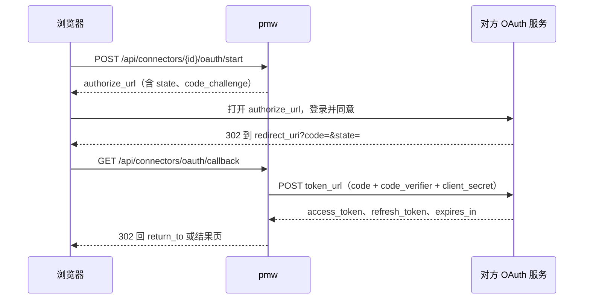

# REST API 契约 v1

所有接口前缀 `/api`。请求与响应均为 JSON（UTF-8）。此文件是前后端唯一契约，改动需同时改 `internal/domain/domain.go` 与 `web/src/lib/types.ts`。

> **给 `domain.ObjectFilter` 加字段时必须同步更新下面的 query 参数表。**
> API 层是照这张表实现解析的——表里没有的参数，即使 domain 和 store 都实现了，
> HTTP 层也会静默丢弃，端到端表现为「参数没生效」，而且不报错。
> `due_after` 就是这么漏掉的：domain 有字段、sqlite 有实现、store 有测试，唯独表里没写。

## 响应信封

成功：
```json
{ "data": <payload>, "meta": { "total": 86, "limit": 50, "offset": 0 } }
```
`meta` 仅列表接口返回。

失败（HTTP 4xx/5xx）：
```json
{ "error": { "code": "not_found", "message": "object not found" } }
```
错误码：`validation` 400 · `not_found` 404 · `conflict` 409 · `readonly` 403 · `internal` 500。

## 通用

| 方法 | 路径 | 说明 |
|---|---|---|
| GET | `/api/health` | `{"data":{"ok":true,"version":"..."}}` |
| GET | `/api/stats` | 状态栏：db 路径、体积、对象数、最后写入时间 |
| GET | `/api/counts` | 侧栏徽标，返回 `Counts` |
| GET | `/api/today?type={typeID}` | 今日页聚合，返回 `Today`，见下方「今日聚合」 |

### 今日聚合

`GET /api/today` 一次请求返回今日页的卡片列表 `{"cards": TodayCard[]}`，按 `order` 排好。
`type` 的语义和 `/api/counts` 相同：不传是全局，传了收窄到该类型；前端比对徽标时两边传同一个 `type`。

`TodayCard`：`{key, title, order, total, items}`。`total` 是全量条数，`items` 最多 50 条（`domain.TodayCardLimit`）；没有内容时 `items` 是 `[]`，卡片照常返回。

| `key` | 标题 | `order` | `items` | 口径 |
|---|---|---|---|---|
| `review` | 等确认 | 10 | `Object[]`，最近更新的在前 | 待办类型（`task`）状态为 `review`（0013）且未归档、未删除。`type` 传了别的类型时为空 |
| `overdue` | 逾期 | 20 | `Object[]`，截止早的在前 | 与 `counts.overdue` 同一份条件，`total` 恒等于 `counts.overdue` |
| `due_today` | 今天到期 | 30 | `Object[]`，按截止时间 | 与 `counts.today` 同一份条件，`total` 恒等于 `counts.today` |
| `running` | 运行中 | 40 | `TodayRun[]`，最近开始的在前 | `task_runs` 里 `finished_at` 为空的执行（`pending` / `running`）。`type` 按所属对象的类型收窄 |

`TodayRun`：`{id, object_id, object_ref, object_title, object_type, workdir, status, started_at}`，不带 `output`，
看过程走 `GET /api/runs/{id}`。所属对象在回收站里也照样列出：进程还在跑。

逾期、今天到期和 `/api/counts` 在 store 里共用同一段条件（`focusConds`），今天、逾期都按服务端本地日期切，
改口径只改那一处，两边一起变。

等回答的 Agent 问题暂不返回：Agent 会话目前没有「等用户回答」这个状态（`agent_sessions` 无状态列，
消息也没有提问标记），要等会话加上这个状态再补一张卡片。
插件卡片（TODAY-01b）：已启用并在跑的插件按 `provides.today_cards` 登记的卡片，在不传 `type` 时合进来，和内核卡片一起按 `order` 排（插件没写 order 时为 100）。`key` 以 `<插件id>_` 开头，不和上面四个撞。`items` 的形状由插件定。单张卡片加载超过 800ms、出错或没有内容时不返回这张卡。插件停用后卡片消失。

## 工作对象类型 object-types

| 方法 | 路径 | body / query |
|---|---|---|
| GET | `/api/object-types` | 返回 `ObjectType[]`，按 sort_order |
| POST | `/api/object-types` | `{id,name,plural,ref_prefix,icon,color,sort_order,statuses}`，id 为小写英文短名 |
| PATCH | `/api/object-types/{id}` | `ObjectTypePatch`，builtin 类型仅允许改 icon/color/sort_order/statuses |

状态 `{key,label,color,terminal,description?}`：`description` 是给人看的说明（PR-13，设置的枚举值页里改），可省，空时不返回；0041 给任务的待验收、受阻、已完成、已取消补了说明。

内置类型 `task` 的 `name`、`plural` 是「任务」（0042 从「待办」「待办事项」改过来，PR-20），key 和前缀 `TSK` 不变；MCP 的 `pmw_list_types` 读的是同一份。
| DELETE | `/api/object-types/{id}` | builtin 返回 403；下挂对象非空返回 409 |

## 分类 categories

| 方法 | 路径 | 说明 |
|---|---|---|
| GET | `/api/categories?type={typeID}&tree=true&counts=true` | `tree=true` 返回嵌套 `children`，否则扁平；`counts=true` 填充 `count`/`total_count` |
| POST | `/api/categories` | `{type_id,parent_id?,name,slug?,color?,description?,sort_order?}`，slug 省略时由 name 生成 |
| PATCH | `/api/categories/{id}` | `CategoryPatch` |
| POST | `/api/categories/{id}/move` | `{parent_id: string\|null, sort_order: number}`，禁止移到自己的子孙下（409） |
| DELETE | `/api/categories/{id}?reassign_to={catID}` | 不传 reassign_to 则下挂对象置为未分类 |

## 工作对象 objects

`GET /api/objects` query 参数：

| 参数 | 示例 | 说明 |
|---|---|---|
| `type` | `requirement,task` | 逗号分隔多选 |
| `category` | `cat_req_prod` | 分类 ID |
| `subtree` | `true` | 含子分类 |
| `uncategorized` | `true` | 只看未分类的对象，与 `category` 互斥（同时给时以本参数为准） |
| `status` | `doing,blocked` | 逗号分隔 |
| `priority` | `P0,P1` | 逗号分隔 |
| `tag` | `云端平台` | 可重复传多个，AND 语义 |
| `owner` / `project` | | 精确匹配 |
| `q` | `多租户` | 标题+正文模糊匹配 |
| `source` | `webhook,im` | 按 `objects.source` 精确匹配，逗号分隔多选。任务来源取值见下方「任务来源」 |
| `due_after` | `2026-09-15` | 到期日下界。RFC3339 或 YYYY-MM-DD，纯日期补 **00:00:00** |
| `due_before` | `2026-09-15` | 到期日上界。RFC3339 或 YYYY-MM-DD，纯日期补 **23:59:59** |
| `stalled` | `true` | N 天未更新且未进终态（口径与 `counts.stalled` 一致） |
| `not_terminal` | `true` | 排除处于终态的对象 |
| `overdue` / `inbox` / `archived` / `deleted` | `true` | 布尔开关 |
| `sort` | `-updated_at` | `-` 前缀为倒序，支持 updated_at/created_at/due_at/priority/title |
| `limit` / `offset` | `50` / `0` | 默认 50，最大 200 |

**两端补时的语义**：`due_after` 与 `due_before` 传同一个纯日期时，正好圈出「当天到期」。
两端都补成当天末尾的话，`due_after=2026-09-15` 会把当天上午到期的全滤掉，窗口直接空掉。

**「今日」「本周」「停滞」的口径必须与 `/api/counts` 对应的计数器逐字一致**：

| 聚焦 | 查询参数 | 对应计数器 |
|---|---|---|
| 今日 | `due_after=今天00:00` + `due_before=今天23:59:59` + `not_terminal=true` | `counts.today` |
| 本周 | `due_after=今天00:00` + `due_before=+7天23:59:59` + `not_terminal=true` | `counts.week` |
| 逾期 | `overdue=true` | `counts.overdue` |
| 停滞 | `stalled=true` | `counts.stalled` |

这几个徽标就贴在列表旁边，口径一旦分叉就会出现「徽标 2 / 列表 20 行」，而这类错误
**不会崩溃、只会让人用错的数字做判断**，很难被发现。改动任何一侧都要同步另一侧。
`/api/today` 的逾期、今天到期卡片直接复用 counts 的条件，不走这张表的参数，但三者必须对得上（`TestTodayMatchesCounts` 盯着）。

| 方法 | 路径 | 说明 |
|---|---|---|
| GET | `/api/objects` | 返回 `Object[]` + `meta.total` |
| POST | `/api/objects` | `{type_id,title,...}`，ref 由后端按类型前缀自增生成 |
| GET | `/api/objects/{id}` | 单个对象（含 tags/category_name/link_count） |
| PATCH | `/api/objects/{id}` | `ObjectPatch`，未出现的字段不改；`category_id: null` 表示置空 |
| DELETE | `/api/objects/{id}?hard=true` | 默认软删除 |
| POST | `/api/objects/{id}/restore` | 从回收站恢复 |
| GET | `/api/objects/{id}/links` | `LinkView[]`，含 in/out 两个方向 |
| POST | `/api/objects/{id}/links` | `{to_id,relation,note?}` |
| GET | `/api/objects/{id}/revisions?limit=50` | `Revision[]` |
| GET | `/api/objects/{id}/progress?limit=100` | `Progress[]`，**最近** N 条，最近的在前；limit 省略取 100，上限 500。对象不存在 404 |
| POST | `/api/objects/{id}/progress` | `ProgressInput`，**服务端追加**；`status` 非空时状态切换与这条进展同一事务落库。201 |
| POST | `/api/objects/{id}/claim` | `ClaimInput`，领取任务。领到 201；同一会话重复领 200（`already=true`，什么都不写）；被占用 409 |

### props 约定（开发任务）

开发任务在 `props` 里约定这几个 key（常量见 `domain.PropAcceptance` / `domain.PropRepo` / `domain.PropSourceRef`）：

| key | 类型 | 说明 |
|---|---|---|
| `acceptance` | string，Markdown | 验收标准，建议写成 `- [ ] …` 清单 |
| `repo` | string | 关联仓库：远端地址或本机绝对路径，只放一个。多个仓库的任务拆成每个仓库一条子任务 |
| `source_ref` | object | 来源详情，见下方「任务来源」 |

工作目录用 `workdir` 列（0008），不在 props 里重复。`PATCH` 的 `props` 是整体替换，
只改其中一个 key 时要先读回再拼（MCP 的 `pmw_update_object` 已经这么做）。

### 任务来源

来源种类写在 `source` 列（0001 就有，`POST` / `PATCH` 都可写），来源详情写在 `props.source_ref`。
取值与原型 `TaskSource.kind` 对应（常量见 `domain.TaskSource*` / `domain.PropSourceRef`）：

| `source` | 含义 | `props.source_ref` |
|---|---|---|
| `manual` | 手动新建 | 不填 |
| `im` | IM 消息转的 | `{message_id, channel?}` |
| `webhook` | Webhook 投递建的 | `{hook_id, delivery_id}` |
| `schedule` | 定时任务建的 | `{schedule_id, name}`，`name` 是建任务时定时任务的名字（定时任务删了也能显示） |
| `incident` | 异常转的 | `{incident_id}` |

`inbox` 不是任务来源：它是收件箱口径（`inbox=true`、`counts.inbox`）在用的值，新来源不要用它。
存量数据里还有 `''` 和 `import`（导入脚本写的），写入时不校验取值，`source=` 筛选按原值匹配。

### id 前缀

实体 id 形如 `<前缀>_<16 位时间有序串>`，一律由后端生成（`idgen.Prefixed`），前端不生成实体 id。前缀登记在 `internal/idgen/prefixes.go`，一类实体一个，不许共用；新表要用新前缀先登记，重复登记或漏登记时测试失败。对象的 `ref`（REQ-0001 这类）另由后端按类型前缀自增。

| 前缀 | 实体 | 表 |
|---|---|---|
| obj | 对象（需求、任务、项目、文档、资源、笔记） | objects |
| cat | 分类 | categories |
| tag | 标签 | tags |
| lnk | 关联 | links |
| rev | 修订和进展 | revisions |
| stk | 干系人 | stakeholders |
| dit | 字典项 | dict_items |
| sgr | 快捷入口分组 | shortcut_groups |
| sct | 快捷入口 | shortcuts |
| apv | 模型供应商 | agent_providers |
| ags | Agent 会话 | agent_sessions |
| agm | Agent 消息 | agent_messages |
| q | ask_user 问题（存在消息里） | - |
| art | 产物 | artifacts |
| run | 任务执行记录 | task_runs |
| sec | 密钥 | vault_secrets |
| aud | 审计 | audits |
| ntf | 通知 | notifications |
| sch | 定时任务 | schedules |
| srn | 定时任务执行记录 | schedule_runs |
| wh | Webhook | webhooks |
| dl | Webhook 投递记录 | webhook_deliveries |
| ws | 工作台 | workspaces |
| dir | 挂载的本机目录 | local_dirs |
| idn | IM 身份 | contact_identities |
| cv | IM 会话 | conversations |
| cn | 连接器 | connectors |
| msg | IM 消息（IM 插件） | im_messages |
| ag | Agent 配置 | agents |
| sop | SOP 流程（SOP 插件） | sop_flows |
| spr | SOP 运行（SOP 插件；`sop_run_steps` 跟着运行 id，不另发前缀） | sop_runs |
| sk | 自定义技能（内置和插件技能的 id 也是 `sk_` 开头，不入库） | skills |
| kb | 知识库 | knowledge_bases |
| kd | 知识库来源（切块 `kb_chunks` 用整数 id） | kb_docs |
| atc | 要人确认的 Agent 工具调用 | agent_tool_calls |
| ar | Agent 执行记录 | agent_runs |
| dbg | 调试对话里要人确认的调用（只在进程内存里） | - |
| dm | 内网域名路由（内网域名插件） | domains_routes |
| vd | 视频（视频插件） | video_videos |
| sr | 系列（视频插件） | video_series |
| pb | 发布记录（视频插件；检查点按视频加阶段认，没有 id） | video_publishes |
| vaf | 视频产出物（视频插件；验收记录用整数 id） | video_artifacts |
| pa | 平台账号（视频插件；数据快照没有 id） | video_accounts |
| vct | 封面 A/B 测试（视频插件；分组没有 id） | video_cover_tests |
| bt | 浏览器标签页（浏览器插件） | browser_tabs |
| deal | 商单（视频插件） | video_deals |
| pn | 终端会话（终端插件，128 位随机串，不走 `idgen.Prefixed`，不入库） | - |

原型 `ids.ts` 和后端不一致的前缀：后端已经上线的不改，原型的前缀保留，不分给别的实体。

| 原型 | 后端 | 原因 |
|---|---|---|
| tk（task）、pj（project）、dc（doc） | obj | 都是 objects 里的类型 |
| ss（session） | ags | 已上线 |
| pv（provider） | apv | 已上线 |
| af（artifact） | art | 已上线 |
| sc（schedule） | sch | 已上线 |

原型里其余前缀（ct att rp mt pd pt ch sop inc ag ar op kb kd sk dm vd sr pb tp cl wl al ae st rl bk ac ps od rn bt tb pn）的实体后端还没建表，前缀已按原型登记占用。

## 进展与领取

开发任务闭环（领取 → 记进展 → 提交验收）的两个接口。没有为它建表：进展和会话标识落在 `revisions`，
验收标准和关联仓库落在 `objects.props`，代码类产物落在 `artifacts`（见「输出产物」）。
任务类型的「待验收」状态（`review`，非终态）由 0013 加上。

**为什么是服务端追加。** 进展如果写在正文里，调用方只能「读出正文、拼一段、整体 PATCH 回去」，
两个会话同时写，后写的会把先写的那段覆盖掉，而且不报错。`POST /progress` 只插入不更新，
并发追加互不影响（`internal/store/sqlite/progress_test.go` 有两个会话各追加 40 条、一条不丢的测试）。

**存储。** 一条进展 = `revisions` 里一行 `field='progress'`：`new_value` 是正文（Markdown），
`old_value` 是元数据 JSON（`{"kind":"note","commits":[...],"files":[...],"status":"..."}`）。
这类行的 `old_value` 不是「旧值」，是复用 revisions 的代价。所以：

- `GET /api/objects/{id}/revisions` 和 `GET /api/revisions` 里会出现 `field="progress"` 的行，
  渲染时不要按「从 old 改成 new」显示，显示 `new_value` 即可（旧前端 DetailDrawer 目前会显示成 JSON）。
- 读进展一律走 `GET /progress`，它已经把元数据拆成字段。

`ProgressInput`：

```json
{ "kind": "note", "text": "定位到原因：……", "commits": ["a1b2c3d"], "files": ["internal/x.go"], "status": "" }
```

| 字段 | 说明 |
|---|---|
| `kind` | `note`（默认）或 `review`。`claim` **只能**经由 `/claim` 写，这里传会 400——否则「谁领了这条任务」可以绕过占用检查伪造 |
| `text` | 必填，去首尾空白后不能为空，合法 UTF-8，上限 32KB |
| `commits` / `files` | 可选，去空白、去重、保序，各自最多 100 条 |
| `status` | 可选。非空时必须属于该对象类型的状态集，和进展同一事务切换（并维护 `started_at` / `completed_at`，规则同 PATCH） |

`Progress`（响应）：

```json
{
  "id": "rev_…", "object_id": "obj_…", "kind": "review",
  "text": "……", "commits": ["a1b2c3d"], "files": ["calc.py"], "status": "review",
  "actor": "claude-code#332d2cac-…", "actor_name": "claude-code", "session_id": "332d2cac-…",
  "source": "agent", "created_at": "2026-10-28T10:00:00Z"
}
```

`ClaimInput`：

```json
{ "owner_id": "stk_…", "status": "", "text": "", "takeover": false }
```

| 字段 | 说明 |
|---|---|
| `owner_id` | 必填，领取者在干系人名册里的 id |
| `status` | 领取后切到的状态 key。空串取该类型的 `doing`；类型里没有 `doing` 时 400，必须显式传。不能是终态 |
| `text` | 领取时记的一句话，空串默认「领取了任务」 |
| `takeover` | 接手被别人或别的会话占着的任务。默认 false |

领取在**一个写事务**里完成「检查占用 → 切状态 → 改负责人 → 记一条 `kind=claim` 的进展」。
检查和写入必须同事务，否则两个会话会同时看到「没人领」然后都写进去
（`TestClaimObjectConcurrentOnlyOneWins`：8 个会话并发领同一条，恰好 1 个成功）。

409 的情况（`takeover=true` 时放行，归档除外）：

| 情况 | 说明 |
|---|---|
| 负责人已是别人 | message 带上负责人姓名 |
| 另一个会话领了且仍在进行中 | 「仍在进行中」= 对象状态仍是那次领取切到的状态，且负责人仍是领取者。任务被退回初始状态、或提交到别的状态（如 `review`）之后，别的会话可以再领 |
| 对象处于终态 | |
| 对象已归档 | 不受 takeover 影响 |

响应 `ClaimResult`：`{ "object": Object, "progress": Progress | null, "already": bool }`。

## 标签 tags

| 方法 | 路径 | body / 说明 |
|---|---|---|
| GET | `/api/tags` | `Tag[]`，含每个标签的引用数 |
| POST | `/api/tags` | `{name, color?}` |
| PATCH | `/api/tags/{id}` | `{name?, color?}` |
| DELETE | `/api/tags/{id}` | 同时解除所有对象上的引用 |
| POST | `/api/tags/{id}/merge` | `{target_id}`，把本标签的引用并到 target 上再删除自己 |

## 关联 / 历史

| 方法 | 路径 | 说明 |
|---|---|---|
| DELETE | `/api/links/{id}` | |
| GET | `/api/revisions?limit=100` | 全局最近变更，日报数据源 |

## 快捷访问 shortcuts

| 方法 | 路径 | body / 说明 |
|---|---|---|
| GET | `/api/shortcuts?grouped=true` | `grouped=true` 时按分组嵌套返回，否则扁平 |
| POST | `/api/shortcuts` | `{group_id?,label,target_kind,url,nav,command,icon,color,description,open_in,pinned,sort_order}`；`target_kind` 决定 `url`/`nav`/`command` 里哪个生效 |
| PATCH | `/api/shortcuts/{id}` | 同上字段的可选版本 |
| DELETE | `/api/shortcuts/{id}` | 真删除，不进回收站 |
| POST | `/api/shortcuts/{id}/visit` | 记一次访问，用于最近使用排序 |
| POST | `/api/shortcuts/reorder` | `{group_id?, ids: string[]}`，ids 是该组内的完整新顺序 |
| GET | `/api/shortcut-groups` | `ShortcutGroup[]` |
| POST | `/api/shortcut-groups` | `{name, color?, collapsed?, sort_order?}` |
| PATCH | `/api/shortcut-groups/{id}` | |
| DELETE | `/api/shortcut-groups/{id}` | 组内快捷项落回未分组，不跟着删 |

## 枚举字典 dictionaries

设置页里所有可配置枚举走这一套。`key` 一经创建不可改——历史数据引用的是它。

| 方法 | 路径 | body / 说明 |
|---|---|---|
| GET | `/api/dictionaries?with_items=true` | `with_items=true` 时连同每本字典的条目一起返回 |
| GET | `/api/dictionaries/{id}/items` | `DictItem[]` |
| POST | `/api/dictionaries/{id}/items` | `{type_id?,key,label,color?,description?,sort_order?,meta?}`；`type_id` 用于按工作对象类型分套的字典（如状态） |
| PATCH | `/api/dict-items/{id}` | 可改 label/color/description/sort_order/meta，**不含 key** |
| POST | `/api/dict-items/{id}/archive` | `{archived: bool}`。归档而非删除：已经引用它的历史数据仍要显示得出来 |
| DELETE | `/api/dict-items/{id}` | 仅在无引用时允许，有引用返回 409 |
| GET | `/api/dict-items/{id}/usage` | 引用计数，删除前的确认依据 |
| POST | `/api/dictionaries/{id}/items/reorder` | `{type_id?, ids: string[]}` |

内置字典和 `usage` 的统计口径（没登记的字典 `usage` 恒为 0）：

| 字典 | 来源 | 落在 | `usage` |
|---|---|---|---|
| `priority` | 0005 | `objects.priority` | 没删的对象数 |
| `link_relation` | 0005 | `links.relation` | 关联数 |
| `artifact_platform` | 0012 | `artifacts.platform` | 产物数 |
| `artifact_kind` | 0031 | `artifacts.kind` | 产物数 |
| `contact_group` | 0041 | `stakeholders.contact_group` | 联系人数（含已归档）。分组按「、」（也认逗号、斜杠、分号）拆开各算一次，没填的算 `其他`；key 就是显示名，内置客户、合作伙伴、同事、供应商、其他（默认） |
| `msg_status` | 0041 | im 插件的 `im_messages.status` | 消息数；im 插件没装（表不存在）时为 0。`pending`（默认）、`done`、`ignored` 由表的约束定死 |

任务状态（对象类型的 `statuses`）和文档分类（`/api/categories`）不进字典表，设置的枚举值页直接读写它们各自的接口。

## 干系人名册 stakeholders

负责人与参与人都指向这里。0010 之前 `objects.owner` 是自由文本，库里出现过
「宋一杰、李钊、振华」三个人挤在一个字段的值——没法筛选、没法统计、改名要全表替换。

一个对象**一个负责人 + 若干参与人**：一件事必须有唯一一个人对结果负责，
否则「这事该找谁」没有答案；参与人表达「还有谁在这件事里」，信息不丢但不承担「找谁」的语义。

| 方法 | 路径 | body / 说明 |
|---|---|---|
| GET | `/api/stakeholders?archived=true` | 默认只回在岗的；`archived=true` 才带上已归档的（名册管理页用）。每条带 `owned_count` / `participating_count` |
| POST | `/api/stakeholders` | `{name,role?,email?,note?,color?,sort_order?,group?,company?,title?,phone?,tags?,photo?,starred?,last_contact_at?}`，`name` 必填且**全局唯一**，撞名回 409 |
| PATCH | `/api/stakeholders/{id}` | `StakeholderPatch`：上面除 `name` 必填外的同一组字段，只改传了的；另含 `archived`（归档/复岗）；`last_contact_at: null` 清空 |
| DELETE | `/api/stakeholders/{id}` | 仅在零引用时允许；有引用返回 409，改走归档 |

**联系人字段（0026，CT-01a）。** 联系人沿用这张名册，不另建表；字段对照原型 `web-next/src/data.ts` 的 `Contact`：

| 字段 | 类型 | 说明 |
|---|---|---|
| `group` | string | 分组显示名（客户、合作伙伴、同事、供应商、其他，可在设置里新增），不约束取值，去首尾空白；库里列名 `contact_group`。一人可在多个分组，多个用「、」连接存成一个字符串（如 `Octok、XAUE`），后端不拆，前端按「、」拆开（也认逗号、斜杠、分号）后按包含匹配筛选（PR-04） |
| `company` / `title` / `phone` | string | 公司、职位、电话，默认空串。`title` 是职位，和原有的 `role`（产品、研发这类角色）是两个字段 |
| `tags` | string[] | 去首尾空白、去空、去重后保存，默认 `[]` |
| `photo` | string | `data:image/` 开头的 data URL，1.4MB 以内（和工作台图标同一上限）；空串表示按名字生成头像 |
| `starred` | bool | 星标，默认 `false` |
| `last_contact_at` | RFC3339 \| null | 最近联系时间，`null` 表示没联系过 |

原型的 `im`（各渠道账号）不在这里，由 CT-01b 的 IM 身份表承接。`email`、`note`、`created_at` 沿用原有字段。

**name 全局唯一，联系人重名时名字要加区分**（如「王磊（北岸）」）。新建或改名撞上已有的人回 409 `conflict`，
message 形如 `stakeholder 王磊 already exists; add a qualifier to tell them apart, e.g. 王磊（公司）`。
是否放宽唯一约束记在 `docs/dev-decisions.md`「待用户决定」，放宽要用新迁移改索引。

**两个计数口径是不同的，不要合并：**

- `owned_count` / `participating_count` 是「他手上有多少事」，**排除回收站**里的软删对象。
- `DELETE` 的引用检查**算上**软删对象。`owner_id` 是 `ON DELETE SET NULL`——人删掉之后，
  那条对象从回收站恢复回来负责人就没了，**而这个丢失不报错**。

**MCP（`cmd/pmw-mcp`）这一层收的是人名，不是 id**，内部再换成 `owner_id`。调用方是模型，
它手上有「李钊」没有 `stk_xxx`，强行要 id 只会逼出「先查一次再调一次」，而中间那步经常被省掉。

这里有一个必须守住的点，任何「名字解析失败就回退成空串」的实现都会踩：
**`owner_id` 传空串的语义是「清空负责人」。**把一个打错的名字变成空串，
结果是把别人的负责人抹掉，而调用方以为改成功了。名字查不到必须**报错**，
错误里列出现有名字（`pmw_list_stakeholders` 也能查）。

`objects.owner` 这一列**保留但只读**：迁移是单向的，留着原文本是兜底；
`owner_id` 为空而 `owner` 非空时，界面回退显示这段文本。新写入一律只写 `owner_id`。

工作对象上的相关字段：`GET` 回 `owner_id` / `owner_name` / `participants[]`；
`PATCH` 收 `owner_id`（空串 = 清空）与 `participant_ids`（**全量替换**：省略 = 不改，`[]` = 清空）。
列表 query 用 `owner_id` 筛负责人——原来的 `owner` 文本匹配已移除，一个语义只留一个定义。

## IM 身份 im-identities

联系人在各 IM 渠道的身份（CT-01b，0027，表 `contact_identities`，id 前缀 `idn`）。原型把它挂在
`Contact.im`（渠道 key → 编号）上，收消息时按 `channel + sender_id` 扫全部联系人认人；后端拆成独立的表，
**一个联系人多个身份，同一渠道同一编号只能属于一个联系人**，收消息按身份认人，不按名字。

| 方法 | 路径 | body / 说明 |
|---|---|---|
| GET | `/api/im-identities?stakeholder_id=&channel=` | `Identity[]`，两个条件都可省；按联系人、渠道、编号排序。前端建「渠道:编号 → 联系人」索引时一次拉全 |
| GET | `/api/im-identities/resolve?channel=&external_id=` | 按渠道和编号认人，回 `{identity, stakeholder}`；编号先按下面的规则规整再查。查不到回 404，已归档的联系人照样回（`stakeholder.archived_at` 非空） |
| GET | `/api/im-identities/{id}` | `Identity` |
| POST | `/api/im-identities` | `{stakeholder_id, channel, external_id, display_name?, account?}`，回 201。同一渠道同一编号已存在回 409：挂在别人身上时 message 写明是谁，挂在本人身上时说已存在 |
| PATCH | `/api/im-identities/{id}` | 同一组字段，只改传了的；改 `stakeholder_id` 就是把身份改挂到另一个联系人（认错人时用），撞上已有身份同样回 409 |
| DELETE | `/api/im-identities/{id}` | 只删身份，不动联系人 |

`Identity`：

| 字段 | 类型 | 说明 |
|---|---|---|
| `id` | string | `idn_` 开头 |
| `stakeholder_id` | string | 干系人名册里的联系人，必须存在，否则 400 |
| `channel` | string | 渠道 key：`wechat`、`lark`、`slack`、`telegram`、`qq`（原型 `IM_CHANNELS`），可扩展；去空白转小写，只收小写字母开头的 `[a-z0-9_-]`，32 字以内 |
| `external_id` | string | 渠道里的编号（微信号、飞书用户 ID 或邮箱、Slack Member ID、Telegram 用户名、QQ 号），去首尾空白，`telegram` 去掉开头的 `@`；其余渠道保留大小写。200 字以内 |
| `display_name` | string | 在该渠道看到的名字（昵称），可空，100 字以内 |
| `account` | string | 在哪个自己的账号下认识的（同一渠道登了多个号时区分），可空，100 字以内 |
| `created_at` / `updated_at` | RFC3339 | |

**联系人删除时身份跟着删**（外键 `ON DELETE CASCADE`）：身份是联系人自己的属性，和电话、邮箱一样，
不是别处对他的引用，不该挡住删除；干系人删除本来就只在零对象引用时放行，有引用的走归档，归档不动身份。

审计照 CORE-08：删除一律记（`kind=delete`，`target_type=im_identity`）；新建、修改只在 Agent 来源时记（`kind=agent`），
和干系人一致；detail 只记 `stakeholder_id`、渠道和改了哪些字段，不记编号的新旧值。

## 会话 conversations

IM 里的群聊和私聊（CT-02，0028，表 `conversations`、`conversation_members`，id 前缀 `cv`）。原型的
`Message.conversation`、`ProjectChat` 按「渠道 + 群名」认群，改群名后项目绑定和消息归属就断了；后端给每个会话一个
**稳定 id**，项目绑定（PJ-02）、消息（IM 插件）都指向 id。**改名只改 `name`，id 和渠道里的编号不变**。
同一渠道同一编号只有一个会话；同名不同编号是两个会话。

一级路径 `/api/conversations` 是 IM 会话，和 Agent 对话（`/api/agent/sessions`）无关；前端模块 key `conversations`
目前是 Agent 会话页，两者只是同名。`conversations` 已加进插件保留 id（plugin-api.md 1.4）。

| 方法 | 路径 | body / 说明 |
|---|---|---|
| GET | `/api/conversations?channel=&kind=&identity_id=&stakeholder_id=` | `Conversation[]`，条件都可省；`identity_id` 查这个身份在的会话，`stakeholder_id` 查这个联系人任一身份在的会话。按渠道、名字、编号排序 |
| GET | `/api/conversations/resolve?channel=&external_id=` | 按渠道和编号找会话，回 `Conversation`；编号的规整规则同 IM 身份。查不到回 404，收消息时据此决定新建 |
| GET | `/api/conversations/{id}` | `Conversation` |
| POST | `/api/conversations` | `{channel, external_id, kind, name?, members?}`，回 201。同一渠道同一编号已存在回 409 |
| PATCH | `/api/conversations/{id}` | `{external_id?, name?, members?}`，只改传了的；`members` 整体替换，留下的成员保留原来的加入顺序。传 `channel`、`kind` 回 400：换了就是另一个会话。改编号（Telegram 群升级成超级群会换 chat id）id 不变，撞上已有会话回 409 |
| DELETE | `/api/conversations/{id}` | 删会话和它的成员关系，不动身份和联系人 |
| POST | `/api/conversations/{id}/members` | `{identity_id}` 加一个成员，回 `Conversation`；已在里面照样回 200（收消息见到新发言人就调，可重复） |
| DELETE | `/api/conversations/{id}/members/{identity_id}` | 移出一个成员，回 `Conversation`；不在里面回 404 |

`Conversation`：

| 字段 | 类型 | 说明 |
|---|---|---|
| `id` | string | `cv_` 开头 |
| `channel` | string | 渠道 key，和 IM 身份同一套规则（去空白转小写，小写字母开头的 `[a-z0-9_-]`，32 字以内），建好后不能改 |
| `external_id` | string | 渠道里的会话编号（Slack channel id、飞书 chat_id、Telegram chat id 或 `@群用户名`……），去首尾空白，`telegram` 去掉开头的 `@`，其余保留大小写，200 字以内 |
| `kind` | string | `group`（群聊、频道）或 `direct`（私聊），建好后不能改 |
| `name` | string | 群名或频道名，100 字以内；`group` 必填，`direct` 可空 |
| `members` | string[] | 成员的 IM 身份 id（`idn_`），按加入先后排；必须是已有身份且和会话同一渠道，否则 400；重复的自动去掉。`direct` 最多 2 个（对方，加上自己账号的身份），全部最多 500 个 |
| `created_at` / `updated_at` | RFC3339 | 改名、改编号、增减成员都会刷新 `updated_at` |

成员存在单独的表里，不存 JSON：要按身份反查所在会话；**身份删除时成员关系跟着删**（联系人删除时身份级联删，成员关系也一起删），
会话本身不动。以后项目绑定、消息这类按 id 引用会话的表，删除会话时怎么处理由那张表自己定（迁移里写明）。

审计照 CORE-08：删除一律记（`kind=delete`，`target_type=conversation`）；新建、修改、`add_member`、`remove_member` 只在 Agent 来源时记
（`kind=agent`），和 IM 身份一致。重复加同一成员不算修改，不记。detail 只记渠道、类型、成员数、改了哪些字段和增减的身份 id，不记名字和编号的新旧值。

## Agent 供应商 agent-providers

| 方法 | 路径 | body / 说明 |
|---|---|---|
| GET | `/api/agent-providers` | `AgentProvider[]`。**`api_key` 永远不出现在响应里**，只回一个是否已配置的标记 |
| POST | `/api/agent-providers` | `{name,kind,base_url,model,enabled?,api_key,extra?}`；`kind` 为 `openai`/`anthropic`/`gemini`/`ollama` |
| PATCH | `/api/agent-providers/{id}` | `api_key` 省略表示不改，传空串表示清空 |
| DELETE | `/api/agent-providers/{id}` | |
| POST | `/api/agent-providers/{id}/default` | 设为默认供应商，同时取消原默认 |
| POST | `/api/agent-providers/{id}/test` | 连通性探测，顺带拉回可用模型列表：`{ok,latency_ms,message,models?}`。探测失败也是 200 + `ok=false`，`message` 只有归类后的说法，不回显上游原文 |

- `api_key` 存在凭证保险箱里（`agent_providers.api_key_secret_id` 指向条目，条目名 `模型服务商 <id>`），库里的 `api_key` 列只剩空串；0015 之前存的明文在服务启动时加密搬进保险箱后清空。
- `api_key_masked` 用保险箱的 `hint` 规则（见「凭证保险箱」一节）。换密钥会换一个新条目、删掉旧条目；删服务商连带删条目。
- 条目在 `/api/secrets` 被单独删掉时，该服务商按「未配置 API Key」处理（`has_api_key=false`）。

**`kind` 是协议，不是厂商。**四种协议各自的端点、鉴权和 `/test` 拉模型列表的方式：

| kind | 默认 base_url | 对话端点 | 鉴权 | `/test` 探测 |
|---|---|---|---|---|
| `openai` | `https://api.openai.com/v1` | `POST {base}/chat/completions`（SSE） | `Authorization: Bearer` | `GET {base}/models`，取 `data[].id` |
| `anthropic` | `https://api.anthropic.com` | `POST {base}/v1/messages`（SSE，Messages API） | `x-api-key` + `anthropic-version: 2023-06-01` | `GET {base}/v1/models?limit=1000`，取 `data[].id` |
| `gemini` | `https://generativelanguage.googleapis.com/v1beta` | `POST {base}/models/{model}:streamGenerateContent?alt=sse` | query 上的 `key` | `GET {base}/models`，取 `models[].name` 去掉 `models/` 前缀 |
| `ollama` | `http://localhost:11434` | `POST {base}/api/chat`（NDJSON） | 无，不要求 `api_key` | `GET {base}/api/tags`，取 `models[].name`（本机已拉取的模型） |

- `anthropic` 的 `base_url` 写成带 `/v1` 的形式也认，不会拼成 `/v1/v1`。
- **兼容 OpenAI 的厂商用 `kind=openai` 加 `extra.preset` 表示**，不单独占一个 kind。`preset` 的取值和原型
  `web-next/src/modeldata.ts` 的 `ProviderKind` 同名；后端目前只认 `deepseek`：没填 `base_url` 时补
  `https://api.deepseek.com`（建、或改 kind 时都按这条补）。不认识的 `preset` 只当标签存着，`base_url` 回落到 kind 的默认值。
- 原型 `ProviderKind` 到后端的对应：`anthropic` → `kind=anthropic`；`openai` → `kind=openai`；`deepseek` → `kind=openai` + `extra.preset=deepseek`；
  `gemini` → `kind=gemini`；`ollama` → `kind=ollama`。原型里其余 kind（azure、bedrock、moonshot 等）后端尚未接入；
  其中兼容 OpenAI 的（moonshot、qwen、siliconflow、vllm、lmstudio、custom 等）可以先按 `kind=openai` + 自填 `base_url` 接。
- `/test` 只返回模型 id 列表，不含原型 `CatalogModel` 的上下文长度、能力和价格；那些仍由前端的目录补齐。

## Agent 对话 agent

| 方法 | 路径 | body / 说明 |
|---|---|---|
| GET | `/api/agent/sessions?object_id=X` / `?unscoped=true` | **必须二选一**：`object_id` 给某个对象的会话（详情抽屉用），`unscoped=true` 给 `object_id IS NULL` 的全局会话（底部对话框用）。两个都不给返回空列表，不是全部；两个都给以 `object_id` 为准（不报 400——这俩是前端两处独立代码各自拼的，真撞上时给一批说得通的数据比让抽屉整个打不开好） |
| POST | `/api/agent/sessions` | `{title?,provider_id,model,workdir?,object_id?,agent_id?}`，`object_id` 省略即全局会话；`agent_id` 见下面「会话挂 Agent」 |
| PATCH | `/api/agent/sessions/{id}` | |
| DELETE | `/api/agent/sessions/{id}` | 消息级联删除；**产物保留**，只把它的 `session_id` 置空（见「输出产物」一节） |
| GET | `/api/agent/sessions/{id}/messages` | `AgentMessage[]`，**按时间正序**（最旧在前） |
| GET | `/api/agent/sessions/{id}/artifacts` | `Artifact[]`，等价于 `/api/artifacts?session_id={id}`；会话不存在报 404（而不是回空列表） |
| POST | `/api/agent/workdir/check` | `{path}`，校验产物目录是否存在且可写 |
| POST | `/api/agent/chat` | `{session_id?,provider_id?,model?,workdir?,object_id?,agent_id?,message}`，**SSE 流式响应**，见下；`agent_id` 只在不带 `session_id`、新建会话时用 |

`/api/agent/chat` 的 SSE 事件在 `delta` / `tool_call` / `tool_result` / `artifact` / `done` / `error`
之外多一种 **`question`**——Agent 遇到拿不准的地方时反问用户，而不是自己猜一个答案继续做：

```json
{"type":"question","id":"q_...","question":"这个需求要不要拆成独立任务？",
 "options":[{"label":"拆成三个任务","detail":"按前端/后端/联调拆"},{"label":"先不拆","detail":"作为一个整体推进"}],
 "multi":false}
```

**会话的归属一经创建不再改写。**`PATCH /api/agent/sessions/{id}` 改不了 `object_id`，
chat 带了不同的 `object_id` 也不会让已有会话搬家——搬走会让它从原来那个列表里消失，
而用户并没有要求移动它。换对象就换一条会话。

`object_id` 是「用户此刻打开的是哪个工作对象」。它不是给模型省一次查询——
没有它，用户说「这个需求怎么推进」时模型只能猜或者反问，而「任务详情里的助手」
这个场景下用户几乎不会报编号。后端把它注入系统提示词（「用户当前打开的是 REQ-0012」），
模型仍然通过 `get_object` 工具去取正文，指代和取数是两件事。

发出 `question` 后**本轮就结束**（后面跟 `done`），流不会挂在那里等。

挂了 Agent 的会话还有一种 **`confirm`**（AG-02a）：模型要调的工具实际档位是「需确认」，不执行，先记一条待确认的调用，
发出这条事件后本轮结束（后面跟 `done`），同 `question`。`id` 是待确认调用的 id，`args` 是参数 JSON 原文，`summary` 是给人看的一句话。
用户点确认、拒绝走 `POST /api/agent/tool-calls/{id}/confirm` / `reject`，见「Agent 工具授权」。

```json
{"type":"confirm","id":"atc_...","name":"create_object","args":"{\"type_id\":\"task\",\"title\":\"开通试点账号\"}","summary":"新建「开通试点账号」"}
```
用户的回答走下一条普通 `POST /api/agent/chat` 消息，没有单独的应答接口——
这样即使前端没渲染成按钮，问题也仍然是一段看得懂的文字，回答仍然是一句普通的话。

`/api/agent/chat` 与 `/api/objects/{id}/run` 都是 SSE，而 `EventSource` 只能发 GET、带不了 body，
前端一律用 `fetch` + `ReadableStream` 自己按空行切块。

### 会话挂 Agent（AG-01b1，0032）

- 会话多两个字段：`agent_id`（挂的 Agent，`null` 是不挂 Agent 的会话，0032 之前的都是）和 `agent_deleted`（挂了 Agent 但 Agent 已删除时为 `true`，其余为 `false`）。`agent_id` 建的时候定下，PATCH 改不了。
- `POST /api/agent/sessions` 带 `agent_id` 时用这个 Agent 的 `provider_id` 和 `model`，请求里的这两项忽略；Agent 不存在 404。停用的 Agent 也能建会话，只是不能发消息。
- `POST /api/agent/chat`：会话挂了 Agent 时按 Agent **当前**的服务商和模型跑（和会话里的快照不同就先写回会话），请求里的 `provider_id`、`model` 不认；Agent 的名称、说明和 `instructions` 拼在系统提示词最后。Agent 停用回 409「Agent 已停用」，删了回 409「Agent 已删除」，都在开流之前、用户消息不落库。不带 `session_id` 但带 `agent_id` 时先查 Agent，再新建会话。
- 删除 Agent 不动会话：消息、产物都在，`agent_id` 原样留着，读出来 `agent_deleted: true`。不带 `agent_id` 的会话行为不变。

## Agent 配置 agents

AG-01b1。表 `agents`（0032），id 前缀 `ag`，字段对齐原型 `web-next/src/agentdata.ts` 的 `Agent`（`SPEC-settings-9` 数据）。工具权限 `abilities` 归 AG-02a，技能、知识库的接口在 AG-01b2、AG-01b3，触发和执行记录在 AG-01b4，这里只存挂载的 id。全量导出暂不含这张表。

| 方法 | 路径 | 说明 |
|---|---|---|
| GET | `/api/agents` | `Agent[]` + `meta.total`，不分页，新建的在前 |
| POST | `/api/agents` | 新建，body 是 `Agent` 去掉 `id` 和时间戳，除 `name`、`provider_id` 外都可省；回 201 + `Agent` |
| GET | `/api/agents/{id}` | 一个 `Agent`；不存在 404 |
| PATCH | `/api/agents/{id}` | 只传要改的字段，`null` 等于没传，不认的键（`id`、`abilities` 等）忽略；回 `Agent` |
| DELETE | `/api/agents/{id}` | 回删掉的那条 `Agent`；影响检查有拦截原因时回 409，message 为「不能删除：<原因>」 |
| GET | `/api/agents/{id}/impact` | 删除前的影响检查，只读，回 `AgentImpact`；不存在 404 |

`Agent`：`{id, name, desc, color, avatar, provider_id, model, instructions, skills, mcps, kbs, triggers, enabled, created_at, updated_at}`，`avatar` 是 `{kind, value}`，`triggers` 是 `{kind, detail, match?}[]`。

- **模型必须带服务商**：新建时 `provider_id` 必填且必须是存在的服务商，不带或不存在回 400；`model` 不给时取服务商的默认模型，服务商也没有默认模型回 400。`model` 不校验是否在模型列表里，服务商停用、模型下架由前端标红，不拦保存（`SPEC-settings-9.27`）；服务商删了 Agent 还在，`provider_id` 留着。PATCH 改 `provider_id` 同样要存在，`model` 不能改成空串。
- `name` 去首尾空白，必填，最多 100 字；`desc` 最多 500 字；`instructions` 最多 20000 字。
- `color` 是 `#rrggbb`，不给时从原型 `AGENT_COLORS` 里随机挑一个。
- `avatar.kind` 为 `text`（`value` 零到两个字，空就用名字第一个字）/ `icon`（`value` 是原型 `AVATAR_ICONS` 之一）/ `image`（`value` 是 `data:image/...;base64,...`，图片解码后 1MB 以内）；不给时 `{kind: "text", value: ""}`。
- `skills`、`mcps`、`kbs` 是 id 数组，去空白、去重，各最多 100 个；不查 id 是否存在（连接器的问题不拦保存，技能、知识库的表还没有）。
- `triggers` 至少一条，`kind` 为 `manual` / `im` / `schedule` / `task`，`detail` 最多 200 字；不给时 `[{kind: "manual", detail: ""}]`。`enabled` 不给时为 `true`。
- `match` 是结构化的触发条件（AG-01b4），见「Agent 执行记录」一节；没有时不出现这个键。
- 校验失败回 400，message 是中文整句（如「名称还没填」「服务商 apv_x 不存在」）。

`AgentImpact`：`{agent_id, blocks, items}`，口径同原型 `agentPlan`（`SPEC-settings-9.29`、`9.30`）。`blocks` 和 `items` 都是 `{key, count, text, effect?}[]`，没有的项不出现，`text` 前端原样显示。

| 放在 | key | 什么时候有 | text 例 |
|---|---|---|---|
| `blocks` | `schedules` | 有定时任务的 `action.kind` 为 `agent` 且 `action.agent_id` 是它 | `定时任务「周报」交给它执行，先改掉或删掉这些定时任务` |
| `items` | `sessions` | 有会话挂在它上面（`effect` 为 `keep`） | `2 个会话和它们的产出保留，显示为已删除的 Agent` |
| `blocks` | `pending_calls` | 会话里还有它等确认的调用（AG-02a） | `还有 1 处操作等你确认（会话里），先处理完` |

- 原型里还有两项后端没有数据：执行记录里的待确认调用（AG-01b4）拦删除，「会从项目 X 里摘掉」（项目挂 Agent）是影响，等对应任务补。删 Agent 时它的工具授权一起删，待确认调用的记录留着。
- 影响检查不记审计。服务没接定时任务时不查 `schedules`。
- 审计按 `config` 记，`target_type` 为 `agent`，`action` 为 `create` / `update` / `delete`：新建、删除记 `detail.name`、`provider_id`、`model`（新建另记 `enabled`），修改只记 `detail.fields`（改了启停时另记新的 `detail.enabled`）。被拦下的删除不记。

## Agent 工具授权 agent-grants

AG-02a。表 `agent_tool_grants`（0035）存每个 Agent 自己的授权，`agent_tool_calls`（0035，id 前缀 `atc`）存要人确认的调用。连接器实例上的工具授权（「连接器」一节的 `tools[].mode`）是全局上限。

| 方法 | 路径 | 说明 |
|---|---|---|
| GET | `/api/agents/{id}/grants` | `AgentGrants`；Agent 不存在 404 |
| PUT | `/api/agents/{id}/grants` | body `{grants: {<key>: "off" \| "confirm" \| "auto"}}`，**整组换掉**，没给的 key 就是关闭；回 `AgentGrants` |
| POST | `/api/agent/tool-calls/{id}/confirm` | 确认一次待确认的调用，**SSE**：先执行，发 `tool_call`、`tool_result`，再让模型接着跑这一轮，事件同 `/api/agent/chat` |
| POST | `/api/agent/tool-calls/{id}/reject` | 拒绝，**SSE**：不执行，把「用户拒绝了」作为工具结果交回模型接着跑，先发一条 `tool_result`（`summary` 为「用户拒绝了：…，没有执行」） |

`AgentGrants`：`{agent_id, grants, effective}`。`grants` 是 Agent 自己的授权，含全部内置能力（没开的为 `off`）和存着的连接器工具；`effective` 是实际档位，key 是 `grants` 的加上挂着的连接器的全部工具。

- **key**：内置能力是原型 `ABILITIES` 的 key（`read_messages`、`reply_message`、`read_contacts`、`write_contacts`、`read_tasks`、`write_tasks`、`read_content`、`write_content`、`run_sop`）；连接器工具是 `conn:<连接器 id>:<工具名>`，连接器必须存在、工具必须在它的清单里（不要求已挂载，先配授权再挂也行）。别的 key、别的档位回 400。只读的（内置能力 `write: false`、连接器工具 `write: false`）设 `confirm` 回 400。
- **实际档位** = min(Agent 授权, 连接器上限)，顺序 关闭 < 需确认 < 自动；只读工具没有「需确认」，算出来是需确认的按自动。连接器工具只算挂着的（`mcps` 里有）、没暂停没断开、定义还在的实例，其余都是关闭。例：连接器上限是需确认、Agent 设成自动，按需确认处理。
- **新建 Agent** 按原型 `newAgent` 只开 `read_tasks`、`read_contacts`（自动）；0035 之前建的 Agent 迁移时同样补上这两项。没挂 Agent 的会话（`agent_id` 为 null）不受授权约束，行为不变。
- **内置工具归哪项能力**：

| 内置工具 | 能力 |
|---|---|
| `search_objects`、`get_object` | `read_tasks` |
| `create_object`、`update_object` | `write_tasks` |
| `write_file` | `write_content` |
| `kb_search` | `read_content` |
| `run_sop` | `run_sop`（SOP-01d） |
| `ask_user`、`list_types` | 不需要授权（反问用户；只列类型和状态 key） |

  `read_messages`、`reply_message`、`read_contacts`、`write_contacts` 现在没有对应的内置工具，授权先存着。
  `run_sop`（SOP-01d）参数是 `{flow_id, input?}`：`flow_id` 是流程 id，也认流程名；`input` 是输入字段，没给的取默认值。经内核「发起 SOP」钩子起一条执行（同定时任务的 `sop` 动作，来源记 `agent`），不等它跑完，人工检查点照常停下；`summary` 为「发起了 SOP「周会」，执行记录 spr_…」。只给挂了 Agent 的会话，SOP 编排插件没启用时工具结果是「SOP 编排插件没启用……」。确认卡片写「发起 SOP <flow_id>」。
- **执行时**：给模型的工具列表只有实际档位不是关闭的。连接器工具给模型的名字是 `<连接器定义 tool>__<工具名>`（非字母数字的字符换成 `_`，最长 64）；同一定义挂了多个实例（CONN-04）撞名时，按 `mcps` 的顺序第一个保持原名，后面的在定义 key 后加序号，如 `custom_mcp_2__search`。工具带参数 Schema（`tools[].schema`）时原样给模型，没有时给空对象。模型硬调关闭的工具不执行，工具结果是「错误：没有授权……」，`tool_result` 的 `summary` 为「<工具> 没有授权，没有执行」。需确认的发 `confirm` 事件后本轮结束，见「Agent 对话」。
- **连接器工具真正调用**：经连接器定义上可选的 `Call` 调对方，参数是模型给的 JSON 原文，对方错误里的凭证原文换成 `***`，单次 15 秒超时。定义没实现 `Call` 时工具结果是「这个连接器的工具还不能调用」。现在只有假连接器 `fake` 实现了：`list_items` 回两条固定条目，`get_item` / `create_item` / `delete_item` 回 `{tool, ok, args}`，`token` 含 `invalid` 时失败。
- **确认、拒绝**：只有 `pending` 的能处理，已经处理过回 409（两个页面同时点，只有一个执行）。会话删了、Agent 删了或停用回 409；确认时按当前授权再查一次，已经关闭的回 409「…已经没有授权了」，调用保持 `pending`，可以拒绝掉。这些都在开流之前。执行结果（或拒绝说明）记进 `agent_tool_calls.result`。执行记录里的调用（`run_id` 非空）同样记着它的会话，确认、拒绝走这两个接口，在那个会话里接着跑，跑完重算执行记录的状态，见「Agent 执行记录」。
- **删除连接器**时，挂着它的 Agent 从 `mcps` 里摘掉、`conn:<id>:*` 授权清掉（同一个事务），影响检查里是 `agent_mounts` 一项，见「连接器」一节。
- 审计：PUT 按 `config` 记，`target_type` 为 `agent`，`action` 为 `set_tool_grants`，`detail.changed` 是改了的 `{<key>: 新档位}`（改成关闭记 `off`），没有改动不记。确认、拒绝按 `agent` 记，`target_type` 为 `agent_tool_call`，`action` 为 `confirm` / `reject`，`detail` 为 `{agent_id, session_id, tool, grant_key}`。

### 调试对话

AG-02c。设置页 Agent 配置右边的调试面板用（`SPEC-settings-9.31`、`9.42`）：用**当前没保存的配置**试，**不写 `agent_sessions`、不写消息**，产出照常落到数据上。

| 方法 | 路径 | body / 说明 |
|---|---|---|
| POST | `/api/agents/debug/chat` | `{agent_id?, <Agent 字段>, grants?, workdir?, messages}`，**SSE**，事件同 `/api/agent/chat` |

- **配置**：Agent 字段同 `PATCH /api/agents/{id}`（`name`、`desc`、`provider_id`、`model`、`instructions`、`skills`、`mcps`、`kbs` 起作用，其余照收不用）。带 `agent_id` 时以它存着的配置打底、body 里给了的字段覆盖，不存在 404；新建还没保存时不带。`provider_id` 最后为空 400「服务商还没选」，不存在 400；`model` 为空取服务商的默认模型。`name` 为空按「新 Agent」。
- **授权**：`grants` 同 `PUT /api/agents/{id}/grants` 的 body，校验也一样（错的 key、只读设 `confirm` 400），按「Agent 工具授权」的规则算实际档位；不给时用 `agent_id` 存着的，新建时同 `newAgent` 只开 `read_tasks`、`read_contacts`（自动）。
- **停用照常能调**（`9.42`）：不看 `enabled`，按启用处理。
- `messages` 是这次调试的对话 `{role, content}[]`，`role` 只能是 `user` / `assistant`，最后一条必须是非空的 `user`（就是这次要发的话），最多 200 条，喂给模型的截到最近 40 条；不合格 400。前端自己留着对话，每次整段带上，「清空」就是前端清掉。
- `workdir` 是 `write_file` 的产物目录，不给时写文件失败；登记的产物 `session_id` 为 `null`。
- `done` 事件只有 `type`，没有 `session_id`、`message_id`。
- **需确认的调用**：发 `confirm` 事件，`id` 前缀 `dbg_`（不是 `atc_`），**只存在进程内存里**，10 分钟有效，不进 `agent_tool_calls`、不拦删除 Agent。确认、拒绝同样走 `POST /api/agent/tool-calls/{id}/confirm` / `reject`，按调试时的配置快照接着跑（不看 Agent 现在的状态和授权）；过期、进程重启后、已经处理过的回 404，两个页面同时点时后到的 409。
- **审计**：调试里执行的写操作照常按 `agent` 记（新建、修改对象，登记产物等），`detail` 多一个 `debug: true`；确认、拒绝同「Agent 工具授权」，`target_id` 是 `dbg_` id，`detail` 为 `{agent_id, session_id: null, tool, grant_key, debug: true}`（新建没保存时 `agent_id` 为空串）。

## Agent 执行记录 agent-runs

AG-01b4。表 `agent_runs`（0036），id 前缀 `ar`，对应原型 `web-next/src/agentdata.ts` 的 `AgentRun`（`SPEC-sessions-2`）。Agent 被任务、IM 消息、定时任务触发后的每一次执行记一条。全量导出暂不含这张表。

| 方法 | 路径 | 说明 |
|---|---|---|
| GET | `/api/agent-runs` | `AgentRun[]` + `meta.total`（不含分页）。等确认的（`waiting`）在前，其余按开始时间倒序。query：`agent`（Agent id）、`status`（逗号分隔多选，别的值 400）、`since` / `until`（按开始时间，两端都含，RFC3339 或 YYYY-MM-DD）、`limit`（缺省 50、最大 500）、`offset` |
| GET | `/api/agent-runs/{id}` | `AgentRunDetail`；不存在 404 |

`AgentRun`：`{id, agent_id, trigger_kind, trigger, source_id, event_key, session_id, status, summary, started_at, finished_at, pending}`。

| 字段 | 说明 |
|---|---|
| `trigger_kind` | `task` / `im` / `schedule` |
| `trigger` | 给人看的触发说明，同原型 `AgentRun.trigger`：「任务分配给它 · TSK-0012」「任务带了标签「Agent」 · TSK-0012」「收到 slack 消息 · @我」「定时 · 写周报」 |
| `source_id` | 触发来源：任务的对象 id、IM 消息 id、定时任务 id |
| `event_key` | 去重键：`task:<对象 id>`、`im:<消息 id>`、`schedule:<定时任务执行记录 id>` |
| `session_id` | 这次执行建的会话；还没建出会话就失败了为 `null` |
| `status` | `running` 执行中 / `waiting` 等你确认 / `done` 已完成 / `rejected` 已拒绝 / `failed` 失败。`running` 原型没有：后端在后台跑，跑完才有结果 |
| `summary` | Agent 最后一条回复（500 字截断），失败时是原因 |
| `finished_at` | `running` 时为 `null`；`waiting` 也有值（这一轮已经跑完，停在等确认） |
| `pending` | 还在等确认的调用数 |

`AgentRunDetail`：`AgentRun` 的字段加 `calls`、`tool_calls`。`calls` 是会话里的工具调用记录 `{tool, args, summary, at}[]`，按时间正序（含「等待确认：…」那条）；`tool_calls` 是这次执行里要人确认的调用，结构同「Agent 工具授权」的 `agent_tool_calls`，先记的在前。

**触发**：订阅事件总线，命中的**启用中**的 Agent 各跑一次：建一条会话（挂 Agent，按 Agent 当前的服务商和模型）、记执行记录、在后台跑一轮（10 分钟上限），口径同「Agent 对话」（授权、技能、知识库都生效）。停用的 Agent 不触发。

- `task`：`object.created`，以及 `fields` 含 `props` 或 `tags` 的 `object.updated`，只看 `type_id = task`、没删没归档的。任务分配给 Agent 记在 `props.agent_id`（`owner_id` 是干系人的外键，放不了 Agent）。会话挂在这条任务下（`object_id` 为任务 id），交给模型的第一句是「任务 TSK-0012「…」分配给了你……」。
- `im`：IM 插件的 `im.message_received`。会话不挂对象；交给模型的第一句带渠道、消息 id、和我的关系、会话 id、联系人 id，正文要等读消息的工具（现在还没有）。
- `schedule`：不在 Agent 上配，由定时任务的 `agent` 动作指过来，见「定时任务 schedules」；`prompt` 为空时第一句是「定时任务「…」到点了……」。会话不挂对象。

`match`（`triggers[].match`）是结构化的条件，`detail` 仍是给人看的文字。`{assigned, tags, connector_id, channel, conversation_id, only_me}`，按 `kind` 只留自己的字段（其余存成零值），`manual`、`schedule` 给了也丢掉：

| kind | 字段 | 不给 `match` 时 |
|---|---|---|
| `task` | `assigned`：任务分配给它（`props.agent_id` 是它）；`tags`：任务带了其中任一标签（去空白、去重，最多 100 个）。两者任一满足即可，两样都没有 400「任务触发至少要选「分配给它」或者填标签」。**Agent 建的任务（`source = agent`）不认标签**，免得 Agent 之间互相派活停不下来 | 只看分配 |
| `im` | `connector_id`、`channel`、`conversation_id`：空串不限；`only_me`：只看与我相关的（`relevance` 为 `me` / `all` / `dm`，同 IM 消息列表的 `mine=any`） | 什么消息都算 |

- **去重**：同一事件对同一 Agent 只触发一次，(`agent_id`, `event_key`) 唯一，重放、重启都不会多跑。同一任务先按标签触发过，后来又分配给它，不再跑第二次。
- **需确认的调用**：发起时记进 `agent_tool_calls`，`run_id` 是这条执行记录、`session_id` 是它的会话，这一轮停下，记录为 `waiting`。确认、拒绝走「Agent 工具授权」的 `POST /api/agent/tool-calls/{id}/confirm` / `reject`，接着跑完后重算（同原型 `SPEC-sessions-2.5`）：还有等确认的为 `waiting`；都处理完了，有调用且全部拒绝为 `rejected`，其余为 `done`；接着跑出错为 `failed`。`summary` 换成最后一条回复。
- **失败**：建会话失败、服务商或模型不对记 `failed`「没跑起来：…」；模型出错、超时记 `failed`「执行失败：…」。服务退出时还在 `running` 的，下次启动记为 `failed`「执行中服务退出了，结果不确定，没有重跑」。
- 删除 Agent：执行记录保留；它还有等确认的调用（会话里或执行记录里）时删除被拦，见「Agent 配置」影响检查的 `pending_calls`。
- 执行记录不记审计；Agent 在执行里的写操作照常按 `agent` 记。

## 技能 skills

AG-01b2。字段对齐原型 `web-next/src/agentdata.ts` 的 `Skill`（`SPEC-settings-15`、`SPEC-settings-16`）。三种来源：内置技能写在代码里（`internal/agent`，原型 `SKILLS` 里来源为「内置」的 10 条），自定义技能存在表 `skills`（0033，id 前缀 `sk`），插件技能由插件在 `Register` 里调 `Registrar.Skill` 登记（`plugin-api.md` 2.6）。内置和插件技能只读。全量导出暂不含这张表。

| 方法 | 路径 | 说明 |
|---|---|---|
| GET | `/api/skills?source=` | `Skill[]` + `meta.total`，不分页；顺序是内置（原型顺序）、在跑的插件（按插件登记顺序）、自定义（新建的在前）。`source` 为 `builtin` / `custom` / 插件 id 时只给这一种，不给是全部 |
| POST | `/api/skills` | 新建自定义技能，body 是 `{name, desc?, instructions, when?, uses?, copy_from?}`；回 201 + `Skill` |
| GET | `/api/skills/{id}` | 一个 `Skill`；不存在、插件已停用 404 |
| PATCH | `/api/skills/{id}` | 只对自定义技能，只传要改的字段，`null` 等于没传，不认的键（`id`、`source`、`agents`）忽略；内置、插件技能回 409 |
| DELETE | `/api/skills/{id}` | 只对自定义技能，内置、插件技能回 409；从挂着它的 Agent 的 `skills` 里摘掉，回删掉的那条 `Skill`，`agents` 是被摘掉它的 Agent |

`Skill`：`{id, name, desc, source, uses, instructions, when, agents}`，自定义技能另有 `created_at`、`updated_at`。

- `source` 为 `builtin`（内置）、`custom`（自定义）或提供它的插件 id。前端按 `source` 显示来源标签，`builtin` 和插件 id 都按只读处理（`SPEC-settings-16.2`）。
- `agents` 是挂着它的 Agent `{id, name}[]`，按 Agent 新建的在前，没有是 `[]`（`SPEC-settings-15.5`「在用的 Agent」、`16.8`）。删除确认框的「<Agent 名> 挂着它，删除后会自动卸下」用它拼（`16.11`）。
- `created_at`、`updated_at` 只有自定义技能有，内置和插件技能的响应里不出现这两个键。
- 校验：`name` 去首尾空白、必填、最多 100 字；`instructions`（怎么做）必填、最多 20000 字；`desc` 最多 500 字；`when` 最多 500 字；`uses` 去空白、去空串、去重，最多 50 个、每个最多 100 字，只是说明，不校验工具是否存在。校验失败回 400，message 是中文整句（如「名称还没填」「怎么做还没填」）。
- **复制**（`SPEC-settings-16.9`）：带 `copy_from` 时，body 里没给的字段从那个技能复制，`name` 默认是原名加「（副本）」；给了的字段以 body 为准（前端要按原型写「（我的）」就自己传 `name`）。任何来源的技能都能复制，结果都是自定义技能；`copy_from` 不存在回 400。
- 删除不影响会话：已经跑过的对话不改，之后对话不再注入它。Agent 的 `updated_at` 跟着更新。
- **对话注入**：会话挂了 Agent 时，`POST /api/agent/chat` 按 Agent `skills` 的顺序把每个技能拼成一段「技能：<名称>」（说明、什么时候用、用到的工具、怎么做），放在 Agent 指令后面。取不到的技能（插件停用、技能已删）跳过，不报错。
- 插件技能的 id 必须在清单 `provides.skills` 里、以 `sk_` 开头，不能和内置技能重复（登记时检查，不对插件起不来）；两个插件登记同一个 id 时列表里只留先登记的那个。
- 审计按 `config` 记，`target_type` 为 `skill`，`action` 为 `create` / `update` / `delete`：新建记 `detail.name`（复制时另记 `copy_from`），修改只记 `detail.fields`，删除记 `detail.name` 和 `detached_agents`（被摘掉它的 Agent id）。被拦下的改、删不记。

## 知识库 knowledge-bases

AG-01b3。字段对齐原型 `web-next/src/agentdata.ts` 的 `KnowledgeBase` 和 `web-next/src/kbdata.ts` 的 `KbDoc`、`KbSettings`（`SPEC-settings-10` 到 `14`）。表 `knowledge_bases`（id 前缀 `kb`）、`kb_docs`（id 前缀 `kd`）、`kb_chunks`（0034）。检索只做关键词，打分口径和原型 `searchKb` 一致；嵌入模型的设置照存，**不做向量检索**。全量导出暂不含这几张表。

| 方法 | 路径 | 说明 |
|---|---|---|
| GET | `/api/knowledge-bases` | `KnowledgeBase[]` + `meta.total`，不分页，新建的在前 |
| POST | `/api/knowledge-bases` | `{name, desc?, sources?, settings?}`，回 201 + `KnowledgeBase`；选了的分类、挂了的目录里的文档当场收进来并索引 |
| GET | `/api/knowledge-bases/{id}` | 一个 `KnowledgeBase` |
| PATCH | `/api/knowledge-bases/{id}` | 只传要改的字段，`settings` 里也只传要改的；`settings.dirs` 整组替换：移除的目录连同从它收进来的文件一起移出，新挂的当场同步；`sources` 加了分类时把新分类里的文档收进来。改切分设置不自动重新索引（`SPEC-settings-13.11`） |
| DELETE | `/api/knowledge-bases/{id}` | 连同文档、切块、上传的原文件一起删，从挂着它的 Agent 的 `kbs` 里摘掉；回删掉的那条，`agents` 是被摘掉它的 Agent |
| GET | `/api/knowledge-bases/{id}/docs` | `KbDoc[]` + `meta.total`，新加的在前，带正文 |
| POST | `/api/knowledge-bases/{id}/docs` | 加一篇（见下），当场索引，回 201 + `KbDoc[]` |
| PATCH | `/api/knowledge-bases/{id}/docs/{doc_id}` | `{excluded?, title?, text?}`：排除或恢复；`title`、`text` 只有笔记和网页链接能改，改了当场重新索引，其他来源回 400 |
| DELETE | `/api/knowledge-bases/{id}/docs/{doc_id}` | 从库里移除这篇，原文档、目录里的文件不动，上传的原文件一起删；回删掉的那篇 |
| GET | `/api/knowledge-bases/{id}/missing` | 来源分类里还没收进来的工作台文档 `{id, ref, title, category_id}[]`（`SPEC-settings-11.5` 的提示） |
| POST | `/api/knowledge-bases/{id}/reindex` | `{doc_ids?}` 重新索引，不给是全部；工作台文档、目录文件重新取正文，按当前切分设置切；回索引后的 `KbDoc[]` |
| POST | `/api/knowledge-bases/{id}/sync` | `{path?}` 同步来源，回 `{result, knowledge_base}`；`path` 给了只同步这个目录（不在设置里回 404），不给是文档分类加全部目录 |
| POST | `/api/knowledge-bases/{id}/search` | `{q, top?}` 关键词检索，回 `{terms, hits, scope}`；`q` 为空回 400，`top` 默认取设置里的 `top`，1 到 20 |

`KnowledgeBase`：`{id, name, desc, sources, settings, counts, agents, created_at, updated_at}`。
- `sources` 是文档分类 id（`categories` 里 `type_id` 为 `doc` 的，原型用的是 `content_category` 枚举的 key），不存在或不是文档分类回 400。
- `settings`：`{auto_sync, dirs, chunk_size, overlap, top, embed}`。`chunk_size` 只能是 200、300、500、800、1200，`overlap` 只能是 0、30、50、100 且不超过段长一半，`top` 是检索返回几段（1 到 20），`embed` 是 `{provider_id, model}`，只存不用。新建默认 `auto_sync: true`、没有目录、300 字、重叠 50、`top` 5、`embed` 两个空串（原型默认 `pv_ollama` 的 `bge-m3`，后端没有这个服务商）。
- `settings.dirs`：`{path, auto_sync, synced_at?, files}[]`，`files` 是从这个目录收进来的篇数，`synced_at` 由同步写，传进来的忽略。新挂的目录边界和 `POST /api/local-dirs` 同一套：必须是绝对路径（否则 400「填绝对路径，以 / 开头」）、允许根内存在的目录（不存在 400「找不到这个目录」，没权限 400「没有读权限」），路径里有隐藏段、是或包住了工作台的数据目录、越出允许根回 **403** `forbidden`；存解析软链后的路径，去掉末尾斜杠；同一目录挂两次 400。
- `counts`：`{docs, indexed, pending, failed, excluded, searchable, chunks, last_doc_at}`，`searchable`、`chunks` 是已索引且没排除的篇数和段数，`last_doc_at` 是最近一篇的更新时间（没有文档为 `null`）。
- `agents` 是挂着它的 Agent `{id, name}[]`，按 Agent 新建的在前。
- `auto_sync`（来源分类有新文档时自动收进来）和目录的 `auto_sync` 只存：后端没有后台监听，收进来靠新建、改分类、挂目录时的同步和 `POST .../sync`。

`KbDoc`：`{id, kb_id, title, source: {type, ref?}, text, chunks, status, excluded, error?, created_at, updated_at}`。`status` 为 `indexed` / `pending` / `failed`，`error` 是失败原因；`chunks` 是上次索引的段数。加文档的 body：

| `type` | 字段 | 规则 |
|---|---|---|
| `library` | `ref`（对象 id）或 `refs`（多篇） | 只能是工作台文档（`type_id` 为 `doc`、没删的），标题和正文取自文档，重新索引时重新取；已在库里回 409；`refs` 先全部校验，有一篇不对就一篇都不加 |
| `upload` | `ref`（文件名）、`data`（base64）、`title?` | 扩展名只收 md、markdown、txt、csv、pdf、docx，原文件最多 1MB（请求体整体限 2MB），存在数据目录 `kb/<知识库 id>/<文档 id>/` 下。文本类按 UTF-8 读正文；pdf、docx 不提取，收进来后状态 `failed`，`error` 写原因 |
| `link` | `ref`（http 或 https 网址）、`title?`、`text?` | **不联网抓取**，正文是用户贴进来的；`title` 留空用网址；没有正文时状态 `failed` |
| `note` | `title`、`text` | 都必填 |
| `dir` | | 不能直接加，回 400：目录里的文件由挂目录和同步收进来 |

- 目录同步：用 `fsbrowse` 列目录（规则同 `GET /api/local-dirs/{id}/files`：跳过隐藏项和依赖目录，软链不跟，最多 1000 个文件），只收 md、markdown、txt、text；库文件和密钥证书类文件（`vault.key`、`.db`、`.db-wal`、`.db-shm`、`.sqlite`、`.key`、`.pem`、`.p12`、`.pfx`）、数据目录里的文件和 `/api/fs/read` 一样拦下，不收。新文件收进来，内容变了的重新索引，不在了的移出。`result` 是 `{added, updated, removed, unchanged, failed, errors}`，`errors` 是同步不了的目录 -> 原因。
- 切块按原型 `splitChunks`：每段 `chunk_size` 字，尽量在段长 60% 之后的换行、句号、分号处断开，相邻两段重叠 `overlap` 字；位置按字符（rune）算，原型按 UTF-16，只在 emoji 这类字符上有差别。
- 检索按原型 `searchKb`：问题拆词（英文按 `[a-z0-9][a-z0-9.-]+` 取词，中文两字一组，去掉停用的组合），每段的分数是命中词占比，标题命中任何一个词加 0.08，封顶 1，低于 0.15 不算；只算已索引、没排除的；分数相同按文档新加的在前、段序号。SQLite 有 FTS5 时用它（表 `kb_chunks_fts`，第一次用到时由代码建、补齐已有切块，不在迁移里）预筛含任一检索词的段，没有就逐块匹配，打分都在代码里，两条路结果一样。
- `hits`：`{kb_id, doc_id, title, source, index, start, end, text, score, terms}[]`，`index` 从 0 起，`start`、`end` 是正文里的字符位置，`terms` 是这段命中的词；`terms`（顶层）是问题拆出的检索词。`scope` 是 `{searchable, skipped}`：参与检索的篇数，和待索引、失败、已排除的篇数（`SPEC-settings-12.2`）。
- **Agent 工具 `kb_search`**：会话挂的 Agent 有 `kbs` 时，对话里给模型这个工具，参数 `{query, kb_id?, limit?}`，只搜这个 Agent 挂的知识库，`kb_id` 不在 `kbs` 里回失败说明；`limit` 默认 5、最多 10。权限归内置能力 `read_content`。
- 审计按 `config` 记：`target_type` 为 `knowledge_base`，`action` 为 `create`（`detail.name`、`sources`、`dirs` 个数）/ `update`（`detail.fields`）/ `delete`（`detail.name`、`detached_agents`）；加文档记 `target_type` 为 `kb_doc`、`action` 为 `create`、`target_id` 为知识库 id（`detail.source`、`docs`），移除记 `delete`、`target_id` 为文档 id。同步、重新索引、排除不记。

## 输出产物 artifacts

「这件事一共产出了什么」的唯一答案来源。一条产物 = 一件交付物，可能落在本地、
可能发到了云端，也可能两者都有。

| 方法 | 路径 | body / 说明 |
|---|---|---|
| GET | `/api/artifacts` | `Artifact[]` + `meta.total`，最近登记的在前。过滤见下 |
| GET | `/api/artifacts/stats` | `ArtifactStats`，走**同一套**过滤参数，忽略 `limit`/`offset` |
| POST | `/api/artifacts` | `ArtifactInput`。`source` 由**请求头** `X-Actor-Source` 判定，无条件覆盖请求体里的值 |
| GET | `/api/artifacts/{id}` | 单条 |
| PATCH | `/api/artifacts/{id}` | `{object_id?,title?,path?,base_dir?,url?,platform?,note?,kind?,status?,scope_type?,scope_id?,props?}`。`props` 整体替换；产出者 `actor_*` 不经 PATCH 改 |
| DELETE | `/api/artifacts/{id}` | 只删登记记录，**不删磁盘文件、不删云端页面** |

过滤参数（彼此是「与」）：

| 参数 | 说明 |
|---|---|
| `object_id` | 某个工作对象的产物 |
| `unscoped=true` | 只看没有归属对象的。与 `object_id` 同时给报 400——两者相与必然是空集，静默返回空会被读成「这个对象没有产物」 |
| `session_id` / `run_id` | 按出处过滤 |
| `platform` | 字典 `artifact_platform` 的 key |
| `source` | `manual` / `agent` / `run` / `mcp` |
| `kind` / `status` | 种类（字典 `artifact_kind` 的 key）、状态 |
| `actor_type` / `actor_id` | 按产出者过滤，`actor_id` 可单独用 |
| `scope_type` / `scope_id` | 按非对象归属过滤；`scope_id` 要和 `scope_type` 一起给，单给报 400（不同模块的 id 可能撞） |
| `has_url` / `has_path` | **三态**：不传=不过滤，`true`=该字段非空，`false`=该字段为空。`has_url=false` 就是「还没发出去的本地文件」 |
| `q` | 同时匹配 title / path / url / note |
| `limit` / `offset` | 默认 100，上限 500 |

`ArtifactStats` 另有 `by_kind`（未分类的计在 `""` 下），口径和其余分组一样只统计 artifacts。

### 溯源字段（AG-03b，0031）

方案见 `docs/file-artifact-model.md` 第 4 节。会话、执行、对象三个出处 0012 已有（`session_id` / `run_id` / `object_id`），0031 补齐以下列，`Artifact` 响应和 `ArtifactInput` 都带：

| 字段 | 取值 | 说明 |
|---|---|---|
| `kind` | 字典 `artifact_kind` 的 key，空=未分类 | 内置 `doc` / `prototype` / `code` / `commit` / `branch` / `pr` / `data` / `other`，插件可往字典里加；不在字典里或已停用的报 400 |
| `status` | `""` / `draft` / `review` / `final` / `published` | 空表示不跟踪 |
| `actor_type` | `user` / `agent` / `skill` / `sop` / `run` / `mcp` / `im` / `sync` | 产出者。不传时按 `source` 推：manual→user、agent→agent、run→run、mcp→mcp |
| `actor_id` / `actor_label` | 任意字符串 | 产出者 id（技能名、Agent id、SOP id）和当时的显示名快照 |
| `scope_type` / `scope_id` | 任意字符串，成对出现 | 不是工作对象的归属（`kb` 知识库、`video` 等），可与 `object_id` 同时有值；只给一半报 400 |
| `props` | JSON 对象，默认 `{}` | 种类特有的字段（视频的 `version`、`picked` 等） |

`source` 和 `actor_type` 两个都留：`source` 是登记途径，服务端判定、统计只认它；`actor_*` 可由调用方声明，只用来展示和筛选。

0031 迁移时按 `source` 回填了老数据的 `actor_type`，并把备注以 `[commit]` / `[branch]` / `[pr]` 开头的产物回填到 `kind`，备注原样保留。

### 一条产物可以同时有 `path` 和 `url`

先在本地写出方案、再发到 Confluence，那是同一份交付物的两个位置，不是两件产出。
拆成两条会让「一共产出了多少」翻倍。两者**至少有一个**非空，否则 400。

因此 `stats` 里 `local + remote` 可能大于 `total`——它回答的是「有多少落在本地」
和「有多少已经发出去了」，不是一次互斥划分。`total_size` 只累加有本地路径的那些
（云端产物的 `size` 恒为 0，混进去会让体积统计失真）。

### 路径存绝对值，相对路径是算出来的

`path` 是绝对路径，`base_dir` 是登记时的基准目录（可空），`rel_path` 是响应里
现算出来的派生字段，**不接受写入**。库里不存第二个路径字符串：存两个的话，
文件挪窝时改了一个漏了另一个，两边都不报错，而读的人无从判断该信哪个。

`base_dir` 为空、或文件已不在 `base_dir` 下时，`rel_path` 等于 `path`。

### `object_id` 的三态

`PATCH` 的 `object_id` 区分三种情况：字段不出现=不改，`null`=解除归属，
有值=改挂到那个对象。用 `""` 表达清空是不行的——它会被当成一个不存在的对象 id。

工作对象被**硬删**时产物不跟着删，只是 `object_id` 置空变成「未归属」
（`ON DELETE SET NULL`）。产物指向的是这个库之外真实存在的东西，
而这一行往往是那个链接在本机唯一的索引；跟着删等于用户删掉一条需求、
顺手永久丢掉了当初发出去的页面地址，且没有任何提示。软删（回收站）不触发这条。

### 登记来源

| `source` | 谁写的 | 去重范围 |
|---|---|---|
| `manual` | 用户在界面上登记 | 不去重。同一个文件先发 Confluence 再发飞书是两条合理记录 |
| `agent` | 内置 Agent 的 `write_file` | 同一会话内同路径只留一条 |
| `run` | Claude Code 执行后扫工作目录 | 同一次执行内同路径只留一条 |
| `mcp` | 别的 Agent 通过 `pmw_record_artifact` 回写 | 不去重 |

`POST /api/artifacts` **不接受调用方自报 `source`**，请求体里的这个字段会被无条件覆盖。
否则统计页上「AI 助手产出了多少」就不再可信——而那个数看起来完全正常。

判据是请求头 `X-Actor-Source`（这个项目既有的调用方标识）：

| `X-Actor-Source` | 记成 | 谁在发 |
|---|---|---|
| `agent` | `mcp` | `pmw-mcp`（内置 Agent 的 `write_file` 直接调 store，不走 HTTP） |
| 其余（`ui` / `api` / 缺省） | `manual` | 界面登记、手工 curl |

`agent` 和 `run` 这两个来源不可能从 HTTP 接口进来，由 `store.RecordArtifact` 内部填。

### 代码类产物（commit / branch / PR）

0031 起种类写在 `kind` 列（`commit` / `branch` / `pr`），前端应改为读 `kind`。`pmw_record_artifact` 仍在 `note` 开头写固定标记，保留一个版本做兼容：

```
[commit] sha=a1b2c3d branch=feat/x repo=/abs/path  自由备注…
[branch] branch=feat/x repo=/abs/path
[pr] branch=feat/x  …
```

位置照旧：有远端页面（GitHub commit / 分支 / PR）就填 `url`；只在本地的 commit / branch 把仓库目录（绝对路径）填进 `path`，
`base_dir` 留空。sha / branch / repo 从 `note` 里同一段 `key=value` 取；只认 `note` 前缀 `^\[(commit|branch|pr)\]` 的旧前端照旧能用。
来源照旧按 `X-Actor-Source` 判定，经 MCP 登记的记成 `mcp`。

## 本机文件系统 fs

只读浏览 + 建目录，范围受允许根限制，越界返回 403。

允许根是默认三块（主目录、`/Volumes`、`/tmp`）加用户在「设置 - 本机目录」里加的额外根（FS-01）。字面量和解析软链后各查一次。

| 方法 | 路径 | body / 说明 |
|---|---|---|
| GET | `/api/fs/browse?path=/Users/x` | `FsListing`：`{path, parent, root, writable, entries}`。`parent` 到了允许根的边界为空串；`root` 是 `path` 所在的最外层允许根（比如 `/Volumes/project/x` 的是 `/Volumes`），界面据此画面包屑 |
| GET | `/api/fs/shortcuts` | `FsShortcut[]`，选目录时的起跳点：主目录、桌面、文稿、下载、当前项目，`/Volumes` 下每个分区（`外挂分区：<名字>`，只列真实目录，跳过隐藏项和软链，比如指回根盘的「Macintosh HD」；每次请求现读，插拔盘后刷新即变），`/Volumes（全部分区）`，每个额外根（`可浏览目录：<目录名>`），临时目录。不存在的不列 |
| POST | `/api/fs/mkdir` | `{parent, name}` |
| GET | `/api/fs/roots` | `{defaults, extra}`：`defaults` 是本机存在的默认根路径，`extra` 是 `FsRoot[]`，按加入先后 |
| POST | `/api/fs/roots` | `{path}` 加一个额外根，201 回 `FsRoot`（存解析软链后的路径）。必须是存在的绝对目录；`/`，`/etc`、`/System`、`/private`、`/usr`、`/bin`、`/sbin`、`/var`、`/dev`、`/Library` 本身和里面的目录，工作台数据目录和它的上级，回 400，message 写明原因（软链解开后再查一遍）。已经加过、或本来就在默认根里的回 409。最多 50 个 |
| DELETE | `/api/fs/roots?path=/abs` | 删一个额外根，原样和解开软链两种写法都认，没有这一条回 404。只删这条记录，不动磁盘；挂在它下面的文档目录之后读不了（越界 403），移除挂载照常 |

`FsRoot`：`{path, added_at}`。额外根存在数据目录的 `fs-roots.json` 里（不进库，所以不在快照和导出里；删掉这个文件就回到默认范围），启动时读一次，文件里不合规的条目丢掉并写服务日志。加、删按 `config` 记审计，`target_type` 为 `fs_root`，`target_id` 是路径，`action` 为 `create` / `delete`，`detail.path`；被拒的不记。
额外根只放宽浏览范围；`/api/fs/read`、文档挂载、知识库目录的拦截规则不变，对额外根里的路径同样适用。

### 文件读取和挂载目录（DOC-01a，0025）

文档模块的工作区除了内置文档库，还能挂本机目录（原型 `library.tsx` 的 `dir:<id>`）。挂载存在 `local_dirs` 表（id 前缀 `dir`），文件内容不进库，按需读。
边界和上面的浏览是同一套（`fsbrowse` 的 resolve：字面量和解析软链后各查一次允许根），挂载的路径本身也要在允许根内。
这几个接口越界回 **403**，`{"error":{"code":"forbidden",...}}`；上面的 browse、mkdir 越界目前仍回 400 validation（`failFs` 的旧行为，未改）。

| 方法 | 路径 | body / 说明 |
|---|---|---|
| GET | `/api/fs/read?path=/abs/file.md` | `FsFile`，只读。**只能读已挂载目录里的文件**，挂载目录以下任何一段是隐藏项（`.` 开头，如 `.env`、`.git/`）也不行，否则 403：允许根包含主目录，不能借这个接口读 `~/.ssh`、`vault.key` 这类凭证。库文件和密钥证书类文件（`vault.key`、`.db`、`.db-wal`、`.db-shm`、`.sqlite`、`.key`、`.pem`、`.p12`、`.pfx`）在任何挂载目录里都不给读。目录、管道等非普通文件回 400，不存在回 404 |
| GET | `/api/local-dirs` | `LocalDir[]`，按 `position` |
| POST | `/api/local-dirs` | `{path, name?}` 挂载，201。`path` 须是允许根内存在的目录，存解析软链后的路径；`name` 省略取目录名。同一目录挂两次 409。路径里有隐藏段（如 `~/.ssh`），或是工作台自己的数据目录（库文件所在目录，含 `vault.key`、`backups/`）、或包住了数据目录（比如挂整个仓库根），回 403 |
| POST | `/api/local-dirs/reorder` | `{ids}` 按给定顺序重排，必须正好列出全部挂载各一次，否则 400；回重排后的 `LocalDir[]` |
| PATCH | `/api/local-dirs/{id}` | `{name}` 改名。路径不能改，换目录就移除再挂 |
| DELETE | `/api/local-dirs/{id}` | 移除挂载，只删记录不动磁盘 |
| GET | `/api/local-dirs/{id}/files` | `FsFileList`：目录下的文本文件清单。每次重新校验边界，目录已不在回 404 |

`LocalDir`：`{id, path, name, position, created_at, updated_at}`。

`FsFile`：`{path, name, ext, size, modified, binary, truncated, limit, content}`。
- 上限 `limit` 是 1MB（1048576 字节）。文件更大时 `truncated: true`，`content` 是前 1MB（退到 UTF-8 字符边界），`size` 是文件真实大小。阅读器整篇渲染，再大的多是日志和导出数据，看开头就够。
- 二进制（前 8000 字节有 NUL，或不是合法 UTF-8）`binary: true`、`content` 为空串，只给元信息：JSON 装不下原始字节，阅读器也只渲染文本。

`FsFileList`：`{path, files, skipped, truncated}`，`files` 是 `{rel, path, name, ext, size, modified}[]`，按 `rel` 排序；`rel` 相对挂载目录、分隔符 `/`，读内容拿 `path` 调 `/api/fs/read`。
规则和原型 `localdir.ts` 一致：跳过隐藏项和 `node_modules`、`.git`、`dist`、`build`、`.venv`、`__pycache__`，只收 md、markdown、txt、text、log、csv、json、yaml、yml、toml、xml、html、sql；其它扩展名计入 `skipped`。软链不跟。最多 1000 个文件、走 20000 项，超出 `truncated: true`。

## 任务执行 runs

用本机 Claude Code 执行任务。

| 方法 | 路径 | body / 说明 |
|---|---|---|
| GET | `/api/objects/{id}/runs?limit=20` | `TaskRun[]`，**最近** N 条，倒序；limit 省略取 20，上限 100 |
| GET | `/api/runs/{id}` | 单条执行记录，含完整输出 |
| POST | `/api/runs/{id}/cancel` | 杀掉整个进程组 |
| POST | `/api/objects/{id}/run` | `{workdir?, extra_prompt?, allow_writes?}`，**SSE 流式响应** |

`workdir` 省略时由对象自身的 `workdir` 逐级向上继承（任务 → 所属项目）。
`allow_writes` 默认 `false`：只读跑一遍看它打算做什么。为 `true` 时后端追加
`--permission-mode acceptEdits`；**任何情况下都不会传 `--dangerously-skip-permissions`**。

SSE 事件（形状的唯一真相是 `internal/runner` 的 `Event.MarshalJSON`）：

| 事件 | 字段 | 说明 |
|---|---|---|
| `start` | `run_id`, `workdir` | 先导事件，在 `CreateTaskRun` 之后发，所以此时 `/cancel` 一定找得到 |
| `delta` | `text` | 正文增量 |
| `tool` | `id`, `name`, `detail` | 工具调用**开始** |
| `tool_result` | `id`, `name`, `ok`, `error` | 靠 `id` 与 `tool` 配对 |
| `done` | `run_id`, `exit_code` | |
| `error` | `message` | |

`exit_code` 为 0 不等于任务做成了——工具调用被权限挡下时 claude 仍会正常退出。
后端按「有没有工具调用成功过」判定 `TaskRun.Status`：一个都没成功记 `failed`，
有成功的记 `done` 并在 `Error` 里留一句保留意见。

## 凭证保险箱 secrets

连接器配置、API Key、Webhook 密钥等加密存放（AES-256-GCM），**明文没有任何读接口**，
响应里只有脱敏提示 `hint`；后端内部用 `vault.Resolve(id)` 取明文，不经 HTTP。

| 方法 | 路径 | body / 说明 |
|---|---|---|
| GET | `/api/secrets` | `Secret[]`：`{id,name,kind,hint,version,created_at,updated_at,rotated_at}`，不含明文和密文 |
| POST | `/api/secrets` | `{name,kind?,value}`，`kind` 缺省 `api_key`（小写字母、数字、下划线，至多 32 位）；`value` 只写，至多 64 KB；回 201 + `Secret` |
| POST | `/api/secrets/{id}/rotate` | `{value}`，原条目换成新值、`version` 加一；旧值随即不可再取到 |
| DELETE | `/api/secrets/{id}` | 直接删除，不进回收站 |

- `hint`：明文不少于 20 位时保留前 3 后 4（`sk-…3f2a`），12 到 19 位只留后 4（`…3f2a`），短于 12 位一律 `***`。
- 主密钥不在库里：macOS 优先系统钥匙串（服务名 `pm-workspace-vault`，账户名为数据目录绝对路径），取不到退回数据目录下权限 0600 的 `vault.key`；权限放宽了拒绝启动。测试实例与自动化测试只用密钥文件。
- 只备份 `pm.db` 不带主密钥，换机恢复时保险箱解不开——要连同 `vault.key`（或钥匙串条目）一起迁移。
- 服务没配保险箱时，这四个接口回 `internal` 500，message 为 `vault is not configured on this server`。

## 连接器 connectors

CONN-01a。连接器的**定义**（认证方式、配置表单、工具目录、连通测试）在代码里登记（`internal/connector` 的注册表，内核提供；插件经 `Registrar.Connector` 登记自己的，CONN-02，见下面「插件提供的连接器」），不进库。接入的**实例**存在表 `connectors`（0029），id 前缀 `cn`。凭证字段整组 JSON 加密存进保险箱（`vault_secrets`，`kind=connector`，名字 `Connector <id>`），表里只有条目 id 和每个字段的脱敏提示。OAuth 授权和令牌刷新（CONN-01b，0030）见本节末的「OAuth 授权」，删除前的影响检查（CONN-03）见「删除前的影响检查」；真实连接器（GitHub，CONN-01c）不在本节。全量导出暂不含这张表。

| 方法 | 路径 | 说明 |
|---|---|---|
| GET | `/api/connectors/defs` | `ConnectorDef[]` + `meta.total`，内核的按登记顺序在前，后面是在跑的插件登记的（按插件登记顺序）；停用的插件的定义不在里面 |
| GET | `/api/connectors` | `Connector[]` + `meta.total`，不分页，新建的在前；`?tool=` 只要某个工具的 |
| POST | `/api/connectors` | 接入，body `{tool, name?, auth_mode?, config?, secrets?, enabled?, direction?, interval?, icon?}`；回 201 + `Connector`。同一工具可以接多个（CONN-04） |
| GET | `/api/connectors/{id}` | 一个 `Connector`；不存在 404 |
| PATCH | `/api/connectors/{id}` | 只传要改的：`name` / `auth_mode` / `config` / `secrets` / `enabled` / `direction` / `interval` / `icon`；带 `tool`、`tools`、`status`、`account` 回 400；回 `Connector` |
| DELETE | `/api/connectors/{id}` | 彻底删除，保险箱里的凭证一起删；回删掉的那条 `Connector`。不拦，删之前先调下一行看影响 |
| GET | `/api/connectors/{id}/impact` | 删除前的影响检查（CONN-03），只读：`{connector_id, items, incomplete}`，见「删除前的影响检查」；不存在 404 |
| POST | `/api/connectors/{id}/test` | 连通测试，回 `{ok, account, message, connector}`。连不上不是接口错误：200 + `ok: false` |
| POST | `/api/connectors/{id}/tools/refresh` | 向对方拉工具清单，回 `{added, removed, connector}`；拉取失败回 409，工具清单不变 |
| PATCH | `/api/connectors/{id}/tools` | 改工具授权，body `{modes: {<工具名>: "off" \| "confirm" \| "auto"}}`，只改给了的；回 `Connector` |
| POST | `/api/connectors/{id}/oauth/start` | 发起 OAuth 授权，body 可空或 `{return_to?}`；回 `{authorize_url, redirect_uri, expires_at}`，浏览器打开 `authorize_url`。实例不是 `oauth2` 认证、没填 client_id 或 `return_to` 不合规回 400 |
| GET | `/api/connectors/oauth/callback` | 对方授权后浏览器回到这里（`?code=&state=` 或 `?error=&error_description=&state=`），不是给前端调的。给过 `return_to` 时 302 回去，否则回一个 HTML 结果页；`state` 不对回 400 结果页 |
| POST | `/api/connectors/{id}/oauth/refresh` | 手动用 `refresh_token` 换新令牌，回 `{ok, message, connector}`。刷新失败不是接口错误：200 + `ok: false`，实例置为 `error` |
| POST | `/api/connectors/{id}/disconnect` | 人主动断开：置为 `disconnected`，配置保留；OAuth 的令牌从保险箱删掉、`oauth` 授权状态清空。回 `Connector` |

`ConnectorDef`：`{tool, label, category, color, desc, can_send, auth, fields, tools, source, oauth}`，与原型 `Tool` 同名字段同义：`auth` 是支持的认证方式（`none` / `oauth2` / `token`），第一个是默认；`fields` 是 `{key, label, kind, placeholder?, options?, required, auth?, default?, long?}`，`kind` 为 `text` / `secret` / `select`；`auth`（CONN-04）非空时这个字段只属于这几种认证方式，别的方式下前端不显示、后端不算必填；`default` 是新建时没给这个键时取的值（只有 `text`、`select`）；`long` 为 true 是长文本（多行输入，最多 512K 字，如粘贴的 OpenAPI 文档）；`tools` 是静态工具目录 `{name, desc, write, schema?}`（原型的 `catalog`），`schema` 是参数的 JSON Schema，没有时不出这个键；`source` 是 `core` 或插件 id；`oauth` 是 OAuth 配置，`auth` 不含 `oauth2` 时为 null，见「OAuth 授权」。

`Connector`：`{id, tool, name, account, status, error, auth_mode, config, secret_hints, direction, interval, tools, tools_at, last_tested_at, last_sync_at, oauth, available, icon, created_at, updated_at}`，与原型 `Connector` 同名字段同义；`icon` 是自定义分类换的图标（0038，见「自定义连接器」），没换为空串；原型 `auth` 里的令牌换成 `auth_mode` 加 `secret_hints`，`interval` 是分钟；`oauth` 是授权状态（原型 `auth.oauth` 的 `account`、`expires_at`），`auth_mode` 不是 `oauth2` 时为 null。

- **凭证明文**：只写不读。`secrets` 是 `{<secret 字段 key>: 明文}`，任何响应里都没有 `secrets` 字段和明文，只有 `secret_hints` `{<key>: hint}`，规则同保险箱的 `hint`。连通测试、拉取工具清单时后端从保险箱取出明文交给定义，对方返回的错误文本里出现凭证原文时换成 `***`，再截到 300 字。
- `config` 只放非凭证字段（`kind` 为 `text` / `select`），`secrets` 只放 `kind=secret` 的字段，键不对回 400；`select` 的值必须在 `options` 里。PATCH 时两者都按键合并：给了的键覆盖，值为空串表示清掉，没给的键不动。合并后 `required` 字段缺了回 400。值去首尾空白（凭证首尾有空白回 400），`config` 每个值最多 2000 字。
- `name` 去首尾空白，不给时取定义的 `label`，最多 100 字。`auth_mode` 不给取定义的第一个，不在 `auth` 里回 400。`direction` 为 `receive`（默认）或 `both`，定义 `can_send` 为 false 时只能 `receive`。`interval` 是同步间隔（分钟），0 到 1440，默认 0（不定时同步）。
- **同一工具可以接多个实例**（CONN-04，内置的也一样，比如两个账号）：不再回 409。`name` 没给、或给的就是定义的 `label` 时，这个工具已有同名实例就自动加序号：`MCP 服务`、`MCP 服务 2`、`MCP 服务 3`；自己填了别的名称就照填的存，不查重。
- `required` 字段缺了回 400 时只算属于当前 `auth_mode` 的字段（`fields[].auth`）；PATCH 改了 `auth_mode`、`config`、`secrets` 任一项都按合并后的结果再查一遍，比如切到 `token` 没填 Token 回 400。定义可以再校验合并后的 `config`（自定义连接器查地址），不合格回 400。
- `status`：`connecting`（新建或从暂停、断开重新启用后，还没测过）、`connected`、`error`（`error` 是最近一次失败的说明，含令牌刷新失败）、`paused`（`enabled: false`）、`disconnected`（`POST /disconnect` 人主动断开；PATCH `enabled: true` 回到 `connecting`）。`POST /test` 成功置 `connected` 并记下 `account`，失败置 `error`；暂停中的实例照样测，但状态保持 `paused`。`oauth2` 认证还没授权时测试直接失败（「还没完成 OAuth 授权」），不调对方。
- **工具授权**：`tools` 是 `[{name, desc, write, mode}]`，`mode` 为 `off`（关闭）/ `confirm`（调用前要人确认）/ `auto`（自动），只读工具（`write: false`）不能设 `confirm`，不在清单里的工具名回 400。拉取工具清单时保留已配过的授权，新出现的按默认（写操作 `confirm`、只读 `auto`），对方删掉的去掉；对方把工具改成只读时 `confirm` 降为 `auto`。`tools_at` 是最近一次拉取时间。这里的授权是 Agent 调用的上限，见「Agent 工具授权」。
- `available` 为 false 表示定义已不在（提供它的插件停用了）：此时测试、拉取工具清单、改 `auth_mode` / `config` / `secrets` / `direction` 回 409，改名、启停和删除照常。
- **插件提供的连接器**（CONN-02）：插件在 `Register` 里调 `Registrar.Connector(def)` 登记，`tool` 必须在清单 `provides.connectors` 里（不在、定义不合法、重复都让启用失败），`source` 固定为插件 id。定义只在插件在跑时出现：停用后不在 `/api/connectors/defs` 里，同 `tool` 新建回 400（同未知工具）；已接入的实例一行不动，`available` 为 false（规则同上一条）。重新启用后定义回来，实例的配置、凭证、工具授权照旧，`available` 回到 true。和内核定义同 `tool` 时内核的优先，插件的不出现（插件之间的 `tool` 冲突由清单检查在安装时挡掉）。后台令牌刷新照样跳过取不到定义的实例。
- 保险箱条目被单独删掉（`DELETE /api/secrets/{id}`）时按没填凭证处理，PATCH 一次 `secrets` 新建条目补上。
- 内置假连接器 `fake`（不联网）和 `fake_oauth` 只在 `pmw --fake-connector` 时登记，给测试和演练用：`fake` 的 `token` 含 `invalid` 或 `expired` 时测试失败，`config.variant` 为 `v2` 时工具清单换一组；`fake_oauth` 走 OAuth，授权、令牌地址是 `config.base_url` 加 `/authorize`、`/token`，连通测试带 access_token 请求 `base_url/userinfo` 取 `login`，要自己起一个假授权服务对接（Go 测试用 `internal/connector/oauthfake`）。正式运行不登记；真实连接器现在登记的有 Google Drive（`gdrive`）和 Google 日历（`gcal`），见下面「Google」；用户自己接的自定义 MCP 服务（`custom_mcp`）、OpenAPI 接口（`custom_openapi`）见「自定义连接器」；IM 插件登记 Slack（`slack`）和 Telegram（`telegram`），见「IM 消息插件 im」的「Slack」「Telegram」；GitHub 等随 CONN-01c 起陆续登记。
- 审计按 `config` 记（不分来源），`target_type` 为 `connector`，`action` 为 `create` / `update` / `delete` / `set_tool_modes`；凭证只记 `detail.secrets` 为 `{<key>: 「已设置」|「已清除」}`，修改只记 `detail.fields`；`set_tool_modes` 记 `detail.tools` 和新的 `detail.modes`（授权是权限配置不是凭证）。OAuth 授权成功记 `oauth_authorize`（`detail.secrets` 为 `{access_token, refresh_token}` 的「已设置」，对方没给 refresh_token 时只有 access_token，另记 `detail.scope`），断开记 `disconnect`（清了令牌时 `detail.secrets` 为「已清除」）。连通测试、拉取工具清单、发起授权、授权失败和令牌刷新（手动、后台）不记，刷新失败写服务日志并置 `error`。
- 服务没接连接器时这几个接口回 `internal` 500，message 为 `connectors are not configured on this server`。

### 删除前的影响检查（CONN-03）

策略照原型 PR-01（`web-next/src/App.tsx` 的 `connPlan`、`deleteConnector`）：删连接器**不拦**，确认框里列出连带影响；不删别处的数据，不留需要人收拾的悬空引用。

- `items` 是 `[{source, key, count, text, effect}]`，内核的在前，后面按插件登记顺序；没有影响的项不出现，`items` 为空表示删了只是不再同步。`source` 是 `core` 或插件 id；`count` 大于 0；`text` 是给人看的一句话，前端原样列进确认框（原型 `delImpact`）；`effect` 是删除后这项数据的去向：`keep`（保留，只能查看）/ `revoke`（一并删掉或撤销）/ `detach`（保留，关联置空）/ `fallback`（保留，改用别的方式）。
- `incomplete` 是 `[{source, key}]`：没查完的提供者（超过 2 秒、出错、panic、返回的 `effect` 不合法）。非空时影响可能不全，前端要提示，不当成没有影响。
- 目前的几项：

| source | key | effect | 删除时怎么处理 | text 例 |
|---|---|---|---|---|
| `core` | `tool_grants` | `revoke` | 实例上 `mode` 不是 `off` 的工具授权随实例一起删掉，Agent 不能再调这些工具；只数开着的 | `2 个 Agent 工具授权会一并撤销：post_message、read_messages` |
| `core` | `agent_mounts` | `detach` | 挂着它（`mcps` 里有）或有开着的 `conn:<id>:*` 授权的 Agent：从 `mcps` 里摘掉、`conn:<id>:*` 授权清掉，Agent 本身保留（AG-02a） | `2 个 Agent 会卸下这个连接器：「消息分诊助手」（失去 create_item、list_items 工具）、「周报助手」` |
| `im` | `messages` | `keep` | IM 插件 `im_messages` 里 `connector_id` 是它的消息原样保留，`connector_id` 不动（不建外键，0001），前端按实例已不在显示「渠道已删除」，只能查看 | `3 条 IM 消息会变成「渠道已删除」，只能查看` |

- 原型里的「盯盘提醒改为只在应用内提醒」（`fallback`）随交易套件登记，现在后端还没有这项数据。
- **插件登记**：插件在 `Register` 里调 `Registrar.ConnectorImpact({Key, Load})`，`key` 本插件内唯一（小写字母、数字、下划线），不用写进清单；`Load(ctx, core, {id, tool})` 返回 `{count, text, effect}`，nil 或 `count` 为 0 表示没有影响。只问在跑的插件：停用的插件不出现，它的数据照它自己的规则留着。删除本身不经过插件，提供者只负责如实说出删除后它的数据会怎样。
- 影响检查不记审计。

### OAuth 授权（CONN-01b）

通用的 OAuth 2.0 授权码流程，带 PKCE（S256）。



- **定义里声明**（`ConnectorDef.oauth`）：`{auth_url, token_url, scopes, base_url_field?, auth_url_field?, token_url_field?, scopes_field?, client_id_field?, client_secret_field?, builtin}`，有附加授权参数时另带 `auth_params`。给了 `auth_url_field`、`token_url_field`（CONN-04，两者一起给，不能和 `base_url_field` 同时给）时授权地址、令牌地址由用户填在这两个 `text` 配置字段里，`auth_url`、`token_url` 为空串，发起授权、换令牌、刷新前两者都必须是 http(s) 地址，否则 400；给了 `scopes_field` 时范围取这个字段的值（空格或逗号隔开），不用 `scopes`。否则 `auth_url`、`token_url` 是完整地址；给了 `base_url_field` 时两者是以 `/` 开头的路径，接在该 `text` 字段的值后面（自建实例用）。client_id 从哪来：内置在代码里（`builtin: true`，接口不出值，用户只需点授权）或取 `client_id_field` 指的 `text` 配置字段；client_secret 需要时取 `client_secret_field` 指的 `secret` 字段，和别的凭证一起进保险箱。`scopes` 用空格拼进 `scope` 参数。`auth_params` 是授权地址上额外带的参数（CONN-01e1，如 Google 的 `access_type=offline`、`prompt=consent`），没有时不出这个键；不能是流程自己填的参数（`response_type`、`client_id`、`redirect_uri`、`scope`、`state`、`code_challenge`、`code_challenge_method`），定义带了登记失败。
- **回调地址** = `pmw --public-url`（默认 `https://bro.vip`，按 docs/local-domain.md，浏览器经 pf 转到 7443）+ `/api/connectors/oauth/callback`，即 `https://bro.vip/api/connectors/oauth/callback`，要原样登记在对方的 OAuth 应用里；`start` 回的 `redirect_uri` 就是它。`--public-url` 只能是 `scheme://host[:port]`，不带路径。测试实例要带 `--public-url http://127.0.0.1:<端口>`，否则回调会落到 bro.vip（正式服务）上。
- **state**：每次 `start` 生成一个随机 state（32 字节）和 PKCE 校验码，只存在进程内存里，10 分钟有效、只能用一次；回调时 state 不认识、已用过、过期一律 400，不跳转、不改实例。进程重启后进行中的授权作废，重新点一次即可。同时进行中的授权最多 200 个，超了回 409。
- **return_to**：可选，授权结束后浏览器回到哪。只放行站内路径（`/` 开头，不能 `//`）、本机地址（`127.0.0.1`、`localhost`、`::1` 的 http(s)）和 `--public-url` 同主机的地址，别的回 400，免得变成开放跳转。跳回时追加 `oauth=ok|error`、`connector=<id>`、`message=<说明>`。
- **换令牌**：表单 POST 到 `token_url`（`grant_type=authorization_code`、`code`、`redirect_uri`、`client_id`、`code_verifier`，有 client_secret 时放表单里），带 `Accept: application/json`，JSON 和表单编码的响应都认。成功后令牌合进实例原有的保险箱条目（键名以 `_` 开头，不会和字段撞，不出 `secret_hints`），记下授权时间、到期时间（`expires_in`，没给则为 null）和授予范围（对方没回 `scope` 时取请求的），然后自动做一次连通测试：成功置 `connected` 并记下 `account`，失败置 `error`。对方拒绝授权（`error=access_denied` 等）或换令牌失败：`ok=false`，实例状态不变，说明里的凭证和授权码换成 `***`。
- **刷新**：后台每分钟查一次，`oauth.expires_at` 在 5 分钟以内的（不含暂停、断开的）用 `refresh_token` 换新令牌；对方轮换了 `refresh_token` 就存新的，没给就沿用旧的。刷新失败（对方拒绝、没有 `refresh_token`、网络错误）把实例置为 `error`，`error` 为「令牌刷新失败：…」（凭证已抹掉），记下 `oauth.refresh_failed_at`；之后 30 分钟内后台不再试，过后再试一次。刷新成功清掉 `refresh_failed_at`，原来是 `error` 的回到 `connected`。手动 `POST /oauth/refresh` 不受退避限制；暂停、断开的实例手动刷新时状态保持不变。
- `oauth`（`Connector` 上）：`{authorized_at, expires_at, refreshed_at, refresh_failed_at, scope}`，时间为 null 表示没有；没授权或已断开时 `authorized_at` 为 null。令牌本身任何响应里都没有。定义里通过 `Config.AccessToken()` 拿 access_token 调对方。

### Google（CONN-01e1、CONN-01e2）

Google 连接器共用一套 OAuth（`internal/connector/google.go`）；现在登记了 Google Drive 和 Google 日历（`internal/connector/google_calendar.go`），两者各是一个实例、各自授权。

- **OAuth**：授权地址 `https://accounts.google.com/o/oauth2/v2/auth`，令牌地址 `https://oauth2.googleapis.com/token`；`scopes` 是 `openid`、`email` 加各自的范围；`auth_params` 为 `{access_type: offline, prompt: consent}`，这样首次和重新授权都会拿到 `refresh_token`。client_id、client_secret 不内置（`builtin: false`），走配置字段 `client_id`（`text`，必填）和 `client_secret`（`secret`，必填，进保险箱）。
- **要用户做的**：在 Google Cloud 建一个「Web 应用」类型的 OAuth 客户端，回调地址登记 `https://bro.vip/api/connectors/oauth/callback`；测试实例另登记 `--public-url` 对应的 `<地址>/api/connectors/oauth/callback`。在连接器设置页填 client_id、client_secret 后点授权。
- **连通测试**：带 access_token 请求 `https://openidconnect.googleapis.com/v1/userinfo`，`account` 取 `email`；没回邮箱算失败。
- **Google Drive**（`tool: gdrive`，分类 `docs`）：范围 `https://www.googleapis.com/auth/drive.readonly`。工具目录是静态的，全部只读（`write: false`，默认 `auto`），实现了 `Call`（Agent 可调），结果是 JSON 文本，文件信息为 `{id, name, mime_type, parents?, modified_time?, size?, shared, web_view_link?, owners?}`：

| 工具 | 参数 | 说明 |
|---|---|---|
| `search_files` | `{query, page_size?, page_token?}` | 名称或全文包含 `query`、不在回收站的文件，按修改时间倒序；回 `{files, next_page_token?}` |
| `list_folder` | `{folder_id?, page_size?, page_token?}` | 文件夹里的文件，`folder_id` 默认 `root`（我的云端硬盘）；回同上 |
| `get_file` | `{file_id}` | 一个文件的信息 |
| `read_file` | `{file_id, max_chars?}` | 读正文：Google 文档、幻灯片导出纯文本，表格导出 CSV（只有第一个工作表），`text/*` 和 JSON、XML 直接下载；别的类型（PDF、图片等）失败。回 `{id, name, mime_type, format, content, truncated}`，`content` 默认最多 20000 字、`max_chars` 最大 100000 |

  `page_size` 默认 20、最大 100；`file_id`、`folder_id` 只能是字母、数字、`-`、`_`。对方的错误回「Google 返回 <状态码>：<说明>」，不带请求头。
- **Google 日历**（`tool: gcal`，分类 `office`）：范围 `https://www.googleapis.com/auth/calendar.readonly` 加 `https://www.googleapis.com/auth/calendar.events`。工具目录是静态的，实现了 `Call`，结果是 JSON 文本；日程为 `{id, summary, start, end, all_day, status?, description?, location?, organizer?, attendees?, html_link?}`，`start`、`end` 全天日程是 `YYYY-MM-DD`、否则是 RFC3339，`attendees` 是 `名字 <邮箱> (回复状态)` 的文本数组：

| 工具 | 读写 | 参数 | 说明 |
|---|---|---|---|
| `list_calendars` | 只读（默认 `auto`） | `{page_size?, page_token?}` | 能看到的日历；回 `{calendars: [{id, summary, primary, access_role, time_zone?, description?}], next_page_token?}` |
| `list_events` | 只读（默认 `auto`） | `{calendar_id?, time_min?, time_max?, query?, page_size?, page_token?}` | 一段时间里的日程，重复日程展开、按开始时间排；`calendar_id` 默认 `primary`，`time_min` 默认现在，时间要 RFC3339；回 `{events, time_zone?, next_page_token?}` |
| `create_event` | 写（`write: true`，默认 `confirm`） | `{summary, start, end, calendar_id?, time_zone?, description?, location?, attendees?}` | 新建日程，回建好的日程。`start`、`end` 同为全天日期或同为 RFC3339，`end` 要晚于 `start`（全天日程的 `end` 是结束日的下一天）；`time_zone` 是 IANA 时区名；`attendees` 是邮箱数组（去重，最多 100 个），有参与人时 `sendUpdates=all` 发邀请，没有时 `none` |

  `page_size` 默认 50、最大 250；`calendar_id` 只能是字母、数字和 `. _ @ # + -`（节假日日历带 `#`，进路径前转义）；`summary`、`description`、`location` 各最多 8000 字。错误同 Drive。
- 开发和 Go 测试只对接本机假服务（`internal/connector/oauthfake` 加测试里的假 userinfo、Drive、日历接口），`connector.GoogleDrive(GoogleEndpoints{...})`、`connector.GoogleCalendar(GoogleCalendarEndpoints{...})` 可以换地址；`cmd/pmw` 用零值登记正式地址。真实 Google 账号的连通由用户在测试实例里验收。

### 自定义连接器（CONN-04）

用户自己接的服务，分类 `custom`，内核登记（`internal/connector/custom*.go`），正式运行就有。照原型 `web-next/src/data.ts` 的 `custom_mcp`、`custom_openapi` 和 `SPEC-settings-5`。

- **认证**（两者共用的字段，`fields[].auth` 标了属于哪种方式）：
  - `none`：不带凭证。
  - `token`：`token`（`secret`，必填）、`token_header`（`text`，默认 `Authorization`）、`token_prefix`（`text`，默认 `Bearer`）；请求带 `<token_header>: <token_prefix> <token>`，前缀清空就只发 Token，这就是「自定义请求头」（如 `X-API-Key`）。
  - `oauth2`：应用信息自己填，`oauth_client_id`（必填）、`oauth_client_secret`（`secret`）、`oauth_auth_url`（必填）、`oauth_token_url`（必填）、`oauth_scopes`（空格或逗号隔开），流程同「OAuth 授权」，请求带 `Authorization: Bearer <access_token>`。
- **出网**：请求只发到用户填的地址（MCP 的服务地址；OpenAPI 的文档地址和接口地址，接口地址没填时用文档里的 `servers`）。地址只能是带主机的 `http://`、`https://`，不能是 `file://`、本机路径，不能带用户名密码，否则新建、修改回 400；不跟跳转（3xx 按失败处理）；一次回应体最多 4 MB，超了失败；回给模型的结果最多 256 KB，多了截掉。单次 15 秒超时。凭证只在请求头或查询参数里，不进日志和审计，对方错误里出现凭证原文换成 `***`。
- **图标**：`icon` 只有 `custom` 分类能改，值是 `data:image/` 开头的 data URL（最多 512 KB）或空串（换回默认图标）；别的分类给非空 `icon` 回 400。
- **MCP 服务**（`tool: custom_mcp`）：`url`（服务地址，必填）、`transport`（`select`：`Streamable HTTP`（默认）/ `SSE`）。stdio 要起本机进程，下一步再做。每次操作新开一个会话（`initialize` 加 `notifications/initialized`），做完关掉：
  - 连通测试 = 连上并完成 `initialize`，`account` 是对方 `serverInfo` 的 `name version`。
  - 拉取工具清单 = `tools/list`（按 `nextCursor` 翻页，最多 500 个，同名只留第一个）；`desc` 取 `description`（没有取 `annotations.title`，最多 500 字），`annotations.readOnlyHint` 为 true 的是只读（`write: false`），**没有标注的当写工具**；`schema` 是 `inputSchema`（超过 32 KB 不给）。
  - Agent 调用 = `tools/call`，参数是模型给的 JSON 对象；结果把 `content` 里的文字按行拼起来（图片、音频、资源写成占位），没有 `content` 时用 `structuredContent` 的 JSON；`isError` 为 true 时按失败处理，说明是对方给的文字。照样过「Agent 工具授权」的实际档位和确认。
- **OpenAPI 接口**（`tool: custom_openapi`）：`spec_url`（文档地址）和 `spec_text`（粘贴文档，`long`）至少填一个，都填时用粘贴的；`base_url`（接口地址，留空用文档 `servers` 的第一个，变量取默认值，相对地址按文档地址补全，粘贴的文档是相对地址时必须填）。认证多一个 `token_in`（`select`：`请求头`（默认）/ `查询参数`），放查询参数时参数名就是 `token_header`。文档每次测试、拉清单、调用都重新读，不缓存。
  - 只认 OpenAPI 3.x（`openapi: 3.*`），JSON 或 YAML；参数和请求体只解本文档 `#/components/parameters`、`#/components/requestBodies` 的 `$ref`。
  - 连通测试 = 读到并解析文档、算得出接口地址，`account` 是 `info.title info.version`。
  - 工具 = 每个带 `operationId` 的接口（没有 `operationId` 的跳过，重复的只留第一个），按路径、方法排序；`GET`、`HEAD` 是只读，其余是写；`desc` 是 `summary（方法 路径）`；`schema` 按参数拼：每个 path、query、header 参数一个属性（path 参数和 `required` 的列进 `required`），有请求体时多一个 `body`。
  - 调用：参数是 `{<参数名>: 值, body?: 请求体}`，path 参数转义后替换进路径，query 参数拼进查询串（数组重复参数），header 参数放请求头，`body` 按 JSON 发（`Content-Type: application/json`）；缺 path 参数、必填参数或必填请求体时失败，不发请求。结果是 `HTTP <状态码>` 换行加回应体，没有内容时是 `HTTP <状态码>（没有内容）`；非 2xx 按失败处理，说明是「接口返回 <状态码>：<回应体前 200 字>」。
- 开发和 Go 测试只对接本机假服务 `internal/connector/customfake`（假 MCP 服务：`/mcp` Streamable HTTP、`/sse` SSE；假 OpenAPI 服务：`/openapi.yaml`、`/openapi.json` 和 `/v1/...` 接口）。

## 插件 plugins

第一方插件编译进二进制（`docs/plugin-api.md`），接口挂在 `/api/<插件 id>/` 下，由插件注册表（`internal/plugin`）管启停。现在编译进来的有「项目」（`projects`，接口见「项目插件 projects」一节）和「IM 消息」（`im`，见「IM 消息插件 im」一节）。插件路由和内核路由一样受契约测试约束，测试里按 `cmd/pmw` 同样的插件登记。

### 插件管理（CORE-04b，plugin-api.md 第 4 节）

| 方法 | 路径 | 说明 |
|---|---|---|
| GET | `/api/plugins` | 二进制里带的全部插件（已装和可装），按登记顺序；没接注册表时为空列表 |
| POST | `/api/plugins/{id}/install` | 安装，不启用。body `{ "permissions": [...] }`：用户确认过的权限，必须覆盖清单里的全部权限 |
| POST | `/api/plugins/{id}/enable` | 启用；依赖没启用时 409 |
| POST | `/api/plugins/{id}/disable` | 停用；还有已启用的插件强依赖它时 409，并列出依赖方 |
| POST | `/api/plugins/{id}/uninstall` | 卸载，只能从停用状态卸；body `{ "delete_data": false, "confirm": "" }`，默认保留数据 |
| POST | `/api/plugins/{id}/upgrade` | 升级到二进制里的版本（SEC-01）。body `{ "permissions": [...] }`：确认过的新增权限，必须覆盖新版本清单里还没确认过的；没覆盖时 409 并列出新增的 |

列表的每一项（enable、disable 的 `data` 也是这个）：

```json
{ "id": "demo", "name": "示例插件", "description": "...", "version": "0.1.0",
  "installed": true, "enabled": true, "running": true,
  "installed_version": "0.1.0", "upgradable": false, "installed_at": "2026-10-28T15:00:00Z",
  "depends": { "projects": ">=1.0.0 <2.0.0" }, "optional_depends": {}, "dependents": ["video"],
  "permissions": ["network:localhost"], "permissions_confirmed": ["network:localhost"], "permissions_at": "...",
  "pending_migrations": 0, "jobs": 2, "provides": { "modules": [], ... } }
```

- `version` 是二进制里的版本，`installed_version` 是安装或上次升级时的版本（没装过为空串）；装着且两者不同时 `upgradable` 为 true，用 `POST /api/plugins/{id}/upgrade` 升级。
- `enabled` 是状态表里的意愿，`running` 是现在真的在跑：已启用但有待应用迁移的插件启动时不起，`running` 为 false，路由回 404。前端按 `running` 决定加载哪些插件。
- `dependents` 是二进制里强依赖它的插件（不论装没装），停用、卸载前提示用；`permissions` 是清单要求的，`permissions_confirmed` 是用户确认过的（卸载后保留，重装时可以提示「上次确认过这些」）。
- `pending_migrations` 是还没应用的插件迁移数，明细看 `GET /api/admin/migrations?plugin=<id>`。

安装：先查未安装、依赖都已启用且版本匹配、插件 API 版本在 `core` 范围里、权限都确认了；有待应用的迁移时打一份快照（同 `POST /api/admin/snapshot`，落在库文件旁的 `backups/`），再按文件名顺序跑迁移。`data` 是 `{ "plugin": <上面的对象>, "backup": "<快照路径>" | null }`。迁移中途失败时已提交的文件不回滚，用这份快照恢复。界面上安装和启用是一个动作，后端两步：装完接着调 enable。

卸载：
- 默认保留数据：本插件的表和迁移记录都在，状态表置未安装；重装时跳过已应用的迁移，数据接着用。
- `delete_data: true` 时 `confirm` 必须等于插件 id，否则 400 `validation`，什么都不动。通过后先打快照，快照失败就不删、回错误；再删掉表名以清单 `table_prefix` 开头的表（索引随表删）和本插件的迁移记录，同一个事务。
- 还有已安装（不论是否启用）的插件强依赖它时 409，并列出依赖方。
- `data` 是 `{ "plugin": ..., "data_deleted": true, "backup": "<快照路径>" | null, "dropped_tables": ["demo_items"] }`；保留数据时 `backup` 为 null、`dropped_tables` 为空数组。

升级（SEC-01，plugin-api.md 4.5）：
- 插件编译在二进制里，换了二进制跑的就是新代码。新版本新增的权限在升级确认之前一律当没授予：要这项权限的功能执行时失败，错误说「插件 <id> 的 <权限> 权限还没确认，到插件管理里升级并确认」（例：sop 的 HTTP 节点要 `network:any`，终端、原型启动要 `process:spawn`），其余功能照常。
- 先查已安装、版本变了（没变 409）、新版本的 `core` 范围和 `depends` 仍满足、依赖它的已装插件认新版本、新增权限都确认了；新增权限没确认 409，`error.permissions` 列出还没确认的。
- 有待应用的迁移时先打快照再跑迁移，同安装。通过后状态表写新版本和新清单的权限（清单里去掉的直接收回），已启用的插件撤掉旧注册、按新版本重新注册；启动时因迁移没跑而没起来的，这时起来。
- `data` 是 `{ "plugin": ..., "backup": "<快照路径>" | null, "from": "0.2.0" }`，`from` 是升级前的版本。

错误码：没有这个插件 404 `not_found`；权限没确认、删数据没确认 400 `validation`；已安装又装、未安装就启用、启用中卸载、依赖没启用或版本不符、插件自己拒绝停用（`DisableGuard`）、不用升级、升级新增的权限没确认 409 `conflict`。被依赖时的 409 在 `error` 里多一个 `dependents`，升级新增的权限没确认时多一个 `permissions`，两者不会同时出现：

```json
{ "error": { "code": "conflict", "message": "插件 demo 被这些已启用的插件依赖，要先停用它们：child", "dependents"?: ["child"], "permissions"?: ["network:any"] } }
```

### 插件路由

- 插件路由在启动时按插件登记的「方法 + 路径」挂上，和内核路由一样逐条写进本文档、受契约测试约束。
- 未安装或停用的插件，它的路由回 `not_found` 404，message 和不存在的接口完全一样（`no such endpoint: <方法> <路径>`）；重新启用后恢复，不用重启进程。
- 停用时先撤路由，再取消插件的后台任务并等它们退出（最多 10 秒）；数据不动。
- 启停状态存在 `plugins` 表（0016）：是否安装、是否启用、安装时的版本、安装时间、确认过的权限。全量导出不含这张表。

## 审计日志 audits

记已成功的操作，失败的不记（CORE-08，表 `audits`，0018）。只读接口，没有写和删的路由；全量导出不含这张表。

| 方法 | 路径 | 说明 |
|---|---|---|
| GET | `/api/audits` | `Audit[]` + `meta.total`，最近的在前。query 见下表，都可省略 |

| 参数 | 示例 | 说明 |
|---|---|---|
| `target_type` / `target_id` | `object` / `obj_01j…` | 按被操作的东西查，两个都给就是「这一条的审计」 |
| `kind` | `config,delete` | 分组，逗号分隔多选：`config` `delete` `agent` `order` |
| `action` | `delete` | 动词，精确匹配 |
| `actor` | `claude-code` | 按名字匹配，含同名的所有会话；写成 `<name>#<session>` 时精确匹配一个会话 |
| `source` | `agent` | 即 `X-Actor-Source` |
| `since` / `until` | `2026-10-28` | 时间区间，两端都含、精确到秒。RFC3339 或 YYYY-MM-DD，纯日期补法与 `due_after` / `due_before` 相同 |
| `limit` / `offset` | `50` / `0` | 默认 50，最大 200 |

`Audit`：`{id, at, kind, action, target_type, target_id, actor, source, summary, detail}`。
`actor` 与 `revisions.actor` 同一写法；`summary` 是给人看的一句话；`detail` 是 JSON 对象，键随 `target_type` 不同。

记哪些：

| kind | 何时记 | target_type / action |
|---|---|---|
| `config` | 类型、字典、服务商、插件、保险箱、Webhook、工作台、连接器的写接口成功后（不分来源） | `object_type`：create/update/delete；`dict_item`：create/update/archive/unarchive/delete，`dictionary`：reorder；`agent_provider`：create/update/delete/set_default；`plugin`：install/enable/disable/uninstall/upgrade；`secret`：create/rotate/delete；`webhook`：create/update/rotate_secret/delete；`workspace`：create/update/delete；`connector`：create/update/delete/set_tool_modes |
| `delete` | 删除成功后（不分来源） | `object`（`detail.hard` 区分软删和彻底删除）、`category`、`tag`（合并标签按删除记，`detail.merged_into`）、`link`、`artifact`、`stakeholder`、`shortcut`、`shortcut_group`、`agent_session`、`schedule` |
| `agent` | `X-Actor-Source: agent` 的写操作（MCP 都带这个头） | `object`：create/update/restore/progress/claim；`link`、`artifact`、`category`、`tag`、`stakeholder`、`schedule` 的新建和修改 |
| `order` | 下单，交易插件接入后记 | 预留 |

- Agent 做的配置变更和删除按 `config` / `delete` 记一条，`source` 是 `agent`，不重复记 `agent`。
- **凭证不进审计**：保险箱和服务商密钥只记 `detail.value` / `detail.api_key` 为「已设置」「已更新」「已清除」，不记明文、密文、长度和 `hint`（`hint` 含明文尾号）。
- 改字段的审计只记字段名（`detail.fields`），不记新旧值；要看值去 `revisions`。
- 审计写在业务事务提交之后，写失败只记日志，不让业务写入失败。
- 服务没接审计时 `GET /api/audits` 回 `internal` 500，message 为 `audit log is not configured on this server`。

## 通知与事件流 notifications / events

CORE-07b。通知存在表 `notifications`（0019），由内核订阅事件总线生成；事件流把总线上的事件摘要推给前端。全量导出不含这张表。

| 方法 | 路径 | 说明 |
|---|---|---|
| GET | `/api/notifications` | `Notification[]`，最近的在前。`meta` 多一个 `unread`（全部未读数，不受分页和 `unread` 过滤影响）。query：`unread=true` 只看未读；`limit` / `offset` 默认 50，最大 200 |
| POST | `/api/notifications/{id}/read` | 标一条已读，回 `Notification`；已读过的保留原 `read_at`；不存在 404 |
| POST | `/api/notifications/read-all` | 全部未读标成已读，回 `{updated}`（标了几条） |
| GET | `/api/events` | SSE 事件流，不套 envelope。GET 请求，前端直接用 `EventSource`；断线重连带 `Last-Event-ID` 补齐 |

`Notification`：`{id, at, kind, level, title, body, object_id, data, read_at}`。

- `kind` 是来源事件类型；`level` 是 `info` / `success` / `error`；`title` 是给人看的一句话（带任务编号）；`body` 是对象标题；`object_id` 可为空串；`data` 是 JSON 对象，放跳转用的 id；`read_at` 为 `null` 即未读。
- 第一版只从两类内核事件生成：

| kind | 何时 | level | title | data |
|---|---|---|---|---|
| `task.review_requested` | 任务提交验收 | `info` | `<编号> 提交验收` | `{}` |
| `run.finished` | 执行结束 | 完成 `success`，取消 `info`，失败 `error` | `<编号> 执行完成` / `执行已取消` / `执行失败` | `{run_id}` |

- 消息到达、提醒触发由对应插件接入后再加，表结构不变。
- 服务没接通知时三个通知接口回 `internal` 500，message 为 `notifications are not configured on this server`。

### 事件流 `GET /api/events`

每条是一个 SSE 消息，只有 `id` 和 `data` 两行，不写 `event:`，前端用 `onmessage` 收全部、按 `data.type` 分发：

```
id: 1761696000123457
data: {"id":"1761696000123457","type":"object.status_changed","at":"2026-10-29T00:10:00.123Z","payload":{"id":"obj_…","type_id":"task","from":"todo","to":"doing"}}
```

- `type` / `payload`：内核事件与 `docs/plugin-api.md` 2.10 的表一致（`object.created`、`object.updated`、`object.status_changed`、`object.progress_appended`、`task.review_requested`、`run.finished`），插件发布的事件（`<插件 id>.xxx`）原样转发；另有 `notification.created`，载荷是整条 `Notification`。
- 载荷只有 id、字段名、状态 key，不含字段值；要看内容用 id 回查对应接口。
- 流自己的两条控制事件：
  - `stream.ready`：没带 `Last-Event-ID` 的新连接，第一条就是它，`id` 是当前最新 id、`payload` 为 `{}`。这样连上后一条事件都没收到就断线，重连也能从这里补齐。
  - `stream.reset`：带了 `Last-Event-ID` 但补不齐（超出窗口、服务重启过、id 比当前还大），`id` 是当前最新 id。前端收到后应整页重新拉数据，之后照常收实时事件。
- **id**：十进制整数字符串，同一进程内严格递增；起点是服务启动时刻的微秒数，所以重启后的 id 也比之前发过的大，旧 id 一律按补不齐处理。
- **补齐窗口**：内存里留最近 1000 条（不落库）。重连时带 `Last-Event-ID`（`EventSource` 自动带；curl 手动加头，或用 `?last_event_id=`，头优先），先补发这之后的事件、再接实时事件，中间不漏不重。不是这条流发出的 id（非数字）回 `validation` 400。
- 响应先发 `retry: 3000`（断线 3 秒后重连）；每 25 秒一行 `: ping` 注释作心跳。
- 客户端处理太慢（积压超过 256 条）时服务端主动断开，前端照常带 `Last-Event-ID` 重连补齐；服务退出时也会先关掉所有事件流。
- 服务没接事件流时回 `internal` 500，message 为 `event stream is not configured on this server`。

## 定时任务 schedules

TASK-03a、TASK-03b。定义存在表 `schedules`（0020），执行记录存在表 `schedule_runs`（0021，不复用 Claude Code 的执行记录 `task_runs`）。全量导出暂不含这两张表。

| 方法 | 路径 | 说明 |
|---|---|---|
| GET | `/api/schedules` | `Schedule[]` + `meta.total`，不分页。下次执行早的在前，不再执行的（停用、一次性已过）排最后，同组按新建时间倒序 |
| POST | `/api/schedules` | 新建，body `{name, enabled?, rule, action}`，`enabled` 缺省 `true`；回 201 + `Schedule` |
| POST | `/api/schedules/preview` | 编辑时预览没保存的规则：body `{rule, count?}`，`count` 缺省 3、最大 10；回 `{rule, next_runs, time_zone}`，`rule` 是规范化后的，`next_runs` 可能少于 `count`（一次性只有一个） |
| GET | `/api/schedules/{id}` | 一个 `Schedule`；不存在 404 |
| PATCH | `/api/schedules/{id}` | 只传要改的：`name` / `enabled` / `rule` / `action`，`rule`、`action` 整体替换；回 `Schedule` |
| DELETE | `/api/schedules/{id}` | 彻底删除，`data` 为 `null`；不存在 404。执行记录一起删，已经建出来的任务保留 |
| GET | `/api/schedules/{id}/runs?limit=50` | 执行记录 `ScheduleRun[]`，计划时刻新的在前；`limit` 缺省 50、最大 500，`meta.total` 是本页条数。定时任务不存在 404 |
| POST | `/api/schedules/{id}/run` | 立即执行一次：按**已保存**的配置执行，停用的也能跑，不影响下次执行时间；回 201 + 这次的 `ScheduleRun`（`manual: true`）。不存在 404 |

`Schedule`：`{id, name, enabled, rule, action, next_run_at, created_at, updated_at}`。

- `next_run_at` 读的时候按规则现算，不落库；停用、一次性已过、cron 在四年内碰不上时为 `null`。带服务所在时区的偏移（如 `2026-11-02T09:00:00+08:00`）。
- `name` 去首尾空白后必填，最多 100 字。

`rule` 与原型 `ScheduleRule` 同形 `{freq, time, weekdays, day, date, cron}`，各频率只用自己的字段，其余原样保存（切换频率时不丢）：

| freq | 用到的字段 | 说明 |
|---|---|---|
| `once` | `date`（yyyy-mm-dd）、`time`（HH:mm） | 只执行一次。新建或改规则时这个时间已经过去回 400 |
| `daily` | `time` | 每天 |
| `weekdays` | `time` | 周一到周五 |
| `weekly` | `time`、`weekdays` | `weekdays` 是 0 到 6（0 为周日），至少一个，保存时去重排序 |
| `monthly` | `time`、`day` | `day` 为 1 到 31；小月没有这一天时按月底算（31 号在 11 月是 30 号、平年 2 月是 28 号） |
| `cron` | `cron` | 5 段：分 时 日 月 周。认数字、`*`、`a-b`、`*/n`、`a-b/n`、逗号列表，月和周可写 `JAN`、`MON` 这类缩写，周的 7 也是周日。日和周都限定时（都不以 `*` 开头）任一满足即可。不按月底顺延：`0 9 31 * *` 只在有 31 号的月份执行 |

- 时间都是服务所在机器本地时区的「墙上时间」（`time_zone` 即这个时区）。夏令时切换时：拨快跳过的时刻顺延跳过的时长（02:30 不存在就在 03:30），当天仍执行一次；拨慢重复的时刻只在第一次执行。不用夏令时的时区不受影响。
- 只改 `name` 或 `enabled` 时不重新校验旧规则，过期的一次性任务也能改名、停用。

`action` 与原型 `ScheduleAction` 同形，按 `kind` 只输出自己的字段，其余字段保存时丢掉：

| kind | 字段 | 说明 |
|---|---|---|
| `task` | `title`（必填）、`desc`、`priority`、`assignee`、`due_days` | 到点建一条任务；`due_days` 是截止日距执行当天几天，0 到 365 |
| `sop` | `sop_id`（必填） | 执行一个 SOP |
| `agent` | `agent_id`（必填）、`prompt` | 让一个 Agent 去做 |
| `<插件 id>_<动作>` | 插件定的参数，和 `kind` 平铺 | 插件登记的动作（VID-06a，`docs/plugin-api.md` 2.12），例 `video_publish` |

- `sop_id`、`agent_id` 只查非空、不查是否存在（SOP 是插件，可能还没装），到点执行时找不到记 `failed`。
- 插件动作（VID-06a）：除 `kind` 外的字段原样存、原样回，校验交给声明它的插件，插件的错误回 `validation` 400「action: …」。没有插件声明这个 `kind` 回 400「action.kind must be task / sop / agent or a plugin action, got "…"」；声明它的插件停用时新建、改动作回 400「action.kind video_publish: 提供这个动作的插件没启用：视频（video）」，只改 `name`、`enabled` 照常。
- 删除按 `delete` 记审计，Agent 来源的新建和修改按 `agent` 记，`target_type` 为 `schedule`。
- 服务没接定时任务时这几个接口回 `internal` 500，message 为 `schedules are not configured on this server`；没接调度器时 `POST /run` 回 `internal` 500，message 为 `schedule runner is not configured on this server`。
- `POST /run` 由 Agent 来源发起时按 `agent` 记审计，`action` 为 `run`。

### 调度和执行记录

服务启动后调度器每 10 秒看一遍所有定时任务（`internal/schedule` 的 `Runner`），处理「游标到现在」之间的计划时刻：

- 到点 2 分钟以内的算准时，执行一次；更早的（服务没在跑、机器睡眠）算错过，**不补跑**，连续错过的合成一条 `missed`，`at` 是最早错过的那次，`missed` 是错过几次。
- 停用的定时任务到点记一条 `skipped`「没执行：已停用」，停用期间更早的不记。
- 重启不重复：游标存在 `schedules.checked_at`（0021 加的列）；执行记录上「定时任务 id + 计划时刻」唯一（手动执行不受限），游标没来得及推进就退出时，同一时刻也插不进第二条。执行先记 `running` 再做动作，上次退出时停在 `running` 的，启动时记为 `failed`「执行中服务退出了，结果不确定，没有重跑」。
- 动作 `task`：建一条待办（`type_id=task`），`source` 为 `schedule`，`props.source_ref` 为 `{schedule_id, name}`；标题里的 `{{date}}` 换成计划时刻那天（写成 `2026/10/29`）；`due_at` 是那天往后 `due_days` 天的零点（本地时区）；`assignee` 是干系人 id（`stk_` 开头）时设为负责人，干系人已删时不设负责人、结果文字里注明，其他取值忽略。建任务用的操作者是 `schedule#<定时任务 id>`。
- 动作 `sop`（SOP-01d）：经内核「发起 SOP」钩子（`docs/plugin-api.md` 2.7）交给 SOP 编排插件起一条执行，同 `POST /api/sop/flows/{id}/runs`：流程当前定义的快照、输入全用字段默认值、不逐步确认，流程里的人工检查点照常停下；不等它跑完。发起了记 `ok`「发起了 SOP「周会纪要」，执行记录 spr_…」；流程不存在、必填字段没有默认值记 `failed`「没执行：流程 sop_x 不存在」「没执行：「客户」必填」。SOP 编排插件没装、停用（没有插件登记发起入口）记 `unsupported`「没执行：SOP 编排插件没启用」。执行的结果看 SOP 运行页。
- 动作 `agent`（AG-01b4）：交给这个 Agent 跑一次，不等它跑完，不看 Agent 上有没有配 `schedule` 触发。发起了记 `ok`「交给了 Agent「周报助手」，执行记录 ar_…」；Agent 不存在、已停用记 `failed`「没执行：Agent「周报助手」已停用」；执行记录建了但没跑起来（服务商不对等）记 `failed`「Agent「周报助手」没跑起来：…，执行记录 ar_…」。Agent 的结果看「Agent 执行记录」。服务没接 Agent 执行时仍记 `unsupported`「没执行：让 Agent 去做暂不支持，M4 之后才有」。
- 插件动作（VID-06a）：交给声明它的插件执行，`object_id`、`ref` 是插件给的产出（可以为 `null`）。成功记 `ok`，文字由插件给，没给时为「执行了 <kind>」；插件回错误记 `failed`「没执行：<原因>」；插件停用、卸载记 `failed`「没执行：提供这个动作的插件没启用：<插件名>（<id>）」，定义不动，启用后下次照常。

`ScheduleRun`：`{id, schedule_id, at, status, ok, text, manual, missed, object_id, ref, started_at, finished_at}`，与原型 `ScheduleRun {at, ok, text, ref, manual}` 同名字段同义。

| 字段 | 说明 |
|---|---|
| `at` | 计划时刻，手动执行为点按钮的时刻；带服务所在时区的偏移 |
| `status` | `running` 执行中 / `ok` 成功 / `failed` 失败 / `skipped` 到点时已停用 / `unsupported` 动作暂不支持 / `missed` 错过 |
| `ok` | `status = ok` |
| `text` | 给人看的结果：「建了任务 TSK-0123」「没建成任务：…」「没执行：已停用」「没执行：服务没在运行，从 10-29 09:00 起错过了 3 次，没有补跑」 |
| `missed` | 只在 `missed` 时有意义，错过几次；数到 10000 次为止 |
| `object_id`、`ref` | 建出来的任务；没建任务时为 `null`，任务删了这里仍是原值 |
| `finished_at` | `running` 时为 `null` |

## Webhook 配置 webhooks

TASK-02a。配置存在表 `webhooks`（0022），接收密钥存在保险箱（`vault_secrets`，`kind=webhook`，名字 `Webhook <id>`），表里只有条目 id。收件、映射执行、去重和投递记录见下面「收件和投递记录」（TASK-02b）。全量导出暂不含这张表和投递记录表。

| 方法 | 路径 | 说明 |
|---|---|---|
| GET | `/api/webhooks` | `Webhook[]` + `meta.total`，不分页，新建的在前 |
| POST | `/api/webhooks` | 新建，body `{name, enabled?, mapping, filter?, dedupe?, defaults?, sample?, secret?}`；回 201 + `Webhook`，`secret` 不传时由服务端生成，明文放在响应的 `secret` 字段里，**只此一次** |
| GET | `/api/webhooks/{id}` | 一个 `Webhook`；不存在 404 |
| PATCH | `/api/webhooks/{id}` | 只传要改的：`name` / `enabled` / `mapping` / `filter` / `dedupe` / `defaults` / `sample`，`mapping`、`defaults` 整体替换；带 `secret` 或 `token` 回 400；回 `Webhook` |
| POST | `/api/webhooks/{id}/rotate-secret` | 换接收密钥，body 可空或 `{secret}`；保险箱条目原地轮换、`secret_version` 加一，旧密钥随即失效。不传 `secret` 时服务端生成，明文在响应的 `secret` 字段里，只此一次；回 `Webhook` |
| GET | `/api/webhooks/{id}/usage` | 删除前的影响 `{tasks, open_tasks}`；不存在 404 |
| DELETE | `/api/webhooks/{id}` | 彻底删除，保险箱里的密钥一起删；回删除时的影响 `{tasks, open_tasks}`。建出来的任务保留，`props.source_ref.hook_id` 不变 |

`Webhook`：`{id, name, token, enabled, mapping, filter, dedupe, defaults, sample, secret_hint, secret_version, secret_rotated_at, created_at, updated_at}`，与原型 `Webhook` 同名字段同义，原型的 `secret` 换成三个 `secret_*` 字段。

- **密钥明文**：只出现在 `POST /api/webhooks` 和 `POST /rotate-secret` 由服务端生成密钥的那一次响应里；自带 `secret` 时不回显，响应里没有 `secret` 字段。其余接口（列表、详情、修改、usage、删除）只有 `secret_hint`，规则同保险箱的 `hint`。服务端生成的密钥形如 `whsec_` 加 43 位 base64url（32 字节随机）；自带的 16 到 512 位，首尾不能有空白。
- 保险箱条目被单独删掉（`DELETE /api/secrets/{id}`）时 Webhook 还在，`secret_hint` 为空串、`secret_version` 为 0、`secret_rotated_at` 为 `null`，调一次 `rotate-secret` 新建条目补上。
- `token` 是接收地址的最后一段，24 位小写 base32 随机串，新建时生成，不可修改。
- `name` 去首尾空白后必填，最多 100 字。
- `mapping` 是 `{title, desc, priority, assignee, due}`，值是推送 JSON 里的路径（`event.title`、`items[0].name`），去首尾空白、不能含空白、最多 200 字；`title` 必填，其余留空不取。
- `filter` 留空不过滤，否则写成 `路径 == 值` 或 `路径 != 值`（与原型 `passFilter` 同一写法），写法不对回 400。`dedupe` 是一条路径，规则同 `mapping`，留空不去重。
- `defaults` 是 `{priority, assignee}`，`priority` 缺省 `P2`；两个都只去首尾空白、不查是否存在，最多 100 字。
- `sample` 是编辑时的示例推送，原样保存，不校验是不是 JSON，最多 64 KB。
- `usage`：`tasks` 是 `source=webhook`、`props.source_ref.hook_id` 是它、没删的任务数；`open_tasks` 是其中状态不是终态的。
- 审计按 `config` 记（不分来源），`target_type` 为 `webhook`，`action` 为 `create` / `update` / `rotate_secret` / `delete`；`detail` 里密钥只记 `secret` 为「已设置」「已更新」「已清除」，修改只记 `detail.fields`，删除带 `tasks`、`open_tasks`。
- 服务没接 Webhook 时这几个接口回 `internal` 500，message 为 `webhooks are not configured on this server`。

### 收件和投递记录

TASK-02b。投递记录存在表 `webhook_deliveries`（0024），id 前缀 `dl`；删 Webhook 时一起删，建出来的任务保留。映射和过滤的语义照原型 `web-next/src/taskdata.ts` 的 `getPath`、`mapFields`、`passFilter`、`ingest`，原型的两个种子 Webhook 和五条种子投递是 `internal/webhook` 的测试用例。

| 方法 | 路径 | 说明 |
|---|---|---|
| POST | `/api/hooks/{token}` | 收件地址，外部系统推 JSON 对象，`token` 是 `Webhook.token`。请求头 `X-PMW-Signature` 必填，`X-PMW-Delivery` 可选；回这次的 `Delivery`，建了任务 201，没建 200 |
| GET | `/api/webhooks/{id}/deliveries?result=&limit=&offset=` | 投递记录 `Delivery[]` + `meta`，新的在前；`limit` 默认 50、最多 200；`result` 只能是 `created` / `skipped` / `failed`，留空不筛；Webhook 不存在 404 |

收件端点不走前端，这几种直接拒收，**不留投递记录**：

| 情况 | 状态 | `code` |
|---|---|---|
| `token` 不存在 | 404 | `not_found` |
| 签名缺失、不是 64 位十六进制、对不上，或保险箱条目被单独删了（`secret_version` 为 0） | 401 | `unauthorized`（只有这个端点用） |
| 请求体超过 256 KB | 413 | `payload_too_large`（只有这个端点用） |

- **签名**：`X-PMW-Signature` 是用接收密钥（明文，`whsec_` 开头的整串）对原始请求体做 HMAC-SHA256 的十六进制，可以带 `sha256=` 前缀。轮换密钥后旧签名立即失效。
- **处理顺序**（同原型 `ingest`）：不是 JSON 对象记 `failed`「推送内容不是 JSON 对象」→ 停用记 `skipped`「Webhook 已停用，只记录不建任务」→ 过滤不通过记 `skipped`，原因如「不满足过滤条件 action == created（实际是「resolved」）」，条件写法不对时「过滤条件写法不对：…」→ 重复推送记 `skipped`，`task_id` 是之前建的那条 → 标题取不到记 `failed`「标题路径 answers.need 取不到值」→ 建任务，出错记 `failed`「没建成任务：…」。
- **去重键**依次取：`dedupe` 路径取到的值（原因写「event.id = b902ee 已经建过任务，按重复推送忽略」）；取不到或没配时用 `X-PMW-Delivery`（「投递 id … 已经建过任务…」）；都没有时用请求体的 sha256（「同样的推送内容已经建过任务…」）。只认 `created` 且任务没删的记录：任务被删（软删也算）后，同样的推送再来会重新建；从回收站恢复不影响已经新建的那条。收件串行处理，并发重试不会建出两条。
- **建出的任务**：类型 `task`，`source=webhook`，`props.source_ref` 为 `{hook_id, delivery_id}`（`GET /api/webhooks/{id}/usage` 按 `hook_id` 统计）。标题去首尾空白后取前 120 字；描述是 `desc` 的值；优先级按原型 `toPriority` 对（`p0`-`p3`、fatal/critical/紧急→P0、error/high/高→P1、warn/medium/中→P2、info/low/低→P3），对不上用 `defaults.priority`；截止日期取值开头的 `yyyy-mm-dd`，按服务端本地时区零点；负责人取映射值，为空用 `defaults.assignee`，按干系人 id 或在岗干系人的名字对上就设 `owner_id`，对不上不设，`reason` 记「负责人「…」不在干系人名册里，没设负责人」。
- 操作者记 `webhook#<Webhook id>`，来源 `webhook`；事件和审计按 store 外层包装的口径走（来源不是 `agent`，不记 Agent 写操作），收件本身不另记审计。

`Delivery`：`{id, hook_id, at, payload, result, reason, task_id, external_id, dedupe_key, mapped, task_ref, task_deleted}`，与原型 `Delivery` 同名字段同义。

| 字段 | 说明 |
|---|---|
| `payload` | 原始请求体；是 JSON 时原样给出，不是时是一个字符串 |
| `result` | `created` / `skipped` / `failed` |
| `reason` | 给人看的原因；`created` 时一般为空串 |
| `task_id` | 建出来的任务，重复推送时是之前建的那条，其余为 `null`；任务删了仍是原值 |
| `external_id` | `X-PMW-Delivery` 的值（去首尾空白，最多 200 字），没带为空串 |
| `dedupe_key` | 去重键：`p:<路径>=<值>`、`id:<投递 id>` 或 `sha256:<十六进制>`；请求体不是 JSON 时为空串 |
| `mapped` | 映射出来的 `{title, desc, priority, assignee, due}` 原始文字，失败时也留着 |
| `task_ref`、`task_deleted` | 读时现查：任务编号（硬删后为空串），任务已删（含软删）为 `true` |

## 工作台 workspaces

CORE-10a。工作台是一套菜单：开哪些模块、怎么分组、默认打开哪个、需要哪些插件（plugin-api.md 第 6 节）。**工作台之间数据不隔离**，切工作台只换菜单，不装也不停用插件。用户的工作台存在表 `workspaces`，预设模板存在表 `workspace_templates`（0023），内容和原型 `web-next/src/workspacedata.ts` 的 `TEMPLATES` 一致。全量导出暂不含这两张表。当前用的是哪个工作台仍由前端各自记，不存后端。

| 方法 | 路径 | 说明 |
|---|---|---|
| GET | `/api/workspaces` | `Workspace[]` + `meta.total`，不分页，按 `position` |
| POST | `/api/workspaces` | 新建，body `{template?, name?, role?, description?, groups?, home?, mark?, plugins?}`；回 201 + `Workspace`，排在最后 |
| GET | `/api/workspaces/templates` | 预设模板 `WorkspaceTemplate[]`，按原型的顺序，只读 |
| GET | `/api/workspaces/{id}` | 一个 `Workspace`；不存在 404 |
| PATCH | `/api/workspaces/{id}` | 只传要改的：`name` / `role` / `description` / `groups` / `home` / `mark` / `plugins`；`groups`、`plugins` 整体替换，`mark: null` 清掉标识；回 `Workspace` |
| DELETE | `/api/workspaces/{id}` | 只删配置不动数据，`data` 为 `null`；不存在 404，只剩一个时 409 `conflict` |

`Workspace`：`{id, name, role, description, groups, modules, home, mark, plugins, template, position, created_at, updated_at}`。

- `groups`：`[{id, name, modules, collapsed}]`，`name` 留空只分隔不显示标题；`collapsed` 是一级菜单里折起来。`id` 在一个工作台内唯一，不给时按 `g1`、`g2`… 补。
- `modules`：按分组顺序摊平的启用模块，读的时候算，写时忽略。模块 key 是内核模块（`today` `tasks` `library` `contacts` `sessions`）或插件 `provides.modules` 里的 key，只校验格式（小写字母、数字、下划线），不校验插件装没装；同一个模块只能出现在一个分组里，至少一个模块。
- `home`：默认打开的模块，必须在 `modules` 里。新建不给时沿用模板的，模板没有或不在里面时取第一个模块；改了 `groups` 没给 `home`、原来的默认模块又被去掉时换成第一个（和原型 `withGroups` 一致）。
- `mark`：`{text, color, image?, icon?}` 或 `null`。`text` 最多 4 字；`color` 是 `#rgb` / `#rrggbb`；`icon` 是内置图标 key；`image` 是 `data:image/` 开头的 data URL，1MB 以内。
- `plugins`：这个工作台需要的插件 id，去重保序；前端切工作台时拿它和已启用的插件比对，提示缺哪些。只校验格式，不校验装没装。
- `template`：从哪个模板建的，空白新建为空串；预设工作台的 `id` 和模板 id 相同（`ws_pm` 等），新建的 id 是 `ws_` 开头。
- `name` 去首尾空白后必填，最多 100 字；`role` 最多 50 字，`description` 最多 200 字。给了 `template` 时没给的字段取模板（`name` 也可省略），模板不存在回 400。

`WorkspaceTemplate`：`{id, role, name, description, groups, modules, home, mark, plugins}`，`groups` 为 `[{name, modules}]`。

| id | 角色 | 名称 | 默认模块 | 需要的插件 |
|---|---|---|---|---|
| `ws_pm` | 产品经理 | 产品经理工作台 | `today` | `projects` `im` `sop` `terminal` `browser` |
| `ws_dev` | 研发工程师 | 研发工作台 | `tasks` | `projects` `terminal` `browser` `sop` |
| `ws_ops` | 运营 / 客户成功 | 运营工作台 | `messages` | `im` `sop` `browser` |
| `ws_video` | 视频博主 | 视频创作工作台 | `videos` | `videos` `im` `projects` `sop` `terminal` `browser` |
| `ws_trader` | 交易员 | 交易工作台 | `markets` | `markets` `monitor` `strategy` `trading` `im` `browser` `terminal` |
| `ws_all` | 全部模块 | 0xBroleez | `today` | 以上全部 10 个 |
| `custom` | 自定义 | 我的工作台 | `today` | 无，只有「今日」 |

- 需要的插件按模块推出：内核模块不要插件，`messages` 由插件 `im` 提供，其余模块 key 即插件 id（`terminal`、`browser`、`videos`、交易套件四个等，插件还没做，id 先按这个占着）。
- 0023 按前六个模板各建一个工作台，`custom` 只是模板。
- **预设工作台能删**（和原型一致），删了不会再自动加回来；模板不受影响，想要回来就 `POST {template: "ws_pm"}` 重建。不让删最后一个，否则前端没有菜单。
- 审计按 `config` 记（不分来源），`target_type` 为 `workspace`，`action` 为 `create` / `update` / `delete`；修改只记 `detail.fields`，新建和删除带 `detail.template`。
- 服务没接工作台时这几个接口回 `internal` 500，message 为 `workspaces are not configured on this server`。

## 项目插件 projects

PJ-01b。插件 `projects`（`internal/plugins/projects`，清单 `plugin.json`）。项目仍是 `type=project` 的工作对象，读写走上面的 `/api/objects`，插件不另开项目接口；插件自己的表放项目干系人、绑定的会话、项目资料和原型定义。项目插件未安装或停用时，本节 `/api/projects/...` 接口回 `not_found` 404（同「插件路由」），项目对象本身照常能读写。

### 项目字段

对照原型 `web-next/src/projectdata.ts` 的 `Project`：

| 原型字段 | 存在哪 | 约定 |
|---|---|---|
| `id` | `id` | `obj_` 开头（原型的 `pj_` 是别名，见「id 前缀」） |
| `name` | `title` | 必填 |
| `desc` | `body` | 一句话说明，纯文本，参与 `q` 搜索 |
| `color` | `props.color` | `#rgb` / `#rrggbb`，原型 `PROJECT_COLORS` 里挑；也是标识的底色 |
| `mark` | `props.mark` | `{text, image?, icon?}`：`text` 最多 4 字，空串表示取名字第一个字；`icon` 是内置图标 key；`image` 是 `data:image/` 开头的 data URL，1MB 以内（同工作台 `mark`，但颜色用 `props.color`，不在 `mark` 里）。不填等于 `{text: ""}` |
| `root` | `workdir` 列（0008） | 本机项目目录，绝对路径；任务执行时向上继承它（见「任务执行 runs」） |
| `related` | `props.related` | `[{path, label}]`，`path` 是绝对路径，`label` 可为空串 |
| `agent_ids` | `props.agent_ids` | `string[]`，第一个是默认 Agent；Agent 表还没建（AG-01），先存原型里的 id |
| `sop_ids` | `props.sop_ids` | `string[]`，关联的 SOP |
| `skipped_attachments` | `props.skipped_attachments` | `string[]`，沟通里选了「不加入」的附件 id |
| `stakeholders` | 插件表 `projects_stakeholders` | 见下方「项目干系人」，不放 props |
| `created_at` | `created_at` | |
| `chats` | 插件表 `projects_conversations` | 见下方「项目绑定的会话」，按会话 id 绑，不放 props |
| `materials` / `docs` | 插件表 `projects_materials` | 合并成「项目资料」，见下方，不放 props |
| `prototypes` | 插件表 `projects_prototypes` | 定义落库，状态和日志在内存，见下方「项目原型」，不放 props |

- 后端不校验这几个 props key 的取值，按上表写；`PATCH` 的 `props` 整体替换，改一个 key 要先读回再拼（同开发任务）。
- props 里没有的 key 按空值处理：`related`、`agent_ids`、`sop_ids`、`skipped_attachments` 当 `[]`，`color` 当空串（前端按顺序给一个）。

### 项目干系人

表 `projects_stakeholders`（插件迁移 `0001_stakeholders.sql`，安装插件时应用）。人是干系人名册里的人（`stakeholders`，即联系人），原型的 `contact_id` 对应这里的 `stakeholder_id`。一个人在一个项目里只有一行、一个角色。

| 方法 | 路径 | body / 说明 |
|---|---|---|
| GET | `/api/projects/{id}/stakeholders` | `ProjectStakeholder[]` + `meta.total`，不分页，按 `sort_order`、`created_at` |
| POST | `/api/projects/{id}/stakeholders` | `{stakeholder_id, role, focus?}`，排在最后；回 201 + `ProjectStakeholder` |
| PATCH | `/api/projects/{id}/stakeholders/{stakeholder_id}` | 只传要改的：`role` / `focus` / `sort_order`；回 `ProjectStakeholder` |
| DELETE | `/api/projects/{id}/stakeholders/{stakeholder_id}` | 移出项目，不动名册里的人；`data` 为 `null` |

`ProjectStakeholder`：`{project_id, stakeholder_id, role, focus, sort_order, created_at, updated_at}`，不带人名，人名、头像从 `/api/stakeholders` 取。

- `role` 必须是五种之一，和原型 `STAKE_ROLE` 一致：`decider` 决策人、`contact` 对接人、`owner` 负责人、`member` 参与、`informed` 知会；别的值（含大小写不同、空串）400 `validation`。表上有 CHECK 兜底。
- `focus` 是关注点，去首尾空白，最多 500 字，默认空串。
- `{id}` 不是项目、不存在或在回收站里 404；`stakeholder_id` 在名册里查不到或已归档 400；这个人已在项目里 409 `conflict`（改角色用 `PATCH`）；`PATCH` / `DELETE` 的人不在项目里 404。
- 硬删项目、删名册里的人时关联行一起删（外键 `ON DELETE CASCADE`）；软删项目不动，恢复后干系人还在。名册 `DELETE` 的引用检查不算项目干系人。
- 这几个写操作暂不记审计、不发事件（插件的审计句柄还没有）。

### 项目绑定的会话

PJ-02a。表 `projects_conversations`（插件迁移 `0002_conversations.sql`，插件 0.3.0，安装插件时应用）。会话是内核的 IM 会话（见「会话 conversations」），按会话 id 绑：**改群名、改渠道编号都不断**。原型 `ProjectChat` 的 `group`（渠道 + 群名）和 `dm`（联系人）都对应一个会话，私聊是 `kind=direct` 的会话。

| 方法 | 路径 | body / 说明 |
|---|---|---|
| GET | `/api/projects/{id}/conversations` | `ProjectConversation[]` + `meta.total`，不分页，按绑定先后 |
| POST | `/api/projects/{id}/conversations` | `{conversation_id}` 绑定，回 201 + `ProjectConversation` |
| DELETE | `/api/projects/{id}/conversations/{conversation_id}` | 解绑，不删会话和消息；`data` 为 `null` |

`ProjectConversation`：`{project_id, conversation_id, conversation: {id, channel, external_id, kind, name}, created_at}`。`conversation` 每次从会话表现读，改名后返回的就是新名字；成员从 `/api/conversations/{id}` 取。

- 一个会话可以绑多个项目（同一个客户群、对接人私聊常同时聊几个项目）；同一个项目里同一个会话只有一行，重复绑定 409 `conflict`。
- `{id}` 不是项目、不存在或在回收站里 404；`conversation_id` 为空或查不到 400；`DELETE` 的会话没绑在这个项目上 404。
- 硬删项目、删会话（`DELETE /api/conversations/{id}`）时绑定一起删（外键 `ON DELETE CASCADE`）；软删项目不动，恢复后绑定还在。
- 暂不记审计、不发事件，同项目干系人。

### 项目资料

PJ-03a。表 `projects_materials`（插件迁移 `0003_materials.sql`，插件 0.4.0，安装插件时应用；已装着旧版的库有待应用的迁移，插件不启动，要等升级接口），id 前缀 `mt`。原型的支持材料 `Material` 和项目文档 `ProjectDoc` 合成一种：带 `category`（PRD、技术方案……）的就是原来的项目文档，不带的是普通材料。只存路径和元信息，不读本机文件内容（读内容走 `/api/fs/read`，有挂载目录和敏感文件限制）。

| 方法 | 路径 | body / 说明 |
|---|---|---|
| GET | `/api/projects/{id}/materials` | `ProjectMaterial[]` + `meta.total`，不分页，按添加先后；`?kind=` 只看一种 |
| POST | `/api/projects/{id}/materials` | `{kind, value, name?, category?, status?, tags?}`，回 201 + `ProjectMaterial` |
| GET | `/api/projects/{id}/materials/{material_id}` | 一条 `ProjectMaterial` |
| PATCH | `/api/projects/{id}/materials/{material_id}` | 只传要改的：`name` / `value` / `category` / `status` / `tags`；回 `ProjectMaterial` |
| DELETE | `/api/projects/{id}/materials/{material_id}` | 只删登记，不动本机文件；`data` 为 `null` |

`ProjectMaterial`：`{id, project_id, kind, name, value, category, status, tags, source, created_at, updated_at}`。

- `kind` 四选一，和原型 `MaterialKind` 一致：`file` 文件、`folder` 文件夹、`link` 链接、`note` 笔记；别的值 400。种类建了不能改（`PATCH` 带不同的 `kind` 400），要换种类删了重加。
- `value` 必填，去首尾空白，按种类：`file` / `folder` 是本机**绝对路径**（相对路径、`~` 开头 400；存规整后的路径，去掉结尾的 `/`，最长 4096 字节），项目目录下的相对路径由前端拼上项目 `workdir` 再传；`link` 是 `http` / `https` 网址（其他协议、没有主机 400，最长 2048 字节）；`note` 是笔记正文，最多 5000 字，要长期编辑的应建成文档对象。
- `name` 去首尾空白，最多 200 字；不传或空串时取默认：文件、文件夹取最后一段，链接取网址，笔记取第一行前 40 字。
- `category` 是资料类别（原型 `DOC_KINDS`：PRD、技术方案、交互说明……），自由文本，最多 50 字，空串表示普通材料；后端不限取值，标签名和筛选由界面定（PROTO-10 的 P-2）。
- `status` 是项目文档的状态：`draft` 草稿、`review` 评审中、`final` 定稿，空串表示不跟踪（默认）；别的值 400，表上有 CHECK 兜底。
- `tags` 是 `string[]`，去空白、去空串、去重，最多 20 个，每个最多 30 字；`PATCH` 整体替换。存在 `props.tags`，`props` 里别的 key 改的时候原样保留。
- `source` 是登记途径，本接口建的都是 `manual`，不接受自报。原型 `Material.from`（IM 附件出处）由 IM-04 接；原型项目文档「关联文档库里的一篇」（`source.type=library`）本条不做，等资料合并的界面定了再加（见 `docs/file-artifact-model.md` 6.1 的 `ref_object_id`）。
- 库里不单独存种类：`path` / `url` / `note` 三列有且只有一列非空，文件夹靠 `mime='inode/directory'` 区分（同 `docs/file-artifact-model.md` 的 `files`）。列名照 `files` 取，以后资料并进内核 `files` 时 `category` 对应 `files.kind`。
- `{id}` 不是项目、不存在或在回收站里 404；`PATCH` / `GET` / `DELETE` 的资料不在这个项目里 404。
- 硬删项目时资料一起删（外键 `ON DELETE CASCADE`）；软删项目不动，恢复后资料还在。项目的产出（`artifacts`）不算资料，分开计数。
- 暂不记审计、不发事件，同项目干系人。

### 项目原型

PJ-04a。表 `projects_prototypes`、`projects_prototype_crashes`（插件迁移 `0004_prototypes.sql`，插件 0.5.0），id 前缀 `pt`。插件要起本机进程，清单权限 `process:spawn`，安装时必须在 `permissions` 里确认（同「插件管理」）。原型的定义（目录、命令、端口）落库；状态、进程号、日志只在服务进程内存里：**插件停用、服务关闭时停掉这次启用起的全部原型进程**，重启后都是 `stopped`。

| 方法 | 路径 | body / 说明 |
|---|---|---|
| GET | `/api/projects/{id}/prototypes` | `ProjectPrototype[]` + `meta.total`，不分页，按添加先后 |
| POST | `/api/projects/{id}/prototypes` | `{dir, command 或 argv, port, name?}`，回 201 + `ProjectPrototype` |
| GET | `/api/projects/{id}/prototypes/{prototype_id}` | 一条 `ProjectPrototype` |
| PATCH | `/api/projects/{id}/prototypes/{prototype_id}` | 只传要改的：`name` / `dir` / `command` 或 `argv` / `port`；在跑时 409 |
| DELETE | `/api/projects/{id}/prototypes/{prototype_id}` | 删定义和崩溃记录，不动目录；在跑时 409；`data` 为 `null` |
| POST | `/api/projects/{id}/prototypes/{prototype_id}/start` | 启动，回 `ProjectPrototype`（`status=starting`）；冲突 409（含 `external`）、命令找不到 400 |
| POST | `/api/projects/{id}/prototypes/{prototype_id}/stop` | 停止，等进程退出后回 `ProjectPrototype`；没在跑也回 200；`external` 不发任何信号，回 200 且状态不变 |
| GET | `/api/projects/{id}/prototypes/{prototype_id}/logs` | `PrototypeLogLine[]`，`?after=<seq>` 只要更新的（轮询），`?limit=` 1 到 1000，默认 200 取最新的；`meta: {last_seq, status}` |
| GET | `/api/projects/{id}/prototypes/{prototype_id}/crashes` | `PrototypeCrash[]`，新的在前，最多 50 条 |

`ProjectPrototype`：`{id, project_id, name, dir, command, argv, port, url, status, error, pid, started_at, last_crash, created_at, updated_at}`。`url` 是 `http://127.0.0.1:<port>`；`pid`、`started_at` 只在 `starting` / `running` 时有值（否则 `0` / `null`，`external` 也是）；`last_crash` 是最近一条 `PrototypeCrash` 或 `null`，跨重启保留。

`PrototypeLogLine`：`{seq, at, text}`。

`PrototypeCrash`：`{id, prototype_id, project_id, exit_code, signal, reason, log, started_at, exited_at}`，`log` 是这次运行最后 50 行（`string[]`）。

- `status` 五种：`stopped` 已停止、`starting` 启动中（进程起来了、端口还没监听）、`running` 运行中（`127.0.0.1` 或 `::1` 上端口能连上）、`crashed` 崩溃、`external` 外部运行中。对照原型 `PROTO_STATUS`：停止是同步等进程退出的，不单列 `stopping`；原型的 `error` 叫 `crashed`，原因在 `error` 字段。不监听端口的命令一直是 `starting`，不自动判失败。
- `external`（PJ-04c，插件 0.9.0）：这次没有本插件起的进程（本来会是 `stopped` 或 `crashed`），但端口在 `127.0.0.1` 或 `::1` 上能连上，比如用户自己在终端里起的 dev server。列表、单条、日志 `meta.status` 读取时探测，每个回环地址连接超时 150ms，结果按端口缓存 3 秒；本插件起的原型退出、启动被拒时丢掉该端口的缓存。端口正被本插件起的另一个原型（`starting` / `running`）占着时不算外部，仍是 `stopped`。`url` 照常给，`pid` 为 `0`、`started_at` 为 `null`、`error` 为空，`last_crash` 照旧。启动回 409 `7778 端口已经有程序在跑（不是这里启动的），直接打开就行`；停止不发任何信号（不能去停别人的进程），回 200、状态仍是 `external`；改、删不拦（不是本插件的进程）。不发 `projects.prototype_started` 事件，所以内网域名插件（DOM-02a）不给外部运行的原型自动分配域名；目标是这个原型的域名路由也按「原型没在运行」不转发（代理只认本插件启动事件记下的端口）。外部运行的直接用 `url` 打开，要域名就加一条目标是地址 `http://127.0.0.1:<port>` 的路由。
- 崩溃：不是点停止、且退出码不为 0 或被信号结束，记一条 `PrototypeCrash`，`error` 是 `进程意外退出：退出码 3` 这样的原因。进程自己以退出码 0 结束算 `stopped`，`error` 写明，不记崩溃。运行异常模块还没有后端，崩溃先只记在这张表，以后对接。
- 命令**不经 shell 执行**：`argv` 是参数数组（1 到 64 个，每个最长 4096 字节），原样执行；`command` 是一行命令，按 shell 的小子集拆成 `argv`（空白分隔，单引号原样，双引号里 `\"`、`\\` 转义，引号外 `\` 转义下一个字符）。引号外出现 `|`、`&`、`;`、`<`、`>`、`(`、`)`、`$`、反引号、`*`、`?`、词首的 `~`、开头的 `VAR=value` 直接 400：这些在 shell 里有意思、这里不生效，要用 shell 就写 `sh -c '...'`。两者只能传一个；传 `argv` 时 `command` 由后端拼回（需要时加单引号）。`argv[0]` 按服务进程的 `PATH` 找，找不到启动时 400。
- `dir` 是本机**绝对路径**，必须存在且是文件夹（相对路径、不存在 400；启动时再查一次），项目目录下的相对路径由前端拼上项目 `workdir`（同项目资料）。原型 `Prototype.dir` 是相对路径，前端换算。
- 环境变量继承服务进程，另加 `PORT=<port>`；输出 stdout、stderr 合成一路按行进日志，每个原型最多留 1000 行（内存环形缓冲，跨次启动保留，停用插件后清空），单行超过 4096 字节截断。每次启动先记 `$ cd <dir>`、`$ <command>` 两行，退出时记 `[已停止]` / `[崩溃]` / `[退出]` 一行。
- 端口 1024 到 65535。保留端口新增、修改、启动都拒绝并说明给谁用着：`7777` 真实数据的工作台服务、`7796` 测试实例、`7780` 正式前端的开发服务，以及当前服务自己的端口（按请求进来的端口取）；新增、修改时 400，启动时 409。启动时另查：本项目或其他项目里 `starting` / `running` 的原型占着同一端口 409（`5173 端口被「项目 / 原型」占着`），本机别的程序已在这个端口监听 409（能连上时按 `external` 说明，连不上但绑不上时 `5173 端口已经被本机别的程序占着`）。`7778`（本仓库原型站点 web-next 的 vite 端口）PJ-04c 起不再保留，可以登记成原型，在外面起着时显示 `external`。端口不设唯一，两个原型可以轮流用同一个端口。
- 进程起在自己的进程组里，停止时先对整个进程组发 `SIGTERM`，5 秒没退再 `SIGKILL`；进程退出后再对进程组补一次 `SIGKILL`，清掉它拉起的子进程。只按本插件记下的进程组号发信号，不按名字找进程。
- `{id}` 不是项目、不存在或在回收站里 404；原型不在这个项目里 404。硬删项目时定义和崩溃记录一起删（外键 `ON DELETE CASCADE`）；软删项目不动。
- 暂不记审计、不发事件，同项目干系人。

### 项目汇总

ALIGN-05。项目列表（SPEC-projects-1.5 到 1.11）按「有原型在跑 / 有待回复 / 其他」分组，卡片上要原型数和待回复数，一次取齐，不用每个项目各发请求。不加表、不加迁移。

| 方法 | 路径 | body / 说明 |
|---|---|---|
| GET | `/api/projects/summary` | `ProjectSummary[]` + `meta.total`，不分页 |

`ProjectSummary`：`{project_id, prototypes: {total, running}, conversations: [{id, channel, external_id}]}`。

- 只列有原型或绑了会话的项目；不在里面的项目原型和会话都是 0。不看项目是否在回收站，前端按自己的项目列表对上。顺序：先有原型的项目（按第一个原型的添加先后），再只绑了会话的项目。
- `running` 数 `status` 为 `running` 或 `external` 的原型（端口能连上；`external` 见「项目原型」，PJ-04c 起算上），`starting` 不算，和原型标签上的绿灯一致。
- 待回复数不在这里：消息在 IM 插件的表里，项目插件读不到，也不加跨插件依赖。只算与我相关的（`relevance` 非空：@我、@所有人、私聊；B-01，PR-02 起），其余群消息只在 IM 消息页。前端拿一次 `GET /api/im/messages?status=pending&snoozed=false&mine=any`（翻页拉完），按 `conversations` 对上项目：消息的 `conversation_id` 等于会话 `id`，或消息没认上会话（`conversation_id` 为 `null`）时 `channel`、`conversation_external_id` 等于会话的 `channel`、`external_id`（同 `/api/im/messages?conversation_id=` 的口径）。一个会话绑了几个项目，它的消息就算进每个项目。IM 插件没装或停用时消息接口 404，待回复都按 0。
- 原型状态在内存里，不发事件；启停原型、绑定解绑会话后前端重新取。

## IM 消息插件 im

IM-01a 起。插件 `im`（`internal/plugins/im`，清单 `plugin.json`，0.5.0，权限 `network:im`：真实渠道出网，IM-01b 加，0.4.0 升上来要确认；域名清单是 `slack.com`、`*.slack.com`、`api.telegram.org` 等 IM 服务）。收各 IM 渠道的消息，落在插件表 `im_messages`（插件迁移 `0001_messages.sql`；IM-02a 的处理动作加了 `0002_actions.sql`，回复在 `im_replies`；IM-04a 的附件获取加了 `0003_attachments.sql`，获取状态在 `im_attachments`；SOP-02b 的等回复节点加了 `0004_sop_waits.sql`，挂起中的等待在 `im_sop_waits`；安装插件时应用）。发送人按 IM 身份（见「IM 身份 im-identities」）的 id 认、会话按会话（见「会话 conversations」）的 id 归，**不靠名字**。插件未安装或停用时，本节接口回 `not_found` 404（同「插件路由」）；停用时拉取也停下，数据不动。

### 适配器

每个渠道一个适配器，编译进二进制，在 `cmd/pmw` 里交给 `im.New`。两种接法，一个适配器可以都实现：

- 拉取（`Puller`）：插件按适配器给的间隔（默认 30 秒）起后台任务拉，进度存在 `im_cursors`（每个适配器一行，整批落库后才存）。拉到不合法的消息跳过并记日志，不卡进度。
- 回调（`Receiver`）：渠道推到 `POST /api/im/callbacks/{adapter}`，适配器解析请求、自己验签。一批里有一条不合法整批 400，什么都不落库。

另有两个可选能力：`Replier`（往渠道回消息，见「处理动作」）、`Fetcher`（把附件下载下来，见「附件获取」），没实现的分别回 409 `unsupported`。

真实渠道：Slack（`slack`，IM-01b）、Telegram（`telegram`，IM-01c），见下面两小节。它们的凭证在连接器实例里（连接器定义由 IM 插件登记，`tool` 和渠道同名，同一工具可以接多个实例，见下面「多个实例」），拉完经 `Core.Connectors().RecordSync` 把结果记到实例上：成功记 `last_sync_at`，原来 `error`、`connecting` 的回到 `connected`；失败置 `error`、`error` 是原因（不带凭证）。按实例的同步间隔（`interval` 分钟，0 是只收回调和手动同步）决定后台拉不拉的，由适配器实现可选的 `Scheduler`。另有演练用的假适配器：`pmw --fake-im` 时登记 `fake`（渠道 `slack`，适配器给的「我」的称呼是 `我`，再加上消息所属连接器的账号），回调 body 是 `{"messages": [Incoming, ...]}`。

**多个实例（IM-01d）**：两个 Slack 工作区、两个 Telegram Bot 各是一个连接器实例（CONN-04 放开了同一工具接多个）。适配器按实例逐个拉、各记各的同步结果（同步间隔、失败退避、`error` 原因都按实例），一个实例失败不耽误别的，都失败这一轮才算失败；后台一轮里 Telegram 各 Bot 的长轮询并发跑。「立即同步」只拉指定的实例，不动别的实例的进度。进度仍是 `im_cursors` 里适配器的一行，值按实例分开存：`{"instances": {<连接器 id>: <这个实例的进度>}}`；只接一个实例时存的旧格式（`{connector, ...}`）读的时候归到它的 `connector` 下，升级后接着拉；已删的实例的进度下一轮清掉。回调按签名（Slack）或 `secret_token`（Telegram）认出是哪个实例，消息的 `connector_id` 是认出的实例；回复、附件下载走消息所属的实例（`connector_id` 为空的旧消息用最新建的实例）。适配器实现可选接口 `InstancePuller`（`PullConnector(ctx, connectorID, cursor)`）时立即同步只拉这一个，没实现的整个拉一次。

`Incoming`（适配器交给插件的一条，对照原型 `IncomingMessage`）：

| 字段 | 说明 |
|---|---|
| `external_id` | 渠道里的消息编号，必填；同一渠道里唯一（Slack 用「频道 id:ts」），重复到达按它去重 |
| `connector_id` | 收这条消息的连接器 id，可空 |
| `conversation_id` | 渠道里的会话编号（Slack channel id、Telegram chat id），可空；规整规则同 IM 身份（telegram 去掉开头的 `@`） |
| `conversation_kind` | `group` / `direct`；空时有群名算 `group`、没有算 `direct`，会话认上后以会话表为准 |
| `conversation_name` | 群名，到达时的快照 |
| `sender_id` | 发送人在渠道里的编号，必填 |
| `sender_name` | 发送人在渠道里的名字，快照 |
| `text` | 正文，超过 20000 字截断 |
| `at` | 发送时间（RFC 3339），不填取到达时间 |
| `mention` | 渠道明确给出的提及：`me` / `all` / 空；空时按正文里的 `@` 判断 |
| `attachments` | 附件元数据数组（原型 `MsgAttachment`：`{id, name, kind: file / image / link, size, url}`），原样存，渠道自己的字段（file_id 等）照留，下载时交回适配器；没有 `id` 或 `id` 在这条消息里重复的，插件补一个 `att_` 开头的 id。获取状态见「附件获取」 |

到达时：按 `(渠道, sender_id)` 查 IM 身份、按 `(渠道, conversation_id)` 查会话，查到的存 id；身份查不到的 id 留空、编号照存，读的时候再按编号认一次（不回写），所以先收消息、后登记身份也能认上。会话查不到时自动登记（PR-02，走插件句柄 `ConversationWriter`，只建不改）：渠道、编号、`conversation_name`（群没有名字时用编号，超过 100 字截断）、`conversation_kind`，私聊认上了发送人时成员是这个身份；登记失败只记日志，id 留空，照读时补认。插件启用时跑一次补登记，之前收到、会话还没登记的消息按 `(渠道, 会话编号)` 登记会话（群名取最近一条）并回写 `conversation_id`。身份、会话删掉时 id 置空，消息保留；删掉的会话再收到消息时会重新登记。

### Slack（IM-01b）

Slack App 的 **Bot Token**（`xoxb-`）方式。适配器 `slack`（`internal/plugins/im/slack.go`，渠道 `slack`），连接器定义 `internal/connector/slack.go`（`tool: slack`，分类 `im`，`source: im`，`can_send: true`，认证 `token`），由 IM 插件登记；出网走 `network:im`，连通测试也走它。

- **字段**：`bot_token`（`secret`，必填，`xoxb-` 开头）、`signing_secret`（`secret`，用事件订阅时必填）进保险箱，界面只有 `secret_hints`；`channels`（`text`，监听频道，`#product, #feedback`，逗号、顿号、空格分隔，`#` 可省，也可以写频道 id；留空只收私信）；`self_user_id`（`text`，「我的 Member ID」，@ 到它算 @我）；`self_names`（`text`，「我的称呼」，逗号分隔，见下面「我」的称呼，PR-19）。
- **连通测试**：`auth.test`，Token 不是 `xoxb-` 开头的直接失败、不调对方；`account` 是 `Bot 名（Bot 的 Member ID）`。
- **收的范围**：私信（`im`，`direct`）、多人私信（`mpim`，`group`，`conversation_name` 是「多人私信」）全收；频道只收 `channels` 里列的，Bot 要先被邀请进频道。普通消息、带文件的、串里回复同时发到频道的、`/me` 和别的 Bot 发的收；编辑、删除、进出频道等子类型和 Bot 自己发的跳过。
- **事件订阅（优先）**：推到回调 `/api/im/callbacks/slack`（即上面的 `{adapter}` 为 `slack`），按 `signing_secret` 校验 `X-Slack-Signature`（`v0=HMAC-SHA256("v0:<时间戳>:<原文>")`），时间戳和本机差 5 分钟以上按重放拒绝；接了多个工作区时逐个实例验签，对上哪个算哪个；同一个 Slack App 装进几个工作区（Signing Secret 一样）时再比事件的 `team_id` 和实例的工作区（拉取或 `auth.test` 时记下），都不是已接入的工作区回 200 `{data: {ignored}}` 不落库。签名都对不上、没填 Signing Secret、还没接入 Slack 都回 401 `unauthorized`，不落库。`url_verification` 签名对时回 `{challenge}`。在用的实例都对不上而有暂停、断开的实例时回 200 `{data: {ignored}}` 不落库（暂停的取不到 Secret，认不出是不是它）。只处理 `event_callback` 里 `type: message` 的事件（含串里的回复），别的回 200 空结果。Slack 重试同一事件按 `external_id` 去重。收到消息时也记一次同步成功。
- **拉取（回调不可达时）**：工作台不在公网上时 Slack 推不进来，按实例的 `interval`（分钟，0 不拉）拉：先 `auth.test`（Token 失效在这一步认出），`users.conversations` 列 Bot 所在的会话，逐个 `conversations.history`（`oldest` 是上次拉到的 ts）。一个会话第一次拉只取最近 20 条，不翻全部历史；一次最多翻 5 页，剩下的下一轮接着拉。拉取只看会话里的消息，串里的回复要事件订阅才收得到。进度存在 `im_cursors`（`adapter=slack`，每个实例一份 `{connector, team, latest: {<会话 id>: ts}}`，见上面「多个实例」），换了工作区从头来。
- **同步结果**：Token 失效（`invalid_auth`、`token_revoked` 等）时实例置为 `error`，原因例「Slack 拒绝了 Bot Token（invalid_auth），Token 无效或已失效，重新填一个」；缺 scope 时写缺的是哪个；监听频道里有找不到或 Bot 不在的，也记成 `error`（「这些频道找不到或 Bot 没被加进去：#x」），找到的照收。
- **字段对应**：`external_id` 是 `<会话 id>:<ts>`，`conversation_id` 是会话 id，`conversation_name` 频道是 `#名字`、私信为空；`sender_id` 是 Member ID（别的 Bot 是 `bot_id`），`sender_name` 经 `users.info` 取显示名（查不到留空）；`at` 是 ts。正文里的标记换成能读的：`<@U1>` 换成 `@名字`，`<#C1|product>` 换成 `#product`，`<!here>` 换成 `@here`，`<https://x|说明>` 换成 `说明 (https://x)`，`&lt;` 等还原。@ 到 Bot 或 `self_user_id` 算 `mention: me`，`<!here>` `<!channel>` `<!everyone>` 算 `all`。文件是附件（图片 `kind: image`，其余 `file`），带 `url`（permalink）和 `url_private_download`。
- **回复**：`chat.postMessage`，频道和多人私信里串在原消息下面（`thread_ts` 是原消息的 ts），私信直接发；渠道回给的编号是 `<会话 id>:<ts>`。SOP 发消息节点同样走它（发到会话，不串）。
- **附件**：带 Bot Token 下载 `url_private_download`（要 `files:read`）。
- **要用户做的**：
  1. 打开 https://api.slack.com/apps ，Create New App，选 From scratch，起名字、选工作区。
  2. OAuth & Permissions 的 Bot Token Scopes 加：`chat:write`、`channels:read`、`channels:history`、`groups:read`、`groups:history`、`im:read`、`im:history`、`mpim:read`、`mpim:history`、`users:read`、`files:read`，然后 Install to Workspace，复制 Bot User OAuth Token（`xoxb-`）。
  3. Basic Information 里复制 Signing Secret。
  4. 在 Slack 里把 Bot 邀请进要监听的频道（频道里 `/invite @Bot 名`）。
  5. 在测试实例 IM 页「渠道配置」里「接入 Slack」，填 Bot Token、Signing Secret、监听频道（可选填自己的 Member ID：Slack 个人资料里「复制成员 ID」），同步间隔选一个（工作台不在公网上时靠它收消息），保存后自动测试连接。
  6. 工作台在公网上时可以改用事件订阅：Event Subscriptions 打开，Request URL 填 `<公网地址>/api/im/callbacks/slack`（Slack 会发一次 url_verification），Subscribe to bot events 加 `message.channels`、`message.groups`、`message.im`、`message.mpim`，保存后按提示 Reinstall。本机域名 `bro.vip` 从 Slack 推不进来，那时只用拉取。
- **联调**：Go 测试和本机联调都对接假 Slack（测试里的 `fakeSlack`），不访问真实 Slack。`pmw --dev-upstream slack.com=http://127.0.0.1:<端口>,files.slack.com=http://127.0.0.1:<端口>` 把插件发往这些域名的请求改投到本机假服务，规则同 Telegram 一节。

### Telegram（IM-01c）

只接 **Bot API**，不接个人账号（有封号风险）。适配器 `telegram`（`internal/plugins/im/telegram.go`，渠道 `telegram`），连接器定义由 IM 插件登记（`tool: telegram`，分类 `im`，`source: im`，`can_send: true`，认证 `token`），出网走 `network:im`（域名清单只有 `api.telegram.org`）。一个实例就是一个 Bot，可以接多个（见上面「多个实例」）。

- **字段**：`bot_token`（`secret`，必填，BotFather 给的 `123456789:AA…`，进保险箱，界面只有 `secret_hints`）；`webhook_url`（`text`，可选，`https://域名`，不带路径）；`self_names`（`text`，「我的称呼」，同 Slack）。
- **连通测试**：`getMe`，不是 Bot 或 Token 不对算失败；`account` 写成 `名字（@用户名）`，正文里 `@用户名` 算 @我（见上面「我」的称呼）。没填 `webhook_url` 时如果 Bot 还挂着 webhook 就 `deleteWebhook`（回到拉取）；填了就 `setWebhook` 到 `<webhook_url>/api/im/callbacks/telegram`，带 `secret_token`（由 Token 派生，换 Token 后要重新测试一次）。
- **拉取（默认）**：`getUpdates` 长轮询（`timeout` 5 秒，两轮之间隔 1 秒），只要 `message`、`channel_post`；本机没有公网回调也能用。进度存在 `im_cursors`（`adapter=telegram`，每个实例一份 `{connector, bot, offset}`，见上面「多个实例」），整批落库后才写，服务重启后接着拉，已收过的不会再来；换了实例或 Bot（Token 冒号前的数字变了）时从头拉。暂停、断开、填了 `webhook_url` 的实例不拉。失败后后台 30 秒内不再试，「立即同步」（`POST /api/im/connectors/{id}/sync`）不受限。
- **同步结果**：每次拉完经 `Core.Connectors().RecordSync` 记到实例上：成功记 `last_sync_at`，原来 `error`、`connecting` 的回到 `connected`；失败置 `error`，`error` 是原因，例如 Token 被重置时为「Telegram 返回 401：Unauthorized（Bot Token 无效或已被重置，去 BotFather 重新拿一个填上）」，原因里不带 Token。同一个 Bot 被别处 `getUpdates` 时 Telegram 回 409，原因里提示「同一个 Bot 只能有一处在收消息」。
- **回调（webhook）**：`POST /api/im/callbacks/{adapter}`，`adapter` 为 `telegram`，body 是 Telegram 的一条 `Update`；请求头 `X-Telegram-Bot-Api-Secret-Token` 和哪个填了 `webhook_url` 的实例的派生值一致就算哪个实例的；都不一致回 401 `unauthorized`，不落库；都不一致而有暂停、断开的实例时回 200 不落库（免得 Telegram 重推）。
- **字段对应**：`external_id` 是 `<chat id>:<message_id>`，私聊是 `<chat id>:<message_id>@<Bot id>`（私聊的 chat id 就是对方的用户 id、message_id 每个 Bot 各数各的，接两个 Bot 时会撞号；IM-01d 起带上，之前收的私聊消息编号不变）；`conversation_id` 是 chat id（群为负数）；私聊（`private`）是 `direct`，群、超级群、频道是 `group`，`conversation_name` 取群名；`sender_id` 是发送人的用户名（IM 身份里 Telegram 记的就是用户名），没有用户名时用数字 id，频道帖子取频道的用户名或 id；`text` 没有时取图片、文件的 `caption`。回复 Bot 发的消息算 @我（`mention: me`）。Bot 自己发的、没有正文也没有附件的服务消息（进群、改群名等）跳过。
- **附件**：图片（取最大的一张，`kind: image`）、文件、视频、音频、语音（`kind: file`），带 `file_id`、`size`、`mime_type`；获取经 `getFile` 下载，Bot API 只给 20MB 以内的文件。
- **回复**：`sendMessage` 发到原消息所在的 chat，带 `reply_parameters` 串回原消息（原消息已删也照发）；渠道回给的编号是 `<chat id>:<message_id>`。
- **要用户做的**：在 Telegram 里找 `@BotFather` 发 `/newbot`，起名字和用户名（以 `bot` 结尾），拿到 Token；要收群里所有消息，给 BotFather 发 `/setprivacy`、选这个 Bot、选 `Disable`，再把 Bot 拉进群（已在群里的移出再拉一次），不关时只收 @它、回复它和 `/命令`。然后在测试实例 IM 页「渠道配置」里「接入 Telegram」，填 Token 保存（自动测试连接）。同一个 Bot 只能有一处在收：7796 和别的实例别同时接同一个 Bot。
- **联调**：Go 测试和本机联调都对接假 Bot API，不访问真实 Telegram。`pmw --dev-upstream api.telegram.org=http://127.0.0.1:<端口>` 把插件发往该域名的请求改投到本机假服务（权限和域名检查照常按原地址做），只给测试实例用，正式运行不带。

### 消息列表

| 方法 | 路径 | 说明 |
|---|---|---|
| GET | `/api/im/messages` | `Message[]` + `meta {total, limit, offset}`，按发送时间倒序 |
| GET | `/api/im/adapters` | `[{key, channel, pull, callback}]` + `meta.total`，二进制里带的适配器 |
| POST | `/api/im/callbacks/{adapter}` | 回调收消息，body 由适配器定；回 `{ids: [新落库的消息 id], duplicates: 已收过的条数}`。没有这个回调适配器 404。验签不对 401 `unauthorized`；握手（Slack `url_verification`）、实例暂停时由适配器直接回，不落库 |
| POST | `/api/im/connectors/{id}/sync` | 立即同步一个 IM 渠道（IM-01b，「渠道配置」的「立即同步」）：不等同步间隔，只拉这一个实例（同一工具的别的实例不拉，IM-01d），和后台拉共用进度、不同时跑；回 `{connector_id, adapter, ids, duplicates}`。连接器不在 404；不是能拉取的 IM 渠道（没有 key 等于它 `tool` 的拉取型适配器）409 `reason: unsupported`，暂停、断开 409 `connector_paused` / `connector_disconnected`；渠道出错 502 `sync_failed`（message 是原因），连接器已置为 `error` |

查询参数（都可选，组合是「且」）：

| 参数 | 说明 |
|---|---|
| `status` | `pending` / `done` / `ignored`，和原型 `MsgStatus` 一致；别的值 400 |
| `channel` | 渠道 key，不分大小写 |
| `conversation_id` | 会话 id（`cv_`）；到达时还没登记、后来登记了的会话的消息也算进来。会话不存在 400 |
| `mine` | 与我相关：`any` 是 @我、@所有人、私聊，`at` 只看 @我（同原型筛选）；别的值 400 |
| `unread` | `true` 只看未读 |
| `snoozed` | `true` 只看设了稍后、还没到点的待处理消息（原型的「稍后」视图）；`false` 去掉这些（原型的「待处理」视图配 `status=pending`）；别的值 400 |
| `limit` / `offset` | 默认 50 / 0，`limit` 最大 200 |

`Message`（字段名对照原型 `Message`）：

```json
{ "id": "msg_...", "channel": "slack", "connector_id": "", "external_id": "C01:1712.33",
  "conversation_id": "cv_..." | null, "conversation_external_id": "C01", "conversation_kind": "group", "conversation": "#product",
  "sender_id": "U04LINYUAN", "sender_name": "Lin Yuan",
  "identity_id": "idn_..." | null, "stakeholder_id": "stk_..." | null, "contact_name": "林原",
  "text": "@Broleez 权限点清单我整理了一版", "attachments": [],
  "relevance": "me", "status": "pending", "read": false, "snooze_until": null,
  "at": "2026-10-29T01:00:00.000Z", "received_at": "2026-10-29T01:00:02.000Z",
  "adapter": "slack", "task_id": "obj_..." | null, "task_ref": "TSK-0012",
  "replies": [{ "id": "rp_...", "text": "收到，我今天看。", "status": "sent", "error": "", "external_id": "C01:1712.40", "at": "..." }],
  "reply_error": "" }
```

- `conversation` 是群名：认上会话的取会话表现在的名字（改群名不断），没认上的取到达时的快照；私聊为空串（原型用空串表示私聊）。
- `identity_id`、`stakeholder_id` 认不上为 `null`，`contact_name` 为空串；界面上这时显示 `sender_name`。
- `relevance` 是「与我相关」的原因，到达时算一次：`me`（@我）优先于 `all`（@所有人：所有人、全体成员、all、here、channel、everyone），私聊是 `dm`，无关为空串；`Incoming.mention` 给了时以它为准。正文里 `@称呼` 后面紧跟字母、数字、下划线的不算（`@我们` 不算 `@我`），不分大小写。
- 「我」的称呼（IM-03）：收这条消息的连接器（`connector_id`）的 `account` 拆出来的几种，加上适配器自己给的（例如渠道里的用户编号）。`account` 按括号、逗号、顿号、斜杠、竖线分段，每段和整串都算，开头的 `@` 去掉，段里 `@` 开头的词也单算，例 `Lin Zhao（@zhaoli，U07ME）` 认 `@Lin Zhao`、`@zhaoli`、`@U07ME`。另加连接器配置里用户自己填的「我的称呼」`config.self_names`（PR-19，微信、飞书这类按名字 @ 的渠道要填）：按逗号、顿号、分号、换行分开，开头的 `@` 去掉，段里的空格保留，例 `李钊, Zhao` 认 `@李钊`、`@Zhao`；改了之后到的消息按新称呼认，已存的不重算（同 `account`）。没给 `connector_id` 或连接器已删时只认适配器给的。
- 连接器的 `account` 变了（重新连通测试时由对方给），之后到的消息按新称呼认；已存的 `relevance` 不重算：那些消息到达时确实是 @ 当时的我，而且渠道给的 `mention` 没有落库，重算会把它丢掉。
- `status`、`read`、`snooze_until` 到达时是 `pending`、未读、无，用下面的处理动作改。
- `adapter` 是收这条消息的适配器 key，回复时按它找适配器；0.2.0 之前收的为空串，回复时按渠道找。
- `task_id`、`task_ref` 是这条消息转成的任务；任务删了（含软删）读出来为 `null` 和空串，可以再转。
- `replies` 按时间正序，含发送失败的（`status: "failed"`，`error` 是原因）；`reply_error` 是最近一次发送失败的原因，再发成功后清空。
- `attachments` 里每个文件、图片附件带上获取状态（IM-04a，见「附件获取」）：`fetch` 是 `idle`（未获取）/ `done`（已获取，带 `local`、`download_url`，`size` 换成实际下载的字节数）/ `error`（失败，带 `error` 原因）；链接没有这几项。渠道带来的同名字段不算数。

### 处理动作

IM-02a，口径照原型 `App.tsx` 的 `actOnMessage`。除单条读取外都是 `POST`，成功时 `data` 是改后的整条 `Message`；消息不存在 404 `not_found`。

| 方法 | 路径 | 说明 |
|---|---|---|
| GET | `/api/im/messages/{id}` | 单条 `Message` |
| POST | `/api/im/messages/{id}/done` | 处理完：`status=done`，清掉稍后，标已读 |
| POST | `/api/im/messages/{id}/ignore` | 忽略：`status=ignored`，清掉稍后，标已读 |
| POST | `/api/im/messages/{id}/reopen` | 重新打开：`status=pending`，清掉稍后，已读不变 |
| POST | `/api/im/messages/{id}/read` | 标已读 |
| POST | `/api/im/messages/{id}/snooze` | 稍后提醒，body `{until}`（RFC 3339，必须在将来、一年以内，否则 400）；只有待处理的能设，别的 409 `conflict`。状态仍是 `pending`，标已读 |
| POST | `/api/im/messages/{id}/reply` | 回复，body `{text, done}`：`text` 必填、最多 4000 字；`done` 为真且发成功时顺带标成处理完。经适配器发出，见下 |
| POST | `/api/im/messages/{id}/task` | 转任务，body 可省略，见下；成功 201 |
| POST | `/api/im/messages/batch` | 批量处理完或忽略（PR-03），见下 |

批量处理（PR-03）：body `{action, ids}` 或 `{action, conversation_id, before}`，二选一，都给或都没给 400。

- `action` 只能是 `done`、`ignore`，效果同单条的处理完、忽略。只改待处理的，已处理、已忽略、不存在的 id 跳过，不报错。
- 按 id：`ids` 最多 500 个；挑中的稍后（还没到点）也一起改。
- 按会话：`conversation_id` 必须是登记过的会话，否则 400；口径同列表的 `conversation_id` 筛选（没认上会话、渠道和会话编号对得上的也算）。`before` 必填（RFC 3339），只改发送时间不晚于它的，免得把刚收进来、还没看到的一起清掉；还没到点的稍后不动，同「待处理」视图。
- 成功 200，`data` 是 `{action, ids, count}`：`ids` 是这次改到的消息 id，按发送时间倒序。不逐条发事件，前端按 `im-message` 整体刷新。

稍后提醒到点：插件后台任务 `snooze_wake` 每 15 秒把 `snooze_until` 到点的清成 `null`，消息回到待处理（`read` 不变，同原型）；插件停用时不跑，重新启用后第一次就补上。

回复：

- 先看回不回得了，回不了 409 `conflict`，`error` 里多一个 `reason`，`message` 是给人看的原因（同原型 `replyBlocker`）。被拦的不发、不记。
- 连接器状态是「异常」时**不拦**（和原型不同）：异常多半出在收消息那一侧（Telegram 别处也在收这个 Bot、Slack 某个频道读不到），发消息照样能发；真发不出去（凭证失效等）按下面的发送失败处理。前端在回复框上方提示连接器的异常原因。

| `reason` | 什么时候 | `message` 例 |
|---|---|---|
| `connector_missing` | 消息的 `connector_id` 在连接器里查不到 | 渠道已删除，这条消息只能查看 |
| `connector_paused` / `connector_disconnected` / `connector_connecting` | 连接器状态是暂停、断开、连接中 | 连接器「Slack 工作区」已暂停 |
| `receive_only` | 连接器 `direction` 是 `receive` | 连接器「Slack 工作区」设置为只收消息 |
| `no_adapter` | 二进制里没有收这条消息的适配器 | 渠道 slack 没有可用的适配器，回不了 |
| `unsupported` | 适配器不支持回复（没实现 `Replier`） | 渠道 telegram 不支持回复 |

- `connector_id` 为空（假适配器灌的消息）时不查连接器。
- 适配器发送失败：记一条 `status=failed` 的回复、原因写进消息的 `reply_error`，回 502 `send_failed`，`error` 里多一个 `reply_id`；不重试，`done` 不生效。发成功的记 `status=sent` 和渠道回给的编号，清空 `reply_error`、标已读。
- 发送超时 15 秒。回复不更新联系人的「最近联系」（插件对联系人只有只读句柄，留给以后）。

```json
{ "error": { "code": "conflict", "reason": "unsupported", "message": "渠道 telegram 不支持回复" } }
{ "error": { "code": "send_failed", "reply_id": "rp_...", "message": "发送失败：rate limited" } }
```

转任务：

- body（都可选）：`{title, body, priority, project_id, owner_id, due_at, done}`。`title` 空时取正文压掉空白后的前 40 字，没正文时是「来自 <联系人或发送人> 的消息」；`due_at` 是 RFC 3339；`project_id` 必须是没删的项目、`owner_id` 必须是联系人，否则 400；其余校验同 `POST /api/objects`。`done` 为真且消息待处理时顺带标成处理完。
- 建的是 `type=task`、`source=im` 的任务，修订的操作者是 `im`、来源 `plugin`。`props.source_ref` 指向消息：`{message_id, channel, connector_id, external_id, conversation_id, conversation, sender, sender_id, text, at}`，`text` 截前 500 字。
- 关联记在消息上（`task_id`、`task_ref`），不进内核 `links`：`links` 只连两个对象，消息不是对象。
- 已经转过、任务还在：409 `conflict`，`error` 里多 `task_id`、`task_ref`，前端打开那条任务。
- 成功 201，`data` 是 `{message: Message, task: {id, ref, title, status, source}}`。

### 附件获取

IM-04a，口径照原型 `App.tsx` 的 `fetchAttachment`、`messages.tsx` 的 `fetchBlocker`。附件下载到数据目录下的 `attachments/<渠道>/`（和库文件同级，备份数据目录时一起带走，见 `docs/dev-decisions.md`「消息附件存在哪」）；状态记在插件表 `im_attachments`，读消息时叠到附件上（见上面 `Message` 的 `attachments`）。

| 方法 | 路径 | 说明 |
|---|---|---|
| POST | `/api/im/messages/{id}/attachments/{attachment_id}/fetch` | 下载一个附件，body 不用传；成功 200，`data` 是整条 `Message`。已获取且本机文件还在的直接回，不重新下载；文件被删了的重新下到原路径 |
| GET | `/api/im/attachments` | `{dir, max_bytes}`：附件目录的绝对路径（没接数据目录时为空串）和单个附件的大小上限 |
| GET | `/api/im/attachments/{channel}/{name}` | 读已获取的附件内容，`name` 是 `local` 的文件名（`download_url` 就是这个地址）。一律按下载给（`Content-Disposition: attachment`，带 `X-Content-Type-Options: nosniff`、`Content-Security-Policy: sandbox`），支持 Range |

获取：

- 消息不存在、附件 id 不在这条消息里 404；链接 409 `conflict`、`reason: "link"`（链接不用获取，直接加进资料）；没接数据目录 409 `reason: "no_storage"`。这三种不记到附件上。
- 先看取不取得到，取不到 409 `conflict`，`error` 里多一个 `reason`，同时把附件记成 `fetch: "error"`、`error` 是同一句话。连接器口径同回复（只收不发的连接器不拦，下载算收）：

| `reason` | 什么时候 | `message` 例 |
|---|---|---|
| `connector_missing` | 消息的 `connector_id` 在连接器里查不到 | 渠道已删除，取不到附件 |
| `connector_error` | 连接器状态是异常；另记一条 warn 日志（原型里记运行异常，后端还没有运行异常） | 连接器「Slack 工作区」异常，取不到附件；修好连接器后重试 |
| `connector_paused` / `connector_disconnected` / `connector_connecting` | 连接器暂停、断开、连接中 | 连接器「Slack 工作区」已暂停，取不到附件；恢复后重试 |
| `no_adapter` | 二进制里没有收这条消息的适配器 | 渠道 slack 没有可用的适配器，取不到附件 |
| `unsupported` | 适配器不支持获取附件（没实现 `Fetcher`） | 渠道 telegram 不支持获取附件 |
| `too_large` | 元数据里的 `size` 超过上限（50 MB），不去下载 | 附件 80.0 MB，超过 50.0 MB 的上限 |

- 渠道下载失败（含下载超时 60 秒、实际内容超过上限）：附件记成 `error`、原因是渠道给的说明，回 502 `fetch_failed`；不重试，不留半截文件。之后再调一次就是重试，成功时清掉原因。
- 文件名由附件的 `name` 规整：路径分隔符和冒号换成 `_`，控制字符和不可见的格式字符（含从右到左改向）去掉，开头的 `.` 去掉，超过 200 字节时保留扩展名截断，空名是「附件」。同一渠道目录里重名的加「 (2)」「 (3)」，不覆盖别的附件和本机已有的文件。
- 在 `connector_id` 为空（假适配器灌的消息）时不查连接器。消息删了获取状态一起删，本机文件不删。

- 例：获取成功后附件是 `fetch: "done"`、`local: "<数据目录>/attachments/slack/权限点清单 v2.xlsx"`、`download_url: "/api/im/attachments/slack/%E6%9D%83...xlsx"`；渠道下载失败回 `{"error": {"code": "fetch_failed", "message": "获取失败：file_not_found"}}`，被拦回的 `error` 同回复，多一个 `reason`。

读内容：只认附件目录里、登记为已获取的文件，真实路径（解开软链后）也得在 `attachments/<channel>/` 里；名字不是规整过的样子、越界、没登记（手放进目录的）都回 404。数据目录不能挂载、`/api/fs/read` 也不读它（DOC-01a），附件内容只走这里。

加进项目资料：插件之间不能直接调，由前端组合两次请求：

1. 文件、图片还没获取的先调上面的获取；链接直接用 `url`。
2. `POST /api/projects/{id}/materials`，body `{kind: "file", name: <附件 name>, value: <local>, tags: ["消息附件"]}`（链接是 `{kind: "link", value: <url>}`），见「项目插件 projects」的「项目资料」。资料只存路径；读内容时，`value` 在 `GET /api/im/attachments` 的 `dir` 下面的，用最后两段拼 `/api/im/attachments/{channel}/{name}`。

已知：资料上不记来源消息（原型的 `from`），`source` 是 `manual`；同一附件重复加由前端按 `value` 去重。

### SOP 节点

SOP-02b。IM 插件经 SOP 节点扩展点（`docs/plugin-api.md` 2.7）登记两个节点，清单 `provides.sop_nodes` 里声明，分组 `沟通`，出现在 `GET /api/sop/node-types` 里（`source: "im"`）；IM 插件停用后从目录里消失，用到它们的步骤执行时失败（见「SOP 编排插件 sop」的「节点类型」）。原型的内置节点 `notify`（发送消息）不在 SOP 插件里实现，编辑器里由 `im_send_message` 代替，SOP 插件不依赖 IM 插件。不加路由。

| kind | 必填配置 | 其余配置 | 说明 |
|---|---|---|---|
| `im_send_message` | `conversation` 会话、`text` 内容 | | 往会话里发一条消息，两项都支持 `{{字段}}` |
| `im_wait_reply` | `conversation` 会话 | `timeout` 最多等多久 | 等这个会话里对方的下一条消息，挂起到收到或超时 |

- `conversation` 是会话 id（见「会话 conversations」），可以写 `{{conversation_id}}` 从输入里取；会话不存在时步骤失败，`error` 是 `会话 cv_x 不存在`。
- **发消息**：内容按输入替换 `{{字段}}`（取不到的留空，写法同 SOP 的模板），替换后为空失败（`要发的内容是空的`），最多 4000 字。连接器和适配器按这个会话最近收到的一条消息定：一条都没收到过时失败（`「#product」里还没收到过消息，不知道用哪个连接器发`）；拦截口径同「处理动作」的回复，只能发到 `direction` 为 `both` 的连接器，被拦时 `error` 是那张表里的 `message`（如 `连接器「Slack 只收」设置为只收消息`）。发给渠道的是会话编号，不串在某条消息下面；私聊另带对方编号。发送超时 15 秒；渠道发送失败时步骤失败，`error` 是 `发送失败：<渠道给的原因>`，不重试。成功时输出是输入加上 `sent: {conversation_id, conversation, channel, connector_id, text, external_id, at}`。发送不记在消息的回复里。
- **发送记审计**：成功、失败各记一条，`kind: "agent"`、`action: "send"`、`target_type: "conversation"`、`target_id` 是会话 id，操作者 `im#<运行 id>`、`source: "plugin"`；`summary` 例 `发消息到「#product」`、`发消息到「#product」失败`；`detail` 有 `status`（`sent` / `failed`）、`channel`、`connector_id`、`adapter`、`conversation`、`text`（前 500 字）、`external_id` 或 `error`，以及 `run_id`、`flow_id`、`step`、`attempt`、`write_key`。
- **重启不重复发**（POL-02）：`write_key` 是 `<运行 id>/<步骤 key>#<尝试次数>`（同写节点）。发之前按这个键查本插件记过的 `send` 审计：这次尝试已经发成过（服务重启后重跑同一次尝试）就不再发，输出取回上次的，`sent` 里 `at` 是上次发出的时间、另带 `reused: true`；发失败过就回上次的 `发送失败：…`，也不再发。重试、退回重做是新的一次尝试，会再发。渠道已经发出、审计还没落下的那一瞬间退出时仍可能重发。
- **等回复**：步骤挂起（`running`，日志 `挂起：等「#product」里对方回复，最多等 1 小时，等插件唤醒`），等待落在 `im_sop_waits`，服务重启后接着等。插件后台任务（约每 3 秒）看这个会话里挂起之后发的消息（按 `at`），发送人的编号或名字是「我」的称呼的不算（口径同「与我相关」：适配器给的加连接器账号拆出来的）。收到对方的消息时唤醒，这一步 `done`，输出是输入加上 `reply: {message_id, conversation_id, conversation, channel, text, sender_id, sender_name, stakeholder_id, contact_name, at}`。
- `timeout` 写法同等待节点：`30 分钟`、`1 小时`、`2 天`，也认 `90s`、`1h30m`；留空是 1 小时，最多 30 天，写错或超过时步骤失败。到点还没等到时步骤失败，`error` 例 `等了 1 小时，「#product」里对方还没回复（超时）`。失败走内核句柄 `SOP().Fail`（SOP-02b 新加，和 `Resume` 一样只能结束自己提供的、挂起中的步骤）。
- 唤醒没成（执行还没调度上、SOP 插件没在跑）的留到下一轮再试；到点后不管成没成都删掉这条等待。重试、退回重做后再挂起，按新的一次重新计时。

### 事件

新消息落库后发 `im.message_received`（清单 `emits` 里声明，走事件总线），重复到达不发。payload：

```json
{ "message_id": "msg_...", "channel": "slack", "connector_id": "", "conversation_id": "cv_..." | null,
  "identity_id": "idn_..." | null, "stakeholder_id": "stk_..." | null, "relevance": "me", "at": "2026-10-29T01:00:00.000Z" }
```

只带 id 和归类，正文用 `GET /api/im/messages` 取。别的插件要订阅，清单 `depends` 或 `optional_depends` 里要写 `im`。

## SOP 编排插件 sop

SOP-01a 起。插件 `sop`（`internal/plugins/sop`，清单 `plugin.json`，0.3.0，权限 `network:any`：HTTP 节点要访问任意地址，高风险，安装时在 `permissions` 里单独确认）。流程定义落在插件表 `sop_flows`（插件迁移 `0001_flows.sql`，安装插件时应用），id 前缀 `sop`；执行（SOP-01b）落在 `sop_runs`、`sop_run_steps`（插件迁移 `0002_runs.sql`），id 前缀 `spr`。AI 类和外部节点 SOP-01c 起；定时任务的 `sop` 动作和 Agent 的 `run_sop` 工具经内核「发起 SOP」钩子发起执行（SOP-01d）。插件未安装或停用时，本节接口回 `not_found` 404（同「插件路由」），数据不动。

### 流程定义

| 方法 | 路径 | body / 说明 |
|---|---|---|
| GET | `/api/sop/flows` | `SopFlow[]` + `meta.total`，不分页，按新建先后 |
| POST | `/api/sop/flows` | `{name, desc?, trigger?, fields?, steps, layout?, id?}`，校验通过回 201 + `SopFlow` |
| GET | `/api/sop/flows/{id}` | 一条 `SopFlow`；不存在 404 |
| PATCH | `/api/sop/flows/{id}` | 只传要改的：`name` / `desc` / `trigger` / `fields` / `steps` / `layout`，数组和 `layout` 整体替换，`layout: null` 清掉；可带 `version`，和库里不一致 409。改完对整条定义重新校验，`version` 加 1 |
| DELETE | `/api/sop/flows/{id}` | 彻底删除，`data` 为 `null`；有进行中的执行（没结束也没终止）、有定时任务指向它时 409；不存在 404；执行记录不跟着删 |
| GET | `/api/sop/node-types` | 节点类型 `SopNodeType[]` + `meta.total`：先是内置的，和原型 `NODE_TYPES` 同序；后面接在跑的插件登记的（SOP-03a） |

`SopFlow`：`{id, name, desc, trigger, fields, steps, layout?, version, created_at, updated_at}`。形状同原型 `web-next/src/sopflow.ts` 的 `Sop`：`fields` 是 `SopField[]`，`steps` 是 `SopStepDef[]`，`layout` 是 `{<步骤 key 或 __start>: {x, y}}`，没有就不返回这个字段。

- `fields`、`steps`、`layout` 校验后按原样存 JSON，取回来和存进去一致，没认的字段（`rule`、`ms` 等）原样保留。步骤里原型的函数字段（`run`、`fail`、`decide`）不在 JSON 里；没有 `decide` 也没有 `rule` 的判断节点就是人工判断（同原型 `isManualDecide`）。
- `after` 不写就接在上一步后面、第一步是起点（同原型 `depsOf`），存的时候不补写。
- `id` 可以不传，后端生成；传了是导入原型或别处导出的流程：必须 `sop_` 开头、后面只能是小写字母、数字、下划线，最多 60 个，已存在 409。
- `name` 去首尾空白后必填，最多 100 字；`desc` 最多 1000 字；`trigger` 是给人看的触发方式说明（如「手动 / 每周一 18:00」），最多 200 字，真正的定时由「定时任务」的 `sop` 动作指过来（SOP-01d）。输入字段最多 50 个，步骤最多 200 个，请求体最多 1MB。
- 删除被拦（SOP-01d，规格 `SPEC-sop-5.7`）：409 `conflict`，`message` 是「这个流程有 N 个进行中的执行，等它们结束或终止后再删」和 / 或「定时任务「周一例会」、「周五复盘」会发起它，先改掉或删掉这些定时任务」，两条用「；」连；`error.schedules` 是动作 `sop` 指向它的定时任务 `{id, name}[]`（停用的也算，按新建时间倒序），没有为 `[]`。定时任务经内核句柄 `SOP().Schedules` 查。
- 暂不记审计、不发事件。

### 保存校验

新建和修改都对整条定义校验，不合格回 `validation` 400，**一次列出全部问题**：`message` 是全部问题用「；」连起来，`error.issues` 是 `[{text, step?}]`，`step` 是步骤下标（从 0 起），整条流程的问题没有 `step`。口径同原型编辑器的「检查」（`web-next/src/sopedit.tsx` 的 `checkSop`）里拦保存的那几条，另加接口要自己查的：

| 问题 | message 里的写法 |
|---|---|
| 名称为空 | `还没有名称` |
| 输入字段没有名称 / 没有 key / key 重复 / 类型不是 `text`、`textarea`、`select` | `第 1 个输入字段没有名称`、`输入字段 key 重复：customer` 等 |
| 没有步骤 | `至少要有一个步骤` |
| 步骤 key 为空、用了 `__start`、重复 | `步骤 key 重复：a（第 1 步和第 2 步）` |
| 步骤没有名称 | `步骤 2 没有名称` |
| 节点类型不存在 | `「甲」的类型 nope 不存在` |
| 必填配置项没填（同原型 `missingFields`，只有空白也算没填） | `「调接口」还没填「地址」` |
| 分支节点少于两个分支、分支没写名称、分支 key 为空或重复 | `「判断」至少要有两个分支` |
| `branch.of` 不存在或不是分支节点 | `「甲」挂在一个不存在的判断上` |
| `branch.case` 在那个分支节点的 `cases` 里不存在 | `「甲」挂的分支 maybe 在「判断」里不存在` |
| `after` 引用不存在的步骤 | `「乙」依赖的步骤 x 不存在` |
| 依赖成环（含依赖自己），按 `after` 和默认依赖一起算，每个环报一次 | `依赖成环：「甲」 → 「乙」 → 「甲」` |
| 字段类型不对（如 `config` 的值不是字符串、`ms` 不是数字）、`layout` 的位置缺 `x` 或 `y` | `步骤 1 格式不对：config 应该是 字符串` 等 |

原型里只是提醒的（没有人工检查点、某个分支下没有步骤、有多个起点）不拦，前端自己提示。

### 节点类型

`SopNodeType`：`{kind, group, branching, default_cases?, required, source}`。`group` 是原型的分组名（`基础`、`知识与数据`、`逻辑`、`人工`、`外部`、`输出`）；`default_cases` 只有分支节点有；`required` 是必填配置项 `[{key, label}]`，`label` 用在校验信息里，没有必填项是 `[]`。节点的名字、说明、颜色、图标和配置项的其余信息仍在前端。内置的 20 种：原型的 18 种，加上 SOP-02a 新加的写节点 `doc`、`contact`（分组 `外部`，排在 `task` 后面，原型里用 `auto` 模拟）。`source` 内置的是 `builtin`，插件登记的是插件 id。

插件节点（SOP-03a，`docs/plugin-api.md` 2.7）：别的插件用 `Registrar.SOPNode` 登记，`kind` 以 `<插件 id>_` 开头，`branching` 为 `false`，`group` 没写时是 `插件`，`required` 由插件给。提供节点的插件停用后不在这个列表里；保存时用到它的流程照常能存（只是不查必填项），执行到这一步失败，`error` 是 `提供这个节点的插件已停用`，流程定义不动；没有任何插件声明的 kind 照旧报「类型不存在」。插件节点挂起等外部事件时步骤停在 `running`，`output` 是 `{waiting: {kind, reason, since}}`，日志写「挂起：<原因>，等插件唤醒」；服务重启后不重跑，接着等；提供节点的插件经内核句柄 `SOP().Resume` 唤醒后这一步 `done`，`output` 是插件给的输出。

### AI 协助

SOP-04a。编排页左侧 AI 协助面板的接口，口径同原型 `web-next/src/sopedit.tsx` 的 `respond`（规格 `web-next/docs/spec/sop.md` 的 `SPEC-sop-10`）。**不保存**，草稿要前端点「应用到流程」后照常走 `PATCH` / `POST` 保存。

| 方法 | 路径 | body / 说明 |
|---|---|---|
| POST | `/api/sop/assist` | `{message, draft?, selected?}`，回 `SopAssistReply` |

- `message` 去首尾空白后必填，最多 4000 字；`draft` 是编排页当前的草稿（形状同 `SopFlow` 去掉 `version` 和时间，可以没保存过、可以不合格），不传当空草稿；`selected` 是选中步骤的下标（从 0 起），不在草稿里 400。`draft` 的字段类型不对（如 `steps` 不是数组）400。
- `SopAssistReply`：`{text, draft?, notes?}`，同原型 `Reply`，`proposal` 改叫 `draft`。`draft` 是改好的整条草稿 `{id?, name, desc, trigger, fields, steps}`，不带 `layout`（前端应用时清掉手动位置）；没给的 `fields`、`trigger` 等沿用请求的草稿，请求的草稿已有名称时保留名称。
- **检查不调模型**：草稿有步骤，且 `message` 以「检查」「看看」「校验」（可带「帮我」）开头，或含「有没有问题」「哪里不对」时，直接用保存校验（见「保存校验」）加原型只提醒的三条（没有人工检查点、某个分支下没有步骤、有多个起点）回答：有问题时 `text` 为 `看了一遍，有 N 处要注意：`，`notes` 逐条 `必须改：…`（拦保存的）、`建议：…`（只提醒的）；没问题时 `text` 为 `流程结构没问题：每个判断的分支都有步骤，有人工检查点，依赖也都连上了。`，`notes` 是流程概要（各类型数量、每个判断的分支、并行分叉数）。不出 `draft`。
- 其余请求经内核的 Agent 句柄（SOP-01c）用默认服务商和它的模型补全一次（启用中标默认的，没有就第一条启用的），提示词里带节点类型目录（`/api/sop/node-types` 的内容加类型名）、当前草稿和选中的步骤，要求模型只回 `{text, draft, notes}` 的 JSON；包在代码块里、前后多说了话也认。
- 模型回的 `draft` 过一遍保存校验，**有问题照常返回**，问题按上面的写法追加在模型自己的 `notes` 后面（规格 `SPEC-sop-10.21`）。
- 模型的回复不是合法 JSON、`text` 和 `draft` 都没有、`draft` 不是对象或没有 `steps`、`draft` 的字段类型不对：422 `bad_model_reply`，`message` 是原因（如 `模型回的不是 JSON`、`模型回的不是合法 JSON：有语法错误或不完整`），前端显示「没能生成流程：原因」（`SPEC-sop-10.20`）。调模型失败（没有启用的服务商、连不上、认证失败、限流等）502 `model_failed`，`message` 是归类后的说法；内核没接上模型句柄 503 `model_unavailable`。
- 不记审计、不发事件。

### 运行

SOP-01b 起。执行语义同原型 `web-next/src/sopflow.ts` 的 `startRun`、`advance`、`tick`、`act`（规格 `web-next/docs/spec/sop.md`「执行语义」）。后端每条没结束的执行一个协程、单写者调度；依赖都结束的步骤同时放出（并行），依赖多于一步的等几路都结束（汇合）；没选中的分支 `bypassed`；逐步确认时执行前停在 `paused`；人工检查、人工判断停在 `review`。原型的 `ms` 不进后端，按真实耗时。

| 方法 | 路径 | body / 说明 |
|---|---|---|
| POST | `/api/sop/flows/{id}/runs` | `{input?, step_through?}`，用流程当前定义的快照发起一次执行，回 201 + `SopRun`；没传的字段取 `default`，`required` 的空着 400（`「客户」必填`）；流程不存在 404 |
| GET | `/api/sop/runs` | `SopRunBrief[]` + `meta.total`，按开始时间倒序；`flow_id=` 按流程，`status=` 按运行状态（逗号隔开多个），`mine=true` 待我处理（`waiting` 加 `failed`），`limit=` 默认 200、最多 500 |
| GET | `/api/sop/runs/{id}` | 一条 `SopRun`，带快照和每步的输入输出、日志；不存在 404 |
| POST | `/api/sop/runs/{id}/actions` | 一个动作 `SopRunAction`，做完回 `SopRun`；见下表 |

`SopRun`：`{id, flow_id, flow_name, flow_version, flow, title, input, step_through, stopped, status, parent_run_id?, parent_step?, started_at, ended_at?, updated_at, steps}`。对照原型 `SopRun`：`sop_id`、`sop` 改叫 `flow_id`、`flow`（`flow` 是开始执行时的整条 `SopFlow` 快照，之后改了流程，进行中的执行仍按它走完；流程删了执行记录照留，`flow_name` 照常显示）。`title` 同原型：`流程名 · 第一个输入值的第一行`（按换行或 `|` 切，前 16 个字，取不到就只有流程名）。`status` 是 `RunStatus`（`running` `waiting` `done` `failed` `stopped`），由步骤算出，口径同原型 `runStatus`。`parent_run_id`、`parent_step` 只有子流程起的子执行有。时间都是 RFC3339 UTC，精确到毫秒。

`SopRunStep`：`{key, status, input, output, route?, route_reason?, started_at?, ended_at?, error?, edited?, attempts, log, wake_at?, child_run_id?}`，顺序同快照的 `steps`。`status` 同原型 `StepStatus`；`input`、`output` 没有时为 `null`；`edited` 是 `input` / `output` / `route`；`log` 是 `{at, text}[]`；`wake_at` 是等待节点的到点时间，`child_run_id` 是子流程节点起的子执行。

`SopRunBrief`（列表行）：`{id, flow_id, flow_name, flow_version, title, step_through, stopped, status, parent_run_id?, started_at, ended_at?, updated_at, focus, steps}`，`steps` 是 `{key, name, kind, status}[]`，不带快照和每步的输入输出、日志；`focus` 是界面默认看的步骤下标（同原型 `focusIndex`）。

`SopRunAction`：`{kind, step?, input?, output?, route?, on?}`，`step` 是步骤下标（从 0 起）或步骤 key。执行已结束或被终止 409（`这次执行已经结束`）；步骤状态不对 409；`kind` 不认、`step` 不存在、`route` 不在分支里 400。

| `kind` | 什么时候能做 | 效果 |
|---|---|---|
| `confirm-input` | 步骤 `paused` | 转 `running`，`attempts` 加 1；带 `input` 时替换输入、标 `edited: input` |
| `approve` | 人工检查步骤 `review` | 转 `done`；带 `output` 时替换输出、标 `edited: output`；放出下游 |
| `route` | 人工判断步骤 `review` | 转 `done`，`route` 为选中分支、`route_reason` 为「人工判断」、标 `edited: route`；没选中的分支下游 `bypassed` |
| `rework` | 人工检查步骤 `review`，且有走到的上游 | 这一步回到 `pending`；上游（没走到的分支除外）重新执行，`attempts` 加 1、清掉 `edited` |
| `retry` | 步骤 `failed` | 转 `running`，清掉错误，`attempts` 加 1 |
| `skip` | 步骤 `failed`；或 `paused` 且不是分支节点 | 转 `skipped`，输出等于输入，放出下游 |
| `stop` | 执行没结束 | `stopped`、写 `ended_at`；`running`、`paused`、`review` 的步骤回到 `pending`；子流程起的子执行一起终止 |
| `step-through` | 执行没结束，带 `on` | 改逐步确认，只影响之后放出的步骤 |

节点执行（`notify` 在 SOP-02b 之前执行直接失败，`error` 为 `这个节点还没接上`，可重试、可跳过；写节点 `task`、`doc`、`contact` 见下面「写节点」）：

| 节点 | 后端怎么执行 |
|---|---|
| `auto` | 只透传输入、记一行日志，不做写操作（写操作用写节点） |
| `template` | `config.template` 里的 `{{字段}}` 换成输入里的值（`a.b[0].c` 写法，取不到留空，对象转 JSON），写到 `config.output`（默认 `text`） |
| `aggregate` | `config.mode`：`merge`（默认，按依赖顺序字段合并，后面的覆盖前面的）、`group`（原样）、`first`（第一个非空的上游） |
| `decide` | 有 `rule` 时按规则判断，规则留空是人工判断（停在 `review`）。规则写法见下 |
| `review` | 输出等于输入，停在 `review` 等放行、改输出或退回 |
| `wait` | `config.duration`（默认 `1 小时`）：`30 分钟`、`2 小时`、`1 天`、`10 秒`、`1 周`，也认 `90s`、`1h30m`；到点时间落在 `wake_at`；写法不认时失败 |
| `subflow` | `config.sop` 是流程 id（也认流程名）；用这一步的输入起一条子执行（补默认值，必填空着就失败），等它结束：完成时输出加 `subflow: {run_id, flow_id, sop, status, output}`（`output` 是子执行没有下游的那几步的输出，只有一步时就是它的输出），子执行被终止时这一步失败；最多嵌套 5 层 |
| `end` | `config.outputs`（逗号隔开）只留这些字段，取不到为 `null`；留空原样 |
| `ai` | SOP-01c。经内核 Agent 句柄用默认服务商补全一次，`config.model` 非空时换这个模型名；提示词带步骤名、`desc`（给 AI 的要求，支持 `{{字段}}`）和输入，回的正文去掉首尾空白写到 `config.output`（默认 `result`） |
| `extract` | SOP-01c。从 `config.from`（留空取输入里最长的那段文字）里提 `config.fields`（逗号隔开），要模型只回 JSON 对象（包在代码块里、前后多说了话也认）；输出加 `extracted: {字段: 值}`，只有配置的字段，取不到为空串。回的不是 JSON 对象时失败，`error` 以 `模型回的不是 JSON 对象，可以重试` 开头 |
| `classifier` | SOP-01c。分支节点。把 `cases` 的类别名、`config.hint`（判断依据）和要分类的文字（`config.from`，同上）交给模型，要它回一个类别名；回的和类别名或 key 一致、或包含某个类别名（取最长的）就走那一类，`route_reason` 为 `模型判断属于「…」`；都不中走第一类，`route_reason` 为 `模型回的「…」不在分支里，归到第一类「…」`。输出等于输入 |
| `iterate` | SOP-01c。`config.list` 取到的不是数组时失败（`输入里的「…」不是列表`），超过 100 项失败；否则对每一项按 `config.action` 调一次模型，输出加 `results: [{item, result}]`；任一项失败整步失败（`第 N 项调模型失败：…`） |
| `knowledge` | SOP-01c。只搜 `config.kbs`（知识库 id，逗号隔开）里的知识库，没配置时失败（`没有配置要检索的知识库`），不搜全部；问题是渲染后的 `config.query`，最多 `config.top_k` 段（默认 3）；输出加 `query` 和 `matches: [{kb_id, doc_id, title, index, score, snippet}]`。原型的 `scope`（文档分类）后端不认 |
| `agent` | SOP-01c。`config.agent` 是 Agent id（也认名称），停用的失败；新建一个挂它的会话（标题 `SOP · 步骤名`），把 `config.prompt`（留空用 `desc` 或步骤名，支持 `{{字段}}`）和输入交给它按自己的工具授权跑一轮。跑完时输出加 `agent_reply` 和 `agent: {session_id, message_id, agent_id, name, status: "done"}`。遇到授权为「需确认」的工具时这一步停在 `review`，日志 `Agent「…」要调用需确认的工具（…），等你在会话里确认`，输出的 `agent.status` 为 `waiting`、`agent.call_ids` 是待确认调用的 id；人在会话里确认或拒绝（`/api/agent/tool-calls/{id}/confirm`、`reject`）后 Agent 接着跑，引擎每 2 秒看一次会话，出了不再等确认的新回复就把这一步记为 `done`（日志 `会话里已经确认，Agent 跑完了这一轮，这一步完成`），运行继续；服务重启后接着看。等确认时也可以直接 `approve` 放行 |
| `http` | SOP-01c。`config.method`（默认 `POST`，`GET` / `POST` / `PUT` / `PATCH` / `DELETE`）、`config.url`（只认 `http://`、`https://`）、`config.headers`（每行 `名称: 值`）、`config.body` 都支持 `{{字段}}`；请求体是合法 JSON 且没给 `Content-Type` 时补 `application/json`，`GET` 不带请求体；30 秒超时。请求体超过 64KB 时失败；响应体最多读 64KB，超过的截断并在输出里加 `truncated: true`。输出加 `http: {status, method, url, body}`，`body` 是 JSON 时解析成对象。对方回 4xx、5xx 时失败（`HTTP 500：对方服务出错`、`HTTP 404：对方拒绝了请求`），连不上、超时也失败，都可重试。日志记一行请求和结果，名字像凭证的请求头（含 auth、token、secret、key、password、cookie、signature、credential、session）的值、同样名字的查询参数、地址里的用户名密码打成 `***`；输出里的 `url` 也打码 |
| `code` | SOP-01c。后端不执行代码，执行时失败，`error` 为 `代码节点暂不支持在后端执行` |
| `task` | SOP-02a。建一条待办：`config.title`（必填，支持 `{{字段}}`，渲染后为空时失败 `任务标题是空的…`）、`config.priority`（默认 `P2`）、`config.assignee`（联系人 id 或名字，支持 `{{字段}}`；`我` 和留空不指派，找不到时不指派、日志记一行）、`config.body`、`config.project`（项目 id）都可选。`source` 为 `sop`，`props.source_ref` 为 `{run_id, flow_id, flow, step, attempt, write_key}`，从任务能追到运行和步骤。输出加 `task: {id, ref, title, priority, assignee, status}` |
| `doc` | SOP-02a。`config.mode` 为 `new`（默认）时新建一篇文档：`config.title`（默认 `流程名 · 步骤名`）、`config.content`（正文，留空时是输入的 JSON 代码块）、`config.category`（文档分类 id，可空），`source`、`props.source_ref` 同 `task`；为 `append` 时把正文追加到 `config.doc`（文档 id，支持 `{{字段}}`）末尾，和原文空一行，不存在或不是文档时失败。输出加 `content_id`（同原型）和 `doc: {id, ref, title, mode}` |
| `contact` | SOP-02a。`config.mode` 为 `new`（默认）时新建联系人，为 `merge` 时把非空的字段写进 `config.id`（联系人 id，支持 `{{字段}}`，留空取输入的 `contact_id`）指的联系人，不存在时失败。字段 `name`、`company`、`title`、`phone`、`email`、`group`、`note`：配置了的按 `{{字段}}` 渲染，没配置的取输入里同名的字段（原型「AI 解析字段」的输出就是这几个）；新建时 `name` 为空失败。输出加 `contact_id`（同原型）和 `contact: {id, name, mode, fields}`，`fields` 是合并时改了的字段 |

调模型的节点（`ai`、`extract`、`classifier`、`iterate`）在没有模型服务商时失败（`调模型失败：还没有配置模型服务商，先在设置 > 模型里加一个`），模型服务出错时也失败（`调模型失败：…`）；`agent` 跑不起来时失败为 `调用 Agent 失败：…`，`knowledge` 检索出错为 `检索失败：…`；都可重试。

写节点（SOP-02a）经内核的写入句柄写（`docs/plugin-api.md` 2.0「带操作者和审计的写入」），修订、事件同界面新建：

- 操作者记为 `sop#<运行 id>`（`revisions.actor` 和审计的 `actor`），来源 `plugin`。
- 每次成功写入记一条审计：`kind` 为 `agent`、`source` 为 `plugin`，`target_type` 为 `object`（`create` 建任务和文档，`update` 追加文档，`detail.fields` 为 `["body"]`、`detail.mode` 为 `append`）或 `stakeholder`（`create`、`update`，合并时 `detail.fields` 是改了的字段）；`detail` 带 `run_id`、`flow_id`、`flow`、`step`、`attempt`、`write_key`。失败的写不记。
- 幂等：`write_key` 是 `<运行 id>/<步骤 key>#<尝试次数>`，同一个 key 只写一次。服务重启后重跑同一次尝试时取回上次写的（日志「这次尝试已经写过（服务重启后重跑），没有重复写：…」），输出照常；重试、退回重做是新的一次尝试，会再写。查重先看审计，建对象另外看 `props.source_ref.write_key`。
- 写入失败（校验不过、对象或联系人不存在）这一步失败，`error` 以 `建任务失败：`、`新建文档失败：`、`追加文档失败：`、`新建联系人失败：`、`合并联系人失败：` 开头，可重试、可跳过。

条件分支规则（`SopStepDef.rule`，一行）：`字段 等于 值`、`字段 包含 值`，另有 `不等于`、`不包含`。字段写法同模板；值可以加引号（`"…"`、`'…'`、`「…」`）。`等于` 按文字比；`包含` 对文字是子串，对列表是有一项等于这个值。成立走第一个分支（`cases[0]`），不成立走第二个（`cases[1]`），`route_reason` 是 `规则「…」成立` / `不成立`。写法不认时这一步失败。

断点续跑：服务启动（或插件启用）时，没结束也没终止的执行接着调度。停在 `running` 的步骤重跑一次，`attempts` 加 1、日志「服务重启后重跑」；写节点按原来那次尝试重跑，`attempts` 不变、日志「服务重启后重跑，这次尝试写过的不再写」；插件节点（没在挂起的）也按原来那次尝试重跑，`attempts` 不变、日志「服务重启后重跑同一次尝试」，由插件按运行 id、步骤 key、尝试次数去重（POL-02）；`wait` 按原来的 `wake_at` 继续（日志「服务重启后继续等待，到点时间不变」），`subflow` 接着等已经起了的子执行；`paused`、`review`、`failed` 原样等人。

事件（清单 `emits`）：`sop.run_status_changed` `{run_id, flow_id, from, to}`（发起时 `from` 为空串）、`sop.step_status_changed` `{run_id, step, from, to, attempts}`，写库后发。

今日卡片：`sop_pending`「SOP 待我处理」（`order` 50），`total` 是 `waiting` 加 `failed` 的执行数，`items` 是最近开始的 5 条 `{id, title, flow_id, flow_name, status, step_key, step_name, step_status, started_at, updated_at}`（`step_*` 是该看的那一步）；没有就不出卡片，插件停用后消失。

- 步骤失败暂不记运行异常（规格「执行语义」第 9 条），等内核给插件开运行异常句柄；步骤失败不记审计（写节点成功的写入记，见上）。

## 终端插件 terminal

TERM-01a。插件 `terminal`（`internal/plugins/terminal`，清单 `plugin.json`，0.1.0），强依赖 `projects`，权限 `process:spawn`（高风险，安装时在 `permissions` 里单独确认，同「插件管理」）。没有自己的表：会话、输出只在服务进程内存里，**删会话、插件停用、服务关闭时按进程组结束这次启用起的全部 shell**，重启后列表是空的。插件未安装或停用时本节接口回 `not_found` 404（同「插件路由」）。前端（TERM-01b）用 xterm 接。

| 方法 | 路径 | body / 说明 |
|---|---|---|
| GET | `/api/terminal/sessions` | `TerminalSession[]` + `meta.total`，不分页，按创建先后，含已退出的 |
| POST | `/api/terminal/sessions` | `{cwd?, project_id?, cols?, rows?}`，回 201 + `TerminalSession`；body 可以为空 |
| DELETE | `/api/terminal/sessions/{id}` | 结束进程组并删掉会话，等进程退出后回，`data` 为 `null`；已退出的会话也用它删 |
| GET | `/api/terminal/sessions/{id}/ws` | WebSocket 握手，收发协议见下；`?after=<字节位置>` 只补发这之后的输出 |

`TerminalSession`：`{id, cwd, shell, cols, rows, pid, status, exit_code, output_bytes, created_at, exited_at}`。`status` 是 `running` / `exited`；`exit_code`、`exited_at` 退出后才有值（否则 `null`），被信号结束时 `exit_code` 为 `-1`；`output_bytes` 是累计输出字节数。

- `id` 是 `pn_` 加 32 位十六进制（128 位随机数），对应原型的 termPane（前缀 `pn` 已登记），**不走 `idgen.Prefixed`**：拿到 id 就能连终端，所以不能按时间猜。
- `cwd` 必须是存在的**绝对路径**文件夹，相对路径、不存在 400；不传或空串取用户主目录。在项目里开终端时前端传项目 `root`（同项目资料、原型的 `dir`）。
- `project_id`（TERM-01c）：不传 `cwd` 时取这个项目的 `root`（对象的 `workdir`）当 `cwd`，同样要是存在的绝对目录，否则 400；项目没设 `root` 时取用户主目录；对象不存在、已删或不是项目 400。传了 `cwd` 就以 `cwd` 为准，`project_id` 不查。
- `cols`、`rows` 1 到 1000，默认 80、24，超出 400。
- shell 用服务进程的 `$SHELL`（不是绝对路径时用 `/bin/sh`），以登录 shell（`-l`）起，环境继承服务进程，另加 `TERM=xterm-256color`、`COLORTERM=truecolor`。shell 起在自己的会话和进程组里，起不来 400。
- 最多 16 个 `running` 的会话，再建 409。已退出的会话留在列表里，连已退出的一起超过 32 个时新建会丢掉最早退出的。
- 结束：对 shell 的进程组和当时终端的前台进程组（交互 shell 给前台作业单开进程组）发 `SIGHUP`，2 秒没退再 `SIGKILL`；shell 退出后对这些进程组补一次 `SIGKILL`。shell 收到 `SIGHUP` 会转给后台作业。只按本插件记下的进程组号发信号，不按名字找进程。
- 输出：每个会话留最近 256 KB（环形缓冲，切口对齐到 UTF-8 字符开头），前端刷新后重连先补发这一段。
- 暂不记审计、不发事件。

### 终端收发（WebSocket）

`GET /api/terminal/sessions/{id}/ws` 升级成 WebSocket。握手先查 Origin：只接受本机（`127.0.0.1`、`localhost`、`::1`，`http` 或 `https`，任意端口）和 `--public-url` 同源（协议、主机、端口都相同，默认端口可省）的 Origin，其余回 403 `{"error":{"code":"forbidden",...}}`、不升级；不带 Origin 的非浏览器客户端放行（跨站页面发起的握手浏览器一定带 Origin）。Origin 通过后会话不存在 404，`after` 不是非负整数 400。

| 方向 | 帧 | 内容 |
|---|---|---|
| 服务端到客户端 | 文本 | 连上先发 `{"type":"replay","from":<n>,"to":<m>}`，接着一个二进制帧补发 `[from, to)` 这段输出（为空就不发）；`from` 是 `after` 和缓冲开头里靠后的那个 |
| 服务端到客户端 | 二进制 | 终端输出，原样字节 |
| 服务端到客户端 | 文本 | shell 退出时 `{"type":"exit","code":<退出码>}`，随后正常关闭（1000） |
| 客户端到服务端 | 二进制 | 键盘输入，原样写进 pty；单帧最多 64 KB |
| 客户端到服务端 | 文本 | 控制消息，现在只有 `{"type":"resize","cols":<n>,"rows":<n>}`，范围同新建；不认的忽略 |

- 字节位置从会话开始累计：`to` 之后每收到 n 字节输出位置加 n，断线重连带 `?after=<位置>` 不重复收；页面刷新后不带 `after`，从缓冲开头补发。
- 一个会话可以同时有多个连接，输入都写进同一个 pty。
- 关闭码：会话被删或插件停用 1001；连接收得太慢、积压超过 256 块 1013（重连补发即可）；shell 退出 1000。

## 内网域名插件 domains

DOM-01a。插件 `domains`（`internal/plugins/domains`，清单 `plugin.json`，0.2.0），弱依赖 `projects`（订阅它的原型事件，DOM-02a），权限 `fs:read:any`、`process:spawn`（都是高风险，安装时在 `permissions` 里单独确认）、`network:localhost`。表前缀 `domains_`，迁移在插件目录 `migrations/0001_domains.sql`。接现有 bro.vip 方案（`docs/local-domain.md`）：**只读检测、只生成配置和命令，不写任何系统文件、不执行 sudo**；读 `/etc/hosts`、`/etc/pf.anchors/broleez-local`、`/etc/pf.conf`、`/Library/LaunchDaemons/vip.broleez.pf.plist` 和证书目录，调 `mkcert -CAROOT`、`security verify-cert`（命令先按 `PATH` 找，再试 `/opt/homebrew/bin`、`/usr/local/bin`）。插件未安装或停用时本节接口回 `not_found` 404（同「插件路由」）。设置分节的前端是 DOM-01b，原型自动分配域名和内置代理按域名转发是 DOM-02a、DOM-02b。

| 方法 | 路径 | body / 说明 |
|---|---|---|
| GET | `/api/domains/settings` | `DomainSettings`；响应头 `X-Pmw-Instance` 是本进程的实例标记（可达检测靠它认出回到的是不是本服务） |
| PUT | `/api/domains/settings` | `DomainSettings` 的部分字段，只改出现的，回整个 `DomainSettings`；校验见下 |
| GET | `/api/domains/routes` | `DomainRoute[]` + `meta.total`，不分页，按创建先后 |
| POST | `/api/domains/routes` | `{host, target, enabled?, note?, auto?}`，回 201 + `DomainRoute` |
| PATCH | `/api/domains/routes/{id}` | `{host?, target?, enabled?, note?}`，回 `DomainRoute`；改过的一律 `auto: false`（自动分配的改了就转成手动） |
| DELETE | `/api/domains/routes/{id}` | `data` 为 `null`；目标是这个工作台的不能删，409 |
| POST | `/api/domains/routes/{id}/check` | 测试一次，回 `{id, fqdn, check}`；结果按完整域名另存，不改路由 |
| GET | `/api/domains/status` | 本机状态 `DomainStatus`，每次现测，不缓存 |
| GET | `/api/domains/config?proxy=` | 生成的配置 `DomainConfig`；`proxy` 是 `builtin` / `caddy` / `nginx`，不传用设置里的，别的值 400 |

`DomainSettings`：`{enabled, suffix, resolve, proxy, https, ca_installed, lan, lan_ip, auto_proto, aliases, http_port, https_port, updated_at}`，前九个同原型 `DomainSettings`。多出来的：`aliases` 是工作台的别名（完整域名数组，比如 `broleez.vip`），和工作台那条路由一起出现在 hosts、状态和证书里；`http_port`、`https_port` 是 pf 把 80、443 转到的工作台明文口和 TLS 口（同 `setup-local-domain.sh` 的 `PORT`、`TLS_PORT`）。安装时写默认值，按现有方案：`suffix: "bro.vip"`、`aliases: ["broleez.vip"]`、`resolve: "hosts"`、`proxy: "builtin"`、`https: true`、`lan: false`、`lan_ip: ""`、`auto_proto: true`、`http_port: 7777`、`https_port: 7443`。`ca_installed` 只为和原型同形，证书状态以 `status` 的检测为准。

- `suffix` 去掉空白、转小写；要是小写字母、数字、连字符，点隔开；`local` 和 `.local` 结尾的 400「后缀不合法；也别用 .local，它被系统的 mDNS 占用了」。`aliases` 每个按同样规则，还要带点、不能重复、不能等于后缀。
- `resolve` 是 `hosts` / `local_dns` / `router_dns`，`proxy` 是 `builtin` / `caddy` / `nginx`；`lan` 打开或 `resolve` 是 `router_dns` 时 `lan_ip` 要是 IPv4。两个端口 1 到 65535 且不相同。不认识的字段 400。

`DomainRoute`：`{id, host, fqdn, target: {kind, proto_id?, url?}, enabled, auto, note, check, created_at, updated_at}`，同原型 `DomainRoute`，多 `fqdn`（完整域名 = `host.后缀`）和时间。`target` 有三种写法：`{kind: "app"}`、`{kind: "proto", proto_id}`、`{kind: "url", url}`（`url` 要是 `http://` 或 `https://` 开头）。`check` 是最近一次测试 `{ok, at, message}`，按 `fqdn` 记，没测过为 `null`。

- `id` 是 `dm_` 前缀（已登记）；安装时写一条 `dm_app`：子域名为空、目标是这个工作台（完整域名就是后缀本身，即 `bro.vip`）。只有目标是工作台的路由 `host` 可以为空，其余要是小写字母、数字、连字符（1 到 63 个，不以连字符开头结尾），否则 400。`host` 和别的路由（含停用的）重名 409「已经有这个域名了」。
- `auto` 只在新建时认（DOM-02a 建自动分配的路由用）。

测试（`POST /api/domains/routes/{id}/check`）依次查：后缀合法；没有另一条启用的同名、不和工作台别名同名；目标是原型时原型没在运行直接记失败「目标原型没在运行」；HTTPS 开着时本地根证书已装进钥匙串；真的解析一次，要解析到 `127.0.0.1`（开了局域网访问是 `lan_ip`）；工作台目标带 `Host` 头请求 `127.0.0.1:80` 要回到本服务，原型目标请求一次 `127.0.0.1:<端口>`、地址目标是本机或 `lan_ip` 时请求一次上游，要有回应；HTTPS 开着时站点证书要覆盖这个域名且没过期。全过是 `<域名> 解析到 <IP>，转发到 <上游>`，否则 `message` 写第一个没过的原因。

`DomainStatus`：`{checked_at, enabled, domains, service: {addr, tls_addr}, items, summary: {ok, problem, unknown}}`。`domains` 是要生效的完整域名：别名在前（同 `setup-local-domain.sh` 默认 `DOMAINS` 的顺序），再接启用的路由。`items` 每项 `{key, group, name, state, message, fix?, detail?}`，`state` 是 `ok`（正常）/ `problem`（有问题）/ `unknown`（没检测到：读不了、命令跑不了），有问题时 `fix: {text, commands}` 给要用户自己执行的命令（多半要 sudo）。

| `key` | 什么时候出 | 查什么 |
|---|---|---|
| `hosts:<域名>` | `resolve` 是 `hosts` | 每个域名一行：`/etc/hosts` 里有没有指到 `127.0.0.1`（开了局域网访问是 `lan_ip`）；没有写「hosts 里没有 <域名>」，指错写「<域名> 指到了 <IP>」 |
| `resolve` | `resolve` 不是 `hosts` | 后缀下随便一个名字能不能解析到本机（路由器 DNS 是 `lan_ip`） |
| `pf_anchor` | `proxy` 是 `builtin` | anchor 文件在不在；`80` 的 `rdr` 是不是转到 `http_port`，HTTPS 开着时 `443` 是不是转到 `https_port`；`/etc/pf.conf` 里有没有 `rdr-anchor "broleez-local"` 和 `load anchor` 两行（缺一行规则不会加载）。`detail: {http_to, https_to}` |
| `pf_autostart` | `proxy` 是 `builtin` | `/Library/LaunchDaemons/vip.broleez.pf.plist` 在不在、里面有没有 `pfctl` |
| `reach_http`、`reach_https` | `reach_https` 只在 HTTPS 开着时 | 带 `Host: <工作台域名>` 请求 `127.0.0.1:80`（`443` 走 TLS，不校验证书）的 `GET /api/domains/settings`，回来的 `X-Pmw-Instance` 等于本进程的才算回到本服务；连不上、回到别的实例都算有问题 |
| `ca` | HTTPS 开着 | `mkcert -CAROOT` 下的 `rootCA.pem` 在不在、`security verify-cert -c <它> -l -L -q` 过不过（系统钥匙串信不信）；没装 mkcert 修法给 `brew install mkcert`、`mkcert -install` |
| `cert` | HTTPS 开着 | 证书目录（`--tls-cert` 所在目录，没给是仓库的 `certs/`）下的 `.pem`（跳过 `-key.pem`）覆盖了哪些域名、最早哪天到期；没覆盖的列出来，过期或 30 天内到期算有问题。`detail: {certs: [{file, dns_names, not_after}], covered, missing, not_after}` |

`DomainConfig`：`{proxy, domains, resolve, pf, proxy_config, cert}`，每段是 `{kind, path?, content, commands, note?}`：`content` 是要写进 `path` 的内容，`commands` 是要用户自己执行的命令（插件不执行）。没有启用的域名时 hosts 段和代理段的 `content` 是「没有启用的域名」。

- `resolve`：按解析方式。`hosts` 是注释行 `# 产品工作台本地域名（scripts/setup-local-domain.sh 添加）` 加每个域名一行 `<IP>\t<域名>`，同脚本写进 `/etc/hosts` 的格式；后缀 `bro.vip` 时就是文档里的 `127.0.0.1 broleez.vip`、`127.0.0.1 bro.vip` 两行。`local_dns`、`router_dns` 同原型 `renderConfig`。
- `pf`：`proxy` 是 `builtin` 时是 anchor 文件内容，同 `setup-local-domain.sh` 写的两条（`rdr pass on lo0 inet proto tcp from any to 127.0.0.1 port 80 -> 127.0.0.1 port <http_port>`，443 同理），开了局域网访问再加发往 `lan_ip` 的两条；命令是 `cd <仓库>` 加 `sudo env DOMAINS='<域名…>' PORT=<http_port> TLS_PORT=<https_port> ./scripts/setup-local-domain.sh`（`sudo` 默认清环境变量，所以用 `env` 传）。Caddy、Nginx 时 `content` 为空，`note` 说明不需要 pf。
- `proxy_config`：内置写 `<域名>  ->  <上游>`，Caddy、Nginx 片段同原型 `renderConfig`。工作台和别名的上游是 `http://127.0.0.1:<http_port>`，原型在运行时是 `http://127.0.0.1:<原型端口>`，没在运行时没有上游（内置写「未运行」）。
- `cert`：HTTPS 开着才有，命令是 `brew install mkcert`、`mkcert -install`、`HOSTS='<域名…> localhost 127.0.0.1 ::1' ./scripts/setup-tls.sh`、`./scripts/install-autostart.sh`。

- 暂不记审计、不发事件。

### 原型自动分配域名和内置代理（DOM-02a）

不加接口。插件订阅项目插件的 `projects.prototype_started`、`projects.prototype_stopped`、`projects.prototype_deleted`（载荷 `{id, name, project_id, project_name, port, status?}`，见 `docs/plugin-api.md` 2.10），运行中的原型和端口只记在内存（服务重启后原型都会停，从空开始）。

- 自动分配：`auto_proto` 打开时，原型启动后如果还没有指向它的路由（手动的、自动的、停用的都算），建一条 `auto: true` 的路由，子域名按原型 `slugHost`：名字转小写、非字母数字换成连字符、去掉首尾连字符，最长 50 字符，剩不到 2 个字符（比如全是中文）用 `proto-<端口>`；和已有路由或工作台别名重名时接 `-<端口>`，再重名接 `-<端口>-<序号>`。备注是 `自动分配：<项目> / <原型>`。停止不删路由；删除原型时删掉指向它的自动路由，手动的留着。把 `auto_proto` 改成关时删掉全部 `auto: true` 的路由（手动的、自动建后改过转成手动的不动），内置代理、状态和生成的配置里随之没有这些域名；从关改成开时，给正在运行的原型补上。事件先后乱了按事件时间只认更新的，删除之后晚到的启动事件不会把路由建回来。
- 内置代理：插件登记内核的 Host 处理器（`docs/plugin-api.md` 2.11），`enabled` 为真时接 `<子域名>.<suffix>` 的请求（只接一级子域名；后缀本身、别名、目标是工作台的、停用的路由不接，照常进工作台；`--public-url` 的主机、IP、`localhost` 由内核挡住，永远进工作台）。原型目标转到 `127.0.0.1:<端口>`（连不上再试 `::1`），地址目标只转本机和 `lan_ip`；转发时 `Host` 改成上游地址，原来的域名放在 `X-Forwarded-Host`。WebSocket 升级照转（vite 热更新要用）。
- 转发不了时回 HTML 中文说明页：原型没在运行 502「原型没在运行」，上游连不上 502「连不上目标」，地址目标不是本机 502「不转发到外部地址」，路由刚好被删 404「没有这个域名」。
- 设置和路由在插件里有 2 秒的快照，经本插件接口改动时立刻作废。

## 交易套件插件 trade

TRD-01a。插件 `trade`（`internal/plugins/trade`，清单 `plugin.json`，0.1.0），不依赖别的插件，权限只有 `network:market-data`（普通）；**不声明 `network:exchanges` 和 `trade:live`，没有任何下单、撤单、划转、提币的接口**，只做行情、回测、模拟盘。表前缀 `trade_`，迁移在插件目录 `migrations/0001_trade.sql`。一个插件提供四个功能模块 `markets`（行情）、`monitor`（盯盘）、`strategy`（策略与回测）、`trading`（交易执行），以后要单独装时再拆。插件未安装或停用时本节接口回 `not_found` 404（同「插件路由」）。真实行情源（Binance、OKX）在 TRD-01b、TRD-01c，本条编进二进制的插件不带行情源，`sources` 为空。

| 方法 | 路径 | body / 说明 |
|---|---|---|
| GET | `/api/trade/sources` | `TradeSource[]` + `meta.total`，编进来的行情源和它们覆盖的市场、品种 |
| POST | `/api/trade/sources/{id}/sync` | 把这个源覆盖的每个市场、品种的标的拉一遍，按 `symbol` 新建或覆盖，回 `TradeSync`；源里没有了的不删。源不存在 404，源出错 502 `upstream` |
| GET | `/api/trade/instruments?market=&kind=&q=&limit=&offset=` | `TradeInstrument[]` + `meta.total/limit/offset`，按市场、品种、symbol 排；`q` 按 symbol 或名称包含（不分大小写）；`limit` 默认 200、1 到 1000；`market`、`kind` 不认识 400 |
| GET | `/api/trade/instruments/{symbol}` | `TradeInstrument`；`symbol` 里的冒号可以不转义 |
| GET | `/api/trade/watchlists` | `TradeWatchlist[]` + `meta.total`，不分页，按 `position`、创建先后 |
| POST | `/api/trade/watchlists` | `{name, symbols?, position?}`，回 201 + `TradeWatchlist`；不传 `position` 排最后 |
| GET | `/api/trade/watchlists/{id}` | `TradeWatchlist` |
| PATCH | `/api/trade/watchlists/{id}` | `{name?, symbols?, position?}`，只改出现的，`symbols` 整体替换，回 `TradeWatchlist` |
| DELETE | `/api/trade/watchlists/{id}` | `data` 为 `null` |

`TradeInstrument`：`{symbol, name, market, kind, venue, digits, lot, multiplier, expiry, underlying, strike, right, limit, source, updated_at}`，同原型 `Instrument`，去掉模拟用的 `base`、`vol`，多 `source`（最近一次同步它的行情源 id）和 `updated_at`。`symbol` 全局唯一，形如 `BINANCE:BTCUSDT`、`SSE:600519`、`OKX:ETH-USDT-SWAP`（交易场所大写字母、数字、下划线，冒号后是代码）。`market` 是 `crypto` / `cn` / `hk` / `us`，`kind` 是 `spot` / `perp` / `future` / `option`；`digits` 是价格小数位，`lot` 最小下单量，`multiplier` 合约乘数。`expiry`（`YYYY-MM-DD`）、`underlying`（标的的 symbol）、`strike`、`right`（`call` / `put`，只有期权有）、`limit`（A 股涨跌停幅度，`0.1` 即 10%）没有时省略。同步时不合格的标的（格式不对、市场品种不在源的覆盖里、最小下单量或合约乘数不是正数、期权没写看涨看跌）跳过，不写表。

`TradeSource`：`{id, name, coverage}`，`coverage` 每项 `{market, kinds}`。

`TradeSync`：`{source, upserted, skipped, errors}`，`errors` 是跳过的原因，最多 10 条。

`TradeWatchlist`：`{id, name, symbols, position, created_at, updated_at}`，同原型 `Watchlist`，多顺序和时间。

- `id` 是 `wl_` 前缀（已登记）。
- `name` 去掉首尾空白，不能为空，最多 40 字；不要求唯一。
- `symbols` 有序、按出现顺序去重（前后空白去掉），每个要是上面的 symbol 格式，否则 400；最多 200 个；不要求已在标的表里（行情源还没同步时也能加）。
- `position` 非负整数。不认识的字段 400。
- 暂不记审计、不发事件。

行情源适配接口（Go，`internal/plugins/trade/source.go`，不是 HTTP 接口）：`Source` 有 `ID`、`Name`、`Coverage`（声明覆盖哪些市场和品种）、`Instruments(market, kind)`、`Ticker`（最新价、买一卖一、24 小时开高低量）、`Klines`（周期 `1m`、`5m`、`15m`、`1h`、`4h`、`1d`、`1w`，1 到 1000 根）、`OrderBook`（档数 1 到 100）、`Funding`（永续资金费率），全部只读；没有的数据返回 `ErrUnsupported`，标的不认识返回 `ErrUnknownSymbol`。插件登记时校验源 id 不重复、覆盖声明里的市场和品种都认识。测试用不出网的 `FakeSource`。

## 视频创作插件 video

VID-01a 起。插件 `video`（`internal/plugins/video`，清单 `plugin.json`，0.4.0），强依赖 `projects`，弱依赖 `im`，权限 `fs:read:project`、`fs:write:project`、`network:media-platforms`、`process:spawn`（前三个是普通级别；`process:spawn` 是高风险，VID-03b 加，技能执行器要它才能让 Claude Code 在工程目录里写文件，0.3.0 升上来要重新确认；产出物路径按 `fs:read:project` 的范围限制在视频工程目录内，登记时不查磁盘；经连接器投稿时读成片和封面，内容平台出网用 `network:media-platforms`，VID-04b 起）。功能模块 key 是 `videos`（同工作台目录和 `ws_video` 模板）。表前缀 `video_`，迁移在插件目录：`migrations/0001_video.sql` 建 `video_series`、`video_videos`、`video_checkpoints`、`video_publishes`，`0002_artifacts.sql`（VID-01b）建 `video_artifacts`、`video_artifact_reviews`，`0003_artifact_ratio.sql`（VID-02a）给产出物加 `ratio`、`lang` 和按封面比例分组的序号、选用列，`0005_runners.sql`（VID-03b）建阶段执行器 `video_runners` 和执行记录 `video_runs`，`0007_video_topic.sql`（VID-09a）给视频加 `topic_id`，`0008_publish_snapshots.sql`（VID-05a）给发布记录加账号、标签、分区、合集和校验结果，建平台账号 `video_accounts`、数据快照 `video_metric_snapshots`，`0010_cover_tests.sql`（VID-05b）建封面 A/B 测试 `video_cover_tests`、`video_cover_test_arms`，给产出物加归档列，`0011_target_date.sql`（VID-06c）给视频加计划首发日 `target_date`、给发布记录加到点查询的索引；0.1.0、0.2.0 装过的要走升级（`POST /api/plugins/{id}/upgrade`）应用新迁移，没升级前插件不启动。形状同原型 `web-next/src/videodata.ts`。前端两页是 VID-01c、VID-01d。内容平台连接器有 B 站 `bilibili`（VID-04b）、YouTube `youtube`、抖音 `douyin`（VID-04d），见下「内容平台」；视频号、小红书不做连接器，发布记录只登记、回填链接，数据手填。插件未安装或停用时本节接口回 `not_found` 404（同「插件路由」），数据不动，再启用照旧。停用 `projects` 时 `video` 在 `dependents` 里（同「插件管理」）。

| 方法 | 路径 | body / 说明 |
|---|---|---|
| GET | `/api/video/series` | `VideoSeries[]` + `meta.total`，不分页，按新建先后 |
| POST | `/api/video/series` | `{name, desc?, intro?, outro?, template?}`，回 201 + `VideoSeries` |
| GET | `/api/video/series/{id}` | 一个 `VideoSeries`；不存在 404 |
| PATCH | `/api/video/series/{id}` | 只传要改的：`name` / `desc` / `intro` / `outro` / `template` / `stale`，回 `VideoSeries` |
| DELETE | `/api/video/series/{id}` | `data` 为 `null`；系列里的集变回单集（清掉 `series_id`、`episode` 和待同步，同规格 `SPEC-videos-6.19`） |
| GET | `/api/video/videos?series_id=&project_id=` | `Video[]` + `meta.total`，不分页，按新建先后；两个筛选都可选 |
| POST | `/api/video/videos` | `{title?, project_id?, series_id?, episode?, orientations?, root?, chapters?}`，回 201 + `Video`，阶段是 `topic`（选题，VID-09a 起，原来是 `script`），4 个检查点都是 `pending` |
| GET | `/api/video/videos/{id}` | 一个 `Video`；不存在 404 |
| PATCH | `/api/video/videos/{id}` | 只传要改的，字段同新建；`project_id`、`series_id`、`episode` 传 `null` 清掉，`series_id` 清掉时没给 `episode` 也一起清（移出系列变回单集）；回 `Video` |
| DELETE | `/api/video/videos/{id}` | `data` 为 `null`；检查点、发布记录、产出物和验收记录一起删 |
| POST | `/api/video/videos/{id}/advance` | `{from?}`，没有检查点的阶段做完了，进下一阶段；回 `Video` |
| POST | `/api/video/videos/{id}/checkpoints/{stage}` | `{state, note?}`，处理当前阶段的检查点；回 `Video` |
| PUT | `/api/video/videos/{id}/runners/{stage}` | `{type, ref_id, prompt?}`，配或换这个阶段的执行器（整条替换）；回 `Video` |
| DELETE | `/api/video/videos/{id}/runners/{stage}` | 这个阶段不用执行器了，没配过也回 200；执行记录留着；回 `Video` |
| POST | `/api/video/videos/{id}/runners/{stage}/run` | 无 body 或 `{}`，用配的执行器跑这个阶段；发起成功 202、发起时就失败 200，都回 `Video`（看 `last_run`），见下「阶段执行器」 |
| GET | `/api/video/publishes?video_id=` | `VideoPublish[]` + `meta.total`，不分页，按登记先后；`video_id` 可选 |
| POST | `/api/video/publishes` | `{video_id, platform, variant, title, cover_id?, desc?, status?, scheduled_at?, published_at?, url?, error?, metrics?, account_id?, tags?, category?, collection?}`，回 201 + `VideoPublish` |
| GET | `/api/video/publishes/{id}` | 一个 `VideoPublish`；不存在 404 |
| PATCH | `/api/video/publishes/{id}` | 只传要改的，字段同新建，`video_id` 不能换（400）；可选字段传 `null` 清掉；回 `VideoPublish` |
| DELETE | `/api/video/publishes/{id}` | `data` 为 `null` |
| GET | `/api/video/platforms` | 平台表 `VideoPlatform[]` + `meta.total`，同原型 `PLATFORMS` 的顺序（VID-04b），见下「内容平台」 |
| POST | `/api/video/publishes/{id}/submit` | `{connector_id?, file_id?, tags?, category?, collection?}`，经平台连接器上传成片、设封面、投稿；回 `VideoPublish`，`meta` 是 `{connector_id, remote_id}`；平台出错 502 `publish_failed`（VID-04b） |
| POST | `/api/video/publishes/{id}/sync` | 无 body 或 `{connector_id?}`，查稿件状态、拉数据写回发布记录，拉到数据时追加一条快照（VID-05a）；回 `VideoPublish`，`meta` 是 `{connector_id, remote_id, remote?, stats?}`；平台出错 502 `sync_failed`（VID-04b） |
| GET | `/api/video/publishes/{id}/comments?cursor=&connector_id=` | 拉稿件的一页评论 `VideoComment[]`，不落库，`meta` 是 `{total, next, connector_id}`；平台没有评论能力 400 `unsupported`，平台出错 502 `fetch_failed`（VID-04b） |
| GET | `/api/video/publishes/{id}/package?file_id=` | 发布包 `VideoPublishPackage`：手动到创作者后台发布要用的东西，只读、不出网（VID-04d），见下「内容平台」 |
| GET | `/api/video/publishes/{id}/snapshots` | 这条发布的数据快照 `VideoMetricSnapshot[]`，按天、按先后排，不分页；`meta` 是 `{total, days}`，`days` 是按天曲线（同一天取最后一条，VID-05a），见下「平台账号、发布规则和按天快照」 |
| GET | `/api/video/calendar?month=&week=&from=&to=` | 内容日历 `VideoCalendarItem[]`：范围内的发布和计划首发日，计划首发日带落后标记 `behind`；`meta` 是 `{total, from, to, today, late_days, behind}`（VID-06c），见下「定时发布和内容日历」 |
| GET | `/api/video/accounts?platform=` | 平台账号 `VideoAccount[]` + `meta.total`，不分页，按登记先后；`platform` 可选（VID-05a） |
| POST | `/api/video/accounts` | `{platform, handle?, connector_id?, uid?, role?, caps?, followers?}`，回 201 + `VideoAccount` |
| GET | `/api/video/accounts/{id}` | 一个 `VideoAccount`；不存在 404 |
| PATCH | `/api/video/accounts/{id}` | 只传要改的，字段同新建；`connector_id`、`followers` 传 `null` 清掉；回 `VideoAccount` |
| DELETE | `/api/video/accounts/{id}` | `data` 为 `null`；挂着发布记录的 409 |
| GET | `/api/video/artifacts?video_id=&kind=&variant=&ratio=&lang=&status=&source_type=&run_id=&session_id=` | `VideoArtifact[]` + `meta.total`，不分页，按登记先后；筛选都可选，`run_id`、`session_id` 用来从一次运行反查它的产出物 |
| POST | `/api/video/artifacts` | `{video_id, kind, path, name?, variant?, ratio?, option?, lang?, version?, status?, duration?, picked?, archived?, source?}`，回 201 + `VideoArtifact` |
| GET | `/api/video/artifacts/{id}` | 一个 `VideoArtifact`；不存在 404 |
| PATCH | `/api/video/artifacts/{id}` | 只传要改的：`name` / `path` / `variant` / `ratio` / `option` / `lang` / `status` / `duration` / `picked` / `archived`；`variant`、`ratio`、`option`、`lang`、`duration` 传 `null` 清掉（封面的 `ratio` 清掉回到方向的默认比例）；带 `video_id`、`kind`、`version`、`source`、`reviews` 400；回 `VideoArtifact` |
| DELETE | `/api/video/artifacts/{id}` | `data` 为 `null`；只删记录，文件不动；验收记录一起删，用它当封面的发布记录 `cover_id` 清掉 |
| POST | `/api/video/artifacts/{id}/reviews` | `{ok, comment?}`，追加一条验收记录；回 `VideoArtifact` |
| POST | `/api/video/artifacts/{id}/bump` | `{from?}`，升版本：版本号加一、状态回到 `draft`，验收记录都留着；回 `VideoArtifact` |
| GET | `/api/video/artifacts/{id}/content?version=` | 读原文、口播稿、大纲的正文 `VideoArtifactContent`；`version` 可选，读留存的旧版本（VID-09a），见下「选题一步和稿件正文」 |
| PUT | `/api/video/artifacts/{id}/content` | `{content, new_version?, from?}`，写正文；`new_version` 为 `true` 时存成下一版，旧版本另存；回 `{artifact, content}`（VID-09a） |
| PUT | `/api/video/videos/{id}/topic` | `{topic_id}`，选定、换掉或（传 `null`）摘下这一集的选题，两边一起回写；回 `{video, topic}`（VID-09a） |

`VideoSeries`：`{id, name, desc, intro, outro, template, stale, created_at, updated_at}`，同原型 `Series` 多时间。`stale` 是改过共用部分还没同步的集（视频 id），按集数排。

- `id` 是 `sr_` 前缀（已登记）。`name` 去首尾空白后必填，最多 100 字；`desc` 最多 1000 字；`intro`、`outro`、`template` 是共用开场、收尾、模板（路径或说明），各最多 500 字。
- `stale` 整体替换，只能是这个系列的集，别的 400。改共用部分时，前端把用户勾选的受影响的集并进原来的 `stale` 一起传（同原型「影响范围确认」）；「标记已同步」就是传去掉那几集的数组。待同步记在视频上：视频移出或换了系列、被删掉，就不再算待同步。

`Video`：`{id, title, project_id?, series_id?, episode?, topic_id?, orientations, stage, checkpoints, root, chapters, runners, last_run?, target_date?, created_at, updated_at}`，同原型 `Video`；`checkpoints` 是 `{stage, state, at?, note?}[]`。

- `id` 是 `vd_` 前缀（已登记）。`project_id`、`series_id`、`episode` 没有就不返回这个字段；`checkpoints` 固定 4 个，按 `plan`、`ch1`、`audio`、`distribution` 排，`at`、`note` 没有就不返回。
- `title` 最多 200 字，可以为空（前端显示「未命名视频」）；`project_id` 要是没删的项目对象，否则 400「项目不存在」；`series_id` 要是存在的系列，否则 400；`episode` 是 1 到 9999 的整数；`root` 是视频项目目录，最多 1000 字，不查磁盘；`chapters` 0 到 999。
- `orientations` 是 `landscape` / `portrait` / `square` 的数组，去重后按这个顺序存（同原型 `ORIENT`）。**规划检查（`plan`）通过后锁定**：改成不一样的值 409「规划检查已通过，画面比例锁定了，要换比例得新开工程」，传同样的值不算改。
- `stage` 是 `topic`、`script`、`plan`、`web`、`ch1`、`chapters`、`audio`、`record`、`distribution` 之一（同原型 `STAGES`；`topic` 是 VID-09a 加在最前面的，已有视频的阶段不动），只能用下面两个接口往前推；PATCH 里带 `stage`、`checkpoints` 或 `topic_id` 400。不认识的字段 400。
- `topic_id` 是这一集来自哪个选题（`VideoTopic.id`），选题那边同时记着 `video_id`；只能用 `PUT /api/video/videos/{id}/topic` 和立项写，选题删掉时清空。没有就不返回。
- `target_date` 是计划首发日（VID-06c），`YYYY-MM-DD` 本地日期，新建、PATCH 可传，传 `null` 或空串清掉，格式不对 400「计划首发日 要写成 YYYY-MM-DD」。排内容日历、算制作进度落后用，没有就不返回。

阶段推进（同原型视频详情的 `advance`、`decide`）：

- `advance`：当前阶段没有检查点（`topic`、`script`、`web`、`chapters`、`record`）时进下一阶段；离开 `topic` 要先挂上选题，否则 400「先选一个选题或新建一个」。当前阶段是检查点 409「要通过或跳过才能往下走」；传了 `from` 且和当前阶段不一致 409（防止重复点）。
- `checkpoints/{stage}`：`stage` 只能是 `plan`、`ch1`、`audio`、`distribution`，别的 400；必须是视频当前所在的阶段，否则 409；已经通过或跳过的 409。`state` 只能是 `passed`、`rejected`、`skipped`，别的 400。
  - `rejected`：**`note` 去空白后必填，不写 400「退回要写意见」**；阶段不动，停在检查点上等修改，可以再通过或再退回。
  - `skipped`：只有 `audio` 能跳过（不合成音频），别的 400。
  - `passed`：`plan` 通过前要至少选一个画面比例，否则 400「先选至少一个画面比例」。通过和跳过后进下一阶段；`distribution` 通过后停在 `distribution`，算已完成（同原型 `videoState`）。
  - 每次处理记 `at`（当时时间），`note` 最多 2000 字，通过时也可以写；重新处理时整条覆盖。

阶段执行器（VID-03b，同原型 `StageRunner`、`LastRun` 和视频详情的 `run`）：`Video` 多两个字段 `runners`、`last_run?`。

- `runners` 是 `{stage, type, ref_id, prompt?}[]`，按阶段先后排，没配是 `[]`。能配的阶段同原型 `RUN_KINDS`：`script`、`web`、`chapters`、`audio`、`record`、`distribution`；`plan`、`ch1` 只有人能做，400「「规划检查」只有人能做，不能配执行器」。`type` 是 `skill` / `sop` / `agent`，必填；`ref_id` 必填，最多 100 字：技能是技能 id，现在只认 `sk_video`（网页演示做视频，即本机 Claude Code 的 web-video-presentation 技能），别的 400；SOP 是流程 id 或名称，Agent 是 id 或名称，插件读不到这两张表，**只存不查**，跑的时候才知道在不在。`prompt` 最多 2000 字。
- `last_run` 是最近一次执行 `{type, id, stage, status, started_at, ended_at?, error?, artifact_ids?, ref?}`，没跑过不返回。`type` 是 `agent`（技能和 Agent 都按 Agent 运行记，同原型）或 `sop`；`id` 是内核插件运行的 id（`run_`，`Core.Runs`，只在进程内存里，没有查询接口），发起时就失败的为空串；`ref` 是原型没有的，Agent 会话 id（`ags_`）或 SOP 执行 id（`spr_`）：SOP 发起成功时就写上，运行中也能查这次执行（POL-02）；Agent 的会话 id 跑完才有。`status` 是 `running` / `done` / `failed`；`artifact_ids` 是这次登记或升版的产出物。
- 跑之前的检查，不过 409 并说明原因，**不记执行**：这个阶段前面的检查点都要通过或跳过，否则 409「「规划检查」还没通过，不能开始「网页开发」」（退回的是「被退回了，改好通过后才能开始……」）；只能跑视频当前所在的阶段（409「视频还在「内容编写」，做到「网页开发」再跑」或「视频已经过了……只能跑当前阶段」）；检查点阶段（`audio`、`distribution`）已经确认过的 409；没配执行器 409；这个视频有执行在跑 409「正在跑，等它跑完再试」（同一视频同一时间只跑一条，靠表上的部分唯一索引，并发时也是 409）。
- 发起：技能交给本机 Claude Code（`Core.Runs().StartClaudeCode`，放开写文件，产物归属 `video` + 视频 id），工作目录是视频的 `root`：绝对路径直接用；相对路径接在所属项目（`project_id`）的工作区目录后面，不能越出去；提示词写明用 web-video-presentation 技能、这个阶段对应的 Phase（`script` 是 Phase 1，`web` 是 2.1 加 2.2 第 1 章，`chapters` 是 2.3、2.4，`audio` 是 3，`record` 是 4，`distribution` 是 5）、标题、画面比例（两个方向提示布局 B）、章节数、执行器的 `prompt`，并要求做完这一阶段就停。Agent 用 `StartAgent`（提示词同上，工程目录写在提示词里），SOP 用 `StartSOP`，入参 `{video_id, title, stage, root, prompt}`。
- **发起时就失败的记一条失败的执行，回 200**（同原型 `runError`）：这一阶段的产出物按比例区分但视频还没选比例「还没定画面比例，先在规划检查里选好」、工程目录没填或是相对路径又没挂有工作区目录的项目、目录不存在或不可写（文案同任务执行）、没确认 `process:spawn`、SOP 插件没启用、本机 Claude Code 或 Agent 没接上、流程不存在等。
- 收尾：运行结束时内核投 `run.finished`（清单 `subscribes` 写了），插件把执行记成 `done` 或 `failed`；错过的（结束得比回写运行 id 还快、插件停用期间结束的）在读视频（列表、详情）和下一次发起时补收；内核查不到的运行（服务重启过）记失败「工作台重启过，这次运行的结果拿不到了，重试一次」，写了执行记录一分钟还没拿到运行 id 的记失败。Agent 停在要确认的调用上、被取消、SOP 被停止都记失败并写明原因。
- 跑成了，同原型 `run` 的收尾把这一阶段的产出物（`script`：口播稿、大纲；`web`、`chapters`：演示工程；`audio`：音频；`record`：成片、字幕；`distribution`：简介、章节时间轴）按比例各一份登记成**待验收**（`status: review`）：已有的取同类型同比例最新一条升版本（版本加一，名称、来源换成这次的，验收记录照留），没有的按原型 `defaultPath` 的默认路径登记第 1 版。来源 `source`：技能是 `{type: skill, label: 技能名, id: sk_video}`，Agent 是 `{type: agent, label/id: ref_id, session_id}`，SOP 是 `{type: sop, label/id: ref_id, run_id: spr_…}`。不查文件在不在。
- **检查点、阶段都不动**，仍由人用上面的检查点接口处理；跑失败也不动。配执行器、删执行器、登记产出物都刷新视频的 `updated_at`。删视频时执行器和执行记录一起删。

`VideoPublish`：`{id, video_id, platform, variant, cover_id?, title, desc, status, scheduled_at?, published_at?, url?, error?, metrics?, account_id?, tags?, category?, collection?, checks?, created_at, updated_at}`，同原型 `Publish` 多时间；`metrics` 是 `{views, likes, comments, shares, impressions?, ctr?, avg_watch_sec?, completion?, favorites?, coins?, followers_gained?, updated_at}`，`checks` 是 `{key, ok, text}[]`。

- `id` 是 `pb_` 前缀（已登记）。`video_id` 要是存在的视频，否则 400。`platform` 是 `bilibili` / `youtube` / `douyin` / `channels` / `xiaohongshu`（同原型 `PLATFORMS`），`variant` 是画面比例，`status` 是 `planned`（默认）/ `scheduled` / `published` / `failed`，别的值 400。
- `title` 去首尾空白后必填，最多 200 字；`desc` 最多 5000 字；`cover_id` 是封面产出物 id（`vaf_`，见 `VideoArtifact`），产出物删掉时清空；`url` 要是 `http://` 或 `https://` 开头；`error` 最多 2000 字。`status` 是 `scheduled` 时要有 `scheduled_at`。
- 选封面（VID-02a）：登记时带了 `cover_id`，或修改时传了 `cover_id`、`platform`、`variant` 之一，就校验封面，不符 400：封面不存在「封面 x 不存在」、不是这个视频的、不是封面类型、方向和这条发布的 `variant` 不同「封面是横屏的，这条发布是竖屏」、比例不是平台收的「封面比例不符合要求：抖音要 3:4 或 9:16，这次用的是 16:9」。只改别的字段不重新校验。平台收的封面比例放插件代码里的平台表（`data.go` 的 `PlatformCovers`，同原型 `PLATFORMS.cover`，第一个是推荐的）：`bilibili` 16:9、4:3，`youtube` 16:9，`douyin` 3:4、9:16，`channels` 9:16、3:4，`xiaohongshu` 3:4、1:1。
- 时间是 RFC3339，存成 UTC 到秒。`metrics` 是平台回填的播放数据，四个数都是非负整数，`updated_at` 必填；不认识的键 400。扩展的几项（VID-05a，同原型 `Metrics`）平台不提供就不传或传 `null`，不返回：`impressions`、`favorites`、`coins` 非负整数，`followers_gained` 是整数（可以是负的），`ctr`、`completion` 是 0 到 1，`avg_watch_sec` 是 0 到 86400 秒。
- `account_id` 是平台账号（`pa_`，见下），要存在、和这条发布同一个平台，否则 400；`tags` 是字符串数组，去空白、去空串、去重保序，最多 50 个、每个最多 50 字；`category`（分区）最多 100 字，`collection`（合集）最多 200 字；这几个传 `null` 清掉。
- `checks` 是发布前校验结果，后端每次新建、修改按平台规则算（见下），请求里带了不报错也不用。
- 可选字段没有就不返回；`cover_id`、`url`、`error` 存的是空串。

### 平台账号、发布规则和按天快照（VID-05a）

形状同原型 `web-next/src/videodata.ts` 的 `PlatformAccount`、`PlatformRule`、`MetricSnapshot`。

`VideoAccount`：`{id, connector_id?, platform, handle, uid, role, caps, followers?, created_at, updated_at}`，同原型 `PlatformAccount` 多时间。

- `id` 是 `pa_` 前缀（已登记）。`platform` 必填，同发布记录；`role` 是 `main`（主号，默认）/ `ab`（A/B 小号）/ `client`（客户号）；`caps` 是 `upload` / `schedule` / `metrics` / `comments` / `reply` / `dm` 的数组，去重后按这个顺序存（同原型 `ContentPlatformCap`），别的值 400；`followers` 是非负整数；`handle`、`uid` 最多 100 字。
- `connector_id` 是内核连接器实例：要存在、是这个平台的连接器（tool 对得上），否则 400；**一个实例只挂一个账号**，已挂在别的账号上 409。不给 `handle` 时取连接器的 `account`；两边都没有 400「昵称必填」。视频号、小红书没有连接器，手动登记、不带 `connector_id`，数据靠回填。
- 挂着发布记录的账号不能换平台、不能删，409「这个账号挂了 n 条发布记录…」。
- 发布记录挂了账号的，投稿、同步、拉评论没给 `connector_id` 时用账号挂的连接器。

发布规则放插件代码里（`rules.go` 的 `PlatformRules`，同原型 `PLATFORM_RULES`），经 `GET /api/video/platforms` 的 `rule` 返回：`{platform, title_max, desc_max, tags_max, allow_link, cover, duration_max_sec?, categories?}`。

- 校验同原型 `checkPublish`，按顺序：`title`、`desc`（去首尾空白后按字符数）、`tags`（个数），平台不许放链接的查 `link`（简介里有 `http://`、`https://`、`www.`），选了封面的查 `cover`（封面比例在不在平台收的里面），平台限时长且有成片的查 `duration`（取同方向最新一版成片的 `duration`）。每项 `{key, ok, text}`，`text` 同原型文案，如「标题超长：抖音最多 30 字，现在 31 字」。
- 结果存在发布记录的 `checks` 上；**有一项不过就不能是 `scheduled`**：新建或修改成已定时、已定时的改成不过，都 400「发布前校验没通过，不能定时：…」（第一项不过的说明）；计划中的照样能登记、能改。经连接器投稿（`submit`）也先算一遍（标签按这次投的），不过 400，不发请求。

`VideoMetricSnapshot`：`{publish_id, day, source, views, likes, comments, shares, impressions?, ctr?, avg_watch_sec?, completion?, favorites?, coins?, followers_gained?, updated_at, created_at}`，同原型 `MetricSnapshot` 多 `created_at`（落库时间；`updated_at` 是数据本身的时间）。

- 快照没有 id，只追加、不覆盖：回填（新建或 PATCH 带非 `null` 的 `metrics`）记一条 `source: manual`，拉取（`sync` 和后台任务）记一条 `source: connector`；发布记录的 `metrics` 是最新一条。只改别的字段不记。发布记录删掉时快照一起删。
- `day` 是发布后第几天（同原型 `dayAfter`）：数据时间减 `published_at` 的整天数，最少是 1；没有 `published_at` 按第 1 天。平台不提供的指标存空、不返回。
- 后台任务 `metrics_daily`（插件 Job，每小时看一遍）：已发布、或已定时且到了定时时间的、有 `url`、平台有 `metrics` 能力的发布记录，当天（按 `day`）还没有 `connector` 快照的拉一次，同 `sync`；单条出错只记日志，接着拉下一条。视频号、小红书没有连接器，不拉，只手填。

### 封面 A/B 测试（VID-05b）

形状同原型 `web-next/src/videodata.ts` 的 `CoverTest`、`CoverTestArm` 和判定 `coverTestState`（COVER.md Part 7）。表 `video_cover_tests`、`video_cover_test_arms`（插件迁移 `0010_cover_tests.sql`，同时给产出物加归档列 `cover_archived`）。

| 方法 | 路径 | 说明 |
|---|---|---|
| GET | `/api/video/cover-tests?video_id=&status=` | `VideoCoverTest[]` + `meta.total`，不分页，按新建先后；筛选都可选 |
| POST | `/api/video/cover-tests` | `{video_id, platform, mode, arms, started_at?, min_days?, min_impressions?, min_gap?}`，回 201 + `VideoCoverTest`；建好立刻算一遍，数据已经够的直接判出 |
| GET | `/api/video/cover-tests/{id}` | 一个 `VideoCoverTest`；不存在 404 |
| PATCH | `/api/video/cover-tests/{id}` | 只有进行中的能改，结束了 409；只传要改的：`min_days` / `min_impressions` / `min_gap`，`arms` 是 `{cover_id, impressions?, ctr?}[]`（按 `cover_id` 对上，只改曝光、点击率，传 `null` 清掉；不在测试里的封面 400「分组建好后不能增删」；小号分发 400，数据回填到发布记录上）；改完立刻算一遍，回 `VideoCoverTest` |
| DELETE | `/api/video/cover-tests/{id}` | `data` 为 `null`；只删测试和分组，封面的选用、归档不回退 |
| POST | `/api/video/cover-tests/{id}/evaluate` | 无 body，按当前数据马上算一遍；已结束的原样返回；回 `VideoCoverTest` |
| POST | `/api/video/cover-tests/{id}/decide` | `{winner_id?}`（VID-05d），手动判定，门槛不动：给了 `winner_id` 按它判 `decided`（同下「胜者设为主封面」），要是这次测试里的封面，否则 400；不给（或请求体为空）判 `inconclusive`，封面都不动；都记 `ended_at`。已结束的 409；回 `VideoCoverTest` |

`VideoCoverTest`：`{id, video_id, platform, mode, arms, started_at, ended_at?, min_days, min_impressions, min_gap, winner_id?, status, state, created_at, updated_at}`，同原型 `CoverTest` 多 `state` 和时间；`arms` 是 `{cover_id, publish_id?, impressions?, ctr?}[]`，按登记顺序。

- `id` 是 `vct_` 前缀（已登记）。`video_id` 要是存在的视频，否则 400「视频不存在」；`platform` 同发布记录，必填；`mode` 是 `native`（平台原生测试）/ `accounts`（小号分发）/ `utm`（分链接），必填（同原型 `COVER_TEST_MODE`）。`started_at` 是 RFC3339，不给按现在。门槛默认 `min_days` 7（1 到 365）、`min_impressions` 10000（非负整数）、`min_gap` 0.2（0 到 10 的小数，0.2 即点击率第一领先第二 20%）。
- `arms` 2 到 5 组，每组一张这个视频的封面（`kind: cover`），不重复、没归档，否则 400。`accounts` 每组必须带一条本视频、本平台的发布记录 `publish_id`，不重复；发布记录用了封面的要和这组的封面一致；曝光、点击率从发布记录最新一次数据（`metrics.impressions`、`metrics.ctr`）读，组上不能手填。`native`、`utm` 的发布记录可选、可以几组共用一条（要是本视频本平台的），曝光 `impressions`（非负整数）、点击率 `ctr`（0 到 1）记在组上，平台按封面分开给的数手填或经 PATCH 回填。
- 同一视频同一平台同时只能有一个进行中的测试，再开 409。视频删掉时测试一起删；封面、发布记录删掉时分组照留，读不到就当没有数据。
- `status` 是 `running`（进行中）/ `decided`（已决出）/ `inconclusive`（没有结论），同原型 `COVER_TEST_STATUS`，不能直接改。`state` 是按当前数据算的判定过程 `{days, gap?, reached, leader?, days_ok, imp_ok, gap_ok, arms, data_incomplete?}`，同原型 `coverTestState` 的返回：`days` 是开始到结束（没结束到现在）第几天，满一天算 1、不足一天也算 1；`leader` 是点击率最高的封面；`gap` 是第一名点击率除以第二名减 1，第二名是 0 或不到两组有点击率时没有；`reached` 是曝光到线的组数；`arms` 是每组实际用的 `{cover_id, impressions?, ctr?}`；有组还没有点击率时 `data_incomplete` 为 `true`。
- **判定**：进行中的测试在每次快照落库后（回填、`sync`、后台任务 `metrics_daily` 记快照时，算挂着这条发布的）、后台任务 `cover_tests`（插件 Job，启用时先跑一轮，之后每小时一轮，天数到线不一定有新快照）、新建和 PATCH 后重算。天数到线（`days_ok`）、每组曝光都到线（`imp_ok`）且每组都有点击率时出结果：差距到线（`gap_ok`）判 `decided`，`winner_id` 是领先的封面；差距不够判 `inconclusive`，没有 `winner_id`。没到线的照旧 `running`。出结果时记 `ended_at`，之后不再重算、数据再变也不改结果。条件没满足时「提前采用领先的」「结束，不判胜负」走 `decide`，不看门槛和数据全不全。
- **胜者设为主封面**：胜者在它那一组（视频 + 方向 + 封面比例）设为选用（`picked: true`，同组原来选用的取消），取消归档；其余各组的封面标归档（`archived: true`）、取消选用。只改产出物记录的这两个标记，记录不删、文件不动。`inconclusive` 时封面都不动。

### 内容平台（VID-04b）

插件内的平台适配接口（`internal/plugins/video/platform.go`）：每个平台一个适配器，自带连接器定义（由本插件登记，`source` 是 `video`），声明自己实际能做什么：`upload`（上传成片、设封面、投稿）、`schedule`（投稿时定时公开）、`metrics`（拉单条稿件数据）、`comments`（拉评论），同原型 `ContentPlatformCap` 的前四个。没声明的能力，接口直接 400，不去试。凭证存在连接器的保险箱条目里，调用时经 `Connectors().With` 现取；出网走 `Core.HTTP("media-platforms")`，域名清单见插件出网一节。**投稿会在用户的平台账号下产生稿件**，只在用户点了才发，没有后台自动投稿。

`VideoPlatform`：`{key, label, tool?, caps, covers, creator_url, rule, connectors}`。`tool` 是平台的连接器 tool，没有连接器的平台不返回、`caps` 是 `[]`；`covers` 同 `PlatformCovers`；`creator_url` 是平台创作者后台的发稿页（VID-04d）；`rule` 是平台发布规则（VID-05a），见上「平台账号、发布规则和按天快照」；`connectors` 是已接入的实例 `{id, name, account, status, error?}[]`，按新建倒序（一个实例一个平台账号）。

- B 站 `bilibili`（`bilibili.go`）：能力 `upload`、`metrics`。开放平台没有评论和定时投稿接口，这两项不声明。认证用令牌（`auth: token`）：字段 `client_id`（文本）、`app_secret`、`access_token`（凭证）。开放平台的授权页用 `gourl` 而不是 `redirect_uri`，令牌接口回的也不是标准 OAuth 形状，内核 OAuth 流程接不上，`access_token` 先由用户自己拿到后填进来，真实接通（VID-04c）时再看要不要做专门的授权。连通测试调 `user/account/info`，账号名记成连接器的 `account`。每个开放平台请求带 `x-bili-*` 签名头和 HMAC-SHA256 的 `Authorization`。投稿：`archive/video/init` 拿 `upload_token`，按 8MB 分片传到 `openupos.bilivideo.com`，`archive/video/complete` 合片，`archive/cover/upload` 传封面，`archive/add-by-utoken` 投稿拿 BV 号（自制、禁止转载）；状态 `archive/view`，数据 `data/arc/stat`。接口形状按开放平台文档写，测试对接本机假服务端（响应样例在 `testdata/bilibili`，不含真实账号信息），和真实返回对不上的归 VID-04c 修。
- 投稿（`submit`）：
  - 只有 `planned`、`failed` 且没有 `url` 的发布记录能投，已有稿件的 409「这条发布已经有稿件了，不能再投一次」；同一条正在投的 409「这条发布正在投稿」。平台没有 `upload` 能力 400 `unsupported`「抖音还不能经连接器投稿：用发布包（`GET /api/video/publishes/{id}/package`）到创作者后台发布，再回填链接」。
  - 标题、简介取发布记录的；`tags` 是字符串数组（去空白、去空串，最多 50 个），`category` 是分区（B 站填分区 id），`collection` 是合集，都只用于这次投稿、不落库（落库归 VID-05a）。`scheduled_at` 在将来的算定时投稿，平台没有 `schedule` 能力 400 `unsupported`。
  - 成片：给了 `file_id` 用它（要是这个视频的成片、方向和这条发布一致），没给取同方向成片里验收过（`final` / `published`）的、版本最新的，都没有 400「这集还没有横屏成片」。封面用发布记录的 `cover_id`。文件路径按视频工程目录解析（同阶段执行器的工作目录：绝对路径直接用，相对路径接在项目工作区目录后面），文件要在、是普通文件、不空，否则 400；插件没有 `fs:read:project` 400。
  - 平台规则在上传前查，不合规 400，不发任何请求。B 站同原型 `PLATFORM_RULES.bilibili`：标题 80 字、简介 2000 字、简介不放外链、标签 1 到 10 个（每个最多 20 字、不带英文逗号）、分区 id 是正整数、封面必填（jpg、png，最大 5MB）；带 `collection` 或定时 400。
  - 连接器：给了 `connector_id` 用它（不存在或不是这个平台的 400），没给时这个平台只接了一个就用它，没接 400「还没接入B 站：到「设置 / 连接器」里接入」，接了多个 400 要指定；暂停、断开的 409。
  - 成功：`status` 是 `published`（定时的是 `scheduled`），`url` 是稿件链接（B 站 `https://www.bilibili.com/video/BV…`），`published_at` 是投稿时间，`error` 清空。平台上还要转码、审核，用 `sync` 看。
  - 失败（平台拒收、令牌失效、连不上）：发布记录 `status` 置为 `failed`，`error` 是原因（凭证原文换成 `***`，最多 2000 字），回 502 `publish_failed`，`error` 里多 `publish_id`、`connector_id`；之后再调一次就是重投。
- 同步（`sync`）：稿件号从发布记录的 `url` 里认（B 站认 `BV` 加 10 位），认不出 400「这条发布还没有B 站的稿件链接」。平台状态 `reviewing`（转码、审核中）、`published`（开放）、`failed`（退回、锁定、转码失败）：`failed` 时发布记录置为 `failed`、`error` 是平台给的原因（如「B 站：封面与内容不符」）；`published` 时置为 `published`、清空 `error`，没有 `published_at` 的用平台的发布时间；`reviewing` 只清空 `error`。有 `metrics` 能力的再拉数据：播放、点赞、评论、分享写进 `metrics`（`updated_at` 是这次拉的时间），`meta.stats` 另外带 `favorites`、`coins`、`danmaku`（按天快照归 VID-05a）。`meta.remote` 是 `{state, label, reason?, published_at?}`。出错 502 `sync_failed`，发布记录不动。
- 评论（`comments`）：`VideoComment` 是 `{id, author, text, likes, at, reply_to?}`；`cursor` 用上一页 `meta.next`，`next` 为空串是没有下一页。YouTube、抖音声明了 `comments`，B 站没有（400 `unsupported`）。
- YouTube `youtube`（`youtube.go`，VID-04d）：能力 `upload`、`schedule`、`metrics`、`comments`。认证走内核 OAuth（`auth: oauth2`，Google 的授权、令牌地址，`access_type=offline`、`prompt=consent`，范围 `youtube.upload`、`youtube.readonly`、`youtube.force-ssl`，令牌刷新归内核）：字段 `client_id`（文本）、`client_secret`（凭证），是 Google Cloud 的 Web 应用客户端。连通测试调 `channels?mine=true`，频道名记成 `account`。投稿：`videos.insert` 断点续传（先私享，按 32MB 分片 `PUT`，`308` 续传），`thumbnails.set` 设缩略图（封面可不传，jpg、png，最大 2MB），`videos.update` 写标题、简介、标签、分类和公开方式（立即发是 `public`，定时是 `private` 加 `publishAt`，`selfDeclaredMadeForKids` 是 false），给了 `collection`（播放列表 id）再 `playlistItems.insert`。`category` 填分类 id 或 `教育`、`科学和技术`、`人物和博客`，不填是 22。上传前查：标题必填、最多 100 字，简介 5000 字，标题简介标签不带尖括号，标签最多 15 个、合计 500 字。稿件号认 `watch?v=`、`youtu.be/`、`shorts/`、`live/`、Studio 的 `video/` 链接和裸 id（11 位），链接存成 `https://www.youtube.com/watch?v=…`。状态 `videos.list?part=snippet,status`：`uploadStatus` 是 `failed` / `rejected` / `deleted` 为 `failed`（原因如「YouTube：侵犯版权」），稿件不在了也是 `failed`；`processed` 且公开为 `published`；带 `publishAt` 为 `reviewing`「已定时」；其余 `reviewing`。数据 `videos.list?part=statistics`：观看、点赞、评论，Data API 没有分享数（0）。评论 `commentThreads.list`（顶层评论，按时间倒序，每页 50，`cursor` 是 `pageToken`）。401、403 的配额和权限原因（`quotaExceeded`、`insufficientPermissions` 等）、429、5xx 算渠道异常，400 只算这次失败。
- 抖音 `douyin`（`douyin.go`，VID-04d）：能力 `metrics`、`comments`。开放平台代用户发布（`video.create`）要应用单独申请、过资质审核，个人创作者的应用拿不到，也没有定时发布，所以不声明 `upload`、`schedule`，发布用发布包到创作者后台手动发，发完回填链接。认证用令牌（`auth: token`）：字段 `open_id`（文本）、`access_token`（凭证，15 天过期）；开放平台的 OAuth 用 `client_key`、令牌包在 `data` 里，内核 OAuth 流程接不上，刷新和专门的授权归 VID-04e。请求带 `access-token` 头和 `open_id` 查询参数。连通测试调 `/oauth/userinfo/`，昵称记成 `account`。稿件号认 `douyin.com/video/<作品 id>` 链接、裸作品 id 和开放平台的 `item_id`（`@` 开头）。数据 `video/video_data`（作品 id 用 `video_ids`）：播放、点赞、评论，分享是分享加转发。评论 `item/comment/list`，要加密的 `item_id`，先经数据接口换；每页 20，`cursor` 是数字游标；评论没有昵称，`author` 是评论人的 open_id。`data.error_code`（或 `extra.error_code`）非 0 是出错，令牌失效、过期、没授权能力的码（2190002、2190008、28001003 等）算渠道异常。
- 视频号、小红书：不做连接器（不开放发布接口），`caps` 是 `[]`，只有 `creator_url`；发布记录只登记、回填链接，数据手填。
- 接口形状都按官方文档写，测试对接本机假服务端（响应样例在 `testdata/youtube`、`testdata/douyin`，不含真实账号信息），真实接通归 VID-04e。
- 平台没有某项能力：投稿、定时、同步、评论回 400，`code` 是 `unsupported`，不发任何请求。
- 发布包（`package`，VID-04d）：`VideoPublishPackage` 是 `{publish_id, platform, label, creator_url, upload, title, desc, tags, category?, collection?, scheduled_at?, video, cover?, checks, steps}`。`upload` 是这个平台能不能经连接器投稿；`video`、`cover` 是 `{artifact_id, path, name, size, ratio?}`，`path` 是本机绝对路径，成片取法同投稿（`file_id` 可指定），封面用 `cover_id`，文件不在、成片没有都 400；`checks` 是按平台规则算的校验（同发布记录的 `checks`），不拦；`steps` 是给人看的几步说明。任何平台都能取；发布记录不存在 404。
- 渠道异常：令牌失效或没权限（B 站返回 -101 等鉴权错误码、HTTP 401、403）、连不上、平台 5xx 时连接器置为 `error`、`error` 是原因（同 IM 渠道的「记一次同步」）；成功一次回到 `connected`。平台只是不收这次投稿（如标题有敏感词）不动连接器。请求被取消的不记。

`VideoArtifact`：`{id, video_id, kind, name, path, variant?, ratio?, option?, lang?, version, status, duration?, source, reviews, picked?, archived?, created_at, updated_at}`，同原型 `Artifact` 多 `updated_at`；`reviews` 是 `{at, ok, comment, version}[]`，同原型 `Review` 多 `version`（验收的是第几版），按先后排；`source` 是 `{type, label, id?, session_id?, run_id?, artifact_id?}`。

- `id` 是 `vaf_` 前缀（原型的 `af` 已归内核产物 `art`）。`video_id` 要是存在的视频，否则 400。
- `kind` 是 `article` / `script` / `outline` / `presentation` / `audio` / `video` / `subtitle` / `cover` / `description` / `chapters`（同原型 `ARTIFACT_KIND`），登记后不能改。口播稿、大纲、演示工程、成片、字幕、封面、简介、章节时间轴按画面比例各一套（技能布局 B：横版 `pc/`、竖版 `app/` 各写各的、各自升版本和验收），`variant`（`landscape` / `portrait` / `square`）必填，不给 400「口播稿按画面比例区分，要选 variant」；`article`、`audio` 带 `variant` 400。`variant` 不查是不是这集选了的比例（同原型「不在本工程比例里」照样显示）。
- `name` 最多 200 字，不给用类型名（封面带方案序号时是「封面 n」）。`status` 是 `draft`（默认）/ `review` / `final` / `published`（同原型 `ARTIFACT_STATUS`），可以直接改。`version` 只在登记时能给（1 到 9999，默认 1），之后只能用 `bump` 加一。
- `path` 相对视频的 `root`（工程目录），必填，最多 1000 字。按 `/` 规整（去掉 `.`、多余的 `/`，目录内的 `..` 折掉，结尾的 `/` 保留表示目录）；**绝对路径（`/` 或 `~` 开头、带盘符、`file://` 之类）、规整后越出工程目录（`..` 开头）、工程目录本身、带反斜杠的一律 400**。不查磁盘。
- `ratio` 是封面本身的比例 `16x9` / `4x3` / `9x16` / `3x4` / `1x1`（同原型 `CoverRatio`），和舞台方向 `variant` 分开，只有封面有，别的类型带了 400；登记封面不给取方向的默认比例（同原型 `DEFAULT_COVER_RATIOS` 的第一个：横屏 16:9、竖屏 9:16、方形 1:1）。只改 `variant` 不给 `ratio` 时，原比例不在新方向的默认比例里（横屏 16:9、4:3，竖屏 9:16、3:4、1:1，方形 1:1、4:3）就回到新方向的第一个。有发布记录在用的封面改了方向或比例，要对得上那些发布记录（同下「选封面」），否则 400「有抖音的发布记录在用这张封面，……」。
- `lang` 是字幕语言，只有 `subtitle` 有，别的类型带了 400；写成 `zh`、`en`、`zh-Hans` 这样的语言代码（小写 2 到 3 个字母，后面可以接 `-` 分段），最多 20 字，可以不给。
- `option` 是封面方案序号，1 到 99，只有封面能带；同一视频同一方向同一封面比例的序号唯一，重复 409「竖屏封面 3:4 的第 n 个方案已经登记过了」。`duration` 是秒，0 到 86400，只有 `audio`、`video` 能带。
- `picked` 只有封面返回（没选是 `false`），非封面传 `true` 400。同一视频同一方向同一封面比例只能选用一张（竖屏的 9:16 和 3:4 各选一张）：选用这张时同组其余的自动取消（同原型「选用这张」）。
- `archived` 只有封面返回（没归档是 `false`），是封面 A/B 测试输掉后标的（VID-05b，见下「封面 A/B 测试」），记录和文件都留着；非封面传 `true` 400，同时选用和归档 400「归档的封面不能选用，先取消归档」，手动传 `false` 取消归档。
- 来源 `source` 同原型 `source`，多内核产物溯源（AG-03b）的几个出处，没有的不返回。只在登记时能给，之后不能改；不给是 `{type: "manual", label: "手动登记"}`。
  - `type` 是 `manual` / `sop` / `agent` / `skill`；`label` 是当时的名字快照，最多 100 字，不给用 `id`，再没有用「SOP」「Agent」「技能」；`id` 是 Agent id、SOP 流程 id 或技能名。
  - `session_id` 是 Agent 会话（`ags_`），`run_id` 是这次运行（Agent 执行记录 `ar_`、SOP 执行 `spr_`、开发执行 `run_`），`artifact_id` 是同一件东西在内核产物表里的那一行（`art_`），都只能有字母、数字和 `. _ : -`，最多 100 字。插件读不到内核表，这几个 id **只存不查**；前端按 id 前缀跳到对应的记录：`ar_` 走 `GET /api/agent-runs/{id}`，`spr_` 走 `GET /api/sop/runs/{id}`，`run_` 走 `GET /api/runs/{id}`，只有 `session_id` 时打开那个会话。
  - `agent` 必须带 `run_id` 或 `session_id`，`sop` 必须带 `run_id`，否则 400；`manual` 带任何出处 400；`skill` 可带可不带。
- 验收（`reviews`）：`ok` 必填（布尔）；`comment` 最多 2000 字。**退回（`ok: false`）`comment` 去空白后必填，不写 400「退回要写意见」**，状态回到 `draft`；通过没写意见存「通过」，状态变 `final`，已经是 `published` 的保持 `published`。每条记下当时的 `version`。
- 升版本（`bump`）：在原记录上 `version` 加一、`status` 回到 `draft`（同原型「升版本」），路径、选用不变；**旧版本的验收记录照留**，靠 `version` 区分。传了 `from` 且和当前版本不一致 409（防止重复点）。
- 登记、修改、验收、升版本、删除产出物都会刷新所属视频的 `updated_at`（同规格 `SPEC-videos-12.3`）。
- 0.2.0 时登记的产出物（0003 之前）在插件每次启动后第一次处理产出物时补齐：封面按方向补默认比例；口播稿、大纲、简介、章节时间轴当时不分比例，补成视频的第一个画面比例，视频还没选比例的补 `landscape`（同原型新登记的默认），补错了用 PATCH 改 `variant`。

### 选题和素材箱（VID-08a）

插件迁移 `migrations/0004_topics.sql` 建 `video_topics`、`video_clips` 和关联表 `video_topic_clips`（选题和素材多对多），形状同原型 `web-next/src/topicdata.ts` 的 `Topic`、`Clip`。0.2.0 装过的要走升级应用。拉热榜还不接内容平台；收评论见下「评论收件」（VID-08b，迁移 `0009_clip_remote.sql` 给 `video_clips` 加内部列 `remote_id`）。

| 方法 | 路径 | 说明 |
|---|---|---|
| GET | `/api/video/topics?status=&series_id=&video_id=&clip_id=` | `VideoTopic[]` + `meta.total`，不分页，按新建先后；筛选都可选，`video_id` 从视频反查立项它的选题，`clip_id` 从素材反查它归到的选题 |
| POST | `/api/video/topics` | `{title?, angle?, audience?, status?, score?, tags?, series_id?, platforms?, outline?, clip_ids?, planned_at?, drop_reason?}`，回 201 + `VideoTopic` |
| GET | `/api/video/topics/{id}` | 一个 `VideoTopic`；不存在 404 |
| PATCH | `/api/video/topics/{id}` | 只传要改的，字段同新建；`clip_ids` 整体替换（去掉的只解除关联，素材留着）；带 `video_id` 400；回 `VideoTopic` |
| DELETE | `/api/video/topics/{id}` | `data` 为 `null`；和素材的关联一起删，素材和立项生成的视频都留着 |
| POST | `/api/video/topics/{id}/make` | `{project_id?}`，立项（开始制作）：生成一集视频并回写 `video_id`；回 201 + `{topic, video}` |
| GET | `/api/video/clips?box=&kind=&topic_id=&publish_id=&message_id=&q=` | `VideoClip[]` + `meta.total`、`meta.todo`，不分页，**按收进来的时间倒序**（同原型收件箱）；筛选见下 |
| POST | `/api/video/clips` | `{kind, title?, content?, url?, source?, heat?, tags?, starred?, triaged?, publish_id?, message_id?}`，回 201 + `VideoClip` |
| GET | `/api/video/clips/{id}` | 一个 `VideoClip`；不存在 404 |
| PATCH | `/api/video/clips/{id}` | 只传要改的：`title` / `content` / `url` / `source` / `heat` / `tags` / `starred` / `triaged`；带 `kind`、`publish_id`、`message_id`、`topic_ids` 400；回 `VideoClip` |
| DELETE | `/api/video/clips/{id}` | `data` 为 `null`；和选题的关联一起删，选题留着 |
| POST | `/api/video/clips/{id}/topic` | 转为选题，body 可带选题字段（除 `clip_ids`）覆盖默认值；回 201 + `{topic, clip}` |
| POST | `/api/video/clips/{id}/link` | `{topic_id}`，并入已有选题；回 `{topic, clip}` |
| POST | `/api/video/clips/comments` | 无 body 或 `{publish_id?}`，立刻从平台拉评论收进素材箱（同原型「收集评论」）；回新收的 `VideoClip[]`，`meta` 是 `{added, duplicates, publishes, skipped}`，见下「评论收件」（VID-08b） |

`VideoTopic`：`{id, title, angle, audience, status, score, tags, series_id?, platforms, outline, clip_ids, planned_at?, video_id?, drop_reason?, created_at, updated_at}`，同原型 `Topic`。

- `id` 是 `tp_` 前缀（已登记）。`title` 最多 200 字，可以为空（同原型新建空选题），立项时必填；`angle` 最多 1000 字，`audience` 最多 500 字，`outline`（markdown）最多 20000 字，`drop_reason` 最多 500 字、传 `null` 清掉。
- `status` 是 `idea`（默认）/ `research` / `ready` / `scheduled` / `made` / `dropped`（同原型 `TOPIC_FLOW`），别的值 400。**`made` 只能由立项进入**：没有 `video_id` 时传 `made` 400「已做成要先立项成视频」（同原型「已做成」不可选）。
- `score` 是 `{demand, fit, effort}`，各 1 到 5 的整数，默认都是 3，可以只传其中几项；不认识的键 400。优先级分（原型 `topicPriority`）由前端算，不存。
- `tags` 是字符串数组，去空白、去空串、去重保序，最多 50 个、每个最多 40 字。`platforms` 是 `bilibili` / `youtube` / `douyin` / `channels` / `xiaohongshu`（同原型 `PLATFORMS`），去重后按这个顺序存。`series_id` 要是存在的系列，否则 400，传 `null` 清掉；系列删掉时清空。`planned_at` 是 RFC3339，存成 UTC，传 `null` 清掉。
- `clip_ids` 是关联的素材，按关联先后排；每个都要存在，否则 400。新关联上的素材记为已整理（`triaged: true`）。
- `video_id` 是立项生成的视频，一个视频只对应一个选题；视频删掉时清空，状态不动，可以重新立项。可选字段没有就不返回。

立项（`make`，同原型 `makeVideoFromTopic`）：

- 已经有 `video_id` 409「这个选题已经立项了」；`dropped` 409「已放弃的选题不能立项」；`title` 为空 400「先写标题」。`project_id` 同视频接口，要是没删的项目对象，否则 400。
- 生成的 `Video`：在系列里时 `episode` 接着系列里最大的集数加一、标题是「第 n 集：选题标题」，不在系列里标题就是选题标题；`orientations` 按目标平台的偏好比例（B 站、YouTube 横屏，抖音、视频号、小红书竖屏），没选平台用 `landscape`；`root` 是 `videos/<选题 id>`，`chapters` 是 3，`topic_id` 是这个选题，阶段直接是 `script`（选题一步算已完成，VID-09a）、4 个检查点 `pending`。
- 然后选题 `video_id` 回写为新视频、`status` 变 `made`。回写时发现别处已经立项或放弃了，删掉刚建的视频，409。

`VideoClip`：`{id, kind, title, content, url?, source, heat?, tags, starred, topic_ids, triaged, publish_id?, message_id?, created_at, updated_at}`，同原型 `Clip` 多来源出处和 `updated_at`。

- `id` 是 `cl_` 前缀（已登记）。`kind` 必填，是 `link` / `note` / `trend` / `comment` / `competitor` / `im`（同原型 `CLIP_KIND`），登记后不能改。
- `title` 最多 200 字；没给时同原型「收进来」：有 `url` 取去掉协议的前 60 字，否则取 `content` 的前 40 字；三样都没有 400。`content` 最多 5000 字；`url` 要是 `http://` 或 `https://` 开头；`source` 是来源说明（平台名、热榜名、评论所在视频、消息所在群），最多 200 字，不给存「手动添加」；`heat` 是非负整数，传 `null` 清掉；`tags` 同选题。`starred`、`triaged` 是布尔，默认 `false`。
- **来源出处**，登记后不能改：`publish_id` 只有 `comment` 能带，是这条评论所在的发布记录（`pb_`），要存在，否则 400，发布记录删掉时清空；`message_id` 只有 `im` 能带，是 im 插件的消息 id（`msg_`），只能有字母、数字和 `. _ : -`，最多 100 字，插件读不到 im 的表，**只存不查**；同一条消息已经收过时不再新建，回 200 + 已有的那条，`meta.existing` 为 `true`（VID-08b，IM 抽屉「收进素材箱」点两次只收一份）。前端从评论跳发布记录再到视频，从 IM 素材跳消息。
- `topic_ids` 是归到的选题，按关联先后排，只能用转为选题、并入、选题的 `clip_ids` 改。
- 列表筛选：`box` 是 `todo`（`triaged` 为 `false`）/ `starred` / `all`（默认），同原型收件箱三栏；`kind` 同上，别的值 400；`topic_id`、`publish_id`、`message_id` 按关联或出处反查；`q` 搜标题、内容、来源、标签（不分大小写，`%`、`_` 按字面）。`meta.todo` 是全部待整理的条数，不受筛选影响（红点用）。

评论收件（VID-08b）：评论进素材箱（`kind: comment`），不进 IM 收件箱（同原型；分析文档建议的「评论走 IM 消息模型」会让联系人表单多出平台渠道，不采用）。只拉不回，在平台上回复评论以后单独做。

- 拉哪些：`status` 是 `published`、有 `url`、平台适配器声明了 `comments` 能力的发布记录。后台任务 `collect_comments` 启用时先跑一轮，之后每 30 分钟一轮，只拉 `published_at` 在 30 天内（或没填）的；`POST /api/video/clips/comments` 不带 `publish_id` 同后台任务，带了只拉这一条、不看时间。后台任务和按钮不同时跑。
- 连接器按发布记录所在平台挑，同 `submit` 不带 `connector_id`：只接了一个账号就用它。每条稿件一次最多翻 5 页，一页里全是收过的就不往下翻。渠道异常时连接器置为异常，同「内容平台」。
- 落成的素材：`title` 取评论正文前 40 字，`content` 是正文（最多 5000 字），`heat` 是点赞数，`source` 是「平台名评论 · 发布标题 · 作者」，`publish_id` 是这条发布记录，`triaged` 为 `false`。正文为空或平台没给评论 id 的跳过。**按平台评论 id 去重**：内部列 `remote_id` 存 `<平台>:<评论 id>`，有唯一索引，拉多少次都只落一份；收过的不改（转过选题、改过标题的照旧）。
- 不带 `publish_id` 时，拉不了的发布记录（没接或接了多个账号、连接器暂停或断开、平台出错）记进 `meta.skipped`（`{publish_id, reason}[]`），别的照拉，回 200；`meta.publishes` 是拉成的条数，`duplicates` 是收过的条数。接入的平台都没有评论能力时 400「接入的平台都还不能经连接器拉评论」（现在的 B 站开放平台没有评论接口）。
- 带 `publish_id` 时：不存在 404；平台没有评论能力、还没有稿件链接、连接器没接或多个 400，暂停、断开 409；平台出错 502 `fetch_failed`。
- IM 消息转素材：由 IM 页消息抽屉的「收进素材箱」调 `POST /api/video/clips`（`kind: im`，带 `message_id`），video 插件没在跑时这一节不显示。视频插件不订阅 `im.message_received`（事件只带 id，正文要回 IM 接口取；也不是每条消息都该进素材箱），没装 IM 插件时照常可用。

转为选题和并入（同原型素材收件箱的「转为选题」「归到选题」）：

- 转为选题：新选题 `title` 用素材标题，`outline` 用素材内容，`tags` 照搬，`status` 是 `idea`，`score` 的 `demand` 在 `heat` 过万时是 4、否则 3，`fit`、`effort` 是 3；body 里给的字段覆盖这些默认值，校验同新建选题。素材关联到新选题并记为已整理。
- 并入：`topic_id` 必填，要存在，否则 400；只能并入进行中的选题，`made`、`dropped` 409；已经关联过的不重复记，照样回 200。素材记为已整理，选题刷新 `updated_at`。

- 暂不记审计、不发事件。

### 选题一步和稿件正文（VID-09a）

选题一步（`PUT /api/video/videos/{id}/topic`，同原型视频详情的 `linkTopic`，规格 `SPEC-videos-10.26` 到 `10.30`）：

- `topic_id` 必填，是要挂的选题 id，传 `null` 摘下。选题不存在 400；已经挂在别的视频上（`video_id` 有值）409；已放弃（`dropped`）409。和现在挂的一样直接回 200。
- 挂上：选题 `video_id` 记成这一集、`status` 变 `made`；视频记 `topic_id`。视频标题还是默认的（空、「新视频」、「第 N 集：」）就换成选题标题（有集数时是「第 N 集：选题标题」）；画面比例没锁定（规划检查没通过）且选题选了平台时，按平台的偏好比例去重（同立项）。
- 换下来或摘下的选题清掉 `video_id`、`status` 回到 `ready`（可开拍）。已经过了选题一步的集也能换。**阶段不动**：选题一步要用 `advance` 进内容编写。
- 「新建选题」由前端先 `POST /api/video/topics` 再用本接口挂上。回 `{video, topic}`，`topic` 是挂着的选题，摘下后是 `null`。

稿件正文（`GET/PUT /api/video/artifacts/{id}/content`，同原型 `ScriptText`，规格 `SPEC-videos-10.31` 到 `10.45`）：

- 只认原文 `article`、口播稿 `script`、大纲 `outline` 三类，别的 400。正文就是视频工程目录里 `path` 那个文件：工程目录同技能执行器（`root` 是绝对路径直接用，相对路径接在所属项目的工作区目录后面），读要已确认 `fs:read:project`、写要 `fs:read:project` 和 `fs:write:project`，没确认 400。
- **只认工程目录内的路径**：`path` 越出工程目录、是绝对路径、符号链接解析后指到外面、放在 `.versions/` 下、是目录，都 400；产出物不存在 404。正文上限 512 KB，超过的（写的内容或磁盘上的文件）400；不是 UTF-8 的文件 400。
- `VideoArtifactContent`：`{artifact_id, version, path, content, exists, size, modified_at?, versions}`。`version` 是读的第几版；`path` 是读的文件（相对工程目录，旧版本是 `.versions/...`）；`exists` 为 `false` 是文件还没写过，`content` 为空串；`versions` 是留存的旧版本号，从小到大。
- GET 的 `version` 默认是当前版本，要是 1 到当前版本的整数，否则 400；旧版本没留存 404「第 N 版的正文没有留存」。
- PUT：`content` 必填（字符串，可以为空）；`from` 给了要和当前版本一致，否则 409。没带 `new_version` 是原地改当前版本的文件（目录不在就建）。`new_version: true` 是「保存为 vN+1」（同原型 `saveText`）：内容去空白后为空 400「稿子是空的，不能存成新版本」；先把当前文件另存成 `.versions/<目录>/<文件名>.v<N><扩展名>`（文件还没写过就不存），再把版本号加一、`status` 回到 `draft`、来源改成 `{type: manual, label: 手写}`，最后写新正文。写文件先写临时文件再改名。都刷新产出物和视频的 `updated_at`。回 `{artifact: VideoArtifact, content: VideoArtifactContent}`。

按选题大纲起草（`SPEC-videos-10.37`，复用上面的「阶段执行器」）：

- 就是 `POST /api/video/videos/{id}/runners/{stage}/run`，`stage` 取 `script`。内容编写没配执行器、视频挂了选题时，用技能 `sk_video`（网页演示做视频）跑，执行器的话是「按 Phase 1 照选题的角度和大纲起草口播稿和大纲」；没配执行器也没挂选题仍是 409。
- 挂了选题时提示词带上选题的标题、切入角度、受众（没写是「还没写」）和大纲；选题没写大纲记一条失败的执行「选题「…」还没写大纲，Phase 1 要照大纲起草；先在选题里补上大纲再重试」。
- 发起前把这一集口播稿、大纲的当前版本另存进 `.versions/`（尽力而为，没权限、目录不可用的跳过），跑完照「阶段执行器」的收尾升版本成待验收，旧版本还能用 `?version=` 读出来对比。原型的「初稿对比、采用、丢弃」现在没有单独的初稿存放处，前端用旧版本和新版本对比，丢弃就把旧版本内容用 `new_version` 再存一版。

### SOP 节点和内置流程（VID-03d）

视频插件经 SOP 节点扩展点（`docs/plugin-api.md` 2.7）登记两个节点，分组 `视频`，出现在 `GET /api/sop/node-types` 里（`source: "video"`），停用后消失。清单 `provides.sop_nodes` 另外预留了 `video_publish`（发布到平台，VID-06c），现在不登记。插件迁移 `migrations/0006_sop.sql` 建挂起中的等待 `video_sop_waits` 和已写入的内置流程 `video_sop_templates`，插件升到 0.5.0，0.4.0 装过的走升级应用。不加路由。

| kind | 必填配置 | 说明 |
|---|---|---|
| `video_wait_checkpoint` | `video` 视频、`checkpoint` 检查点 | 等这个视频的检查点（`plan` / `ch1` / `audio` / `distribution`）通过或跳过 |
| `video_run_stage` | `video` 视频、`stage` 阶段 | 用视频这个阶段配的执行器跑一次，挂起到跑完 |

- `video` 是视频 id，支持 `{{字段}}`（写法同 SOP 的模板），常写 `{{video_id}}`；视频不存在时步骤失败，`error` 是 `视频 vid_x 不存在`。
- **等检查点**：已经通过或跳过的直接 `done`。没有时，视频还在前面且中间只隔着没有检查点的阶段，就把视频推到这个检查点上（例：内容编写做完的视频推到规划检查），然后挂起（日志 `等《标题》的「规划检查」通过`），等待落在 `video_sop_waits`，服务重启后接着等。人在视频页（`POST /api/video/videos/{id}/checkpoints/{stage}`）通过或跳过后，插件后台任务（约每 3 秒）唤醒，输出是输入加上 `checkpoint: {video_id, title, stage, label, state, note, at}`；退回不算，接着等。等的时候视频删了，步骤失败（`视频 vid_x 已经删了`）。
- **跑阶段**：发起口径同 `POST /api/video/videos/{id}/runners/{stage}/run`，那里回 409 的情况这里步骤直接失败，`error` 是同一句话（例 `「规划检查」还没通过，不能开始「网页开发」`、`「内容编写」还没配执行器，先配一个再跑`）；发起时就失败的记一条失败的执行，步骤失败。发起成功后挂起，执行记录收尾后：跑成了唤醒，输出是输入加上 `stage_run: {video_id, title, stage, label, status, run_id, ref, artifact_ids, ended_at}`；没跑成步骤失败，`error` 是 `「内容编写」没跑成：<原因>`。产出物照常进待验收，检查点不动。
- 唤醒没成（执行还没调度上、SOP 插件没在跑）的留到下一轮再试，同 IM 的等回复。
- **内置流程「视频周更」**（id `sop_video_weekly`，同原型 `sopflow.ts`）：入参 `video_id`；八步依次是文稿处理（跑 `script`）、规划检查（等 `plan`）、开发第 1 章（跑 `web`）、检查第 1 章（等 `ch1`）、并行开发其余章节（跑 `chapters`）、音频检查（等 `audio`）、渲染（跑 `record`）、分发包检查（等 `distribution`）。插件启用后由后台任务经 `Core.SOP().InstallFlow` 写进 SOP，SOP 插件没在跑时下次再试；写过一次记在 `video_sop_templates`，用户删了不补回来。用户改要先复制一份（新 id）。卸载视频插件时撤下还是第 1 版、没有进行中的执行、没被定时任务引用的模板，改过的留着；复制的副本不归插件，不动。

### 定时发布和内容日历（VID-06c）

定时发布（同原型「定时发布」，规格 `video-creator-analysis.md` P0-2）：

- 定时就存在发布记录上：`status` 为 `scheduled`、有 `scheduled_at`（已定时要过发布前校验，见 VID-05a）。改 `scheduled_at` 就是改时间，删发布记录就不再发，不用另外同步。
- 插件常驻后台任务 `publish_due` 启用时先看一轮，之后约每 30 秒一轮：`status` 为 `scheduled`、`scheduled_at` 已到、还没有 `url` 的发布记录逐条投稿，口径同 `POST /api/video/publishes/{id}/submit`（标签、分区、合集用发布记录上存的，连接器用挂的账号的或这个平台唯一的那个）。投成了 `status` 变为 `published`、写上 `url`、`published_at`。`planned` 的不会自动发。已经交给平台定时公开（投稿时带了以后的 `scheduled_at`、平台有 `schedule` 能力）的有 `url`，不再投，由同步接口跟状态。
- 投不成的：`status` 变为 `failed`，`error` 写原因（平台报错的是平台给的原因；投之前就过不了的是同一句校验文字，例「这集还没有横屏成片：先登记成片，或用 file_id 指定」；平台没有 `upload` 能力的在原因后加「；到点了，请用发布包手动发布后回填链接」），并以插件名义发一条通知：`kind` 是 `video.publish_failed`、级别 `error`、标题「定时发布失败：《发布标题》」、正文是原因（原因不以平台名开头时前面加「平台名：」），`data` 是 `{publish_id, video_id, platform, source: "video"}`。失败的不自动重试；改回 `scheduled` 后到点再投。
- 定时任务动作 `video_publish`（plugin-api.md 2.12）：`action` 是 `{"kind":"video_publish","publish_id":"pb_…"}`，保存时校验发布记录存在、没有别的参数。到点时放进同一个后台任务的队列马上返回，执行记录写「开始发布《标题》到平台名，记录 pb_…」；已经发布过的写「《标题》已经发布过了，没有再投」。投稿结果和失败通知同上。插件拿不到内核定时任务的写句柄，所以新建定时发布时**不会**自动建定时任务，定时任务页的这种动作要用户自己建。
- SOP 节点 `video_publish`（分组「视频」，必填配置 `publish`：发布记录 id，支持 `{{字段}}`）：当场投稿，不挂起；投成了输出是输入加上 `publish: {publish_id, video_id, platform, title, status, url}`，投不成步骤失败，`error` 是原因，发布记录和通知同上（通知标题是「SOP 发布失败：…」）。

内容日历 `GET /api/video/calendar`（同原型 `calendarItems`）：

- 范围三选一：`month=YYYY-MM`（整月）、`week=YYYY-MM-DD`（这一天所在的那一周，周一到周日）、`from=YYYY-MM-DD&to=YYYY-MM-DD`（含两端，最多 93 天）；都不给是本月；给了多种、格式不对、`to` 早于 `from` 400。日期都按服务所在时区的本地日期算。
- `VideoCalendarItem`：`{date, kind, ref_id, label, tone, at?, status?, platform?, video_id?, movable, behind?}`，同原型 `CalendarItem` 多 `behind`。按 `date`、`at` 排。
  - `kind: publish`：有日期的发布记录（`published` 取 `published_at`，其余取 `scheduled_at`，都没有的不上日历）。`ref_id` 是发布记录 id，`label` 是发布标题，没有用视频标题，再没有是「未填标题」；`tone` 失败 `danger`、已发布 `ok`、其余 `muted`；`movable` 是 `planned`、`scheduled` 为 `true`。
  - `kind: target`：排了 `target_date` 的视频，`ref_id` 是视频 id。已完成（到了分发包且分发包检查点通过）`tone: ok`、`movable: false`；**落后**（离首发日不到 7 天或已经过了，第一章验收 `ch1` 还没通过，同原型 `isBehind`、`LATE_DAYS`）`behind: true`、`tone: danger`；其余 `muted`。`behind` 只有落后时返回。
  - 商单截止 `deal_deadline` 等商单后端（VID-08d）落地后再加。

### 今日卡片（VID-07a）

视频插件经今日卡片扩展点（`docs/plugin-api.md` 2.8）登记三张卡片，合进 `GET /api/today`（不传 `type` 时），没有内容就不出这张卡，插件停用后消失。`total` 是全量条数，`items` 最多 50 条。每条带 `link`，是前端路由，点了直接跳。不加路由、不加迁移。

| `key` | 标题 | `order` | 口径 | `items` 排序 |
|---|---|---|---|---|
| `video_waiting` | 视频待验收 | 60 | 停在带检查点的阶段、当前阶段检查点 `pending` 或 `rejected` 的视频（同原型 `videoState` 的 warn），加上 `status` 为 `review` 的产出物 | `at` 新的在前 |
| `video_scheduled` | 视频待发布 | 61 | `status` 为 `scheduled`、`scheduled_at` 在 24 小时内的发布记录，已过点还没发出去的也算 | 定时早的在前 |
| `video_failed` | 视频发布失败 | 62 | `status` 为 `failed` 的发布记录 | 最近更新的在前 |

- `video_waiting` 的条目：`{kind, video_id, video_title, label, at, link}`，`kind` 是 `checkpoint` 时另带 `stage, stage_label, state, note?`，`label` 是「待<阶段名>」或「退回修改」，`at` 是视频的 `updated_at`（退回的取检查点的 `at`），`link` 是 `/videos/v/{video_id}`；`kind` 是 `artifact` 时另带 `artifact_id, artifact_name, artifact_kind, version`，`label` 是「<产出物类型>待验收」，`at` 是产出物的 `updated_at`，`link` 是 `/videos/v/{video_id}/artifacts?a={artifact_id}`。
- `video_scheduled`、`video_failed` 的条目：`{id, video_id, video_title, platform, platform_label, variant, title, status, scheduled_at?, error?, at, link}`，字段取自 `VideoPublish`，`at` 是它的 `updated_at`，`link` 是 `/videos/v/{video_id}?p={id}`（`p` 留给发布抽屉，前端还没接时停在视频详情）。

### 商单（VID-08d）

品牌询价转成商单挂在项目下，按状态流转；视频挂到商单上，发布满 7 天出结案报告存进「文档」（规格 `video-creator-analysis.md` P2-1、`SPEC-videos-16`）。插件迁移 `migrations/0012_deals.sql` 建 `video_deals` 和关联表 `video_deal_videos`，形状同原型 `web-next/src/videodata.ts` 的 `Deal`。金额只是记录，不接收付款、不对接支付渠道。

| 方法 | 路径 | body / 说明 |
|---|---|---|
| GET | `/api/video/deals?project_id=&status=&video_id=&source_message_id=` | `VideoDeal[]` + `meta.total`，不分页，按新建先后；筛选都可选，`video_id` 从视频反查挂着它的商单，`source_message_id` 查一条 IM 消息转过的商单 |
| POST | `/api/video/deals` | `{project_id, brand, title, contact_id?, platforms?, deliverables?, quote?, currency?, status?, deadline?, pay_due?, video_ids?, source_message_id?, lost_reason?}`，回 201 + `VideoDeal` |
| GET | `/api/video/deals/quote-ref?platforms=` | 报价参考 `{platforms, avg, n, cpm, value}`，`platforms` 逗号分隔，不给是各平台 |
| GET | `/api/video/deals/{id}` | `VideoDeal` |
| PATCH | `/api/video/deals/{id}` | 只传要改的，字段同新建；可选字段传 `null` 清掉；`video_ids` 整体替换；带 `history`、`report_content_id`、`report_state` 400；回 `VideoDeal` |
| DELETE | `/api/video/deals/{id}` | 只删商单，挂的视频和结案报告文档都留着 |
| POST | `/api/video/deals/{id}/report` | 出结案报告，回 201 + `{deal, doc: {id, ref, title}}` |

`VideoDeal`：`{id, project_id, contact_id?, brand, title, platforms, deliverables, quote, currency, status, deadline?, pay_due?, video_ids, source_message_id?, report_content_id?, lost_reason?, history, report_state?, created_at, updated_at}`，同原型 `Deal` 多 `report_state`。

- `id` 是 `deal_` 前缀（已登记）。`brand`（最多 100 字）、`title`（最多 200 字）必填，`project_id` 必填，要是没删的项目对象，否则 400「品牌必填」「商单名称必填」「选一个项目」「项目不存在」。`contact_id` 是询价人（联系人 id），不存在 400「联系人不存在」。
- `platforms` 是投放平台，取值同 `VideoPublish.platform`，去重后按平台顺序存。`quote` 是 0 到 10 亿的整数，`currency` 是 `CNY`（默认）/ `USD`。`deadline`（交付截止）、`pay_due`（账期，最晚收款日）是本地日期 `YYYY-MM-DD`。
- `video_ids` 是挂的视频，按挂上的先后；视频要存在，否则 400。保存时挂着的、还没有项目的视频归到商单的项目（`project_id` 改成商单的），有项目的不动。视频删掉时从商单上摘掉。
- `source_message_id` 是从哪条 IM 消息转来的（im 插件的消息 id，只存不查）。`report_content_id` 是结案报告文档的对象 id，只能由出报告接口写。
- 状态流转：`status` 是 `inquiry`（默认，询价）/ `quoted` / `signed` / `producing` / `client_review` / `delivered` / `paid` / `lost`（同原型 `DEAL_STATUS`），别的值 400。正常七步之间可以前后跳（同原型点哪步就是哪步）；进 `lost` 要有 `lost_reason`，否则 400「写一下丢单原因」；`paid` 不能进 `lost`，400「已收款的商单不能丢单」；离开 `lost` 时 `lost_reason` 清空。状态变了后端在 `history` 最前面记一条 `{status, at}`，新建时记第一条；前端不能写 `history`。
- `report_state` 同原型 `reportState`：`{ready, left, first_published_at}`，挂上的视频最早一条已发布记录满 7 天 `ready` 为 `true`，`left` 是还差几天；挂上的视频还没有已发布的记录时不返回。
- 报价参考同原型 `avgViews30`：近 30 天 `status` 为 `published` 的发布记录（`platforms` 里的平台），每条取最新一条数据快照的播放（没有快照的取发布记录上的 `metrics`，都没有的不算），`avg` 是平均播放，`n` 是算了几条；`cpm` 是每千次播放折多少钱（150 元），`value` 是 `avg / 1000 × cpm` 取整到百。没有数据时 `avg`、`n`、`value` 都是 0。平台不认识 400。
- 出结案报告：`report_state` 没有时 409「挂上的视频还没有发出去；发布满 7 天后可以出结案报告」，没满 7 天 409「最早一条发布还差 N 天满 7 天」。满了经插件建对象（`Core.ObjectWriter`）建一篇文档：标题「<品牌> · <名称> 结案报告」，类型 `doc`、状态取文档类型的第一个，`project_id` 是商单的项目，标签「商单」「结案报告」，来源 `video`，`props.source_ref` 是 `{deal_id, deal}`；正文同原型 `dealReport`（合作概况、数据汇总、各平台明细、结论）。建成后把 `report_content_id` 换成这篇。插件只能建不能改，所以「按最新数据重出」是再建一篇新的，旧的那篇留在文档里。

今日卡片 `video_deal_due`（标题「商单账期」，`order` 63）：`status` 为 `delivered`、有 `pay_due`、离账期不到 7 天或已经过了的商单（同原型 `payState`），账期早的在前。条目 `{id, project_id, brand, deal_title, quote, currency, pay_due, days, tone, label, title, sub, at, link}`：`days` 是离账期几天（负数是已过），`tone` 已过是 `danger`、其余 `warn`，`label` 是「N 天后到账期」「今天到账期」「账期已过 N 天」，`title` 是「<品牌>「<名称>」<label>」，`sub` 是「已交付待收款 · <报价>」，`at` 是商单的 `updated_at`，`link` 是 `/projects/{project_id}/deals?deal={id}`。

## 内置浏览器插件 browser

BR-01a。插件 `browser`（`internal/plugins/browser`，清单 `plugin.json`，0.2.0），不依赖别的插件，没有权限（不出网，Google 授权由内核连接器做）。表前缀 `browser_`，迁移在插件目录 `migrations/0001_browser.sql`。清单出模块 `browser`（0.2.0，BR-01b）：一级菜单「浏览器」，前端在 `frontend/src/plugins/browser`。插件未安装或停用时本节接口回 `not_found` 404（同「插件路由」）。

| 方法 | 路径 | body / 说明 |
|---|---|---|
| GET | `/api/browser/tabs` | `BrowserTab[]` + `meta.total`，按 `position` |
| PUT | `/api/browser/tabs` | `{tabs: BrowserTab[]}` 整体替换，顺序就是数组顺序，回替换后的 `BrowserTab[]`；超过 50 个 400，校验见下 |
| GET | `/api/browser/allowlist` | `AllowEntry[]` + `meta.total`，内置的在前，其余按加入先后 |
| POST | `/api/browser/allowlist` | `{host, note?}`，回 201 + `BrowserAllowEntry`；已经有了（含内置的）409 |
| DELETE | `/api/browser/allowlist?host=` | `data` 为 `null`；内置的 409，没有 404 |
| GET | `/api/browser/google` | `BrowserGoogleState` |
| POST | `/api/browser/google/login` | body 可空或 `{return_to?}`，转调 Drive 实例的 OAuth 授权，回 `{connector_id, authorize_url, redirect_uri, expires_at, calendar}`；没有 Drive 实例 409「先在设置 / 连接器里配好 Google Drive 的 OAuth 客户端」，实例缺 client_id 等照 `POST /api/connectors/{id}/oauth/start` 的口径回错 |
| POST | `/api/browser/google/logout` | body 可空，断开这个账号的 Drive 和日历实例，回 `{disconnected: [连接器 id], google: GoogleState}`；没登录时什么都不断 |

`BrowserTab`：`{id, url, title, kind, history, cursor, pinned, position, active, updated_at}`，同原型 `BrowserTab`，多 `position`（从 0 起）、`active`（是否当前标签）和 `updated_at`；原型的 `loading` PUT 带了也不存。

- `id` 是 `bt_` 前缀（已登记），由前端 `newId('bt')` 生成；不给或空串时后端生成。重复 400。
- `url` 必填，`about:` 开头或 `http(s)` 地址（`javascript:`、`file:` 之类 400），最长 4096；`title` 最多 200 字；`kind` 是 `home` / `proto` / `drive` / `web`。
- `history` 最多 100 条，每条同 `url` 的规则；不给或空数组时是 `[url]`。`cursor` 要在 `0` 到 `history.length - 1`，不给取最后一条。
- `active` 为 `true` 的最多一个；一个都没有也行。不认识的字段 400。

`BrowserAllowEntry`：`{host, note, builtin, created_at}`。内置 `127.0.0.1`、`localhost`（`builtin: true`、`created_at: null`，不落表、删不掉）；内网域名后缀由前端带上，插件不读内网域名插件的设置。`host` 给网址也认：去掉协议、路径和端口，转小写；要是 IP 或点隔开的主机名，开头可以是 `*.`（所有子域名）；`note` 最多 200 字。

`BrowserGoogleState`：`{signed_in, configured, account, drive, calendar}`。Google 账号不单独存，以 Google Drive 连接器实例（`tool: "gdrive"`）为准：

- `configured`：有没有 Drive 实例（OAuth 客户端填在实例配置里）。`drive` 取授权着的那个，没有就取最新建的；`signed_in` 是它授权过且没断开。在连接器设置页断开或删掉 Drive 实例，这里就回没登录；日历实例不受影响。
- `account`：登录着时 `{email, name, scopes, connected_at}`，同原型 `GoogleAccount` 去掉 `avatarColor`（前端按邮箱算）；`email` 是 Drive 实例的账号，`name` 取 `@` 前面，`connected_at` 是授权时间，`scopes` 是 Drive 和同账号日历实例授权范围的并集，换成原型 `GOOGLE_SCOPES` 的 key（`drive.readonly`、`calendar.events` 之类，去掉 `openid`、`email`）。没登录为 `null`。
- `drive`、`calendar` 是 `BrowserGoogleConn`，没有实例为 `null`。`calendar` 是 Google 日历实例（`tool: "gcal"`，CONN-01e2），登录着时取同一账号的。
- 登录回的 `calendar`：有日历实例时顺带给它发起一次授权（同 `connector_id`、`authorize_url` 那几项），发起失败为 `null`；前端授权完 Drive 再打开它。
- 退出断开的是：Drive 用的那个实例，加上账号相同（不分大小写）、还没断开的 Drive、日历实例；Drive 实例没有账号时断开授权着的日历实例。每断一个记一条审计（`action: disconnect`，操作者是插件 `browser`），口径同 `POST /api/connectors/{id}/disconnect`：状态置为 `disconnected`，令牌删掉、授权状态清空。

`BrowserGoogleConn`：`{id, name, status, error, account, scopes, authorized_at}`，`scopes` 同样换成 `GOOGLE_SCOPES` 的 key。

## 运维 admin

| 方法 | 路径 | 说明 |
|---|---|---|
| GET | `/api/admin/migrations?plugin=<id>` | 已应用的迁移及其 checksum（截成前 8 位）；`plugin` 可选，见下方说明 |
| POST | `/api/admin/snapshot` | 打一份数据库快照 |
| GET | `/api/admin/export?format=json\|markdown` | 全量导出。**刻意不含 `agent_providers`**（0015 之前的库里有明文 api_key）**和保险箱 `vault_secrets`** |

`/api/admin/migrations` 的每一行：`{ version, checksum, applied_at, plugin?, plugin_version?, pending? }`。

- 不带参数：先是内核的 `schema_migrations` 全部记录（按文件名），再是所有插件已应用的迁移（按插件 id、文件名）。内核行没有 `plugin` 字段。
- 0001-0004 的 checksum 为空串：它们是加 checksum 列之前应用的，库里的记录不补写；启动时改为和代码里写死的期望值比对（`internal/db/migrate.go` 的 `legacyChecksums`），对不上拒绝启动。
- 插件行（CORE-05）：`version` 是插件迁移目录里的文件名（插件内从 0001 单独编号，和内核编号无关），`plugin` 是插件 id，`plugin_version` 是应用时的插件版本。记录在 `plugins_migrations`（0017），不进 `schema_migrations`。
- `?plugin=<id>`：只返回这个插件的迁移，含还没应用的（`applied_at: null`、`pending: true`），安装和升级前展示迁移计划用；没有这个插件、也没有它的迁移记录时 404。
- 已应用的插件迁移文件被改过时进程拒绝启动，报错里有插件 id 和文件名。
- 启动时（REL-02）：有待应用的内核迁移且库不是新建的，先用 VACUUM INTO 快照到库文件旁的 `backups/pm-<UTC时间>-before-<目标版本>.db`，再在同一个事务里应用全部待应用迁移；任一失败整体回滚、库版本不变，进程以非零码退出并在日志里打出快照路径。没有待应用迁移时不打快照。快照只有库文件，不含 `vault.key`。

## 约定

- 时间一律 RFC3339 带时区字符串；可空时间用 `null`。
- 前端 PATCH 只传要改的字段。
- 写操作在 header 可带三个取证头，都落进 `revisions`。不合法时降级而不是拒绝，取证信息写坏了不让写入失败：
  - `X-Actor-Source: ui|api|agent|import`，缺省 `api`，其它值也按 `api`，落进 `revisions.source`；
  - `X-Actor-Name`：操作者名（如 `claude-code`），缺省 `me`。去掉控制字符和 `#`，超过 40 字符截断；
  - `X-Actor-Session`：会话标识（如 Claude Code 的会话 id），只收 `[A-Za-z0-9._:-]{1,64}`，不合法整串丢弃。
- 名字和会话拼成 `revisions.actor = "<name>#<session>"`（无会话时就是 `<name>`，与老数据一致）。
  `Revision`（以及 `Progress`）响应多两个派生字段 `actor_name`、`session_id`，前端按 `session_id` 分组即可「按会话看 Agent 改动」，
  不要自己拆 `actor`。拆分规则只在 `domain.SplitActor` 一处。
- `--dev` 下 CORS 的 `Access-Control-Allow-Headers` 含 `Content-Type, X-Actor-Source, X-Actor-Name, X-Actor-Session`。
- 路由表与本文档由 `TestEveryRouteIsInTheContractDoc` / `TestContractDocHasNoDeadRoutes`
  双向盯着：加了路由不记文档、或文档里留了已删除的路由，测试都会红。
