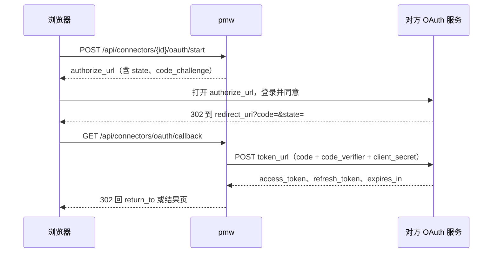

# REST API 契约 v1

所有接口前缀 `/api`。请求与响应均为 JSON（UTF-8）。此文件是前后端唯一契约，改动需同时改 `internal/domain/domain.go` 与 `web/src/lib/types.ts`。

> **给 `domain.ObjectFilter` 加字段时必须同步更新下面的 query 参数表。**
> API 层是照这张表实现解析的——表里没有的参数，即使 domain 和 store 都实现了，
> HTTP 层也会静默丢弃，端到端表现为「参数没生效」，而且不报错。
> `due_after` 就是这么漏掉的：domain 有字段、sqlite 有实现、store 有测试，唯独表里没写。

## 响应信封

成功：
```json
{ "data": <payload>, "meta": { "total": 86, "limit": 50, "offset": 0 } }
```
`meta` 仅列表接口返回。

失败（HTTP 4xx/5xx）：
```json
{ "error": { "code": "not_found", "message": "object not found" } }
```
错误码：`validation` 400 · `not_found` 404 · `conflict` 409 · `readonly` 403 · `internal` 500。

## 通用

| 方法 | 路径 | 说明 |
|---|---|---|
| GET | `/api/health` | `{"data":{"ok":true,"version":"..."}}` |
| GET | `/api/stats` | 状态栏：db 路径、体积、对象数、最后写入时间 |
| GET | `/api/counts` | 侧栏徽标，返回 `Counts` |
| GET | `/api/today?type={typeID}` | 今日页聚合，返回 `Today`，见下方「今日聚合」 |

### 今日聚合

`GET /api/today` 一次请求返回今日页的卡片列表 `{"cards": TodayCard[]}`，按 `order` 排好。
`type` 的语义和 `/api/counts` 相同：不传是全局，传了收窄到该类型；前端比对徽标时两边传同一个 `type`。

`TodayCard`：`{key, title, order, total, items}`。`total` 是全量条数，`items` 最多 50 条（`domain.TodayCardLimit`）；没有内容时 `items` 是 `[]`，卡片照常返回。

| `key` | 标题 | `order` | `items` | 口径 |
|---|---|---|---|---|
| `review` | 等确认 | 10 | `Object[]`，最近更新的在前 | 待办类型（`task`）状态为 `review`（0013）且未归档、未删除。`type` 传了别的类型时为空 |
| `overdue` | 逾期 | 20 | `Object[]`，截止早的在前 | 与 `counts.overdue` 同一份条件，`total` 恒等于 `counts.overdue` |
| `due_today` | 今天到期 | 30 | `Object[]`，按截止时间 | 与 `counts.today` 同一份条件，`total` 恒等于 `counts.today` |
| `running` | 运行中 | 40 | `TodayRun[]`，最近开始的在前 | `task_runs` 里 `finished_at` 为空的执行（`pending` / `running`）。`type` 按所属对象的类型收窄 |

`TodayRun`：`{id, object_id, object_ref, object_title, object_type, workdir, status, started_at}`，不带 `output`，
看过程走 `GET /api/runs/{id}`。所属对象在回收站里也照样列出：进程还在跑。

逾期、今天到期和 `/api/counts` 在 store 里共用同一段条件（`focusConds`），今天、逾期都按服务端本地日期切，
改口径只改那一处，两边一起变。

等回答的 Agent 问题暂不返回：Agent 会话目前没有「等用户回答」这个状态（`agent_sessions` 无状态列，
消息也没有提问标记），要等会话加上这个状态再补一张卡片。
插件卡片（TODAY-01b）：已启用并在跑的插件按 `provides.today_cards` 登记的卡片，在不传 `type` 时合进来，和内核卡片一起按 `order` 排（插件没写 order 时为 100）。`key` 以 `<插件id>_` 开头，不和上面四个撞。`items` 的形状由插件定。单张卡片加载超过 800ms、出错或没有内容时不返回这张卡。插件停用后卡片消失。

## 工作对象类型 object-types

| 方法 | 路径 | body / query |
|---|---|---|
| GET | `/api/object-types` | 返回 `ObjectType[]`，按 sort_order |
| POST | `/api/object-types` | `{id,name,plural,ref_prefix,icon,color,sort_order,statuses}`，id 为小写英文短名 |
| PATCH | `/api/object-types/{id}` | `ObjectTypePatch`，builtin 类型仅允许改 icon/color/sort_order/statuses |
| DELETE | `/api/object-types/{id}` | builtin 返回 403；下挂对象非空返回 409 |

## 分类 categories

| 方法 | 路径 | 说明 |
|---|---|---|
| GET | `/api/categories?type={typeID}&tree=true&counts=true` | `tree=true` 返回嵌套 `children`，否则扁平；`counts=true` 填充 `count`/`total_count` |
| POST | `/api/categories` | `{type_id,parent_id?,name,slug?,color?,description?,sort_order?}`，slug 省略时由 name 生成 |
| PATCH | `/api/categories/{id}` | `CategoryPatch` |
| POST | `/api/categories/{id}/move` | `{parent_id: string\|null, sort_order: number}`，禁止移到自己的子孙下（409） |
| DELETE | `/api/categories/{id}?reassign_to={catID}` | 不传 reassign_to 则下挂对象置为未分类 |

## 工作对象 objects

`GET /api/objects` query 参数：

| 参数 | 示例 | 说明 |
|---|---|---|
| `type` | `requirement,task` | 逗号分隔多选 |
| `category` | `cat_req_prod` | 分类 ID |
| `subtree` | `true` | 含子分类 |
| `uncategorized` | `true` | 只看未分类的对象，与 `category` 互斥（同时给时以本参数为准） |
| `status` | `doing,blocked` | 逗号分隔 |
| `priority` | `P0,P1` | 逗号分隔 |
| `tag` | `云端平台` | 可重复传多个，AND 语义 |
| `owner` / `project` | | 精确匹配 |
| `q` | `多租户` | 标题+正文模糊匹配 |
| `source` | `webhook,im` | 按 `objects.source` 精确匹配，逗号分隔多选。任务来源取值见下方「任务来源」 |
| `due_after` | `2026-09-15` | 到期日下界。RFC3339 或 YYYY-MM-DD，纯日期补 **00:00:00** |
| `due_before` | `2026-09-15` | 到期日上界。RFC3339 或 YYYY-MM-DD，纯日期补 **23:59:59** |
| `stalled` | `true` | N 天未更新且未进终态（口径与 `counts.stalled` 一致） |
| `not_terminal` | `true` | 排除处于终态的对象 |
| `overdue` / `inbox` / `archived` / `deleted` | `true` | 布尔开关 |
| `sort` | `-updated_at` | `-` 前缀为倒序，支持 updated_at/created_at/due_at/priority/title |
| `limit` / `offset` | `50` / `0` | 默认 50，最大 200 |

**两端补时的语义**：`due_after` 与 `due_before` 传同一个纯日期时，正好圈出「当天到期」。
两端都补成当天末尾的话，`due_after=2026-09-15` 会把当天上午到期的全滤掉，窗口直接空掉。

**「今日」「本周」「停滞」的口径必须与 `/api/counts` 对应的计数器逐字一致**：

| 聚焦 | 查询参数 | 对应计数器 |
|---|---|---|
| 今日 | `due_after=今天00:00` + `due_before=今天23:59:59` + `not_terminal=true` | `counts.today` |
| 本周 | `due_after=今天00:00` + `due_before=+7天23:59:59` + `not_terminal=true` | `counts.week` |
| 逾期 | `overdue=true` | `counts.overdue` |
| 停滞 | `stalled=true` | `counts.stalled` |

这几个徽标就贴在列表旁边，口径一旦分叉就会出现「徽标 2 / 列表 20 行」，而这类错误
**不会崩溃、只会让人用错的数字做判断**，很难被发现。改动任何一侧都要同步另一侧。
`/api/today` 的逾期、今天到期卡片直接复用 counts 的条件，不走这张表的参数，但三者必须对得上（`TestTodayMatchesCounts` 盯着）。

| 方法 | 路径 | 说明 |
|---|---|---|
| GET | `/api/objects` | 返回 `Object[]` + `meta.total` |
| POST | `/api/objects` | `{type_id,title,...}`，ref 由后端按类型前缀自增生成 |
| GET | `/api/objects/{id}` | 单个对象（含 tags/category_name/link_count） |
| PATCH | `/api/objects/{id}` | `ObjectPatch`，未出现的字段不改；`category_id: null` 表示置空 |
| DELETE | `/api/objects/{id}?hard=true` | 默认软删除 |
| POST | `/api/objects/{id}/restore` | 从回收站恢复 |
| GET | `/api/objects/{id}/links` | `LinkView[]`，含 in/out 两个方向 |
| POST | `/api/objects/{id}/links` | `{to_id,relation,note?}` |
| GET | `/api/objects/{id}/revisions?limit=50` | `Revision[]` |
| GET | `/api/objects/{id}/progress?limit=100` | `Progress[]`，**最近** N 条，最近的在前；limit 省略取 100，上限 500。对象不存在 404 |
| POST | `/api/objects/{id}/progress` | `ProgressInput`，**服务端追加**；`status` 非空时状态切换与这条进展同一事务落库。201 |
| POST | `/api/objects/{id}/claim` | `ClaimInput`，领取任务。领到 201；同一会话重复领 200（`already=true`，什么都不写）；被占用 409 |

### props 约定（开发任务）

开发任务在 `props` 里约定这几个 key（常量见 `domain.PropAcceptance` / `domain.PropRepo` / `domain.PropSourceRef`）：

| key | 类型 | 说明 |
|---|---|---|
| `acceptance` | string，Markdown | 验收标准，建议写成 `- [ ] …` 清单 |
| `repo` | string | 关联仓库：远端地址或本机绝对路径，只放一个。多个仓库的任务拆成每个仓库一条子任务 |
| `source_ref` | object | 来源详情，见下方「任务来源」 |

工作目录用 `workdir` 列（0008），不在 props 里重复。`PATCH` 的 `props` 是整体替换，
只改其中一个 key 时要先读回再拼（MCP 的 `pmw_update_object` 已经这么做）。

### 任务来源

来源种类写在 `source` 列（0001 就有，`POST` / `PATCH` 都可写），来源详情写在 `props.source_ref`。
取值与原型 `TaskSource.kind` 对应（常量见 `domain.TaskSource*` / `domain.PropSourceRef`）：

| `source` | 含义 | `props.source_ref` |
|---|---|---|
| `manual` | 手动新建 | 不填 |
| `im` | IM 消息转的 | `{message_id, channel?}` |
| `webhook` | Webhook 投递建的 | `{hook_id, delivery_id}` |
| `schedule` | 定时任务建的 | `{schedule_id, name}`，`name` 是建任务时定时任务的名字（定时任务删了也能显示） |
| `incident` | 异常转的 | `{incident_id}` |

`inbox` 不是任务来源：它是收件箱口径（`inbox=true`、`counts.inbox`）在用的值，新来源不要用它。
存量数据里还有 `''` 和 `import`（导入脚本写的），写入时不校验取值，`source=` 筛选按原值匹配。

### id 前缀

实体 id 形如 `<前缀>_<16 位时间有序串>`，一律由后端生成（`idgen.Prefixed`），前端不生成实体 id。前缀登记在 `internal/idgen/prefixes.go`，一类实体一个，不许共用；新表要用新前缀先登记，重复登记或漏登记时测试失败。对象的 `ref`（REQ-0001 这类）另由后端按类型前缀自增。

| 前缀 | 实体 | 表 |
|---|---|---|
| obj | 对象（需求、待办、项目、文档、资源、笔记） | objects |
| cat | 分类 | categories |
| tag | 标签 | tags |
| lnk | 关联 | links |
| rev | 修订和进展 | revisions |
| stk | 干系人 | stakeholders |
| dit | 字典项 | dict_items |
| sgr | 快捷入口分组 | shortcut_groups |
| sct | 快捷入口 | shortcuts |
| apv | 模型供应商 | agent_providers |
| ags | Agent 会话 | agent_sessions |
| agm | Agent 消息 | agent_messages |
| q | ask_user 问题（存在消息里） | - |
| art | 产物 | artifacts |
| run | 任务执行记录 | task_runs |
| sec | 密钥 | vault_secrets |
| aud | 审计 | audits |
| ntf | 通知 | notifications |
| sch | 定时任务 | schedules |
| srn | 定时任务执行记录 | schedule_runs |
| wh | Webhook | webhooks |
| dl | Webhook 投递记录 | webhook_deliveries |
| ws | 工作台 | workspaces |
| dir | 挂载的本机目录 | local_dirs |
| idn | IM 身份 | contact_identities |
| cv | IM 会话 | conversations |
| cn | 连接器 | connectors |
| msg | IM 消息（IM 插件） | im_messages |

原型 `ids.ts` 和后端不一致的前缀：后端已经上线的不改，原型的前缀保留，不分给别的实体。

| 原型 | 后端 | 原因 |
|---|---|---|
| tk（task）、pj（project）、dc（doc） | obj | 都是 objects 里的类型 |
| ss（session） | ags | 已上线 |
| pv（provider） | apv | 已上线 |
| af（artifact） | art | 已上线 |
| sc（schedule） | sch | 已上线 |

原型里其余前缀（ct att rp mt pd pt ch sop inc ag ar op kb kd sk dm vd sr pb tp cl wl al ae st rl bk ac ps od rn bt tb pn）的实体后端还没建表，前缀已按原型登记占用。

## 进展与领取

开发任务闭环（领取 → 记进展 → 提交验收）的两个接口。没有为它建表：进展和会话标识落在 `revisions`，
验收标准和关联仓库落在 `objects.props`，代码类产物落在 `artifacts`（见「输出产物」）。
待办类型的「待验收」状态（`review`，非终态）由 0013 加上。

**为什么是服务端追加。** 进展如果写在正文里，调用方只能「读出正文、拼一段、整体 PATCH 回去」，
两个会话同时写，后写的会把先写的那段覆盖掉，而且不报错。`POST /progress` 只插入不更新，
并发追加互不影响（`internal/store/sqlite/progress_test.go` 有两个会话各追加 40 条、一条不丢的测试）。

**存储。** 一条进展 = `revisions` 里一行 `field='progress'`：`new_value` 是正文（Markdown），
`old_value` 是元数据 JSON（`{"kind":"note","commits":[...],"files":[...],"status":"..."}`）。
这类行的 `old_value` 不是「旧值」，是复用 revisions 的代价。所以：

- `GET /api/objects/{id}/revisions` 和 `GET /api/revisions` 里会出现 `field="progress"` 的行，
  渲染时不要按「从 old 改成 new」显示，显示 `new_value` 即可（旧前端 DetailDrawer 目前会显示成 JSON）。
- 读进展一律走 `GET /progress`，它已经把元数据拆成字段。

`ProgressInput`：

```json
{ "kind": "note", "text": "定位到原因：……", "commits": ["a1b2c3d"], "files": ["internal/x.go"], "status": "" }
```

| 字段 | 说明 |
|---|---|
| `kind` | `note`（默认）或 `review`。`claim` **只能**经由 `/claim` 写，这里传会 400——否则「谁领了这条任务」可以绕过占用检查伪造 |
| `text` | 必填，去首尾空白后不能为空，合法 UTF-8，上限 32KB |
| `commits` / `files` | 可选，去空白、去重、保序，各自最多 100 条 |
| `status` | 可选。非空时必须属于该对象类型的状态集，和进展同一事务切换（并维护 `started_at` / `completed_at`，规则同 PATCH） |

`Progress`（响应）：

```json
{
  "id": "rev_…", "object_id": "obj_…", "kind": "review",
  "text": "……", "commits": ["a1b2c3d"], "files": ["calc.py"], "status": "review",
  "actor": "claude-code#332d2cac-…", "actor_name": "claude-code", "session_id": "332d2cac-…",
  "source": "agent", "created_at": "2026-10-28T10:00:00Z"
}
```

`ClaimInput`：

```json
{ "owner_id": "stk_…", "status": "", "text": "", "takeover": false }
```

| 字段 | 说明 |
|---|---|
| `owner_id` | 必填，领取者在干系人名册里的 id |
| `status` | 领取后切到的状态 key。空串取该类型的 `doing`；类型里没有 `doing` 时 400，必须显式传。不能是终态 |
| `text` | 领取时记的一句话，空串默认「领取了任务」 |
| `takeover` | 接手被别人或别的会话占着的任务。默认 false |

领取在**一个写事务**里完成「检查占用 → 切状态 → 改负责人 → 记一条 `kind=claim` 的进展」。
检查和写入必须同事务，否则两个会话会同时看到「没人领」然后都写进去
（`TestClaimObjectConcurrentOnlyOneWins`：8 个会话并发领同一条，恰好 1 个成功）。

409 的情况（`takeover=true` 时放行，归档除外）：

| 情况 | 说明 |
|---|---|
| 负责人已是别人 | message 带上负责人姓名 |
| 另一个会话领了且仍在进行中 | 「仍在进行中」= 对象状态仍是那次领取切到的状态，且负责人仍是领取者。任务被退回初始状态、或提交到别的状态（如 `review`）之后，别的会话可以再领 |
| 对象处于终态 | |
| 对象已归档 | 不受 takeover 影响 |

响应 `ClaimResult`：`{ "object": Object, "progress": Progress | null, "already": bool }`。

## 标签 tags

| 方法 | 路径 | body / 说明 |
|---|---|---|
| GET | `/api/tags` | `Tag[]`，含每个标签的引用数 |
| POST | `/api/tags` | `{name, color?}` |
| PATCH | `/api/tags/{id}` | `{name?, color?}` |
| DELETE | `/api/tags/{id}` | 同时解除所有对象上的引用 |
| POST | `/api/tags/{id}/merge` | `{target_id}`，把本标签的引用并到 target 上再删除自己 |

## 关联 / 历史

| 方法 | 路径 | 说明 |
|---|---|---|
| DELETE | `/api/links/{id}` | |
| GET | `/api/revisions?limit=100` | 全局最近变更，日报数据源 |

## 快捷访问 shortcuts

| 方法 | 路径 | body / 说明 |
|---|---|---|
| GET | `/api/shortcuts?grouped=true` | `grouped=true` 时按分组嵌套返回，否则扁平 |
| POST | `/api/shortcuts` | `{group_id?,label,target_kind,url,nav,command,icon,color,description,open_in,pinned,sort_order}`；`target_kind` 决定 `url`/`nav`/`command` 里哪个生效 |
| PATCH | `/api/shortcuts/{id}` | 同上字段的可选版本 |
| DELETE | `/api/shortcuts/{id}` | 真删除，不进回收站 |
| POST | `/api/shortcuts/{id}/visit` | 记一次访问，用于最近使用排序 |
| POST | `/api/shortcuts/reorder` | `{group_id?, ids: string[]}`，ids 是该组内的完整新顺序 |
| GET | `/api/shortcut-groups` | `ShortcutGroup[]` |
| POST | `/api/shortcut-groups` | `{name, color?, collapsed?, sort_order?}` |
| PATCH | `/api/shortcut-groups/{id}` | |
| DELETE | `/api/shortcut-groups/{id}` | 组内快捷项落回未分组，不跟着删 |

## 枚举字典 dictionaries

设置页里所有可配置枚举走这一套。`key` 一经创建不可改——历史数据引用的是它。

| 方法 | 路径 | body / 说明 |
|---|---|---|
| GET | `/api/dictionaries?with_items=true` | `with_items=true` 时连同每本字典的条目一起返回 |
| GET | `/api/dictionaries/{id}/items` | `DictItem[]` |
| POST | `/api/dictionaries/{id}/items` | `{type_id?,key,label,color?,description?,sort_order?,meta?}`；`type_id` 用于按工作对象类型分套的字典（如状态） |
| PATCH | `/api/dict-items/{id}` | 可改 label/color/description/sort_order/meta，**不含 key** |
| POST | `/api/dict-items/{id}/archive` | `{archived: bool}`。归档而非删除：已经引用它的历史数据仍要显示得出来 |
| DELETE | `/api/dict-items/{id}` | 仅在无引用时允许，有引用返回 409 |
| GET | `/api/dict-items/{id}/usage` | 引用计数，删除前的确认依据 |
| POST | `/api/dictionaries/{id}/items/reorder` | `{type_id?, ids: string[]}` |

## 干系人名册 stakeholders

负责人与参与人都指向这里。0010 之前 `objects.owner` 是自由文本，库里出现过
「宋一杰、李钊、振华」三个人挤在一个字段的值——没法筛选、没法统计、改名要全表替换。

一个对象**一个负责人 + 若干参与人**：一件事必须有唯一一个人对结果负责，
否则「这事该找谁」没有答案；参与人表达「还有谁在这件事里」，信息不丢但不承担「找谁」的语义。

| 方法 | 路径 | body / 说明 |
|---|---|---|
| GET | `/api/stakeholders?archived=true` | 默认只回在岗的；`archived=true` 才带上已归档的（名册管理页用）。每条带 `owned_count` / `participating_count` |
| POST | `/api/stakeholders` | `{name,role?,email?,note?,color?,sort_order?,group?,company?,title?,phone?,tags?,photo?,starred?,last_contact_at?}`，`name` 必填且**全局唯一**，撞名回 409 |
| PATCH | `/api/stakeholders/{id}` | `StakeholderPatch`：上面除 `name` 必填外的同一组字段，只改传了的；另含 `archived`（归档/复岗）；`last_contact_at: null` 清空 |
| DELETE | `/api/stakeholders/{id}` | 仅在零引用时允许；有引用返回 409，改走归档 |

**联系人字段（0026，CT-01a）。** 联系人沿用这张名册，不另建表；字段对照原型 `web-next/src/data.ts` 的 `Contact`：

| 字段 | 类型 | 说明 |
|---|---|---|
| `group` | string | 分组显示名（客户、合作伙伴、同事、供应商、其他，可在设置里新增），不约束取值，去首尾空白；库里列名 `contact_group` |
| `company` / `title` / `phone` | string | 公司、职位、电话，默认空串。`title` 是职位，和原有的 `role`（产品、研发这类角色）是两个字段 |
| `tags` | string[] | 去首尾空白、去空、去重后保存，默认 `[]` |
| `photo` | string | `data:image/` 开头的 data URL，1.4MB 以内（和工作台图标同一上限）；空串表示按名字生成头像 |
| `starred` | bool | 星标，默认 `false` |
| `last_contact_at` | RFC3339 \| null | 最近联系时间，`null` 表示没联系过 |

原型的 `im`（各渠道账号）不在这里，由 CT-01b 的 IM 身份表承接。`email`、`note`、`created_at` 沿用原有字段。

**name 全局唯一，联系人重名时名字要加区分**（如「王磊（北岸）」）。新建或改名撞上已有的人回 409 `conflict`，
message 形如 `stakeholder 王磊 already exists; add a qualifier to tell them apart, e.g. 王磊（公司）`。
是否放宽唯一约束记在 `docs/dev-decisions.md`「待用户决定」，放宽要用新迁移改索引。

**两个计数口径是不同的，不要合并：**

- `owned_count` / `participating_count` 是「他手上有多少事」，**排除回收站**里的软删对象。
- `DELETE` 的引用检查**算上**软删对象。`owner_id` 是 `ON DELETE SET NULL`——人删掉之后，
  那条对象从回收站恢复回来负责人就没了，**而这个丢失不报错**。

**MCP（`cmd/pmw-mcp`）这一层收的是人名，不是 id**，内部再换成 `owner_id`。调用方是模型，
它手上有「李钊」没有 `stk_xxx`，强行要 id 只会逼出「先查一次再调一次」，而中间那步经常被省掉。

这里有一个必须守住的点，任何「名字解析失败就回退成空串」的实现都会踩：
**`owner_id` 传空串的语义是「清空负责人」。**把一个打错的名字变成空串，
结果是把别人的负责人抹掉，而调用方以为改成功了。名字查不到必须**报错**，
错误里列出现有名字（`pmw_list_stakeholders` 也能查）。

`objects.owner` 这一列**保留但只读**：迁移是单向的，留着原文本是兜底；
`owner_id` 为空而 `owner` 非空时，界面回退显示这段文本。新写入一律只写 `owner_id`。

工作对象上的相关字段：`GET` 回 `owner_id` / `owner_name` / `participants[]`；
`PATCH` 收 `owner_id`（空串 = 清空）与 `participant_ids`（**全量替换**：省略 = 不改，`[]` = 清空）。
列表 query 用 `owner_id` 筛负责人——原来的 `owner` 文本匹配已移除，一个语义只留一个定义。

## IM 身份 im-identities

联系人在各 IM 渠道的身份（CT-01b，0027，表 `contact_identities`，id 前缀 `idn`）。原型把它挂在
`Contact.im`（渠道 key → 编号）上，收消息时按 `channel + sender_id` 扫全部联系人认人；后端拆成独立的表，
**一个联系人多个身份，同一渠道同一编号只能属于一个联系人**，收消息按身份认人，不按名字。

| 方法 | 路径 | body / 说明 |
|---|---|---|
| GET | `/api/im-identities?stakeholder_id=&channel=` | `Identity[]`，两个条件都可省；按联系人、渠道、编号排序。前端建「渠道:编号 → 联系人」索引时一次拉全 |
| GET | `/api/im-identities/resolve?channel=&external_id=` | 按渠道和编号认人，回 `{identity, stakeholder}`；编号先按下面的规则规整再查。查不到回 404，已归档的联系人照样回（`stakeholder.archived_at` 非空） |
| GET | `/api/im-identities/{id}` | `Identity` |
| POST | `/api/im-identities` | `{stakeholder_id, channel, external_id, display_name?, account?}`，回 201。同一渠道同一编号已存在回 409：挂在别人身上时 message 写明是谁，挂在本人身上时说已存在 |
| PATCH | `/api/im-identities/{id}` | 同一组字段，只改传了的；改 `stakeholder_id` 就是把身份改挂到另一个联系人（认错人时用），撞上已有身份同样回 409 |
| DELETE | `/api/im-identities/{id}` | 只删身份，不动联系人 |

`Identity`：

| 字段 | 类型 | 说明 |
|---|---|---|
| `id` | string | `idn_` 开头 |
| `stakeholder_id` | string | 干系人名册里的联系人，必须存在，否则 400 |
| `channel` | string | 渠道 key：`wechat`、`lark`、`slack`、`telegram`、`qq`（原型 `IM_CHANNELS`），可扩展；去空白转小写，只收小写字母开头的 `[a-z0-9_-]`，32 字以内 |
| `external_id` | string | 渠道里的编号（微信号、飞书用户 ID 或邮箱、Slack Member ID、Telegram 用户名、QQ 号），去首尾空白，`telegram` 去掉开头的 `@`；其余渠道保留大小写。200 字以内 |
| `display_name` | string | 在该渠道看到的名字（昵称），可空，100 字以内 |
| `account` | string | 在哪个自己的账号下认识的（同一渠道登了多个号时区分），可空，100 字以内 |
| `created_at` / `updated_at` | RFC3339 | |

**联系人删除时身份跟着删**（外键 `ON DELETE CASCADE`）：身份是联系人自己的属性，和电话、邮箱一样，
不是别处对他的引用，不该挡住删除；干系人删除本来就只在零对象引用时放行，有引用的走归档，归档不动身份。

审计照 CORE-08：删除一律记（`kind=delete`，`target_type=im_identity`）；新建、修改只在 Agent 来源时记（`kind=agent`），
和干系人一致；detail 只记 `stakeholder_id`、渠道和改了哪些字段，不记编号的新旧值。

## 会话 conversations

IM 里的群聊和私聊（CT-02，0028，表 `conversations`、`conversation_members`，id 前缀 `cv`）。原型的
`Message.conversation`、`ProjectChat` 按「渠道 + 群名」认群，改群名后项目绑定和消息归属就断了；后端给每个会话一个
**稳定 id**，项目绑定（PJ-02）、消息（IM 插件）都指向 id。**改名只改 `name`，id 和渠道里的编号不变**。
同一渠道同一编号只有一个会话；同名不同编号是两个会话。

一级路径 `/api/conversations` 是 IM 会话，和 Agent 对话（`/api/agent/sessions`）无关；前端模块 key `conversations`
目前是 Agent 会话页，两者只是同名。`conversations` 已加进插件保留 id（plugin-api.md 1.4）。

| 方法 | 路径 | body / 说明 |
|---|---|---|
| GET | `/api/conversations?channel=&kind=&identity_id=&stakeholder_id=` | `Conversation[]`，条件都可省；`identity_id` 查这个身份在的会话，`stakeholder_id` 查这个联系人任一身份在的会话。按渠道、名字、编号排序 |
| GET | `/api/conversations/resolve?channel=&external_id=` | 按渠道和编号找会话，回 `Conversation`；编号的规整规则同 IM 身份。查不到回 404，收消息时据此决定新建 |
| GET | `/api/conversations/{id}` | `Conversation` |
| POST | `/api/conversations` | `{channel, external_id, kind, name?, members?}`，回 201。同一渠道同一编号已存在回 409 |
| PATCH | `/api/conversations/{id}` | `{external_id?, name?, members?}`，只改传了的；`members` 整体替换，留下的成员保留原来的加入顺序。传 `channel`、`kind` 回 400：换了就是另一个会话。改编号（Telegram 群升级成超级群会换 chat id）id 不变，撞上已有会话回 409 |
| DELETE | `/api/conversations/{id}` | 删会话和它的成员关系，不动身份和联系人 |
| POST | `/api/conversations/{id}/members` | `{identity_id}` 加一个成员，回 `Conversation`；已在里面照样回 200（收消息见到新发言人就调，可重复） |
| DELETE | `/api/conversations/{id}/members/{identity_id}` | 移出一个成员，回 `Conversation`；不在里面回 404 |

`Conversation`：

| 字段 | 类型 | 说明 |
|---|---|---|
| `id` | string | `cv_` 开头 |
| `channel` | string | 渠道 key，和 IM 身份同一套规则（去空白转小写，小写字母开头的 `[a-z0-9_-]`，32 字以内），建好后不能改 |
| `external_id` | string | 渠道里的会话编号（Slack channel id、飞书 chat_id、Telegram chat id 或 `@群用户名`……），去首尾空白，`telegram` 去掉开头的 `@`，其余保留大小写，200 字以内 |
| `kind` | string | `group`（群聊、频道）或 `direct`（私聊），建好后不能改 |
| `name` | string | 群名或频道名，100 字以内；`group` 必填，`direct` 可空 |
| `members` | string[] | 成员的 IM 身份 id（`idn_`），按加入先后排；必须是已有身份且和会话同一渠道，否则 400；重复的自动去掉。`direct` 最多 2 个（对方，加上自己账号的身份），全部最多 500 个 |
| `created_at` / `updated_at` | RFC3339 | 改名、改编号、增减成员都会刷新 `updated_at` |

成员存在单独的表里，不存 JSON：要按身份反查所在会话；**身份删除时成员关系跟着删**（联系人删除时身份级联删，成员关系也一起删），
会话本身不动。以后项目绑定、消息这类按 id 引用会话的表，删除会话时怎么处理由那张表自己定（迁移里写明）。

审计照 CORE-08：删除一律记（`kind=delete`，`target_type=conversation`）；新建、修改、`add_member`、`remove_member` 只在 Agent 来源时记
（`kind=agent`），和 IM 身份一致。重复加同一成员不算修改，不记。detail 只记渠道、类型、成员数、改了哪些字段和增减的身份 id，不记名字和编号的新旧值。

## Agent 供应商 agent-providers

| 方法 | 路径 | body / 说明 |
|---|---|---|
| GET | `/api/agent-providers` | `AgentProvider[]`。**`api_key` 永远不出现在响应里**，只回一个是否已配置的标记 |
| POST | `/api/agent-providers` | `{name,kind,base_url,model,enabled?,api_key,extra?}`；`kind` 为 `openai`/`anthropic`/`gemini`/`ollama` |
| PATCH | `/api/agent-providers/{id}` | `api_key` 省略表示不改，传空串表示清空 |
| DELETE | `/api/agent-providers/{id}` | |
| POST | `/api/agent-providers/{id}/default` | 设为默认供应商，同时取消原默认 |
| POST | `/api/agent-providers/{id}/test` | 连通性探测，顺带拉回可用模型列表：`{ok,latency_ms,message,models?}`。探测失败也是 200 + `ok=false`，`message` 只有归类后的说法，不回显上游原文 |

- `api_key` 存在凭证保险箱里（`agent_providers.api_key_secret_id` 指向条目，条目名 `模型服务商 <id>`），库里的 `api_key` 列只剩空串；0015 之前存的明文在服务启动时加密搬进保险箱后清空。
- `api_key_masked` 用保险箱的 `hint` 规则（见「凭证保险箱」一节）。换密钥会换一个新条目、删掉旧条目；删服务商连带删条目。
- 条目在 `/api/secrets` 被单独删掉时，该服务商按「未配置 API Key」处理（`has_api_key=false`）。

**`kind` 是协议，不是厂商。**四种协议各自的端点、鉴权和 `/test` 拉模型列表的方式：

| kind | 默认 base_url | 对话端点 | 鉴权 | `/test` 探测 |
|---|---|---|---|---|
| `openai` | `https://api.openai.com/v1` | `POST {base}/chat/completions`（SSE） | `Authorization: Bearer` | `GET {base}/models`，取 `data[].id` |
| `anthropic` | `https://api.anthropic.com` | `POST {base}/v1/messages`（SSE，Messages API） | `x-api-key` + `anthropic-version: 2023-06-01` | `GET {base}/v1/models?limit=1000`，取 `data[].id` |
| `gemini` | `https://generativelanguage.googleapis.com/v1beta` | `POST {base}/models/{model}:streamGenerateContent?alt=sse` | query 上的 `key` | `GET {base}/models`，取 `models[].name` 去掉 `models/` 前缀 |
| `ollama` | `http://localhost:11434` | `POST {base}/api/chat`（NDJSON） | 无，不要求 `api_key` | `GET {base}/api/tags`，取 `models[].name`（本机已拉取的模型） |

- `anthropic` 的 `base_url` 写成带 `/v1` 的形式也认，不会拼成 `/v1/v1`。
- **兼容 OpenAI 的厂商用 `kind=openai` 加 `extra.preset` 表示**，不单独占一个 kind。`preset` 的取值和原型
  `web-next/src/modeldata.ts` 的 `ProviderKind` 同名；后端目前只认 `deepseek`：没填 `base_url` 时补
  `https://api.deepseek.com`（建、或改 kind 时都按这条补）。不认识的 `preset` 只当标签存着，`base_url` 回落到 kind 的默认值。
- 原型 `ProviderKind` 到后端的对应：`anthropic` → `kind=anthropic`；`openai` → `kind=openai`；`deepseek` → `kind=openai` + `extra.preset=deepseek`；
  `gemini` → `kind=gemini`；`ollama` → `kind=ollama`。原型里其余 kind（azure、bedrock、moonshot 等）后端尚未接入；
  其中兼容 OpenAI 的（moonshot、qwen、siliconflow、vllm、lmstudio、custom 等）可以先按 `kind=openai` + 自填 `base_url` 接。
- `/test` 只返回模型 id 列表，不含原型 `CatalogModel` 的上下文长度、能力和价格；那些仍由前端的目录补齐。

## Agent 对话 agent

| 方法 | 路径 | body / 说明 |
|---|---|---|
| GET | `/api/agent/sessions?object_id=X` / `?unscoped=true` | **必须二选一**：`object_id` 给某个对象的会话（详情抽屉用），`unscoped=true` 给 `object_id IS NULL` 的全局会话（底部对话框用）。两个都不给返回空列表，不是全部；两个都给以 `object_id` 为准（不报 400——这俩是前端两处独立代码各自拼的，真撞上时给一批说得通的数据比让抽屉整个打不开好） |
| POST | `/api/agent/sessions` | `{title?,provider_id,model,workdir?,object_id?}`，`object_id` 省略即全局会话 |
| PATCH | `/api/agent/sessions/{id}` | |
| DELETE | `/api/agent/sessions/{id}` | 消息级联删除；**产物保留**，只把它的 `session_id` 置空（见「输出产物」一节） |
| GET | `/api/agent/sessions/{id}/messages` | `AgentMessage[]`，**按时间正序**（最旧在前） |
| GET | `/api/agent/sessions/{id}/artifacts` | `Artifact[]`，等价于 `/api/artifacts?session_id={id}`；会话不存在报 404（而不是回空列表） |
| POST | `/api/agent/workdir/check` | `{path}`，校验产物目录是否存在且可写 |
| POST | `/api/agent/chat` | `{session_id?,provider_id?,model?,workdir?,object_id?,message}`，**SSE 流式响应**，见下 |

`/api/agent/chat` 的 SSE 事件在 `delta` / `tool_call` / `tool_result` / `artifact` / `done` / `error`
之外多一种 **`question`**——Agent 遇到拿不准的地方时反问用户，而不是自己猜一个答案继续做：

```json
{"type":"question","id":"q_...","question":"这个需求要不要拆成独立任务？",
 "options":[{"label":"拆成三个任务","detail":"按前端/后端/联调拆"},{"label":"先不拆","detail":"作为一个整体推进"}],
 "multi":false}
```

**会话的归属一经创建不再改写。**`PATCH /api/agent/sessions/{id}` 改不了 `object_id`，
chat 带了不同的 `object_id` 也不会让已有会话搬家——搬走会让它从原来那个列表里消失，
而用户并没有要求移动它。换对象就换一条会话。

`object_id` 是「用户此刻打开的是哪个工作对象」。它不是给模型省一次查询——
没有它，用户说「这个需求怎么推进」时模型只能猜或者反问，而「任务详情里的助手」
这个场景下用户几乎不会报编号。后端把它注入系统提示词（「用户当前打开的是 REQ-0012」），
模型仍然通过 `get_object` 工具去取正文，指代和取数是两件事。

发出 `question` 后**本轮就结束**（后面跟 `done`），流不会挂在那里等。
用户的回答走下一条普通 `POST /api/agent/chat` 消息，没有单独的应答接口——
这样即使前端没渲染成按钮，问题也仍然是一段看得懂的文字，回答仍然是一句普通的话。

`/api/agent/chat` 与 `/api/objects/{id}/run` 都是 SSE，而 `EventSource` 只能发 GET、带不了 body，
前端一律用 `fetch` + `ReadableStream` 自己按空行切块。

## 输出产物 artifacts

「这件事一共产出了什么」的唯一答案来源。一条产物 = 一件交付物，可能落在本地、
可能发到了云端，也可能两者都有。

| 方法 | 路径 | body / 说明 |
|---|---|---|
| GET | `/api/artifacts` | `Artifact[]` + `meta.total`，最近登记的在前。过滤见下 |
| GET | `/api/artifacts/stats` | `ArtifactStats`，走**同一套**过滤参数，忽略 `limit`/`offset` |
| POST | `/api/artifacts` | `ArtifactInput`。`source` 由**请求头** `X-Actor-Source` 判定，无条件覆盖请求体里的值 |
| GET | `/api/artifacts/{id}` | 单条 |
| PATCH | `/api/artifacts/{id}` | `{object_id?,title?,path?,base_dir?,url?,platform?,note?,kind?,status?,scope_type?,scope_id?,props?}`。`props` 整体替换；产出者 `actor_*` 不经 PATCH 改 |
| DELETE | `/api/artifacts/{id}` | 只删登记记录，**不删磁盘文件、不删云端页面** |

过滤参数（彼此是「与」）：

| 参数 | 说明 |
|---|---|
| `object_id` | 某个工作对象的产物 |
| `unscoped=true` | 只看没有归属对象的。与 `object_id` 同时给报 400——两者相与必然是空集，静默返回空会被读成「这个对象没有产物」 |
| `session_id` / `run_id` | 按出处过滤 |
| `platform` | 字典 `artifact_platform` 的 key |
| `source` | `manual` / `agent` / `run` / `mcp` |
| `kind` / `status` | 种类（字典 `artifact_kind` 的 key）、状态 |
| `actor_type` / `actor_id` | 按产出者过滤，`actor_id` 可单独用 |
| `scope_type` / `scope_id` | 按非对象归属过滤；`scope_id` 要和 `scope_type` 一起给，单给报 400（不同模块的 id 可能撞） |
| `has_url` / `has_path` | **三态**：不传=不过滤，`true`=该字段非空，`false`=该字段为空。`has_url=false` 就是「还没发出去的本地文件」 |
| `q` | 同时匹配 title / path / url / note |
| `limit` / `offset` | 默认 100，上限 500 |

`ArtifactStats` 另有 `by_kind`（未分类的计在 `""` 下），口径和其余分组一样只统计 artifacts。

### 溯源字段（AG-03b，0031）

方案见 `docs/file-artifact-model.md` 第 4 节。会话、执行、对象三个出处 0012 已有（`session_id` / `run_id` / `object_id`），0031 补齐以下列，`Artifact` 响应和 `ArtifactInput` 都带：

| 字段 | 取值 | 说明 |
|---|---|---|
| `kind` | 字典 `artifact_kind` 的 key，空=未分类 | 内置 `doc` / `prototype` / `code` / `commit` / `branch` / `pr` / `data` / `other`，插件可往字典里加；不在字典里或已停用的报 400 |
| `status` | `""` / `draft` / `review` / `final` / `published` | 空表示不跟踪 |
| `actor_type` | `user` / `agent` / `skill` / `sop` / `run` / `mcp` / `im` / `sync` | 产出者。不传时按 `source` 推：manual→user、agent→agent、run→run、mcp→mcp |
| `actor_id` / `actor_label` | 任意字符串 | 产出者 id（技能名、Agent id、SOP id）和当时的显示名快照 |
| `scope_type` / `scope_id` | 任意字符串，成对出现 | 不是工作对象的归属（`kb` 知识库、`video` 等），可与 `object_id` 同时有值；只给一半报 400 |
| `props` | JSON 对象，默认 `{}` | 种类特有的字段（视频的 `version`、`picked` 等） |

`source` 和 `actor_type` 两个都留：`source` 是登记途径，服务端判定、统计只认它；`actor_*` 可由调用方声明，只用来展示和筛选。

0031 迁移时按 `source` 回填了老数据的 `actor_type`，并把备注以 `[commit]` / `[branch]` / `[pr]` 开头的产物回填到 `kind`，备注原样保留。

### 一条产物可以同时有 `path` 和 `url`

先在本地写出方案、再发到 Confluence，那是同一份交付物的两个位置，不是两件产出。
拆成两条会让「一共产出了多少」翻倍。两者**至少有一个**非空，否则 400。

因此 `stats` 里 `local + remote` 可能大于 `total`——它回答的是「有多少落在本地」
和「有多少已经发出去了」，不是一次互斥划分。`total_size` 只累加有本地路径的那些
（云端产物的 `size` 恒为 0，混进去会让体积统计失真）。

### 路径存绝对值，相对路径是算出来的

`path` 是绝对路径，`base_dir` 是登记时的基准目录（可空），`rel_path` 是响应里
现算出来的派生字段，**不接受写入**。库里不存第二个路径字符串：存两个的话，
文件挪窝时改了一个漏了另一个，两边都不报错，而读的人无从判断该信哪个。

`base_dir` 为空、或文件已不在 `base_dir` 下时，`rel_path` 等于 `path`。

### `object_id` 的三态

`PATCH` 的 `object_id` 区分三种情况：字段不出现=不改，`null`=解除归属，
有值=改挂到那个对象。用 `""` 表达清空是不行的——它会被当成一个不存在的对象 id。

工作对象被**硬删**时产物不跟着删，只是 `object_id` 置空变成「未归属」
（`ON DELETE SET NULL`）。产物指向的是这个库之外真实存在的东西，
而这一行往往是那个链接在本机唯一的索引；跟着删等于用户删掉一条需求、
顺手永久丢掉了当初发出去的页面地址，且没有任何提示。软删（回收站）不触发这条。

### 登记来源

| `source` | 谁写的 | 去重范围 |
|---|---|---|
| `manual` | 用户在界面上登记 | 不去重。同一个文件先发 Confluence 再发飞书是两条合理记录 |
| `agent` | 内置 Agent 的 `write_file` | 同一会话内同路径只留一条 |
| `run` | Claude Code 执行后扫工作目录 | 同一次执行内同路径只留一条 |
| `mcp` | 别的 Agent 通过 `pmw_record_artifact` 回写 | 不去重 |

`POST /api/artifacts` **不接受调用方自报 `source`**，请求体里的这个字段会被无条件覆盖。
否则统计页上「AI 助手产出了多少」就不再可信——而那个数看起来完全正常。

判据是请求头 `X-Actor-Source`（这个项目既有的调用方标识）：

| `X-Actor-Source` | 记成 | 谁在发 |
|---|---|---|
| `agent` | `mcp` | `pmw-mcp`（内置 Agent 的 `write_file` 直接调 store，不走 HTTP） |
| 其余（`ui` / `api` / 缺省） | `manual` | 界面登记、手工 curl |

`agent` 和 `run` 这两个来源不可能从 HTTP 接口进来，由 `store.RecordArtifact` 内部填。

### 代码类产物（commit / branch / PR）

0031 起种类写在 `kind` 列（`commit` / `branch` / `pr`），前端应改为读 `kind`。`pmw_record_artifact` 仍在 `note` 开头写固定标记，保留一个版本做兼容：

```
[commit] sha=a1b2c3d branch=feat/x repo=/abs/path  自由备注…
[branch] branch=feat/x repo=/abs/path
[pr] branch=feat/x  …
```

位置照旧：有远端页面（GitHub commit / 分支 / PR）就填 `url`；只在本地的 commit / branch 把仓库目录（绝对路径）填进 `path`，
`base_dir` 留空。sha / branch / repo 从 `note` 里同一段 `key=value` 取；只认 `note` 前缀 `^\[(commit|branch|pr)\]` 的旧前端照旧能用。
来源照旧按 `X-Actor-Source` 判定，经 MCP 登记的记成 `mcp`。

## 本机文件系统 fs

只读浏览 + 建目录，范围受允许根限制，越界返回 403。

| 方法 | 路径 | body / 说明 |
|---|---|---|
| GET | `/api/fs/browse?path=/Users/x` | `FsListing`：目录项、面包屑、是否可写 |
| GET | `/api/fs/shortcuts` | `FsShortcut[]`，选目录时的起跳点（主目录、桌面、临时目录等） |
| POST | `/api/fs/mkdir` | `{parent, name}` |

### 文件读取和挂载目录（DOC-01a，0025）

文档模块的工作区除了内置文档库，还能挂本机目录（原型 `library.tsx` 的 `dir:<id>`）。挂载存在 `local_dirs` 表（id 前缀 `dir`），文件内容不进库，按需读。
边界和上面的浏览是同一套（`fsbrowse` 的 resolve：字面量和解析软链后各查一次允许根），挂载的路径本身也要在允许根内。
这几个接口越界回 **403**，`{"error":{"code":"forbidden",...}}`；上面的 browse、mkdir 越界目前仍回 400 validation（`failFs` 的旧行为，未改）。

| 方法 | 路径 | body / 说明 |
|---|---|---|
| GET | `/api/fs/read?path=/abs/file.md` | `FsFile`，只读。**只能读已挂载目录里的文件**，挂载目录以下任何一段是隐藏项（`.` 开头，如 `.env`、`.git/`）也不行，否则 403：允许根包含主目录，不能借这个接口读 `~/.ssh`、`vault.key` 这类凭证。库文件和密钥证书类文件（`vault.key`、`.db`、`.db-wal`、`.db-shm`、`.sqlite`、`.key`、`.pem`、`.p12`、`.pfx`）在任何挂载目录里都不给读。目录、管道等非普通文件回 400，不存在回 404 |
| GET | `/api/local-dirs` | `LocalDir[]`，按 `position` |
| POST | `/api/local-dirs` | `{path, name?}` 挂载，201。`path` 须是允许根内存在的目录，存解析软链后的路径；`name` 省略取目录名。同一目录挂两次 409。路径里有隐藏段（如 `~/.ssh`），或是工作台自己的数据目录（库文件所在目录，含 `vault.key`、`backups/`）、或包住了数据目录（比如挂整个仓库根），回 403 |
| POST | `/api/local-dirs/reorder` | `{ids}` 按给定顺序重排，必须正好列出全部挂载各一次，否则 400；回重排后的 `LocalDir[]` |
| PATCH | `/api/local-dirs/{id}` | `{name}` 改名。路径不能改，换目录就移除再挂 |
| DELETE | `/api/local-dirs/{id}` | 移除挂载，只删记录不动磁盘 |
| GET | `/api/local-dirs/{id}/files` | `FsFileList`：目录下的文本文件清单。每次重新校验边界，目录已不在回 404 |

`LocalDir`：`{id, path, name, position, created_at, updated_at}`。

`FsFile`：`{path, name, ext, size, modified, binary, truncated, limit, content}`。
- 上限 `limit` 是 1MB（1048576 字节）。文件更大时 `truncated: true`，`content` 是前 1MB（退到 UTF-8 字符边界），`size` 是文件真实大小。阅读器整篇渲染，再大的多是日志和导出数据，看开头就够。
- 二进制（前 8000 字节有 NUL，或不是合法 UTF-8）`binary: true`、`content` 为空串，只给元信息：JSON 装不下原始字节，阅读器也只渲染文本。

`FsFileList`：`{path, files, skipped, truncated}`，`files` 是 `{rel, path, name, ext, size, modified}[]`，按 `rel` 排序；`rel` 相对挂载目录、分隔符 `/`，读内容拿 `path` 调 `/api/fs/read`。
规则和原型 `localdir.ts` 一致：跳过隐藏项和 `node_modules`、`.git`、`dist`、`build`、`.venv`、`__pycache__`，只收 md、markdown、txt、text、log、csv、json、yaml、yml、toml、xml、html、sql；其它扩展名计入 `skipped`。软链不跟。最多 1000 个文件、走 20000 项，超出 `truncated: true`。

## 任务执行 runs

用本机 Claude Code 执行任务。

| 方法 | 路径 | body / 说明 |
|---|---|---|
| GET | `/api/objects/{id}/runs?limit=20` | `TaskRun[]`，**最近** N 条，倒序；limit 省略取 20，上限 100 |
| GET | `/api/runs/{id}` | 单条执行记录，含完整输出 |
| POST | `/api/runs/{id}/cancel` | 杀掉整个进程组 |
| POST | `/api/objects/{id}/run` | `{workdir?, extra_prompt?, allow_writes?}`，**SSE 流式响应** |

`workdir` 省略时由对象自身的 `workdir` 逐级向上继承（任务 → 所属项目）。
`allow_writes` 默认 `false`：只读跑一遍看它打算做什么。为 `true` 时后端追加
`--permission-mode acceptEdits`；**任何情况下都不会传 `--dangerously-skip-permissions`**。

SSE 事件（形状的唯一真相是 `internal/runner` 的 `Event.MarshalJSON`）：

| 事件 | 字段 | 说明 |
|---|---|---|
| `start` | `run_id`, `workdir` | 先导事件，在 `CreateTaskRun` 之后发，所以此时 `/cancel` 一定找得到 |
| `delta` | `text` | 正文增量 |
| `tool` | `id`, `name`, `detail` | 工具调用**开始** |
| `tool_result` | `id`, `name`, `ok`, `error` | 靠 `id` 与 `tool` 配对 |
| `done` | `run_id`, `exit_code` | |
| `error` | `message` | |

`exit_code` 为 0 不等于任务做成了——工具调用被权限挡下时 claude 仍会正常退出。
后端按「有没有工具调用成功过」判定 `TaskRun.Status`：一个都没成功记 `failed`，
有成功的记 `done` 并在 `Error` 里留一句保留意见。

## 凭证保险箱 secrets

连接器配置、API Key、Webhook 密钥等加密存放（AES-256-GCM），**明文没有任何读接口**，
响应里只有脱敏提示 `hint`；后端内部用 `vault.Resolve(id)` 取明文，不经 HTTP。

| 方法 | 路径 | body / 说明 |
|---|---|---|
| GET | `/api/secrets` | `Secret[]`：`{id,name,kind,hint,version,created_at,updated_at,rotated_at}`，不含明文和密文 |
| POST | `/api/secrets` | `{name,kind?,value}`，`kind` 缺省 `api_key`（小写字母、数字、下划线，至多 32 位）；`value` 只写，至多 64 KB；回 201 + `Secret` |
| POST | `/api/secrets/{id}/rotate` | `{value}`，原条目换成新值、`version` 加一；旧值随即不可再取到 |
| DELETE | `/api/secrets/{id}` | 直接删除，不进回收站 |

- `hint`：明文不少于 20 位时保留前 3 后 4（`sk-…3f2a`），12 到 19 位只留后 4（`…3f2a`），短于 12 位一律 `***`。
- 主密钥不在库里：macOS 优先系统钥匙串（服务名 `pm-workspace-vault`，账户名为数据目录绝对路径），取不到退回数据目录下权限 0600 的 `vault.key`；权限放宽了拒绝启动。测试实例与自动化测试只用密钥文件。
- 只备份 `pm.db` 不带主密钥，换机恢复时保险箱解不开——要连同 `vault.key`（或钥匙串条目）一起迁移。
- 服务没配保险箱时，这四个接口回 `internal` 500，message 为 `vault is not configured on this server`。

## 连接器 connectors

CONN-01a。连接器的**定义**（认证方式、配置表单、工具目录、连通测试）在代码里登记（`internal/connector` 的注册表，内核提供；插件经 `Registrar.Connector` 登记自己的，CONN-02，见下面「插件提供的连接器」），不进库。接入的**实例**存在表 `connectors`（0029），id 前缀 `cn`。凭证字段整组 JSON 加密存进保险箱（`vault_secrets`，`kind=connector`，名字 `Connector <id>`），表里只有条目 id 和每个字段的脱敏提示。OAuth 授权和令牌刷新（CONN-01b，0030）见本节末的「OAuth 授权」；真实连接器（GitHub，CONN-01c）、删除前的影响检查（CONN-03）不在本节。全量导出暂不含这张表。

| 方法 | 路径 | 说明 |
|---|---|---|
| GET | `/api/connectors/defs` | `ConnectorDef[]` + `meta.total`，内核的按登记顺序在前，后面是在跑的插件登记的（按插件登记顺序）；停用的插件的定义不在里面 |
| GET | `/api/connectors` | `Connector[]` + `meta.total`，不分页，新建的在前；`?tool=` 只要某个工具的 |
| POST | `/api/connectors` | 接入，body `{tool, name?, auth_mode?, config?, secrets?, enabled?, direction?, interval?}`；回 201 + `Connector`。同一工具已经接过回 409 |
| GET | `/api/connectors/{id}` | 一个 `Connector`；不存在 404 |
| PATCH | `/api/connectors/{id}` | 只传要改的：`name` / `auth_mode` / `config` / `secrets` / `enabled` / `direction` / `interval`；带 `tool`、`tools`、`status`、`account` 回 400；回 `Connector` |
| DELETE | `/api/connectors/{id}` | 彻底删除，保险箱里的凭证一起删；回删掉的那条 `Connector` |
| POST | `/api/connectors/{id}/test` | 连通测试，回 `{ok, account, message, connector}`。连不上不是接口错误：200 + `ok: false` |
| POST | `/api/connectors/{id}/tools/refresh` | 向对方拉工具清单，回 `{added, removed, connector}`；拉取失败回 409，工具清单不变 |
| PATCH | `/api/connectors/{id}/tools` | 改工具授权，body `{modes: {<工具名>: "off" \| "confirm" \| "auto"}}`，只改给了的；回 `Connector` |
| POST | `/api/connectors/{id}/oauth/start` | 发起 OAuth 授权，body 可空或 `{return_to?}`；回 `{authorize_url, redirect_uri, expires_at}`，浏览器打开 `authorize_url`。实例不是 `oauth2` 认证、没填 client_id 或 `return_to` 不合规回 400 |
| GET | `/api/connectors/oauth/callback` | 对方授权后浏览器回到这里（`?code=&state=` 或 `?error=&error_description=&state=`），不是给前端调的。给过 `return_to` 时 302 回去，否则回一个 HTML 结果页；`state` 不对回 400 结果页 |
| POST | `/api/connectors/{id}/oauth/refresh` | 手动用 `refresh_token` 换新令牌，回 `{ok, message, connector}`。刷新失败不是接口错误：200 + `ok: false`，实例置为 `error` |
| POST | `/api/connectors/{id}/disconnect` | 人主动断开：置为 `disconnected`，配置保留；OAuth 的令牌从保险箱删掉、`oauth` 授权状态清空。回 `Connector` |

`ConnectorDef`：`{tool, label, category, color, desc, can_send, auth, fields, tools, source, oauth}`，与原型 `Tool` 同名字段同义：`auth` 是支持的认证方式（`none` / `oauth2` / `token`），第一个是默认；`fields` 是 `{key, label, kind, placeholder?, options?, required}`，`kind` 为 `text` / `secret` / `select`；`tools` 是静态工具目录 `{name, desc, write}`（原型的 `catalog`）；`source` 是 `core` 或插件 id；`oauth` 是 OAuth 配置，`auth` 不含 `oauth2` 时为 null，见「OAuth 授权」。

`Connector`：`{id, tool, name, account, status, error, auth_mode, config, secret_hints, direction, interval, tools, tools_at, last_tested_at, last_sync_at, oauth, available, created_at, updated_at}`，与原型 `Connector` 同名字段同义；原型 `auth` 里的令牌换成 `auth_mode` 加 `secret_hints`，`interval` 是分钟；`oauth` 是授权状态（原型 `auth.oauth` 的 `account`、`expires_at`），`auth_mode` 不是 `oauth2` 时为 null。

- **凭证明文**：只写不读。`secrets` 是 `{<secret 字段 key>: 明文}`，任何响应里都没有 `secrets` 字段和明文，只有 `secret_hints` `{<key>: hint}`，规则同保险箱的 `hint`。连通测试、拉取工具清单时后端从保险箱取出明文交给定义，对方返回的错误文本里出现凭证原文时换成 `***`，再截到 300 字。
- `config` 只放非凭证字段（`kind` 为 `text` / `select`），`secrets` 只放 `kind=secret` 的字段，键不对回 400；`select` 的值必须在 `options` 里。PATCH 时两者都按键合并：给了的键覆盖，值为空串表示清掉，没给的键不动。合并后 `required` 字段缺了回 400。值去首尾空白（凭证首尾有空白回 400），`config` 每个值最多 2000 字。
- `name` 去首尾空白，不给时取定义的 `label`，最多 100 字。`auth_mode` 不给取定义的第一个，不在 `auth` 里回 400。`direction` 为 `receive`（默认）或 `both`，定义 `can_send` 为 false 时只能 `receive`。`interval` 是同步间隔（分钟），0 到 1440，默认 0（不定时同步）。
- **一个工具只接一个账号**（同原型）：`tool` 已有实例时新建回 409，message 带已有实例的 id。
- `status`：`connecting`（新建或从暂停、断开重新启用后，还没测过）、`connected`、`error`（`error` 是最近一次失败的说明，含令牌刷新失败）、`paused`（`enabled: false`）、`disconnected`（`POST /disconnect` 人主动断开；PATCH `enabled: true` 回到 `connecting`）。`POST /test` 成功置 `connected` 并记下 `account`，失败置 `error`；暂停中的实例照样测，但状态保持 `paused`。`oauth2` 认证还没授权时测试直接失败（「还没完成 OAuth 授权」），不调对方。
- **工具授权**：`tools` 是 `[{name, desc, write, mode}]`，`mode` 为 `off`（关闭）/ `confirm`（调用前要人确认）/ `auto`（自动），只读工具（`write: false`）不能设 `confirm`，不在清单里的工具名回 400。拉取工具清单时保留已配过的授权，新出现的按默认（写操作 `confirm`、只读 `auto`），对方删掉的去掉；对方把工具改成只读时 `confirm` 降为 `auto`。`tools_at` 是最近一次拉取时间。Agent 按授权调用工具归 AG-02。
- `available` 为 false 表示定义已不在（提供它的插件停用了）：此时测试、拉取工具清单、改 `auth_mode` / `config` / `secrets` / `direction` 回 409，改名、启停和删除照常。
- **插件提供的连接器**（CONN-02）：插件在 `Register` 里调 `Registrar.Connector(def)` 登记，`tool` 必须在清单 `provides.connectors` 里（不在、定义不合法、重复都让启用失败），`source` 固定为插件 id。定义只在插件在跑时出现：停用后不在 `/api/connectors/defs` 里，同 `tool` 新建回 400（同未知工具）；已接入的实例一行不动，`available` 为 false（规则同上一条）。重新启用后定义回来，实例的配置、凭证、工具授权照旧，`available` 回到 true。和内核定义同 `tool` 时内核的优先，插件的不出现（插件之间的 `tool` 冲突由清单检查在安装时挡掉）。后台令牌刷新照样跳过取不到定义的实例。
- 保险箱条目被单独删掉（`DELETE /api/secrets/{id}`）时按没填凭证处理，PATCH 一次 `secrets` 新建条目补上。
- 内置假连接器 `fake`（不联网）和 `fake_oauth` 只在 `pmw --fake-connector` 时登记，给测试和演练用：`fake` 的 `token` 含 `invalid` 或 `expired` 时测试失败，`config.variant` 为 `v2` 时工具清单换一组；`fake_oauth` 走 OAuth，授权、令牌地址是 `config.base_url` 加 `/authorize`、`/token`，连通测试带 access_token 请求 `base_url/userinfo` 取 `login`，要自己起一个假授权服务对接（Go 测试用 `internal/connector/oauthfake`）。正式运行不登记，定义列表现在为空，真实连接器随 CONN-01c 起陆续登记。
- 审计按 `config` 记（不分来源），`target_type` 为 `connector`，`action` 为 `create` / `update` / `delete` / `set_tool_modes`；凭证只记 `detail.secrets` 为 `{<key>: 「已设置」|「已清除」}`，修改只记 `detail.fields`；`set_tool_modes` 记 `detail.tools` 和新的 `detail.modes`（授权是权限配置不是凭证）。OAuth 授权成功记 `oauth_authorize`（`detail.secrets` 为 `{access_token, refresh_token}` 的「已设置」，对方没给 refresh_token 时只有 access_token，另记 `detail.scope`），断开记 `disconnect`（清了令牌时 `detail.secrets` 为「已清除」）。连通测试、拉取工具清单、发起授权、授权失败和令牌刷新（手动、后台）不记，刷新失败写服务日志并置 `error`。
- 服务没接连接器时这几个接口回 `internal` 500，message 为 `connectors are not configured on this server`。

### OAuth 授权（CONN-01b）

通用的 OAuth 2.0 授权码流程，带 PKCE（S256）。



- **定义里声明**（`ConnectorDef.oauth`）：`{auth_url, token_url, scopes, base_url_field?, client_id_field?, client_secret_field?, builtin}`。`auth_url`、`token_url` 是完整地址；给了 `base_url_field` 时两者是以 `/` 开头的路径，接在该 `text` 字段的值后面（自建实例用）。client_id 从哪来：内置在代码里（`builtin: true`，接口不出值，用户只需点授权）或取 `client_id_field` 指的 `text` 配置字段；client_secret 需要时取 `client_secret_field` 指的 `secret` 字段，和别的凭证一起进保险箱。`scopes` 用空格拼进 `scope` 参数。
- **回调地址** = `pmw --public-url`（默认 `https://bro.vip`，按 docs/local-domain.md，浏览器经 pf 转到 7443）+ `/api/connectors/oauth/callback`，即 `https://bro.vip/api/connectors/oauth/callback`，要原样登记在对方的 OAuth 应用里；`start` 回的 `redirect_uri` 就是它。`--public-url` 只能是 `scheme://host[:port]`，不带路径。测试实例要带 `--public-url http://127.0.0.1:<端口>`，否则回调会落到 bro.vip（正式服务）上。
- **state**：每次 `start` 生成一个随机 state（32 字节）和 PKCE 校验码，只存在进程内存里，10 分钟有效、只能用一次；回调时 state 不认识、已用过、过期一律 400，不跳转、不改实例。进程重启后进行中的授权作废，重新点一次即可。同时进行中的授权最多 200 个，超了回 409。
- **return_to**：可选，授权结束后浏览器回到哪。只放行站内路径（`/` 开头，不能 `//`）、本机地址（`127.0.0.1`、`localhost`、`::1` 的 http(s)）和 `--public-url` 同主机的地址，别的回 400，免得变成开放跳转。跳回时追加 `oauth=ok|error`、`connector=<id>`、`message=<说明>`。
- **换令牌**：表单 POST 到 `token_url`（`grant_type=authorization_code`、`code`、`redirect_uri`、`client_id`、`code_verifier`，有 client_secret 时放表单里），带 `Accept: application/json`，JSON 和表单编码的响应都认。成功后令牌合进实例原有的保险箱条目（键名以 `_` 开头，不会和字段撞，不出 `secret_hints`），记下授权时间、到期时间（`expires_in`，没给则为 null）和授予范围（对方没回 `scope` 时取请求的），然后自动做一次连通测试：成功置 `connected` 并记下 `account`，失败置 `error`。对方拒绝授权（`error=access_denied` 等）或换令牌失败：`ok=false`，实例状态不变，说明里的凭证和授权码换成 `***`。
- **刷新**：后台每分钟查一次，`oauth.expires_at` 在 5 分钟以内的（不含暂停、断开的）用 `refresh_token` 换新令牌；对方轮换了 `refresh_token` 就存新的，没给就沿用旧的。刷新失败（对方拒绝、没有 `refresh_token`、网络错误）把实例置为 `error`，`error` 为「令牌刷新失败：…」（凭证已抹掉），记下 `oauth.refresh_failed_at`；之后 30 分钟内后台不再试，过后再试一次。刷新成功清掉 `refresh_failed_at`，原来是 `error` 的回到 `connected`。手动 `POST /oauth/refresh` 不受退避限制；暂停、断开的实例手动刷新时状态保持不变。
- `oauth`（`Connector` 上）：`{authorized_at, expires_at, refreshed_at, refresh_failed_at, scope}`，时间为 null 表示没有；没授权或已断开时 `authorized_at` 为 null。令牌本身任何响应里都没有。定义里通过 `Config.AccessToken()` 拿 access_token 调对方。

## 插件 plugins

第一方插件编译进二进制（`docs/plugin-api.md`），接口挂在 `/api/<插件 id>/` 下，由插件注册表（`internal/plugin`）管启停。现在编译进来的有「项目」（`projects`，接口见「项目插件 projects」一节）和「IM 消息」（`im`，见「IM 消息插件 im」一节）。插件路由和内核路由一样受契约测试约束，测试里按 `cmd/pmw` 同样的插件登记。

### 插件管理（CORE-04b，plugin-api.md 第 4 节）

| 方法 | 路径 | 说明 |
|---|---|---|
| GET | `/api/plugins` | 二进制里带的全部插件（已装和可装），按登记顺序；没接注册表时为空列表 |
| POST | `/api/plugins/{id}/install` | 安装，不启用。body `{ "permissions": [...] }`：用户确认过的权限，必须覆盖清单里的全部权限 |
| POST | `/api/plugins/{id}/enable` | 启用；依赖没启用时 409 |
| POST | `/api/plugins/{id}/disable` | 停用；还有已启用的插件强依赖它时 409，并列出依赖方 |
| POST | `/api/plugins/{id}/uninstall` | 卸载，只能从停用状态卸；body `{ "delete_data": false, "confirm": "" }`，默认保留数据 |

列表的每一项（enable、disable 的 `data` 也是这个）：

```json
{ "id": "demo", "name": "示例插件", "description": "...", "version": "0.1.0",
  "installed": true, "enabled": true, "running": true,
  "installed_version": "0.1.0", "upgradable": false, "installed_at": "2026-10-28T15:00:00Z",
  "depends": { "projects": ">=1.0.0 <2.0.0" }, "optional_depends": {}, "dependents": ["video"],
  "permissions": ["network:localhost"], "permissions_confirmed": ["network:localhost"], "permissions_at": "...",
  "pending_migrations": 0, "jobs": 2, "provides": { "modules": [], ... } }
```

- `version` 是二进制里的版本，`installed_version` 是安装或上次升级时的版本（没装过为空串）；装着且两者不同时 `upgradable` 为 true。升级接口还没做。
- `enabled` 是状态表里的意愿，`running` 是现在真的在跑：已启用但有待应用迁移的插件启动时不起，`running` 为 false，路由回 404。前端按 `running` 决定加载哪些插件。
- `dependents` 是二进制里强依赖它的插件（不论装没装），停用、卸载前提示用；`permissions` 是清单要求的，`permissions_confirmed` 是用户确认过的（卸载后保留，重装时可以提示「上次确认过这些」）。
- `pending_migrations` 是还没应用的插件迁移数，明细看 `GET /api/admin/migrations?plugin=<id>`。

安装：先查未安装、依赖都已启用且版本匹配、插件 API 版本在 `core` 范围里、权限都确认了；有待应用的迁移时打一份快照（同 `POST /api/admin/snapshot`，落在库文件旁的 `backups/`），再按文件名顺序跑迁移。`data` 是 `{ "plugin": <上面的对象>, "backup": "<快照路径>" | null }`。迁移中途失败时已提交的文件不回滚，用这份快照恢复。界面上安装和启用是一个动作，后端两步：装完接着调 enable。

卸载：
- 默认保留数据：本插件的表和迁移记录都在，状态表置未安装；重装时跳过已应用的迁移，数据接着用。
- `delete_data: true` 时 `confirm` 必须等于插件 id，否则 400 `validation`，什么都不动。通过后先打快照，快照失败就不删、回错误；再删掉表名以清单 `table_prefix` 开头的表（索引随表删）和本插件的迁移记录，同一个事务。
- 还有已安装（不论是否启用）的插件强依赖它时 409，并列出依赖方。
- `data` 是 `{ "plugin": ..., "data_deleted": true, "backup": "<快照路径>" | null, "dropped_tables": ["demo_items"] }`；保留数据时 `backup` 为 null、`dropped_tables` 为空数组。

错误码：没有这个插件 404 `not_found`；权限没确认、删数据没确认 400 `validation`；已安装又装、未安装就启用、启用中卸载、依赖没启用或版本不符、插件自己拒绝停用（`DisableGuard`）409 `conflict`。被依赖时的 409 在 `error` 里多一个 `dependents`：

```json
{ "error": { "code": "conflict", "message": "插件 demo 被这些已启用的插件依赖，要先停用它们：child", "dependents": ["child"] } }
```

### 插件路由

- 插件路由在启动时按插件登记的「方法 + 路径」挂上，和内核路由一样逐条写进本文档、受契约测试约束。
- 未安装或停用的插件，它的路由回 `not_found` 404，message 和不存在的接口完全一样（`no such endpoint: <方法> <路径>`）；重新启用后恢复，不用重启进程。
- 停用时先撤路由，再取消插件的后台任务并等它们退出（最多 10 秒）；数据不动。
- 启停状态存在 `plugins` 表（0016）：是否安装、是否启用、安装时的版本、安装时间、确认过的权限。全量导出不含这张表。

## 审计日志 audits

记已成功的操作，失败的不记（CORE-08，表 `audits`，0018）。只读接口，没有写和删的路由；全量导出不含这张表。

| 方法 | 路径 | 说明 |
|---|---|---|
| GET | `/api/audits` | `Audit[]` + `meta.total`，最近的在前。query 见下表，都可省略 |

| 参数 | 示例 | 说明 |
|---|---|---|
| `target_type` / `target_id` | `object` / `obj_01j…` | 按被操作的东西查，两个都给就是「这一条的审计」 |
| `kind` | `config,delete` | 分组，逗号分隔多选：`config` `delete` `agent` `order` |
| `action` | `delete` | 动词，精确匹配 |
| `actor` | `claude-code` | 按名字匹配，含同名的所有会话；写成 `<name>#<session>` 时精确匹配一个会话 |
| `source` | `agent` | 即 `X-Actor-Source` |
| `since` / `until` | `2026-10-28` | 时间区间，两端都含、精确到秒。RFC3339 或 YYYY-MM-DD，纯日期补法与 `due_after` / `due_before` 相同 |
| `limit` / `offset` | `50` / `0` | 默认 50，最大 200 |

`Audit`：`{id, at, kind, action, target_type, target_id, actor, source, summary, detail}`。
`actor` 与 `revisions.actor` 同一写法；`summary` 是给人看的一句话；`detail` 是 JSON 对象，键随 `target_type` 不同。

记哪些：

| kind | 何时记 | target_type / action |
|---|---|---|
| `config` | 类型、字典、服务商、插件、保险箱、Webhook、工作台、连接器的写接口成功后（不分来源） | `object_type`：create/update/delete；`dict_item`：create/update/archive/unarchive/delete，`dictionary`：reorder；`agent_provider`：create/update/delete/set_default；`plugin`：install/enable/disable/uninstall；`secret`：create/rotate/delete；`webhook`：create/update/rotate_secret/delete；`workspace`：create/update/delete；`connector`：create/update/delete/set_tool_modes |
| `delete` | 删除成功后（不分来源） | `object`（`detail.hard` 区分软删和彻底删除）、`category`、`tag`（合并标签按删除记，`detail.merged_into`）、`link`、`artifact`、`stakeholder`、`shortcut`、`shortcut_group`、`agent_session`、`schedule` |
| `agent` | `X-Actor-Source: agent` 的写操作（MCP 都带这个头） | `object`：create/update/restore/progress/claim；`link`、`artifact`、`category`、`tag`、`stakeholder`、`schedule` 的新建和修改 |
| `order` | 下单，交易插件接入后记 | 预留 |

- Agent 做的配置变更和删除按 `config` / `delete` 记一条，`source` 是 `agent`，不重复记 `agent`。
- **凭证不进审计**：保险箱和服务商密钥只记 `detail.value` / `detail.api_key` 为「已设置」「已更新」「已清除」，不记明文、密文、长度和 `hint`（`hint` 含明文尾号）。
- 改字段的审计只记字段名（`detail.fields`），不记新旧值；要看值去 `revisions`。
- 审计写在业务事务提交之后，写失败只记日志，不让业务写入失败。
- 服务没接审计时 `GET /api/audits` 回 `internal` 500，message 为 `audit log is not configured on this server`。

## 通知与事件流 notifications / events

CORE-07b。通知存在表 `notifications`（0019），由内核订阅事件总线生成；事件流把总线上的事件摘要推给前端。全量导出不含这张表。

| 方法 | 路径 | 说明 |
|---|---|---|
| GET | `/api/notifications` | `Notification[]`，最近的在前。`meta` 多一个 `unread`（全部未读数，不受分页和 `unread` 过滤影响）。query：`unread=true` 只看未读；`limit` / `offset` 默认 50，最大 200 |
| POST | `/api/notifications/{id}/read` | 标一条已读，回 `Notification`；已读过的保留原 `read_at`；不存在 404 |
| POST | `/api/notifications/read-all` | 全部未读标成已读，回 `{updated}`（标了几条） |
| GET | `/api/events` | SSE 事件流，不套 envelope。GET 请求，前端直接用 `EventSource`；断线重连带 `Last-Event-ID` 补齐 |

`Notification`：`{id, at, kind, level, title, body, object_id, data, read_at}`。

- `kind` 是来源事件类型；`level` 是 `info` / `success` / `error`；`title` 是给人看的一句话（带任务编号）；`body` 是对象标题；`object_id` 可为空串；`data` 是 JSON 对象，放跳转用的 id；`read_at` 为 `null` 即未读。
- 第一版只从两类内核事件生成：

| kind | 何时 | level | title | data |
|---|---|---|---|---|
| `task.review_requested` | 任务提交验收 | `info` | `<编号> 提交验收` | `{}` |
| `run.finished` | 执行结束 | 完成 `success`，取消 `info`，失败 `error` | `<编号> 执行完成` / `执行已取消` / `执行失败` | `{run_id}` |

- 消息到达、提醒触发由对应插件接入后再加，表结构不变。
- 服务没接通知时三个通知接口回 `internal` 500，message 为 `notifications are not configured on this server`。

### 事件流 `GET /api/events`

每条是一个 SSE 消息，只有 `id` 和 `data` 两行，不写 `event:`，前端用 `onmessage` 收全部、按 `data.type` 分发：

```
id: 1761696000123457
data: {"id":"1761696000123457","type":"object.status_changed","at":"2026-10-29T00:10:00.123Z","payload":{"id":"obj_…","type_id":"task","from":"todo","to":"doing"}}
```

- `type` / `payload`：内核事件与 `docs/plugin-api.md` 2.10 的表一致（`object.created`、`object.updated`、`object.status_changed`、`object.progress_appended`、`task.review_requested`、`run.finished`），插件发布的事件（`<插件 id>.xxx`）原样转发；另有 `notification.created`，载荷是整条 `Notification`。
- 载荷只有 id、字段名、状态 key，不含字段值；要看内容用 id 回查对应接口。
- 流自己的两条控制事件：
  - `stream.ready`：没带 `Last-Event-ID` 的新连接，第一条就是它，`id` 是当前最新 id、`payload` 为 `{}`。这样连上后一条事件都没收到就断线，重连也能从这里补齐。
  - `stream.reset`：带了 `Last-Event-ID` 但补不齐（超出窗口、服务重启过、id 比当前还大），`id` 是当前最新 id。前端收到后应整页重新拉数据，之后照常收实时事件。
- **id**：十进制整数字符串，同一进程内严格递增；起点是服务启动时刻的微秒数，所以重启后的 id 也比之前发过的大，旧 id 一律按补不齐处理。
- **补齐窗口**：内存里留最近 1000 条（不落库）。重连时带 `Last-Event-ID`（`EventSource` 自动带；curl 手动加头，或用 `?last_event_id=`，头优先），先补发这之后的事件、再接实时事件，中间不漏不重。不是这条流发出的 id（非数字）回 `validation` 400。
- 响应先发 `retry: 3000`（断线 3 秒后重连）；每 25 秒一行 `: ping` 注释作心跳。
- 客户端处理太慢（积压超过 256 条）时服务端主动断开，前端照常带 `Last-Event-ID` 重连补齐；服务退出时也会先关掉所有事件流。
- 服务没接事件流时回 `internal` 500，message 为 `event stream is not configured on this server`。

## 定时任务 schedules

TASK-03a、TASK-03b。定义存在表 `schedules`（0020），执行记录存在表 `schedule_runs`（0021，不复用 Claude Code 的执行记录 `task_runs`）。全量导出暂不含这两张表。

| 方法 | 路径 | 说明 |
|---|---|---|
| GET | `/api/schedules` | `Schedule[]` + `meta.total`，不分页。下次执行早的在前，不再执行的（停用、一次性已过）排最后，同组按新建时间倒序 |
| POST | `/api/schedules` | 新建，body `{name, enabled?, rule, action}`，`enabled` 缺省 `true`；回 201 + `Schedule` |
| POST | `/api/schedules/preview` | 编辑时预览没保存的规则：body `{rule, count?}`，`count` 缺省 3、最大 10；回 `{rule, next_runs, time_zone}`，`rule` 是规范化后的，`next_runs` 可能少于 `count`（一次性只有一个） |
| GET | `/api/schedules/{id}` | 一个 `Schedule`；不存在 404 |
| PATCH | `/api/schedules/{id}` | 只传要改的：`name` / `enabled` / `rule` / `action`，`rule`、`action` 整体替换；回 `Schedule` |
| DELETE | `/api/schedules/{id}` | 彻底删除，`data` 为 `null`；不存在 404。执行记录一起删，已经建出来的任务保留 |
| GET | `/api/schedules/{id}/runs?limit=50` | 执行记录 `ScheduleRun[]`，计划时刻新的在前；`limit` 缺省 50、最大 500，`meta.total` 是本页条数。定时任务不存在 404 |
| POST | `/api/schedules/{id}/run` | 立即执行一次：按**已保存**的配置执行，停用的也能跑，不影响下次执行时间；回 201 + 这次的 `ScheduleRun`（`manual: true`）。不存在 404 |

`Schedule`：`{id, name, enabled, rule, action, next_run_at, created_at, updated_at}`。

- `next_run_at` 读的时候按规则现算，不落库；停用、一次性已过、cron 在四年内碰不上时为 `null`。带服务所在时区的偏移（如 `2026-11-02T09:00:00+08:00`）。
- `name` 去首尾空白后必填，最多 100 字。

`rule` 与原型 `ScheduleRule` 同形 `{freq, time, weekdays, day, date, cron}`，各频率只用自己的字段，其余原样保存（切换频率时不丢）：

| freq | 用到的字段 | 说明 |
|---|---|---|
| `once` | `date`（yyyy-mm-dd）、`time`（HH:mm） | 只执行一次。新建或改规则时这个时间已经过去回 400 |
| `daily` | `time` | 每天 |
| `weekdays` | `time` | 周一到周五 |
| `weekly` | `time`、`weekdays` | `weekdays` 是 0 到 6（0 为周日），至少一个，保存时去重排序 |
| `monthly` | `time`、`day` | `day` 为 1 到 31；小月没有这一天时按月底算（31 号在 11 月是 30 号、平年 2 月是 28 号） |
| `cron` | `cron` | 5 段：分 时 日 月 周。认数字、`*`、`a-b`、`*/n`、`a-b/n`、逗号列表，月和周可写 `JAN`、`MON` 这类缩写，周的 7 也是周日。日和周都限定时（都不以 `*` 开头）任一满足即可。不按月底顺延：`0 9 31 * *` 只在有 31 号的月份执行 |

- 时间都是服务所在机器本地时区的「墙上时间」（`time_zone` 即这个时区）。夏令时切换时：拨快跳过的时刻顺延跳过的时长（02:30 不存在就在 03:30），当天仍执行一次；拨慢重复的时刻只在第一次执行。不用夏令时的时区不受影响。
- 只改 `name` 或 `enabled` 时不重新校验旧规则，过期的一次性任务也能改名、停用。

`action` 与原型 `ScheduleAction` 同形，按 `kind` 只输出自己的字段，其余字段保存时丢掉：

| kind | 字段 | 说明 |
|---|---|---|
| `task` | `title`（必填）、`desc`、`priority`、`assignee`、`due_days` | 到点建一条任务；`due_days` 是截止日距执行当天几天，0 到 365 |
| `sop` | `sop_id`（必填） | 执行一个 SOP |
| `agent` | `agent_id`（必填）、`prompt` | 让一个 Agent 去做 |

- `sop_id`、`agent_id` 只查非空、不查是否存在（SOP、Agent 的接口在 M4 之后）。
- 删除按 `delete` 记审计，Agent 来源的新建和修改按 `agent` 记，`target_type` 为 `schedule`。
- 服务没接定时任务时这几个接口回 `internal` 500，message 为 `schedules are not configured on this server`；没接调度器时 `POST /run` 回 `internal` 500，message 为 `schedule runner is not configured on this server`。
- `POST /run` 由 Agent 来源发起时按 `agent` 记审计，`action` 为 `run`。

### 调度和执行记录

服务启动后调度器每 10 秒看一遍所有定时任务（`internal/schedule` 的 `Runner`），处理「游标到现在」之间的计划时刻：

- 到点 2 分钟以内的算准时，执行一次；更早的（服务没在跑、机器睡眠）算错过，**不补跑**，连续错过的合成一条 `missed`，`at` 是最早错过的那次，`missed` 是错过几次。
- 停用的定时任务到点记一条 `skipped`「没执行：已停用」，停用期间更早的不记。
- 重启不重复：游标存在 `schedules.checked_at`（0021 加的列）；执行记录上「定时任务 id + 计划时刻」唯一（手动执行不受限），游标没来得及推进就退出时，同一时刻也插不进第二条。执行先记 `running` 再做动作，上次退出时停在 `running` 的，启动时记为 `failed`「执行中服务退出了，结果不确定，没有重跑」。
- 动作 `task`：建一条待办（`type_id=task`），`source` 为 `schedule`，`props.source_ref` 为 `{schedule_id, name}`；标题里的 `{{date}}` 换成计划时刻那天（写成 `2026/10/29`）；`due_at` 是那天往后 `due_days` 天的零点（本地时区）；`assignee` 是干系人 id（`stk_` 开头）时设为负责人，干系人已删时不设负责人、结果文字里注明，其他取值忽略。建任务用的操作者是 `schedule#<定时任务 id>`。
- 动作 `sop`、`agent`：M4 之前不支持，记一条 `unsupported`「没执行：执行 SOP 暂不支持，M4 之后才有」「没执行：让 Agent 去做暂不支持，M4 之后才有」。

`ScheduleRun`：`{id, schedule_id, at, status, ok, text, manual, missed, object_id, ref, started_at, finished_at}`，与原型 `ScheduleRun {at, ok, text, ref, manual}` 同名字段同义。

| 字段 | 说明 |
|---|---|
| `at` | 计划时刻，手动执行为点按钮的时刻；带服务所在时区的偏移 |
| `status` | `running` 执行中 / `ok` 成功 / `failed` 失败 / `skipped` 到点时已停用 / `unsupported` 动作暂不支持 / `missed` 错过 |
| `ok` | `status = ok` |
| `text` | 给人看的结果：「建了任务 TSK-0123」「没建成任务：…」「没执行：已停用」「没执行：服务没在运行，从 10-29 09:00 起错过了 3 次，没有补跑」 |
| `missed` | 只在 `missed` 时有意义，错过几次；数到 10000 次为止 |
| `object_id`、`ref` | 建出来的任务；没建任务时为 `null`，任务删了这里仍是原值 |
| `finished_at` | `running` 时为 `null` |

## Webhook 配置 webhooks

TASK-02a。配置存在表 `webhooks`（0022），接收密钥存在保险箱（`vault_secrets`，`kind=webhook`，名字 `Webhook <id>`），表里只有条目 id。收件、映射执行、去重和投递记录见下面「收件和投递记录」（TASK-02b）。全量导出暂不含这张表和投递记录表。

| 方法 | 路径 | 说明 |
|---|---|---|
| GET | `/api/webhooks` | `Webhook[]` + `meta.total`，不分页，新建的在前 |
| POST | `/api/webhooks` | 新建，body `{name, enabled?, mapping, filter?, dedupe?, defaults?, sample?, secret?}`；回 201 + `Webhook`，`secret` 不传时由服务端生成，明文放在响应的 `secret` 字段里，**只此一次** |
| GET | `/api/webhooks/{id}` | 一个 `Webhook`；不存在 404 |
| PATCH | `/api/webhooks/{id}` | 只传要改的：`name` / `enabled` / `mapping` / `filter` / `dedupe` / `defaults` / `sample`，`mapping`、`defaults` 整体替换；带 `secret` 或 `token` 回 400；回 `Webhook` |
| POST | `/api/webhooks/{id}/rotate-secret` | 换接收密钥，body 可空或 `{secret}`；保险箱条目原地轮换、`secret_version` 加一，旧密钥随即失效。不传 `secret` 时服务端生成，明文在响应的 `secret` 字段里，只此一次；回 `Webhook` |
| GET | `/api/webhooks/{id}/usage` | 删除前的影响 `{tasks, open_tasks}`；不存在 404 |
| DELETE | `/api/webhooks/{id}` | 彻底删除，保险箱里的密钥一起删；回删除时的影响 `{tasks, open_tasks}`。建出来的任务保留，`props.source_ref.hook_id` 不变 |

`Webhook`：`{id, name, token, enabled, mapping, filter, dedupe, defaults, sample, secret_hint, secret_version, secret_rotated_at, created_at, updated_at}`，与原型 `Webhook` 同名字段同义，原型的 `secret` 换成三个 `secret_*` 字段。

- **密钥明文**：只出现在 `POST /api/webhooks` 和 `POST /rotate-secret` 由服务端生成密钥的那一次响应里；自带 `secret` 时不回显，响应里没有 `secret` 字段。其余接口（列表、详情、修改、usage、删除）只有 `secret_hint`，规则同保险箱的 `hint`。服务端生成的密钥形如 `whsec_` 加 43 位 base64url（32 字节随机）；自带的 16 到 512 位，首尾不能有空白。
- 保险箱条目被单独删掉（`DELETE /api/secrets/{id}`）时 Webhook 还在，`secret_hint` 为空串、`secret_version` 为 0、`secret_rotated_at` 为 `null`，调一次 `rotate-secret` 新建条目补上。
- `token` 是接收地址的最后一段，24 位小写 base32 随机串，新建时生成，不可修改。
- `name` 去首尾空白后必填，最多 100 字。
- `mapping` 是 `{title, desc, priority, assignee, due}`，值是推送 JSON 里的路径（`event.title`、`items[0].name`），去首尾空白、不能含空白、最多 200 字；`title` 必填，其余留空不取。
- `filter` 留空不过滤，否则写成 `路径 == 值` 或 `路径 != 值`（与原型 `passFilter` 同一写法），写法不对回 400。`dedupe` 是一条路径，规则同 `mapping`，留空不去重。
- `defaults` 是 `{priority, assignee}`，`priority` 缺省 `P2`；两个都只去首尾空白、不查是否存在，最多 100 字。
- `sample` 是编辑时的示例推送，原样保存，不校验是不是 JSON，最多 64 KB。
- `usage`：`tasks` 是 `source=webhook`、`props.source_ref.hook_id` 是它、没删的任务数；`open_tasks` 是其中状态不是终态的。
- 审计按 `config` 记（不分来源），`target_type` 为 `webhook`，`action` 为 `create` / `update` / `rotate_secret` / `delete`；`detail` 里密钥只记 `secret` 为「已设置」「已更新」「已清除」，修改只记 `detail.fields`，删除带 `tasks`、`open_tasks`。
- 服务没接 Webhook 时这几个接口回 `internal` 500，message 为 `webhooks are not configured on this server`。

### 收件和投递记录

TASK-02b。投递记录存在表 `webhook_deliveries`（0024），id 前缀 `dl`；删 Webhook 时一起删，建出来的任务保留。映射和过滤的语义照原型 `web-next/src/taskdata.ts` 的 `getPath`、`mapFields`、`passFilter`、`ingest`，原型的两个种子 Webhook 和五条种子投递是 `internal/webhook` 的测试用例。

| 方法 | 路径 | 说明 |
|---|---|---|
| POST | `/api/hooks/{token}` | 收件地址，外部系统推 JSON 对象，`token` 是 `Webhook.token`。请求头 `X-PMW-Signature` 必填，`X-PMW-Delivery` 可选；回这次的 `Delivery`，建了任务 201，没建 200 |
| GET | `/api/webhooks/{id}/deliveries?result=&limit=&offset=` | 投递记录 `Delivery[]` + `meta`，新的在前；`limit` 默认 50、最多 200；`result` 只能是 `created` / `skipped` / `failed`，留空不筛；Webhook 不存在 404 |

收件端点不走前端，这几种直接拒收，**不留投递记录**：

| 情况 | 状态 | `code` |
|---|---|---|
| `token` 不存在 | 404 | `not_found` |
| 签名缺失、不是 64 位十六进制、对不上，或保险箱条目被单独删了（`secret_version` 为 0） | 401 | `unauthorized`（只有这个端点用） |
| 请求体超过 256 KB | 413 | `payload_too_large`（只有这个端点用） |

- **签名**：`X-PMW-Signature` 是用接收密钥（明文，`whsec_` 开头的整串）对原始请求体做 HMAC-SHA256 的十六进制，可以带 `sha256=` 前缀。轮换密钥后旧签名立即失效。
- **处理顺序**（同原型 `ingest`）：不是 JSON 对象记 `failed`「推送内容不是 JSON 对象」→ 停用记 `skipped`「Webhook 已停用，只记录不建任务」→ 过滤不通过记 `skipped`，原因如「不满足过滤条件 action == created（实际是「resolved」）」，条件写法不对时「过滤条件写法不对：…」→ 重复推送记 `skipped`，`task_id` 是之前建的那条 → 标题取不到记 `failed`「标题路径 answers.need 取不到值」→ 建任务，出错记 `failed`「没建成任务：…」。
- **去重键**依次取：`dedupe` 路径取到的值（原因写「event.id = b902ee 已经建过任务，按重复推送忽略」）；取不到或没配时用 `X-PMW-Delivery`（「投递 id … 已经建过任务…」）；都没有时用请求体的 sha256（「同样的推送内容已经建过任务…」）。只认 `created` 且任务没删的记录：任务被删（软删也算）后，同样的推送再来会重新建；从回收站恢复不影响已经新建的那条。收件串行处理，并发重试不会建出两条。
- **建出的任务**：类型 `task`，`source=webhook`，`props.source_ref` 为 `{hook_id, delivery_id}`（`GET /api/webhooks/{id}/usage` 按 `hook_id` 统计）。标题去首尾空白后取前 120 字；描述是 `desc` 的值；优先级按原型 `toPriority` 对（`p0`-`p3`、fatal/critical/紧急→P0、error/high/高→P1、warn/medium/中→P2、info/low/低→P3），对不上用 `defaults.priority`；截止日期取值开头的 `yyyy-mm-dd`，按服务端本地时区零点；负责人取映射值，为空用 `defaults.assignee`，按干系人 id 或在岗干系人的名字对上就设 `owner_id`，对不上不设，`reason` 记「负责人「…」不在干系人名册里，没设负责人」。
- 操作者记 `webhook#<Webhook id>`，来源 `webhook`；事件和审计按 store 外层包装的口径走（来源不是 `agent`，不记 Agent 写操作），收件本身不另记审计。

`Delivery`：`{id, hook_id, at, payload, result, reason, task_id, external_id, dedupe_key, mapped, task_ref, task_deleted}`，与原型 `Delivery` 同名字段同义。

| 字段 | 说明 |
|---|---|
| `payload` | 原始请求体；是 JSON 时原样给出，不是时是一个字符串 |
| `result` | `created` / `skipped` / `failed` |
| `reason` | 给人看的原因；`created` 时一般为空串 |
| `task_id` | 建出来的任务，重复推送时是之前建的那条，其余为 `null`；任务删了仍是原值 |
| `external_id` | `X-PMW-Delivery` 的值（去首尾空白，最多 200 字），没带为空串 |
| `dedupe_key` | 去重键：`p:<路径>=<值>`、`id:<投递 id>` 或 `sha256:<十六进制>`；请求体不是 JSON 时为空串 |
| `mapped` | 映射出来的 `{title, desc, priority, assignee, due}` 原始文字，失败时也留着 |
| `task_ref`、`task_deleted` | 读时现查：任务编号（硬删后为空串），任务已删（含软删）为 `true` |

## 工作台 workspaces

CORE-10a。工作台是一套菜单：开哪些模块、怎么分组、默认打开哪个、需要哪些插件（plugin-api.md 第 6 节）。**工作台之间数据不隔离**，切工作台只换菜单，不装也不停用插件。用户的工作台存在表 `workspaces`，预设模板存在表 `workspace_templates`（0023），内容和原型 `web-next/src/workspacedata.ts` 的 `TEMPLATES` 一致。全量导出暂不含这两张表。当前用的是哪个工作台仍由前端各自记，不存后端。

| 方法 | 路径 | 说明 |
|---|---|---|
| GET | `/api/workspaces` | `Workspace[]` + `meta.total`，不分页，按 `position` |
| POST | `/api/workspaces` | 新建，body `{template?, name?, role?, description?, groups?, home?, mark?, plugins?}`；回 201 + `Workspace`，排在最后 |
| GET | `/api/workspaces/templates` | 预设模板 `WorkspaceTemplate[]`，按原型的顺序，只读 |
| GET | `/api/workspaces/{id}` | 一个 `Workspace`；不存在 404 |
| PATCH | `/api/workspaces/{id}` | 只传要改的：`name` / `role` / `description` / `groups` / `home` / `mark` / `plugins`；`groups`、`plugins` 整体替换，`mark: null` 清掉标识；回 `Workspace` |
| DELETE | `/api/workspaces/{id}` | 只删配置不动数据，`data` 为 `null`；不存在 404，只剩一个时 409 `conflict` |

`Workspace`：`{id, name, role, description, groups, modules, home, mark, plugins, template, position, created_at, updated_at}`。

- `groups`：`[{id, name, modules, collapsed}]`，`name` 留空只分隔不显示标题；`collapsed` 是一级菜单里折起来。`id` 在一个工作台内唯一，不给时按 `g1`、`g2`… 补。
- `modules`：按分组顺序摊平的启用模块，读的时候算，写时忽略。模块 key 是内核模块（`today` `tasks` `library` `contacts` `sessions`）或插件 `provides.modules` 里的 key，只校验格式（小写字母、数字、下划线），不校验插件装没装；同一个模块只能出现在一个分组里，至少一个模块。
- `home`：默认打开的模块，必须在 `modules` 里。新建不给时沿用模板的，模板没有或不在里面时取第一个模块；改了 `groups` 没给 `home`、原来的默认模块又被去掉时换成第一个（和原型 `withGroups` 一致）。
- `mark`：`{text, color, image?, icon?}` 或 `null`。`text` 最多 4 字；`color` 是 `#rgb` / `#rrggbb`；`icon` 是内置图标 key；`image` 是 `data:image/` 开头的 data URL，1MB 以内。
- `plugins`：这个工作台需要的插件 id，去重保序；前端切工作台时拿它和已启用的插件比对，提示缺哪些。只校验格式，不校验装没装。
- `template`：从哪个模板建的，空白新建为空串；预设工作台的 `id` 和模板 id 相同（`ws_pm` 等），新建的 id 是 `ws_` 开头。
- `name` 去首尾空白后必填，最多 100 字；`role` 最多 50 字，`description` 最多 200 字。给了 `template` 时没给的字段取模板（`name` 也可省略），模板不存在回 400。

`WorkspaceTemplate`：`{id, role, name, description, groups, modules, home, mark, plugins}`，`groups` 为 `[{name, modules}]`。

| id | 角色 | 名称 | 默认模块 | 需要的插件 |
|---|---|---|---|---|
| `ws_pm` | 产品经理 | 产品经理工作台 | `today` | `projects` `im` `sop` `terminal` `browser` |
| `ws_dev` | 研发工程师 | 研发工作台 | `tasks` | `projects` `terminal` `browser` `sop` |
| `ws_ops` | 运营 / 客户成功 | 运营工作台 | `messages` | `im` `sop` `browser` |
| `ws_video` | 视频博主 | 视频创作工作台 | `videos` | `videos` `im` `projects` `sop` `terminal` `browser` |
| `ws_trader` | 交易员 | 交易工作台 | `markets` | `markets` `monitor` `strategy` `trading` `im` `browser` `terminal` |
| `ws_all` | 全部模块 | 0xBroleez | `today` | 以上全部 10 个 |
| `custom` | 自定义 | 我的工作台 | `today` | 无，只有「今日」 |

- 需要的插件按模块推出：内核模块不要插件，`messages` 由插件 `im` 提供，其余模块 key 即插件 id（`terminal`、`browser`、`videos`、交易套件四个等，插件还没做，id 先按这个占着）。
- 0023 按前六个模板各建一个工作台，`custom` 只是模板。
- **预设工作台能删**（和原型一致），删了不会再自动加回来；模板不受影响，想要回来就 `POST {template: "ws_pm"}` 重建。不让删最后一个，否则前端没有菜单。
- 审计按 `config` 记（不分来源），`target_type` 为 `workspace`，`action` 为 `create` / `update` / `delete`；修改只记 `detail.fields`，新建和删除带 `detail.template`。
- 服务没接工作台时这几个接口回 `internal` 500，message 为 `workspaces are not configured on this server`。

## 项目插件 projects

PJ-01b。插件 `projects`（`internal/plugins/projects`，清单 `plugin.json`）。项目仍是 `type=project` 的工作对象，读写走上面的 `/api/objects`，插件不另开项目接口；插件自己的表放项目干系人和绑定的会话。项目插件未安装或停用时，本节 `/api/projects/...` 接口回 `not_found` 404（同「插件路由」），项目对象本身照常能读写。

### 项目字段

对照原型 `web-next/src/projectdata.ts` 的 `Project`：

| 原型字段 | 存在哪 | 约定 |
|---|---|---|
| `id` | `id` | `obj_` 开头（原型的 `pj_` 是别名，见「id 前缀」） |
| `name` | `title` | 必填 |
| `desc` | `body` | 一句话说明，纯文本，参与 `q` 搜索 |
| `color` | `props.color` | `#rgb` / `#rrggbb`，原型 `PROJECT_COLORS` 里挑；也是标识的底色 |
| `mark` | `props.mark` | `{text, image?, icon?}`：`text` 最多 4 字，空串表示取名字第一个字；`icon` 是内置图标 key；`image` 是 `data:image/` 开头的 data URL，1MB 以内（同工作台 `mark`，但颜色用 `props.color`，不在 `mark` 里）。不填等于 `{text: ""}` |
| `root` | `workdir` 列（0008） | 本机项目目录，绝对路径；任务执行时向上继承它（见「任务执行 runs」） |
| `related` | `props.related` | `[{path, label}]`，`path` 是绝对路径，`label` 可为空串 |
| `agent_ids` | `props.agent_ids` | `string[]`，第一个是默认 Agent；Agent 表还没建（AG-01），先存原型里的 id |
| `sop_ids` | `props.sop_ids` | `string[]`，关联的 SOP |
| `skipped_attachments` | `props.skipped_attachments` | `string[]`，沟通里选了「不加入」的附件 id |
| `stakeholders` | 插件表 `projects_stakeholders` | 见下方「项目干系人」，不放 props |
| `created_at` | `created_at` | |
| `chats` | 插件表 `projects_conversations` | 见下方「项目绑定的会话」，按会话 id 绑，不放 props |
| `materials` / `docs` | 不在这里 | 合并成「项目资料」，PJ-03 做 |
| `prototypes` | 不在这里 | 原型进程管理，PJ-04 做 |

- 后端不校验这几个 props key 的取值，按上表写；`PATCH` 的 `props` 整体替换，改一个 key 要先读回再拼（同开发任务）。
- props 里没有的 key 按空值处理：`related`、`agent_ids`、`sop_ids`、`skipped_attachments` 当 `[]`，`color` 当空串（前端按顺序给一个）。

### 项目干系人

表 `projects_stakeholders`（插件迁移 `0001_stakeholders.sql`，安装插件时应用）。人是干系人名册里的人（`stakeholders`，即联系人），原型的 `contact_id` 对应这里的 `stakeholder_id`。一个人在一个项目里只有一行、一个角色。

| 方法 | 路径 | body / 说明 |
|---|---|---|
| GET | `/api/projects/{id}/stakeholders` | `ProjectStakeholder[]` + `meta.total`，不分页，按 `sort_order`、`created_at` |
| POST | `/api/projects/{id}/stakeholders` | `{stakeholder_id, role, focus?}`，排在最后；回 201 + `ProjectStakeholder` |
| PATCH | `/api/projects/{id}/stakeholders/{stakeholder_id}` | 只传要改的：`role` / `focus` / `sort_order`；回 `ProjectStakeholder` |
| DELETE | `/api/projects/{id}/stakeholders/{stakeholder_id}` | 移出项目，不动名册里的人；`data` 为 `null` |

`ProjectStakeholder`：`{project_id, stakeholder_id, role, focus, sort_order, created_at, updated_at}`，不带人名，人名、头像从 `/api/stakeholders` 取。

- `role` 必须是五种之一，和原型 `STAKE_ROLE` 一致：`decider` 决策人、`contact` 对接人、`owner` 负责人、`member` 参与、`informed` 知会；别的值（含大小写不同、空串）400 `validation`。表上有 CHECK 兜底。
- `focus` 是关注点，去首尾空白，最多 500 字，默认空串。
- `{id}` 不是项目、不存在或在回收站里 404；`stakeholder_id` 在名册里查不到或已归档 400；这个人已在项目里 409 `conflict`（改角色用 `PATCH`）；`PATCH` / `DELETE` 的人不在项目里 404。
- 硬删项目、删名册里的人时关联行一起删（外键 `ON DELETE CASCADE`）；软删项目不动，恢复后干系人还在。名册 `DELETE` 的引用检查不算项目干系人。
- 这几个写操作暂不记审计、不发事件（插件的审计句柄还没有）。

### 项目绑定的会话

PJ-02a。表 `projects_conversations`（插件迁移 `0002_conversations.sql`，插件 0.3.0，安装插件时应用）。会话是内核的 IM 会话（见「会话 conversations」），按会话 id 绑：**改群名、改渠道编号都不断**。原型 `ProjectChat` 的 `group`（渠道 + 群名）和 `dm`（联系人）都对应一个会话，私聊是 `kind=direct` 的会话。

| 方法 | 路径 | body / 说明 |
|---|---|---|
| GET | `/api/projects/{id}/conversations` | `ProjectConversation[]` + `meta.total`，不分页，按绑定先后 |
| POST | `/api/projects/{id}/conversations` | `{conversation_id}` 绑定，回 201 + `ProjectConversation` |
| DELETE | `/api/projects/{id}/conversations/{conversation_id}` | 解绑，不删会话和消息；`data` 为 `null` |

`ProjectConversation`：`{project_id, conversation_id, conversation: {id, channel, external_id, kind, name}, created_at}`。`conversation` 每次从会话表现读，改名后返回的就是新名字；成员从 `/api/conversations/{id}` 取。

- 一个会话可以绑多个项目（同一个客户群、对接人私聊常同时聊几个项目）；同一个项目里同一个会话只有一行，重复绑定 409 `conflict`。
- `{id}` 不是项目、不存在或在回收站里 404；`conversation_id` 为空或查不到 400；`DELETE` 的会话没绑在这个项目上 404。
- 硬删项目、删会话（`DELETE /api/conversations/{id}`）时绑定一起删（外键 `ON DELETE CASCADE`）；软删项目不动，恢复后绑定还在。
- 暂不记审计、不发事件，同项目干系人。

## IM 消息插件 im

IM-01a。插件 `im`（`internal/plugins/im`，清单 `plugin.json`，0.1.0）。收各 IM 渠道的消息，落在插件表 `im_messages`（插件迁移 `0001_messages.sql`，安装插件时应用）。发送人按 IM 身份（见「IM 身份 im-identities」）的 id 认、会话按会话（见「会话 conversations」）的 id 归，**不靠名字**。插件未安装或停用时，本节接口回 `not_found` 404（同「插件路由」）；停用时拉取也停下，数据不动。

### 适配器

每个渠道一个适配器，编译进二进制，在 `cmd/pmw` 里交给 `im.New`。两种接法，一个适配器可以都实现：

- 拉取（`Puller`）：插件按适配器给的间隔（默认 30 秒）起后台任务拉，进度存在 `im_cursors`（每个适配器一行，整批落库后才存）。拉到不合法的消息跳过并记日志，不卡进度。
- 回调（`Receiver`）：渠道推到 `POST /api/im/callbacks/{adapter}`，适配器解析请求、自己验签。一批里有一条不合法整批 400，什么都不落库。

真实渠道（Slack、Telegram）从 IM-01b、IM-01c 起加，现在只有演练用的假适配器：`pmw --fake-im` 时登记 `fake`（渠道 `slack`，「我」的称呼是 `我`），回调 body 是 `{"messages": [Incoming, ...]}`。

`Incoming`（适配器交给插件的一条，对照原型 `IncomingMessage`）：

| 字段 | 说明 |
|---|---|
| `external_id` | 渠道里的消息编号，必填；同一渠道里唯一（Slack 用「频道 id:ts」），重复到达按它去重 |
| `connector_id` | 收这条消息的连接器 id，可空 |
| `conversation_id` | 渠道里的会话编号（Slack channel id、Telegram chat id），可空；规整规则同 IM 身份（telegram 去掉开头的 `@`） |
| `conversation_kind` | `group` / `direct`；空时有群名算 `group`、没有算 `direct`，会话认上后以会话表为准 |
| `conversation_name` | 群名，到达时的快照 |
| `sender_id` | 发送人在渠道里的编号，必填 |
| `sender_name` | 发送人在渠道里的名字，快照 |
| `text` | 正文，超过 20000 字截断 |
| `at` | 发送时间（RFC 3339），不填取到达时间 |
| `mention` | 渠道明确给出的提及：`me` / `all` / 空；空时按正文里的 `@` 判断 |
| `attachments` | 附件元数据数组（原型 `MsgAttachment`），原样存；获取到本地归 IM-04 |

到达时：按 `(渠道, sender_id)` 查 IM 身份、按 `(渠道, conversation_id)` 查会话，查到的存 id；查不到的 id 留空、编号照存，读的时候再按编号认一次（不回写），所以先收消息、后登记身份或会话也能认上。身份、会话删掉时 id 置空，消息保留。

### 消息列表

| 方法 | 路径 | 说明 |
|---|---|---|
| GET | `/api/im/messages` | `Message[]` + `meta {total, limit, offset}`，按发送时间倒序 |
| GET | `/api/im/adapters` | `[{key, channel, pull, callback}]` + `meta.total`，二进制里带的适配器 |
| POST | `/api/im/callbacks/{adapter}` | 回调收消息，body 由适配器定；回 `{ids: [新落库的消息 id], duplicates: 已收过的条数}`。没有这个回调适配器 404 |

查询参数（都可选，组合是「且」）：

| 参数 | 说明 |
|---|---|
| `status` | `pending` / `done` / `ignored`，和原型 `MsgStatus` 一致；别的值 400 |
| `channel` | 渠道 key，不分大小写 |
| `conversation_id` | 会话 id（`cv_`）；到达时还没登记、后来登记了的会话的消息也算进来。会话不存在 400 |
| `mine` | 与我相关：`any` 是 @我、@所有人、私聊，`at` 只看 @我（同原型筛选）；别的值 400 |
| `unread` | `true` 只看未读 |
| `limit` / `offset` | 默认 50 / 0，`limit` 最大 200 |

`Message`（字段名对照原型 `Message`）：

```json
{ "id": "msg_...", "channel": "slack", "connector_id": "", "external_id": "C01:1712.33",
  "conversation_id": "cv_..." | null, "conversation_external_id": "C01", "conversation_kind": "group", "conversation": "#product",
  "sender_id": "U04LINYUAN", "sender_name": "Lin Yuan",
  "identity_id": "idn_..." | null, "stakeholder_id": "stk_..." | null, "contact_name": "林原",
  "text": "@Broleez 权限点清单我整理了一版", "attachments": [],
  "relevance": "me", "status": "pending", "read": false, "snooze_until": null,
  "at": "2026-10-29T01:00:00.000Z", "received_at": "2026-10-29T01:00:02.000Z" }
```

- `conversation` 是群名：认上会话的取会话表现在的名字（改群名不断），没认上的取到达时的快照；私聊为空串（原型用空串表示私聊）。
- `identity_id`、`stakeholder_id` 认不上为 `null`，`contact_name` 为空串；界面上这时显示 `sender_name`。
- `relevance` 是「与我相关」的原因，到达时算一次：`me`（@我）优先于 `all`（@所有人：所有人、全体成员、all、here、channel、everyone），私聊是 `dm`，无关为空串。「我」的称呼由适配器给，从连接器账号取归 IM-03。
- `status`、`read`、`snooze_until` 现在只有到达时的初值（`pending`、未读、无），改状态、回复、稍后提醒归 IM-02。

### 事件

新消息落库后发 `im.message_received`（清单 `emits` 里声明，走事件总线），重复到达不发。payload：

```json
{ "message_id": "msg_...", "channel": "slack", "connector_id": "", "conversation_id": "cv_..." | null,
  "identity_id": "idn_..." | null, "stakeholder_id": "stk_..." | null, "relevance": "me", "at": "2026-10-29T01:00:00.000Z" }
```

只带 id 和归类，正文用 `GET /api/im/messages` 取。别的插件要订阅，清单 `depends` 或 `optional_depends` 里要写 `im`。

## 运维 admin

| 方法 | 路径 | 说明 |
|---|---|---|
| GET | `/api/admin/migrations?plugin=<id>` | 已应用的迁移及其 checksum（截成前 8 位）；`plugin` 可选，见下方说明 |
| POST | `/api/admin/snapshot` | 打一份数据库快照 |
| GET | `/api/admin/export?format=json\|markdown` | 全量导出。**刻意不含 `agent_providers`**（0015 之前的库里有明文 api_key）**和保险箱 `vault_secrets`** |

`/api/admin/migrations` 的每一行：`{ version, checksum, applied_at, plugin?, plugin_version?, pending? }`。

- 不带参数：先是内核的 `schema_migrations` 全部记录（按文件名），再是所有插件已应用的迁移（按插件 id、文件名）。内核行没有 `plugin` 字段。
- 0001-0004 的 checksum 为空串：它们是加 checksum 列之前应用的，库里的记录不补写；启动时改为和代码里写死的期望值比对（`internal/db/migrate.go` 的 `legacyChecksums`），对不上拒绝启动。
- 插件行（CORE-05）：`version` 是插件迁移目录里的文件名（插件内从 0001 单独编号，和内核编号无关），`plugin` 是插件 id，`plugin_version` 是应用时的插件版本。记录在 `plugins_migrations`（0017），不进 `schema_migrations`。
- `?plugin=<id>`：只返回这个插件的迁移，含还没应用的（`applied_at: null`、`pending: true`），安装和升级前展示迁移计划用；没有这个插件、也没有它的迁移记录时 404。
- 已应用的插件迁移文件被改过时进程拒绝启动，报错里有插件 id 和文件名。
- 启动时（REL-02）：有待应用的内核迁移且库不是新建的，先用 VACUUM INTO 快照到库文件旁的 `backups/pm-<UTC时间>-before-<目标版本>.db`，再在同一个事务里应用全部待应用迁移；任一失败整体回滚、库版本不变，进程以非零码退出并在日志里打出快照路径。没有待应用迁移时不打快照。快照只有库文件，不含 `vault.key`。

## 约定

- 时间一律 RFC3339 带时区字符串；可空时间用 `null`。
- 前端 PATCH 只传要改的字段。
- 写操作在 header 可带三个取证头，都落进 `revisions`。不合法时降级而不是拒绝，取证信息写坏了不让写入失败：
  - `X-Actor-Source: ui|api|agent|import`，缺省 `api`，其它值也按 `api`，落进 `revisions.source`；
  - `X-Actor-Name`：操作者名（如 `claude-code`），缺省 `me`。去掉控制字符和 `#`，超过 40 字符截断；
  - `X-Actor-Session`：会话标识（如 Claude Code 的会话 id），只收 `[A-Za-z0-9._:-]{1,64}`，不合法整串丢弃。
- 名字和会话拼成 `revisions.actor = "<name>#<session>"`（无会话时就是 `<name>`，与老数据一致）。
  `Revision`（以及 `Progress`）响应多两个派生字段 `actor_name`、`session_id`，前端按 `session_id` 分组即可「按会话看 Agent 改动」，
  不要自己拆 `actor`。拆分规则只在 `domain.SplitActor` 一处。
- `--dev` 下 CORS 的 `Access-Control-Allow-Headers` 含 `Content-Type, X-Actor-Source, X-Actor-Name, X-Actor-Session`。
- 路由表与本文档由 `TestEveryRouteIsInTheContractDoc` / `TestContractDocHasNoDeadRoutes`
  双向盯着：加了路由不记文档、或文档里留了已删除的路由，测试都会红。
