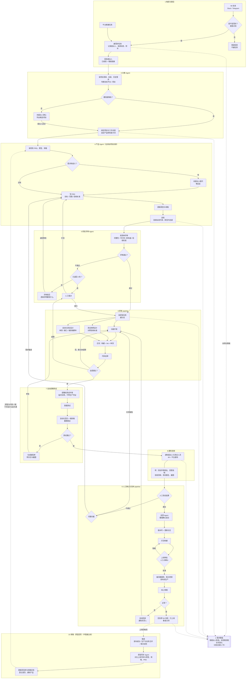
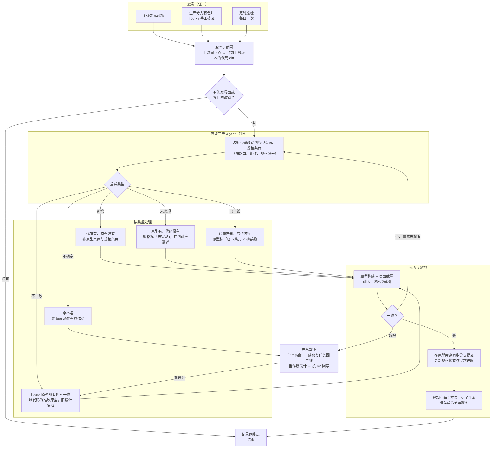
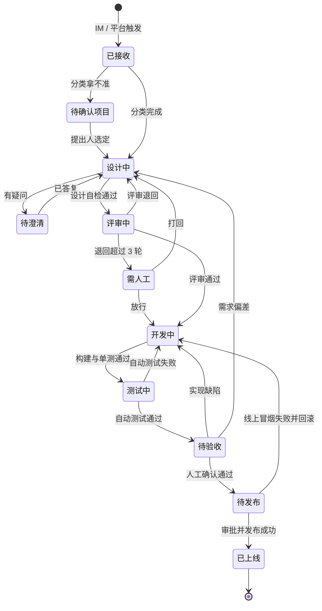

# 需求到发布全自动化工作流

> 2026-11-04 设计稿。目标：从一条 IM 消息或平台任务开始，经 Agent 分类、产品设计、研发评审、研发 pipeline、自动部署测试，到人工验收、打包发布全程自动推进；只在「拿不准」和「上生产」两处要人。

## 1. 总流程

## 2. 旁路：按上线代码回写原型库

主线走完只能保证「这一条需求」的原型和代码一致。实际进度还会被 hotfix、手工改动、研发阶段的实现取舍拉开差距，原型库会慢慢过时，下一条需求的产品 Agent 就会在过时的原型上设计。旁路分支专门做反向同步：**以上线代码为准，回写原型库和规格**，不阻塞主线，失败也不影响发布。

**旁路的规则**

- **以代码为准，但不静默抹掉设计**：不一致时以上线代码为准改原型，被替换的旧设计存档到同步记录里，产品随时能翻回去看。
- **原型领先的部分不删**：原型有、代码没有的，标成「未实现」并挂回需求，作为待开发的输入；代码删掉的功能，原型标成「已下线」。
- **拿不准就问产品**：分不清是 bug 还是有意改动时交给产品裁决。判成 bug 就建修复任务回主线，判成新设计就照常回写。
- **只走同步分支**：不直接改原型库主干，产品看过差异清单后再合并；同步失败只发通知，不影响已上线的版本。
- **同步点可追溯**：每次记下「同步到哪个上线版本」，下次只看增量；同步状态会写到需求上，看板上能看到「原型已同步到 vX.Y.Z」。

## 3. 看板状态

提出人在看板上看到的就是这些状态，每一步由流程自动推进，不用手改。

## 4. 各阶段由谁做、交出什么

| 阶段 | 执行者 | 产出（进下一步的条件） | 要人的地方 |
| --- | --- | --- | --- |
| 1 触发 | IM 插件 / 平台 | 需求任务（含提出人、来源消息） | 无 |
| 2 看板 | 平台 | 按提出人筛选的看板视图 | 只看 |
| 3 分类 | 分类 Agent | 绑定的项目、工作目录、角色提示词 | 置信度不够时提出人选项目 |
| 4 产品设计 | 产品 Agent | PRD、原型、规格，验收标准可测 | 需求有歧义时回答提问 |
| 5 研发评审 | 研发评审 Agent | 评审结论与意见 | 退回超过 3 轮时人工裁决 |
| 6 研发 | 研发 Agent（三路并行） | 代码分支、测试用例、自动化脚本，构建与单测通过 | 重试超限时转人工 |
| 7 部署测试 | 部署 Agent | 测试环境、测试报告、截图 | 无 |
| 8 通知 | 平台 | IM 与平台通知、验收清单 | 无 |
| 9 验收与发布 | 人 + 反馈 Agent + 发布 pipeline | 版本、更新日志、生产发布、线上冒烟结果 | 人工验收；上线审批 |
| 10 旁路回写 | 原型同步 Agent | 原型库同步分支、规格状态、差异清单、同步点 | 拿不准的差异由产品裁决；合并同步分支 |

## 5. 关键规则

- **两处必须有人**：人工验收和上线审批。生产发布前固定做数据库备份和密钥核对，失败自动回滚。
- **每个回退环都有上限**：评审退回最多 3 轮，研发自修和测试修复各自有重试上限，超限转人工，避免 Agent 空转。
- **人工验收不通过要分清归属**：实现缺陷回研发，需求偏差回产品，不一律退回开发。
- **测试环境不带生产凭证**：临时实例不复制密钥，避免和生产抢 IM 机器人。
- **原型跟着代码走**：每次上线后由旁路把原型库拉齐到上线代码，下一条需求的产品 Agent 始终在最新原型上设计。
- **全程留痕**：每一步的产出登记到任务（PRD、原型、commit、测试报告、版本号），看板状态随之更新，结束时回复原 IM 消息。
