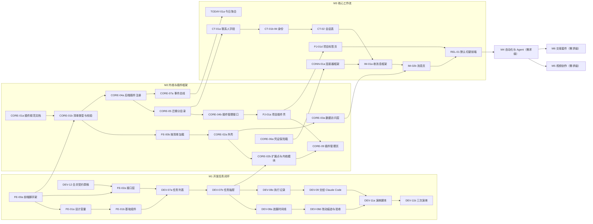

# 开发任务清单

- 依据：`web-next/docs/dev-plan.md` v3（2026-10-28）
- 机器可读版本：`docs/dev-tasks.json`；导入工作台：`scripts/import-dev-tasks.py`（默认 dry-run，加 `--apply` 才写入，建议先 `--api http://127.0.0.1:7796` 对测试实例）
- 每条任务都有验收标准和工作目录，可以直接用 `/task <编号>` 执行；需求级条目（M4 以后）开工前再拆
- 本文件的表格由 `docs/dev-tasks.json` 生成，改任务请改 JSON

## 总数

| 里程碑 | 任务 | 需求 |
|---|---|---|
| M1 开发任务闭环（含 4.0b 原型维护与正式前端工程） | 28 | 0 |
| M2 内核与插件框架 | 23 | 0 |
| M3 核心工作流 | 48 | 0 |
| M4 自动化与 Agent | 0 | 13 |
| M5 视频创作 | 0 | 8 |
| M6 交易套件 | 0 | 8 |
| 合计 | 99 | 29 |

## 依赖图（里程碑和关键路径）

只画里程碑之间的关系和关键路径上的任务，完整依赖看下面各表的「依赖」列。

关键路径：FE-00a、FE-01a、FE-01b、DEV-07a、DEV-07b、DEV-08a、DEV-08d、DEV-11a（M1）；CORE-01a、CORE-01b、CORE-04a、CORE-05、CORE-04b、PJ-01a、CORE-09（M2）；CT-01a、CT-01b、CT-02、CONN-01a、IM-01a、IM-02b、REL-01（M3）。
CORE-01a 是文档，要用户评审通过才能往下走，越早开越好。

## 第一批可以并行开工的任务

这几条互不依赖，改的目录也不重叠：

| 编号 | 改动范围 | 说明 |
|---|---|---|
| DEV-12 | `docs/api-contract.md`、`docs/mcp.md`、删 `docs/dev-loop-contract-draft.md` | 只改文档；它是 FE-02a 的前置，规模 S，最先合入 |
| FE-00a | 新建 `frontend/` | 正式前端脚手架，M1 前端任务都在它后面 |
| CORE-01a | 新建 `docs/plugin-api.md` | 只写文档，评审要用户参与，提早开可以把等待时间藏在 M1 里 |
| CORE-06a | `internal/`（新迁移、新包） | 不依赖任何任务；改契约文档那一步等 DEV-12 合入后再做 |
| QA-02a | 新建 `scripts/smoke-proto.py`，Makefile 加一个目标 | 只读原型（7778），不改原型代码 |

可以一起开但要注意：

- AG-03a（新建 `docs/file-artifact-model.md`）也是纯文档，人手够可以并进第一批。
- PROTO-02、PROTO-05 改 `web-next/`，而 M0 的 PR-01 到 PR-03 子代理正在改同一个目录，等它们合入后再开，否则会冲突。
- 第二批（FE-00a 合入后）：QA-01、FE-01a、FE-02a、FE-03。FE-01a 和 FE-02a 都在 `frontend/` 里，但分别在 `src/core/ui` 和 `src/core/api`，可以并行；两者都可能改 `frontend/package.json`，后合入的那条负责解决冲突。FE-03 改 Makefile，和 QA-02a 错开合入。

并行时的共同约束：

- `docs/api-contract.md` 同一时间只由一个任务改（并行分支合入时容易冲突，契约测试也会互相干扰）。
- 新迁移编号按合入顺序取，撞号时后合入的改号；0001 到 0013 一行不动。
- 只用测试实例（7796）联调；不启动、不重启 7777，不碰 `data/pm.db`；停进程按 pid 或端口，不用 `pkill -f`。

## 和计划相比做了哪些调整

| 调整 | 原因 |
|---|---|
| DEV-07 到 DEV-09 改在 `frontend/` 里做，FE-00 拆成 FE-00a（脚手架，无依赖）和 FE-00b（按插件清单加载，依赖 CORE-01） | 计划里 FE-00 依赖 CORE-01（M2），任务页又要在 M1 做，不拆就会被 M2 卡住 |
| QA-01（Vitest）提前到 M1，只依赖 FE-00a | 接口层、SSE 解析、产出物前缀解析都需要早点有测试；计划里它依赖 CORE-02 |
| FE-03 只打通链路并提供开关，默认切换放到 REL-01 | 计划里 FE-03 和 REL-01 是同一件事，但依赖不同（FE-00 和 M3） |
| 新增 PJ-01a（项目插件壳）放在 M2 | CORE-09 的验收要「项目」插件走完生命周期，而 PJ-01 在 M3 又依赖 CORE-09，互相等 |
| AG-01 拆成 AG-01a（M3，会话页接现有接口）和 AG-01b（M4，需求级） | 4.4 把 AG-01 放在 M3，里程碑表把「技能和知识库」放在 M4 |
| 连接器基础部分（CONN-01a 到 01d、CONN-02、CONN-03、MP-01）放进 M3，Google Drive 和日历拆成 CONN-01e 放 M4 | 按本次拆分范围；计划 4.7 写的是 M4 |
| CONN-02 的验收改用 IM 消息插件 | 计划写「停用视频插件」，视频插件在 M5 |
| 新增 CORE-07c、CORE-10a、DOC-01a、CONN-01d、MP-01b、AG-03a 等拆分条目 | 原条目是全栈 M 或 L，按前后端或设计与实现拆开 |
| 规格包放在 `web-next/docs/spec/` | 计划没有写位置 |

## M1 开发任务闭环（28 条）

### 开发任务闭环（4.0）

| 编号 | 标题 | 优先级 | 规模 | 模块 | 依赖 | 负责目录 |
|---|---|---|---|---|---|---|
| DEV-12 | 合并开发任务闭环契约草稿到 api-contract.md 和 mcp.md | P0 | S | backend | 无 | `.` |
| DEV-07a | 在 frontend/ 实现任务列表页并接真实接口 | P0 | M | frontend | FE-01b、FE-02a | `frontend` |
| DEV-07b | 在 frontend/ 实现任务抽屉：新建、编辑、改状态 | P0 | M | frontend | DEV-07a | `frontend` |
| DEV-08a | 在任务详情里显示进展时间线 | P0 | M | frontend | DEV-07b | `frontend` |
| DEV-08b | 在任务详情里显示产出物 | P1 | S | frontend | DEV-07b | `frontend` |
| DEV-08c | 在任务详情里显示执行记录和流式输出 | P0 | M | frontend | DEV-07b、FE-02b | `frontend` |
| DEV-08d | 在任务详情里显示 Agent 改动痕迹并支持验收和退回 | P0 | M | frontend | DEV-08a | `frontend` |
| DEV-09 | 在任务页实现「交给 Claude Code」 | P1 | M | frontend | DEV-08c | `frontend` |
| DEV-11a | 编写开发任务闭环的端到端演练脚本 | P0 | M | qa | DEV-08d、DEV-09、DEV-12 | `.` |
| DEV-11b | 在测试实例上连续三次演练闭环并整理切换清单 | P0 | S | qa | DEV-11a | `.` |

### 正式前端工程（4.0b）

| 编号 | 标题 | 优先级 | 规模 | 模块 | 依赖 | 负责目录 |
|---|---|---|---|---|---|---|
| FE-00a | 新建正式前端工程 frontend/ 的脚手架 | P0 | M | frontend | 无 | `.` |
| FE-01a | 从原型抽出设计变量并实现亮暗主题 | P0 | M | frontend | FE-00a | `frontend` |
| FE-01b | 实现正式前端的基础组件 | P0 | M | frontend | FE-01a、QA-01 | `frontend` |
| FE-02a | 实现前端接口层和按契约手写的类型 | P0 | M | frontend | FE-00a、DEV-12 | `frontend` |
| FE-02b | 实现 SSE 流式响应客户端 | P1 | S | frontend | FE-02a、QA-01 | `frontend` |
| FE-03 | 打通新前端构建产物嵌入 Go 二进制的链路 | P1 | S | build | FE-00a | `.` |
| FE-04 | 实现原型与正式前端的截图对照工具 | P2 | M | qa | FE-01a、QA-02a | `.` |

### 原型维护（4.0b）

| 编号 | 标题 | 优先级 | 规模 | 模块 | 依赖 | 负责目录 |
|---|---|---|---|---|---|---|
| PROTO-02 | 清理原型里的开发残留 | P2 | S | proto | 无 | `web-next` |
| PROTO-01 | 把原型示例数据整理成一套干净的演示故事线 | P2 | M | proto | PROTO-02 | `web-next` |
| PROTO-04a | 搭建规格包骨架和截图生成 | P1 | S | proto | QA-02a | `web-next` |
| PROTO-04b | 整理今日与任务模块的规格包 | P1 | M | proto | PROTO-04a | `web-next` |
| PROTO-04c | 整理文档、联系人、会话模块的规格包 | P1 | M | proto | PROTO-04a | `web-next` |
| PROTO-04d | 整理 IM 消息与项目模块的规格包 | P1 | M | proto | PROTO-04a | `web-next` |
| PROTO-04e | 整理设置模块的规格包（连接器、模型服务商、工作台、枚举、外观） | P1 | M | proto | PROTO-04a | `web-next` |
| PROTO-03 | 在原型里加一个总览页 | P2 | S | proto | PROTO-04a | `web-next` |
| PROTO-05 | 终端和浏览器改为项目内的独立展开区域 | P2 | M | proto | 无 | `web-next` |

### 质量（4.12）

| 编号 | 标题 | 优先级 | 规模 | 模块 | 依赖 | 负责目录 |
|---|---|---|---|---|---|---|
| QA-01 | 给 frontend/ 接入 Vitest 单元与组件测试 | P1 | S | qa | FE-00a | `frontend` |
| QA-02a | 把原型的 Playwright 冒烟测试固定成一条 make 命令 | P2 | S | qa | 无 | `.` |

## M2 内核与插件框架（23 条）

### 前端内核

| 编号 | 标题 | 优先级 | 规模 | 模块 | 依赖 | 负责目录 |
|---|---|---|---|---|---|---|
| FE-00b | 让正式前端按插件清单加载模块 | P0 | M | frontend | CORE-01b | `frontend` |
| CORE-02a | 实现正式前端的外壳：一级菜单、顶栏、命令面板 | P0 | M | frontend | FE-00b、FE-01b | `frontend` |
| CORE-02b | 接通扩展点并把任务页迁成内核模块 | P0 | M | frontend | CORE-02a、DEV-07b | `frontend` |
| CORE-03a | 实现正式前端的统一数据访问层 | P0 | M | frontend | CORE-02a、FE-02a | `frontend` |
| CORE-03b | 用 lint 规则守住插件和模块之间的边界 | P1 | S | frontend | CORE-03a、CORE-02b | `frontend` |
| CORE-07c | 让正式前端订阅事件流并刷新数据 | P1 | S | frontend | CORE-07b、CORE-03a | `frontend` |
| CORE-09 | 实现插件管理页 | P0 | M | frontend | CORE-02b、CORE-04b、PJ-01a | `frontend` |
| CORE-10b | 实现工作台切换与模板缺插件提示 | P2 | S | frontend | CORE-10a、CORE-09 | `frontend` |

### 后端内核

| 编号 | 标题 | 优先级 | 规模 | 模块 | 依赖 | 负责目录 |
|---|---|---|---|---|---|---|
| CORE-04a | 实现后端插件注册与按配置启停 | P0 | M | backend | CORE-01b | `.` |
| CORE-05 | 实现插件迁移分目录、单独记版本并带校验和 | P0 | M | backend | CORE-04a | `.` |
| REL-02 | 实现迁移前自动备份和失败回滚 | P1 | S | backend | CORE-05 | `.` |
| CORE-06a | 实现凭证保险箱：加密存储、脱敏提示、轮换 | P0 | M | backend | 无 | `.` |
| CORE-06b | 把模型服务商的 api_key 迁进凭证保险箱 | P1 | S | backend | CORE-06a | `.` |
| CORE-07a | 实现后端事件总线 | P0 | M | backend | CORE-04a | `.` |
| CORE-07b | 实现通知存储和推送给前端的事件流接口 | P1 | M | backend | CORE-07a | `.` |
| CORE-08 | 实现审计日志 | P1 | M | backend | CORE-07a | `.` |
| CORE-04b | 实现插件管理接口：列出、安装、启停、卸载 | P0 | M | backend | CORE-04a、CORE-05 | `.` |
| CORE-10a | 把工作台配置存到后端 | P2 | S | backend | CORE-04b | `.` |
| CORE-11 | 统一 id 前缀登记并去掉前端生成编号 | P2 | S | backend | 无 | `.` |

### 全栈与插件规范

| 编号 | 标题 | 优先级 | 规模 | 模块 | 依赖 | 负责目录 |
|---|---|---|---|---|---|---|
| CORE-01a | 编写插件清单格式和插件 API 规范文档 | P0 | M | fullstack | 无 | `.` |
| CORE-01b | 实现插件清单的类型定义和校验（前后端） | P0 | M | fullstack | CORE-01a、FE-00a、QA-01 | `.` |
| PJ-01a | 搭出「项目」插件的壳：清单、注册、空页面 | P0 | S | fullstack | CORE-04b、FE-00b | `.` |

### 质量与发布（4.12）

| 编号 | 标题 | 优先级 | 规模 | 模块 | 依赖 | 负责目录 |
|---|---|---|---|---|---|---|
| QA-04 | 补强后端契约测试：响应字段与契约文档示例一致 | P2 | M | qa | DEV-12 | `.` |

## M3 核心工作流（48 条）

### 今日（4.3）

| 编号 | 标题 | 优先级 | 规模 | 模块 | 依赖 | 负责目录 |
|---|---|---|---|---|---|---|
| TODAY-01a | 实现今日聚合接口的内核部分 | P0 | M | backend | CORE-07a | `.` |
| TODAY-01b | 让插件能往今日聚合里加卡片 | P1 | S | backend | TODAY-01a、CORE-04a | `.` |
| TODAY-02 | 实现今日页并接聚合接口 | P0 | S | frontend | TODAY-01b、CORE-02b、CORE-03a | `frontend` |

### 任务（4.3）

| 编号 | 标题 | 优先级 | 规模 | 模块 | 依赖 | 负责目录 |
|---|---|---|---|---|---|---|
| TASK-01 | 让任务接口支持来源和来源筛选 | P1 | S | backend | DEV-07b | `.` |
| TASK-02a | 实现 Webhook 配置和密钥管理 | P1 | M | backend | TASK-01、CORE-06a | `.` |
| TASK-02b | 实现 Webhook 收件、映射过滤与去重 | P1 | M | backend | TASK-02a | `.` |
| TASK-03a | 实现定时任务定义和下次执行时间计算 | P1 | M | backend | TASK-01 | `.` |
| TASK-03b | 实现定时任务调度执行和执行记录 | P1 | M | backend | TASK-03a、CORE-07a | `.` |
| TASK-04a | 实现定时任务页 | P1 | M | frontend | TASK-03b、CORE-03a | `frontend` |
| TASK-04b | 实现 Webhook 页和任务来源视图 | P1 | M | frontend | TASK-02b、CORE-03a | `frontend` |

### 文档（4.3）

| 编号 | 标题 | 优先级 | 规模 | 模块 | 依赖 | 负责目录 |
|---|---|---|---|---|---|---|
| DOC-01a | 实现文档的本机目录挂载和文件读取接口 | P1 | S | backend | 无 | `.` |
| DOC-01b | 实现文档页：分类树、标签、本地目录、阅读器 | P1 | M | frontend | DOC-01a、CORE-03a | `frontend` |

### 联系人与会话（4.4）

| 编号 | 标题 | 优先级 | 规模 | 模块 | 依赖 | 负责目录 |
|---|---|---|---|---|---|---|
| CT-01a | 扩展联系人字段（基于干系人名册） | P1 | M | backend | CORE-05 | `.` |
| CT-01b | 实现 IM 身份表：一个联系人多个渠道身份 | P0 | M | backend | CT-01a | `.` |
| CT-02 | 实现会话表：群聊和私聊有稳定 id | P0 | M | backend | CT-01b | `.` |
| CT-03a | 实现联系人列表页 | P1 | M | frontend | CT-01a、CORE-03a | `frontend` |
| CT-03b | 实现联系人抽屉和 IM 身份编辑 | P1 | M | frontend | CT-03a、CT-01b | `frontend` |
| AG-01a | 实现会话页并接现有的 Agent 会话与对话接口 | P1 | M | frontend | CORE-03a、FE-02b | `frontend` |
| AG-03a | 设计产出溯源的统一模型 | P1 | S | backend | 无 | `.` |
| AG-03b | 实现文件与产出溯源 | P1 | M | backend | AG-03a、CORE-05 | `.` |

### 项目插件（4.5）

| 编号 | 标题 | 优先级 | 规模 | 模块 | 依赖 | 负责目录 |
|---|---|---|---|---|---|---|
| PJ-01b | 对齐项目数据接口：项目字段和项目干系人角色 | P1 | M | backend | PJ-01a、CT-01a | `.` |
| PJ-01c | 实现项目列表与项目概览、设置标签页 | P1 | M | frontend | PJ-01b、CORE-03a | `frontend` |
| PJ-01d | 实现项目的任务、文档、干系人标签页 | P1 | M | frontend | PJ-01c、DEV-07b | `frontend` |
| PJ-02a | 实现项目与会话的绑定接口 | P2 | S | backend | CT-02、PJ-01b | `.` |
| PJ-02b | 实现项目沟通页 | P2 | M | frontend | PJ-02a、IM-02b | `frontend` |
| PJ-03a | 实现项目资料接口（合并支持材料与项目文档） | P2 | M | backend | AG-03b、PJ-01b | `.` |
| PJ-03b | 实现项目资料页 | P2 | M | frontend | PJ-03a、PJ-01c | `frontend` |
| PJ-04a | 实现原型进程管理：启停、端口检查、日志 | P2 | M | backend | PJ-01b | `.` |
| PJ-04b | 实现项目原型卡片的启停与日志 | P2 | S | frontend | PJ-04a、PJ-01c | `frontend` |

### IM 消息插件（4.6）

| 编号 | 标题 | 优先级 | 规模 | 模块 | 依赖 | 负责目录 |
|---|---|---|---|---|---|---|
| IM-01a | 实现 IM 消息插件的收消息框架和消息表 | P1 | M | backend | CONN-01a、CT-02、CORE-07a | `.` |
| IM-01b | 接入 Slack 收消息 | P1 | M | backend | IM-01a | `.` |
| IM-01c | 接入 Telegram Bot 收消息 | P2 | M | backend | IM-01a | `.` |
| IM-02a | 实现消息处理动作：回复、稍后提醒、转任务 | P1 | M | backend | IM-01a、TASK-01 | `.` |
| IM-02b | 实现 IM 消息页和消息抽屉 | P1 | M | frontend | IM-02a、CORE-03a、CT-03a | `frontend` |
| IM-03 | 实现「与我相关」识别 | P2 | S | backend | IM-01a | `.` |
| IM-04a | 实现消息附件下载到本地 | P2 | M | backend | IM-01a、PJ-03a | `.` |
| IM-04b | 实现附件面板和项目附件收件 | P2 | S | frontend | IM-04a、IM-02b | `frontend` |

### 连接器与模型服务商（4.7）

| 编号 | 标题 | 优先级 | 规模 | 模块 | 依赖 | 负责目录 |
|---|---|---|---|---|---|---|
| CONN-01a | 实现连接器框架的数据模型与接口 | P1 | M | backend | CORE-06a、CORE-04a | `.` |
| CONN-01b | 实现连接器的 OAuth 回调与 Token 刷新 | P1 | M | backend | CONN-01a | `.` |
| CONN-01c | 真实接通 GitHub 连接器 | P1 | S | backend | CONN-01a | `.` |
| CONN-01d | 实现连接器设置页 | P1 | M | frontend | CONN-01a、CORE-02b | `frontend` |
| CONN-02 | 让插件可以注册连接器 | P2 | S | fullstack | CONN-01d、CORE-01b | `.` |
| CONN-03 | 实现删除连接器前的影响检查 | P2 | S | backend | CONN-01a | `.` |
| MP-01a | 补齐模型服务商：Anthropic、DeepSeek 与可用模型列表 | P1 | M | backend | CORE-06b | `.` |
| MP-01b | 实现模型服务商设置页 | P1 | M | frontend | MP-01a、CORE-02b | `frontend` |

### 质量与发布（4.12）

| 编号 | 标题 | 优先级 | 规模 | 模块 | 依赖 | 负责目录 |
|---|---|---|---|---|---|---|
| QA-02b | 为正式前端固定 Playwright 冒烟测试 | P2 | S | qa | QA-02a、CORE-02a | `.` |
| QA-03 | 制作大量数据压测数据集作为固定测试夹具 | P2 | S | qa | DEV-07a | `.` |
| REL-01 | 把 make build 的默认前端切成新前端，旧前端保留一个版本回退 | P1 | S | build | FE-03、TODAY-02、DOC-01b、CT-03b、PJ-01d、IM-02b、TASK-04b、AG-01a、QA-02b | `.` |

## M4 以后：需求级条目（29 条，不拆细，开工前再拆）

| 编号 | 标题 | 里程碑 | 规模 | 依赖 |
|---|---|---|---|---|
| AG-01b | Agent 配置、技能、知识库接口 | M4 | L | CORE-06b、AG-01a |
| AG-02 | Agent 工具权限：按连接器工具逐项授权 | M4 | M | AG-01b、CONN-01a |
| CONN-01e | 接通 Google Drive 和 Google 日历连接器 | M4 | M | CONN-01b |
| SOP-01 | SOP 执行引擎搬到后端 | M4 | L | CORE-07a |
| SOP-02 | SOP 写操作节点真落地 | M4 | M | SOP-01、CORE-08 |
| SOP-03 | 插件可以注册 SOP 节点类型 | M4 | M | SOP-01、CORE-01b |
| SOP-04 | SOP 编辑器和运行页接接口，AI 协助生成流程 | M4 | M | SOP-01 |
| TERM-01 | 真终端：后端 pty 加 WebSocket，2x2 分屏 | M4 | M | PJ-04a |
| BR-01 | 浏览器标签页持久化，Google 账号状态存后端 | M4 | S | CONN-01b |
| BR-02 | 内置浏览器处理不能嵌入的站点 | M4 | S | 无 |
| DOM-01 | 内网域名插件接现有 bro.vip 方案 | M4 | M | CORE-04b |
| DOM-02 | 原型自动分配域名并写入代理 | M4 | M | DOM-01、PJ-04a |
| PROTO-04f | 整理其余模块的规格包（SOP、终端、浏览器、内网域名、视频、交易） | M4 | L | PROTO-04a |
| VID-01 | 视频、系列、检查点、产出物数据表和接口 | M5 | M | CORE-05、AG-03b |
| VID-02 | 产出物结构对齐 web-video-presentation 技能 | M5 | M | VID-01 |
| VID-03 | 制作阶段一键调技能、SOP、Agent | M5 | L | VID-01、SOP-03 |
| VID-04 | 内容平台连接器：B 站、YouTube、抖音上传和数据拉取 | M5 | L | CONN-02 |
| VID-05 | 发布记录和数据按天存快照 | M5 | M | VID-04 |
| VID-06 | 内容日历与到点发布 | M5 | M | TASK-03b、VID-04 |
| VID-07 | 视频插件的今日卡片 | M5 | S | TODAY-01b |
| VID-08 | 选题库、评论收件箱、商单 | M5 | L | VID-01、IM-01a |
| TRD-01 | 行情数据源适配：先接 Binance、OKX 公开行情 | M6 | L | CONN-02 |
| TRD-02 | 行情推送和本地缓存 | M6 | M | TRD-01 |
| TRD-03 | 盯盘提醒放后端定时检查，推送走事件总线 | M6 | M | TRD-02、CORE-07a |
| TRD-04 | 回测引擎搬到后端，用真实历史数据 | M6 | L | TRD-01 |
| TRD-05 | 模拟盘撮合和策略部署 | M6 | L | TRD-04 |
| TRD-06 | 风控在后端强制：仓位上限、日亏损熔断、单笔上限、一键全停 | M6 | M | TRD-05 |
| TRD-07 | 交易账户接入：API Key 存保险箱，默认只读 | M6 | M | CORE-06a |
| TRD-08 | 实盘评审：审计日志、对账、异常处理、停用前强制全停 | M6 | M | TRD-06、CORE-08 |
