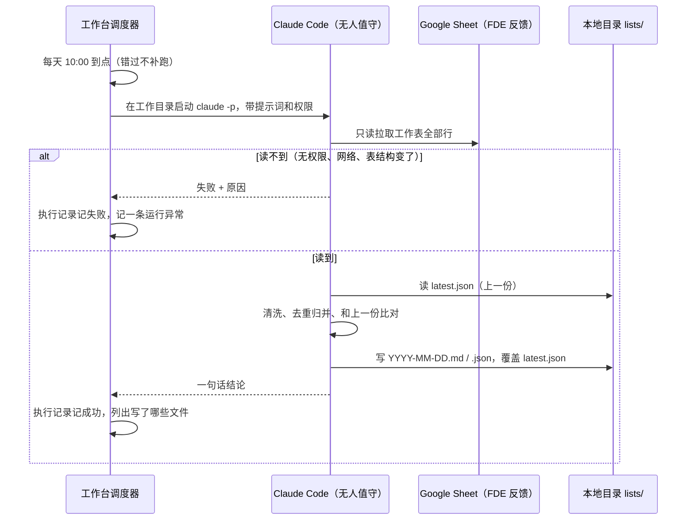

# PRD：每日 10:00 由 Claude Code 整理 FDE 反馈需求清单

| 项 | 内容 |
|---|---|
| 工作台任务 | TSK-0429（P2，到期 2026-11-05） |
| 版本 | v0.1 草稿，2026-11-04 |
| 数据源 | Google Sheet `1AbCdEfGhIjKlMnOpQrStUvWxYz0123456789`，工作表 gid `1115809405` |
| 原型 | `web-next`：任务 > 定时任务，演示数据「整理 FDE 反馈需求清单」；新增动作「交给 Claude Code」 |
| 规格 | `web-next/docs/spec/tasks.md`：`SPEC-tasks-0` 的 `ScheduleAction.claude`、`ScheduleRun.files`，`SPEC-tasks-8.27` 到 `8.31` |

## 1. 背景与问题

FDE（驻场工程师）把客户现场的反馈记在一张共享 Google Sheet 里。产品这边现在靠人隔几天翻一次表，问题是：

- 新增行和改过的行看不出来，容易漏；
- 同一个诉求被不同 FDE、不同客户重复记，人工归并费时；
- 整理结果散在聊天和脑子里，没有可追溯的日版本。

工作台已有「定时任务」，但能做的事只有建任务、提醒、执行 SOP、让 Agent 去做、运行异常巡检，**没有「到点让本机 Claude Code 在某个目录里跑一段要求」**。这件事拆成两部分：

- **A. 工作台能力**：定时任务新增动作「交给 Claude Code」，通用，不绑 FDE。
- **B. 这一条定时任务的配置与整理规则**：每天 10:00，读表、归并成需求清单、存本地。

## 2. 目标与不做的

目标：

1. 每天 10:00 自动产出一份当天的 FDE 需求清单（Markdown 给人看、JSON 给程序用），存在本机固定目录。
2. 清单和上一份比，标出新增、变更、已关闭，人只看变化。
3. 跑没跑、跑成什么样、写了哪些文件，在工作台定时任务的执行记录里一眼看到；失败进运行异常。

不做的（本期）：

- 不回写 Google Sheet（只读）。
- 不自动在工作台里建需求 / 任务（避免每天刷出一堆重复对象；是否要做见第 9 节问题 Q4）。
- 不做跨表、多数据源。
- 不发 Slack / IM 通知（失败走运行异常；后续可加）。

## 3. 整体流程



## 4. B 部分：整理规则

### 4.1 字段映射

表头目前未确认（见 Q1）。约定在工作目录 `README.md` 里写一张「列映射」，Claude Code 每次按它读；表头和映射对不上时**不猜**，记失败「表结构变了：缺少列 X」。建议映射的目标字段：

| 目标字段 | 含义 | 必须 |
|---|---|---|
| `row_id` | 表里的行号，或表里已有的反馈编号 | 是 |
| `submitted_at` | 提交日期 | 是 |
| `fde` | 提交人 | 是 |
| `customer` | 客户 / 项目 | 是 |
| `module` | 产品模块 | 否 |
| `content` | 反馈原文 | 是 |
| `severity` | 紧急程度（表里有就用，没有留空） | 否 |
| `status` | 表里的处理状态（如有） | 否 |

### 4.2 清洗

- 跳过：整行空、`content` 为空、表头重复行。跳过的行数写进结论。
- 去首尾空白；日期统一成 `YYYY-MM-DD`。

### 4.3 归并成需求

- 一条需求 = 一个诉求，可能由多行反馈支撑。判定同一诉求：同模块（或模块为空）且说的是同一件事；拿不准的**不合并**，在需求上标 `uncertain_merge: true`，留给人看。
- 需求编号 `FDE-REQ-NNN` 一旦分配不变：按 `latest.json` 里的 `source_rows` 匹配，同一组行仍对应原编号。
- 每条需求字段：`id`、`title`（一句话，动宾结构）、`module`、`summary`、`customers`（去重列表）、`source_rows`（行号列表）、`mentions`（反馈行数）、`first_seen`、`last_seen`、`severity`（取支撑行里最高的）、`change`（见 4.4）。
- 排序：`severity` 高的在前，同级按 `mentions` 多的在前，再按 `last_seen` 新的在前。

### 4.4 和上一份比对

| `change` | 判定 |
|---|---|
| `new` | 上一份没有这个编号 |
| `updated` | 编号在，但 `source_rows` 增加了，或支撑行的原文改了 |
| `closed` | 表里支撑行的状态全部变成已关闭类状态（依赖 `status` 列，没有该列时不出现） |
| `unchanged` | 其余 |

第一份清单（没有 `latest.json`）全部记 `new`。

### 4.5 本地存储

工作目录 `/Users/<me>/pm/fde-feedback`（实际路径见 Q2），结构：

```text
fde-feedback/
  README.md              列映射、整理规则（Claude Code 每次读）
  lists/
    2026-11-05.md        当天清单，给人看
    2026-11-05.json      当天清单，结构化
    latest.json          最近一份成功的清单，用于下次比对
```

- 同一天重跑（「立即执行一次」）覆盖当天文件，不产生第二份。
- 失败时**不写**任何文件，`latest.json` 保持上一份。
- 不在本地存表格原始数据快照（避免客户信息散落本机，见 Q5）。

`.md` 结构：标题「FDE 需求清单 · YYYY-MM-DD」，一行统计（反馈 N 行、需求 M 条、新增 a、变更 b、关闭 c、跳过 d 行），然后按「新增 / 变更 / 已关闭 / 其余」分四节，每条需求一个小表。`.json` 是 `{generated_at, sheet_id, gid, stats, requirements: [...]}`。

## 5. A 部分：工作台能力「交给 Claude Code」定时动作

详细交互以规格 `SPEC-tasks-8.27` 到 `8.31` 为准，这里只列要点：

- 抽屉「做什么」新增「交给 Claude Code」：工作目录（必填，绝对路径）、角色（可选，默认「不用」）、要它做什么（必填，支持 `{{date}}`）、结果存到（可选，工作目录下相对路径）、允许写入（默认不勾，勾时二次确认；只读角色锁定不勾）。
- 到点：同「流式执行」在工作目录跑 `claude -p`；只读不加权限参数，允许写入加 `--permission-mode acceptEdits`；任何情况都不加 `--dangerously-skip-permissions`。需要确认的操作被挡下即算失败。最长 30 分钟。
- 不建任务、不开终端、不改任务状态；结论文字和本次写出的文件（结果目录执行前后对比）记进定时任务执行记录 `ScheduleRun.files`。
- 失败同时记一条运行异常，同一定时任务连续失败按指纹合并次数。
- 错过不补跑、停用记「没执行：已停用」，沿用现有调度口径。

后端契约草案（实现时并入 `docs/api-contract.md` 的「定时任务 schedules」）：

| kind | 字段 | 说明 |
|---|---|---|
| `claude` | `workdir`（必填，绝对路径）、`prompt`（必填）、`preset_id`（可空）、`allow_writes`（缺省 `false`）、`out_dir`（可空，相对路径，不许 `..`） | 保存时校验路径写法，不查目录存在；到点目录不存在记 `failed`「没执行：工作目录不存在」；角色已删记 `failed`「没执行：角色已删除」；本机没装 claude 记 `unsupported` |

`ScheduleRun` 增加 `files: string[]`（可空），其余字段不变。

## 6. 本条定时任务的配置

| 项 | 值 |
|---|---|
| 名称 | 整理 FDE 反馈需求清单 |
| 什么时候 | 每天 10:00（服务所在机器本地时区） |
| 做什么 | 交给 Claude Code |
| 工作目录 | `/Users/<me>/pm/fde-feedback`（待定，Q2） |
| 角色 | 不用 |
| 结果存到 | `lists` |
| 允许写入 | 是（要写清单文件） |
| 要它做什么 | 从 FDE 反馈表（链接）读全部反馈行，按 README.md 里的整理规则去重、归并成需求清单：写当天的 .md 和 .json，更新 latest.json；和上一份比，标出新增、变更、已关闭。只读表格，不改表格。 |

## 7. 验收标准

每条都能独立测试。A 部分在原型和正式产品各验一遍，B 部分在正式产品上验。

A. 工作台能力

1. 定时任务列表的动作筛选里有「交给 Claude Code」，条数正确；演示数据「整理 FDE 反馈需求清单」显示「每天 10:00」、下次执行为今天或明天 10:00。
2. 新建定时任务选「交给 Claude Code」，工作目录留空直接保存：底栏显示「选一个工作目录」，抽屉不关。
3. 工作目录填 `abc`：保存时提示「工作目录要写本机绝对路径」。
4. 要它做什么留空：保存时提示「写一下要它做什么」。
5. 结果存到填 `/tmp` 或 `../x`：框下红字「要写工作目录下的相对路径，比如 lists」，不能保存；填 `lists` 时灰字显示「产出写到 <工作目录>/lists」。
6. 勾「允许写入」先出现橙色确认，不点确认时复选框保持不勾；点「算了，只读」后仍不勾；点「确认允许写入」后勾上，灰字变成 acceptEdits 说明。
7. 角色选「研发评审（只读）」：允许写入变成不勾且不可点，灰字写「角色「研发评审」只读」。
8. 打开演示数据点「立即执行一次」：执行记录最上面多一条带「手动」标签的成功记录，后面列出 `<今天>.md`、`<今天>.json`，悬停显示完整路径；「下次执行」不变。
9. 把允许写入取消后立即执行：记录为「只读跑完：结论记在这里，没写文件」，不列文件。
10. 演示数据里前天那条显示红点和「失败：读不到表格（403，没有访问权限）…」，列表「上次」一列不受它影响（上次是最近一次）。
11. 正式产品：到点执行时进程参数里没有 `--dangerously-skip-permissions`；只读时没有 `--permission-mode acceptEdits`。
12. 正式产品：执行超过 30 分钟被停止，记失败「跑了 30 分钟没结束，已停止」，并在运行异常里出现一条来源为定时任务的记录。
13. 正式产品：服务在 10:00 没运行、10:05 启动，当天不补跑，执行记录记一条错过。

B. FDE 清单

14. 首次运行后 `lists/` 下有当天 `.md`、`.json` 和 `latest.json`，`.json` 能被 JSON 解析，`requirements` 每条含 4.3 列出的全部字段。
15. 表里新增一行全新诉求后再跑：清单多一条 `change: new` 的需求，原有需求编号不变。
16. 给已有诉求再加一行同类反馈后再跑：对应需求 `mentions` 加 1、`change: updated`，没有新开编号。
17. 同一天跑两次：当天文件被覆盖，`lists/` 里没有第二份当天文件。
18. 把表格权限收回后跑：执行记录失败、原因含「没有访问权限」，`lists/` 里没有新文件，`latest.json` 内容不变。
19. 把某个映射里的列名改掉后跑：失败，原因为「表结构变了：缺少列 <列名>」，不产出文件。
20. 运行前后 Google Sheet 的修改历史里没有这次运行产生的改动。

## 8. 风险

| 风险 | 影响 | 应对 |
|---|---|---|
| 无人值守时 Claude Code 拿不到 Google 授权（claude.ai 连接器需要交互式 OAuth，`claude -p` 下不一定可用） | 每天都失败 | 上线前定读表方式（Q3），首选服务账号只读 + 本地脚本导出 CSV，再交给 Claude Code 整理 |
| 归并依赖模型判断，前后两天结果不稳定 | 编号漂移、误报变更 | 编号按 `source_rows` 锚定；拿不准不合并并标记 |
| 本机睡眠 / 服务没开 | 当天没清单 | 错过不补跑是现有口径；执行记录可见，必要时手动执行 |
| 客户信息落在本机 | 合规 | 只存整理结果，不存原始快照（Q5 确认） |

## 9. 待确认问题

- Q1：工作表的列有哪些、哪列是状态？本次没有读表权限，列映射要你给或授权后由首轮运行生成草稿再确认。
- Q2：清单存到哪个目录？原型里用的是示例路径 `/Users/me/pm/fde-feedback`。
- Q3：读表方式选哪种：(a) Google 服务账号只读 + 脚本导出；(b) 表格发布为 CSV 链接（任何拿到链接的人都能看，不推荐）；(c) 依赖 Claude Code 里的 Google 连接器（无人值守下可用性未验证）。
- Q4：清单里的新增需求要不要自动在工作台建成需求对象？本期默认不建。
- Q5：本地是否允许留表格原始快照（便于追溯）？默认不留。
- Q6：周末和节假日也跑吗？默认每天都跑。

---

由 DeepSeek Harness（dsh）协助完成。

[](https://github.com/deepseek-ai/deepseek-harness)
