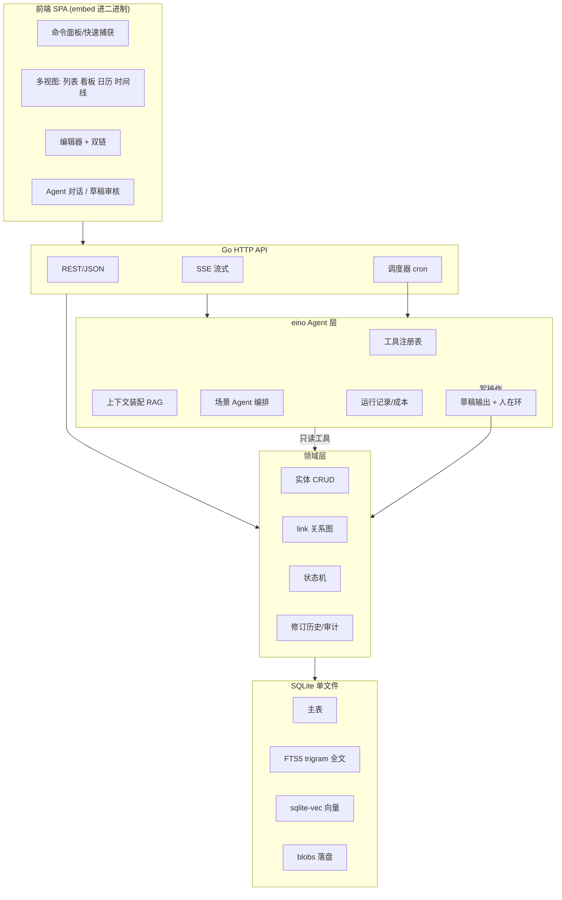

# 产品工作台 · 功能分析

技术栈假设：SQLite（单文件 + WAL + FTS5 + sqlite-vec）/ Go 后端（cloudwego eino 做 Agent 编排）/ 前端 SPA（Vite + React + shadcn）打包 embed 进 Go 单二进制。

已明确的四块：需求收录、待办跟进、文档资源项目管理、AI Agent 总结与分析。下面是「还需要支持哪些」。

---

## 1. 领域模型：缺的是「关联」而不是「实体」

这类工作台真正的价值在于万物互联，而不是四张独立的表。需要补：

| 能力 | 说明 | 不做的后果 |
|---|---|---|
| 统一 link 表 | `links(from_type, from_id, to_type, to_id, relation)`，支持 需求→任务、需求→文档、任务→资源、需求→需求（重复/依赖/拆分） | 四个模块变成四个孤岛，AI 拿不到上下文 |
| 反向链接 backlinks | 任一实体页展示「谁引用了我」 | 无法回答「这个文档支撑了哪些需求」 |
| 状态机可配置 | 需求 / 任务各自一套状态 + 允许的流转，存表不写死 | 半年后改流程要改代码 |
| 自定义字段 | EAV 或 JSON 列，按实体类型定义 | 一定会遇到「我想加个字段」 |
| 修订历史 | `revisions` 表存字段级变更 + 操作人 + 时间 | Agent 写坏数据无法回滚，也做不了「本周变更了什么」 |
| 软删除 + 回收站 | `deleted_at` | 误删无解 |
| 周期规则 | 重复待办（每周一、每月末） | 例行工作靠手工重建 |

建议实体集合：`project / requirement / task / doc / resource / note / person / tag / view / agent_run`。

## 2. 输入侧（最容易被低估的一块）

- **Inbox 收件箱**：先收进来，再分类。GTD 的核心，没有它收录会变成「每次录入都要想归到哪」然后就不录了。
- **快速捕获**：全局快捷键 / 命令面板（Cmd+K）/ CLI 子命令 `pmw add "xxx"`，3 秒内完成一条。
- **多来源导入**：Markdown 目录批量导入、CSV、剪贴板、URL 抓取正文、IM webhook（Slack/飞书把消息转需求）、邮件。
- **附件策略**：SQLite 只存元数据 + sha256，文件落 `data/blobs/<hash>`，天然去重；不要往 SQLite 塞 BLOB。
- **模板**：需求模板、会议纪要模板、周报模板、复盘模板。模板可带默认标签与默认关联。

## 3. 组织与检索

- **全文检索 FTS5**：中文必须提前决策分词方案。FTS5 默认 unicode61 对中文无效，走 **trigram tokenizer**（SQLite 3.34+，零依赖，推荐）或外挂分词。这个决定要在建表前做。
- **语义检索 sqlite-vec**：文档/需求分块 embedding 入库，供相似需求发现与 RAG。
- **多视图**：列表 / 看板 / 表格 / 日历 / 时间线，同一批数据不同呈现；**Saved View**（存筛选条件 + 排序 + 视图类型）。
- **标签 + 层级分类**双轨，标签做交叉维度，项目做归属维度。

## 4. 跟进与提醒

- 到期日、逾期高亮、今日聚焦视图、我的一周。
- **调度器**（Go cron）：逾期扫描、日报/周报定时生成、Agent 定时分析、自动备份。
- 通知通道：桌面通知 / 邮件 / Slack / 飞书，按事件类型配置。
- **停滞检测**：N 天未更新的需求/任务自动标记，这是工作台相对 Notion 的差异化价值。

## 5. AI Agent 层（eino）

这是核心增量，需要的不止「调个大模型总结一下」：

- **工具注册层**：把领域操作封装成 eino tool —— 查询需求、检索文档、建任务、改状态、统计负载。Agent 的能力上限 = 工具集设计质量。
- **上下文工程**：结构化上下文（SQL 查出的实体与关系）+ 非结构化召回（FTS + 向量）拼装，而非把全库塞进 prompt。
- **人在环（必须）**：Agent 的写操作一律先落 **草稿/建议** 表，人工确认才落主表。否则跑几周后数据不可信，整个库就废了。
- **可追溯**：`agent_run / agent_step / tool_call` 三张表记录每次运行的输入、工具调用、输出、token、耗时、成本。
- **提示词管理**：prompt 存库、可编辑、带版本，不要硬编码在 Go 里。
- **多模型接入**：抽象 provider（Claude / OpenAI / 本地 Ollama），key 加密存储，失败降级。
- **流式输出**：SSE，Go 原生支持，前端逐 token 渲染。

场景化 Agent 清单（按价值排序）：

1. 日报 / 周报 / 月报自动生成（读 revisions + 完成的 task）
2. 粗糙输入 → 结构化需求卡（澄清助手）
3. 相似/重复需求发现（向量召回 + LLM 判定）
4. 会议纪要 → 待办抽取（带关联建议）
5. 项目健康度分析（停滞项、阻塞链、负载分布）
6. 文档问答（RAG over 本地资料）
7. 优先级与排期风险建议

## 6. 数据与工程

- **迁移管理**：goose / golang-migrate，从第一天就用。
- **WAL 模式 + 单 writer**：Go 侧 `db.SetMaxOpenConns(1)` 给写连接，读连接单独池。SQLite 并发写是最常见的踩坑点。
- **备份与导出**：定时 `VACUUM INTO` 快照 + 全量导出 Markdown/JSON（防数据锁定，也是信任基础）。
- **审计日志**：谁在何时改了什么，Agent 操作单独标记来源。
- **鉴权**：单人本地可先 localhost only，但预留 `owner_id` 字段与 token 机制，避免后面加多人要重构。

## 7. 前端

- 命令面板 Cmd+K（创建、跳转、执行 Agent，全部键盘可达）
- Markdown 编辑器 + `[[双链]]` 自动补全
- 乐观更新 + 本地缓存，操作零延迟感
- 深浅色、响应式（手机上至少能查和快速捕获）

## 8. 外部集成（二期）

Jira / Confluence / Slack / 飞书 / GitHub / Google Calendar。已有 Atlassian MCP 的情况下，需求池双向同步是高价值项：本地是工作草稿区，Confluence/Jira 是对外正式区。

---

## 架构分层

## 建议分期

| 阶段 | 范围 | 判定标准 |
|---|---|---|
| M1 骨架 | 实体 + link + 迁移 + REST + 列表视图 + Inbox 快速捕获 | 自己能把当前所有需求录进去并用起来 |
| M2 跟进 | 状态机、到期提醒、看板、Saved View、修订历史、调度器 | 不再需要另开 todo 工具 |
| M3 检索 | FTS5 中文检索 + 文档管理 + 附件 + 双链 backlinks | 能靠搜索找回三个月前的东西 |
| M4 Agent | eino 工具集 + 日报周报 + 需求结构化 + 草稿人在环 + 运行记录 | Agent 产出可直接采纳 |
| M5 智能 | 向量召回、相似需求、健康度分析、RAG 问答 | 提出了你没想到的洞察 |
| M6 集成 | Jira/Confluence/Slack 同步 | 不用手工搬运 |

## 需要先拍板的三件事

1. **中文全文检索方案**：trigram（零依赖，推荐）vs 外挂分词（效果好但增加构建复杂度）。影响建表，必须先定。
2. **单人 vs 预留多人**：影响是否从一开始带 `owner_id` 与权限层。
3. **Agent 写权限边界**：建议一律走草稿确认；若要允许直写，需要限定白名单操作 + 可回滚。
