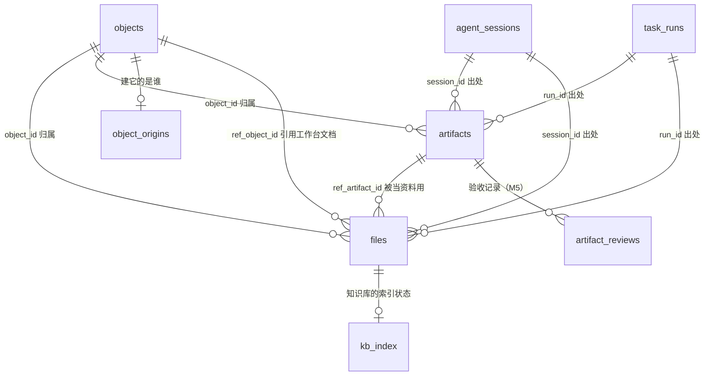

# 资料与产出：file 和 artifact 统一模型

AG-03a 的设计文档。解决开发计划 1.2 里的 P1 问题「文档、材料、项目文档、产出物、Agent 产出五个概念重叠」，给 AG-03b（实现）、PJ-03a（项目资料）、IM-04a（附件下载）、VID-01（视频产出物）、AG-01（知识库）一个共同的底座。

本文只是设计，不含迁移文件和代码。

## 评审记录

| 评审人 | 日期 | 结论 |
|---|---|---|
| Claude（代评，待用户复核） | 2026-10-28 | 有条件通过。条件：AG-03b 给 artifacts 加 kind 列时，同一个迁移里把已有备注带 `[commit]`、`[branch]`、`[pr]` 前缀的产物回填到 kind（只改数据、不改表结构），`pmw_record_artifact` 改成写 kind 列、备注前缀保留一个版本做兼容。第 9 节：1 同意 SET NULL；2 留给 VID-01 定；3 object_origins 在 AG-03b 建表、AG-01 负责写入 |

---

## 1. 问题

原型里有五个各管各的概念，字段大半重复，却互不认识：

| 概念 | 原型位置 | 是什么 | 毛病 |
|---|---|---|---|
| 文档 | `data.ts` 的文档库、`kbdata.ts` 的 `KbDoc` | 工作台里的文档对象；知识库里的「一篇资料」 | 知识库自己又存一份 `text`，和源文档各改各的 |
| 材料 | `projectdata.ts` 的 `Material` | 项目的支持材料：文件、文件夹、链接、笔记 | 文件存本地路径，和产物表的 path 是两套规则 |
| 项目文档 | `projectdata.ts` 的 `ProjectDoc` | 项目的 PRD、技术方案，指向文档库或项目目录里的文件 | 和材料只差一个「类别 + 状态」，却是两张表、两个页签 |
| 产出物 | `videodata.ts` 的 `Artifact` | 视频各阶段做出来的文件：口播稿、封面、视频 | 和后端 0012 的 artifacts 同名不同物，溯源字段是自己的 `source` |
| Agent 产出 | `agentdata.ts` 的 `AgentOutput` | Agent 落到数据上的东西：任务、文档、回复、SOP | 只有一个 `target` 字符串，指不清是什么；会话出处和 artifacts 的 session_id 重复 |

后端现状：0012 已经有 `artifacts` 表，是「这件事一共产出了什么」的唯一出处（见 `docs/api-contract.md` 输出产物一节）。它已经有 `object_id`、`session_id`、`run_id`、`source`，缺的是「谁产出」「挂在非对象的东西上（视频、知识库）」「类别和状态」。

## 2. 核心划分：拿来用的 vs 做出来的

五个概念按一个问题分开：**这东西是拿来用的，还是做出来的？**

- **file（资料）**：拿来用的。用户、Agent 或 IM 收件带进来的参考内容，挂在某个归属上被使用：项目资料、知识库来源、消息附件。新表 `files`。
- **artifact（产出）**：做出来的。某次工作的交付物，回答「产出了什么」。沿用 0012 的 `artifacts` 表，只加列。

为什么不合成一张表：`artifacts` 的全部价值在于「产出总数」这个数可信。把资料塞进去，产物页和统计页的数就会悄悄变大，而且看上去完全正常——0012 文件头说的正是这种数。反过来，把产出塞进资料表，0012 已经上线的接口、去重规则、MCP 回写全部要改。两张表各自的统计口径都干净。

两者之间只有一条单向的引用：一件产出被拿来当资料用（Agent 写的方案加进项目资料、视频定稿的口播稿收进知识库），在 `files` 里记一行引用它，不复制路径。

还有一类 Agent 产出不是文件：建的任务、发的 IM 回复、发起的 SOP。它们本身就是各自模块里的一等记录（工作对象、消息、SOP 执行），不另造实体，只在那条记录上带同一套溯源字段（见第 4 节）。「Agent 产出」页签是按溯源字段查出来的视图。



## 3. 五个概念到两个实体的映射

### 3.1 总表

| 原型概念 | 落到 | 归属（挂在哪） | 定位方式 | 原型里特有的字段去哪 |
|---|---|---|---|---|
| 文档：工作台文档对象 | 保持 `objects`（type=doc），不进两张表 | 自身的 `project_id` | 对象本身 | 不变 |
| 文档：知识库的一篇资料 `KbDoc` | `files`，归属 `scope_type='kb'` | 知识库 | 按来源五选一，见 3.2 | 索引状态进 `kb_index`；`text` 不再另存 |
| 材料 `Material` | `files`，归属项目 | `object_id` = 项目 | 文件/文件夹=path，链接=url，笔记=note，IM 附件=blob | `tags` 进 `props.tags`；`from` 进溯源列 |
| 项目文档 `ProjectDoc` | `files`，归属项目 | `object_id` = 项目 | 文档库来源=ref_object_id，文件来源=path | `kind`（PRD 等）进 `files.kind`；`status` 进 `files.status` |
| 产出物（视频）`Artifact` | `artifacts` | 视频（见 5.3） | path（视频目录下，base_dir=视频目录） | `kind`/`status` 进新列；`variant`/`option`/`version`/`picked`/`duration` 进 `props`；`source` 进 `actor_*`；`reviews` 进 `artifact_reviews` |
| Agent 产出 `AgentOutput`，kind=doc 且是文件 | `artifacts` | 会话或执行挂的对象 | path 和/或 url | `agent_id` 进 `actor_id`；`origin` 就是已有的 `session_id`/`run_id` |
| Agent 产出，kind=doc 且是工作台文档 | `objects`（type=doc）+ `object_origins` | 自身 | 对象本身 | 溯源进 `object_origins` |
| Agent 产出，kind=task | `objects`（type=task）+ `object_origins` | 自身 | 对象本身 | 同上 |
| Agent 产出，kind=reply | IM 消息表（IM-01a 建）带溯源列 | 会话（conversation） | 消息本身 | 消息表自带 `actor_*`、`session_id` |
| Agent 产出，kind=sop | SOP 执行记录（SOP 模块建）带溯源列 | SOP | 执行记录本身 | 执行记录自带触发者 `actor_*` |

结论：五个概念收成 file 和 artifact 两个实体，加一套溯源字段。工作台文档、任务、消息、SOP 执行这些本来就是一等记录的，不重复建模，只被引用或者带上溯源字段。

### 3.2 files 的定位方式（六选一）

| 定位 | 列 | 用在 | 说明 |
|---|---|---|---|
| 本地路径 | `path` + `base_dir` | 材料的文件、文件夹；项目文档的文件来源；知识库目录同步 | 规则照搬 0012：存绝对路径，`base_dir` 记基准，相对路径现算；文件夹靠 `mime='inode/directory'` 区分 |
| 网址 | `url` | 材料的链接；知识库的网页 | `platform` 复用字典 `artifact_platform` 自动识别 |
| 托管文件 | `blob_key` + `sha256` | 上传的文件；IM 附件 | 工作台自己保管的那份拷贝，见 3.3 |
| 笔记 | `note` | 材料的笔记；知识库手写笔记 | 短文本直接存；要长期编辑的应该建成文档对象 |
| 工作台对象 | `ref_object_id` | 项目文档的文档库来源；知识库收的工作台文档 | 内容以对象为准，不复制 |
| 一件产出 | `ref_artifact_id` | 把产出当资料用 | 位置以产出那一行为准，不复制 |

一行只能有一种定位，靠 CHECK 保证；定位方式不单独存一列，由哪一列非空推出来——和 0012 不存第二个路径字符串是同一个道理，存了就可能和实际矛盾。

### 3.3 托管文件（blob）

- 存在数据目录下（`dev-decisions.md`「消息附件存在哪」：`attachments/`，按渠道分子目录；上传的放 `attachments/upload/`）。
- `blob_key` 存相对数据目录的路径，不存绝对路径：数据目录整体搬家时不用改库。
- 按 `sha256` 去重：同一份附件既在消息里又加进项目资料，是两行 files 指向同一个 blob。
- 删一行 files 不直接删磁盘；没有任何一行再引用某个 `blob_key` 时，由清理任务回收。用户自己目录里的文件（`path` 定位）工作台永远不删。

## 4. 溯源字段

两张表、以及 `object_origins`、消息表、SOP 执行记录，用同一套列名，回答三件事：

| 问题 | 列 | 取值 |
|---|---|---|
| 谁产出 / 谁带进来 | `actor_type` | `user` / `agent` / `skill` / `sop` / `run` / `mcp` / `im` / `sync` |
|  | `actor_id` | Agent id、技能名、SOP id；用户和 IM 收件为空 |
|  | `actor_label` | 产出当时的名字快照：Agent 改名或删掉后仍能显示是谁（同 `agent_sessions.model` 快照的做法） |
| 哪次会话或执行 | `session_id` | 内置 Agent 会话（已有于 artifacts） |
|  | `run_id` | Claude Code 执行（已有于 artifacts） |
|  | 以后的出处 | SOP 执行、定时任务执行等由各自模块的迁移给这几张表加列，只加不改 |
| 挂在哪 | `object_id` | 工作对象（已有于 artifacts） |
|  | `scope_type` + `scope_id` | 不是工作对象的归属：`kb`（知识库）、`message`（IM 消息）、视频插件自己的实体等；空串表示没有 |

`actor_type` 和已有的 `source` 不是一回事，两个都留：

- `source` 是**登记途径**（manual / agent / run / mcp），由服务端判定、不接受自报，决定去重范围，统计页「AI 助手产出了多少」只认它。语义不变。
- `actor_*` 是**产出者**，可以由调用方声明（比如 MCP 回写时说明是哪个技能做的、视频产出物标明是 SOP 还是手工）。它用来展示和筛选，不用于可信统计。

`object_id` 和 `scope_*` 可以同时有值（知识库挂在某个项目下的资料），也可以都为空（未归属）。`scope_*` 不加外键，归属实体被删时由对应模块负责处理它名下的行，这一点在第 6 节逐个写明。

## 5. 迁移方案

原则：`internal/db/migrations` 里 0001 到 0013 一行不动；0012 的表结构、CHECK、唯一索引全部保持原样。新迁移从 0014 起，只建新表、旧表只用 `ALTER TABLE ... ADD COLUMN` 加列、只新建索引。编号在实现时按当时的下一个空号顺延（别的任务也会占号），下文用 00A、00B 等占位。

SQLite 的约束：`ADD COLUMN` 加的列必须有常量默认值；带 `REFERENCES` 的列默认值必须是 NULL。下面的方案都满足。

### 5.1 00A：建 files 表（AG-03b）

```sql
CREATE TABLE files (
  id              TEXT PRIMARY KEY,
  -- 归属：和 artifacts 一样用 SET NULL，硬删对象后变成「未归属」，可以重新挂
  object_id       TEXT REFERENCES objects(id) ON DELETE SET NULL,
  scope_type      TEXT NOT NULL DEFAULT '',
  scope_id        TEXT NOT NULL DEFAULT '',

  -- 定位：六选一，见文末 CHECK
  path            TEXT NOT NULL DEFAULT '',
  base_dir        TEXT NOT NULL DEFAULT '',
  url             TEXT NOT NULL DEFAULT '',
  blob_key        TEXT NOT NULL DEFAULT '',   -- 相对数据目录
  note            TEXT NOT NULL DEFAULT '',
  -- 被引用的东西没了，这行引用也就没意义了；用 SET NULL 会撞上 CHECK 导致删不掉
  ref_object_id   TEXT REFERENCES objects(id) ON DELETE CASCADE,
  ref_artifact_id TEXT REFERENCES artifacts(id) ON DELETE CASCADE,

  name            TEXT NOT NULL DEFAULT '',
  mime            TEXT NOT NULL DEFAULT '',
  size            INTEGER NOT NULL DEFAULT 0,
  sha256          TEXT NOT NULL DEFAULT '',
  platform        TEXT NOT NULL DEFAULT '',   -- 复用字典 artifact_platform
  kind            TEXT NOT NULL DEFAULT '',   -- 资料类别：PRD、技术方案……空表示普通材料
  status          TEXT NOT NULL DEFAULT '',   -- draft | review | final，空表示不跟踪
  props           TEXT NOT NULL DEFAULT '{}', -- tags 等

  -- 溯源，见第 4 节
  source          TEXT NOT NULL,              -- manual | agent | run | mcp | im | sync
  actor_type      TEXT NOT NULL DEFAULT '',
  actor_id        TEXT NOT NULL DEFAULT '',
  actor_label     TEXT NOT NULL DEFAULT '',
  session_id      TEXT REFERENCES agent_sessions(id) ON DELETE SET NULL,
  run_id          TEXT REFERENCES task_runs(id) ON DELETE SET NULL,

  created_at      TEXT NOT NULL,
  updated_at      TEXT NOT NULL,

  CHECK ((path <> '') + (url <> '') + (blob_key <> '') + (note <> '')
         + (ref_object_id IS NOT NULL) + (ref_artifact_id IS NOT NULL) = 1),
  CHECK (blob_key = '' OR sha256 <> '')
);

CREATE INDEX idx_files_object ON files(object_id, created_at DESC);
CREATE INDEX idx_files_scope  ON files(scope_type, scope_id, created_at DESC) WHERE scope_type <> '';
CREATE INDEX idx_files_blob   ON files(blob_key) WHERE blob_key <> '';
-- 同一归属下同一份托管文件只留一行：同一个附件点两次「加进项目资料」不出两条
CREATE UNIQUE INDEX idx_files_owner_sha
  ON files(coalesce(object_id,''), scope_type, scope_id, sha256) WHERE sha256 <> '';
-- 知识库目录同步按路径去重，手工添加的不受限
CREATE UNIQUE INDEX idx_files_sync_path
  ON files(scope_type, scope_id, path) WHERE source = 'sync' AND path <> '';
```

### 5.2 00B：artifacts 加溯源列（AG-03b）

```sql
ALTER TABLE artifacts ADD COLUMN kind        TEXT NOT NULL DEFAULT '';   -- 字典 artifact_kind
ALTER TABLE artifacts ADD COLUMN status      TEXT NOT NULL DEFAULT '';   -- draft | review | final | published，空表示不跟踪
ALTER TABLE artifacts ADD COLUMN actor_type  TEXT NOT NULL DEFAULT '';
ALTER TABLE artifacts ADD COLUMN actor_id    TEXT NOT NULL DEFAULT '';
ALTER TABLE artifacts ADD COLUMN actor_label TEXT NOT NULL DEFAULT '';
ALTER TABLE artifacts ADD COLUMN scope_type  TEXT NOT NULL DEFAULT '';
ALTER TABLE artifacts ADD COLUMN scope_id    TEXT NOT NULL DEFAULT '';
ALTER TABLE artifacts ADD COLUMN props       TEXT NOT NULL DEFAULT '{}';

-- 老数据补产出者：登记途径能确定产出者的照填，manual 视为用户本人
UPDATE artifacts SET actor_type = CASE source
  WHEN 'manual' THEN 'user' WHEN 'agent' THEN 'agent'
  WHEN 'run' THEN 'run' WHEN 'mcp' THEN 'mcp' ELSE '' END
WHERE actor_type = '';

CREATE INDEX idx_artifacts_actor ON artifacts(actor_type, actor_id, created_at DESC);
CREATE INDEX idx_artifacts_scope ON artifacts(scope_type, scope_id, created_at DESC) WHERE scope_type <> '';
```

同一迁移里新增字典 `artifact_kind`（builtin=1），内核只放通用条目：`doc` 文档、`prototype` 原型、`code` 代码、`data` 数据、`other` 其他。视频类别由视频插件自己的迁移往这个字典里加。

明确不动的：`CHECK (path <> '' OR url <> '')`、`idx_artifacts_session_path`、`idx_artifacts_run_path`、`source` 的取值和判定规则。

### 5.3 00C：object_origins（AG-03b，或放到 AG-01 一起做）

```sql
-- 工作对象是谁建的。只记创建那一刻，后续修改由 revisions 记
CREATE TABLE object_origins (
  object_id   TEXT PRIMARY KEY REFERENCES objects(id) ON DELETE CASCADE,
  source      TEXT NOT NULL,
  actor_type  TEXT NOT NULL DEFAULT '',
  actor_id    TEXT NOT NULL DEFAULT '',
  actor_label TEXT NOT NULL DEFAULT '',
  session_id  TEXT REFERENCES agent_sessions(id) ON DELETE SET NULL,
  run_id      TEXT REFERENCES task_runs(id) ON DELETE SET NULL,
  created_at  TEXT NOT NULL
);
CREATE INDEX idx_object_origins_actor ON object_origins(actor_type, actor_id, created_at DESC);
```

不往 `objects` 加列的理由：绝大多数对象是用户手建的，溯源只对少数行有意义；`objects` 是最热的表，单独一张表不影响它的读写。老对象没有记录，视为用户建的。

### 5.4 后续模块各自加的（不在 AG-03b 里）

| 任务 | 迁移 | 内容 |
|---|---|---|
| IM-04a | 00D | `files` 加 `message_id TEXT REFERENCES <消息表>(id) ON DELETE SET NULL`、`attachment_key TEXT NOT NULL DEFAULT ''`（渠道里的附件编号） |
| IM-02（回复） | 消息表自己的迁移 | 发出的消息带 `actor_type`/`actor_id`/`actor_label`/`session_id`/`run_id` |
| VID-01 | 00E | 视频相关表；`artifact_reviews(id, artifact_id FK CASCADE, ok, comment, reviewer, created_at)`；往 `artifact_kind` 加视频类别 |
| AG-01（知识库） | 00F | `kb_index(file_id PK FK files CASCADE, chunks, status, excluded, error, indexed_at)` |
| SOP 模块 | 各自迁移 | 给 `artifacts`、`files`、`object_origins` 加 `sop_run_id` 列 |

## 6. 各模块怎么复用

### 6.1 项目资料（PJ-03a）

- 项目资料 = `files WHERE object_id = 项目`。支持材料和项目文档不再分开：有 `kind`（PRD 等）的就是原来的项目文档，没有的就是材料；界面按 `kind` 分组或筛选。
- 四种添加方式：选本地文件或文件夹（path，base_dir=项目 workdir）、贴链接（url）、写笔记（note）、选工作台文档（ref_object_id）。另有「上传」走托管文件。
- 项目文档的状态：文件来源用 `files.status`；文档库来源以文档对象自己的状态为准，`files.status` 留空，不存两份。
- 项目的产出在「产出」页签读 `artifacts WHERE object_id = 项目`，和资料分开计数。产出上提供「加进项目资料」，建一行 `ref_artifact_id`。
- 只认 `files` 一个来源：挂了 `project_id` 的文档对象不会自动出现在项目资料里，要显式添加。这样项目资料只有一个出处，避免 1.2 里「枚举两份来源」那类问题。

### 6.2 IM 附件（IM-04a）

- 附件下载到 `attachments/<渠道>/`，算 sha256，建一行 files：`scope_type='message'`、`scope_id=消息 id`、`blob_key`、`source='im'`、`actor_type='im'`，并填 00D 加的 `message_id`、`attachment_key`。
- 同一附件重复获取靠 `idx_files_owner_sha` 去重；渠道异常时不建行，按 IM-04 的验收记运行异常。
- 「加进项目资料」：新建一行，`object_id=项目`、同一个 `blob_key` 和 `sha256`、`message_id` 照抄。原型 `Material.from` 里的 sender、conversation 由 `message_id` 关联查出，不再冗余存。
- 消息被删时：`message_id` 置空，消息名下（`scope_type='message'`）的行由 IM 模块删掉；项目里那一行还在，blob 也就还被引用。

### 6.3 视频产出物（M5，VID-01、VID-02）

- 每件产出物一行 artifacts：`kind`（cover、script、video……）、`status`、`path`（绝对路径，`base_dir`=视频项目目录，相对路径即原型的 `path`）、`props`（`variant`、`option`、`version`、`picked`、`duration`）、`actor_*`（原型的 `source.type` / `source.label`）。
- 归属：VID-01 若把视频建成工作对象类型，用 `object_id`；若是插件自己的表，用 `scope_type='video'`、`scope_id=视频 id`。倾向前者，能直接复用对象详情页的产出页签。
- 一版一行：改出新版本是新的一行（`props.version` 递增），旧版保留可追溯；同比例「选用的那张」是 `props.picked`，切换时在同一事务里清掉同组其他行。
- 验收记录进 `artifact_reviews`；发布到平台后把平台地址写进同一行的 `url`，不另起一行（0012 的「同一件交付物两个位置」）。
- 视频插件停用时，这些行照常留在产物表里，产物页按 `kind` 显示，不依赖插件代码。

### 6.4 知识库文档（AG-01）

- 知识库的每篇资料是一行 files：`scope_type='kb'`、`scope_id=知识库 id`。原型的五种来源对应：工作台文档→`ref_object_id`，目录文件→`path` + `source='sync'`，上传→`blob_key`，网页→`url`，手写笔记→`note`。
- 索引状态（段数、已索引/待索引/失败、是否排除、失败原因）放 `kb_index`，是知识库自己的事，不污染 files。
- 原型 `KbDoc.text` 不落库：切分时现读源内容，源文档改了重新索引即可，不会出现知识库里一份、文档库里一份各改各的。
- 知识库被删时，由 AG-01 删掉其名下的 files 行（`kb_index` 随之级联）；被引用的工作台文档、用户目录里的文件不受影响。

### 6.5 Agent 产出页签（AG-01）

按 `actor_type='agent' AND actor_id=<Agent id>` 合并四处查询，按时间倒序：

| 原型 kind | 查哪 | target |
|---|---|---|
| doc（文件） | `artifacts` | 产出 id |
| doc（工作台文档）、task | `object_origins` join `objects` | 对象 id |
| reply | 消息表 | 消息 id |
| sop | SOP 执行记录 | 执行 id |

返回结构对齐原型 `AgentOutput`，`target` 改成 `{type, id}`，不再是一个猜不出类型的字符串；`origin` 直接取 `session_id` / `run_id`。注意 `agent_sessions` 目前没有 agent_id，AG-01 建 Agent 实体时要给会话补上，产出才能按 Agent 归集。

## 7. 接口影响（给 AG-03b 的提纲）

- `artifacts`：响应多出 `kind`、`status`、`actor_type`、`actor_id`、`actor_label`、`scope_type`、`scope_id`、`props`；列表加同名过滤参数；`PATCH` 可改 `kind`、`status`、`props`、`scope_*`。`stats` 口径不变，只统计 artifacts。`pmw_record_artifact` 增加可选的 `kind`、`actor_*`。
- `files`：新增 `/api/files` 增删改查，过滤 `object_id`、`scope_type`+`scope_id`、`unscoped`、`q`；上传走 multipart；`GET /api/files/{id}/content` 只对托管文件和允许根内的路径开放；`DELETE` 只删登记行，不删用户目录里的文件。
- `docs/api-contract.md` 是主会话独占的契约文件，AG-03b 开工前由主会话把上述内容写进去。

## 8. 不做什么

- 不把资料并进 artifacts，也不改 artifacts 已有列的含义。
- 不改 0001 到 0013 任何一个迁移，包括 0012 的 CHECK 和唯一索引。
- 不给 files 做版本历史；本地文件的版本是用户自己的事，视频产出物的版本靠一版一行。
- 不在本阶段做 blob 清理任务的调度，先在删除 files 行时同步检查引用计数，定时清理等 TASK-03 的定时任务落地后再接。

## 9. 留给评审的问题

1. `files.object_id` 用 SET NULL（和 artifacts 一致，可重新挂）还是 CASCADE（资料脱离项目意义不大）。本文选 SET NULL：可逆，且链接类资料可能是那个地址在本机唯一的记录。
2. 视频是做成工作对象类型还是插件自有表，影响产出物用 `object_id` 还是 `scope_*`。本文倾向工作对象，最终由 VID-01 定。
3. `object_origins` 放在 AG-03b 还是 AG-01。本文倾向 AG-03b 一起建表，AG-01 负责写入。
