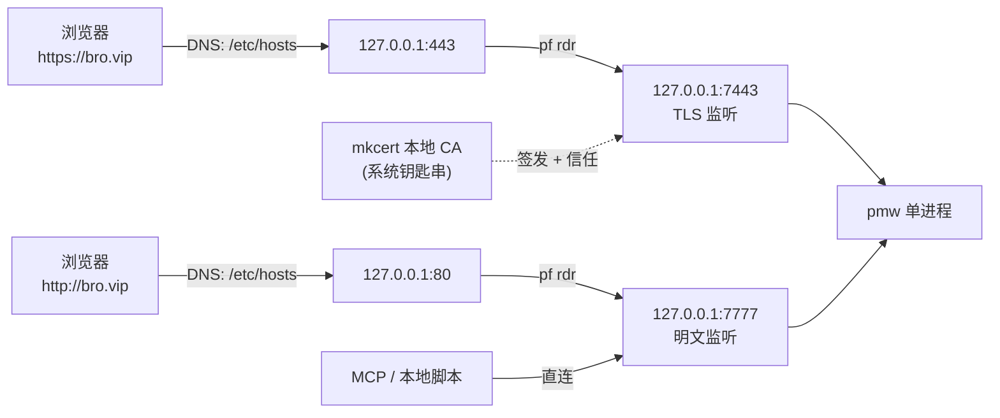

# 本地域名与 HTTPS

让产品工作台在浏览器里用 `https://bro.vip` / `https://broleez.vip` 直达，不带端口号、不弹证书警告。

## 为什么必须配 HTTPS

不是为了加密——本地回环流量没有中间人。真正的原因是浏览器行为：

`.vip` 是公网 TLD，Chrome 对它启用 HTTPS-First。在地址栏敲 `bro.vip` 并回车，Chrome
**不会**先试 80 口，而是直接请求 `https://bro.vip`。如果 443 上没人监听，结果就是
`ERR_CONNECTION_REFUSED`——看起来像服务挂了，其实 HTTP 那边好好的。

验证过：显式输 `http://bro.vip/` 返回 200，页面标题「产品工作台」；`https://bro.vip` 连不上。

所以只有两个选择：每次手打 `http://` 前缀，或者把 HTTPS 真的配上。本文档是后者。

## 整体结构



四层各管一件事：

| 层 | 做什么 | 配置位置 |
|---|---|---|
| hosts | 把域名解析到 127.0.0.1 | `/etc/hosts` |
| pf | 80 -> 7777、443 -> 7443 | `/etc/pf.anchors/broleez-local` |
| pmw | 一个进程同时监听明文口与 TLS 口 | LaunchAgent 参数 |
| mkcert | 签发证书并让系统信任签发它的 CA | 系统钥匙串 + `certs/` |

**为什么不让 pmw 直接监听 80/443**：1024 以下是特权端口，那要求整个进程以 root 跑。
一个本地工具没必要拿 root。pf 重定向只把一条转发规则交给内核，进程本身仍是普通用户身份。

**为什么一个进程开两个口**：7777 明文继续服务 MCP 和本地 curl 脚本（它们不需要 TLS，
也省得给每个脚本配 CA），7443 服务浏览器。同一个 handler、同一个数据库连接，不用起两份进程。

## 从零配置

按顺序执行。需要 root 的那几步已经标出来了。

### 0. 先构建

```bash
cd /Volumes/project/0xBroleez/pm-workspace
make build
```

### 1. 安装 mkcert（一次性）

```bash
brew install mkcert
```

**为什么用 mkcert 而不是 openssl 自签**：mkcert 会生成一个本地 CA 并把它装进系统钥匙串。
由这个 CA 签出来的证书，Chrome 和 Safari 直接信任，地址栏是正常的锁图标。openssl 自签的
证书没有受信任的签发者，每次访问都要点一遍「高级 -> 继续前往」，配了跟没配差不多。

### 2. 把本地 CA 装进钥匙串（一次性，会弹密码框）

```bash
mkcert -install
```

这步必须手动跑：写系统钥匙串需要交互授权，脚本里代跑不了。装过一次之后所有项目共用这个 CA。

### 3. 签发证书

```bash
./scripts/setup-tls.sh
```

不需要 root。产物：

- `certs/pmw.pem`（证书，权限 644）
- `certs/pmw-key.pem`（私钥，权限 600）

SAN 覆盖 `broleez.vip bro.vip localhost 127.0.0.1 ::1`。想加域名就带 `HOSTS` 变量重跑：

```bash
HOSTS="broleez.vip bro.vip pm.vip localhost 127.0.0.1 ::1" ./scripts/setup-tls.sh
```

`certs/` 已加进 `.gitignore`。私钥不进版本库，而且 mkcert 签的证书离开本机也没用
（别的机器不信任你这个 CA）。

### 4. 配 hosts 与 pf（需要 root）

```bash
sudo ./scripts/setup-local-domain.sh
```

做三件事：

1. `/etc/hosts` 加 `127.0.0.1 broleez.vip` 和 `127.0.0.1 bro.vip`（原文件先备份）
2. 写 `/etc/pf.anchors/broleez-local`，两条规则：

   ```
   rdr pass on lo0 inet proto tcp from any to 127.0.0.1 port 80  -> 127.0.0.1 port 7777
   rdr pass on lo0 inet proto tcp from any to 127.0.0.1 port 443 -> 127.0.0.1 port 7443
   ```

3. 装 `/Library/LaunchDaemons/vip.broleez.pf.plist`，开机重新加载并启用 pf

第 3 步不能省：macOS 上 pf 默认不开机自启，`pfctl -e` 也不持久。没有这个 LaunchDaemon
的话重启一次域名就全挂了。

端口可以改：

```bash
PORT=7777 TLS_PORT=7443 sudo ./scripts/setup-local-domain.sh
```

### 5. 装常驻服务

```bash
./scripts/install-autostart.sh
```

脚本会检查 `certs/` 下证书在不在：

- 在 → LaunchAgent 参数带上 `--tls-addr 127.0.0.1:7443 --tls-cert ... --tls-key ...`，
  一个进程同时监听 7777 明文和 7443 TLS
- 不在 → 只跑明文，和以前完全一样

幂等，重复跑只是重写 plist 再重启服务。

### 6. 验证

```bash
curl -s  -o /dev/null -w '%{http_code}\n' http://bro.vip/api/health
curl -s  -o /dev/null -w '%{http_code}\n' https://bro.vip/api/health
curl -s  -o /dev/null -w '%{http_code}\n' https://broleez.vip/api/health
```

三条都应该是 `200`。注意 HTTPS 那两条**不要**加 `-k`：不加 `-k` 还能通，才说明证书链真的
被系统信任了，加了 `-k` 等于把要验证的东西跳过了。

浏览器里打开 `https://bro.vip`，地址栏应该是正常的锁图标，没有「不安全」字样。

## 已知副作用：7777 直连会被遮蔽

pf 的 rdr 规则生效后，**直接访问 `http://127.0.0.1:7777` 会连不上**。

这不是 bug，是 pf 地址转换的工作方式：规则匹配的是 `to 127.0.0.1 port 80`，但 pf 在
lo0 上做转换时会把去往该目的的连接一并纳入状态跟踪，结果就是原始端口被遮住。

**应对**：一律用域名访问。

- 浏览器：`https://bro.vip`
- 脚本 / curl：`http://bro.vip/api/health`
- MCP：走域名或明文域名端口，不要写 `127.0.0.1:7777`

要临时直连 7777 做调试，先关掉 pf：

```bash
sudo pfctl -d          # 临时关闭（重启或跑一次 LaunchDaemon 会恢复）
sudo pfctl -e          # 用完开回来
```

## 常用排查

```bash
# 看 pf 里当前生效的转发规则（没有输出就是 anchor 没加载）
sudo pfctl -a broleez-local -s nat

# 看 pf 开着没
sudo pfctl -s info | head -1

# 看 pmw 进程状态与日志
launchctl list | grep vip.broleez.pmw
tail -50 logs/pmw.log

# 确认两个端口真的在监听
lsof -nP -iTCP -sTCP:LISTEN | grep -E '7777|7443'

# 看证书覆盖了哪些域名、有没有过期
openssl x509 -in certs/pmw.pem -noout -text | grep -A1 'Subject Alternative Name'
openssl x509 -in certs/pmw.pem -noout -dates
```

几个典型症状：

| 症状 | 多半是 |
|---|---|
| `ERR_CONNECTION_REFUSED` on https | 443 没转发（pf 没加载），或 pmw 没带 TLS 参数 |
| 浏览器报「不安全 / NET::ERR_CERT_AUTHORITY_INVALID」 | `mkcert -install` 没跑过 |
| `curl https://bro.vip` 报证书错但浏览器正常 | curl 用的是自己的 CA 库，不读系统钥匙串（macOS 自带 curl 会读，Homebrew 版可能不读） |
| 重启后全挂 | pf LaunchDaemon 没装成功，重跑 `sudo ./scripts/setup-local-domain.sh` |
| 直连 127.0.0.1:7777 连不上 | 正常，见上面「已知副作用」 |
| pmw 反复崩溃重启 | 只给了 `--tls-cert` 没给 `--tls-key`（或反过来），pmw 会直接报错退出，看 `logs/pmw.log` |

## pmw 的 TLS 相关参数

| 参数 | 默认 | 说明 |
|---|---|---|
| `--addr` | `127.0.0.1:7777` | 明文 HTTP 监听地址 |
| `--tls-addr` | 空 | 额外的 HTTPS 监听地址。给了就**同时**监听明文和 TLS |
| `--tls-cert` | 空 | 证书路径，须与 `--tls-key` 同时给 |
| `--tls-key` | 空 | 私钥路径，须与 `--tls-cert` 同时给 |

三种组合：

```bash
# 只明文（默认行为，没给证书时和以前完全一样）
./bin/pmw --addr 127.0.0.1:7777

# 双监听：7777 明文 + 7443 TLS，一个进程
./bin/pmw --addr 127.0.0.1:7777 --tls-addr 127.0.0.1:7443 \
          --tls-cert ./certs/pmw.pem --tls-key ./certs/pmw-key.pem

# 只 HTTPS：给了证书但不给 --tls-addr，--addr 本身升级成 HTTPS
./bin/pmw --addr 127.0.0.1:7443 \
          --tls-cert ./certs/pmw.pem --tls-key ./certs/pmw-key.pem
```

只给 `--tls-cert` 不给 `--tls-key`（或反过来）会直接报错退出，不会静默降级成明文——
静默降级的话你会以为 HTTPS 配好了，实际浏览器那边一直连不上，很难查。

## 卸载

逐层撤，按需执行。

```bash
# 1. 停掉常驻服务
launchctl bootout gui/$(id -u)/vip.broleez.pmw
rm ~/Library/LaunchAgents/vip.broleez.pmw.plist

# 2. 撤掉 hosts + pf（80 和 443 两条规则在同一个 anchor 文件里，一起没）
sudo ./scripts/teardown-local-domain.sh

# 3. 删掉项目里的证书
./scripts/teardown-tls.sh

# 4. 卸载 mkcert 本地 CA —— 只在确定没有别的项目依赖它时才做（全局影响，会弹密码框）
mkcert -uninstall
```

只想退回「明文 + 域名」不要 HTTPS 的话，跑第 3 步再重跑 `./scripts/install-autostart.sh`
即可：证书没了脚本会自动去掉 TLS 参数。pf 的 443 规则留着也无害，只是那个端口会连不上。
