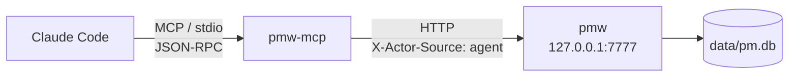

# MCP Server（pmw-mcp）

把产品工作台接进 Claude Code，让 Agent 直接查需求、建待办、搜文档、看最近变更，不用人肉在浏览器和对话之间复制粘贴。

## 架构：它是个瘦客户端

`pmw-mcp` 不打开 SQLite，所有操作都走工作台的 HTTP API（默认 `http://127.0.0.1:7777`）。



这么设计有两条硬理由：

1. **校验规则全长在 store 层**：类型状态集校验、分类与类型同源校验、字典枚举、URL 协议白名单等。直连数据库会把这些统统绕过去，Agent 能轻易写进一个该类型根本不存在的状态。
2. **一个 SQLite 文件不该被两个进程同时写**。工作台本来就是常驻的本地服务，让它继续当唯一的写入方。

代价是 MCP server 依赖工作台处于运行状态。换来的是：凡是界面上做不到的非法操作，Agent 也一样做不到。

## 构建

```bash
make build-mcp     # 产出 bin/pmw-mcp
make build         # 构建前端 + pmw + pmw-mcp
```

`build-mcp` 不依赖前端构建，改完 Go 代码单独跑它就够了。

## 接入 Claude Code

项目根目录的 `.mcp.json` 是项目级 MCP 配置，Claude Code 在该目录下启动时会自动读取：

```json
{
  "mcpServers": {
    "pm-workspace": {
      "command": "./bin/pmw-mcp",
      "args": ["--api", "http://127.0.0.1:7777"],
      "env": {}
    }
  }
}
```

接入步骤：

1. `make build-mcp`（`.mcp.json` 里写的就是这个产物路径，没构建过会连不上）
2. 启动工作台：`make run` 或 `./bin/pmw`
3. 在项目根目录启动 Claude Code。首次会提示是否信任本项目的 MCP server，选允许
4. 在会话里执行 `/mcp` 查看服务器状态，应当看到 `pm-workspace` 处于 connected，展开能列出 9 个 `pmw_` 开头的工具

工作台跑在别的端口时，改 `--api` 参数，或设环境变量 `PMW_API`（命令行参数优先）。

## 工具清单

工具名统一加 `pmw_` 前缀，避免和其它 MCP server 撞名。

| 工具 | 读写 | 作用 |
| --- | --- | --- |
| `pmw_search` | 只读 | 按关键词 + 类型/状态/优先级/标签/负责人/分类/到期等条件检索工作对象，返回紧凑列表 |
| `pmw_get_object` | 只读 | 取单个对象全文：结构化摘要 + 正文 |
| `pmw_list_types` | 只读 | 列出所有类型及各自的状态集，外加优先级、关联关系枚举 |
| `pmw_list_categories` | 只读 | 列出某类型的分类树（含对象数） |
| `pmw_recent_changes` | 只读 | 字段级变更流水，日报周报的数据源 |
| `pmw_counts` | 只读 | 待办概览：收件箱/今日/本周/逾期/停滞，以及按类型和状态的分布 |
| `pmw_create_object` | **写入** | 新建工作对象，必填 `type_id` + `title` |
| `pmw_update_object` | **写入** | 改状态/优先级/负责人/到期/分类/标签/正文/归档 |
| `pmw_link_objects` | **写入** | 在两个对象之间建立有方向的关联 |

三个写工具在 MCP 协议层带了 `readOnlyHint: false` 注解，描述开头也标了「【会写入数据】」。

### 几条 Agent 容易踩的约定

- **状态是按类型隔离的**。需求的 `doing` 和待办的 `doing` 是两套配置，状态 key 不能跨类型套用。`pmw_update_object` 传了不属于该类型状态集的 key 会被工作台直接拒绝，错误信息里会写明合法范围。拿不准先调 `pmw_list_types`。
- **传的是 key 不是中文标签**。`status=doing` 而不是 `status=进行中`。
- **`body` 和 `tags` 是整体替换不是追加**。要在原有基础上增补，先 `pmw_get_object` 读回来，拼好完整内容再传。
- **id 和 ref 是两回事**。`obj_06ga7…` 是 id，`REQ-0001` 是给人看的 ref。工具大多两种都认（内部会把 ref 换算成 id），但 id 更可靠。
- **清空字段传空串**。`owner`、`category_id`、`project_id`、`due_at` 传 `""` 表示置空；不传表示保持原值。

### 返回值是给人和模型同时看的

列表类返回紧凑单行文本而不是原始 JSON：

```
obj_06ga7tpsxz34hed7  REQ-0001  多租户组织架构与成员权限 | 进行中(doing) | P0 | 到期 2026-09-24 | 负责人 me | 标签 P0 冲刺,云端平台
```

状态渲染成 `标签(key)` 的形式：中文给人读，key 让模型知道下一步该往 `pmw_update_object` 里传什么。空字段直接省略，不用一堆占位符撑满上下文。

## 工作台没起的时候

任何工具调用都会返回一段可操作的提示，而不是 connection refused 堆栈：

```
工作台未运行：连不上 http://127.0.0.1:7777。

工作台没有在运行，或没有监听这个地址。请在项目根目录先把它启动起来：

    make run          # 或者
    ./bin/pmw         # 已构建过二进制的话
```

Agent 看到这条应当把启动命令转达给用户，而不是反复重试同一个调用。

## 安全边界

**这个 MCP server 能改用户的真实数据库，而 Claude Code 里任何一个会话、任何一个 subagent 都能调用它。** 接入前要清楚这意味着什么：

- **没有鉴权**。工作台的 HTTP API 本身不校验身份，只靠绑定 `127.0.0.1` 限制在本机。`pmw-mcp` 同样不加任何额外授权层，谁能起这个进程谁就能读写全部数据。
- **写操作会立即落库**，没有二次确认、没有 dry-run。`pmw_update_object` 改掉的正文无法从工具侧撤回。
- **变更可追溯但不可回滚**。所有经由 MCP 的写入都带 `X-Actor-Source: agent`，在 `revisions` 表里留痕，`pmw_recent_changes` 能看到「哪些是 Agent 改的」。但审计不等于回滚，工作台目前不提供按 revision 还原。
- **有删除能力的接口没有暴露**。`DELETE /api/objects/{id}`、删分类、删类型这些都没有对应的 MCP 工具，Agent 删不掉东西。`pmw_update_object` 只提供 `archived` 归档，归档后对象仍可检索。
- **正文会进模型上下文**。`pmw_get_object` 返回完整正文，`pmw_search` 返回标题。工作台里放了敏感信息（密钥、客户名单、未公开的商业条款）就要意识到它可能被发送给模型。
- **别把工作台暴露到 0.0.0.0**。一旦监听公网地址，等于把一个无鉴权的读写接口开了出去。

想要更严的隔离，可以在 `.mcp.json` 里把 `--api` 指向一个只读副本实例，或者干脆不配置这个 MCP server，需要时再临时启用。

## 排查

| 现象 | 多半是 |
| --- | --- |
| `/mcp` 里看不到 `pm-workspace` | 没在项目根目录启动 Claude Code，或首次信任提示被拒绝了 |
| 服务器 failed to connect | `bin/pmw-mcp` 没构建，跑 `make build-mcp` |
| 工具全部返回「工作台未运行」 | 工作台进程没起，或端口和 `--api` 对不上 |
| 改状态总被拒 | 传了中文标签或别的类型的状态 key，先 `pmw_list_types` 查该类型合法的 key |
| 想看 server 自己的日志 | 它把启动横幅和错误写在 stderr，Claude Code 的 MCP server 日志里能看到；stdout 被 JSON-RPC 协议独占，任何往 stdout 的输出都会破坏协议流 |

## 手工验证协议

不经 Claude Code 也能直接验：

```bash
make build-mcp
./bin/pmw-mcp --api http://127.0.0.1:7777
```

进程会在 stdin 上等 newline-delimited JSON-RPC。按顺序喂 `initialize`、`notifications/initialized`、`tools/list`、`tools/call` 即可。注意 stdin 一旦 EOF 会话就结束，用管道一次性灌完请求往往来不及读到响应，要用能保持 stdin 打开的客户端驱动。
