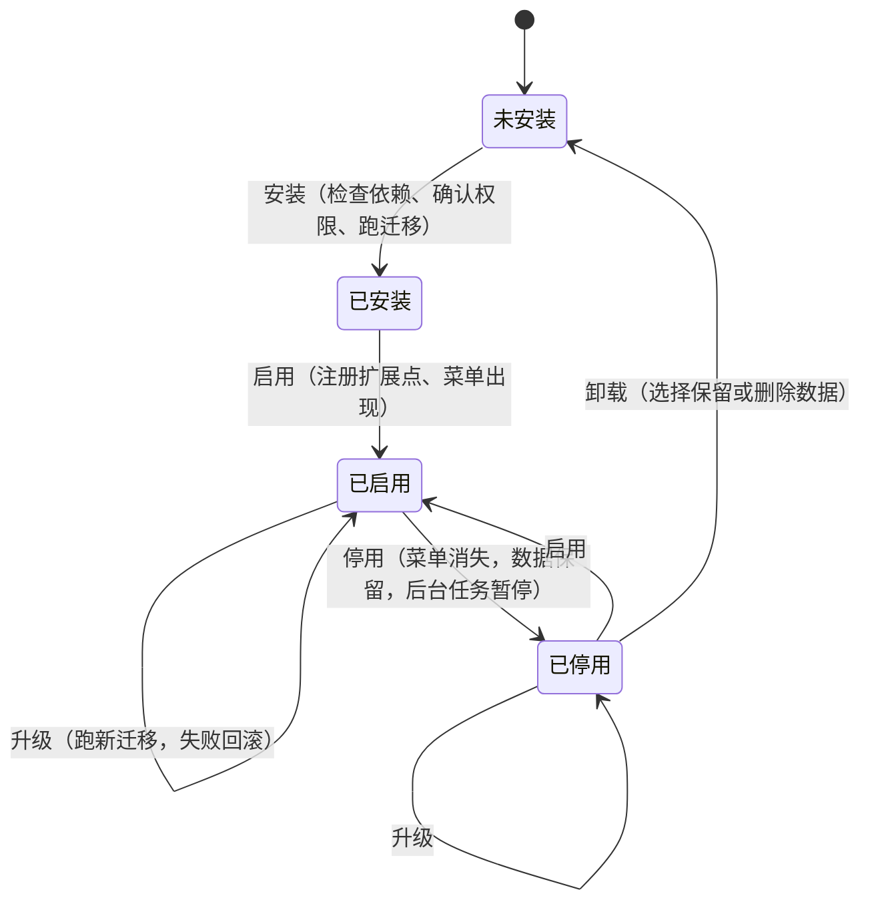

# 插件清单格式和插件 API

一人之下的内核加插件架构的接口规范：插件清单怎么写、插件能往内核里注册什么、权限怎么确认、生命周期每一步前后端各做什么、插件不能做什么。

- 来源：`web-next/docs/dev-plan.md` 2.3 到 2.8、第 6 节；已定决策见 `docs/dev-decisions.md`
- 任务：CORE-01a（本文档）；类型定义和校验在 CORE-01b，后端注册在 CORE-04a，迁移在 CORE-05
- 范围：只定第一方插件需要的东西。第三方插件（进程外、走 HTTP 或 MCP）到 M3 之后再开放，到时在本文档上加一版
- 插件 API 版本：`1.0.0`（M2 起），见第 1.3 节

## 评审记录

| 评审人 | 日期 | 结论 |
|---|---|---|
| Claude（代评，待用户复核） | 2026-10-28 | 通过。第 8 节待定事项：1 同意「强依赖不许成环、弱依赖允许」；2 交易套件表前缀放到 M6 定；3 第三方插件协议 M3 之后另起一版。偏离开发计划的一处（干系人留在内核、不划给项目插件）理由成立：任务的负责人字段也引用干系人表，同意。第 6 节模板样例里的 terminal、browser 模块，PROTO-05 要把它们改成项目内的展开区域，到时同步改样例 |

按 `docs/dev-decisions.md`「设计文档的用户评审由主会话代评」，由主会话代评并标注「Claude 代评，待用户复核」。用户复核时提出的修改，按修改调整本文档和已开工的相关任务。

---

## 0. 术语和约定

| 词 | 意思 |
|---|---|
| 内核 | 必装、不能卸载的部分：外壳、对象模型、身份、连接器框架、Agent 框架、执行与调度、事件总线、凭证保险箱、审计、插件管理；内核模块是今日、任务、文档、联系人、会话、设置 |
| 插件 | 按需安装的功能包，带一份清单；第一方插件和内核同仓库、编译进同一个二进制、一起构建前端 |
| 扩展点 | 插件能往内核里注册的东西，共十个，见第 2 节 |
| 插件 id | 清单里的 `id`，全局唯一，同时决定表前缀、接口路径前缀、事件前缀 |

约定：

- 插件目录：后端 `internal/plugins/<id>/`，前端 `frontend/src/plugins/<id>/`
- 清单文件只有一份：`internal/plugins/<id>/plugin.json`。后端用 `embed` 读；前端构建时通过 Vite 的 glob 导入同一个文件（`server.fs.allow` 放开这个目录），运行时的安装、启用状态从 `GET /api/plugins` 拿。不在两边各写一份，避免漂移
- 清单字段名用 snake_case，和后端 JSON 风格一致；前端类型里保持同名
- 所有 id、key 都是小写字母、数字、下划线，插件 id 不带下划线以外的分隔符

## 1. 清单

### 1.1 字段

| 字段 | 类型 | 必填 | 语义 |
|---|---|---|---|
| `id` | string | 是 | 插件 id，`^[a-z][a-z0-9_]{1,23}$`。一经发布不能改：表前缀、迁移记录、已确认权限、工作台配置都挂在它上面。不能和内核保留字重名（见 1.4） |
| `name` | string | 是 | 显示名，插件管理页和菜单用 |
| `description` | string | 否 | 一句话说明，插件管理页用 |
| `version` | string | 是 | 插件自己的版本，semver（`MAJOR.MINOR.PATCH`）。升级判断、依赖匹配都用它 |
| `core` | string | 是 | 要求的插件 API 版本范围，semver 范围语法（见 1.2）。内核的插件 API 版本不在范围里就拒绝安装和启用 |
| `depends` | object | 否 | 强依赖：`{ "<插件 id>": "<版本范围>" }`。安装前必须已装且版本匹配；被依赖的插件停用时，本插件跟着停用 |
| `optional_depends` | object | 否 | 弱依赖：装了就联动，没装也能用。例：IM 消息在装了项目插件时提供「绑定到项目」 |
| `provides` | object | 是 | 本插件注册的扩展点 id 清单，按扩展点分组（见 1.5）。代码里注册的东西必须在这里列出，反之亦然，CORE-01b 的校验和 CORE-04a 的注册都会比对 |
| `emits` | string[] | 否 | 本插件会发布的事件类型，必须以 `<id>.` 开头 |
| `subscribes` | string[] | 否 | 本插件订阅的事件类型（内核事件或别的插件的事件）。订阅别的插件的事件时，那个插件要在 `depends` 或 `optional_depends` 里 |
| `adopts` | object | 否 | 认领插件化之前就在内核里的东西，见 1.6。只给第一方插件用 |
| `permissions` | string[] | 是 | 需要的权限，见第 3 节；可以是空数组 |
| `migrations` | string | 否 | 迁移目录，相对插件目录。没有自己的表就不写 |
| `table_prefix` | string | 有迁移时必填 | 本插件的表名前缀，必须是 `<id>_`（交易套件这类插件族可以申请共享前缀，如 `trade_`，在内核的白名单里登记） |

未知字段：CORE-01b 的校验报错，不静默忽略。加字段要升插件 API 的小版本。

### 1.2 版本范围

用 semver 范围，写法和 npm 的子集一致，前后端用同一套解析（CORE-01b 实现）：

| 写法 | 意思 |
|---|---|
| `>=1.2.0 <2.0.0` | 空格分隔表示同时满足 |
| `^1.2.0` | 等价 `>=1.2.0 <2.0.0`；`^0.3.0` 等价 `>=0.3.0 <0.4.0` |
| `~1.2.0` | 等价 `>=1.2.0 <1.3.0` |
| `1.2.3` | 只认这一个版本 |

不支持 `||`、`*`、`x` 通配和预发布标签。开发计划里的 `>=1.2 <2` 这种省略写法按补零处理（`>=1.2.0 <2.0.0`），但清单里推荐写全。

### 1.3 插件 API 版本怎么升

插件 API 版本是内核对插件承诺的接口版本，和内核二进制的发版号分开记，定义在 `internal/plugin` 包里的一个常量，前端从 `GET /api/plugins` 的响应里拿。

| 变化 | 升哪位 | 例子 |
|---|---|---|
| 加扩展点、加清单字段、加注册参数里的可选字段、加内核事件 | MINOR | 加第十一个扩展点 |
| 修文档、修实现，接口不变 | PATCH | |
| 删字段、改语义、改签名 | MAJOR | 改 `Registrar` 的方法签名 |

第一方插件跟内核一起构建，升 MAJOR 时在同一个提交里改完所有第一方插件。这一条是为了把「插件 API 定得太早会频繁改」（开发计划第 6 节）的代价压在仓库内部：M3 之前接口可以改，但每改一次都升版本、写进本文档的变更记录。

### 1.4 内核保留字

插件 id 不能是这些（它们是内核的接口路径段或模块 key）：

`api` `admin` `agent` `agent_providers` `artifacts` `audits` `categories` `contacts` `core` `counts` `dict_items` `dictionaries` `events` `fs` `health` `hooks` `kernel` `library` `links` `notifications` `objects` `object_types` `plugins` `revisions` `runs` `schedules` `sessions` `settings` `shortcut_groups` `shortcuts` `stakeholders` `stats` `tags` `tasks` `today` `webhooks` `workspaces`

内核以后加新的一级路径时同步这张表；已发布插件的 id 和新路径冲突时，内核让路（换内核路径），不改插件 id。

### 1.5 `provides` 的分组

| 键 | 扩展点（第 2 节） | 每项是什么 |
|---|---|---|
| `modules` | 2.1 功能模块 | 模块 key，等于工作台菜单里的 key，例 `projects`、`messages`、`videos` |
| `settings` | 2.2 设置分节 | 设置分节 key |
| `object_types` | 2.3 对象类型 | 新对象类型 id，必须等于插件 id 或以 `<id>_` 开头 |
| `connectors` | 2.5 连接器 | 连接器工具 id，例 `slack`、`bilibili` |
| `skills` | 2.6 技能 | 技能 id，以 `sk_` 开头 |
| `agent_tools` | 2.6 Agent 工具 | 工具名，以 `<id>_` 开头 |
| `sop_nodes` | 2.7 SOP 节点 | 节点 kind，以 `<id>_` 开头 |
| `today_cards` | 2.8 今日卡片 | 卡片 key，以 `<id>_` 开头 |
| `commands` | 2.9 命令面板命令 | 命令 id，`<id>.<动作>` |
| `search` | 2.9 命令面板数据源 | 搜索数据源 key |

数据迁移（2.4）用顶层的 `migrations` 和 `table_prefix`，事件订阅（2.10）用顶层的 `emits` 和 `subscribes`，不放进 `provides`。

开发计划 2.4 的样例里 `connectors` 写的是 `douyin`、`channels` 这类不带前缀的名字。连接器 id 是全局命名空间（一个平台只该有一个连接器定义），不加插件前缀，靠内核检查重复：两个插件声明同一个连接器 id 时，后装的拒绝安装。

### 1.6 `adopts`：认领插件化之前的东西

项目、对象类型 `project` 这些在插件化之前就已经在内核里了（`project` 类型由 0002 号迁移写进 `object_types`）。已应用的迁移不能改、表不能搬，所以插件不「拥有」它们，只「认领」：

| 键 | 意思 | 停用时 | 卸载删数据时 |
|---|---|---|---|
| `object_types` | 认领已有的对象类型 | 该类型从新建菜单、命令面板里隐藏；已有对象仍能通过搜索、关联打开（只读） | 不删类型，不删对象；只在插件管理页提示「这些对象还在，可以在文档或任务里看到」 |
| `routes` | 认领已有的内核接口路径 | 这些路径返回 404 | 同停用 |

认领只能认领内核白名单里列出的东西（白名单写在 `internal/plugin`，CORE-04a 实现）。白名单第一版只有一项：`project` 类型给 `projects` 插件。

决策（CORE-01a）：干系人（`stakeholders`、`object_participants` 两张表和 `/api/stakeholders` 接口）留在内核，不给项目插件认领。理由：0010 号迁移让所有对象的 `owner_id` 都引用干系人，任务、需求也用，停用项目插件不能让任务的负责人失效。项目插件只提供项目页里的「干系人」标签页，数据走内核接口。撤回：把干系人加进认领白名单即可，不动表。

---

## 2. 扩展点

十个扩展点，每个给出前端注册函数、后端注册接口和一个例子。

### 2.0 公共部分

前端入口（`frontend/src/plugins/<id>/index.ts`），由内核按清单动态 `import()`，没装或没启用的插件不加载：

```ts
// frontend/src/core/plugin/api.ts（CORE-01b 定类型，CORE-02b 实现）
export interface Disposable { dispose(): void }

export interface PluginEntry {
  /** 启用时调用。只注册，不发请求；数据在页面里按需取 */
  activate(api: PluginApi): void
  /** 停用时调用。注册过的东西内核会自动撤掉，这里只清插件自己的定时器、订阅之外的资源 */
  deactivate?(): void
}

export function definePlugin(entry: PluginEntry): PluginEntry

export interface PluginApi {
  readonly id: string
  readonly manifest: PluginManifest
  modules: ModuleRegistry          // 2.1
  settings: SettingsRegistry       // 2.2
  objectTypes: ObjectTypeRegistry  // 2.3
  migrations: MigrationInfo        // 2.4（只读）
  connectors: ConnectorRegistry    // 2.5
  agent: AgentRegistry             // 2.6
  sopNodes: SopNodeRegistry        // 2.7
  todayCards: TodayCardRegistry    // 2.8
  commands: CommandRegistry        // 2.9
  events: EventRegistry            // 2.10
  /** 内核的数据访问层（CORE-03a）；插件只能通过它读写数据 */
  data: DataClient
  /** 外壳能力：跳转、抽屉、提示、确认框 */
  shell: ShellApi
}
```

规则：

- 每个 `register` 返回 `Disposable`；停用时内核按插件 id 统一撤销，插件不用自己记
- 注册的 id 不在清单 `provides` 里：开发环境直接抛错，生产环境拒绝注册并记运行异常
- 插件的状态只放在自己目录里（自己的 store 或组件状态），不读写别的模块的状态（第 5 节）

后端入口（`internal/plugins/<id>/plugin.go`）：

```go
// internal/plugin（CORE-04a 实现）
package plugin

type Plugin interface {
	// Manifest 返回 embed 进来的 plugin.json 解析结果。
	Manifest() Manifest
	// Migrations 返回迁移目录；没有自己的表返回 nil。
	Migrations() fs.FS
	// Register 在启用时调用，只登记，不做 IO、不起协程。
	Register(r Registrar) error
}

// 可选：需要在生命周期节点做事的插件实现这些。
type Installer interface   { OnInstall(ctx context.Context, c Core) error }
type Uninstaller interface { OnUninstall(ctx context.Context, c Core, deleteData bool) error }
type DisableGuard interface {
	// CanDisable 返回 false 时内核拒绝停用并把 reason 给用户看，例：交易插件还有挂单。
	CanDisable(ctx context.Context, c Core) (ok bool, reason string)
}

type Registrar interface {
	Core() Core

	Routes(fn func(m RouteRegistrar))     // 2.1
	Job(j Job)                            // 2.1
	SettingsSection(s SettingsSection)    // 2.2
	ObjectType(t ObjectTypeDef)           // 2.3
	Connector(c ConnectorDef)             // 2.5
	Skill(s SkillDef)                     // 2.6
	AgentTool(t AgentToolDef)             // 2.6
	SOPNode(n SOPNodeDef)                 // 2.7
	TodayCard(c TodayCardDef)             // 2.8
	SearchProvider(p SearchProviderDef)   // 2.9
	Subscribe(eventType string, h EventHandler) // 2.10
}

// Core 是插件能用的全部内核能力。每个方法拿到的都是按本插件 id 和权限收窄过的句柄。
type Core interface {
	PluginID() string
	Objects() ObjectService     // 读所有类型；写只限本插件声明或认领的类型
	Links() LinkService
	Contacts() ContactService   // 联系人、IM 身份、会话（CT-01、CT-02）
	Artifacts() ArtifactService // 产出和文件（AG-03）
	Settings() SettingsStore    // 本插件命名空间下的设置值
	Secrets() SecretStore       // 只能取 secrets:<scope> 声明过的范围（CORE-06）
	HTTP(group string) (*http.Client, error) // 只给 network:<group> 声明过的组
	FS(scope string) (FS, error)             // 只给 fs:<read|write>:<scope> 声明过的范围
	Process() (ProcessRunner, error)         // 只给声明了 process:spawn 的插件
	Events() Publisher          // 只能发布清单 emits 里的类型
	Audit() AuditLog            // CORE-08
	Store() Store               // 只能访问 table_prefix 开头的表
	Log() *slog.Logger
}
```

`RouteRegistrar` 沿用 `internal/api/server.go` 里的同名接口（`HandleFunc(pattern, handler)`），路径必须以 `/api/<id>/` 开头；内核在外面包一层，停用时整组返回 404。加了路由照旧要写进 `docs/api-contract.md`（契约测试双向检查）。

### 2.1 功能模块

一级菜单项、它的页面、二级菜单；后端是这个模块的接口和后台任务。

前端：

```ts
export interface ModuleDef {
  key: string                 // = provides.modules 里的一项，也是工作台菜单里的 key
  label: string
  icon: string                // 内核图标集里的名字
  desc?: string               // 工作台「挑模块」时的说明
  /** 页面组件，用 React.lazy 包，没打开不加载 */
  page: React.LazyExoticComponent<React.ComponentType<ModulePageProps>>
  /** 二级菜单；没有就不出二级菜单 */
  subnav?: { key: string; label: string; badge?: () => number | undefined }[]
  /** 一级菜单上的角标，例：未读数 */
  badge?: () => number | undefined
}
export interface ModulePageProps { sub?: string; params: Record<string, string> }
export interface ModuleRegistry { register(def: ModuleDef): Disposable }
```

后端：

```go
type Job struct {
	Name  string        // 本插件内唯一，审计和执行记录里显示
	Every time.Duration // 定时跑；0 表示常驻
	Run   func(ctx context.Context, c Core) error // ctx 在停用时取消
}
// Registrar.Routes(fn func(m RouteRegistrar))
// Registrar.Job(j Job)
```

例子（IM 消息）：

```ts
api.modules.register({
  key: 'messages', label: 'IM 消息', icon: 'chat', desc: '各渠道收进来的消息，处理和回复',
  page: lazy(() => import('./MessagesPage')),
  subnav: [{ key: 'inbox', label: '收件箱' }, { key: 'mine', label: '与我相关', badge: () => mentions.unread() }],
})
```

```go
r.Routes(func(m plugin.RouteRegistrar) {
	m.HandleFunc("GET /api/im/messages", h.list)
	m.HandleFunc("POST /api/im/messages/{id}/reply", h.reply)
})
r.Job(plugin.Job{Name: "poll", Every: 30 * time.Second, Run: p.pollAll})
```

### 2.2 设置分节

设置页里的一节。值存在内核的设置存储里，按插件 id 分命名空间；凭证类字段不进设置，进凭证保险箱。

前端：

```ts
export interface SettingsSectionDef {
  key: string                 // = provides.settings 里的一项
  label: string
  group?: string              // 设置左侧导航的分组，默认「插件」
  page: React.LazyExoticComponent<React.ComponentType>
}
export interface SettingsRegistry { register(def: SettingsSectionDef): Disposable }
```

后端：

```go
type SettingsSection struct {
	Key    string
	Schema json.RawMessage           // JSON Schema，内核按它校验写入
	Defaults map[string]any
	// Validate 做 Schema 表达不了的检查（例：端口范围不重叠），可以为 nil。
	Validate func(ctx context.Context, v map[string]any) error
}
// Registrar.SettingsSection(s SettingsSection)
// 读写：Core().Settings().Get(ctx, key) / Put(ctx, key, v)，接口由内核统一提供：
// GET/PUT /api/settings/plugins/{id}/{section}
```

例子（项目）：设置分节 `projects`，放「原型端口范围」「新项目默认根目录」。

```go
r.SettingsSection(plugin.SettingsSection{
	Key:      "projects",
	Schema:   projectsSettingsSchema,
	Defaults: map[string]any{"port_from": 5170, "port_to": 5199, "root": "~/Projects"},
})
```

### 2.3 对象类型

带字段定义的对象类型。数据有两种放法：放内核对象表（`objects`，享受搜索、关联、标签、修订记录），或放插件自己的表（见 2.4）。默认放内核对象表；只有字段多、查询重（例：K 线、成交）的才放自己的表。

前端：

```ts
export interface ObjectTypeView {
  typeId: string              // = provides.object_types 或 adopts.object_types 里的一项
  /** 详情抽屉；不给就用内核的通用详情 */
  detail?: React.LazyExoticComponent<React.ComponentType<{ objectId: string }>>
  /** 列表行的副标题、角标 */
  summary?: (o: ObjectRecord) => { sub?: string; badges?: string[] }
}
export interface ObjectTypeRegistry { register(def: ObjectTypeView): Disposable }
```

后端：

```go
type ObjectTypeDef struct {
	ID        string            // 新类型：插件 id 或 <id>_ 开头；认领的类型：adopts 里的 id
	Name      string
	Plural    string
	RefPrefix string            // 编号前缀，例 VID；内核检查不重复
	Icon      string
	Color     string
	Statuses  []domain.Status   // 和 object_types.statuses 同结构
	Fields    []FieldDef        // 自定义字段，存在 objects 的扩展字段里
}
// Registrar.ObjectType(t ObjectTypeDef)
// 新类型在安装时写进 object_types（内核代写，插件不直接 INSERT）；
// 认领的类型只登记归属，不改 object_types 里已有的行。
```

例子（视频创作，M5）：

```go
r.ObjectType(plugin.ObjectTypeDef{
	ID: "videos_clip", Name: "视频", Plural: "视频", RefPrefix: "VID", Icon: "video", Color: "#e8590c",
	Statuses: []domain.Status{{Key: "script", Label: "写稿"}, {Key: "recording", Label: "录制"}, {Key: "published", Label: "已发布", Terminal: true}},
})
```

例子（项目，认领）：`r.ObjectType(plugin.ObjectTypeDef{ID: "project"})`，只给 ID 表示沿用已有定义。

### 2.4 数据迁移

插件自己的表，表名带插件前缀，迁移按插件分目录、单独编号、单独记版本（CORE-05）。

前端：没有注册函数，前端只读。插件管理页在安装、升级前展示迁移计划：

```ts
export interface MigrationStep { plugin: string; file: string; checksum: string; applied_at?: string }
export interface MigrationInfo {
  /** 本插件已应用和待应用的迁移；来自 GET /api/admin/migrations?plugin=<id> */
  list(): Promise<MigrationStep[]>
}
```

后端：

```go
// Plugin.Migrations() fs.FS
// 目录：internal/plugins/<id>/migrations/0001_<说明>.sql，插件内从 0001 起编号，和内核的 0001..0013 无关。
// 应用记录写在插件迁移表里（插件 id、文件名、校验和、插件版本、时间），不写进内核的 schema_migrations。
```

规则：

- 每个文件一个事务；已应用的文件不能改，启动时比对校验和，不一致拒绝启动并指出文件（和内核迁移同一套逻辑）
- 只能 `CREATE TABLE` / `CREATE INDEX` / `ALTER TABLE ... ADD COLUMN` 本插件前缀的表；不能 `ALTER`、`DROP`、`INSERT`、`UPDATE`、`DELETE` 内核表。CORE-05 在应用前做静态检查（按语句前缀和表名），不合规拒绝应用
- 不写回滚脚本。升级失败靠迁移前的自动备份恢复（REL-02），见 4.5
- 外键可以指向内核表（例：`REFERENCES objects(id)`），但不能 `ON DELETE CASCADE` 到内核表之外的方向

例子（IM 消息）：

```sql
-- internal/plugins/im/migrations/0001_messages.sql
CREATE TABLE im_messages (
  id              TEXT PRIMARY KEY,
  connector_id    TEXT NOT NULL,
  conversation_id TEXT NOT NULL,          -- 内核会话（CT-02），不按群名匹配
  identity_id     TEXT,                   -- 内核 IM 身份（CT-01），不按名字匹配
  external_id     TEXT NOT NULL,
  body            TEXT NOT NULL,
  status          TEXT NOT NULL DEFAULT 'open',
  mentions_me     INTEGER NOT NULL DEFAULT 0,
  received_at     TEXT NOT NULL,
  UNIQUE (connector_id, external_id)
);
```

### 2.5 连接器

连接器定义：认证方式、配置表单、工具清单。连接器框架（OAuth、Token、工具权限）在内核，插件只提供定义和适配器。凭证由内核的凭证保险箱存，插件拿到的是取凭证的句柄，拿不到明文的存储位置。

前端：

```ts
export interface ConnectorView {
  tool: string                // = provides.connectors 里的一项
  label: string
  color: string
  category: 'im' | 'media' | 'market' | 'dev' | 'other'
  desc: string
  /** 配置表单字段；凭证字段标 secret，前端只显示脱敏提示 */
  fields: { key: string; label: string; kind: 'text' | 'secret' | 'select'; placeholder?: string }[]
}
export interface ConnectorRegistry { register(def: ConnectorView): Disposable }
```

后端：

```go
type ConnectorDef struct {
	Tool     string
	Auth     AuthMode            // AuthToken / AuthOAuth2 / AuthNone
	Network  string              // 用哪个 network 权限组发请求，例 "im"
	Tools    []ConnectorToolDef  // 工具清单：名字、说明、读或写；Agent 工具授权（AG-02）按它逐项授权
	// Test 在「测试连接」时调用，返回账号名（「我」的称呼从这里来，IM-03）。
	Test func(ctx context.Context, cfg ConnectorConfig) (account string, err error)
}
// Registrar.Connector(c ConnectorDef)
// cfg.Secret("bot_token") 经凭证保险箱解密，只在调用期间有效，不落日志。
```

例子（IM 消息，Slack）：

```go
r.Connector(plugin.ConnectorDef{
	Tool: "slack", Auth: plugin.AuthToken, Network: "im",
	Tools: []plugin.ConnectorToolDef{{Name: "read_messages", Write: false}, {Name: "post_message", Write: true}},
	Test:  slack.Test,
})
```

### 2.6 技能、Agent 工具

技能是给 Agent 的一段说明加可选资源；Agent 工具是 Agent 能调用的函数，走内核的工具权限（AG-02：自动、确认、关闭）。

前端：

```ts
export interface AgentToolView {
  name: string                // = provides.agent_tools 里的一项
  label: string
  /** 「确认」模式下给用户看的调用预览；不给就显示参数 JSON */
  preview?: React.ComponentType<{ args: unknown }>
}
export interface AgentRegistry {
  registerToolView(def: AgentToolView): Disposable
  /** 技能只在后端定义；前端注册图标和分组，技能列表从后端读 */
  registerSkillView(def: { id: string; icon: string; group?: string }): Disposable
}
```

后端：

```go
type SkillDef struct {
	ID     string   // sk_ 开头
	Name   string
	Prompt fs.FS    // SKILL.md 和资源文件
	Tools  []string // 这个技能默认用到的工具名
}
type AgentToolDef struct {
	Name        string          // <id>_ 开头
	Description string
	Schema      json.RawMessage // 参数的 JSON Schema
	Write       bool            // 写操作默认「确认」，并记审计日志（CORE-08）
	Run         func(ctx context.Context, c Core, args json.RawMessage) (agent.ToolResult, error)
}
// Registrar.Skill(s SkillDef) / Registrar.AgentTool(t AgentToolDef)
// 返回值沿用 internal/agent 的 ToolResult。
```

例子（IM 消息）：

```go
r.AgentTool(plugin.AgentToolDef{
	Name: "im_draft_reply", Description: "给一条消息起草回复，不发送",
	Schema: draftSchema, Write: false, Run: p.draftReply,
})
```

### 2.7 SOP 节点

SOP 编排插件里的自定义节点类型。SOP 编排本身是插件，所以这个扩展点由内核定义接口、SOP 插件负责执行；没装 SOP 插件时，别的插件注册的节点不显示，也不报错。

前端（字段结构和原型 `web-next/src/nodetypes.tsx` 一致）：

```ts
export interface SopNodeView {
  kind: string                // = provides.sop_nodes 里的一项
  label: string
  group: string               // 节点面板里的分组
  desc: string
  color: string
  fields: { key: string; label: string; type: 'text' | 'textarea' | 'select' | 'multi' | 'number' | 'code'; required?: boolean; default?: string; hint?: string; options?: () => { value: string; label: string }[] }[]
}
export interface SopNodeRegistry { register(def: SopNodeView): Disposable }
```

后端：

```go
type SOPNodeDef struct {
	Kind string
	// Run 拿到上游输入和节点配置，返回输出字段；返回 ErrWaiting 表示挂起等外部事件（例：等对方回复）。
	Run func(ctx context.Context, c Core, in SOPNodeInput) (map[string]any, error)
}
// Registrar.SOPNode(n SOPNodeDef)
```

例子（IM 消息，发消息节点）：

```ts
api.sopNodes.register({
  kind: 'im_send_message', label: '发消息', group: '沟通', color: '#0f8a8a', desc: '往指定渠道和会话发一条消息',
  fields: [{ key: 'conversation', label: '会话', type: 'select', required: true, options: conversationOptions },
           { key: 'text', label: '内容', type: 'textarea', required: true, hint: '支持 {{字段}}' }],
})
```

### 2.8 今日卡片

今日页上的一块。数据由今日聚合接口（TODAY-01）一次请求拿全，插件后端提供数据，前端提供渲染；插件停用后卡片消失（TODAY-02）。

前端：

```ts
export interface TodayCardView<T = unknown> {
  key: string                 // = provides.today_cards 里的一项
  title: string
  order?: number              // 越小越靠前，默认 100
  render: React.ComponentType<{ data: T }>
}
export interface TodayCardRegistry { register<T>(def: TodayCardView<T>): Disposable }
```

后端：

```go
type TodayCardDef struct {
	Key   string
	Title string
	Order int // 0 表示默认 100
	// Load 在今日聚合接口里并发调用，超时（默认 800ms）就跳过这张卡，不拖慢整页。
	// 返回 nil 表示今天没有内容，卡片不显示。
	Load func(ctx context.Context, c Core) (*TodayCardData, error)
}
type TodayCardData struct {
	Total int // 全量条数
	Items any // 形状由插件定
}
// Registrar.TodayCard(c TodayCardDef)
```

例子（IM 消息，与我相关）：

```go
r.TodayCard(plugin.TodayCardDef{Key: "im_mentions", Title: "与我相关", Load: func(ctx context.Context, c plugin.Core) (*plugin.TodayCardData, error) {
	top5, n, err := p.unreadMentions(ctx, 5) // 最多 5 条，带总数
	if err != nil || n == 0 {
		return nil, err
	}
	return &plugin.TodayCardData{Total: n, Items: top5}, nil
}})
```

### 2.9 命令面板命令

可搜索的操作，以及命令面板里的数据条目（项目、消息）。命令只在前端执行；后端提供数据源，让命令面板能搜到插件的数据。

前端（结构和原型 `App.tsx` 里命令面板条目一致）：

```ts
export interface CommandDef {
  id: string                  // = provides.commands 里的一项
  group: string
  title: string
  sub?: string
  keywords?: string
  run(ctx: { shell: ShellApi }): void | Promise<void>
}
export interface CommandRegistry {
  register(cmd: CommandDef): Disposable
  /** 动态条目，命令面板打开且有输入时才调用 */
  provide(source: string, fn: (q: string) => Promise<CommandDef[]>): Disposable
}
```

后端：

```go
type SearchHit struct{ ID, Title, Sub, Kind string }
type SearchProviderDef struct {
	Key    string // = provides.search 里的一项
	Search func(ctx context.Context, c Core, q string, limit int) ([]SearchHit, error)
}
// Registrar.SearchProvider(p SearchProviderDef)
// 内核的统一搜索接口按启用的插件合并结果，前端的 provide() 一般就是调它。
```

例子（项目）：

```ts
api.commands.register({ id: 'projects.new', group: '操作', title: '新建项目', keywords: 'project 新建', run: ({ shell }) => shell.openDrawer('projects.new') })
```

### 2.10 事件订阅

订阅内核事件和别的插件的事件；插件也能发布自己的事件。总线在 CORE-07a 实现：事务提交后才发布，订阅者异步执行、互相隔离，出错或 panic 不影响发布方，插件停用后不再收到。

内核事件（第一版）：

| 类型 | 何时 | 载荷 |
|---|---|---|
| `object.created` | 对象新建 | `{ id, type_id }` |
| `object.updated` | 对象字段变化 | `{ id, type_id, fields }` |
| `object.status_changed` | 状态变化 | `{ id, type_id, from, to }` |
| `object.progress_appended` | 记了一条进展（领取、普通进展、提交验收都发） | `{ id, kind }` |
| `task.review_requested` | 任务提交验收 | `{ id }` |
| `run.finished` | 执行结束 | `{ run_id, object_id, ok }` |
| `contact.identity_merged` | 两个 IM 身份合到一个联系人 | `{ contact_id, identity_ids }` |

插件事件以 `<id>.` 开头，在清单 `emits` 里声明，例 `im.message_received`。

前端（经事件流接口推到前端，CORE-07c）：

```ts
export interface EventRegistry {
  on<T = unknown>(type: string, handler: (payload: T) => void): Disposable
}
```

后端：

```go
type Event struct {
	Type    string
	At      time.Time
	Payload json.RawMessage
}
type EventHandler func(ctx context.Context, c Core, e Event) error
// Registrar.Subscribe(eventType string, h EventHandler)
// 发布：Core().Events().Publish(ctx, "im.message_received", payload)，类型不在 emits 里返回错误。
```

例子（项目，消息到达时刷新项目沟通页的未读数）：

```go
r.Subscribe("im.message_received", func(ctx context.Context, c plugin.Core, e plugin.Event) error {
	return p.bumpUnreadForConversation(ctx, e.Payload)
})
```

---

## 3. 权限

### 3.1 权限清单

格式 `<类别>:<动作>[:<范围>]`。内核只认下表里的权限，未知权限 CORE-01b 校验报错。

| 权限 | 能做什么 | 风险级别 |
|---|---|---|
| `fs:read:project` | 读项目根目录下的文件 | 普通 |
| `fs:write:project` | 写项目根目录下的文件 | 普通 |
| `fs:read:attachments` | 读数据目录下的 `attachments/` | 普通 |
| `fs:write:attachments` | 写 `attachments/`（按渠道分子目录，见开发决策「消息附件存在哪」） | 普通 |
| `fs:read:any` | 读本机任意路径（用户在文件选择器里选的除外，那个不需要权限） | 高 |
| `fs:write:any` | 写本机任意路径 | 高 |
| `network:localhost` | 访问 127.0.0.1 和本机域名 | 普通 |
| `network:im` | 访问 IM 平台（Slack、Telegram、飞书、企业微信的接口域名） | 普通 |
| `network:media-platforms` | 访问视频平台 | 普通 |
| `network:market-data` | 访问行情源 | 普通 |
| `network:exchanges` | 访问交易所的交易接口 | 高 |
| `network:any` | 访问任意外网地址 | 高 |
| `secrets:<scope>` | 取凭证保险箱里该范围的凭证，例 `secrets:im`、`secrets:media` | 普通 |
| `process:spawn` | 起子进程（原型、终端） | 高 |
| `trade:live` | 实盘下单 | 最高 |

`network:<group>` 的域名清单由内核维护（写在 `internal/plugin`），不由插件自己声明，避免插件给自己开口子。

### 3.2 安装时确认的规则

- 安装前，插件管理页列出清单里的全部权限，每条带一句人话说明（来自上表）；用户点「确认并安装」才继续。确认结果（权限列表、时间）记进插件状态表和审计日志
- 高风险权限（`fs:*:any`、`network:exchanges`、`network:any`、`process:spawn`）单独一行、单独勾选，不勾不能装
- `trade:live` 安装时不授予：交易插件装好后只有模拟盘。要开实盘，在交易插件的设置里单独申请，过二次确认（输入插件名），并且要过 TRD-08 评审。默认只开模拟盘
- 升级时新增了权限：列出新增的那几条要求确认；用户不确认就停在旧版本，旧版本继续可用
- 升级时减少了权限：直接收回，不用确认
- 第一方插件也走确认流程，不因为是第一方就跳过；内核模块不需要确认

### 3.3 权限怎么生效

权限不是靠插件自觉。插件拿到的所有能力都经过 `Core` 的收窄句柄（2.0）：`HTTP(group)` 只给声明过的组、发请求前检查目标域名；`FS(scope)` 只给声明过的范围、路径越界返回错误；`Secrets()` 只解得开声明过的范围；`Process()` 没声明返回错误。第一方插件和内核同进程，句柄外的路（直接 `os.Open`、`http.DefaultClient`）靠代码评审和静态检查守（CORE-03b 的后端对应规则：`internal/plugins/` 下禁止 import `net/http` 的默认客户端、`os` 的写文件函数、`database/sql`）。进程外插件阶段（M3 之后）改成物理隔离。

---

## 4. 生命周期



插件状态（是否安装、是否启用、版本、安装时间、确认过的权限）存在内核的插件状态表（CORE-04a 新迁移）。安装后默认直接启用，安装和启用在界面上是一个动作，后端仍是两步。

管理接口（CORE-04b，加进 `docs/api-contract.md`）：`GET /api/plugins`、`POST /api/plugins/{id}/install`、`POST /api/plugins/{id}/enable`、`POST /api/plugins/{id}/disable`、`POST /api/plugins/{id}/uninstall`、`POST /api/plugins/{id}/upgrade`。第一方插件编译进二进制，所以「可装」列表就是二进制里带的全部插件，「升级」发生在换了新二进制之后。

### 4.1 安装

| 步骤 | 后端 | 前端 |
|---|---|---|
| 检查 | 插件 API 版本在 `core` 范围里；`depends` 都已安装、已启用、版本匹配；连接器 id、对象类型 id、编号前缀不和已装的冲突 | 插件管理页展示检查结果；缺依赖时列出要先装的插件，给「一起安装」（按依赖顺序装） |
| 确认权限 | 无 | 按 3.2 展示和勾选；提交时带上确认的权限列表 |
| 备份 | 有迁移时先调快照（`POST /api/admin/snapshot`） | 显示「正在备份」 |
| 迁移 | 按 2.4 跑本插件的迁移；任一失败整次安装失败，用快照恢复 | 显示迁移计划和进度 |
| 写入 | 新对象类型写进 `object_types`；写插件状态表；调 `Installer.OnInstall`；记审计日志 | 无 |
| 结束 | 默认接着做「启用」 | 刷新插件列表 |

### 4.2 启用

| 后端 | 前端 |
|---|---|
| 再查一遍依赖（被依赖的必须已启用）；调 `Register`，登记路由、后台任务、订阅、今日卡片等；启动后台任务；状态表置启用；记审计日志 | 动态 `import()` 插件入口，调 `activate`；菜单出现（按当前工作台的配置决定放在哪组，工作台里没有这个模块时放进「未分组」并提示可以拖到合适的位置）；今日卡片、命令、设置分节出现 |

### 4.3 停用

| 后端 | 前端 |
|---|---|
| 有 `DisableGuard` 时先调 `CanDisable`，不通过就拒绝（交易插件：有在跑的部署或挂单时不允许停用，要先「一键全停」）；取消后台任务的 ctx，等它们退出（最多 10 秒）；撤掉订阅；本插件和认领的路由返回 404；状态表置停用；记审计日志。数据一行不动 | 撤销所有注册（`Disposable`），调 `deactivate`；如果当前停在这个模块的页面，跳回工作台的默认模块；菜单、今日卡片、命令消失 |

被依赖时的提示：停用前后端返回依赖它且已启用的插件列表（`depends` 强依赖），前端弹确认框：

> 停用「项目」会同时停用「视频创作」「终端与原型」。数据都会保留，重新启用即可恢复。[ 取消 ] [ 一起停用 ]

只有 `optional_depends` 的插件不跟着停用，只在确认框里附一句「IM 消息里的绑定到项目会暂时不可用」。

### 4.4 卸载

只能从停用状态卸载。

| 步骤 | 后端 | 前端 |
|---|---|---|
| 检查 | 还有已安装（不论是否启用）的插件强依赖它时拒绝卸载，返回这些插件 | 提示「先卸载视频创作、终端与原型」 |
| 选择 | 无 | 两个选项：保留数据（默认）、删除数据。选删除数据要二次确认：列出要删的表和行数，输入插件名才能点确定 |
| 备份 | 删除数据时先自动备份：调快照，备份文件路径写进审计日志并返回给前端；备份失败就不删 | 显示备份文件位置 |
| 清理 | 调 `Uninstaller.OnUninstall(deleteData)`；删除数据时删掉本插件前缀的表和插件迁移记录、本插件的设置值、本插件范围的凭证；本插件新建的对象类型：类型下还有对象时只隐藏不删，没有对象时删除类型；认领的东西不删（1.6）；状态表置未安装；记审计日志 | 刷新插件列表；工作台里引用这个模块的菜单项去掉 |

保留数据时：表、设置、凭证、迁移记录都在，下次安装跳过已应用的迁移，接着用。

### 4.5 升级

换了新二进制、插件的 `version` 变了时，启动后插件管理页标「可升级」；不自动升级。

| 步骤 | 后端 | 前端 |
|---|---|---|
| 检查 | 新版本的 `core` 范围、`depends` 仍满足；依赖本插件的插件对新版本的版本范围仍满足，不满足就拒绝并列出 | 展示版本变化、新增权限、待跑的迁移 |
| 确认 | 无 | 新增权限按 3.2 确认 |
| 备份、迁移 | 先快照，再跑新迁移；任一失败用快照恢复，插件停在旧版本，错误记运行异常（REL-02） | 显示进度和结果 |
| 生效 | 已启用的插件：先按 4.3 撤掉旧注册，再按 4.2 注册新版本；状态表写新版本；记审计日志 | 重新加载插件入口 |

降级不支持：新版本的迁移已经改了表，旧代码不一定认识。要回退只能从升级前的快照恢复。

---

## 5. 插件不能做什么

| 不能做 | 为什么 | 怎么守 |
|---|---|---|
| 直接读写别的模块的状态（前端 import 别的插件或内核模块的 store、组件内部状态） | 停用一个插件会把另一个弄坏；状态和接线拆不开就回到 `App.tsx` 的老问题 | 前端 lint 规则：`frontend/src/plugins/<a>/` 不能 import `plugins/<b>/` 和 `core/` 下非公开导出（CORE-03b）。跨插件只能走事件或数据访问层 |
| 直连数据库（自己开 SQLite 连接、拿 `*sql.DB`、拼 SQL 查内核表） | 绕过对象模型的修订记录、审计、事件；表结构一改就坏 | 插件只拿得到 `Core().Store()`，它只能访问本插件前缀的表；内核数据只走 `Objects()`、`Contacts()` 等服务；后端静态检查禁止 `internal/plugins/` import `database/sql` 和 `internal/db` |
| 改内核表（迁移里 `ALTER`、`DROP`、`INSERT` 内核表，或运行时写内核表） | 已应用的迁移锁死，内核表是所有模块共用的 | 2.4 的迁移静态检查；运行时 `Store()` 拒绝非前缀表 |
| 前端直接 `fetch` | 数据访问层是唯一出口，便于缓存、鉴权和事件刷新 | 组件里不直接 fetch，走 `api.data`（CORE-03a） |
| 拿凭证明文给前端、写进日志 | 凭证保险箱的承诺是前端拿不到明文（CORE-06） | 凭证只在后端调用期间解密；日志统一脱敏 |
| 绕过权限句柄（`http.DefaultClient`、`os.WriteFile`、`exec.Command`） | 权限确认就成了摆设 | 3.3 的静态检查 |
| 在 `Register` 里做 IO 或起协程 | 启用会变慢、失败难回滚 | 后台活动一律用 `Job`，内核管启停 |
| 注册清单里没声明的东西 | 清单是安装确认和依赖检查的依据 | 前后端注册时比对 `provides` |

---

## 6. 工作台

已定（2026-10-28）：工作台之间数据不隔离。工作台只决定菜单里有哪些模块、怎么分组、默认打开哪个，以及需要哪些插件；所有工作台共用同一份数据。

工作台模板是插件组合预设（CORE-10）：

```json
{
  "id": "ws_trader",
  "role": "交易员",
  "name": "交易工作台",
  "plugins": ["markets", "monitor", "strategy", "trading", "im"],
  "groups": [["", ["today"]], ["行情", ["markets", "monitor"]], ["策略与执行", ["strategy", "trading"]], ["资讯", ["messages", "library", "browser"]], ["工具", ["tasks", "sessions", "terminal"]]],
  "home": "markets"
}
```

- `plugins` 列出这个模板需要的插件 id；`groups` 里的模块 key 来自内核模块和这些插件的 `provides.modules`，结构和原型 `web-next/src/workspacedata.ts` 的 `TEMPLATES` 一致
- 切到一个工作台或从模板新建时，前端比对已启用的插件，缺的列出来：「交易工作台需要行情、盯盘、策略与回测、交易执行，现在都没装。[ 去安装 ] [ 先不装 ]」。选「先不装」也能切过去，缺的模块在菜单里不出现
- 切工作台不装、不停用任何插件：插件是全局的，停用一个插件会影响所有工作台，只在插件管理页里做
- 工作台配置存后端（CORE-10a），引用插件里的模块 key；插件卸载后，引用它的菜单项自动去掉

---

## 7. 清单样例

两份样例同时放在 `docs/plugin-api/projects.json`、`docs/plugin-api/im.json`，内容和下面一致；CORE-01b 把它们放进合法样例集。版本从 `0.1.0` 开始：M2 只有壳（PJ-01a），真实功能在 M3 补齐后升 `1.0.0`。

### 7.1 项目

```json
{
  "id": "projects",
  "name": "项目",
  "description": "项目目录、沟通渠道绑定、项目资料、原型启停",
  "version": "0.1.0",
  "core": ">=1.0.0 <2.0.0",
  "depends": {},
  "optional_depends": { "im": ">=0.1.0 <1.0.0" },
  "provides": {
    "modules": ["projects"],
    "settings": ["projects"],
    "object_types": [],
    "connectors": [],
    "skills": ["sk_project_brief"],
    "agent_tools": ["projects_list", "projects_get", "projects_bind_conversation"],
    "sop_nodes": ["projects_start_prototype"],
    "today_cards": ["projects_prototype_errors"],
    "commands": ["projects.new", "projects.open", "projects.start_prototype"],
    "search": ["projects"]
  },
  "emits": ["projects.prototype_started", "projects.prototype_exited"],
  "subscribes": ["object.status_changed", "im.message_received"],
  "adopts": {
    "object_types": ["project"],
    "routes": []
  },
  "permissions": ["fs:read:project", "fs:write:project", "process:spawn", "network:localhost"],
  "migrations": "migrations",
  "table_prefix": "projects_"
}
```

说明：

- 项目数据仍是内核对象表里的 `project` 类型（认领，1.6）；插件自己的表放内核对象表放不下的东西：沟通渠道绑定（PJ-02，按 `conversation_id`）、原型进程配置和运行记录（PJ-04），表名 `projects_channel_bindings`、`projects_prototypes`
- 项目资料（PJ-03）走内核的产出和文件（AG-03），不建自己的表
- 订阅 `im.message_received`，所以把 `im` 写进 `optional_depends`（1.1 的规则）：没装 IM 消息时项目照常可用，只是沟通页没有未读数；IM 消息也弱依赖项目，弱依赖允许成环（8 节第 1 条）
- `process:spawn` 是原型启停要的，高风险，安装时单独勾选
- 项目页的干系人标签页用内核的 `/api/stakeholders`，不认领（1.6 的决策）

### 7.2 IM 消息

```json
{
  "id": "im",
  "name": "IM 消息",
  "description": "各渠道收进来的消息：收件箱、与我相关、回复、稍后提醒、转任务、附件",
  "version": "0.1.0",
  "core": ">=1.0.0 <2.0.0",
  "depends": {},
  "optional_depends": { "projects": ">=0.1.0 <1.0.0" },
  "provides": {
    "modules": ["messages"],
    "settings": ["im_channels"],
    "object_types": [],
    "connectors": ["slack", "telegram", "lark", "wecom"],
    "skills": ["sk_im_reply"],
    "agent_tools": ["im_search_messages", "im_draft_reply", "im_send_reply"],
    "sop_nodes": ["im_send_message", "im_wait_reply"],
    "today_cards": ["im_mentions", "im_snoozed_due"],
    "commands": ["im.open_inbox", "im.reply", "im.to_task"],
    "search": ["im_messages"]
  },
  "emits": ["im.message_received", "im.mention_received", "im.snooze_due"],
  "subscribes": ["object.status_changed", "contact.identity_merged"],
  "adopts": {
    "object_types": [],
    "routes": []
  },
  "permissions": ["network:im", "secrets:im", "fs:write:attachments", "fs:read:attachments"],
  "migrations": "migrations",
  "table_prefix": "im_"
}
```

说明：

- 插件 id 是 `im`，模块 key 是 `messages`（和原型、现有工作台配置里的 key 一致，不改）
- 只依赖内核：连接器框架、联系人和 IM 身份、会话都在内核。消息按 IM 身份 id 和会话 id 关联，不按名字匹配（IM-01a，开发决策「干系人名字重名」）
- 连接器先做 Slack、Telegram（IM-01b、IM-01c），飞书、企业微信随后；个人微信不在清单里（封号风险，开发计划第 6 节）
- 「转任务」建的是内核的任务对象，不需要对象类型；订阅 `object.status_changed` 是为了任务完成时回到原消息标记已处理
- `im_send_reply` 是写工具，默认「确认」模式，调用记审计日志
- 附件下载到数据目录 `attachments/<渠道>/`（开发决策「消息附件存在哪」）；加进项目资料（IM-04）走内核的产出和文件，不直接写项目插件的表

---

## 8. 待定事项

1. `optional_depends` 会形成互相引用（项目弱依赖 IM、IM 弱依赖项目）。暂定：强依赖不允许成环，弱依赖允许成环，CORE-01b 的校验按这个写；评审时确认。
2. 交易套件四个子插件共享 `trade_` 前缀还是各用各的（`markets_`、`trading_` 等）：放到 M6 定，表前缀白名单先留口子。
3. 进程外插件（第三方）的协议、签名、沙箱：M3 之后另起一版，本文档不覆盖。

## 变更记录

| 插件 API 版本 | 日期 | 变化 |
|---|---|---|
| 1.0.0 | 2026-10-28 | 初版（CORE-01a） |
