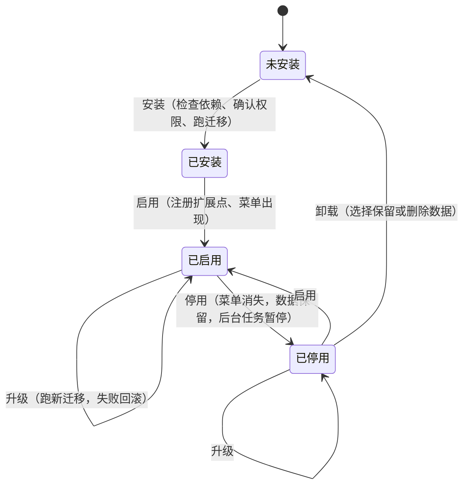

# 插件清单格式和插件 API

一人之下的内核加插件架构的接口规范：插件清单怎么写、插件能往内核里注册什么、权限怎么确认、生命周期每一步前后端各做什么、插件不能做什么。

- 来源：`web-next/docs/dev-plan.md` 2.3 到 2.8、第 6 节；已定决策见 `docs/dev-decisions.md`
- 任务：CORE-01a（本文档）；类型定义和校验在 CORE-01b，后端注册在 CORE-04a，迁移在 CORE-05
- 范围：只定第一方插件需要的东西。第三方插件（进程外、走 HTTP 或 MCP）到 M3 之后再开放，到时在本文档上加一版
- 插件 API 版本：`1.1.0`（M2 起 1.0.0，VID-03a 升到 1.1.0），见第 1.3 节。这几批加的句柄和清单字段按 1.3 本该再升小版本，发布前由用户一起定稿，本文档暂不改版本号
- 覆盖到：第三十六批（DOC-02 按提交 2775785 的代码逐项核对）。2.0 的代码块和 2.13 的句柄参考是代码里已有的；标了「规划」的还没实现

## 评审记录

| 评审人 | 日期 | 结论 |
|---|---|---|
| Claude（代评，待用户复核） | 2026-10-28 | 通过。第 8 节待定事项：1 同意「强依赖不许成环、弱依赖允许」；2 交易套件表前缀放到 M6 定；3 第三方插件协议 M3 之后另起一版。偏离开发计划的一处（干系人留在内核、不划给项目插件）理由成立：任务的负责人字段也引用干系人表，同意。第 6 节模板样例里的 terminal、browser 模块，PROTO-05 要把它们改成项目内的展开区域，到时同步改样例 |

按 `docs/dev-decisions.md`「设计文档的用户评审由主会话代评」，由主会话代评并标注「Claude 代评，待用户复核」。用户复核时提出的修改，按修改调整本文档和已开工的相关任务。

---

## 0. 术语和约定

| 词 | 意思 |
|---|---|
| 内核 | 必装、不能卸载的部分：外壳、对象模型、身份、连接器框架、Agent 框架、执行与调度、事件总线、凭证保险箱、审计、插件管理；内核模块是今日、任务、文档、联系人、会话、设置 |
| 插件 | 按需安装的功能包，带一份清单；第一方插件和内核同仓库、编译进同一个二进制、一起构建前端 |
| 扩展点 | 插件能往内核里注册的东西，共十个，见第 2 节 |
| 插件 id | 清单里的 `id`，全局唯一，同时决定表前缀、接口路径前缀、事件前缀 |

约定：

- 插件目录：后端 `internal/plugins/<id>/`，前端 `frontend/src/plugins/<id>/`
- 清单文件只有一份：`internal/plugins/<id>/plugin.json`。后端用 `embed` 读；前端构建时通过 Vite 的 glob 导入同一个文件（`server.fs.allow` 放开这个目录），运行时的安装、启用状态从 `GET /api/plugins` 拿。不在两边各写一份，避免漂移
- 清单字段名用 snake_case，和后端 JSON 风格一致；前端类型里保持同名
- 所有 id、key 都是小写字母、数字、下划线，插件 id 不带下划线以外的分隔符

## 1. 清单

### 1.1 字段

| 字段 | 类型 | 必填 | 语义 |
|---|---|---|---|
| `id` | string | 是 | 插件 id，`^[a-z][a-z0-9_]{1,23}$`。一经发布不能改：表前缀、迁移记录、已确认权限、工作台配置都挂在它上面。不能和内核保留字重名（见 1.4） |
| `name` | string | 是 | 显示名，插件管理页和菜单用 |
| `description` | string | 否 | 一句话说明，插件管理页用 |
| `icon` | string | 否 | 本插件功能模块在一级菜单上的图标，外壳内置图标的 key（`^[a-z][a-z0-9_]*$`，如 `folder`、`message`）；外壳不认识的 key 用默认图标 |
| `icons` | object | 否 | 按模块给的菜单图标：`{ "<模块 id>": "<图标 key>" }`，模块必须在 `provides.modules` 里，图标 key 规则同 `icon`。没给的模块用 `icon`。例：交易套件 `{ "markets": "candles", "monitor": "pulse", "strategy": "chart", "trading": "swap" }`。前后端怎么校验、怎么取见 2.13.19 |
| `version` | string | 是 | 插件自己的版本，semver（`MAJOR.MINOR.PATCH`）。升级判断、依赖匹配都用它 |
| `core` | string | 是 | 要求的插件 API 版本范围，semver 范围语法（见 1.2）。内核的插件 API 版本不在范围里就拒绝安装和启用 |
| `depends` | object | 否 | 强依赖：`{ "<插件 id>": "<版本范围>" }`。安装前必须已装且版本匹配；被依赖的插件停用时，本插件跟着停用 |
| `optional_depends` | object | 否 | 弱依赖：装了就联动，没装也能用。例：IM 消息在装了项目插件时提供「绑定到项目」 |
| `provides` | object | 是 | 本插件注册的扩展点 id 清单，按扩展点分组（见 1.5）。代码里注册的东西必须在这里列出，反之亦然，CORE-01b 的校验和 CORE-04a 的注册都会比对 |
| `emits` | string[] | 否 | 本插件会发布的事件类型，必须以 `<id>.` 开头 |
| `subscribes` | string[] | 否 | 本插件订阅的事件类型（内核事件或别的插件的事件）。订阅别的插件的事件时，那个插件要在 `depends` 或 `optional_depends` 里 |
| `adopts` | object | 否 | 认领插件化之前就在内核里的东西，见 1.6。只给第一方插件用 |
| `permissions` | string[] | 是 | 需要的权限，见第 3 节；可以是空数组 |
| `migrations` | string | 否 | 迁移目录，相对插件目录。没有自己的表就不写 |
| `table_prefix` | string | 有迁移时必填 | 本插件的表名前缀，必须是 `<id>_`（交易套件这类插件族可以申请共享前缀，如 `trade_`，在内核的白名单里登记） |

未知字段：CORE-01b 的校验报错，不静默忽略。加字段要升插件 API 的小版本。

### 1.2 版本范围

用 semver 范围，写法和 npm 的子集一致，前后端用同一套解析（CORE-01b 实现）：

| 写法 | 意思 |
|---|---|
| `>=1.2.0 <2.0.0` | 空格分隔表示同时满足 |
| `^1.2.0` | 等价 `>=1.2.0 <2.0.0`；`^0.3.0` 等价 `>=0.3.0 <0.4.0` |
| `~1.2.0` | 等价 `>=1.2.0 <1.3.0` |
| `1.2.3` | 只认这一个版本 |

不支持 `||`、`*`、`x` 通配和预发布标签。开发计划里的 `>=1.2 <2` 这种省略写法按补零处理（`>=1.2.0 <2.0.0`），但清单里推荐写全。

### 1.3 插件 API 版本怎么升

插件 API 版本是内核对插件承诺的接口版本，和内核二进制的发版号分开记，定义在 `internal/plugin` 包里的一个常量，前端从 `GET /api/plugins` 的响应里拿。

| 变化 | 升哪位 | 例子 |
|---|---|---|
| 加扩展点、加清单字段、加注册参数里的可选字段、加内核事件 | MINOR | 加第十一个扩展点 |
| 修文档、修实现，接口不变 | PATCH | |
| 删字段、改语义、改签名 | MAJOR | 改 `Registrar` 的方法签名 |

第一方插件跟内核一起构建，升 MAJOR 时在同一个提交里改完所有第一方插件。这一条是为了把「插件 API 定得太早会频繁改」（开发计划第 6 节）的代价压在仓库内部：M3 之前接口可以改，但每改一次都升版本、写进本文档的变更记录。

### 1.4 内核保留字

插件 id 不能是这些（它们是内核的接口路径段或模块 key）：

`api` `admin` `agent` `agent_providers` `agents` `artifacts` `audits` `categories` `connectors` `contacts` `conversations` `core` `counts` `dict_items` `dictionaries` `events` `fs` `health` `hooks` `incident` `incidents` `kernel` `knowledge_bases` `library` `links` `notifications` `objects` `object_types` `plugins` `revisions` `runs` `schedules` `sessions` `settings` `shortcut_groups` `shortcuts` `skills` `stakeholders` `stats` `tags` `tasks` `today` `webhooks` `workspaces`

内核以后加新的一级路径时同步这张表；已发布插件的 id 和新路径冲突时，内核让路（换内核路径），不改插件 id。

### 1.5 `provides` 的分组

| 键 | 扩展点（第 2 节） | 每项是什么 |
|---|---|---|
| `modules` | 2.1 功能模块 | 模块 key，等于工作台菜单里的 key，例 `projects`、`messages`、`videos` |
| `settings` | 2.2 设置分节 | 设置分节 key |
| `object_types` | 2.3 对象类型 | 新对象类型 id，必须等于插件 id 或以 `<id>_` 开头 |
| `connectors` | 2.5 连接器 | 连接器工具 id，例 `slack`、`bilibili` |
| `skills` | 2.6 技能 | 技能 id，以 `sk_` 开头 |
| `agent_tools` | 2.6 Agent 工具 | 工具名，以 `<id>_` 开头 |
| `sop_nodes` | 2.7 SOP 节点 | 节点 kind，以 `<id>_` 开头 |
| `today_cards` | 2.8 今日卡片 | 卡片 key，以 `<id>_` 开头 |
| `commands` | 2.9 命令面板命令 | 命令 id，`<id>.<动作>` |
| `search` | 2.9 命令面板数据源 | 搜索数据源 key |
| `schedule_actions` | 2.12 定时任务动作（只有后端） | 动作 kind，以 `<id>_` 开头，例 `video_publish`（VID-06a） |

数据迁移（2.4）用顶层的 `migrations` 和 `table_prefix`，事件订阅（2.10）用顶层的 `emits` 和 `subscribes`，不放进 `provides`。

开发计划 2.4 的样例里 `connectors` 写的是 `douyin`、`channels` 这类不带前缀的名字。连接器 id 是全局命名空间（一个平台只该有一个连接器定义），不加插件前缀，靠内核检查重复：两个插件声明同一个连接器 id 时，后装的拒绝安装。

### 1.6 `adopts`：认领插件化之前的东西

项目、对象类型 `project` 这些在插件化之前就已经在内核里了（`project` 类型由 0002 号迁移写进 `object_types`）。已应用的迁移不能改、表不能搬，所以插件不「拥有」它们，只「认领」：

| 键 | 意思 | 停用时 | 卸载删数据时 |
|---|---|---|---|
| `object_types` | 认领已有的对象类型 | 该类型从新建菜单、命令面板里隐藏；已有对象仍能通过搜索、关联打开（只读） | 不删类型，不删对象；只在插件管理页提示「这些对象还在，可以在文档或任务里看到」 |
| `routes` | 认领已有的内核接口路径 | 这些路径返回 404 | 同停用 |

认领只能认领内核白名单里列出的东西（白名单写在 `internal/plugin`，CORE-04a 实现）。白名单第一版只有一项：`project` 类型给 `projects` 插件。

决策（CORE-01a）：干系人（`stakeholders`、`object_participants` 两张表和 `/api/stakeholders` 接口）留在内核，不给项目插件认领。理由：0010 号迁移让所有对象的 `owner_id` 都引用干系人，任务、需求也用，停用项目插件不能让任务的负责人失效。项目插件只提供项目页里的「干系人」标签页，数据走内核接口。撤回：把干系人加进认领白名单即可，不动表。

---

## 2. 扩展点

十个扩展点，每个给出前端注册函数、后端注册接口和一个例子；另有只在后端的按 Host 分发（2.11）、定时任务动作（2.12）。后来加的句柄（2.0 的 `Core`）和不进清单的扩展点（`ConnectorImpact`、前端 `todaySources`）逐项见 2.13。

### 2.0 公共部分

前端入口（`frontend/src/plugins/<id>/index.ts`），由内核按清单动态 `import()`，没装或没启用的插件不加载：

```ts
// frontend/src/core/plugin/api.ts（CORE-01b 定类型，CORE-02b 实现）
export interface Disposable { dispose(): void }

export interface PluginEntry {
  /** 启用时调用。只注册，不发请求；数据在页面里按需取 */
  activate(api: PluginApi): void
  /** 停用时调用。注册过的东西内核会自动撤掉，这里只清插件自己的定时器、订阅之外的资源 */
  deactivate?(): void
}

export function definePlugin(entry: PluginEntry): PluginEntry

export interface PluginApi {
  readonly id: string
  readonly manifest: PluginManifest
  modules: ModuleRegistry          // 2.1
  settings: SettingsRegistry       // 2.2
  objectTypes: ObjectTypeRegistry  // 2.3
  migrations: MigrationInfo        // 2.4（只读；规划，用到就抛「还没实现」）
  connectors: ConnectorRegistry    // 2.5（规划，同上）
  agent: AgentRegistry             // 2.6（规划，同上）
  sopNodes: SopNodeRegistry        // 2.7（SOP-03b，见 2.13.18）
  todayCards: TodayCardRegistry    // 2.8
  todaySources: TodaySourceRegistry // 今日「需要你处理」「正在运行」的来源（ALIGN-08，见 2.13.17）
  projectTabs: ProjectTabRegistry  // 项目详情的插件标签（VID-08d）
  objectSections: ObjectSectionRegistry // 对象详情的插件区块（SOP-06，见 2.13.21）
  sessionTools: SessionToolRegistry // 会话头部的工具入口和面板（SPEC-sessions-1.34，见 2.13.22）
  sessionSources: SessionSourceRegistry // 会话来源怎么显示、跳到哪（SPEC-sessions-1.42，见 2.13.23）
  terminalLauncher: TerminalLauncherRegistry // 在终端里开 Claude Code 的入口（内核 0048，见 2.13.25）
  commands: CommandRegistry        // 2.9
  events: EventRegistry            // 2.10（规划，同上）
  /** 内核的数据访问层（CORE-03a）；插件只能通过它读写数据 */
  data: DataClient
  /** 外壳能力：现在只有 navigate(to)；抽屉、提示、确认框是规划 */
  shell: ShellApi
}
```

实现在 `frontend/src/core/plugin/registry.ts` 的 `pluginApi`：标了「规划」的扩展点是 `notImplemented` 占位，`activate` 里一调就抛错，插件按加载失败处理。

规则：

- 每个 `register` 返回 `Disposable`；停用时内核按插件 id 统一撤销，插件不用自己记
- 注册的 id 不在清单 `provides` 里：开发环境直接抛错，生产环境拒绝注册并记运行异常
- 插件的状态只放在自己目录里（自己的 store 或组件状态），不读写别的模块的状态（第 5 节）

后端入口（`internal/plugins/<id>/plugin.go`）：

```go
// internal/plugin（CORE-04a 实现）
package plugin

type Plugin interface {
	// Manifest 返回 embed 进来的 plugin.json 解析结果。
	Manifest() Manifest
	// Migrations 返回迁移目录；没有自己的表返回 nil。
	Migrations() fs.FS
	// Register 在启用时调用，只登记，不做 IO、不起协程。
	Register(r Registrar) error
}

// 可选：需要在生命周期节点做事的插件实现这些。
type Installer interface   { OnInstall(ctx context.Context, c Core) error }
type Uninstaller interface { OnUninstall(ctx context.Context, c Core, deleteData bool) error }
type DisableGuard interface {
	// CanDisable 返回 false 时内核拒绝停用并把 reason 给用户看，例：交易插件还有挂单。
	CanDisable(ctx context.Context, c Core) (ok bool, reason string)
}

// Registrar 是 Register 拿到的登记入口（internal/plugin/plugin.go）。登记的东西不对时 Register 整体失败，插件不会被启用。
type Registrar interface {
	Core() Core

	Routes(fn func(m RouteRegistrar))           // 2.1
	Job(j Job)                                  // 2.1
	Subscribe(eventType string, h EventHandler) // 2.10
	TodayCard(c TodayCardDef)                   // 2.8
	Connector(d ConnectorDef)                   // 2.5，ConnectorDef = connector.Def（CONN-02，见 2.13.8）
	ConnectorImpact(d ConnectorImpactDef)       // 删除连接器前的影响检查，不进清单（CONN-03，见 2.13.7）
	Skill(s SkillDef)                           // 2.6
	SOPNode(n SOPNodeDef)                       // 2.7
	SOPEngine(e SOPEngine)                      // 2.7，只给 sop 插件
	SOPStarter(st SOPStarter)                   // 2.7，只给 provides.modules 含 sop 的插件（SOP-01d）
	HostHandler(d HostHandlerDef)               // 2.11，只有后端
	ScheduleAction(d ScheduleActionDef)         // 2.12，只有后端（VID-06a）
	ProjectPrototypes(fn ProjectPrototypeLister) // 只给 provides.modules 含 projects 的插件，见 2.13.24

	// 规划，还没实现：SettingsSection（2.2）、ObjectType（2.3）、AgentTool（2.6）、SearchProvider（2.9）
}

// Core 是插件能用的内核能力，每个方法拿到的都是按本插件 id 收窄过的句柄；逐项见 2.13。
type Core interface {
	PluginID() string
	Log() *slog.Logger
	Events() Publisher                       // 只能发布清单 emits 里的类型（2.10）
	Store() Store                            // 只能访问 table_prefix 开头的表（2.13.1）
	Objects() ObjectReader                   // 只读：Get(ctx, id)、Find(ctx, typeID, key) ObjectInfo（下面「内核对象只读句柄」）；TaskStages(ctx, TaskStageQuery{MessageID, RequesterID, Channel, SenderID, Limit}) 按来源消息或提出人查任务阶段，口径同 GET /api/tasks/stages（AUTO-05）
	Contacts() ContactReader                 // 只读：Get、FindByName；ContactInfo 带 ID、Name、Email、Archived
	Conversations() ConversationReader       // 只读：IM 会话（2.13.2）
	Dicts() DictReader                       // 只读：内核枚举字典的条目，含停用的（TSK-0718）
	ConversationWriter() ConversationWriter  // 登记 IM 会话，只建不改（PR-02，2.13.5 后）
	Identities() IdentityReader              // 只读：IM 身份（2.13.3）
	ObjectWriter() ObjectWriter              // 建对象、追加正文、改任务阶段（2.13.4）
	ContactWriter() ContactWriter            // 建联系人、合并字段（2.13.5）
	Connectors() ConnectorReader             // 连接器实例：查、授权、断开、取配置、记同步（2.13.6、2.13.9）
	HTTP(group string) (*http.Client, error) // 只给 network:<group> 声明并确认过的组，每一跳查域名清单（VID-04a，3.1）
	AttachmentDir() string                   // 数据目录下 attachments/ 的绝对路径，没接数据目录为空串（IM-04a）
	WorktreeDir() string                     // 数据目录下 worktrees/ 的绝对路径，没接数据目录为空串；项目插件在这里建需求工作区（AUTO-07）
	CacheDir() string                        // 数据目录下 cache/<插件 id>/ 的绝对路径，没接数据目录为空串；放缩略图这类能重新生成的东西（TSK-0456）
	Agent() AgentService                     // 用默认服务商补全、按 Agent 的授权跑一轮、搜指定知识库（SOP-01c）
	Knowledge() KnowledgeService             // 取、建知识库，按插件自己的资料同步它加进来的篇目，挂到 Agent（TSK-0721，下面「知识库句柄」）
	Granted(perm string) bool                // 用户确认过这项权限没有（SEC-01，2.13.16）
	RevokePermission(ctx context.Context, perm string) error // 收回自己单独授予的权限（如 trade:live），只能收回不能授予（TRD-08c，2.13.26）
	SOP() SOPService                         // SOP 节点、唤醒和失败、内置流程、指向流程的定时任务（2.7、2.13.14、2.13.15）
	Audit() AuditLog                         // 插件替用户做的对外动作记一条（SOP-02b，2.13.12）
	Notify(ctx context.Context, n Notification) error // 以本插件的名义发通知（VID-06b，2.13.11）
	Runs() RunService                        // 发起 Agent、SOP 运行或交给 Claude Code（VID-03a，2.13.13）
	Incidents() IncidentService              // 记运行异常，按指纹合并（INC-01a，2.13.20）
	Artifacts() ArtifactWriter               // 登记产物（本地文件）：来源记 run、产出者记本插件，挂到给的对象上（AUTO-08）

	// 规划，还没实现：Links()、Artifacts() 的改和删（AG-03）、Settings()、Secrets()（CORE-06）、FS(scope)、Process()；
	// 改对象、建关联等更宽的写能力等 ObjectService。现在 fs、process 权限靠 Granted/Require 在代码路径上查
}
```

`RouteRegistrar` 沿用 `internal/api/server.go` 里的同名接口（`HandleFunc(pattern, handler)`），路径必须以 `/api/<id>/` 开头；内核在外面包一层，停用时整组返回 404。加了路由照旧要写进 `docs/api-contract.md`（契约测试双向检查）。

内核对象只读句柄（已实现，`internal/plugin/store.go`）：`Objects().Get(ctx, id)` 返回 `ObjectInfo{ID, Type, Ref, Title, Workdir, Props, Deleted, Status, ProjectID, OwnerID}`（`ProjectID` 是对象所属项目，没挂项目为空串，AUTO-07 加；`OwnerID` 是负责人联系人 id，没有为空串，TSK-0411 加），没有这个 id 返回 `ErrNoRows`。`Status` 是状态 key（按类型隔离，IM 的「等任务执行完成」节点看任务是不是 `done`，0.19.0 加）。`Props` 是对象的自定义字段（JSON 解开的 `map[string]any`，解不开为空 map），`Ref` 是给人看的编号（消息分流加，SOP 的写进项目目录要读项目的 `props.related`）。`Objects().Find(ctx, typeID, key)` 在一个类型里按 id、`ref`（不分大小写）、标题（完全相同）依次找没删的对象，标题重名取最早建的，都找不到返回 `ErrNoRows`（消息分流加，SOP 节点和 IM 的归到项目按「项目 id、编号或名字」认项目）。`Workdir` 是对象自身的 `workdir` 列，对项目就是 `root`，没设为空串，不往所属项目继承（TERM-01c 加）。项目根目录可能存成了 `file://` 地址，拿来当目录用之前过一遍 `plugin.LocalDir`（SEC-01 加：去掉前缀、按 URL 解码，不是 `file://` 的原样返回）。

`Objects().List(ctx, ObjectQuery{Type, ProjectID, Archived, Limit})`（TSK-0721）按类型（可再按所属项目）列没删的对象，按建立先后；默认不列归档的（`Archived: true` 一起列），`Limit` 默认 500、最多 2000。`ObjectInfo` 加 `Archived`（`archived_at` 非空）。项目插件列项目、项目下的文档用。

知识库句柄（TSK-0721，`internal/plugin/knowledge.go`，实现在内核接口层 `internal/api/kbplugin.go`，`api.New` 接上，没接上回 `ErrNoKnowledge`）：

| 方法 | 说明 |
|---|---|
| `Knowledge().Get(ctx, id)` | `KnowledgeBaseInfo{ID, Name, Desc, Docs, Agents}`（`Agents` 是挂着它的 Agent id），不存在回 `ErrNoRows` |
| `Knowledge().Create(ctx, name, desc)` | 建一个知识库（默认切分设置、不选分类、不挂目录），名称规则同 `POST /api/knowledge-bases`；记审计 `knowledge_base`/`create`，操作者插件 |
| `Knowledge().Sync(ctx, kbID, scope, items []KBItem)` | 让知识库里 `origin` 为 `<插件 id>:<scope>` 的篇目和 `items` 一致（新的加、变了的重新索引、没了的移出），人工加的、别的插件和别的 scope 的不动，和它们重复的跳过；`KBItem{Key, Kind, Ref, Title, Text, Label}`，`Kind` 是 `file`、`dir`、`note`、`link`、`library`。读本机文件同知识库目录同步的拦截（只收 md、markdown、txt、text，库文件、密钥证书、数据目录里的不收，数据目录下的 `attachments/` 例外；单个文件超过 1MB 跳过），整目录收时目录本身不能是隐藏目录、数据目录或包住它的。回 `KBSyncResult{Added, Updated, Removed, Unchanged, Skipped, Failed, Failures, Skips}`；和知识库页的同步互斥，撞上回冲突错误。有增删改时记审计 `knowledge_base`/`sync` |
| `Knowledge().AttachAgent(ctx, agentID, kbID)` | 把知识库挂到 Agent 的 `kbs`，已挂回 `false`；记审计 `agent`/`update` |

谁能调：任何插件，不要权限（读文件走内核的拦截，插件拿不到文件内容以外的东西；只能改自己 origin 下的篇目）。

产物登记句柄（已实现，`internal/plugin/artifacts_write.go`，AUTO-08 加）：`Artifacts().Record(ctx, NewArtifact{ObjectID, Title, Path, BaseDir, Kind, Note, Props})` 回产物 id。走 `cmd/pmw` 交的外层 store（同 Claude Code 运行的产物登记），`source` 固定 `run`、`actor_type` 固定 `run`、`actor_id` / `actor_label` 为插件 id，`platform` 为 `local`，插件改不了；`ObjectID` 空串不挂对象；`Path` 可以是相对 `BaseDir` 的路径；`Kind` 是字典 `artifact_kind` 的 key（不认的回 `domain.ErrValidation`）。没接 store 回 `ErrNoObjectWriter`。只登记，不改、不删。项目插件用它把测试报告、截图登记为任务产出。

模型和 Agent 句柄（已实现，`internal/plugin/agent.go`，SOP-01c 加）：实现是 `internal/agent` 的 `Service`，`cmd/pmw` 用 `Registry.SetAgent` 接上；没接上时每个方法回 `ErrNoAgent`。服务商、授权、技能的口径和对话接口（`/api/agent/chat`）一致。

| 方法 | 做什么 |
|---|---|
| `Complete(ctx, CompleteRequest{System, Prompt, Provider, Model, Agent, Scenario, Thinking})` | 不带工具补全一次，回模型说的原文。`Agent`（id 或名称）给了就用这个 Agent 的服务商、模型、思考档位，它的指令拼在 `System` 前面，`Provider`、`Model` 忽略；指定的 Agent 不存在或停用了报错。`Agent`、`Provider`、`Model` 都没给时按 `Scenario`（`plugin.ScenarioSOPAssist` / `plugin.ScenarioBackground`，空的算 background）用「设置 / Agent」里选的场景默认 Agent，没选或用不了照老样子。服务商取 `Provider`，没给取默认的（没有默认的取第一个启用的），`Model` 为空用服务商的模型；一个服务商都没有回 `agent.ErrNoProvider`。`Thinking`（`default`/`off`/`low`/`medium`/`high`，空串跟 Agent/服务商默认）可以覆盖这次调用的思考档位：结构化输出这类不需要长思考的调用传 `plugin.ThinkingOff` 能明显省时间。思考档位翻成各家参数、模型不认时自动去掉重来，插件不用管。服务商不可用（熔断中，或自动重试 2 次仍是 5xx / 连不上）时：服务商设了「失败时改用」（`extra.fallback_id`）先改用备用服务商和它的默认模型；还不行回 `*plugin.ProviderUnavailableError`（即 `agent.UnavailableError`：`ProviderID`、`Provider`、`Cause` 原始失败、`Open` 是否已熔断、`RetryAt` 下次探测时间、`Fallback` 试过的备用服务商名），用 `plugin.AsProviderUnavailable(err)` 取，插件可以据此等服务商恢复再跑（SOP 的做法见 api-contract「等服务商恢复」）。`RunAgent` 也经过熔断，熔断中直接回这个错误，不改用备用 |
| `RunAgent(ctx, AgentRunRequest{Agent, Prompt, Title})` | `Agent` 是 id 或名称，停用的不跑。新建一个挂这个 Agent 的会话（标题 `Title`），按它当前的服务商、模型、技能、工具授权跑一轮。遇到授权是「需确认」的工具不执行，回 `Waiting: true`、`Pending`（给人看的一句话）、`CallIDs`；人在会话里确认或拒绝后由对话接口接着跑 |
| `AgentState(ctx, sessionID)` | 会话里最新一条 Agent 回复（`MessageID`、`Reply`）；回复里还有确认卡片时 `Waiting` 为真。插件靠「`MessageID` 变了、`Waiting` 为假」判断确认后这一轮跑完了 |
| `SearchKB(ctx, kbIDs, query, top)` | 只在给的知识库里检索，回前 `top` 段（`KBHit` 即 `kb.SearchHit`）；`kbIDs` 为空直接报错，不搜全部 |

这个句柄暂不按权限收窄：调模型、跑 Agent 不在 3.1 的权限清单里，Agent 能做什么由它自己的工具授权管。

带操作者和审计的写入（已实现，`internal/plugin/writes.go`，SOP-02a 加）：插件替用户自动写内核数据时用，例 SOP 的写节点。和只能建对象的 `ObjectWriter().Create`（IM-02a，`objects_write.go`）走同一个外层包装过的 store（`Registry.SetObjectCreator`），修订、事件照常，不用另外接线。每个方法都带 `WriteMeta{Session, Key, Detail}`：

- 操作者记为 `<插件 id>#<Session>`（`Session` 空时就是插件 id），来源 `plugin`；对象的 `source` 固定是插件 id。
- 每次成功写入记一条审计：`kind` 为 `agent`、`source` 为 `plugin`，`detail` 补上 `Detail` 的键和 `write_key`。失败的写不记，审计写失败只记日志（同 CORE-08）。
- `Key` 非空时同一个键只写一次，再调回第一次的结果、`Reused` 为真。按同一操作者、`detail.write_key` 相同的审计查；建对象另外把 `props.source_ref.write_key` 写成 `Key` 并按它查，写成了但审计没落下时也认得出。追加正文、写联系人只按审计查。

| 方法 | 做什么 |
|---|---|
| `ObjectWriter().CreateAs(ctx, NewObject, WriteMeta)` | 建对象，校验同 `POST /api/objects`；`NewObject.CategoryID` 是分类 id（可空） |
| `ObjectWriter().AppendBody(ctx, id, text, WriteMeta)` | 在对象正文末尾追加一段，和原文空一行；对象不存在或已删除回 `domain.ErrNotFound` |
| `ObjectWriter().UpdateTask(ctx, id, TaskChange{Stage, ProjectID, Status, OwnerID}, WriteMeta) (ChangedTask, error)` | 改任务的阶段（`props.stage`）和所属项目（AUTO-06，`internal/plugin/taskstage_write.go`）。口径同 `PUT /api/objects/{id}/stage`：服务端读当前 props、只换 `stage` 一个键再写回，所属项目同一次写入；`object.stage_changed` 事件和阶段审计由 store 包装层发。空串表示不改（本期不提供清掉阶段、解除项目）；两样都空回 `domain.ErrValidation`。只改任务：不是任务、阶段不认（`domain.TaskStages`）、项目不存在或已删除回 `domain.ErrValidation`；对象不存在、已删除回 `domain.ErrNotFound`。同样的值再写一次不写库、不记审计，回 `Changed` 为空（天然幂等，不查 `WriteMeta.Key`）。改了时操作者「插件 id#Session」，记一条审计 `action=update`、`target_type=object`，`detail` 含 `ref`、`title`、`type_id`、`fields`（`stage` / `project_id`）、`from_stage`、`to_stage`，加 `WriteMeta.Detail`。`ChangedTask`：`{ID, Ref, Title, Status, Stage, ProjectID, Changed, OwnerID}`。TSK-0411 追加：`Status` 是状态 key（空串不改，store 按任务类型的状态集校验，不认回 `domain.ErrValidation`；`object.status_changed` 照常发），`OwnerID` 是 `*string` 负责人联系人 id（nil 不改；不提供清掉负责人，给了空串回 `domain.ErrValidation`；联系人不存在回 `domain.ErrNotFound`）；四样都没给回 `domain.ErrValidation`；`Changed`、审计的 `fields` 多 `status`、`owner_id` |
| `ContactWriter().Create(ctx, NewContact, WriteMeta)` | 建联系人（干系人名册），`Name` 必填，校验同 `POST /api/stakeholders` |
| `ContactWriter().Merge(ctx, id, ContactPatch, WriteMeta)` | 把非 nil 的字段写进已有联系人，回 `WrittenContact{ID, Name, Fields}`，`Fields` 是改了的字段 |
| `Contacts().FindByName(ctx, name)` | 只读：按名字找没归档的联系人，重名取最早建的，没有回 `ErrNoRows` |
| `Dicts().Item(ctx, dictID, key)` / `Dicts().Items(ctx, dictID)` | 只读：内核枚举字典（`dict_items`，只看 `type_id` 为空的全局条目）。`DictItemInfo` 带 `Key`、`Label`、`Archived`、`Default`（`meta.default`）；`Item` 没有这条或字典不存在回 `ErrNoRows`，`Items` 按 `sort_order` 含停用的，字典不存在回空。项目插件按 `project_role` 校验干系人角色用（TSK-0718）；改字典走内核接口 |

写内核数据不在 3.1 的权限清单里，暂不按权限收窄；能写哪些类型等 `ObjectService` 落地时按「本插件声明或认领的类型」收。

发通知（已实现，`internal/plugin/notify.go`，VID-06b 加）：插件要提醒人时调 `Core.Notify(ctx, Notification{Kind, Level, Title, Body, ObjectID, Data})`，实现是 `internal/notify` 的 `Center`，`cmd/pmw` 用 `Registry.SetNotifier` 接上；落进通知列表（`GET /api/notifications`），同时照常推 `notification.created`。

- `Kind` 必填，小写字母开头、点分段（`publish_failed`、`alert.price`）；内核统一补成 `<插件 id>.<kind>`，已带本插件前缀的不重复加。插件因此发不出内核的 kind（`task.review_requested` 会变成 `<id>.task.review_requested`）；插件 id 本身是内核事件命名空间（`object`、`task`、`run`、`contact`）或保留字时一律拒绝。
- `Title` 必填；`Level` 是 `info`、`success`、`error`，空记 `info`。
- 来源：`Data.source` 由内核写成插件 id，插件自己填的会被覆盖（通知表没有来源列，本批不加迁移）。
- 插件没在跑（停用了、还没启用）回 `ErrNotifyInactive`；已发的通知保留，不随停用、卸载删。没接通知中心（测试里）回 `ErrNoNotifier`。
- 发通知不在 3.1 的权限清单里，不按权限收窄。

发起运行（已实现，`internal/plugin/runs.go`，VID-03a 加）：插件要让 Agent、SOP 或本机 Claude Code 替它干活时用 `Core.Runs()`。三个发起方法都不等跑完，先回运行 id（`run_` 开头），跑完给发起的插件投一条 `run.finished`，插件按运行 id 认是哪次、用 `Get` 取结果。

| 方法 | 做什么 |
|---|---|
| `StartAgent(ctx, AgentRunStart{Agent, Prompt, Title})` | 在后台调 `Agent().RunAgent` 跑一轮（口径同上面的 `RunAgent`），上限 10 分钟。Agent 不存在、停用、服务商不对在结束时报（`status: failed`）；停在要确认的调用上记 `waiting` 并算结束，`Error` 是待确认的那句话，确认后接着跑由会话管，用 `Agent().AgentState(Ref)` 查 |
| `StartSOP(ctx, SOPRunStart{Flow, Input, ObjectID})` | 经 `Registry.StartSOP` 交给 SOP 插件起一条执行（口径同定时任务的 sop 动作，发起方记 `plugin`、插件 id）；`ObjectID` 非空时执行关联到那个工作对象（SOP-06，IM 转任务的回执流程用）。SOP 插件没启用回 `ErrNoSOPStarter`，流程不存在、必填空着同步回错误。内核看 SOP 插件发的 `sop.run_status_changed`，到 `done`、`failed`、`stopped` 算结束；人工检查点停着（`waiting`）不算 |
| `StartClaudeCode(ctx, ClaudeCodeStart{Workdir, Prompt, AllowWrites, ObjectID, ScopeType, ScopeID})` | 用 `internal/runner` 在 `Workdir`（绝对路径，校验同任务执行）里跑一次 claude，提示词原样交过去。默认只读；`AllowWrites` 要用户确认过 `process:spawn`，没确认回 `ErrNotGranted`。跑完按执行前后的目录快照登记改动的文件（同任务执行）：来源 `run`、产出者 `run` 加插件 id、`props.plugin_run_id` 是运行 id，挂到 `ObjectID`（可空）和 `ScopeType`/`ScopeID`（可空，要同时给）。默认不写 `task_runs`；`RecordOnTask` 为真且给了 `ObjectID` 时在任务上建执行记录，运行 id 即记录 id，接口层的取消和残留收尾也认得（插件运行和任务执行共用同一个执行器）。AUTO-01 另加：`PresetID`（角色 id，内核拼执行要求和输出要求；只读角色一律不放开写）、`FollowPreset`（为真且给了角色时写不写按角色定）、`Timeout`（空用执行器默认）、`ReportBack`（提示词末尾加回写一节、接回写用 MCP `pmw-run`） |
| `Get(runID)` | 本插件发起的运行 `RunInfo{ID, Kind, Source, Status, OK, Ref, Output, Error, ExitCode, Artifacts, Finished, StartedAt, FinishedAt, Summary, Result, Reported, TaskRun}`（后四项 AUTO-01 加：回报的摘要、结构化结论、回报的状态、是否在任务上建了记录）；别的插件发起的、不存在的回 `ErrRunNotFound` |
| `Cancel(runID)` | AUTO-01：取消本插件发起、还没结束的 Claude Code 运行，只发请求不等进程退出；已结束的不报错；别的插件发起的回 `ErrRunNotFound`；Agent、SOP 运行回 `ErrRunNotCancelable` |

- `Kind` 是 `agent`、`sop`、`claude_code`；`Status` 是 `done`、`failed`、`waiting`（Agent）、`canceled`（Claude Code）、`stopped`（SOP），只有 `done` 时 `OK` 为真。`Ref` 是 Agent 会话 id 或 SOP 执行 id；`Output` 是 Agent 最新回复或 Claude Code 的过程记录，SOP 为空。
- `run.finished` 只投给发起插件当前在跑的订阅，不上总线：总线上的 `run.finished` 是任务执行的（2.10），通知中心和事件流按任务执行认。载荷 `{ run_id, kind, source, status, ok, ref, summary, result }`（`summary`、`result` 是 Claude Code 经 `pmw_finish_run` 回报的摘要和结构化结论，没回报为空，AUTO-01），插件照常在清单 `subscribes` 里写 `run.finished`、用 `Subscribe` 登记；任务执行的那条也会收到，`Get` 回 `ErrRunNotFound` 跳过即可。
- 插件停用后它发起的运行照样跑完、`Get` 照样查得到，只是 `run.finished` 不再投给它；停用期间不能发起（回 `ErrRunInactive`）。
- 每次发起记一条审计：`kind` 为 `agent`、`action` 为 `run`、`target_type` 为 `plugin_run`、`target_id` 是运行 id，操作者是插件 id、来源 `plugin`，`detail` 带种类和 Agent、流程或目录。
- 运行记录只在进程内存里，最多留 500 条跑完的；重启后查不到，在途的 Agent、Claude Code 运行退出时最多等 5 秒。没接实现时回 `ErrNoAgent`、`ErrNoClaudeRunner`（`cmd/pmw` 用 `Registry.SetClaudeRunner` 接上）。
- 发起 Agent、SOP 不在 3.1 的权限清单里，不按权限收窄，同上面的 Agent 句柄。

### 2.1 功能模块

一级菜单项、它的页面、二级菜单；后端是这个模块的接口和后台任务。

前端：

```ts
export interface ModuleDef {
  key: string                 // = provides.modules 里的一项，也是工作台菜单里的 key
  label: string
  icon: string                // 内核图标集里的名字
  desc?: string               // 工作台「挑模块」时的说明
  /** 页面组件，用 React.lazy 包，没打开不加载 */
  page: React.LazyExoticComponent<React.ComponentType<ModulePageProps>>
  /** 二级菜单；没有就不出二级菜单 */
  subnav?: { key: string; label: string; badge?: () => number | undefined }[]
  /** 一级菜单上的角标，例：未读数 */
  badge?: () => number | undefined
}
export interface ModulePageProps { sub?: string; params: Record<string, string> }
export interface ModuleRegistry { register(def: ModuleDef): Disposable }
```

后端：

```go
type Job struct {
	Name  string        // 本插件内唯一，审计和执行记录里显示
	Every time.Duration // 定时跑；0 表示常驻
	Run   func(ctx context.Context, c Core) error // ctx 在停用时取消
}
// Registrar.Routes(fn func(m RouteRegistrar))
// Registrar.Job(j Job)
```

例子（IM 消息）：

```ts
api.modules.register({
  key: 'messages', label: 'IM 消息', icon: 'chat', desc: '各渠道收进来的消息，处理和回复',
  page: lazy(() => import('./MessagesPage')),
  subnav: [{ key: 'inbox', label: '收件箱' }, { key: 'mine', label: '与我相关', badge: () => mentions.unread() }],
})
```

```go
r.Routes(func(m plugin.RouteRegistrar) {
	m.HandleFunc("GET /api/im/messages", h.list)
	m.HandleFunc("POST /api/im/messages/{id}/reply", h.reply)
})
r.Job(plugin.Job{Name: "poll", Every: 30 * time.Second, Run: p.pollAll})
```

### 2.2 设置分节

设置页里的一节。值存在内核的设置存储里，按插件 id 分命名空间；凭证类字段不进设置，进凭证保险箱。

前端：

```ts
export interface SettingsSectionDef {
  key: string                 // = provides.settings 里的一项
  label: string
  group?: string              // 设置左侧导航的分组，默认「插件」
  page: React.LazyExoticComponent<React.ComponentType>
}
export interface SettingsRegistry { register(def: SettingsSectionDef): Disposable }
```

后端：

```go
type SettingsSection struct {
	Key    string
	Schema json.RawMessage           // JSON Schema，内核按它校验写入
	Defaults map[string]any
	// Validate 做 Schema 表达不了的检查（例：端口范围不重叠），可以为 nil。
	Validate func(ctx context.Context, v map[string]any) error
}
// Registrar.SettingsSection(s SettingsSection)
// 读写：Core().Settings().Get(ctx, key) / Put(ctx, key, v)，接口由内核统一提供：
// GET/PUT /api/settings/plugins/{id}/{section}
```

例子（项目）：设置分节 `projects`，放「原型端口范围」「新项目默认根目录」。

```go
r.SettingsSection(plugin.SettingsSection{
	Key:      "projects",
	Schema:   projectsSettingsSchema,
	Defaults: map[string]any{"port_from": 5170, "port_to": 5199, "root": "~/Projects"},
})
```

### 2.3 对象类型

带字段定义的对象类型。数据有两种放法：放内核对象表（`objects`，享受搜索、关联、标签、修订记录），或放插件自己的表（见 2.4）。默认放内核对象表；只有字段多、查询重（例：K 线、成交）的才放自己的表。

前端：

```ts
export interface ObjectTypeView {
  typeId: string              // = provides.object_types 或 adopts.object_types 里的一项
  /** 详情抽屉；不给就用内核的通用详情 */
  detail?: React.LazyExoticComponent<React.ComponentType<{ objectId: string }>>
  /** 列表行的副标题、角标 */
  summary?: (o: ObjectRecord) => { sub?: string; badges?: string[] }
}
export interface ObjectTypeRegistry { register(def: ObjectTypeView): Disposable }
```

后端：

```go
type ObjectTypeDef struct {
	ID        string            // 新类型：插件 id 或 <id>_ 开头；认领的类型：adopts 里的 id
	Name      string
	Plural    string
	RefPrefix string            // 编号前缀，例 VID；内核检查不重复
	Icon      string
	Color     string
	Statuses  []domain.Status   // 和 object_types.statuses 同结构
	Fields    []FieldDef        // 自定义字段，存在 objects 的扩展字段里
}
// Registrar.ObjectType(t ObjectTypeDef)
// 新类型在安装时写进 object_types（内核代写，插件不直接 INSERT）；
// 认领的类型只登记归属，不改 object_types 里已有的行。
```

例子（视频创作，M5）：

```go
r.ObjectType(plugin.ObjectTypeDef{
	ID: "videos_clip", Name: "视频", Plural: "视频", RefPrefix: "VID", Icon: "video", Color: "#e8590c",
	Statuses: []domain.Status{{Key: "script", Label: "写稿"}, {Key: "recording", Label: "录制"}, {Key: "published", Label: "已发布", Terminal: true}},
})
```

例子（项目，认领）：`r.ObjectType(plugin.ObjectTypeDef{ID: "project"})`，只给 ID 表示沿用已有定义。

### 2.4 数据迁移

插件自己的表，表名带插件前缀，迁移按插件分目录、单独编号、单独记版本（CORE-05）。

前端：没有注册函数，前端只读。插件管理页在安装、升级前展示迁移计划：

```ts
export interface MigrationStep { plugin: string; file: string; checksum: string; applied_at?: string }
export interface MigrationInfo {
  /** 本插件已应用和待应用的迁移；来自 GET /api/admin/migrations?plugin=<id> */
  list(): Promise<MigrationStep[]>
}
```

后端：

```go
// Plugin.Migrations() fs.FS
// 目录：internal/plugins/<id>/migrations/0001_<说明>.sql，插件内从 0001 起编号，和内核的 0001..0013 无关。
// 应用记录写在插件迁移表里（插件 id、文件名、校验和、插件版本、时间），不写进内核的 schema_migrations。
```

规则：

- 每个文件一个事务；已应用的文件不能改，启动时比对校验和，不一致拒绝启动并指出文件（和内核迁移同一套逻辑）
- 只能 `CREATE TABLE` / `CREATE INDEX` / `ALTER TABLE ... ADD COLUMN` 本插件前缀的表；不能 `ALTER`、`DROP`、`INSERT`、`UPDATE`、`DELETE` 内核表。CORE-05 在应用前做静态检查（按语句前缀和表名），不合规拒绝应用
- 不写回滚脚本。升级失败靠迁移前的自动备份恢复（REL-02），见 4.5
- 外键可以指向内核表（例：`REFERENCES objects(id)`），但不能 `ON DELETE CASCADE` 到内核表之外的方向

例子（IM 消息）：

```sql
-- internal/plugins/im/migrations/0001_messages.sql
CREATE TABLE im_messages (
  id              TEXT PRIMARY KEY,
  connector_id    TEXT NOT NULL,
  conversation_id TEXT NOT NULL,          -- 内核会话（CT-02），不按群名匹配
  identity_id     TEXT,                   -- 内核 IM 身份（CT-01），不按名字匹配
  external_id     TEXT NOT NULL,
  body            TEXT NOT NULL,
  status          TEXT NOT NULL DEFAULT 'open',
  mentions_me     INTEGER NOT NULL DEFAULT 0,
  received_at     TEXT NOT NULL,
  UNIQUE (connector_id, external_id)
);
```

### 2.5 连接器

连接器定义：认证方式、配置表单、工具清单。连接器框架（OAuth、Token、工具权限）在内核，插件只提供定义和适配器。凭证由内核的凭证保险箱存，插件拿到的是取凭证的句柄，拿不到明文的存储位置。

前端：

```ts
export interface ConnectorView {
  tool: string                // = provides.connectors 里的一项
  label: string
  color: string
  category: 'im' | 'media' | 'market' | 'dev' | 'other'
  desc: string
  /** 配置表单字段；凭证字段标 secret，前端只显示脱敏提示 */
  fields: { key: string; label: string; kind: 'text' | 'secret' | 'select'; placeholder?: string }[]
}
export interface ConnectorRegistry { register(def: ConnectorView): Disposable }
```

后端（已实现，CONN-02，`internal/plugin/connector.go`）：`ConnectorDef` 就是内核连接器框架的 `connector.Def`（`internal/connector/def.go`），认证、配置表单、凭证、工具授权都由内核管，插件只给定义和几个适配函数。

```go
type ConnectorDef = connector.Def

type Def struct {
	Tool     string     // = provides.connectors 里的一项，^[a-z][a-z0-9_]{0,31}$，全局唯一
	Label    string     // 必填
	Category string     // im / media / market / dev / other
	Color    string
	Logo     string     // 平台图标的键（TSK-0725），小写字母和数字；留空时内核按 Tool 补内置的（internal/connector/logo.go），前端不认识的键退回文字图标
	Desc     string
	CanSend  bool       // 能往外发（IM 回复）；只收不发的为 false
	Auth     []AuthMode // 支持的认证方式，至少一个，第一个是默认：AuthNone / AuthOAuth2 / AuthToken
	Fields   []Field    // 配置表单 {Key, Label, Kind(text/secret/select), Placeholder, Options, Required, Auth, Default, Long}
	Tools    []ToolDef  // 静态工具目录 {Name, Desc, Write, Schema}；没有 ListTools 时就用它
	Source   string     // 内核填成插件 id，插件写了也会被覆盖
	OAuth    *OAuthSpec // Auth 含 oauth2 时必填：AuthURL、TokenURL、Scopes、AuthParams 等

	Test        func(ctx context.Context, cfg Config) (account string, err error) // 必填，连通测试，回对方账号名（「我」从这里来，IM-03）
	ListTools   func(ctx context.Context, cfg Config) ([]ToolDef, error)          // 可选，向对方拉工具清单
	Call        func(ctx context.Context, cfg Config, tool string, args json.RawMessage) (string, error) // 可选，Agent 调工具（AG-02a）
	CheckConfig func(values map[string]string) error                              // 可选，新建、修改时校验非凭证字段（CONN-04）
}
// Registrar.Connector(d ConnectorDef)
// cfg.Get(key) 取普通字段、cfg.Secret(key) 取凭证明文、cfg.AccessToken() 取 OAuth 令牌，只在调用期间有效，不落日志。
```

旧设计里的单个 `Auth` 和 `Network` 字段没有了：认证方式是切片；出网组不写在定义上，适配函数自己用 `Core.HTTP(group)` 拿客户端。

- 谁能调：任何插件，在 `Register` 里。`Tool` 不在 `provides.connectors`、本插件内重复、`connector.Prepare` 校验不过（缺 `Label`、没有认证方式、没有 `Test`、字段 key 不合法或重复、OAuth 配置缺）时 `Register` 整体失败。
- 权限：登记本身不要权限；适配函数出网要清单声明并经确认的 `network:<group>`（3.1）。
- 停用后定义从 `GET /api/connectors/defs` 里消失，已接入的实例一行不动、`available` 为 false；重新启用后恢复。和内核定义同 `tool` 时内核的优先（契约「插件提供的连接器」）。

例子（IM 消息，Slack，`internal/connector/slack.go`，IM 插件经适配器的 `ConnectorProvider` 登记，见 2.13.10）：

```go
r.Connector(plugin.ConnectorDef{
	Tool: "slack", Label: "Slack", Category: "im", Color: "#611f69", CanSend: true,
	Auth:   []connector.AuthMode{connector.AuthToken},
	Fields: []connector.Field{{Key: "bot_token", Label: "Bot Token", Kind: "secret", Required: true}},
	Test: func(ctx context.Context, cfg connector.Config) (string, error) {
		c, err := core.HTTP("im") // 适配器 Bind 时拿到的 Core
		if err != nil {
			return "", err
		}
		return slackAuthTest(ctx, c, cfg.Secret("bot_token"))
	},
})
```

连接器实例句柄（已实现，`internal/plugin/connectors_read.go`，IM-02a 加只读，BR-01a 加两个动作）：`Core.Connectors()` 拿实例的状态，不给凭证和配置；建、改、删实例仍走内核 `/api/connectors`。发起授权和断开的实现是内核的 `connector.Store`，`cmd/pmw` 用 `Registry.SetConnectors` 接上；没接上时这两个方法回 `ErrNoConnectors`。

| 方法 | 做什么 |
|---|---|
| `Get(ctx, id)` | 一个实例的 `ConnectorInfo{ID, Tool, Name, Account, Status, Error, Direction, Scope, AuthorizedAt}`，没有这个 id 回 `ErrNoRows`。`Scope` 是 OAuth 授权下来的范围（空格分隔），`AuthorizedAt` 是最近一次授权完成的时间，没授权为 nil |
| `List(ctx, tool)` | 按工具列实例，新建的在前；`tool` 为空列全部 |
| `StartOAuth(ctx, id, returnTo)` | 发起这个实例的 OAuth 授权，回 `OAuthStart{AuthorizeURL, RedirectURI, ExpiresAt}`，口径同 `POST /api/connectors/{id}/oauth/start`：`returnTo` 只认站内路径或本机地址，实例不是 OAuth 或缺 client_id 回内核的冲突错误。回调照常落在内核 |
| `Disconnect(ctx, id)` | 断开这个实例，口径同 `POST /api/connectors/{id}/disconnect`：状态置为 `disconnected`，OAuth 令牌删掉、授权状态清空。记一条审计（`action: disconnect`，`kind` 为 `agent`，操作者是插件 id），回断开后的 `ConnectorInfo` |
| `With(ctx, id, fn)` | 把本插件登记的实例的配置交给回调，见下面「调对方接口时拿配置」（VID-04a） |
| `RecordSync(ctx, id, syncErr)` | 记本插件登记的实例的一次同步结果，见 2.13.9（IM-01b） |
| `SaveSession(ctx, id, secrets, account)` | 把插件自己拿到的登录态写进本插件登记的实例的保险箱条目，见 2.13.27（TSK-0455） |

`ConnectorInfo` 另有 `Interval`（同步间隔，分钟，0 是不定时同步，IM-01b）；`SelfNames`（配置里的 `self_names`，用户自己填的「我的称呼」，逗号分隔，没填为空串，PR-19）：从普通配置读，不经保险箱。

这个句柄暂不按权限收窄：连接器的授权和断开都要用户在界面上点，插件只是替用户转一次（例：浏览器插件的「登录 Google」「退出登录」转给 Google Drive、Google 日历实例，BR-01a）。

调对方接口时拿配置（已实现，VID-04a，`internal/plugin/connectors_config.go`，实现是 `connector.Store.WithConfig`）：`Connectors().With(ctx, id, func(cfg plugin.ConnectorConfig) error)`。

- 只开放本插件登记的连接器实例（定义的 `Source` 是本插件 id）；别的插件和内核的实例、没有这个 id、本插件停用后定义不在了，都回 `ErrNoRows`，回调不会被调。没接上实现回 `ErrNoConnectors`。
- 回调里 `cfg.Get(key)` 取普通字段、`cfg.Secret(key)` 取凭证明文、`cfg.AccessToken()` 取 OAuth 令牌。回调结束即丢，不要把 `cfg` 或里面的值留存、打日志、放进错误。
- 暂停、断开的实例回冲突；OAuth 实例没授权回冲突。令牌已过期或 5 分钟内到期时先刷新（CONN-01b）；刷新失败时令牌还没过期就先用着，已过期回冲突，失败后 30 分钟内不每次都重刷（同后台刷新的退避）。
- 回调返回的错误里出现凭证原文时换成 `***`，没有时原样返回，调用方还能 `errors.Is`。
- 发请求用 `Core.HTTP(def.Network)` 拿的客户端，不用默认客户端（3.3）。

### 2.6 技能、Agent 工具

技能是给 Agent 的一段说明加可选资源；Agent 工具是 Agent 能调用的函数，走内核的工具权限（AG-02：自动、确认、关闭）。

前端：

```ts
export interface AgentToolView {
  name: string                // = provides.agent_tools 里的一项
  label: string
  /** 「确认」模式下给用户看的调用预览；不给就显示参数 JSON */
  preview?: React.ComponentType<{ args: unknown }>
}
export interface AgentRegistry {
  registerToolView(def: AgentToolView): Disposable
  /** 技能只在后端定义；前端注册图标和分组，技能列表从后端读 */
  registerSkillView(def: { id: string; icon: string; group?: string }): Disposable
}
```

后端：

```go
// 已实现（AG-01b2，internal/plugin/skill.go），字段对齐原型 Skill
type SkillDef struct {
	ID           string   // = provides.skills 里的一项，sk_ 开头，不能和内置技能重复
	Name         string   // 必填
	Desc         string   // 一句话说明
	When         string   // 什么时候用
	Instructions string   // 怎么做；为空时读 Prompt 里的 SKILL.md
	Prompt       fs.FS    // 可选，SKILL.md 和资源文件（embed 进来的，登记时读一次）
	Tools        []string // 用到的工具，对应原型 uses
}
type AgentToolDef struct {
	Name        string          // <id>_ 开头
	Description string
	Schema      json.RawMessage // 参数的 JSON Schema
	Write       bool            // 写操作默认「确认」，并记审计日志（CORE-08）
	Run         func(ctx context.Context, c Core, args json.RawMessage) (agent.ToolResult, error)
}
// Registrar.Skill(s SkillDef) / Registrar.AgentTool(t AgentToolDef)
// 返回值沿用 internal/agent 的 ToolResult。
```

技能后端的实现情况（AG-01b2）：

- `Registrar.Skill` 已实现。登记不对（id 不在 `provides.skills`、和内置技能重复、没名称、没说明、本插件内重复）时 `Register` 整体失败，插件起不来。
- 插件技能在 `GET /api/skills` 里 `source` 是插件 id，只读（改、删回 409）；停用插件后不在列表里，`GET /api/skills/{id}` 回 404，挂了它的 Agent 对话时跳过、不报错，重新启用后回来。Agent 的 `skills` 里不摘掉它。
- 对话时按 Agent 挂载顺序拼成「技能：<名称>」段，见 `docs/api-contract.md`「技能 skills」。
- `AgentTool` 还没实现（AG-02）。

例子（IM 消息）：

```go
r.AgentTool(plugin.AgentToolDef{
	Name: "im_draft_reply", Description: "给一条消息起草回复，不发送",
	Schema: draftSchema, Write: false, Run: p.draftReply,
})
```

### 2.7 SOP 节点

SOP 编排插件里的自定义节点类型。SOP 编排本身是插件，所以这个扩展点由内核定义接口、SOP 插件负责执行；没装 SOP 插件时，别的插件注册的节点不显示，也不报错。

前端（字段结构和原型 `web-next/src/nodetypes.tsx` 一致）：

```ts
export interface SopNodeView {
  kind: string                // = provides.sop_nodes 里的一项
  label: string
  group: string               // 节点面板里的分组
  desc: string
  color: string
  fields: { key: string; label: string; type: 'text' | 'textarea' | 'select' | 'multi' | 'number' | 'code'; required?: boolean; default?: string; hint?: string; options?: () => { value: string; label: string }[] }[]
  summary?: (config: Record<string, string>) => string   // 画布节点上的一行配置摘要，不给时显示节点说明；出错当空串（消息分流加）
}
export interface SopNodeRegistry { register(def: SopNodeView): Disposable }
```

后端：

```go
// 已实现（SOP-03a，internal/plugin/sopnode.go）
type SOPNodeDef struct {
	Kind     string         // = provides.sop_nodes 里的一项，以 <id>_ 开头
	Group    string         // 节点面板分组，空为「插件」
	Required []SOPNodeField // {Key, Label}，保存时校验的必填配置项；Spec.Params 里 Required 的也并进来
	// Spec 是节点的声明（TSK-0490）：做什么、认哪些配置、往输出里加哪些字段
	Spec SOPNodeSpec
	// Run 拿到上游输入和节点配置，返回输出字段；返回 ErrWaiting 表示挂起等外部事件（例：等对方回复）。
	// c 是提供节点的插件自己的 Core。
	Run func(ctx context.Context, c Core, in SOPNodeInput) (map[string]any, error)
}
// 节点声明（TSK-0490）。Params、Outputs 为 nil 是没声明；空切片是不认配置 / 只透传
type SOPNodeSpec struct {
	Label, Desc string
	Params      []SOPParam  // {Key, Label, Desc, Required, Default, Template（能写 {{字段}}）, Options []SOPOption, Source（现取的选项：conversations、projects……）}
	Outputs     []SOPOutput // {Path（a.b，{配置项} 换成配置值）, Type（string/number/bool/object/list/any）, Label, Values []SOPOption, Example, Open}
	// Effect 是副作用（TSK-0491，SOP 调试按它决定真跑还是模拟）：SOPEffectRead 只读，调试时真实执行（Run 不能改任何数据）；
	// SOPEffectWrite 改数据或对外发，调试时不调 Run，只列出渲染后的配置、声明的输出填占位值；SOPEffectWait 停下等外部事件，调试时不等、输出填占位值。
	// 空串按 SOPEffectWrite（没声明的一律不真跑）
	Effect string
	DryRun string // 调试时怎么模拟的一句话，空串按 Effect 的默认说法
}
// 把声明集中写在一个文件里时，Register 开头包一层，登记节点时按 kind 补上 Spec：
//   r = plugin.WithSOPSpecs(r, sopSpecs) // sopSpecs map[string]SOPNodeSpec
type SOPNodeInput struct {
	RunID, FlowID, Step string // Step 是步骤 key，唤醒时用
	Attempt             int    // 从 1 起，重试、退回重做加 1；服务重启后重跑同一次尝试不加（POL-02）
	Input               map[string]any
	Config              map[string]string
}
// Registrar.SOPNode(n SOPNodeDef)
// Core.SOP() SOPService：Nodes()、Provider(kind)、RunNode(ctx, kind, in)、Resume(ctx, runID, step, output)、Fail(ctx, runID, step, reason)
```

后端的实现情况（SOP-03a）：

- `Registrar.SOPNode` 已实现。登记不对（kind 不在 `provides.sop_nodes`、不以 `<id>_` 开头、没有 `Run`、必填项或声明的配置项缺 key 或 label、本插件内重复）时 `Register` 整体失败，插件起不来，错误写明哪一项。
- 节点声明 `Spec`（TSK-0490）：SOP 插件拿它做保存校验（多余的配置键给警告、条件引用的字段要在上游声明的输出里）、编辑器的「这一步能拿到的字段」和配置表单、AI 协助的节点目录、Agent 的编排说明（`GET /api/sop/node-types` 的 `label`、`desc`、`params`、`outputs`，契约「SOP 编排插件 sop」的「节点类型」）。**新加节点要写声明**，输出写 `with(input, …)` 加上去的那几个字段，子字段列全或标 `Open`；没声明的节点照样能用，只是 `outputs_open: true`，下游引用它的字段只给警告、AI 不知道它输出什么。第一方的 IM、项目、视频插件各有 `sopspec.go` 和守卫测试 `sopspec_test.go`（清单里的节点都要有声明）。`Spec` 只是元数据，改它要照常升插件版本。
- 内核只存登记，执行由 SOP 插件经 `Core.SOP()` 取到：`Nodes()` 是在跑的插件登记的节点（`Source` 为插件 id），`RunNode` 用提供方的 Core 跑一次（panic 转成错误），提供方没在跑回 `ErrNodeUnavailable`（「提供这个节点的插件已停用」）。
- `GET /api/sop/node-types` 在内置节点后面接上插件节点，带 `source`；停用后消失。用到它的流程定义不动，保存照常（不查必填项），执行到这一步失败并写「提供这个节点的插件已停用」。
- 挂起：`Run` 返回 `ErrWaiting`（可以包一层写原因，如 `fmt.Errorf("等对方回复：%w", plugin.ErrWaiting)`）时步骤停在 `running`，挂起状态落在步骤输出里，服务重启后不重跑、接着等。之后提供节点的插件调 `c.SOP().Resume(ctx, runID, step, output)` 唤醒，这一步 `done`、输出是 `output`，下游接着跑；只能唤醒自己提供的节点，步骤没在等、执行已结束都回错误。SOP 插件没在跑时回 `ErrNoSOPEngine`。`Resume` 要在 `Run` 返回之后调，先存下 `RunID`、`Step`。
- 重启重跑（POL-02）：没在挂起、停在 `running` 的插件节点，服务重启后按原来那次尝试重跑，`Attempt` 不变（同写节点）。有对外副作用的节点按「运行 id/步骤 key#尝试次数」去重，例：IM 发消息先 `Core.Audit().Find` 查这次尝试发过没有（2.13.12）。
- 挂起后要让步骤失败（例：等回复超时）调 `c.SOP().Fail(ctx, runID, step, reason)`（SOP-02b），这一步 `failed`、`error` 是 `reason`，校验同 `Resume`。
- `Registrar.SOPEngine` 只给 SOP 编排插件用（别的插件登记直接失败），是 `Resume`、`Fail` 的接收方；另外实现 `SOPFlowInstaller` 才接得住 `InstallFlow`、`RemoveFlow`。
- 前端登记（`SopNodeRegistry`）SOP-03b 已实现，见 2.13.18。示例插件 `internal/plugin/plugintest` 登记了 `demo_wait_reply` 用来测试；第一方节点是 SOP-02b 的 IM 发消息 `im_send_message`、等回复 `im_wait_reply`（契约「IM 消息插件 im」的「SOP 节点」）。
- 内置流程（VID-03d，`internal/plugin/sopflow.go`）：插件经 `Core.SOP().InstallFlow(ctx, SOPFlowTemplate)` 把自带的流程写进 SOP，`RemoveFlow(ctx, id)` 撤下。`SOPFlowTemplate` 形状同 `POST /api/sop/flows` 的请求体，id 必须是 `sop_<插件 id>_` 开头（靠前缀认归属，只能写入、撤下自己的）。内核只转交给 SOP 插件登记的执行引擎，引擎另外实现 `SOPFlowInstaller` 才接得住，否则回 `ErrNoSOPFlowInstaller`。写入时已有同 id 的不动、回 `false`；撤下只删还是第 1 版、没有进行中的执行、没被定时任务引用的，别的回 `false` 和原因。第一个用的是视频插件的「视频周更」（契约「视频创作插件 video」的「SOP 节点和内置流程」）。

**发起 SOP 的钩子（SOP-01d，`internal/plugin/soplaunch.go`）**：SOP 编排是插件，内核不直接调它。定时任务的 `sop` 动作和 Agent 的内置工具 `run_sop` 经这个钩子起执行。

```go
// 请求和结果的类型定义在 internal/schedule（agent、schedule 不能 import plugin），这里是别名
type SOPStartRequest = schedule.SOPRequest // {FlowID（也认流程名）, Input, Source（schedule / agent）, SourceID, SourceName, ObjectID}
type SOPStarted = schedule.SOPStarted      // {RunID, FlowID, FlowName, Status}，不等跑完，Status 是发起时的运行状态
type SOPStarter interface {
	StartSOP(ctx context.Context, q SOPStartRequest) (*SOPStarted, error)
}
// Registrar.SOPStarter(st SOPStarter)
// Registry.StartSOP(ctx, q)：交给在跑的登记方；没有回 ErrNoSOPStarter（「SOP 编排插件没启用」，即 schedule.ErrSOPUnavailable）
// Core.SOP().Schedules(ctx, flowID) ([]SOPScheduleRef, error)：动作 sop 指向这个流程的定时任务 {ID, Name, Managed}
// 随流程管理的定时任务（TSK-0463，internal/plugin/sopschedule.go）：
// Core.SOP().FlowSchedule(ctx, flowID) (*SOPFlowSchedule, error)：随这个流程管理的那条，没有回 nil
// Core.SOP().FlowSchedules(ctx) (map[string]SOPFlowSchedule, error)：全部，按流程 id
// Core.SOP().SaveFlowSchedule(ctx, flowID, SOPFlowScheduleInput{Name, Rule *SOPScheduleRule, Enabled *bool, Adopt bool}) (*SOPFlowScheduleResult, error)
// Core.SOP().DeleteFlowSchedule(ctx, flowID) (int, error)
// Core.SOP().CheckScheduleRule(rule SOPScheduleRule) (SOPScheduleRule, error)：规范化并校验（同 POST /api/schedules/preview）
```

- 只有清单 `provides.modules` 含 `sop` 的插件能登记，**同一时间只有一个**：已有在跑的插件登记过时，后启用的那个启用失败（「发起 SOP 的入口已由插件 x 登记，同一时间只能有一个」），先停掉前一个再启用。本插件内重复登记、传 nil 也失败。
- 登记方的 `StartSOP` 自己负责找流程、补默认值和必填校验，错误文字给人看（定时任务记进执行记录、Agent 回给模型）；panic 转成「发起 SOP 出错」。SOP 编排插件的实现同 `POST /api/sop/flows/{id}/runs`，不逐步确认，人工检查点照常停下。
- `ObjectID`（SOP-06）：这次执行关联的工作对象。Agent 的 `run_sop` 在挂着对象的会话（任务分配给 Agent 触发的、在任务详情里对话的）里调用时带上会话的 `object_id`，定时任务不带。SOP 编排插件把它记进 `sop_runs.object_id`，对象已经不在了只记日志、照常发起不关联。
- 来源（SOP-06）：SOP 编排插件把 `Source` 记进 `sop_runs.source`，只认 `schedule`、`agent`、`plugin`（内核运行句柄 `Runs().StartSOP` 发起的），别的记空串；`SourceID`、`SourceName` 记进 `source_ref`、`source_name`。界面发起记 `manual`、IM 触发记 `im`、子流程记 `subflow`，这三种不经钩子。
- 流程目录（TSK-0480，`internal/schedule/sopcatalog.go`、`internal/plugin/soplaunch.go`）：登记的发起入口可以另外实现 `SOPCatalog`（别名 `schedule.SOPCatalog`），内核的 `Registry.ListSOPs`、`GetSOP`、`SaveSOP`、`SOPNodeKinds`、`ListSOPFolders`（TSK-0482）转给它，Agent 的内置工具 `list_sops`、`get_sop`、`create_sop`、`update_sop` 走这里。没实现或没有在跑的登记方时回 `ErrNoSOPStarter`，插件 panic 转成「读写 SOP 流程出错」。

  ```go
  type SOPCatalog interface {
    ListSOPs(ctx) ([]SOPFlowBrief, error)              // {ID, Name, Desc, Trigger, Steps（步骤数）, Version, IMTrigger, Folder}，按新建时间
    GetSOP(ctx, ref string) (*SOPFlowDoc, error)       // ref 认 id 和名称；找不到 errors.Is(err, ErrSOPNotFound)
    SaveSOP(ctx, q SOPSave) (*SOPFlowDoc, error)       // q.ID 为空新建，否则修改；q.Body 同 POST / PATCH /api/sop/flows 的请求体
    SOPNodeKinds(ctx) ([]SOPNodeKind, error)           // {Kind, Label, Group, Branching, Cases, Required}，内置的和在跑的插件登记的
    ListSOPFolders(ctx) (SOPFolders, error)            // TSK-0482：{Folders: [{ID, Name, Count}], Uncategorized}，按新建先后
    SOPGuide(ctx) (string, error)                      // TSK-0490：给模型看的编排说明（节点目录含配置项和输出、触发方式字段、条件写法、IM 过滤、文件夹），同编辑器 AI 协助
  }
  type SOPFlowDoc struct { SOPFlowBrief; Fields, StepDefs json.RawMessage; FolderCreated bool; Warnings []string }
  ```

  `Folder`（TSK-0482）是流程所在文件夹的名字，未分类为空串。`SaveSOP` 的 body 另认 `folder`：文件夹名字（不分大小写）或 `sfd_` id，空串或「未分类」放回未分类，对不上时按这个名字新建文件夹（流程没存上时删掉这个还空着的新文件夹），`FolderCreated` 为真；给了 `folder` 就不看 `folder_id`。新实现 `SOPCatalog` 的要补 `ListSOPFolders`（接口加了方法）。`Warnings`（TSK-0490）：`SaveSOP` 存上了但有保存校验警告时逐条列出（「第 n 步：…」），`GetSOP` 时是打开这条流程会看到的全部问题（警告前标「（警告）」）；没存上的错误照旧在 `error` 里，后面接一并要改的警告。

  `IMTrigger`（TSK-0481）是触发方式为 `im` 时的过滤条件、执行顺序和拦截，一句给人看的话（如「会话 ai-octok-platform（slack C0BNCBRL5C0，cv_…）；排除 @我；第 1 个判断；命中后不再触发后面的 IM 流程」），不是 `im` 为空串；`SaveSOP` 的 body 可带 `im`，同 `POST` / `PATCH` 的 `im`。

  SOP 编排插件的实现和 `POST /api/sop/flows`、`PATCH /api/sop/flows/{id}` 是同一段代码（同样的校验、版本冲突、随流程管理的定时任务），body 里的 `id` 忽略（新建一律生成 id），`steps` 里分支节点没写 `cases` 的补默认出口、有 `branch.of` 没写 `after` 的补成依赖分支步骤；保存校验没过的错误是「流程没存上：第 n 步：…；…」，其余错误去掉分类前缀给人看。
- `Schedules` 由内核接上定时任务的查询（`Registry.SetSOPRefs`），没接时回空切片。SOP 插件删流程前用它拦下被定时任务引用的流程（契约「SOP 编排插件 sop」）。
- 随流程管理的定时任务（TSK-0463）：SOP 流程触发方式是「定时」时，规则存在一条动作 `sop`、`action.managed` 为真的内核定时任务里，一个流程最多一条（契约「SOP 编排插件 sop」的「定时触发」）。类型是 `internal/schedule` 的别名：`SOPFlowSchedule = schedule.Schedule`、`SOPFlowScheduleInput = schedule.FlowScheduleInput`、`SOPFlowScheduleResult = schedule.FlowScheduleResult{Schedule, Created, Adopted}`、`SOPScheduleRule = schedule.Rule`。内核用 `Registry.SetSOPSchedules(*schedule.Store)` 接上（可以在 `Start` 之后调），没接时这几个方法回 `ErrNoSOPSchedules`。读（`FlowSchedule`、`FlowSchedules`、`CheckScheduleRule`）谁都能调；写（`SaveFlowSchedule`、`DeleteFlowSchedule`）只有 SOP 编排插件（id `sop`）能调，别的插件回 `ErrSOPScheduleForbidden`。`SaveFlowSchedule`：已有那一条就改（`Rule`、`Enabled` 为 nil 不改，`Name` 非空且不同就改名）；没有时 `Rule` 为 nil 不建，否则新建（`Enabled` 缺省启用）；`Adopt` 为真时先找用户手建、指向这个流程、规则等价的条目，有就认领（置 `managed`，名字、启停不动，`Adopted` 为真）。同一个流程的查找和新建串行，不会建出两条。`SOPScheduleRef` 多了 `Managed`：删流程前只拦 `Managed` 为假的。

例子（IM 消息，发消息节点）：

```ts
api.sopNodes.register({
  kind: 'im_send_message', label: '发消息', group: '沟通', color: '#0f8a8a', desc: '往指定渠道和会话发一条消息',
  fields: [{ key: 'conversation', label: '会话', type: 'select', required: true, options: conversationOptions },
           { key: 'text', label: '内容', type: 'textarea', required: true, hint: '支持 {{字段}}' }],
})
```

### 2.8 今日卡片

今日页上的一块。数据由今日聚合接口（TODAY-01）一次请求拿全，插件后端提供数据，前端提供渲染；插件停用后卡片消失（TODAY-02）。

前端：

```ts
export interface TodayCardView<T = unknown> {
  key: string                 // = provides.today_cards 里的一项
  title: string
  order?: number              // 越小越靠前，默认 100
  render: React.ComponentType<{ data: T }>
}
export interface TodayCardRegistry { register<T>(def: TodayCardView<T>): Disposable }
```

后端：

```go
type TodayCardDef struct {
	Key   string
	Title string
	Order int // 0 表示默认 100
	// Load 在今日聚合接口里并发调用，超时（默认 800ms）就跳过这张卡，不拖慢整页。
	// 返回 nil 表示今天没有内容，卡片不显示。
	Load func(ctx context.Context, c Core) (*TodayCardData, error)
}
type TodayCardData struct {
	Total int // 全量条数
	Items any // 形状由插件定
}
// Registrar.TodayCard(c TodayCardDef)
```

例子（IM 消息，与我相关）：

```go
r.TodayCard(plugin.TodayCardDef{Key: "im_mentions", Title: "与我相关", Load: func(ctx context.Context, c plugin.Core) (*plugin.TodayCardData, error) {
	top5, n, err := p.unreadMentions(ctx, 5) // 最多 5 条，带总数
	if err != nil || n == 0 {
		return nil, err
	}
	return &plugin.TodayCardData{Total: n, Items: top5}, nil
}})
```

### 2.9 命令面板命令

可搜索的操作，以及命令面板里的数据条目（项目、消息）。命令只在前端执行；后端提供数据源，让命令面板能搜到插件的数据。

前端（结构和原型 `App.tsx` 里命令面板条目一致）：

```ts
export interface CommandDef {
  id: string                  // = provides.commands 里的一项
  group: string
  title: string
  sub?: string
  keywords?: string
  run(ctx: { shell: ShellApi }): void | Promise<void>
}
export interface CommandRegistry {
  register(cmd: CommandDef): Disposable
  /** 动态条目，命令面板打开且有输入时才调用 */
  provide(source: string, fn: (q: string) => Promise<CommandDef[]>): Disposable
}
```

后端：

```go
type SearchHit struct{ ID, Title, Sub, Kind string }
type SearchProviderDef struct {
	Key    string // = provides.search 里的一项
	Search func(ctx context.Context, c Core, q string, limit int) ([]SearchHit, error)
}
// Registrar.SearchProvider(p SearchProviderDef)
// 内核的统一搜索接口按启用的插件合并结果，前端的 provide() 一般就是调它。
```

例子（项目）：

```ts
api.commands.register({ id: 'projects.new', group: '操作', title: '新建项目', keywords: 'project 新建', run: ({ shell }) => shell.openDrawer('projects.new') })
```

### 2.10 事件订阅

订阅内核事件和别的插件的事件；插件也能发布自己的事件。总线在 CORE-07a 实现：事务提交后才发布，订阅者异步执行、互相隔离，出错或 panic 不影响发布方，插件停用后不再收到。

内核事件（第一版）：

| 类型 | 何时 | 载荷 |
|---|---|---|
| `object.created` | 对象新建 | `{ id, type_id }` |
| `object.updated` | 对象字段变化 | `{ id, type_id, fields }` |
| `object.status_changed` | 状态变化 | `{ id, type_id, from, to }` |
| `object.stage_changed` | 任务阶段（`props.stage`）变化（AUTO-05） | `{ id, type_id, from, to }` |
| `object.progress_appended` | 记了一条进展（领取、普通进展、提交验收都发） | `{ id, kind }` |
| `task.review_requested` | 任务提交验收 | `{ id }` |
| `run.finished` | 执行结束 | `{ run_id, object_id, ok, status, summary, origin }`，`summary` 是执行输出去首尾空白后的前 1500 字；`origin` 为 `plugin:<插件 id>` 表示是插件流程里发起、在任务上留了记录的执行，人交给 CLI 的为空；插件发起的运行不上总线，只投给发起的插件，载荷见 2.0「发起运行」 |
| `contact.identity_merged` | 两个 IM 身份合到一个联系人 | `{ contact_id, identity_ids }` |

插件事件以 `<id>.` 开头，在清单 `emits` 里声明，例 `im.message_received`。

前端（经事件流接口推到前端，CORE-07c）：

```ts
export interface EventRegistry {
  on<T = unknown>(type: string, handler: (payload: T) => void): Disposable
}
```

后端：

```go
type Event struct {
	Type    string
	At      time.Time
	Payload json.RawMessage
}
type EventHandler func(ctx context.Context, c Core, e Event) error
// Registrar.Subscribe(eventType string, h EventHandler)
// 发布：Core().Events().Publish(ctx, "im.message_received", payload)，类型不在 emits 里返回错误。
```

例子（项目，消息到达时刷新项目沟通页的未读数）：

```go
r.Subscribe("im.message_received", func(ctx context.Context, c plugin.Core, e plugin.Event) error {
	return p.bumpUnreadForConversation(ctx, e.Payload)
})
```

已有的插件事件：

| 类型 | 何时 | 载荷 |
|---|---|---|
| `projects.prototype_started` | 原型进程起来了（还没开始监听也发） | `{ id, name, project_id, project_name, port }` |
| `projects.prototype_stopped` | 原型进程退出：点了停止、自己退出、崩溃都发 | 同上，多 `status`：`stopped` 或 `crashed` |
| `projects.prototype_deleted` | 原型定义删了 | 同 `started` |

DOM-02a 加。投递是异步的，先后可能乱，订阅方按 `Event.At` 只认更新的（内网域名插件就这么做）。

### 2.11 按 Host 分发（只有后端）

DOM-02a 加（`internal/plugin/host.go`）。插件接管某个域名后缀下的子域名：请求的 `Host` 落在后缀下、插件也认它时，整个请求交给插件，不进接口层。内网域名插件用它做内置代理，把 `<原型>.<后缀>` 转到原型的端口。

```go
type HostHandlerDef struct {
	Suffix  func() string           // 现在接的后缀（不带开头的点），空串表示不接；每个请求都调，要快
	Match   func(host string) bool  // host 已转小写、去掉端口和末尾的点，一定是 Suffix 下的子域名
	Handler http.Handler            // 拿到的是未经接口层包装的 ResponseWriter，WebSocket 升级可以 Hijack
}
// Registrar.HostHandler(d HostHandlerDef)
```

规则：

- 清单要声明 `network:localhost`，没声明 `Register` 失败；每个插件最多登记一个。用户没确认这项权限、插件停用时不交给它。
- 内核在接口层外面包一层（`Registry.HostDispatch`，`cmd/pmw` 接上）。这些主机永远进工作台、不问插件：空的、`localhost` 和 `*.localhost`、IP、不带点的、`--public-url` 的主机（默认 `bro.vip`）、后缀本身。
- 工作台的别名、目标是工作台的路由由插件自己在 `Match` 里排除；多个插件都认同一个主机时按登记顺序取第一个。
- 交出去的请求不经过接口层的日志、鉴权、错误信封，插件自己回中文说明页。

例子（内网域名插件，`internal/plugins/domains/proxy.go`）：

```go
r.HostHandler(plugin.HostHandlerDef{Suffix: h.hostSuffix, Match: h.hostMatch, Handler: http.HandlerFunc(h.serveHost)})
```

### 2.12 定时任务动作（只有后端）

VID-06a 加（`internal/plugin/scheduleaction.go`）。定时任务内核只认 `task`、`sop`、`agent` 三种动作（INC-01a 起另有内核动作 `incident_sweep` 运行异常巡检，不走这个扩展点），插件用这个扩展点加别的：视频的到点发布（`video_publish`），以后交易的盘前简报也走这里。

```go
type ScheduleActionDef struct {
	Kind string // = 清单 provides.schedule_actions 里的一项，以 <插件 id>_ 开头
	// 新建、修改定时任务时校验参数（不含 kind），返回要存的参数；为 nil 时原样存
	Validate func(ctx context.Context, c Core, params map[string]any) (map[string]any, error)
	// 到点执行一次
	Run func(ctx context.Context, c Core, in ScheduleActionInput) (*ScheduleActionResult, error)
}
// Registrar.ScheduleAction(d ScheduleActionDef)

type ScheduleActionInput struct {
	Kind, ScheduleID, ScheduleName string
	RunID  string         // 这次执行记录的 id，按它去重
	At     time.Time      // 计划时刻，手动执行为点按钮的时刻
	Manual bool
	Params map[string]any // Validate 返回的参数
}
type ScheduleActionResult struct {
	Text     string // 写进执行记录，空时写「执行了 <kind>」
	ObjectID string // 产出的对象，可以空
	Ref      string
}
```

规则：

- 动作的参数和 `kind` 平铺在定时任务的 `action` 里（同原型 `ScheduleAction`，例 `{"kind":"video_publish","publish_id":"pb_…"}`），内核原样存、原样回，不认识字段。
- 校验交给插件：`Validate` 回错误时定时任务接口回 `validation` 400，文字是 `action: <错误文字>`。没有插件声明这个 kind 时回「`action.kind must be task / sop / agent or a plugin action`」；声明它的插件没在跑时也回 400（「提供这个动作的插件没启用：视频（video）」），只改名字、启停不重新校验动作。
- 到点由调度器交给插件，执行记录照常写（先记 `running`，同一时刻不重复，错过不补跑）：成功记 `ok`，`Run` 回错误记 `failed`「没执行：<错误文字>」。插件停用、没启动起来时记 `failed`「没执行：提供这个动作的插件没启用：<插件名>（<id>）」，定时任务的定义不动，插件启用后下次照常；插件卸载后同样记 `failed`。
- `Validate`、`Run` panic 时转成错误（「校验动作 <kind> 出错」「动作 <kind> 执行出错」），不带垮调度器。
- `Run` 不要等很久：调度器串行处理到点的定时任务，要长时间跑的事（上传视频）起一条插件自己的执行记录、后台任务里做，`Run` 只回「开始发布，记录 …」。
- 前端只认清单里的 `provides.schedule_actions`（清单校验、插件管理页的分组），定时任务页还没认插件动作（名字、参数表单），随用到它的插件一起加。

例子（示例插件，`internal/plugin/plugintest/demo.go`）：

```go
r.ScheduleAction(plugin.ScheduleActionDef{Kind: "demo_note", Validate: validateNote, Run: d.runNote})
```

### 2.13 内核句柄和新扩展点逐项参考

DOC-02 补的文档欠账（`docs/dev-decisions.md` 记下的几批），按代码逐项核对过。每项写签名、谁能调、权限要求和一个最小例子；前面各节已经写过的口径（2.0 的「带操作者和审计的写入」「发通知」「发起运行」、2.5 的「调对方接口时拿配置」、2.7 的「后端的实现情况」）不重复，这里只补签名和例子。

通用约定：

- 「谁能调」里的「任何插件」指拿到自己 `Core` 的任何第一方插件：`Register` 里的 `r.Core()`，或后台任务、订阅、今日卡片、SOP 节点等回调传进来的 `c`。句柄都按调用方插件 id 收窄，拿别的插件的 `Core` 冒充做不到。
- 「权限」写「不要权限」的，是 3.1 的权限清单里没有这一项，暂不按权限收窄；以后收窄时升插件 API 版本。
- 没接上实现（测试里）时各句柄回自己的 `ErrNoXxx`，生产里 `cmd/pmw` 都接上了。

#### 2.13.1 `Core.Store()` 的收窄规则

```go
// internal/plugin/store.go
type Store interface {
	Exec(ctx context.Context, query string, args ...any) (sql.Result, error)  // 走写连接
	Query(ctx context.Context, query string, args ...any) (*sql.Rows, error)  // 走读连接
	QueryRow(ctx context.Context, query string, args ...any) Row              // 检查不通过时 Scan 报错
}
type Row interface{ Scan(dest ...any) error }
var ErrNoRows = sql.ErrNoRows // 插件不 import database/sql，用它判断没查到
var ErrNoStore                // 注册表没接上数据库
```

- 谁能调：清单写了 `table_prefix` 的插件。没写前缀的插件每条语句都回「插件没有 table_prefix，不能用 Store」。
- 权限：不要权限，靠下面的检查收窄。每条语句执行前（`checkStoreSQL`）：
  1. 一次只能一条语句（按分号拆，字符串里的分号不算），多条回「Store 一次只能执行一条语句」。
  2. 第一个词是 `ATTACH`、`DETACH`、`PRAGMA`、`VACUUM`、`CREATE`、`DROP`、`ALTER`、`REINDEX` 时拒绝：表结构只能在迁移里改（2.4）。
  3. 取出字符串字面量以外的全部标识符（引号、反引号、方括号包着的去掉包装），和库里现有的表、视图名比对（不分大小写）：不以本插件前缀开头的表名一律拒绝；`sqlite_` 开头的系统表、`pragma_` 开头的表值函数也拒绝。报错写明是哪个标识符。
  4. 列名、别名和别的表重名也会被拒（按字符串检查分不出是表还是列），插件的列避开内核表名即可，例：不要把列叫 `objects`、`tasks`。
- 这是按字符串检查，第一方插件够用；开放第三方插件前要换成更严格的方式（`docs/dev-decisions.md`「插件框架补了数据句柄」）。

例子：

```go
var n int
err := c.Store().QueryRow(ctx, `SELECT count(*) FROM im_messages WHERE connector_id = ?`, cn.ID).Scan(&n)
// c.Store().Exec(ctx, `UPDATE objects SET title = ''`) 回「Store 只能访问 im_ 开头的表，语句里出现了 objects」
```

#### 2.13.2 `Core.Conversations()`

```go
// internal/plugin/store.go、identities.go
type ConversationInfo struct {
	ID, Channel, ExternalID string
	Kind                    string // group 或 direct
	Name                    string
}
type ConversationReader interface {
	Get(ctx context.Context, id string) (ConversationInfo, error)
	// Find 按渠道和渠道里的会话编号找；编号规整同 imident（telegram 去掉开头的 @），格式不对当查不到
	Find(ctx context.Context, channel, externalID string) (ConversationInfo, error)
	// Match 不知道渠道时按一句话找（TSK-0481）：先按各渠道的会话编号原样比（telegram 也认带 @ 的），
	// 都没有再按会话名比（不分大小写，开头的 # 去掉）；按渠道、编号排序，可能多条，都没有回空切片（不是 ErrNoRows）
	Match(ctx context.Context, ref string) ([]ConversationInfo, error)
}
```

- 谁能调：任何插件。只读，查内核的 IM 会话表（CT-02，`conversations`），不带成员；建会话、改成员走内核 `/api/conversations`。
- 权限：不要权限。
- 查不到回 `ErrNoRows`（`Match` 除外，回空）。
- `Match` 给 SOP 编排插件的 IM 触发按会话过滤用（用户、Agent 给的是 Slack 频道编号 `C0BNCBRL5C0` 或群名，不知道渠道）；对上多条时调用方自己决定怎么办（SOP 插件回 400 让改填 `cv_` id）。

例子（IM 插件收到消息时认会话）：

```go
cv, err := c.Conversations().Find(ctx, "slack", "C0123")
if errors.Is(err, plugin.ErrNoRows) {
	// 还没有这个会话，走内核接口建
}
```

#### 2.13.3 `Core.Identities()`

```go
// internal/plugin/identities.go
type IdentityInfo struct {
	ID, StakeholderID, Channel, ExternalID, DisplayName string
}
type IdentityReader interface {
	Get(ctx context.Context, id string) (IdentityInfo, error)
	Find(ctx context.Context, channel, externalID string) (IdentityInfo, error) // 规整规则同 Conversations().Find
	List(ctx context.Context, channel string) ([]IdentityInfo, error)           // 一个渠道的全部身份，按编号排序
}
```

- 谁能调：任何插件。只读，查联系人的 IM 身份（CT-01b，`contact_identities`）；收消息时按渠道编号认人，不按名字。写身份走内核 `/api/im-identities`。
- 权限：不要权限。
- 查不到、渠道或编号格式不对都回 `ErrNoRows`。
- `List` 渠道格式不对回空列表、不报错。IM 插件从渠道资料补联系人邮箱时用它列身份（`internal/plugins/im/emails.go`），配合 `Contacts().Get` 回的 `Email` 判断空不空、`ContactWriter().Merge` 写回。

例子：

```go
id, err := c.Identities().Find(ctx, "telegram", "@alice") // 等价于 "alice"
if err == nil {
	contact, _ := c.Contacts().Get(ctx, id.StakeholderID)
	_ = contact
}
```

#### 2.13.4 `Core.ObjectWriter()`

```go
// internal/plugin/objects_write.go、writes.go
type NewObject struct {
	TypeID, Title, Body, Status, Priority string // Status 空取类型的第一个状态
	ProjectID, OwnerID                     *string
	DueAt                                  *time.Time
	CategoryID                             *string // 只有 CreateAs 认，Create 忽略
	Props                                  map[string]any
	Tags                                   []string
}
type CreatedObject struct {
	ID, Ref, TypeID, Title, Status, Source string
	Reused                                 bool // 按幂等键取回的上次结果
}
type ObjectWriter interface {
	Create(ctx context.Context, o NewObject) (CreatedObject, error)                          // IM-02a
	CreateAs(ctx context.Context, o NewObject, m WriteMeta) (CreatedObject, error)           // SOP-02a
	AppendBody(ctx context.Context, id, text string, m WriteMeta) (CreatedObject, error)     // SOP-02a
}
```

- 谁能调：任何插件。只能建对象、追加正文、改任务阶段、所属项目、状态和负责人（`UpdateTask`，AUTO-06、TSK-0411），不能改别的字段、删除、建关联。校验同 `POST /api/objects`，错误可以 `errors.Is(err, domain.ErrValidation)`、`domain.ErrNotFound`。没接上回 `ErrNoObjectWriter`，接上的 store 不支持追加正文时回 `ErrWriteUnsupported`。
- 权限：不要权限；暂不限制能建哪些类型，等 `ObjectService` 落地时按「本插件声明或认领的类型」收。
- `Create` 和 `CreateAs` 的区别：`Create` 操作者记为插件 id、来源 `plugin`，修订、事件照常，不另记审计、没有幂等；`CreateAs`、`AppendBody` 带 `WriteMeta`，操作者、审计、幂等的口径见 2.0「带操作者和审计的写入」。两者的 `objects.source` 都固定是插件 id。

例子（IM 消息转任务，`internal/plugins/im/actions.go`）：

```go
task, err := c.ObjectWriter().Create(ctx, plugin.NewObject{TypeID: "task", Title: "回复 Alice 的报价问题", Props: map[string]any{"source_ref": ref}})
```

#### 2.13.5 `Core.ContactWriter()`

```go
// internal/plugin/writes.go
type NewContact struct {
	Name, Company, Title, Phone, Email, Group, Note string // Name 必填
	Tags                                           []string
}
type ContactPatch struct{ Name, Company, Title, Phone, Email, Group, Note *string } // nil 不改
type WrittenContact struct {
	ID, Name string
	Fields   []string // Merge 改了的字段，新建时为空
	Reused   bool
}
type ContactWriter interface {
	Create(ctx context.Context, in NewContact, m WriteMeta) (WrittenContact, error)
	Merge(ctx context.Context, id string, p ContactPatch, m WriteMeta) (WrittenContact, error)
}
```

- 谁能调：任何插件，必须带 `WriteMeta`。校验同 `POST /api/stakeholders`、`PATCH /api/stakeholders/{id}`（`ContactPatch` 不含归档）。
- 权限：不要权限。
- 每次成功写入记一条审计（`target_type` 为 `stakeholder`，`action` 为 `create` 或 `update`，`detail.fields` 是改了的字段）；`Key` 非空时按审计去重，没有建对象那层 `props` 兜底。找人用只读的 `Contacts().FindByName(ctx, name)`。

例子（SOP 的写联系人节点）：

```go
meta := plugin.WriteMeta{Session: in.RunID, Key: in.RunID + "/" + in.Step, Detail: map[string]any{"step": in.Step}}
if old, err := c.Contacts().FindByName(ctx, name); err == nil {
	_, err = c.ContactWriter().Merge(ctx, old.ID, plugin.ContactPatch{Email: &email}, meta)
} else if errors.Is(err, plugin.ErrNoRows) {
	_, err = c.ContactWriter().Create(ctx, plugin.NewContact{Name: name, Email: email}, meta)
}
```

#### `Core.ConversationWriter()`（PR-02）

```go
// internal/plugin/conversations_write.go
type NewConversation struct {
	Channel, ExternalID, Kind, Name string // Kind 是 group 或 direct；群没有名字时用编号，超过 100 字截断
	Members                         []string // IM 身份 id，私聊放对方的身份
}
type ConversationWriter interface {
	Ensure(ctx context.Context, in NewConversation) (info ConversationInfo, created bool, err error)
}
```

- 谁能调：任何插件，IM 插件收消息时用。按渠道和编号找，有了原样返回（不改名字和成员），没有就建；校验同 `POST /api/conversations`，并发建撞上时取已有的。
- 权限：不要权限。不记审计（和界面上建会话一致），建了记一行日志。

#### 2.13.6 `Core.Connectors()`

```go
// internal/plugin/connectors_read.go、connectors_config.go、connectors_sync.go
type ConnectorReader interface {
	Get(ctx context.Context, id string) (ConnectorInfo, error)
	List(ctx context.Context, tool string) ([]ConnectorInfo, error)            // 新建的在前，tool 空列全部
	StartOAuth(ctx context.Context, id, returnTo string) (OAuthStart, error)
	Disconnect(ctx context.Context, id string) (ConnectorInfo, error)
	With(ctx context.Context, id string, fn func(ConnectorConfig) error) error // ConnectorConfig = connector.Config
	RecordSync(ctx context.Context, id string, syncErr error) (ConnectorInfo, error)
	SaveSession(ctx context.Context, id string, secrets map[string]string, account string) (ConnectorInfo, error) // TSK-0455，见 2.13.27
}
```

- 谁能调：
  - `Get`、`List`、`StartOAuth`、`Disconnect`：任何插件，能看到所有实例（含内核和别的插件的），但拿不到配置和凭证。
  - `With`、`RecordSync`、`SaveSession`：只对本插件登记的实例（定义的 `Source` 是本插件 id）；别的实例、没有这个 id、本插件停用后定义不在了，都回 `ErrNoRows`。
- 权限：不要权限。授权、断开要用户在界面上点，插件只是替用户转一次；`With` 回调里出网仍要 `Core.HTTP(group)`，受 `network:<group>` 管。
- 各方法的口径见 2.5 的「连接器实例句柄」表和「调对方接口时拿配置」。没接上回 `ErrNoConnectors`。

例子（视频插件调 B 站接口）：

```go
err := c.Connectors().With(ctx, cn.ID, func(cfg plugin.ConnectorConfig) error {
	hc, err := c.HTTP("media-platforms")
	if err != nil {
		return err
	}
	return uploadTo(ctx, hc, cfg.AccessToken())
})
```

#### 2.13.7 `Registrar.ConnectorImpact`

```go
// internal/plugin/impact.go
type ConnectorRef struct{ ID, Tool string } // 以后加字段只加不改
type ConnectorImpactDef struct {
	Key  string // 本插件内唯一，^[a-z][a-z0-9_]*$
	Load func(ctx context.Context, c Core, cn ConnectorRef) (*ConnectorImpactData, error)
}
type ConnectorImpactData struct {
	Count  int
	Text   string // 给人看的一句话，Count > 0 时必填
	Effect string // ImpactKeep / ImpactRevoke / ImpactDetach / ImpactFallback
}
const ConnectorImpactTimeout = 2 * time.Second
```

- 谁能调：任何插件，在 `Register` 里。不进清单 `provides`；`Key` 不合法、没有 `Load`、本插件内重复时 `Register` 失败。
- 权限：不要权限。
- 删连接器实例前接口层（`GET /api/connectors/{id}/impact`，契约「删除前的影响检查」）并发问在跑的插件；返回 nil 或 `Count` 为 0 表示没影响；超时（2 秒）、出错、panic、`Text` 空、`Effect` 不在四个值里都记为「没查完」（`Failed`），不当成没有影响。停用的插件不问。删除本身不经过插件，提供者只负责如实说出删除后它的数据会怎样。

例子（IM 插件，`internal/plugins/im/impact.go`）：

```go
r.ConnectorImpact(plugin.ConnectorImpactDef{Key: "messages", Load: func(ctx context.Context, c plugin.Core, cn plugin.ConnectorRef) (*plugin.ConnectorImpactData, error) {
	var n int
	if err := c.Store().QueryRow(ctx, `SELECT count(*) FROM im_messages WHERE connector_id = ?`, cn.ID).Scan(&n); err != nil || n == 0 {
		return nil, err
	}
	return &plugin.ConnectorImpactData{Count: n, Effect: plugin.ImpactKeep, Text: fmt.Sprintf("%d 条 IM 消息会变成「渠道已删除」，只能查看", n)}, nil
}})
```

#### 2.13.8 `Registrar.Connector` 的新结构

签名 `Connector(d ConnectorDef)`，`ConnectorDef = connector.Def`，字段、校验、谁能调、权限和例子见 2.5「后端」。和最初设计的差别：

| 设计（CORE-01a） | 现在（CONN-02 起） |
|---|---|
| `Auth AuthMode` 单个 | `Auth []AuthMode`，第一个是默认；字段可以用 `Field.Auth` 只属于某几种认证方式（CONN-04） |
| `Network string` 写在定义上 | 去掉。适配函数自己调 `Core.HTTP(group)`，组要在清单 `permissions` 里声明 |
| `Tools []ConnectorToolDef{Name, Write}` | `Tools []connector.ToolDef{Name, Desc, Write, Schema}`，另有可选的 `ListTools` 向对方拉、`Call` 真正调用 |
| 没有 | `Label`、`Category`、`Color`、`Desc`、`CanSend`、`Fields`、`OAuth`、`CheckConfig`；`Source` 由内核填 |

#### 2.13.9 `Connectors().RecordSync`

```go
RecordSync(ctx context.Context, id string, syncErr error) (ConnectorInfo, error)
```

- 谁能调：任何插件，只对本插件登记的实例；别的实例、没有这个 id 回 `ErrNoRows`。
- 权限：不要权限。
- `syncErr` 为 nil：记同步时间（`last_sync_at`）；状态是 `error`、`connecting` 的回到 `connected`，`error` 时清掉原因；暂停、断开的不动。
- `syncErr` 非 nil：状态置为 `error`（暂停、断开的不动），原因记成错误文字，里面出现这个实例的凭证原文时换成 `***`，空文字记「同步失败」。实例异常后 IM 插件的回复、取附件随之被拦，界面上显示「渠道异常」。
- 回记完之后的 `ConnectorInfo`。记失败只影响状态显示，调用方一般只打日志。

例子（IM 插件 Slack 适配器每拉完一个实例记一次，`internal/plugins/im/slack.go`，`err` 是这次拉取的错误）：

```go
if _, rerr := c.Connectors().RecordSync(ctx, cn.ID, err); rerr != nil {
	c.Log().Warn("record slack sync failed", "connector", cn.ID, "err", rerr)
}
```

#### 2.13.27 `Connectors().SaveSession`

```go
// internal/plugin/connectors_session.go，实现是 connector.Store.SaveSession（internal/connector/session.go）
SaveSession(ctx context.Context, id string, secrets map[string]string, account string) (ConnectorInfo, error)
```

- 谁能调：任何插件，只对本插件登记的实例；别的实例、没有这个 id 回 `ErrNoRows`。没接上实现回 `ErrNoConnectors`。
- 做什么：把插件自己拿到的登录态（如视频插件扫码登录 B 站网页端得到的 Cookie，TSK-0455）合进实例的保险箱条目。键必须以 `_` 开头（同 OAuth 令牌：不出 `secret_hints`、不在配置表单里，`Disconnect` 时一起删），否则回 `connector.ErrSessionKey`；值为空串表示清掉这一项，单项最多 8KB、不能带首尾空白。原有的表单凭证不动。`account` 非空时记成实例的账号。
- 状态不动：成功与否由调用方再记一次 `RecordSync`（登录成功记 nil 恢复，退出登录记一条说明置为异常）。
- 审计：动到了键就记一条（`action: connector_session`，`kind` 为 `agent`，操作者是插件 id），`detail` 是 `{tool, secrets: {键: "已更新" | "已清除"}}`，不记值。
- 权限：不要权限，同 `RecordSync`；值只在调用期间经过，调用方不要留存、打日志、放进错误。

例子（视频插件扫码成功后，`internal/plugins/video/biliapi.go`）：

```go
_, err := c.Connectors().SaveSession(ctx, cn.ID, map[string]string{
	"_web_cookie": login.Cookie, "_web_csrf": login.CSRF, "_web_refresh": login.Refresh,
}, nav.Uname)
```

#### 2.13.10 IM 适配器的可选接口

这一项不是内核的插件 API，是 IM 插件（`internal/plugins/im/adapter.go`、`instances.go`）给渠道适配器定的接口；新渠道（飞书、企业微信）照它接。适配器在 `im.New(adapters...)` 时给定（`cmd/pmw` 里），启用后不再变。

```go
type Adapter interface {
	Key() string     // 本插件内唯一，^[a-z][a-z0-9_]{0,31}$，回调路径和拉取进度用它
	Channel() string // 渠道 key，和 IM 身份、会话的 channel 同一套
}
// 两种接法至少实现一种，可以都实现
type Puller interface {   // 后台任务 pull_<key> 按 Interval 拉，0 取 30 秒
	Adapter
	Interval() time.Duration
	Pull(ctx context.Context, cursor string) (msgs []Incoming, next string, err error)
}
type Receiver interface { // 渠道回调 POST /api/im/callbacks/{key} 推进来，验签是适配器自己的事
	Adapter
	Receive(r *http.Request) ([]Incoming, error) // 回 *CallbackReply 时插件原样写回状态码和响应体
}

// 可选接口，插件用类型断言探测
type Replier interface {        // 能回消息（IM-02a）；没实现时回复回 409 unsupported
	Adapter
	Reply(ctx context.Context, out Outgoing) (externalID string, err error)
}
type Fetcher interface {        // 能下载附件（IM-04a）；没实现时获取回 409 unsupported
	Adapter
	Fetch(ctx context.Context, ref AttachmentRef) (io.ReadCloser, error)
}
type Binder interface{ Bind(c plugin.Core) }                      // 要插件句柄时实现，每次 Register 都交一次（IM-01b）
type ConnectorProvider interface{ ConnectorDef() plugin.ConnectorDef } // 自带连接器定义，Register 时经 r.Connector 登记（IM-01b）
type Scheduler interface{ Due(ctx context.Context, now time.Time) bool } // 拉取型自己决定这一轮拉不拉；立即同步不问它（IM-01b）
type Handles interface{ Handles() []string }                       // 「我」在这个渠道里的称呼，@ 到它算 @我
type InstancePuller interface {                                   // 立即同步只拉指定实例（IM-01d）
	PullConnector(ctx context.Context, connectorID, cursor string) (msgs []Incoming, next string, err error)
}
type EmailLooker interface {                                      // 按渠道用户编号查资料里的邮箱，给联系人补邮箱用
	Adapter
	LookupEmails(ctx context.Context, connectorID string, ids []string) (EmailLookup, error)
}
// EmailLookup{Found: 编号 -> 邮箱（资料里没邮箱为空串，不在这个工作区的不回）, MissingScope, Hint, Pending（被限流没查完的个数）}
```

- 谁能调：只有 IM 插件自己调适配器；适配器拿到的 `plugin.Core` 是 IM 插件的，所以 `Connectors().With`、`RecordSync` 只对 IM 插件登记的实例有效。
- 权限：适配器出网用 `Core.HTTP("im")`，要 IM 插件清单里的 `network:im` 经用户确认；`ConnectorProvider` 的 `tool` 要写进 IM 清单的 `provides.connectors`，并和适配器的渠道同名。
- `EmailLooker`：Slack 实现（`slackemail.go`，`users.info` 的 `profile.email`，要 `users:read.email`；先看 `auth.test` 响应头 `X-OAuth-Scopes`，没有这个 scope 时回 `MissingScope` 不逐个查）。插件用它做 `POST /api/im/connectors/{id}/backfill-emails` 和后台任务 `backfill_emails`：只填联系人邮箱为空的，不覆盖，写入走 `ContactWriter().Merge`（操作者 `im#email_backfill`，记审计）。缺权限不算失败。
- 进度：`cursor` 存在 `im_cursors` 里适配器的一行，一个工具接多个实例时按实例分开存（`{"instances": {<连接器 id>: <进度>}}`），整批落库后才存。

例子（最小的拉取型适配器，示意：飞书还没做，`connector.Lark` 不存在）：

```go
type Lark struct{ c plugin.Core }

func (l *Lark) Key() string                   { return "lark" }
func (l *Lark) Channel() string               { return "lark" }
func (l *Lark) Interval() time.Duration       { return time.Minute }
func (l *Lark) Bind(c plugin.Core)            { l.c = c }
func (l *Lark) ConnectorDef() plugin.ConnectorDef { return connector.Lark() }
func (l *Lark) Pull(ctx context.Context, cursor string) ([]im.Incoming, string, error) {
	// 用 l.c.Connectors().List(ctx, "lark") 逐个实例拉，拉完 RecordSync
	return nil, cursor, nil
}
```

#### 2.13.11 `Core.Notify`

```go
// internal/plugin/notify.go
Notify(ctx context.Context, n Notification) error

type Notification struct {
	Kind     string // 必填，^[a-z][a-z0-9_]*(\.[a-z0-9_]+)*$，内核补成 <插件 id>.<kind>
	Level    string // NotifyInfo / NotifySuccess / NotifyError，空记 info
	Title    string // 必填
	Body     string
	ObjectID string
	Data     map[string]any // source 键由内核写成插件 id
}
var ErrNoNotifier, ErrNotifyInactive error
```

- 谁能调：在跑的插件（停用了、还没启用回 `ErrNotifyInactive`）。插件 id 是内核事件命名空间（`object`、`task`、`run`、`contact`）或 1.4 保留字的一律拒绝；补完前缀后正好是内核事件类型的也拒绝。
- 权限：不要权限。
- 口径见 2.0「发通知」。

例子：

```go
err := c.Notify(ctx, plugin.Notification{Kind: "publish_failed", Level: plugin.NotifyError,
	Title: "发布失败", Body: "B 站回了 401，到连接器里重新授权", ObjectID: videoID})
// 通知的 kind 是 video.publish_failed
```

#### 2.13.12 `Core.Audit`

```go
// internal/plugin/audit_note.go
type AuditNote struct {
	Action     string // 例 send
	TargetType string // 例 conversation
	TargetID   string
	Summary    string
	Detail     map[string]any
}
type NotedAudit struct {
	TargetID, Summary, At string // At 同库里的写法（UTC，到毫秒）
	Detail                map[string]any
}
type AuditLog interface {
	Note(ctx context.Context, n AuditNote, m WriteMeta)
	// Find 按幂等键查本插件、同一会话记过的同一动作，取最早一条；没有或 m.Key 为空回 false（POL-02）
	Find(ctx context.Context, action, targetType string, m WriteMeta) (NotedAudit, bool, error)
}
```

- 谁能调：任何插件。用在没有内核写入可挂的对外动作上（例：IM 插件在 SOP 里发消息）；建对象、写联系人用 `ObjectWriter().CreateAs`、`ContactWriter()`，它们自己记审计，不用再调。
- 权限：不要权限。
- 口径同 2.0「带操作者和审计的写入」：`kind` 为 `agent`、`source` 为 `plugin`，操作者「插件 id#`WriteMeta.Session`」；`n.Detail` 优先，`m.Detail` 里没冲突的键补进去，`m.Key` 记成 `detail.write_key`。没有返回值：写失败只记日志（同 CORE-08），不挡调用方。
- `Find`（POL-02）：按 `m.Session` 拼出的操作者、`action`、`target_type`、`detail.write_key = m.Key` 查。用来让对外动作在服务重启后不重复做：SOP 插件节点重启后按原来那次尝试重跑（`Attempt` 不变），节点先查这次尝试记过没有，记过就取回上次的结果（例：IM 发消息）。

例子（`internal/plugins/im/sopnodes.go`）：

```go
c.Audit().Note(ctx, plugin.AuditNote{Action: "send", TargetType: "conversation", TargetID: cv.ID,
	Summary: "发消息到 #product", Detail: map[string]any{"status": "sent", "external_id": ext}},
	plugin.WriteMeta{Session: in.RunID, Key: fmt.Sprintf("%s/%s#%d", in.RunID, in.Step, in.Attempt)})
```

#### 2.13.13 `Core.Runs`

```go
// internal/plugin/runs.go
type RunService interface {
	StartAgent(ctx context.Context, q AgentRunStart) (string, error)          // {Agent, Prompt, Title}
	StartSOP(ctx context.Context, q SOPRunStart) (string, error)              // {Flow, Input, ObjectID}
	StartClaudeCode(ctx context.Context, q ClaudeCodeStart) (string, error)   // {Workdir, Prompt, AllowWrites, ObjectID, ScopeType, ScopeID}
	Get(runID string) (RunInfo, error)                                       // 只查本插件发起的
}
var ErrRunNotFound, ErrNoClaudeRunner, ErrRunInactive error
```

- 谁能调：在跑的插件（停用期间发起回 `ErrRunInactive`）；`Get` 只认本插件发起的，别的回 `ErrRunNotFound`。
- 权限：`StartAgent`、`StartSOP` 不要权限；`StartClaudeCode` 默认只读不要权限，`AllowWrites: true` 要用户确认过 `process:spawn`，没确认回 `*NotGrantedError`（`errors.Is(err, plugin.ErrNotGranted)`）。
- 想收到跑完的通知，清单 `subscribes` 写 `run.finished` 并 `Subscribe`。口径见 2.0「发起运行」。

例子（视频插件交给 Claude Code 写稿）：

```go
id, err := c.Runs().StartClaudeCode(ctx, plugin.ClaudeCodeStart{Workdir: dir, Prompt: prompt, ScopeType: "video", ScopeID: videoID})
// 之后在 run.finished 的订阅里：
r.Subscribe("run.finished", func(ctx context.Context, c plugin.Core, e plugin.Event) error {
	var p struct{ RunID string `json:"run_id"` }
	_ = json.Unmarshal(e.Payload, &p)
	info, err := c.Runs().Get(p.RunID)
	if errors.Is(err, plugin.ErrRunNotFound) {
		return nil // 任务执行的那条，或别人的
	}
	return saveDraft(ctx, c, info)
})
```

#### 2.13.14 `SOP().Fail`

```go
// internal/plugin/sopnode.go
Fail(ctx context.Context, runID, step, reason string) error
```

- 谁能调：提供这个节点的插件（内核把调用方插件 id 交给引擎，引擎只认它自己提供的节点）；要在节点 `Run` 返回 `ErrWaiting` 之后调，先存下 `RunID`、`Step`。
- 权限：不要权限。
- 这一步置为 `failed`、`error` 是 `reason`；`reason` 空时记「插件 <id> 结束了这一步」。步骤没在等、执行已结束、不是本插件的节点都回错误；SOP 插件没在跑回 `ErrNoSOPEngine`。要成功唤醒用 `Resume(ctx, runID, step, output)`。

例子（IM 等回复节点超时，`internal/plugins/im/sopnodes.go`）：

```go
reason := fmt.Sprintf("等了 %s，%s里对方还没回复（超时）", humanDur(d), convLabel(cv))
if err := c.SOP().Fail(ctx, w.runID, w.step, reason); err != nil {
	if errors.Is(err, plugin.ErrNoSOPEngine) {
		continue // SOP 没在跑，下一轮再试
	}
	c.Log().Debug("im sop wait timeout fail", "run", w.runID, "step", w.step, "err", err)
}
```

#### 2.13.15 `SOP().InstallFlow`、`SOP().RemoveFlow`

```go
// internal/plugin/sopflow.go
InstallFlow(ctx context.Context, t SOPFlowTemplate) (created bool, err error)
RemoveFlow(ctx context.Context, id string) (removed bool, reason string, err error)

type SOPFlowTemplate struct { // 形状同 POST /api/sop/flows 的请求体
	ID      string          `json:"id"` // sop_<插件 id>_ 开头，后面只能是小写字母、数字、下划线
	Name    string          `json:"name"`
	Desc    string          `json:"desc"`
	Trigger string          `json:"trigger"`
	Fields  json.RawMessage `json:"fields"`
	Steps   json.RawMessage `json:"steps"`
	Layout  json.RawMessage `json:"layout,omitempty"`
	// 触发方式是 schedule 时随流程一起建的定时任务（TSK-0721）；nil 时流程是「定时，未配置」
	Schedule *SOPFlowTemplateSchedule `json:"schedule,omitempty"`
}
type SOPFlowTemplateSchedule struct {
	Rule    SOPScheduleRule `json:"rule"`    // 同 /api/schedules 的 rule
	Enabled bool            `json:"enabled"` // 建出来启不启用；到点自动跑的事建议 false，由用户确认后启用
}
var ErrNoSOPFlowInstaller error
```

- 谁能调：任何插件，只能写入、撤下 id 以 `sop_<本插件 id>_` 开头的流程（前缀不对直接回错误，不转给引擎）。用户复制出来的副本是新 id，不归插件。
- 权限：不要权限。
- SOP 插件没在跑、或它的引擎没实现 `SOPFlowInstaller` 回 `ErrNoSOPFlowInstaller`，调用方下次再试。写入时已有同 id 的不动、回 `false`（用户放的文件夹也不动，TSK-0482）；撤下只删还是第 1 版、没放进文件夹、没有进行中的执行、没被定时任务引用的，别的回 `false` 和原因（不算出错；放进了文件夹的原因是「流程放进了文件夹，留给用户」）。写进来的流程在「未分类」。
- 插件自己记「写过没有」（视频插件用 `video_sop_templates` 表），用户删掉内置流程后不会被再写回来。
- 定时规则（TSK-0721，SOP 插件 0.19.0 起）：`Schedule` 给了且 `Trigger` 是 `schedule` 时，第一次写入同时建随流程管理的定时任务（按 `Enabled` 启停）；流程已有、还是第 1 版、又没有这一条时（上次写入时内核没接定时任务、SOP 插件是旧版）补建，用户改过的不动。内核没接定时任务时不建，不算出错。

例子（`internal/plugins/video/sopnodes.go`）：

```go
created, err := c.SOP().InstallFlow(ctx, plugin.SOPFlowTemplate{ID: "sop_video_weekly", Name: "视频周更", Steps: steps})
if errors.Is(err, plugin.ErrNoSOPFlowInstaller) {
	return nil // SOP 没在跑，下次再试
}
```

#### 2.13.16 `Core.Granted` 和 `plugin.Require`

```go
// internal/plugin/permissions.go
Granted(perm string) bool              // Core 的方法
func Require(c Core, perm string) error // 没确认时回 *NotGrantedError
type NotGrantedError struct{ ID, Perm string } // errors.Is(err, ErrNotGranted)
```

- 谁能调：任何插件查自己的权限；没安装时一律 false。不拿注册表的锁，后台任务里随便调。
- 权限：只认插件状态表里用户确认过的权限，清单里声明了但升级时还没确认的也是 false（3.3、4.5）。
- 要高风险权限的代码路径执行前调 `Require`，错误文字直接给用户看（「插件 <id> 的 <权限> 权限还没确认，到插件管理里升级并确认」）；接口里一般回 409。现在检查的地方见 3.3 的表，另外视频插件在读项目目录前查 `fs:read:project`、交给 Claude Code 写文件前查 `process:spawn`。

例子（`internal/plugins/projects/procman.go`）：

```go
if err := plugin.Require(c, "process:spawn"); err != nil {
	return err // 「插件 projects 的 process:spawn 权限还没确认，到插件管理里升级并确认」
}
```

#### 2.13.17 前端扩展点 `todaySources`

```ts
// frontend/src/core/plugin/todaySources.ts（ALIGN-08）
export type TodayTone = 'danger' | 'warn' | 'info' | 'ok'
export type TodayItem = { id: string; tone: TodayTone; title: string; sub: string; at?: string | null; action?: string; to?: string; href?: string }
export const TODAY_ORDER = { sop: 10, agent: 20, review: 30, im: 40, incident: 50, connection: 60 } as const

export interface TodaySourceDef<T = unknown> {
  key: string                       // 本插件内唯一
  slot: 'need' | 'running'          // 「需要你处理」的一组，或「正在运行」的几行
  label: string                     // 组名；running 用在出错提示里
  order: number                     // 越小越靠前，见 TODAY_ORDER
  queryKey: QueryKey                // 放在对应资源的缓存前缀下，资源一变今日跟着刷
  queryFn: (ctx: { signal: AbortSignal }) => Promise<T>
  refetchInterval?: number | false
  select: (data: T) => { total: number; items: TodayItem[] } // total 是全量条数，items 可以只给前几条
  more?: string                     // 「查看全部」去哪，不给不显示
}
export interface TodaySourceRegistry { register<T>(def: TodaySourceDef<T>): Disposable }
// PluginApi.todaySources
```

- 谁能调：任何插件，在 `activate` 里调 `api.todaySources.register`。不进清单 `provides`（条目长什么样由内核定，插件只给数据）；同一插件 `key` 重复时抛错。停用插件时按插件 id 撤掉。
- 权限：不要权限；数据照常走 `api.data` 里的接口。
- 和今日卡片（2.8）的区别：卡片是插件自己渲染的一块，数据来自今日聚合接口；来源是今日页统一渲染的行，今日页用 `useQueries` 把所有来源一起取，汇总数字跟着相加，取失败的来源单独显示出错和重试。

例子（IM 插件，`frontend/src/plugins/im/index.ts`）：

```ts
api.todaySources.register({
  key: 'pending', slot: 'need', label: 'IM 消息', order: TODAY_ORDER.im, more: '/messages',
  queryKey: dataKeys.im.list,
  queryFn: ({ signal }) => imApi.all(signal),
  select: (rows: ImMessage[]) => {
    const items = rows.filter((m) => m.status === 'pending').map((m) => ({
      id: m.id, tone: 'info' as const, title: m.text, sub: m.conversation || '私聊', at: m.at, action: '回复', to: `/messages?m=${m.id}`,
    }))
    return { total: items.length, items }
  },
})
```

#### 2.13.18 前端扩展点 `sopNodes`

签名见 2.7 前端的 `SopNodeView`、`SopNodeRegistry`（`frontend/src/core/plugin/api.ts`，SOP-03b）。

- 谁能调：任何插件，在 `activate` 里调 `api.sopNodes.register`。`kind` 必须在清单 `provides.sop_nodes` 里，别的插件已经登记过同一个 `kind` 时拒绝（开发环境抛错，生产环境拒绝并记原因，同 2.0 规则）。
- 权限：不要权限。
- 只管编辑器里怎么显示（名字、说明、颜色、配置表单）；有没有这种节点、分组、必填项以后端 `GET /api/sop/node-types`（`Registrar.SOPNode`）为准。没装 SOP 插件时没人读，不报错。`options` 在编辑器渲染时调，可以读数据层缓存，缓存变了编辑器会重新调；它抛错时当没有选项。

例子（IM 插件等回复节点，`frontend/src/plugins/im/index.ts`）：

```ts
api.sopNodes.register({
  kind: 'im_wait_reply', label: '等待回复', group: '沟通', color: '#0c8599', desc: '等这个会话里对方的下一条消息，超时失败',
  fields: [{ key: 'conversation', label: '会话', type: 'select', required: true, options: conversationOptions },
           { key: 'timeout', label: '超时', type: 'text', default: '1 小时', hint: '留空是 1 小时，最多 30 天；也认 90s、1h30m' }],
})
```

#### 2.13.19 清单的 `icon` 和 `icons`

```jsonc
{ "icon": "<图标 key>", "icons": { "<模块 id>": "<图标 key>" } } // 都可选，见 1.1
```

- 谁能写：任何插件的 `plugin.json`。校验前后端一致（`internal/plugin/manifest.go`、`frontend/src/core/plugin/manifest.ts`）：图标 key 必须是 `^[a-z][a-z0-9_]*$`；`icons` 的键必须是本插件 `provides.modules` 里的模块，值必须是字符串。不合法时清单校验失败：后端第一方插件 `MustParse` 直接 panic（清单写错是编译期问题），前端不加载这个插件。
- 权限：不要权限。
- 外壳怎么取（`frontend/src/core/shell/pluginIcons.ts`、`icons.tsx`）：模块的图标 key 取 `icons[模块 id]`，没有取 `icon`；按构建时打进来的清单算，插件启没启用不影响；两个插件给同一模块时取先发现的那个。渲染时内核模块（今日、任务、文档、联系人、会话、设置）的内置图标优先，其次是插件图标集里的 key（现有 `folder`、`message`、`terminal`、`globe`、`video`、`candles`、`pulse`、`chart`、`swap`、`flow`），外壳不认识的 key 用默认图标。加新图标 key 改 `icons.tsx` 的 `PLUGIN_ICONS`。

例子（`internal/plugins/im/plugin.json`）：

```json
{ "id": "im", "name": "IM 消息", "icon": "message", "provides": { "modules": ["messages"] } }
```

---

#### 2.13.20 `Core.Incidents()`

INC-01a 加（`internal/plugin/incidents.go`）。插件运行中出了要人处理的问题（原型崩溃、附件取不到、SOP 步骤失败）记一条运行异常，进「设置 / 运行异常」，能转研发任务，定时任务的运行异常巡检会把它建成交给 Claude Code 修的任务。口径见 `docs/api-contract.md`「运行异常 incidents」。

```go
// internal/plugin/incidents.go
type Incident struct {
	Fingerprint string         // 必填，同一个问题同一个指纹，例 proto:<原型 id>:crash
	Level       string         // error / warn，空记 error
	Module      string         // 运行异常页的模块名：项目原型、IM 消息、SOP……
	Title       string         // 必填
	Message     string
	Stack       string         // 堆栈或原始报错，可空
	Context     map[string]any // 出事时的上下文，键用给人看的中文，值可以是对象
}
type IncidentService interface {
	Record(ctx context.Context, in Incident) error
}
var ErrNoIncidents error
// Registry.SetIncidents(rec IncidentRecorder)，cmd/pmw 接 internal/incident 的 Store
```

- 谁能调：任何插件。实现是 `internal/incident` 的 `Store`，`cmd/pmw` 用 `Registry.SetIncidents` 接上；没接上（测试里）回 `ErrNoIncidents`。
- 权限：不要权限。
- 内核自己也会以插件的名义记一种：插件经 `Core.Runs().StartClaudeCode` 发起的运行失败（取消不算），指纹 `claude:<ObjectID>:failed`（没给 `ObjectID` 时 `claude:<插件 id>:failed`），模块 Claude Code，来源 `plugin:<插件 id>`，插件不用自己记。
- 来源记为 `plugin:<插件 id>`；同一指纹合并（次数加一、更新最近时间，一分钟内只加次数）；已忽略、已解决的再出现会重新打开。`Fingerprint` 空回错误，其余校验（级别、模块、标题）同前端上报，不合法回错误。
- 记异常不该挡住插件自己的业务：调用方拿到错误只记日志。写库用的 ctx 去掉了取消（请求结束也照样写完）。
- 指纹建议「<对象前缀>:<对象 id>:<错误类型>」，第一段用来在运行异常页分组；已用的：项目 `proto:<原型 id>:crash`，IM `att:<连接器 id>`，SOP `sop:<流程 id>:<步骤 key>`。

例子（`internal/plugins/sop/engine.go`）：

```go
err := c.Incidents().Record(ctx, plugin.Incident{
	Fingerprint: "sop:" + run.FlowID + ":" + step.Key, Level: "error", Module: "SOP",
	Title: "「" + run.FlowName + "」" + step.Name + "失败", Message: msg,
	Context: map[string]any{"SOP": run.FlowName, "步骤": step.Name, "执行 id": run.ID},
})
if err != nil {
	c.Log().Warn("sop step failure incident not recorded", "err", err)
}
```

#### 2.13.21 前端扩展点 `objectSections`

```ts
// frontend/src/core/plugin/objectSections.ts（SOP-06）
export type ObjectSectionProps = { object: WorkObject; returnTo?: string } // returnTo：离开详情后「返回」回哪里能重新打开这条对象
export interface ObjectSectionDef {
  key: string                       // 本插件内唯一
  typeIds: string[]                 // 在哪些类型的对象详情里显示，如 ['task']
  order?: number                    // 越小越靠前，没有算 100；同 order 按登记顺序
  section: LazyExoticComponent<ComponentType<ObjectSectionProps>>
}
export interface ObjectSectionRegistry { register(def: ObjectSectionDef): Disposable }
// PluginApi.objectSections；宿主用 core/shell/extensionHosts 的 <ObjectSections object returnTo />
```

- 谁能调：任何插件，在 `activate` 里调 `api.objectSections.register`。不进清单 `provides`（同项目标签）；同一插件 `key` 重复时抛错。停用插件时按插件 id 撤掉，区块跟着消失。
- 权限：不要权限；数据照常走 `api.data`。
- 宿主：任务抽屉（`modules/tasks/TaskDrawer.tsx`）在开发闭环区块后面摆 `typeIds` 含 `task` 的区块，每块单独出错边界，加载时不占位。任务页给 `returnTo`（当前地址加 `?t=<任务 id>`），从别的模块打开的任务抽屉不给，区块退回当前地址。

例子（SOP 插件，`frontend/src/plugins/sop/index.ts`）：

```ts
api.objectSections.register({ key: 'sop-runs', typeIds: ['task'], order: 50, section: lazy(() => import('./ObjectRuns')) })
```

- 区块可以放进对象详情的标签（只增不减，老写法照常）：`ObjectSectionDef.tab?: { key: string; label: string; badge?: LazyExoticComponent<ComponentType<ObjectSectionProps>>; focusParam?: string }`。同 key 的区块合在一个标签里，按 `order` 排；插件停用后标签跟着消失；不给 `tab` 的区块摆在基础信息末尾。`badge` 是标签名后面的计数或状态点；地址带 `focusParam` 这个参数时自动切到这个标签，参数值作为 `focus` 传给区块。`ObjectSectionProps` 新增 `focus?: string`。SOP 插件登记的是 `tab: { key: 'sop', label: 'SOP', badge, focusParam: 'sop_run' }`（任务详情分标签：基础信息、开发任务、SOP、执行记录）。

#### 2.13.22 前端扩展点 `sessionTools`

```ts
// frontend/src/core/plugin/sessionTools.ts（SPEC-sessions-1.34）
export type SessionToolProps = {
  sessionId: string
  workdir: string                   // 会话的工作目录；空串是会话没设，插件按自己的默认处理
  links: readonly string[]          // 会话里出现过的链接（Agent 回复和工具结果里的 http/https），新的在前，最多 8 个
  request: number                   // 每从头部入口打开一次加一；插件据此做「打开时」的动作
  hidden: boolean                   // 收起或切到别的工具时面板不卸载，只是藏起来
}
export interface SessionToolDef {
  key: string                       // 全局唯一
  label: string                     // 入口上的名字
  icon: ComponentType               // 入口和面板头部切换上的图标
  order?: number                    // 越小越靠前，没有算 100；同 order 按登记顺序
  hint?: (ctx: { workdir: string; links: readonly string[] }) => string // 入口的悬停提示
  page?: string                     // 「整页打开」去的站内路径，如 '/terminal'
  panel: LazyExoticComponent<ComponentType<SessionToolProps>>
}
export interface SessionToolRegistry { register(def: SessionToolDef): Disposable }
// PluginApi.sessionTools；会话页（modules/conversations/ChatsView.tsx）用 useSessionTools() 读
```

- 谁能调：任何插件，在 `activate` 里调 `api.sessionTools.register`。不进清单 `provides`（同项目标签、对象区块）；`key` 全局重复时抛错。停用插件时按插件 id 撤掉，入口和面板跟着消失。
- 权限：不要权限；面板里的数据照常走 `api.data`。
- 宿主：会话页的会话头部右上角（「删除会话」左边）按 order 摆入口；点了在对话右边展开面板（宽屏是第三列，放不下时盖在对话右边），面板头部能在登记的工具间切换、「整页打开」、收起。面板打开过就一直挂着，离开会话页才卸载；每个面板单独出错边界。
- 现在的登记：终端插件 `terminal`（面板和一级菜单「终端」同一套标签，`request` 变化时定位到停在 `workdir` 的格子，没有就新开标签），浏览器插件 `browser`（面板和一级菜单「浏览器」同一套标签，`links` 显示成「会话里的链接」一行）。

例子（终端插件，`frontend/src/plugins/terminal/index.ts`）：

```ts
api.sessionTools.register({
  key: 'terminal', label: '终端', icon: IconTerminal, order: 10, page: '/terminal',
  hint: ({ workdir }) => `在对话旁边打开终端，目录：${workdir || '没设工作目录，用终端的默认目录'}`,
  panel: lazy(() => import('./SessionPanel')),
})
```

## 3. 权限


#### 2.13.23 前端扩展点 `sessionSources`

```ts
// frontend/src/core/plugin/sessionSources.ts（SPEC-sessions-1.42）
export type SessionSourceLink = { label: string; to: string; title?: string }  // to 为空串时只显示不跳
export interface SessionSourceDef {
  kind: string                                                // 认哪种来源：会话 source_ref.kind 等于它，全局唯一
  describe: (ref: SessionSourceRef) => SessionSourceLink | null
}
export interface SessionSourceRegistry { register(def: SessionSourceDef): Disposable }
// PluginApi.sessionSources；会话页用 useSessionSource(session.source_ref) 读
```

- 会话来源是内核会话的 `source_ref`（迁移 0047，`POST /api/agent/sessions` 建的时候给，之后不改）：从别的记录发起的会话记下是哪条。会话里 Agent 用 `create_object` 新建的对象 `props.source_ref` 缺省就是它，里面有 `project_id` 时对象缺省挂到这个项目。
- 谁能调：发起这种会话的插件，在 `activate` 里调 `api.sessionSources.register`；不进清单 `provides`，`kind` 重复时抛错，停用插件时撤掉。没人认的来源只显示 `source_ref.label`、不能点。
- 宿主：会话页头部下面一行「来源 <label>」，点了跳到 `to`。
- 现在的登记：IM 插件 `im_message`（IM 消息页「发起会话」「拆分任务」，`SPEC-messages-5`），跳到 `/messages?m=<最新一条消息>`。

#### 2.13.24 `Registrar.ProjectPrototypes`（只有后端）

```go
// internal/plugin/projectprotos.go
type ProjectPrototype struct{ Name, Dir string }
type ProjectPrototypeLister func(ctx context.Context, projectID string) ([]ProjectPrototype, error)
// Registrar.ProjectPrototypes(fn ProjectPrototypeLister)
// Registry.ProjectPrototypes(ctx, projectID) ([]ProjectPrototype, error)，没人登记回 ErrNoProjectPrototypes
```

- 用途：任务「交给 Claude Code」（两种方式都是，内核 0048）拼提示词时，内核要写出任务所属项目的「原型在哪里操作」，而原型登记在项目插件自己的表 `projects_prototypes` 里，内核读不到，就经这个入口问。
- 谁能调：清单 `provides.modules` 含 `projects` 的插件，在 `Register` 里登记一次，重复登记、传 nil 都是登记错误；按插件登记顺序第一个在跑的生效。插件 panic 转成错误。
- 权限：不要权限，只读插件自己的表。
- 内核的用法：没人登记（项目插件没装或停用）或查询出错时，提示词按「这个项目没有登记原型目录，可在项目设置里补」写，不让执行失败；出错记一条 warn 日志。
- 现在的登记：项目插件 `projects`（0.10.0 起），按登记先后回每个原型的 `name`、`dir`。

```go
r.ProjectPrototypes(func(ctx context.Context, projectID string) ([]plugin.ProjectPrototype, error) {
	rows, err := c.Store().Query(ctx, `SELECT name, dir FROM projects_prototypes WHERE project_id = ? ORDER BY created_at, rowid`, projectID)
	// ...
})
```

#### 2.13.25 前端扩展点 `terminalLauncher`

```ts
// frontend/src/core/plugin/terminalLaunch.ts（内核 0048）
export type ClaudeLaunch = { prompt_file: string; mcp_config: string; workdir: string }
export type TerminalLaunchRequest = { cwd: string; claude: ClaudeLaunch; title: string }
export interface TerminalLauncherDef {
  page: string                                                    // 开好之后去的站内路径，如 '/terminal'
  launch(req: TerminalLaunchRequest): Promise<{ command: string }> // 新开标签执行启动命令，回写进终端的那条命令；失败抛错
}
export interface TerminalLauncherRegistry { register(def: TerminalLauncherDef): Disposable }
// PluginApi.terminalLauncher；任务模块（modules/tasks/HandOff.tsx）用 useTerminalLauncher() 读，没有登记时是 undefined
```

- 用途：任务抽屉「交给 Claude Code」选「切换到终端」时，任务模块先调 `POST /api/objects/{id}/run/terminal` 让内核建执行记录、写好提示词和 MCP 配置，再经这个入口让终端插件在终端里新开标签执行启动命令，然后跳到 `page`。任务模块和终端插件互不 import。
- 谁能调：任何插件，在 `activate` 里调 `api.terminalLauncher.register`；同一时间只能有一个，已有登记时再登记抛错。不进清单 `provides`。停用插件时按插件 id 撤掉，任务弹窗里「切换到终端」跟着置灰（「终端插件没启用，到 设置 > 插件 里启用后可用」）。
- 权限：不要前端权限；终端插件后端起 shell 要 `process:spawn`（安装时确认过）。
- 命令只在用户点「在终端中打开」之后才执行。
- 现在的登记：终端插件 `terminal`（0.2.0 起），`launch` 调 `POST /api/terminal/sessions` 带 `claude`，按设置「Claude Code 启动命令」渲染后写进新会话；标签名是任务编号，`page` 是 `/terminal`。

```ts
api.terminalLauncher.register({
  page: '/terminal',
  launch: async (req) => (await import('./store')).launchClaudeTab(req),
})
```

#### 2.13.26 单独申请的权限和「只接受用户本人」（TRD-08c）

```go
// internal/plugin/separate.go
var SeparatePermissions = []string{"trade:live"}
func IsSeparate(perm string) bool
func (in Info) SeparateDeclared() []string               // 清单里声明了的单独申请的权限
type PermissionGuard interface {                         // 插件可选实现
	CanGrant(ctx context.Context, c Core, perm string) (ok bool, reason string)
}
type GrantDeniedError struct{ ID, Perm, Reason string }
var ErrNotSeparate = errors.New("permission is not separately granted")
func (r *Registry) Grant(ctx context.Context, id, perm string) error
func (r *Registry) Revoke(ctx context.Context, id, perm string) error
// Core 的方法：收回自己单独授予的权限
RevokePermission(ctx context.Context, perm string) error

type RequestActor struct{ Name, Session, Source string }
func ActorOf(ctx context.Context) RequestActor            // 这次请求的操作者（api 层按取证头解析后放进 ctx）
func (a RequestActor) IsUser() bool                       // Source == "ui" && Session == ""
var ErrNotUser = errors.New("only the user can do this")
type NotUserError struct{ What string; Actor RequestActor }
func RequireUser(ctx context.Context, what string) error
```

- 单独申请的权限：清单 `permissions` 里可以声明；`Install` 只授予去掉它们的那些（`confirmed` 里带上了也不授予），`NewPermissions`、`CheckUpgrade` 不把它们算新增、不要求确认；`Upgrade` 写新权限集时保留已经单独授予、新清单仍声明的。`Grant` 要插件已安装、在跑、清单声明了这项、是单独申请的；插件实现 `PermissionGuard` 时先问它（持有注册表的锁，`CanGrant` 里只能读自己的表，不能调注册表的方法）。`Revoke` 随时可以。卸载后重装从头来（不保留单独授予的）。
- 谁能调：接口层 `POST /api/plugins/{id}/permissions/grant` 只接受用户本人；`Core.RevokePermission` 给插件在自己的接口里收回（交易插件撤回评审时），不能在持有注册表锁的回调里调。
- 「只接受用户本人」：内核区分用户和代理只有一种办法——请求的取证头 `X-Actor-Source`（前端的写请求一律 `ui`、不带会话标识；pmw-mcp 一律 `agent` 并带 `X-Actor-Session`；没带头的是 `api`）。`RequireUser` 要求 `ui` 且不带会话标识，插件接口里调它（交易插件的评审确认、实盘开关）。这只是请求自己声明的来源，不是认证：本机能发 HTTP 的进程（Claude Code 的 shell、SOP 的 HTTP 节点）伪造 `X-Actor-Source: ui` 就能过，要真正挡住得有用户会话或令牌（待定事项）。

#### 2.13.28 `Core.CacheDir()`（TSK-0456）

```go
// internal/plugin/datadir.go
const CacheSubdir = "cache"
CacheDir() string // Core 的方法
```

- 谁能调：任何插件，拿到的是自己的目录：数据目录下的 `cache/<插件 id>/` 的绝对路径；没接数据目录（测试里常见）时为空串，调用方要按「没有缓存」降级。
- 做什么：放能重新生成的东西（视频插件的缩略图）。同附件目录只给路径、不建目录，插件用的时候自己建；删了不丢数据，备份时可以跳过。
- 权限：不要权限，写自己的缓存目录不算 `fs:write:*`；插件只往自己的缓存目录写，不往里放凭证、用户数据。
- 例子（视频插件的缩略图，`internal/plugins/video/media.go`）：

```go
dir := filepath.Join(h.c.CacheDir(), "thumbs", name[:2])
if err := os.MkdirAll(dir, 0o755); err != nil { return err }
```

### 3.1 权限清单

格式 `<类别>:<动作>[:<范围>]`。内核只认下表里的权限，未知权限 CORE-01b 校验报错。

| 权限 | 能做什么 | 风险级别 |
|---|---|---|
| `fs:read:project` | 读项目根目录下的文件 | 普通 |
| `fs:write:project` | 写项目根目录下的文件 | 普通 |
| `fs:read:attachments` | 读数据目录下的 `attachments/` | 普通 |
| `fs:write:attachments` | 写 `attachments/`（按渠道分子目录，见开发决策「消息附件存在哪」） | 普通 |
| `fs:read:any` | 读本机任意路径（用户在文件选择器里选的除外，那个不需要权限） | 高 |
| `fs:write:any` | 写本机任意路径 | 高 |
| `fs:read:registered` | 只读用户在插件界面上逐个登记的本机目录（登记表和路径校验在插件里，见 3.3；TSK-0456） | 普通 |
| `network:localhost` | 访问 127.0.0.1 和本机域名 | 普通 |
| `network:im` | 访问 IM 平台（Slack、Telegram、飞书、企业微信的接口域名） | 普通 |
| `network:media-platforms` | 访问视频平台 | 普通 |
| `network:market-data` | 访问行情源 | 普通 |
| `network:model` | 下载本地模型（HuggingFace 与镜像，录音转写插件用，REC-01a） | 普通 |
| `network:exchanges` | 访问交易所的账户和交易接口（交易套件 0.5.0 起用它只读同步交易所账户，0.7.0 起加实盘闸门放行的下单、撤单、查单，见 3.3） | 高 |
| `network:any` | 访问任意外网地址 | 高 |
| `secrets:<scope>` | 取凭证保险箱里该范围的凭证，例 `secrets:im`、`secrets:media` | 普通 |
| `process:spawn` | 起子进程（原型、终端） | 高 |
| `trade:live` | 实盘下单。单独申请的权限：清单里可以声明，安装、升级都不授予（3.2、2.13.26） | 最高 |

`network:<group>` 的域名清单由内核维护（写在 `internal/plugin/network.go` 的 `NetworkHosts`，VID-04a），不由插件自己声明，避免插件给自己开口子。只认 http、https，端口不管；`*.example.com` 只配子域名。同一个域名上公开行情和交易接口混在一起时按路径前缀分组。

| 组 | 域名清单 |
|---|---|
| `localhost` | 回环地址（127.0.0.0/8、::1）、`localhost`、`*.localhost` |
| `im` | `slack.com`、`*.slack.com`、`api.telegram.org`、`open.feishu.cn`、`open.larksuite.com`、`qyapi.weixin.qq.com` |
| `media-platforms` | B 站 `bilibili.com`、`*.bilibili.com`、`*.hdslb.com`、`*.bilivideo.com`；YouTube `youtube.com`、`*.youtube.com`、`youtube.googleapis.com`、`*.googlevideo.com`、`*.ytimg.com`，`www.googleapis.com` 只放 `/youtube/`、`/upload/youtube/`；抖音 `douyin.com`、`*.douyin.com`、`*.douyinpic.com`、`*.douyinvod.com` |
| `market-data` | Binance `data-api.binance.vision`、`data-stream.binance.vision`，`api.binance.com` 只放公开行情路径（`/api/v3/` 下的 ping、time、exchangeInfo、depth、trades、aggTrades、klines、uiKlines、avgPrice、ticker），U 本位永续 `fapi.binance.com` 只放公开行情路径（`/fapi/v1/` 下的 ping、time、exchangeInfo、depth、klines、premiumIndex、fundingRate、fundingInfo、ticker）；OKX `www.okx.com` 只放 `/api/v5/market/`、`/api/v5/public/`，`ws.okx.com` 只放 `/ws/v5/public`、`/ws/v5/business` |
| `model` | `huggingface.co`、`*.huggingface.co`、`hf.co`、`*.hf.co`、`hf-mirror.com`、`*.hf-mirror.com`（REC-01a：下载 whisper.cpp 模型，会 302 到 CDN，每一跳都查） |
| `exchanges` | Binance `api.binance.com`、`api1` 到 `api4.binance.com`、`fapi`、`dapi`、`stream`、`fstream.binance.com`、`testnet.binance.vision`；OKX `www.okx.com`、`ws.okx.com`。只列域名、不分路径。交易套件（TRD-07a）在客户端外面再包一层检查：只读请求只放行 `GET` 和 `internal/plugins/trade/exchange.go` 的 `exchangeReadPaths` 里的路径（Key 权限、余额、持仓、挂单查询、成交历史、公开的交易规则、永续杠杆查询）；写请求（TRD-08d）只放行 `exchange_trade.go` 的 `exchangeTradePaths`（下单、撤单、查单），而且只在实盘闸门签发的一次性令牌下放行，永不放行提币、划转、借贷。`testnet.binancefuture.com`（U 本位合约测试网）还不在这张表里 |
| `any` | 任意 http、https 地址 |

`Core.HTTP(group)`：清单 `permissions` 里没声明 `network:<group>`（或组不存在）回 `ErrNetworkNotDeclared`；声明了但用户没确认回 `*NotGrantedError`（3.3）。拿到的客户端每一跳（含重定向）发出前再查一次确认状态和域名清单，清单外回 `*HostNotAllowedError`（`errors.Is(err, plugin.ErrHostNotAllowed)`，说明里不带查询串），请求不发出去。客户端没设总超时，请求用 `NewRequestWithContext` 带期限。测试用 `Registry.SetHTTPTransport` 把底层换成本机假服务，检查照样在外面。

### 3.2 安装时确认的规则

- 安装前，插件管理页列出清单里的全部权限，每条带一句人话说明（来自上表）；用户点「确认并安装」才继续。确认结果（权限列表、时间）记进插件状态表和审计日志
- 高风险权限（`fs:*:any`、`network:exchanges`、`network:any`、`process:spawn`）单独一行、单独勾选，不勾不能装
- `trade:live` 安装时不授予：交易插件装好后只有模拟盘。要开实盘，在交易插件的设置里单独申请，过二次确认（输入插件名），并且要过 TRD-08 评审。默认只开模拟盘。授予之后也不是放行：实盘下单（TRD-08d）每一笔都在插件的实盘闸门里现查 `Granted("trade:live")`，和评审、实盘开关、账户的读取 + 交易、交易所现查的 Key 权限一起，一项不满足就拒单。已实现（TRD-08c）：内核把它当「单独申请的权限」（`SeparatePermissions`）——安装、升级都不授予也不要求确认，升级时已单独授予的保留；申请走 `POST /api/plugins/{id}/permissions/grant`（只接受用户本人在界面上的操作，`confirm` 要等于插件名，插件的 `PermissionGuard` 同意才授予），收回走 `/permissions/revoke`，见 2.13.26
- 升级时新增了权限：列出新增的那几条要求确认；用户不确认，状态表里的版本和权限都不变，要新增权限的代码路径在运行时被拦（3.3、4.5），其余功能照常
- 升级时减少了权限：直接收回，不用确认
- 第一方插件也走确认流程，不因为是第一方就跳过；内核模块不需要确认

### 3.3 权限怎么生效

权限不是靠插件自觉。插件拿到的所有能力都经过 `Core` 的收窄句柄（2.0）：`HTTP(group)` 只给声明过的组、发请求前检查目标域名；`FS(scope)` 只给声明过的范围、路径越界返回错误；`Secrets()` 只解得开声明过的范围；`Process()` 没声明返回错误。第一方插件和内核同进程，句柄外的路（直接 `os.Open`、`http.DefaultClient`）靠代码评审和静态检查守（CORE-03b 的后端对应规则：`internal/plugins/` 下禁止 import `net/http` 的默认客户端、`os` 的写文件函数、`database/sql`）。已落地的一条：`internal/plugins/` 下的非测试代码不许用 `http.DefaultClient`、`http.Get`、`http.Post`、`http.PostForm`、`http.Head`，由 `internal/plugin/boundary_test.go` 用语法树扫，`go test ./internal/plugin/...` 里跑（VID-04a）。进程外插件阶段（M3 之后）改成物理隔离。

运行时检查（已实现，SEC-01，`internal/plugin/permissions.go`）：上面的收窄句柄还没全做，先有一个查询句柄 `Core.Granted(perm)`，只认状态表里用户确认过的权限（插件没安装时都是 false）。要高风险权限的代码路径在执行前调 `plugin.Require(c, perm)`，没确认时返回 `*NotGrantedError`（`errors.Is(err, plugin.ErrNotGranted)`），`Error()` 直接给用户看：「插件 <id> 的 <权限> 权限还没确认，到插件管理里升级并确认」。现在检查的地方：

| 插件 | 权限 | 检查的地方 |
|---|---|---|
| `sop` | `network:any` | HTTP 节点发请求前，没确认时这一步失败 |
| `projects` | `process:spawn` | 原型启动前，409 |
| `terminal` | `process:spawn` | 新建终端会话前，409 |
| 登记了 Host 处理器的插件（`domains`） | `network:localhost` | 内核按 Host 分发前查，没确认的不交给它（2.11） |
| `trade` | `network:exchanges` | 交易所账户连通测试、同步前经 `Core.HTTP("exchanges")` 拿客户端，没确认时失败，账户的异常原因就是这句提示（0.5.0，TRD-07a） |
| `trade` | `trade:live` | 实盘开关的闸门里查（0.6.0，TRD-08c）：打开开关要评审通过且 `Granted("trade:live")`；0.7.0（TRD-08d）起实盘下单、部署到实盘、恢复实盘部署每一笔都现查它（和评审、开关、读取 + 交易、交易所现查的 Key 权限一起），收回后下一笔就被拒、运行中的实盘部署自动暂停 |

视频插件（TSK-0456）另有两处：读用户登记的素材目录（浏览、预览、缩略图、加 B-roll、检查文件在不在）前查 `fs:read:registered`，没确认时素材目录标成不可用，接口回 400，登记新目录回 409；取视频元数据、生成缩略图前查 `process:spawn`，没确认时降级成只显示文件信息。读工程目录照旧查 `fs:read:project`。

`Granted` 不拿注册表的锁（后台任务里也会调，停用时等任务退出不能卡在锁上），状态变了由注册表换掉它看的权限集合。新加要高风险权限的代码路径时同样调 `Require`。

---

## 4. 生命周期



插件状态（是否安装、是否启用、版本、安装时间、确认过的权限）存在内核的插件状态表（CORE-04a 新迁移）。安装后默认直接启用，安装和启用在界面上是一个动作，后端仍是两步。

管理接口（CORE-04b，加进 `docs/api-contract.md`）：`GET /api/plugins`、`POST /api/plugins/{id}/install`、`POST /api/plugins/{id}/enable`、`POST /api/plugins/{id}/disable`、`POST /api/plugins/{id}/uninstall`、`POST /api/plugins/{id}/upgrade`。第一方插件编译进二进制，所以「可装」列表就是二进制里带的全部插件，「升级」发生在换了新二进制之后。

### 4.1 安装

| 步骤 | 后端 | 前端 |
|---|---|---|
| 检查 | 插件 API 版本在 `core` 范围里；`depends` 都已安装、已启用、版本匹配；连接器 id、对象类型 id、编号前缀不和已装的冲突 | 插件管理页展示检查结果；缺依赖时列出要先装的插件，给「一起安装」（按依赖顺序装） |
| 确认权限 | 无 | 按 3.2 展示和勾选；提交时带上确认的权限列表 |
| 备份 | 有迁移时先调快照（`POST /api/admin/snapshot`） | 显示「正在备份」 |
| 迁移 | 按 2.4 跑本插件的迁移；任一失败整次安装失败，用快照恢复 | 显示迁移计划和进度 |
| 写入 | 新对象类型写进 `object_types`；写插件状态表；调 `Installer.OnInstall`；记审计日志 | 无 |
| 结束 | 默认接着做「启用」 | 刷新插件列表 |

### 4.2 启用

| 后端 | 前端 |
|---|---|
| 再查一遍依赖（被依赖的必须已启用）；调 `Register`，登记路由、后台任务、订阅、今日卡片等；启动后台任务；状态表置启用；记审计日志 | 动态 `import()` 插件入口，调 `activate`；菜单出现（按当前工作台的配置决定放在哪组，工作台里没有这个模块时放进「未分组」并提示可以拖到合适的位置）；今日卡片、命令、设置分节出现 |

### 4.3 停用

| 后端 | 前端 |
|---|---|
| 有 `DisableGuard` 时先调 `CanDisable`，不通过就拒绝（交易插件：有在跑的部署或挂单时不允许停用，要先「一键全停」；TRD-08a 已实现，原因「还有 N 个部署在跑、N 笔挂单，先到交易里一键全停」，卸载时 `OnUninstall` 同样拦）；取消后台任务的 ctx，等它们退出（最多 10 秒）；撤掉订阅；本插件和认领的路由返回 404；状态表置停用；记审计日志。数据一行不动 | 撤销所有注册（`Disposable`），调 `deactivate`；如果当前停在这个模块的页面，跳回工作台的默认模块；菜单、今日卡片、命令消失 |

被依赖时的提示：停用前后端返回依赖它且已启用的插件列表（`depends` 强依赖），前端弹确认框：

> 停用「项目」会同时停用「视频创作」「终端与原型」。数据都会保留，重新启用即可恢复。[ 取消 ] [ 一起停用 ]

只有 `optional_depends` 的插件不跟着停用，只在确认框里附一句「IM 消息里的绑定到项目会暂时不可用」。

### 4.4 卸载

只能从停用状态卸载。

| 步骤 | 后端 | 前端 |
|---|---|---|
| 检查 | 还有已安装（不论是否启用）的插件强依赖它时拒绝卸载，返回这些插件 | 提示「先卸载视频创作、终端与原型」 |
| 选择 | 无 | 两个选项：保留数据（默认）、删除数据。选删除数据要二次确认：列出要删的表和行数，输入插件名才能点确定 |
| 备份 | 删除数据时先自动备份：调快照，备份文件路径写进审计日志并返回给前端；备份失败就不删 | 显示备份文件位置 |
| 清理 | 调 `Uninstaller.OnUninstall(deleteData)`；删除数据时删掉本插件前缀的表和插件迁移记录、本插件的设置值、本插件范围的凭证；本插件新建的对象类型：类型下还有对象时只隐藏不删，没有对象时删除类型；认领的东西不删（1.6）；状态表置未安装；记审计日志 | 刷新插件列表；工作台里引用这个模块的菜单项去掉 |

保留数据时：表、设置、凭证、迁移记录都在，下次安装跳过已应用的迁移，接着用。

### 4.5 升级

换了新二进制、插件的 `version` 变了时，启动后插件管理页标「可升级」；不自动升级。

SOP 在进程启动时自动完成表结构迁移和 JSON 补建：主程序在 `Registry.Start` 前显式调用 `PrepareStartup("sop")`，校验所有已登记插件的迁移历史，针对已安装的 SOP（包括已停用的）按 `plugins_migrations` 找出待执行迁移。存在待执行迁移时先通过 SQLite 一致性快照备份，再执行内嵌 SQL（包括 `0008_flow_ownership.sql`）；每个文件及其迁移记录在同一事务提交，失败回滚当前文件，已提交文件保留，下次启动按记录续迁。备份或迁移失败即拒绝启动，日志包含文件名、错误和已有备份路径。不修改插件版本、权限、启停状态；其他插件仍使用原显式升级流程。

迁移完成后，通过可选的 `StartupInitializer` 接口同步导入 `config/sop-build-in/*.json`，所有导入结束后才启动任何插件任务；首次安装 SOP 也通过 `OnInstall` 导入。目录相对于进程工作目录，日志显示解析后的绝对路径。目录不存在时警告并跳过；读取失败、JSON 无效或同批文件 ID 重复时初始化失败。先校验整批文件，再逐条写入；新 ID 创建为 `buildin`、版本 1，任何已有 ID 一律 `ON CONFLICT(id) DO NOTHING`，无论归属如何都不修改内容、版本、时间或 ownership。不会删除目录中已移除的流程。插入过程中失败时已创建部分保留，下次启动跳过已有记录后继续。

关键日志包括：启动准备开始/结束、待迁移数量、备份开始/成功/失败及路径、迁移文件开始/成功/失败、JSON 扫描目录、逐条创建/跳过、创建和跳过汇总，以及导入失败原因。JSON 导入失败会拒绝进程启动，不再仅由后台引擎记错后继续运行。

新库没有 SOP 时不自动安装插件；迁移历史异常或迁移失败时拒绝启动，不自动删除记录或猜测修复历史。

第一方插件编译在二进制里，换了二进制跑的就是新代码，「停在旧版本」做不到。所以升级之前：已启用的插件照常起来、旧功能照常用；新版本新增的权限在确认之前一律当没授予，要它的代码路径执行时被 `Require` 拦下（3.3），用户到插件管理里升级并确认后才放行。启动时因有待应用的迁移没起来的插件，升级跑完迁移后起来。

| 步骤 | 后端 | 前端 |
|---|---|---|
| 检查 | 已安装、版本变了；新版本的 `core` 范围、`depends` 仍满足；依赖本插件的已装插件对新版本的版本范围仍满足，不满足就拒绝并列出；新增权限（新清单里有、状态表里没确认过的）都在请求的 `permissions` 里，不在就 409、`error.permissions` 列出 | 展示版本变化、新增权限、待跑的迁移 |
| 确认 | 无 | 新增权限按 3.2 确认，高风险的逐条勾选 |
| 备份、迁移 | 有待跑的迁移时先快照，再跑新迁移；任一失败时状态表不动（仍是旧版本），已提交的迁移用快照恢复（REL-02） | 显示进度和结果 |
| 生效 | 状态表写新版本和新清单的权限（减少的直接收回）；已启用的插件按 4.3 撤掉旧注册、按 4.2 注册新版本；记审计日志（`plugin` / `upgrade`） | 刷新插件列表；插件入口随整页重新加载换新 |

接口是 `POST /api/plugins/{id}/upgrade`，body `{ "permissions": [...] }`，见 `docs/api-contract.md`「插件管理」。

降级不支持：新版本的迁移已经改了表，旧代码不一定认识。要回退只能从升级前的快照恢复。

---

## 5. 插件不能做什么

| 不能做 | 为什么 | 怎么守 |
|---|---|---|
| 直接读写别的模块的状态（前端 import 别的插件或内核模块的 store、组件内部状态） | 停用一个插件会把另一个弄坏；状态和接线拆不开就回到 `App.tsx` 的老问题 | 前端 lint 规则：`frontend/src/plugins/<a>/` 不能 import `plugins/<b>/` 和 `core/` 下非公开导出（CORE-03b）。跨插件只能走事件或数据访问层 |
| 直连数据库（自己开 SQLite 连接、拿 `*sql.DB`、拼 SQL 查内核表） | 绕过对象模型的修订记录、审计、事件；表结构一改就坏 | 插件只拿得到 `Core().Store()`，它只能访问本插件前缀的表；内核数据只走 `Objects()`、`Contacts()` 等服务；后端静态检查禁止 `internal/plugins/` import `database/sql` 和 `internal/db` |
| 改内核表（迁移里 `ALTER`、`DROP`、`INSERT` 内核表，或运行时写内核表） | 已应用的迁移锁死，内核表是所有模块共用的 | 2.4 的迁移静态检查；运行时 `Store()` 拒绝非前缀表 |
| 前端直接 `fetch` | 数据访问层是唯一出口，便于缓存、鉴权和事件刷新 | 组件里不直接 fetch，走 `api.data`（CORE-03a） |
| 拿凭证明文给前端、写进日志 | 凭证保险箱的承诺是前端拿不到明文（CORE-06） | 凭证只在后端调用期间解密；日志统一脱敏 |
| 绕过权限句柄（`http.DefaultClient`、`os.WriteFile`、`exec.Command`） | 权限确认就成了摆设 | 3.3 的静态检查 |
| 在 `Register` 里做 IO 或起协程 | 启用会变慢、失败难回滚 | 后台活动一律用 `Job`，内核管启停 |
| 注册清单里没声明的东西 | 清单是安装确认和依赖检查的依据 | 前后端注册时比对 `provides` |

---

## 6. 工作台

已定（2026-10-28）：工作台之间数据不隔离。工作台只决定菜单里有哪些模块、怎么分组、默认打开哪个，以及需要哪些插件；所有工作台共用同一份数据。

工作台模板是插件组合预设（CORE-10）：

```json
{
  "id": "ws_trader",
  "role": "交易员",
  "name": "交易工作台",
  "plugins": ["markets", "monitor", "strategy", "trading", "im"],
  "groups": [["", ["today"]], ["行情", ["markets", "monitor"]], ["策略与执行", ["strategy", "trading"]], ["资讯", ["messages", "library", "browser"]], ["工具", ["tasks", "sessions", "terminal"]]],
  "home": "markets"
}
```

- `plugins` 列出这个模板需要的插件 id；`groups` 里的模块 key 来自内核模块和这些插件的 `provides.modules`，结构和原型 `web-next/src/workspacedata.ts` 的 `TEMPLATES` 一致
- 切到一个工作台或从模板新建时，前端比对已启用的插件，缺的列出来：「交易工作台需要行情、盯盘、策略与回测、交易执行，现在都没装。[ 去安装 ] [ 先不装 ]」。选「先不装」也能切过去，缺的模块在菜单里不出现
- 切工作台不装、不停用任何插件：插件是全局的，停用一个插件会影响所有工作台，只在插件管理页里做
- 工作台配置存后端（CORE-10a），引用插件里的模块 key；插件卸载后，引用它的菜单项自动去掉

---

## 7. 清单样例

两份样例同时放在 `docs/plugin-api/projects.json`、`docs/plugin-api/im.json`，内容和下面一致；CORE-01b 把它们放进合法样例集。版本从 `0.1.0` 开始：M2 只有壳（PJ-01a），真实功能在 M3 补齐后升 `1.0.0`。

### 7.1 项目

```json
{
  "id": "projects",
  "name": "项目",
  "description": "项目目录、沟通渠道绑定、项目资料、原型启停",
  "version": "0.1.0",
  "core": ">=1.0.0 <2.0.0",
  "depends": {},
  "optional_depends": { "im": ">=0.1.0 <1.0.0" },
  "provides": {
    "modules": ["projects"],
    "settings": ["projects"],
    "object_types": [],
    "connectors": [],
    "skills": ["sk_project_brief"],
    "agent_tools": ["projects_list", "projects_get", "projects_bind_conversation"],
    "sop_nodes": ["projects_start_prototype"],
    "today_cards": ["projects_prototype_errors"],
    "commands": ["projects.new", "projects.open", "projects.start_prototype"],
    "search": ["projects"]
  },
  "emits": ["projects.prototype_started", "projects.prototype_exited"],
  "subscribes": ["object.status_changed", "im.message_received"],
  "adopts": {
    "object_types": ["project"],
    "routes": []
  },
  "permissions": ["fs:read:project", "fs:write:project", "process:spawn", "network:localhost"],
  "migrations": "migrations",
  "table_prefix": "projects_"
}
```

说明：

- 项目数据仍是内核对象表里的 `project` 类型（认领，1.6）；插件自己的表放内核对象表放不下的东西：沟通渠道绑定（PJ-02，按 `conversation_id`）、原型进程配置和运行记录（PJ-04），表名 `projects_channel_bindings`、`projects_prototypes`
- 项目资料（PJ-03）走内核的产出和文件（AG-03），不建自己的表
- 订阅 `im.message_received`，所以把 `im` 写进 `optional_depends`（1.1 的规则）：没装 IM 消息时项目照常可用，只是沟通页没有未读数；IM 消息也弱依赖项目，弱依赖允许成环（8 节第 1 条）
- `process:spawn` 是原型启停要的，高风险，安装时单独勾选
- 项目页的干系人标签页用内核的 `/api/stakeholders`，不认领（1.6 的决策）

### 7.2 IM 消息

```json
{
  "id": "im",
  "name": "IM 消息",
  "description": "各渠道收进来的消息：收件箱、与我相关、回复、稍后提醒、转任务、附件",
  "version": "0.1.0",
  "core": ">=1.0.0 <2.0.0",
  "depends": {},
  "optional_depends": { "projects": ">=0.1.0 <1.0.0" },
  "provides": {
    "modules": ["messages"],
    "settings": ["im_channels"],
    "object_types": [],
    "connectors": ["slack", "telegram", "lark", "wecom"],
    "skills": ["sk_im_reply"],
    "agent_tools": ["im_search_messages", "im_draft_reply", "im_send_reply"],
    "sop_nodes": ["im_send_message", "im_wait_reply"],
    "today_cards": ["im_mentions", "im_snoozed_due"],
    "commands": ["im.open_inbox", "im.reply", "im.to_task"],
    "search": ["im_messages"]
  },
  "emits": ["im.message_received", "im.mention_received", "im.snooze_due"],
  "subscribes": ["object.status_changed", "contact.identity_merged"],
  "adopts": {
    "object_types": [],
    "routes": []
  },
  "permissions": ["network:im", "secrets:im", "fs:write:attachments", "fs:read:attachments"],
  "migrations": "migrations",
  "table_prefix": "im_"
}
```

说明：

- 插件 id 是 `im`，模块 key 是 `messages`（和原型、现有工作台配置里的 key 一致，不改）
- 只依赖内核：连接器框架、联系人和 IM 身份、会话都在内核。消息按 IM 身份 id 和会话 id 关联，不按名字匹配（IM-01a，开发决策「干系人名字重名」）
- 连接器先做 Slack、Telegram（IM-01b、IM-01c），飞书、企业微信随后；个人微信不在清单里（封号风险，开发计划第 6 节）
- 「转任务」建的是内核的任务对象，不需要对象类型；订阅 `object.status_changed` 是为了任务完成时回到原消息标记已处理
- `im_send_reply` 是写工具，默认「确认」模式，调用记审计日志
- 附件下载到数据目录 `attachments/<渠道>/`（开发决策「消息附件存在哪」）；加进项目资料（IM-04）走内核的产出和文件，不直接写项目插件的表

---

## 8. 待定事项

1. `optional_depends` 会形成互相引用（项目弱依赖 IM、IM 弱依赖项目）。暂定：强依赖不允许成环，弱依赖允许成环，CORE-01b 的校验按这个写；评审时确认。
2. 交易套件四个子插件共享 `trade_` 前缀还是各用各的（`markets_`、`trading_` 等）：放到 M6 定，表前缀白名单先留口子。
3. 进程外插件（第三方）的协议、签名、沙箱：M3 之后另起一版，本文档不覆盖。

## 变更记录

| 插件 API 版本 | 日期 | 变化 |
|---|---|---|
| 1.0.0 | 2026-10-28 | 初版（CORE-01a） |
| 1.1.0 | 2026-10-29 | `Core` 加 `Runs()`：发起 Agent、SOP 运行和交给 Claude Code，跑完给发起的插件投 `run.finished`（VID-03a） |

补记（不改版本号，2026-11-06，TSK-0491）：SOP 节点扩展点（2.7）`SOPNodeSpec` 加 `Effect`（`SOPEffectRead` / `SOPEffectWrite` / `SOPEffectWait`）、`DryRun`，SOP 调试按它决定真跑还是模拟；声明 `read` 的节点 `Run` 必须不改任何数据。流程目录加可选接口 `SOPDebugger`（`TestSOP`、`ExplainIMTrigger`，类型 `SOPTest`，内核别名 `SOPCatalogDebugger`），Agent 的 `test_sop`、`explain_im_trigger` 经注册表 `Registry.TestSOP` / `ExplainIMTrigger` 调；SOP 插件旧版本没实现时这两个工具不出现。只增不改。IM（0.28.0）、视频（0.8.2）插件声明了各自节点的 `Effect`；IM 插件 `emits` 加 `im.message_muted`。

补记（不改版本号，2026-11-06，TSK-0721）：`Core` 加 `Knowledge()`（类型 `KnowledgeService`、`KnowledgeBackend`、`KnowledgeBaseInfo`、`KBItem`、`KBSyncResult`、`KBProblem`，钩子 `Registry.SetKnowledge`）；`ObjectReader` 加 `List`、类型 `ObjectQuery`，`ObjectInfo` 加 `Archived`；`SOPFlowTemplate` 加 `Schedule`（类型 `SOPFlowTemplateSchedule`）。内核迁移 `0054_kb_doc_origin.sql`（`kb_docs.origin`、`origin_key`，来源类型多 `file`）。项目插件实际清单（0.19.0）`sop_nodes` 加 `projects_kb_sync`，迁移加 `0012_kb.sql`（表 `projects_kb`、`projects_sop_templates`），后台任务加 `kb_flow_template`，实现 `Uninstaller`；全部节点补 `Spec.Effect`。SOP 插件 0.19.0 的 `InstallFlow` 认 `Schedule`。只增不改。

补记（不改版本号，2026-11-06，TSK-0490）：SOP 节点扩展点（2.7）`SOPNodeDef`、`SOPNode` 加 `Spec SOPNodeSpec`（`Label`、`Desc`、`Params []SOPParam`、`Outputs []SOPOutput`），加 `WithSOPSpecs(r, specs)` 在登记时按 kind 补声明；`Spec.Params` 里必填的并进 `Required`。流程目录 `SOPCatalog` 加 `SOPGuide`，`SOPFlowDoc` 加 `Warnings`。只增不改：不给 `Spec` 的节点照旧能用（`outputs_open: true`）；`SOPCatalog` 现有唯一实现是 SOP 编排插件（实际清单 0.16.0，不加迁移）。IM（0.26.1）、项目（0.17.1）、视频（0.8.1）插件给各自的节点补了声明，不加迁移。

补记（不改版本号，2026-11-06，TSK-0482）：流程目录 `SOPCatalog`（2.7）加 `ListSOPFolders`，类型 `SOPFolders`、`SOPFolderBrief`；`SOPFlowBrief` 加 `Folder`，`SOPFlowDoc` 加 `FolderCreated`，`SaveSOP` 的 body 认 `folder`。接口加方法，现有唯一实现是 SOP 编排插件（实际清单 0.15.0，迁移加 `0009_folders.sql`，表 `sop_folders`），没有第三方实现。`RemoveFlow` 不再删用户放进了文件夹的内置流程。

补记（不改版本号，2026-11-05，TSK-0455）：`ConnectorReader` 加 `SaveSession(ctx, id, secrets, account)`（2.13.27），插件把自己拿到的登录态（`_` 开头的键）写进本插件登记的实例的保险箱条目，记只有键名的审计。视频插件实际清单升到 0.8.0：`provides.connectors` 加 `bilibili_web`（B 站网页端，扫码登录，非官方接口），迁移加 `0013_bilibili_web.sql`（表 `video_bili_profiles`、`video_bili_snapshots`、`video_bili_trends`、`video_bili_sessions`、`video_bili_messages`），后台任务加 `bili_inbox`（每 60 秒拉私信）、`bili_daily`（每小时看一遍当天快照），通知 kind 加 `video.bili_dm`；id 前缀登记 `bpm`（`video_bili_messages`）。权限不变：网页端域名都在 `network:media-platforms` 已有的 `*.bilibili.com` 里。只增不改。

补记（不改版本号，2026-11-02，交给 Claude Code 两种方式）：`Registrar` 加 `ProjectPrototypes`（2.13.24），前端 `PluginApi` 加 `terminalLauncher`（2.13.25）。只增不改，按 1.3 是小版本，和下一条一起等用户定稿。

补记（不改版本号，2026-11-02）：`ContactInfo` 加 `Email`，`IdentityReader` 加 `List(ctx, channel)`，IM 适配器加可选接口 `EmailLooker`（从 Slack 补联系人邮箱）。都是只增不改，按 1.3 是小版本，和上一条一起等用户定稿。

补记（不改版本号，2026-11-04，AUTO-08）：`Core` 加 `Artifacts()`（类型 `ArtifactWriter`、`NewArtifact`）。项目插件实际清单（0.14.0）`sop_nodes` 加 `projects_run_test`，`emits` 加 `projects.test_changed`，迁移加 `0007_test_runs.sql`。只增不改。

补记（不改版本号，2026-11-04，AUTO-10）：项目插件实际清单（0.16.0）`sop_nodes` 加 `projects_prepare_release`、`projects_release`，`emits` 加 `projects.release_changed`，迁移加 `0009_releases.sql`；IM 插件 0.22.0 只加内置流程（`sop_im_release_pipeline`），清单不变。内核接口不变。

补记（不改版本号，2026-11-05，TRD-03a、TRD-04b）：交易插件实际清单升到 0.3.0，`emits` 加 `trade.alert_fired`，迁移加 `0003_alerts.sql`（表 `trade_alerts`、`trade_alert_events`）和 `0004_strategy_backtest.sql`（表 `trade_strategies`、`trade_backtests`），后台任务加 `trade_alerts`（每 2 秒）和 `trade_backtests`（常驻执行回测）。内核接口不变。IM 推送是弱依赖但内核还没有给插件的 IM 发送句柄，盯盘提醒选了 IM 时只在触发记录上标「未推送」。

补记（不改版本号，2026-11-05，TRD-05a、TRD-05b、TRD-06a）：交易插件实际清单升到 0.4.0，`emits` 加 `trade.halted`、`trade.halt_released`，迁移加 `0005_paper_trading.sql`（表 `trade_accounts`、`trade_orders`、`trade_fills`、`trade_day_marks`）、`0006_strategy_runs.sql`（表 `trade_runs`、`trade_run_logs`）、`0007_risk.sql`（表 `trade_risk`、`trade_halts`），后台任务加 `trade_paper`（常驻撮合、强平、日亏损熔断）和 `trade_runs`（常驻按 K 线收盘算部署信号）；id 前缀登记 `fl`（`trade_fills`）、`hl`（`trade_halts`），`ac`、`od`、`rn` 补上表名。权限不变：仍只有 `network:market-data`，模拟盘只在本地撮合，没有任何向交易所下单的代码路径。审计走内核的 `Core.Audit()`（下单、拦截、成交、撤单、全停、熔断、解除、改规则、部署启停）。内核接口不变。插件还没实现 `DisableGuard`（停用前强制全停是 TRD-08a）。

补记（不改版本号，2026-11-04，AUTO-11）：项目插件实际清单（0.17.0）`sop_nodes` 加 `projects_proto_sync_range`、`projects_proto_sync_branch`、`projects_proto_sync_classify`、`projects_proto_sync_verdict`、`projects_proto_sync_commit`、`projects_proto_sync_record`，`emits` 加 `projects.proto_sync_changed`，`subscribes` 加 `run.finished`（自己发起的「原型同步」执行结束时收尾），迁移加 `0010_proto_syncs.sql`；id 前缀登记 `psy`（`projects_proto_syncs`）。IM 插件 0.23.0 只加内置流程（`sop_im_proto_sync`），清单不变。内核接口不变。

补记（不改版本号，2026-11-05，TSK-0411）：`TaskChange` 加 `Status`、`OwnerID`，`ChangedTask` 加 `OwnerID`，`ObjectInfo` 加 `OwnerID`。IM 插件清单 `sop_nodes` 加 `im_ask_me`、`im_tell_me`，迁移加 `0013_ask_me.sql`（表 `im_ask_waits`），后台任务加 `ask_waits`；SOP 插件内置节点加 `task_run`、`task_update`（不加迁移）。两个插件的版本号由主会话统一升，IM 插件有新迁移，必须升版本走升级才会应用（不升时插件以「迁移待应用」不启动）。

补记（不改版本号，2026-11-04，AUTO-06/07）：`ObjectWriter` 加 `UpdateTask`、类型 `TaskChange`、`ChangedTask`；IM 插件入口加 `WithPublicURL(url)`；`Core` 加 `WorktreeDir()`，`ObjectInfo` 加 `ProjectID`。项目插件实际清单（0.13.0）另有 `provides.settings: ["worktrees"]`、`sop_nodes` 含 `projects_list_profiles`、`projects_get_profile`、`projects_prepare_worktree`，`emits` 含 `projects.worktree_changed`，`subscribes` 为 `object.status_changed`、`object.stage_changed`。只增不改。

补记（不改版本号，2026-11-04，需求到发布自动化一期）：`RunService` 加 `Cancel`，`ClaudeCodeStart` 加 `PresetID`、`FollowPreset`、`Timeout`、`RecordOnTask`、`ReportBack`，`RunInfo` 加 `Summary`、`Result`、`Reported`、`TaskRun`，插件运行的 `run.finished` 加 `summary`、`result`，总线 `run.finished` 加 `origin`；`ObjectReader` 加 `TaskStages`；内核事件加 `object.stage_changed`。内核钩子 `Registry.SetRunCallback`、`SetRunPresets`、`ReportRun`。都是只增不改，等用户定稿版本号。

补记（不改版本号，2026-11-05，TRD-08c）：内核加「单独申请的权限」（2.13.26）：`SeparatePermissions`（现在只有 `trade:live`）安装、升级都不授予也不要求确认，`Registry.Grant`、`Revoke`，可选接口 `PermissionGuard`，`Core` 加 `RevokePermission`；只接受用户本人的判断 `RequestActor`、`ActorOf`、`RequireUser`（按取证头 `X-Actor-Source`）。插件管理接口加 `POST /api/plugins/{id}/permissions/grant`、`/revoke`，列表项加 `permissions_separate`。交易插件实际清单升到 0.6.0，`permissions` 加 `trade:live`（单独申请），迁移加 `0011_live_review.sql`（表 `trade_live_checks`、`trade_live_reviews`、`trade_live_switch`），实现 `PermissionGuard`（实盘评审通过才同意授予 `trade:live`）。仍然没有实盘下单的代码路径。只增不改。

补记（不改版本号，2026-11-05，TRD-08d）：交易插件实际清单升到 0.7.0，迁移加 `0012_live_orders.sql`（`trade_orders` 加实盘委托的五列和两个索引）。实盘下单上线：`network:exchanges` 下的写请求只有下单、撤单、查单（`exchangeTradePaths`），只在插件的实盘闸门签发的一次性令牌下放行，闸门每笔现查评审、`Granted("trade:live")`、实盘开关、账户的读取 + 交易和交易所现查的 Key 权限；永不提币、划转、借贷。内核接口不变，`RequireUser` 不变（插件对实盘手动下单、部署到实盘多用了它）。

补记（不改版本号，2026-11-05，TSK-0456）：权限清单加 `fs:read:registered`（3.1，普通级别：只读用户在插件界面上逐个登记的本机目录，范围由插件自己的登记表和路径校验收窄，比 `fs:read:any` 小）；`Core` 加 `CacheDir()`（2.13.28）。视频插件清单 `permissions` 末尾追加 `fs:read:registered`（升级时要确认），迁移加 `0014_storyboard.sql`（表 `video_shots`、`video_shot_brolls`、`video_media_roots`），id 前缀登记 `vsh`、`vbr`、`vmr`。只增不改。

文档补记（不改版本号，DOC-02，2026-10-29）：补写 1.0.0 到 1.1.0 之间各批已经加进代码、文档没跟上的句柄和扩展点（2.13），2.0 的代码块、2.5 的连接器定义按代码改正。这些按 1.3 本该升小版本，发布前由用户定稿版本号时一起写进上表。

---

由 DeepSeek Harness（dsh）协助完成。

[](https://github.com/deepseek-ai/deepseek-harness)
