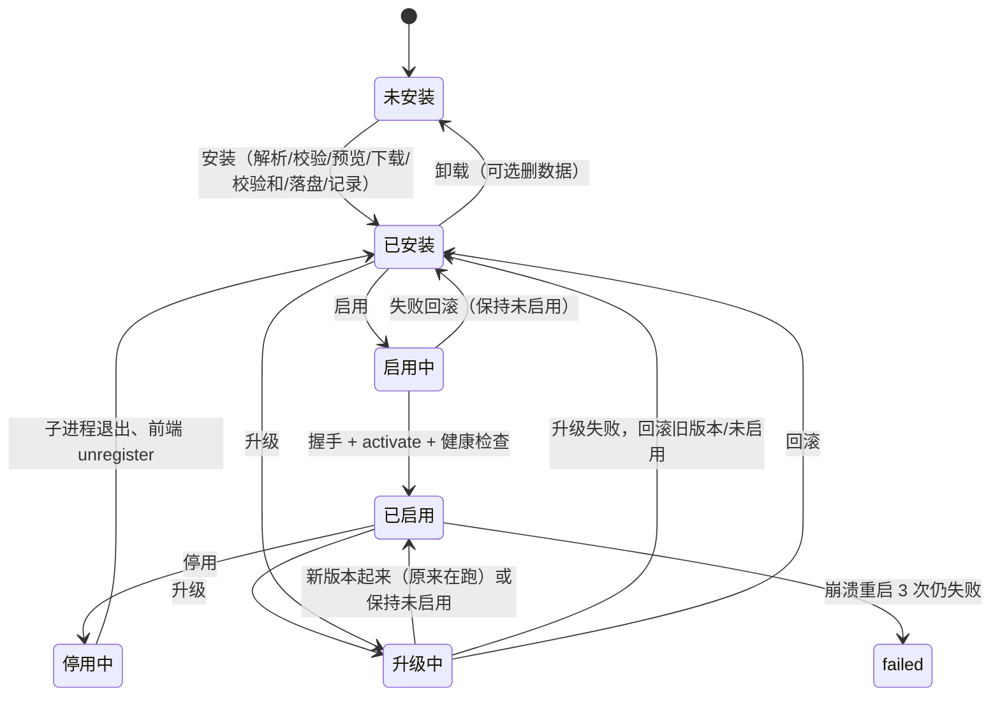

# PMW 外部插件规范 v2（草案 v0.1）

> **状态：草案 v0.1（2026-11-13）。** 宿主实现状态：**P1-a 已实现**（`internal/pluginhost/`、`internal/api/plugins_external.go`、前端 `frontend/src/core/plugin/external.ts`、设置页外部插件安装 UI）：本地目录 / tar.gz / GitHub Release 安装、子进程 + `pmw-plugin-rpc/1`、基础 broker（store/objects/settings/notify）、运行时 ESM 加载、安装/启停/卸载、hello-world 端到端。**P1-b 未实现**：源码构建、Windows 命名管道。事件投递、升级/回滚、市场索引拉取/校验与发现 UI、插件 HTTP/WS 代理、开发者目录（dev link）、**可选发布者签名与 verified 信任级**已实现（2026-11）；索引仓库 `pmw-plugins-index` 已建立。P2 剩余：网络代理 allowlist、FS/密钥 broker、CSP、OS 沙箱。文中标「设计（P1 待实现）」的以 P1-b 为准。
>
> 已经上线的是**第一方内置插件**的 Plugin API **1.1.0**（`internal/plugin.APIVersion`，规范见 `docs/plugin-api.md`）。本文不改变它，也不是它的 2.0 版本：内置插件继续编译进二进制，外部插件是新增的第二种形态。
>
> 适用范围：想给 PMW 写/安装第三方功能包的人、要实现外部插件宿主的 PMW 开发者、要评审外部插件的人。基线是团队共享设计基线 v0.1 草案（内部文件，非交付物）；本文与仓库代码冲突处以代码为准，差异记录在「附录 C」。
>
> 规范用词：「必须」= MUST，「应当」= SHOULD，「可以」= MAY（同 RFC 2119）。状态标记说明：
>
> | 标记 | 意思 |
> |---|---|
> | 已实现 | 仓库现有代码里可用（主要是第一方 Plugin API 1.x） |
> | 设计（P1 待实现） | 本文规定、宿主 P1-b 阶段实现，当前代码里没有（P1-a 已落地的见开头状态说明） |
> | 计划新增 | 具体文件/常量/接口/表尚不存在，需要新建 |

## 0. 结论摘要

| 能力 | 本文的定位 | 状态 |
|---|---|---|
| 外部插件清单 v2 | 一个 GitHub 仓库 = 一个插件包，清单 `plugin.json` + schema `docs/plugin-manifest-v2.schema.json` | P1-a 已实现 |
| 从 GitHub 安装 | 输入仓库/Release/树/资产直链，或本地 tar.gz、本地目录；固定 tag + commit + SHA-256 | P1-a 已实现（zip/索引/镜像仍 P1-b） |
| 后端运行形态 | 每插件一个子进程，Unix socket 上跑 `pmw-plugin-rpc/1`（JSON-RPC 2.0 + 换行分帧），**不在宿主进程内加载第三方 Go 代码**；Windows 命名管道 P1-b | P1-a 已实现 |
| 前端运行形态 | 运行时 ESM（`web/entry.js`）+ 宿主 import map 共享 React，`window.__PMW_PLUGIN__.register` 登记，宿主 `ctx` API 与槽位 | P1-a 已实现 |
| 权限 | 清单逐项声明 + 中文理由；安装时确认非高风险项；高风险安装不授予、装后在插件卡片逐项单独授予 + 二次确认；`trade:live` v0.1 一律不授予；未声明能力在 broker 直接 `permission_denied` | P1-a 已实现 |
| 生命周期 | 安装 / 启用 / 停用 / 卸载 / 重启恢复 / 升级 / 回滚（保留上一版本） | P1-a 已实现 |
| 市场索引 | 可托管的第三方 JSON（`index_version: 1`）；索引内容不是指令；安装以清单实际声明为准 | 设计（P3 待实现） |
| 信任与签名 | `official` / `verified` / `community` / `local-dev`；`SHA256SUMS` 强制，ed25519 签名可选 | 设计（P1/P2 待实现） |
| 第一方内置插件 | Plugin API `1.1.0` 不变，继续编译进二进制 | 已实现 |

一句话：**外部插件是「用户在设置里贴一个 GitHub 链接就能装、但代码跑在子进程里、前端跑在宿主 ESM 容器里、权限逐项可见」的第三方功能包；P1-a 起本地/包/Release 安装链路已可用。**

## 1. 定位与命名

### 1.1 两种插件形态

| 维度 | 内置插件（builtin） | 外部插件（external） |
|---|---|---|
| 规范名 | PMW Plugin API 1.x | PMW Plugin 2.0 / 外部插件规范 v2（草案） |
| 交付物 | 和内核同仓库，编译进 `bin/pmw` 与前端产物 | 独立 GitHub 仓库，发 Release 预编译产物 |
| 清单 | `internal/plugins/<id>/plugin.json` | 包根的 `plugin.json` |
| 清单 schema | `docs/plugin-manifest.schema.json`（v1） | `docs/plugin-manifest-v2.schema.json`（本次交付） |
| 宿主 API 字段 | `core`（范围，当前 `1.1.0`） | `api`（范围，目标 `2.0.0`）+ `pmw`（PMW 产品版本范围） |
| 代码加载 | Go 编译进二进制；前端 `import.meta.glob` 构建期打包 | 子进程 + IPC；前端运行时 ESM |
| 语言 | Go + TypeScript（仓库内） | 契约语言无关：协议公开后 Node/Python 也能写；前端只接受 ESM |
| 安装来源 | 跟着二进制，无单独安装 | GitHub Release / 本地 zip / 本地目录 / 市场索引 |
| 权限 | 清单 `permissions`，安装时确认 | 清单 `permissions` + `permissions_reason`（逐项中文理由）；高风险装后单独授权 |
| 用户是否需要 Go/Node | 不需要 | 安装不需要（用预编译产物）；只有开发者模式允许源码构建 |
| 状态存储 | `plugins` 表（`internal/db/migrations/0016_plugins.sql`） | 新表 `external_plugins` 等（计划新增） |
| 管理页 `tier` | `builtin` | `community` / `verified`（`official` 是 `verified` 的徽标，`local-dev` 是来源标记，见 10.1） |

外部插件**不重建 PMW**、不要求用户装 Go/Node；只允许开发者模式从源码构建。两种形态在插件管理页统一展示，但代码、清单、生命周期数据完全分开。

### 1.2 命名与五套版本号

| 名字 | 值（设计） | 含义 |
|---|---|---|
| 产品名 | PMW 外部插件 / PMW Plugin 2.0 | 用户可见名称 |
| `manifest_version` | `2` | 清单结构版本；只有清单结构破坏性变化才升 3 |
| 宿主外部 API 版本 `api` | `2.0.0`（计划新增 `internal/plugin.ExternalAPIVersion`） | 宿主对**外部插件**承诺的接口版本，和第一方 `APIVersion = "1.1.0"` 并列 |
| IPC 协议 | `pmw-plugin-rpc/1` | 子进程与宿主之间的线协议；破坏性变化升 `/2` |
| `pmw` | PMW 产品版本范围，如 `>=0.3.0 <1.0.0` | 宿主二进制版本（`cmd/pmw` 的 `-ldflags -X main.version=...`）必须落在范围内；宿主版本为空或不是正式版本号（开发构建的 `dev`，生产 bro.vip 即是）时不判断 `pmw`，`api` 照常检查（2026-11-23） |
| 插件 `version` | SemVer `MAJOR.MINOR.PATCH` | 插件自己的发布版本，升级判断、依赖匹配用 |

当前仓库 `Makefile` 的 `VERSION ?= 0.3.0`：P1-a 起二进制默认版本就是 **0.3.0**，外部插件宿主可用，示例清单写 `pmw: ">=0.3.0 <1.0.0"`。P1-a 之前的旧二进制（≤0.2.x）不支持外部插件。

### 1.3 与 DSH 插件改造文档的关系

`docs/dsh-plugin-adaptation.md` 讨论的是**把整个 PMW 包成 DSH 插件**（DSH 作为宿主，PMW 作为 sidecar）。本文讨论的是**把第三方功能包装进 PMW**（PMW 作为宿主）。两者方向相反、互不替代，也不要互相引用实现细节。`docs/dsh-plugin-adaptation.md` 只作为产品形态参考，本次不改它。

## 2. 包结构与发布产物

### 2.1 源码仓库结构

一个 GitHub 仓库 = 一个外部插件包。发布产物与源码结构同构（`bin/`、`web/` 由 CI 生成，源码仓库可以不提交）。

```text
plugin.json                 # 必需：清单 v2，唯一清单
migrations/                 # 可选：SQL 迁移，只作用于宿主给插件自己的私有库
assets/icon.svg             # 可选：图标，包内相对路径
bin/<id>-<os>-<arch>[.exe]  # 发布产物：平台二进制，CI 生成
web/entry.js                # 发布产物：前端 ESM 入口
web/*.css                   # 发布产物：样式
README.md                   # 说明（仓库根）
CHANGELOG.md                # 版本变更
LICENSE                     # 必需：许可证正文
Makefile / package.json     # 构建入口
.github/workflows/release.yml  # CI：构建矩阵、SHA256SUMS、Release
```

### 2.2 发布产物

| 产物 | 必需 | 说明 |
|---|---|---|
| `dist/<id>-<version>-<os>-<arch>.tar.gz` | 是 | 按平台拆分的安装包（`<os>-<arch>` 同清单平台键，如 `darwin-arm64`） |
| `SHA256SUMS` | 是 | 对同一 Release 全部资产逐行 `sha256 文件名`；必须随 Release 提供 |
| `SHA256SUMS.sig` | 否 | ed25519 对 `SHA256SUMS` 原始字节的签名（base64 单行）；有 `publisher.key` 时使用，见 10 节 |
| Release tag | 是 | `v<version>`，与清单 `version` 一致（例 `v0.1.0`） |

安装包（解包后的安装产物，也是安装目录内容）只含允许的条目：

```text
plugin.json
bin/<当前平台二进制>          # Windows 保留 .exe
web/                          # 入口、相对 import 的 chunk、样式（发布构建产物）
assets/                       # 图标、图片等静态资源
migrations/                   # 可选：清单 migrations 声明的 SQL，由宿主应用到插件私有库
LICENSE
SHA256SUMS
```

安装目录：`<data>/plugins/<id>/<version>/`（`<data>` = 库文件所在目录，即 `--db` 的父目录；宿主按内容寻址、只读挂载/标记）。插件自己的运行数据和缓存由宿主另外给目录（见 7.1 环境变量）。具体子目录布局是宿主实现细节，不构成对插件的契约：插件只能通过 `PMW_PLUGIN_DATA_DIR` / `PMW_PLUGIN_CACHE_DIR` 和 `host.store.*` 访问。

### 2.3 包规则（发布校验强制）

1. **清单唯一**：包根（或唯一一层顶级目录内）必须有 `plugin.json`；出现第二份清单、多套目录直接拒绝。
2. **路径安全**：清单和安装记录里的所有路径必须是包内相对路径——不以 `/` 开头、不含反斜杠、不含 `..` 段。解包时按同样规则做 zip-slip 校验，符号链接不得指向包外。
3. **平台资产**：清单 `runtime.backend.entry` 可以列多个平台，但每个平台安装包只带本平台二进制；宿主只解压、只校验当前平台的资产与 entry。发布检查强制每个 Release 至少覆盖 **`darwin-arm64` + `linux-amd64`**（brief 基线）；本地开发只需当前平台。
4. **禁止项**：源码仓库不应提交构建产物；确需提交时**禁止提交混淆/压缩后的后端二进制**（评审红线，见 12.6）。Release 资产必须带 `SHA256SUMS`。
5. **包大小**：宿主对下载大小、解包后大小、文件数设上限（设计值 P1 定，见待定事项 7）；超限直接拒绝安装。
6. **只读**：安装目录安装后只读；插件不得在安装目录写文件，缓存/数据写自己的目录。

### 2.4 前端 bundle 约定

- `web/entry.js` 是入口，必须是 ES module；`web/` 内的相对 `import` 允许（chunk 一起发布），不得引用 CDN 或 `/` 开头的站内路径。
- 裸模块只允许 import map 里的共享模块（`react`、`react-dom`、`react-dom/client`、`react/jsx-runtime`），其余裸 import 一律失败（见 8.3）。
- 样式放在 `web/` 下，由入口 import 或清单 `runtime.web.styles` 声明；选择器必须挂在 `[data-pmw-plugin="<id>"]` 下（见 8.6）。

## 3. 安装来源解析

### 3.1 用户入口与接受的形态

入口：设置 → 插件 →「外部插件」→ 安装（P1-a 已实现）。接受以下输入：

| 输入形态 | 例子 | 解析结果 | 版本固定项 |
|---|---|---|---|
| GitHub 仓库 URL | `https://github.com/owner/repo` | 仓库默认分支元数据 + 最新兼容 Release（有 Release 时） | tag + commit + 资产 SHA-256 |
| 省略协议的 GitHub 地址 | `github.com/owner/repo` | 同上 | 同上 |
| 简写 | `owner/repo` | 同上 | 同上 |
| 仓库树 | `https://github.com/owner/repo/tree/<tag-or-branch>` | tag 且有同名 Release → 按该 Release；branch/commit → 仅开发者模式（源码构建） | tag + commit + 资产 SHA-256 |
| Release 页 | `https://github.com/owner/repo/releases/tag/<tag>` | 指定 Release | tag + commit + 资产 SHA-256 |
| Release 资产直链 + sha256 | `https://github.com/owner/repo/releases/download/v0.1.0/hello_world-0.1.0-darwin-arm64.tar.gz` | 离线/镜像安装；用户必须同时提供 sha256 | 资产 URL + SHA-256（commit 由资产内清单/索引补） |
| 本地 zip | `~/Downloads/hello_world.zip` | 离线安装；无签名时按 community 提示 | SHA-256（可选但强烈建议） |
| 本地目录 | `~/src/pmw-plugin-hello` | **仅开发者模式**（`--plugin-dev-dir`，计划新增）；直接链接目录，不复制、不签名 | 无（`local-dev` 信任等级） |
| 市场索引条目 | 索引里 `(id, version)` | 按索引声明的精确来源安装 | 索引给出的 tag + commit + 资产 SHA-256 |

不接受：非 `github.com` 域名的仓库 URL（镜像另配，见 3.4）、`git://`/SSH 地址、npm 包、任意 HTTP 直链（除配置的镜像）、带账号密码的 URL。

### 3.2 服务端安装流程（P1-a 已实现；zip/索引/签名校验属 P1-b）

| 步骤 | 做什么 | 失败处理 |
|---|---|---|
| 1 解析来源 | 规范化输入；GitHub API / Release / zip / 目录读取 `plugin.json`；Release 资产优先 | 给出「哪里不识别」，不改任何状态 |
| 2 校验清单 | JSON Schema（`docs/plugin-manifest-v2.schema.json`）+ 语义校验（4.6） | 拒绝，逐条列出字段错误 |
| 3 兼容性 | `api` 含宿主 `ExternalAPIVersion`；`pmw` 含当前 PMW 版本；目标平台有 entry | 拒绝并说明需要哪个版本 |
| 4 依赖 | `depends` 都已安装/可装、版本范围匹配、强依赖无环；`optional_depends` 不阻塞 | 列出缺失/不匹配/成环的依赖 |
| 5 冲突 | 插件 id 不与内置/已装插件冲突；连接器/对象类型 id 全局不冲突；声明了 `trade:live` 不阻塞安装，但 v0.1 一律不授予（5.3） | 拒绝并指出冲突对象 |
| 6 安全预览 | 展示：名称/作者/来源仓库/解析出的 tag+commit/版本/许可证/签名状态/信任等级/全部权限与中文理由/需要的平台产物/是否含高风险或单独授权权限 | 用户取消即结束 |
| 7 下载与校验 | 下载资产；校验 SHA-256；有 `publisher.key` 时校验 `SHA256SUMS.sig`；解包并做路径校验 | 校验失败一律不落盘安装目录 |
| 8 落盘与记录 | 解包到 `<data>/plugins/<id>/<version>/`（只读）；写安装记录（来源、tag、commit、资产 SHA-256）、审计日志；管理页出现，**默认不启用** | 部分写入失败则清理本次目录 |

安全预览是安装时**确认非高风险权限**的地方：用户点「确认并安装」即确认清单里的非高风险权限；高风险/单独授权项只列出来、不随安装授予，装后按 5.3 单独申请 + 二次确认。安装记录保存确认的权限列表与时间。

### 3.3 版本固定与完整性

- 安装记录固定四元组：`release tag` + `commit SHA`（40 或 64 位十六进制）+ `资产 SHA-256`（64 位小写十六进制）+ 安装时间。任何一项缺失（本地 zip 的 commit、资产直链的 commit）要在 UI 上标明「来源不可验证」。
- 不允许「latest」漂移：解析结果必须落到具体版本；再次检查升级时重新解析并重新走流程。
- 同版本重复安装是幂等的（已装则提示已安装）；不同版本走升级（6.5）。
- 离线 zip 必须可安装（brief 基线）。离线安装的信任等级至少降为 `community` 或 `local-dev`（无签名、无法确认 commit）。

### 3.4 GitHub 网络与镜像（P1-b；P1-a 只支持直连 GitHub）

- 默认走 `https://api.github.com`（元数据）和 `https://codeload.github.com`（源码归档）；Release 资产走 `https://github.com/.../releases/download/...` 或镜像。
- 支持 `--plugin-mirror` 配置镜像（ghproxy 等）：只替换下载基地址，**不改变** commit / SHA-256 校验；镜像不可信也不影响完整性校验。
- 支持 `HTTP(S)_PROXY` 环境变量；请求有超时、重试（指数退避）和 GitHub 限速处理；限速时给用户可读提示。
- 离线 zip / 本地目录不依赖网络。

### 3.5 安装器安全要求

1. 只接受 https（本地文件除外）；跟随重定向时目标域名必须在允许列表内，最终主机须仍是 github.com 或配置的镜像。
2. 解包时做 zip-slip / 绝对路径 / 符号链接检查，拒绝设备文件；限制单文件与总解包大小。
3. 安装目录只读；安装器不执行包内脚本（没有 `postinstall` 一类钩子）。唯一的执行发生在「启用」时拉起清单声明的平台二进制。
4. 校验顺序固定：SHA-256 → 签名（可选）→ 清单 schema → 语义 → 兼容性；任何一步失败都不写安装记录。

### 3.6 宿主接口（设计；`internal/api/plugins_external.go` 计划新增）

| 方法 | 路径 | 作用 | 状态 |
|---|---|---|---|
| POST | `/api/plugins/external/resolve` | 解析来源，返回安全预览（不落盘） | 计划新增 |
| POST | `/api/plugins/external/install` | 执行安装（body 带确认的权限列表） | 计划新增 |
| POST | `/api/plugins/external/upgrade` | 升级到指定版本 | 计划新增 |
| POST | `/api/plugins/external/uninstall` | 卸载（`delete_data` 可选） | 计划新增 |
| GET | `/api/plugins/external/updates` | 检查已装插件的新版本 | 计划新增 |
| GET | `/api/plugins/{id}/web/*` | 外部插件前端静态资源（同源、正确 `Content-Type`、按版本缓存） | 计划新增 |
| GET | `/api/plugins/{id}/icon` | 外部插件图标 | 计划新增 |
| GET | 安装进度 SSE | 安装/升级进度流（路径 P1 定） | 计划新增 |

已有的内置插件管理接口（`GET /api/plugins`、`POST /api/plugins/{id}/{install,enable,disable,uninstall,upgrade}`、`POST /api/plugins/{id}/permissions/{grant,revoke}`）**保持不变**，定义在 `internal/api/plugins.go`；外部插件的启停走新接口，管理页把两者合并展示（13.3）。

## 4. 清单 v2

### 4.1 文件与校验器

- 清单文件名固定 `plugin.json`，包根唯一；schema 是 `docs/plugin-manifest-v2.schema.json`（本次交付，draft 2020-12，顶层 `additionalProperties: false`）。
- **Schema 只表达能静态判定的部分**；以下语义校验由宿主安装器（`internal/pluginhost`，计划新增）和 `plugin-sdk` 的 `validate` 完成，规则见 4.6：id 前缀/保留字、文件是否真的存在、平台产物是否齐全、权限理由是否逐项覆盖（含 `secrets:<scope>`）、依赖与冲突、签名链。`provides` 与代码里真实注册是否一致属于运行时行为（`validate` 只做清单内一致性），由宿主启用校验或评审确认。
- 第一方内置插件继续用 `docs/plugin-manifest.schema.json`，两套 schema 不要混用；样例风格参照 `docs/plugin-manifest-examples/`（中文 description、`additionalProperties: false`、`required` 列表）。

### 4.2 字段逐项语义

| 字段 | 类型 | 必填 | 语义 |
|---|---|---|---|
| `manifest_version` | int | 是 | 固定 `2`；与 `api`（宿主 API 范围）是两件事 |
| `id` | string | 是 | 插件 id，`^[a-z][a-z0-9_]{1,23}$`；全局唯一（含内置插件），一经发布不改；不能是内核保留字（以 `internal/plugin/manifest.go` 的 `ReservedIDs` 为准） |
| `name` | string | 是 | 显示名，插件管理页和菜单用 |
| `description` | string | 否 | 一句话说明 |
| `version` | string | 是 | 插件版本，SemVer `MAJOR.MINOR.PATCH`；升级、依赖匹配用 |
| `api` | string | 是 | 要求的宿主外部 API 版本范围，例 `>=2.0.0 <3.0.0`；语法同 1.x（4.4） |
| `pmw` | string | 是 | 要求的 PMW 产品版本范围，例 `>=0.3.0 <1.0.0` |
| `license` | string | 是 | 许可证标识（优先 SPDX，如 `MIT`、`Apache-2.0`）；包内必须有 `LICENSE` |
| `homepage` | string | 否 | 项目主页 URL |
| `repository` | string | 是 | 源码仓库 URL（v0.1 只接受 `https://github.com/...`）；升级检查、来源展示用 |
| `publisher` | object | 否 | `{ "id": "github:owner", "key": "<ed25519 公钥 base64，可选>" }`；没有或没有 key = 未签名（community） |
| `icon` | string | 否 | 图标，包内相对路径，例 `assets/icon.svg`；由 `/api/plugins/{id}/icon` 提供 |
| `provides` | object | 否 | 本插件注册的扩展点 id，按分组；分组键和值规则沿用 1.x（4.4）。**给了 `modules` 就必须有 `runtime.web`** |
| `permissions` | string[] | 是 | 申请的可选权限，可为空数组；隐式权限（`store:plugin`、`log:write`）不写进来。见第 5 节 |
| `permissions_reason` | object | 是 | 每项权限一条 1–80 字中文理由；缺一项即清单非法。见 5.2 |
| `runtime` | object | 是 | `backend` / `web` 至少一个；backend 是子进程 + RPC，web 是前端 ESM |
| `depends` | object | 否 | 强依赖：外部插件 id → 版本范围；安装/启用都要满足 |
| `optional_depends` | object | 否 | 弱依赖：装了就联动，没装也能用 |
| `emits` | string[] | 否 | 本插件发布的事件，必须以 `<id>.` 开头；经 `host.events.publish` 只能发这里声明的事件 |
| `subscribes` | string[] | 否 | 订阅的事件；非空时必须声明 `events:subscribe` 权限 |
| `migrations` | string | 否 | 插件私有库的迁移目录（包内相对路径）；外部插件没有 `table_prefix`，迁移只作用于宿主分配的私有库 |

> `depends` / `optional_depends` / `emits` / `subscribes` / `migrations` 这五个字段不在团队基线 3.3 的示例清单里，但由基线 3.4（订阅写进 `subscribes`）、3.7（依赖检查）、2.1（`migrations/` 目录）推出，本规范按流程需要纳入 v2；见附录 C。

`runtime` 子字段：

| 字段 | 类型 | 必填 | 语义 |
|---|---|---|---|
| `runtime.backend.kind` | string | 是 | 固定 `process`（v0.1 只支持子进程形态） |
| `runtime.backend.protocol` | string | 是 | 固定 `pmw-plugin-rpc/1` |
| `runtime.backend.entry` | object | 是 | 平台键 → 二进制包内相对路径；键必须匹配 `^(darwin\|linux\|windows)-(amd64\|arm64)$`；至少一项；Windows 值允许 `.exe` |
| `runtime.backend.health_timeout_ms` | int | 否 | 健康检查超时，默认 10000，范围 100–60000 |
| `runtime.web.entry` | string | 是（有 web 时） | 前端 ESM 入口，包内相对路径，例 `web/entry.js` |
| `runtime.web.styles` | string[] | 否 | 入口之外的样式文件，包内相对路径 |

### 4.3 完整示例

完整且与本文 schema 自洽的 `hello_world` 清单见 **附录 A**。字段顺序建议照附录 A 写，便于评审和 diff。

### 4.4 字段规则

**版本范围语法（`api` / `pmw` / `depends` 的值）**沿用 1.x，解析器已存在于 `internal/plugin/semver.go`（`ParseRange`），1.x 文档见 `docs/plugin-api.md` 1.2：

| 写法 | 意思 |
|---|---|
| `>=2.0.0 <3.0.0` | 空格分隔表示同时满足 |
| `^2.0.0` | 等价 `>=2.0.0 <3.0.0`；`^0.3.0` 等价 `>=0.3.0 <0.4.0` |
| `~2.0.0` | 等价 `>=2.0.0 <2.1.0` |
| `2.0.0` | 只认这一个版本 |

不支持 `||`、`*`、`x` 通配、预发布标签、`v` 前缀。`>=1.2` 这类省略写法按补零处理，但清单里推荐写全。

**id 与保留字**：`^[a-z][a-z0-9_]{1,23}$`（最短 2 字符）。保留字表以代码为准（`internal/plugin.ReservedIDs`，与 `docs/plugin-api.md` 1.4 的 44 个完全一致）。外部插件 id 还必须不与任何内置插件 id 冲突（当前内置：`browser`、`domains`、`etf`、`im`、`jobs`、`projects`、`recording`、`sop`、`terminal`、`trade`、`tts`、`video`，以 `internal/plugins/` 目录为准）。

**禁止的 v1 字段**（schema 顶层 `additionalProperties: false`，写进来直接非法）：

| v1 字段 | 外部插件怎么替代 |
|---|---|
| `core` | 用 `api`（宿主外部 API 范围）+ `pmw`（产品版本范围） |
| `adopts` | 只给内置插件用；外部插件不能认领内核已有对象类型/路由 |
| `table_prefix` | 外部插件没有内核表前缀；数据只能进宿主给的私有库，经 `host.store.*` 访问 |

**`provides` 分组**（规则同 1.x，但每项都会和运行时注册比对）：

| 键 | 值规则（语义校验） |
|---|---|
| `modules` | 模块 key，`^[a-z][a-z0-9_]*$`；每个 key 必须由前端槽位 `module` 注册；有它必须有 `runtime.web` |
| `settings` | 设置分节 key；由槽位 `settings.section` 注册 |
| `object_types` | 等于插件 id 或以 `<id>_` 开头 |
| `connectors` | 全局命名空间（不加上下文前缀）；有 `connectors` 时必须至少有一项 `network:*` 权限 |
| `skills` | 以 `sk_` 开头 |
| `agent_tools` | 以 `<id>_` 开头 |
| `sop_nodes` | 以 `<id>_` 开头；目录评审单独说明 |
| `today_cards` | 以 `<id>_` 开头 |
| `commands` | `<id>.<动作>` |
| `search` | 搜索数据源 key |
| `schedule_actions` | 以 `<id>_` 开头；目录评审单独说明 |

**`emits` / `subscribes`**：事件名形如 `<命名空间>.<事件名>`（两侧都是 `^[a-z][a-z0-9_]*$`）。`emits` 的命名空间必须是本插件 id。`subscribes` 只能写宿主事件或已声明依赖的插件事件；写成未知内核事件直接非法。

**`migrations`**：只作用于插件私有库，由宿主在启用/升级时按文件名顺序执行并记录；任一文件失败整次启用/升级回滚（6.5）。迁移不得引用内核表名（语义校验 + 评审）。

**`publisher` 与图标**：`icon` 必须是包内相对路径（v0.1 不允许远程图标 URL）；`publisher.key` 是 ed25519 公钥 raw 32 字节的 base64（44 字符），私钥不进仓库。

### 4.5 v1 → v2 字段对照

| Plugin API 1.x（内置） | v2（外部） | 说明 |
|---|---|---|
| `core` | `api` + `pmw` | 宿主 API 范围拆成「接口版本」和「产品版本」两个 |
| `id` / `name` / `description` / `version` / `icon` | 同名 | `icon` 从「外壳内置图标 key」改为「包内相对路径」 |
| `depends` / `optional_depends` | 同名 | 依赖目标从内置插件改为外部插件（9.6） |
| `provides` | 同名 | 分组规则沿用 |
| `emits` / `subscribes` | 同名 | 订阅需要 `events:subscribe` 权限（v1 没有这项权限） |
| `adopts` | 禁止 | 外部插件不认领内核已有东西 |
| `permissions` | `permissions` + `permissions_reason` | 逐项中文理由成为硬要求 |
| `migrations` + `table_prefix` | `migrations` | 没有 `table_prefix`；私有库由宿主分配 |
| — | `manifest_version` / `license` / `repository` / `homepage` / `publisher` / `runtime` | v2 新增的发布元数据和运行形态 |
| — | `icons` | v1 的按模块图标 v2 不提供（v0.1）；首版用单一 `icon` |

### 4.6 校验顺序与错误提示

1. JSON 可解析；
2. JSON Schema（本文件 `docs/plugin-manifest-v2.schema.json`）；
3. 语义：id 正则/保留字/冲突、版本范围、`provides` 前缀与运行时一致性、`permissions` 每项在 `permissions_reason` 有对应中文理由（含每个 `secrets:<scope>`）、`runtime` 至少一个、`modules` → `web`、`connectors` → `network:*`、`subscribes` ↔ `events:subscribe`、声明的文件存在、平台产物齐全（发布检查）；
4. 环境：`api` / `pmw` 兼容、`depends` 满足且无强依赖环、`optional_depends` 记录即可；
5. 冲突：id、连接器、对象类型。

错误信息要求：字段路径 + 中文可读原因（例 `permissions[2] 缺少 permissions_reason 里的中文理由`）；不要只吐 JSON Schema 的英文原文。客户端和 CLI 用同一套规则、逐字一致（沿用 1.x 的前后端共用样例做法）。

## 5. 权限 v2

### 5.1 隐式权限（不写进 `permissions`）

| 能力 | 说明 |
|---|---|
| `store:plugin` | 宿主给每个插件一个独立 SQLite 库，只能经 `host.store.query/exec` 访问；不能直连内核库、拿不到 `table_prefix` |
| `log:write` | 插件 stdout/stderr 与日志由宿主收集；日志统一脱敏 |
| 自己的数据/缓存目录 | `PMW_PLUGIN_DATA_DIR` / `PMW_PLUGIN_CACHE_DIR` 内读写不需要 `fs:*` 权限；缓存删了不丢数据 |
| `host.settings.get/set` | 插件自己的设置值，天然隔离 |
| `host.i18n` | 宿主文案/格式化，不带数据 |
| 发布自己声明的事件 | 只允许 `emits` 里的事件 |

隐式权限写进 `permissions` 反而是非法清单（schema enum 不含它们）。

### 5.2 可申请权限

格式 `<类别>:<动作>[:<范围>]`；未知权限非法。`secrets:<scope>` 的 scope 是 `^[a-z][a-z0-9_]*$`。

| 权限 | 能做什么 | 风险 |
|---|---|---|
| `objects:read` | 只读内核对象、联系人、会话（经 `host.objects/contacts/conversations.*`） | 普通 |
| `objects:write` | 建对象、改**本插件创建的对象**（`host.objects.create/update`）；改不了内核或别的插件建的对象 | 普通 |
| `events:subscribe` | 订阅内核事件/依赖插件事件；订阅清单必须写进 `subscribes` | 普通 |
| `fs:read:project` | 读项目根目录内文件 | 普通 |
| `fs:write:project` | 写项目根目录内文件 | 普通 |
| `fs:read:attachments` | 读附件目录 | 普通 |
| `fs:write:attachments` | 写附件目录 | 普通 |
| `fs:read:any` | 读本机任意路径（文件选择器里用户当场选的除外） | 高 |
| `fs:write:any` | 写本机任意路径 | **高（单独授权）** |
| `network:localhost` | 访问回环地址与本机域名 | 普通 |
| `network:im` | 访问 IM 平台接口域名 | 普通 |
| `network:media-platforms` | 访问视频/内容平台 | 普通 |
| `network:github` | 访问 GitHub Release 接口（只拉公开仓库匿名 API） | 普通 |
| `network:market-data` | 访问行情源公开接口 | 普通 |
| `network:model` | 下载本地模型（HuggingFace 与镜像） | 普通 |
| `network:exchanges` | 访问交易所账户/交易接口 | 普通（见附录 C 的 v1 差异说明） |
| `network:any` | 访问任意外网地址 | **高（单独授权）** |
| `process:spawn` | 起子进程（原型、终端、插件自己的辅助进程） | **高（单独授权）** |
| `agent:run` | 用宿主 Agent/模型跑 LLM（消耗额度、对外发送数据） | 普通 |
| `notify` | 以插件名义发系统通知 | 普通 |
| `schedule` | 向宿主定时调度器登记一次性/周期任务 | 普通 |
| `artifacts:write` | 登记产物（本地文件） | 普通 |
| `audit:write` | 往审计日志写插件替用户做的对外动作 | 普通 |
| `trade:live` | 实盘下单 | **最高（单独申请，v0.1 一律不授予）** |

每个 `permissions` 项都必须在 `permissions_reason` 有 1–80 字中文理由；没有理由的清单非法（schema 逐项校验 + 语义校验）。`secrets:<scope>` 每个 scope 都要有独立理由。

### 5.3 高风险与单独授权

按基线 3.4：高风险权限**安装时不授予**（升级也不自动授予），安装后在插件设置里由用户本人单独申请 + 二次确认。这样「装一个插件」不会顺带拿到高危能力。

| 权限 | 安装/升级时 | 安装后 |
|---|---|---|
| `fs:write:any`、`network:any`、`process:spawn` | **不授予**；安全预览里单独标出「装完还要再授权一次」 | 插件设置里逐项单独申请 + 二次确认（输入插件名/勾选风险说明）后授予；可随时收回 |
| `trade:live` | 不授予（v0.1 外部插件一律不授予） | 目录评审不接受需要它的插件；宿主 UI 显示「本版本不支持实盘」 |

> 与第一方 v1 的差异：v1 的高风险权限是安装时单独勾选授予（`docs/plugin-api.md` 3.2）；v2 外部插件按基线改成「安装不授予、装后单独申请 + 二次确认」。`network:exchanges` / `fs:read:any` 是否也纳入高风险待 P1 安全评审确认（见待定事项 1）。
>
> 注意口径差别：`trade:live` 在安装流程里「不阻塞安装」（只列出来），但发布/CI 的严格档 `validate --strict` 会拒绝含它的清单（见 5.3 与 `plugin-sdk` 的 release 检查），目录评审也不接受——所以它实际不能进入发布流程。

### 5.4 授权规则

1. **安装前逐项确认**：安全预览列出全部权限 + 中文理由；用户确认的是**非高风险**权限列表，随安装请求提交；高风险和单独授权项列出来但不随安装授予（5.3）。
2. **升级新增权限**：列新增项要求确认（仅非高风险项）；用户拒绝则升级不生效（版本和权限集都不变）；减少的权限直接收回、无需确认。
3. **高风险 / 单独授权**：安装、升级都不授予；安装后在插件设置里由用户本人逐项申请 + 二次确认（接口只接受用户本人的操作，沿用 v1 的 `RequestActor`/`RequireUser` 思路）。未授予期间相关能力在 RPC 层回 `permission_denied`。
4. **`trade:live`**：属于单独授权里最高风险的一项，v0.1 外部插件一律不授予；目录评审不接受需要它的插件。
5. **运行时强制**：宿主 broker 对每个 `host.*` 调用检查「清单声明 + 用户已授予」；未声明的能力直接回 `permission_denied`，不依赖插件自觉。插件不得把权限状态当作已授权依据（前端同样）。
6. **收回**：用户随时可收回单项权限（含单独授权的）；宿主发 `plugin.permission_changed` 通知，插件应立刻降级而不是继续重试。
7. **卸载**：删安装记录、单独授权；**默认保留插件数据**，二次确认才删（6.7）。

### 5.5 权限拒绝语义

- RPC 层回错误码 `permission_denied`（-32001），`data` 带 `{ "permission": "objects:write", "declared": false, "granted": false }`（设计）。
- 前端 `ctx.permissions.has(perm)` 只反映当前**已授予**的权限；**不能**用它替代后端校验；`ctx.host.call` 到 broker 的调用仍按「声明 + 已授予」校验。
- **边界诚实说明**：P1-a 的外部插件前端与宿主同页执行（无 iframe/Worker 隔离），恶意插件理论上可以直接 `fetch` 本机 API；broker 拦的是「未声明/未授予的能力」和工具越界，不构成对同页恶意 JS 的硬隔离。需要硬隔离属 P2/P3，见 12.7 #1。
- 插件应当优雅降级：权限被收回后，相关页面显示不可用原因，不要循环重试；宿主对同一权限连续拒绝会记审计并提示用户。
- 权限状态变了由宿主通知（`plugin.permission_changed`），插件可据此刷新 UI。

### 5.6 清单与权限的一致性（语义校验）

| 条件 | 强制 |
|---|---|
| 有 `provides.modules` | 必须有 `runtime.web` 和 `provides.settings` 之外的前端入口（schema + 语义） |
| 有 `provides.connectors` | `permissions` 至少有一项 `network:*` |
| `subscribes` 非空 | 必须有 `events:subscribe`；反之声明了 `events:subscribe` 就必须有订阅 |
| `provides.skills` / `provides.agent_tools` | 调模型的能力仍需声明 `agent:run`；注册本身不需要权限 |
| 调 `host.agent.run` | 必须声明 `agent:run` |
| 调 `host.schedules.enqueue` | 必须声明 `schedule` |
| 调 `host.artifacts.add` | 必须声明 `artifacts:write` |
| 调 `host.audit.record` | 必须声明 `audit:write` |
| 调 `host.fs.*` 写项目/附件之外 | 必须声明对应 `fs:*:any` |
| 调 `host.http.request` | 目标组必须是已声明的 `network:<group>`；`network:any` 例外放行全部 http(s) |

## 6. 生命周期

### 6.1 状态机



`failed` 是宿主运行时状态（不是安装状态）：UI 显示原因和「重试」；重启宿主会重新尝试拉起已启用的插件。

### 6.2 安装

安装接口 body 的 `enable` 默认 `true`（管理页「安装并启用」是一个动作，和第一方一致）；`enable:false` 时只安装不启用，`external_plugins.enabled=0`。安装记录写来源、commit(如有)、SHA-256、确认的权限；是否启用由 `enable` 决定，安装完成后可单独启用/停用。步骤见 3.2 的 8 步；安装完成后管理页出现，`tier` 按 10.1 判定，来源、commit、SHA-256、确认的权限写入安装记录。

### 6.3 启用（P1-a 已实现；备份/回滚差异见 6.8）

| 步骤 | 宿主 | 失败处理 |
|---|---|---|
| 1 再检查 | 依赖满足；`api`/`pmw` 兼容；平台 entry 存在 | 拒绝，状态不变 |
| 2 准备目录 | 建插件私有库（没有则建）、跑待应用迁移（先备份）、准备数据/缓存目录 | 迁移失败回滚备份，保持未启用 |
| 3 拉起子进程 | 按 `runtime.backend.entry` 起进程，注入环境变量（7.1） | 启动失败标记启用失败 |
| 4 握手 | 10s 内完成 `plugin.hello` → `host.welcome` | 超时/失败 → 杀进程，保持未启用 |
| 5 激活 | 发 `plugin.activate`，≤10s | 超时/报错 → 杀进程，保持未启用 |
| 6 健康检查 | 发 `plugin.health`，超时 `min(5s, 清单 health_timeout_ms)` | 不健康只告警、不阻塞首次启用；运行期每 30s 复查，连续 3 次失败杀进程并走崩溃重启 |
| 7 前端 | 登记前端入口，页面动态 import 并 `register`；各槽位进入错误边界 | 前端失败不影响后端，插件标记「前端不可用」 |
| 8 状态 | 写 `external_plugins` 启用状态、审计日志 | — |

停用时逆序：前端 unregister → `plugin.deactivate`（≤10s）→ SIGTERM → 5s 后 SIGKILL → 子进程退出后置未启用、保留数据。

### 6.4 停用

| 宿主 | 前端 |
|---|---|
| 先查有无已启用的外部插件强依赖它（有则列出来，用户确认一起停用或取消）；发 `plugin.deactivate`（≤10s），超时 SIGTERM，5s 后 SIGKILL；取消后台任务、撤订阅；数据一行不动；写状态和审计 | 调 `deactivate()` 并撤销所有槽位注册；若当前停在它的模块页，跳回默认模块；菜单、卡片、命令消失 |

强依赖联动提示文案与 1.x 一致：醒目标出「停用 A 会同时停用 B、C」，`optional_depends` 只提示功能暂时不可用（6.7）。

### 6.5 升级（P1-a 已实现：单步升级 + 保留上一版本）

| 步骤 | 行为 |
|---|---|
| 1 检查 | 解析新版本并校验清单/兼容性；新增权限列出要求确认；`depends` 仍满足 |
| 2 备份 | 备份插件私有库（快照），保留最近 2 个已安装版本目录用于回滚 |
| 3 停旧 | 停前端、停子进程（同停用） |
| 4 换目录 | 新版本解包/校验后切换安装目录；旧版本目录保留 |
| 5 迁移 | 跑新版本迁移；失败则恢复备份并回到旧版本 |
| 6 起新 | 拉子进程、握手、activate、健康检查、加载前端；失败回滚到旧版本并恢复备份 |
| 7 记录 | 写版本、来源（tag/commit/SHA-256）、权限集、审计 |

降级/回滚只保留最近 2 个版本；回滚会恢复升级前的插件库备份，**升级后产生的数据会丢失**，UI 必须二次确认并写清时间点。

### 6.6 回滚（P1-a 已实现：代码/清单回滚，迁移不回退）

- 触发：升级失败自动回滚；用户在插件管理页手动「回滚到上一版本」（保留目录存在时）。
- 回滚 = 停新版本 → 恢复旧版本目录 + 恢复升级前备份 → 起旧版本。旧版本迁移已执行过的记录随备份恢复。
- 回滚不承诺跨大版本数据兼容；`api` MAJOR 升级后旧版本可能读不了新数据，回滚前必须提示。

### 6.7 卸载

| 步骤 | 行为 |
|---|---|
| 1 检查 | 还有已启用外部插件强依赖它 → 拒绝并列出 |
| 2 选择 | 默认保留数据；选「删除数据」要二次确认（列出将删的库/表、输入插件 id） |
| 3 备份 | 删数据前自动快照，备份路径写审计日志；备份失败不删 |
| 4 清理 | 删除安装目录、安装记录、单独授权；删数据时删除插件私有库与数据/缓存目录；内置插件/内核东西一律不动 |
| 5 前端 | 菜单项、命令、卡片、槽位全部移除；引用它的工作台配置自动去掉 |

保留数据时：数据目录留着，下次安装会自动接上；版本回退时以备份为准。

### 6.8 失败恢复

| 场景 | 行为 |
|---|---|
| 握手失败 / activate 失败 / 健康检查失败 | 杀进程；启用整体失败，回到「已安装未启用」，UI 显示原因和「重试」 |
| 运行中崩溃 | 按 1s / 2s / 4s 退避自动重启，最多 3 次；超过上限记 `last_error` 并停止重试，等用户手动启用。用户停用/卸载/关闭宿主时取消等待中的重启 |
| 前端异常 | 该插件错误边界内显示错误，不影响外壳；连续异常计数，超阈值提示停用 |
| 迁移失败 | 回滚备份；升级失败回落旧版本；启用失败保持未启用 |
| 宿主重启 | 已启用的插件重新走启用流程；崩溃计数清零；`failed` 的插件保持失败，提供手动重试 |
| 数据损坏 | 插件负责自己的库；宿主只保证备份/回滚，不做自动修复 |

### 6.9 状态与数据表（计划新增）

| 表 | 用途 |
|---|---|
| `external_plugins` | 外部插件安装记录：id、安装版本、来源（tag/commit/asset sha256）、启用状态、确认的权限、信任等级、时间戳 |
| `external_plugin_versions` | 已安装版本目录与回滚链（保留 2 个） |
| `plugin_permissions` | 权限授予记录（含单独授权与时间） |
| `plugin_install_log` | 安装/升级/回滚/卸载/迁移/校验结果审计流水 |

已有 `plugins` 表（`internal/db/migrations/0016_plugins.sql`）只服务内置插件，不复用。

## 7. 后端协议 `pmw-plugin-rpc/1`

### 7.1 进程模型与传输

- 每个**启用**的外部插件 = 一个子进程，由宿主 `internal/pluginhost`（计划新增）拉起；**宿主进程内不加载任何第三方代码**。
- IPC：macOS/Linux 用 Unix domain socket，Windows 用命名管道（`\\.\pipe\pmw-plugin-<id>-<random>`）。**宿主是 socket server**，插件进程启动后连上来；socket 对外不可达、路径与权限由宿主控制。
- 握手：`plugin.hello` → `host.welcome`（7.3）。
- 环境变量（白名单，**不含**宿主的 vault/凭证/DB 路径等变量）：

| 变量 | 含义 |
|---|---|
| `PMW_PLUGIN_ID` | 插件 id |
| `PMW_PLUGIN_VERSION` | 插件版本 |
| `PMW_PLUGIN_API_VERSION` | 宿主外部 API 版本（`2.0.0`） |
| `PMW_PLUGIN_SOCKET` | 要连接的 socket / 命名管道 |
| `PMW_PLUGIN_TOKEN` | 本次实例的一次性握手令牌 |
| `PMW_PLUGIN_DATA_DIR` | 插件数据目录（SQLite 文件与用户数据放这里） |
| `PMW_PLUGIN_CACHE_DIR` | 插件缓存目录（可重新生成，卸载/清理可删） |
| `PMW_PLUGIN_LOG_LEVEL` | 日志级别（`debug`/`info`/`warn`/`error`） |
| `PMW_PLUGIN_OS` / `PMW_PLUGIN_ARCH` | `GOOS` / `GOARCH` 等价信息 |

- 工作目录 = 插件安装目录；不继承宿主的其它环境；stdout/stderr 由宿主收集并脱敏后进插件日志。
- 语言无关：协议是规范，SDK 是助手。Go SDK 优先（`plugin-sdk/go`，计划新增），Node/Python 可后续实现。

### 7.2 分帧与 JSON-RPC 2.0

- 每条消息是一行 UTF-8 文本 + `\n`（换行分帧）；一行一个完整 JSON-RPC 2.0 对象；不允许批量数组（v0.1）。
- 双向：宿主和插件都可以发 request；响应必须带请求的 `id`；notification 不带 `id`，不回复。
- 未知方法回 `method_not_found`（-32601）；未知字段忽略（向前兼容）；未知 notification 忽略。
- 单条消息（含 base64 后的正文）≤ **8 MiB**；超限回 `validation`（"消息过大"），对端可关闭连接。
- 二进制正文一律 base64（`data_b64`/`body_b64`）。
- 每条连接只服务一个插件实例；连接断开即视为插件不可用（走 6.8）。

### 7.3 握手

A. 插件首次连接必须发且只发一条 `plugin.hello`（request，10s 内完成）：

| 参数 | 类型 | 说明 |
|---|---|---|
| `protocol` | string | 固定 `pmw-plugin-rpc/1` |
| `plugin_id` | string | 必须等于 `PMW_PLUGIN_ID` |
| `plugin_version` | string | 插件版本 |
| `token` | string | 必须等于 `PMW_PLUGIN_TOKEN`（常量时间比较） |
| `api` | string | 清单 `api` 原文 |
| `capabilities` | string[] | 可选，插件支持的扩展能力（如 `http.stream`、`ws`） |

B. 宿主校验通过后回 `host.welcome`（result）：

| 字段 | 说明 |
|---|---|
| `protocol` | `pmw-plugin-rpc/1` |
| `host` | `{ "pmw_version": "0.3.0", "api_version": "2.0.0", "os": "darwin", "arch": "arm64" }` |
| `plugin` | `{ "id": "...", "version": "..." }` |
| `limits` | `{ "max_message_bytes": 8388608, "max_concurrent_requests": 8, "default_timeout_ms": 30000 }` |
| `permissions` | 当前**已授予**的权限数组（安装确认的非高风险项 + 已单独授权项；未授予的不出现） |

C. 失败：宿主回 JSON-RPC error（`unavailable` 或 `validation`）后关闭连接，插件进程随后被终止，启用失败。以下情况直接失败：协议版本不符、token 不符、id 不符、`api` 范围不含宿主 `ExternalAPIVersion`、首帧不是 `plugin.hello`。

D. 握手成功后宿主发 `plugin.activate`，插件初始化和注册完成后回结果；之后进入健康检查与运行（6.3）。

### 7.4 Host → Plugin 方法

| 方法 | 类型 | 参数（要点） | 结果 | 说明 |
|---|---|---|---|---|
| `plugin.activate` | request | `{ reason, permissions }` | `{ ok }` | 启用时调用；≤10s |
| `plugin.deactivate` | request | `{ reason, deadline_ms }` | `{ ok }` | 停用时调用；≤10s，之后 SIGTERM/SIGKILL |
| `plugin.health` | request | `{ nonce? }` | `{ status: "ok"\|"degraded", detail? }` | 启用后健康检查；运行期每 30s 周期探测，连续失败杀进程 |
| `plugin.http.request` | request | `{ request_id, method, path, query, headers, body_b64?, remote_addr?, stream? }`（`path` 是 `/api/plugins/external/<id>/api` 之后的部分，如 `/runs/1`；`query` 是原始查询串 `a=1&b=2`。2026-11-23 前的宿主误给 `/plugins/external/<id>/api/...`，插件可两种都认） | `{ stream, status, headers, body_b64? }` | 宿主把 `/api/plugins/external/<id>/api/*` 转发给插件（已实现；流式先回开始帧，再用 `host.http.chunk/end`） |
| `plugin.http.upgrade` | request | `{ stream_id, path, query, headers, remote_addr }` | `{ ok }` | WebSocket 升级（已实现；之后 `plugin.http.ws_message` / `host.ws.send` / `host.ws.close` 双向转发） |
| `plugin.event.deliver` | request | `{ event: { type, at, payload } }` | `{ ok }` | 投递订阅的事件；需 `events:subscribe`（P1-a 已实现，5s 超时异步投递） |
| `plugin.job.run` | request | `{ job, scheduled_at? }` | `{ ok }` | 宿主按插件在 activate 时报的后台任务调度 |
| `plugin.sop_node.execute` | request | `{ kind, params, context }` | `{ outputs }` | SOP 节点执行 |
| `plugin.schedule_action.run` | request | `{ kind, payload }` | `{ result }` | 定时任务动作 |
| `plugin.command.run` | request | `{ command, args? }` | `{ result }` | 命令面板命令（后端部分） |
| `plugin.skill.invoke` | request | `{ skill, input }` | `{ output }` | 技能调用 |
| `plugin.agent_tool.call` | request | `{ tool, arguments }` | `{ content }` | Agent 工具调用 |
| `plugin.permission_changed` | notification | `{ permissions }` | 无 | 权限被授予/收回；插件应立刻按新集合降级 |

### 7.5 Plugin → Host 方法

| 方法 | 参数（要点） | 结果 | 所需权限 |
|---|---|---|---|
| `host.objects.get` | `{ type, id }` | 对象 | `objects:read` |
| `host.objects.list` | `{ type?, query?, limit?, cursor? }` | `{ items, next_cursor? }` | `objects:read` |
| `host.objects.create` | `{ type, props, owner_id? }` | `{ id, revision }` | `objects:write`（来源记本插件） |
| `host.objects.update` | `{ id, props?, status? }` | `{ id, revision }` | `objects:write`（仅本插件创建的对象） |
| `host.contacts.get` / `host.contacts.list` | `{ id }` / `{ query?, limit?, cursor? }` | 联系人 / `{ items, next_cursor? }` | `objects:read` |
| `host.conversations.get` / `host.conversations.list` | `{ id }` / `{ limit?, cursor? }` | 会话 / `{ items, next_cursor? }` | `objects:read` |
| `host.store.query` | `{ sql, args? }` | `{ columns, rows }` | 隐式 `store:plugin`；只读、单条语句 |
| `host.store.exec` | `{ sql, args? }` | `{ rows_affected, last_insert_id? }` | 隐式 `store:plugin`；单条语句 |
| `host.events.publish` | `{ type, payload }` | `{ ok }` | 类型必须在 `emits` 里（已实现，经宿主事件总线发布） |
| `host.http.chunk` | `{ request_id, seq, data_b64 }` | `{ ok }` | 流式响应块；seq 从 0 递增，宿主按序写出 |
| `host.http.end` | `{ request_id, seq }` | `{ ok }` | 流式响应结束；seq = 已发块数 |
| `host.ws.send` | `{ stream_id, type, data_b64 }` | `{ ok }` | WS 回帧（type: text/binary） |
| `host.ws.close` | `{ stream_id, code?, reason? }` | `{ ok }` | 关闭 WS |
| `host.http.request` | `{ method, url, headers?, body_b64?, timeout_ms?, stream? }` | `{ status, headers, body_b64 }` | `network:<group>`（按域名匹配；P2 已实现非流式，每一跳重定向都重查） |
| `host.secrets.get` / `set` / `delete` | `{ scope, value? }` | `{ value }` / `{ ok }` | `secrets:<scope>`（只能碰自己声明的 scope）。2026-11-23 实现：存进内核凭证保险箱（加密），名字 `plugin:<插件 id>:<scope>`、类型 `plugin_secret`；没存过 `get` 回空串；`set` 空值等于删除；`delete` 幂等；宿主没接保险箱时回 `unavailable` |
| `host.fs.read` | `{ path, offset?, length? }` | `{ data_b64, eof }` | 对应 `fs:read:*`，路径必须在允许目录内 |
| `host.fs.list` | `{ path }` | `{ entries: [{ name, type, size? }] }` | `fs:read:*` |
| `host.fs.write` | `{ path, data_b64, mode? }` | `{ bytes }` | `fs:write:*`；`fs:write:any` 才允许任意路径 |
| `host.agent.run` | `{ prompt, preset_id?, tools?, timeout_ms? }` | `{ run_id, status, summary, result }` | `agent:run`；超时另配（7.8） |
| `host.notify` | `{ kind, title, body, level? }` | `{ id }` | `notify` |
| `host.schedules.enqueue` | `{ action, at, payload }` | `{ schedule_id }` | `schedule` |
| `host.artifacts.add` | `{ path, title, run_id? }` | `{ artifact_id }` | `artifacts:write` |
| `host.audit.record` | `{ action, detail }` | `{ id }` | `audit:write` |
| `host.settings.get` / `set` | `{ key }` / `{ key, value }` | `{ value }` / `{ ok }` | 隐式（本插件设置） |
| `host.i18n` | `{ key, lang?, vars? }` | `{ text }` | 隐式 |

`host.store.*` 的安全规则：只允许在宿主分配的私有库上执行；禁止 `ATTACH`/`DETACH`、跨库引用、事务控制语句（`BEGIN`/`COMMIT` 等，v0.1）、DDL 之外的多语句拼接；参数一律走 `args`，宿主拒绝字符串拼接检测到的多语句。迁移走清单 `migrations`，不在运行时 `exec` DDL。

### 7.6 流式 HTTP / WS

普通 HTTP 代理（两个方向）默认内联：正文 ≤ 1 MiB（设计值）时请求/响应带 `body_b64` 一次返回。需要流式时：

| 场景 | 流程 |
|---|---|
| 宿主代理插件出网 `host.http.request` | request 收到后回 `{ stream_id, status, headers }`；随后插件发通知 `host.http.chunk { stream_id, seq, data_b64 }`、结束发 `host.http.end { stream_id }`；中途错误发 JSON-RPC error 或 `host.http.end` 带 `error` |
| 宿主转发请求进插件 `plugin.http.request` | 同上，通知名为 `plugin.http.chunk` / `plugin.http.end` |
| WebSocket `plugin.http.upgrade` | 宿主回 `{ stream_id }` 后，双向用 `plugin.http.ws_message { stream_id, data_b64 }`，关闭用 `plugin.http.ws_close { stream_id, code, reason }`（P2 实现；P1 只做 HTTP 转发） |

`stream_id` 由发起响应的一方分配；`seq` 从 0 起严格递增；同一 `stream_id` 结束后不得复用。超过 8 MiB 的流式消息按帧拆，单帧仍受 8 MiB 限制。

### 7.7 错误码

| 名字 | JSON-RPC code | 何时用 | 可重试 |
|---|---|---|---|
| `parse_error` | -32700 | 帧不是合法 JSON | 否 |
| `invalid_request` | -32600 | 不是合法 JSON-RPC 2.0 对象 | 否 |
| `method_not_found` | -32601 | 方法未实现/拼错 | 否 |
| `invalid_params` | -32602 | 参数缺失/类型错 | 否 |
| `internal_error` | -32603 | JSON-RPC 层内部错误 | 视情况 |
| `permission_denied` | -32001 | 未声明或用户尚未授予 | 否（用户授权后才可） |
| `not_found` | -32002 | 对象/记录/文件不存在 | 否 |
| `validation` | -32003 | 参数语义不合法（含消息过大、SQL 被拒） | 否 |
| `conflict` | -32004 | 版本冲突、id 冲突、迁移冲突 | 否 |
| `rate_limited` | -32005 | 并发/频率超限 | 是（退避） |
| `unavailable` | -32006 | 插件/宿主/依赖不可用、握手中断 | 是（有限） |
| `internal` | -32007 | 业务内部错误 | 视情况 |

每条错误必须带用户可读的 `message`（中文，可脱敏），`data` 可带字段路径、权限名等细节；不得把凭证、路径、SQL 原文回给前端。

### 7.8 超时、大小与并发限额

| 项 | 默认 | 可配置 |
|---|---|---|
| 握手（首帧到 welcome） | 10s | 否 |
| `plugin.activate` | 10s | 否 |
| `plugin.deactivate` | 10s，之后 SIGTERM；再 5s 后 SIGKILL | 否 |
| 健康检查超时 | `min(5s, health_timeout_ms)`；运行期每 30s 一次，连续 3 次失败杀进程 | 清单 |
| 宿主→插件动作超时 | 30s | 宿主 |
| `host.agent.run` 超时 | 另配（按 Agent 运行配置） | 宿主，见待定事项 6 |
| 单条消息 | 8 MiB | 宿主 |
| 每插件并发 in-flight 请求 | 8（每个方向） | 宿主 |
| 崩溃重启退避 | 1s / 2s / 4s，最多 3 次 | 宿主 |
| HTTP 内联正文上限 | 1 MiB（设计值） | 宿主 |

### 7.9 版本协商

1. **安装/启用前**：清单 `api` 范围必须包含宿主 `ExternalAPIVersion`（2.0.0）；`pmw` 范围必须包含产品版本。
2. **握手**：`protocol` 必须相等；`api` 范围再校验一次；`host.welcome` 回报宿主版本与 API 版本，插件可据此调整行为或主动退出（退出码非 0 → 启用失败）。
3. **协议演进**：`pmw-plugin-rpc/1` 内只做兼容新增（新方法、新可选字段、新通知）；未知请求回 `method_not_found`，未知通知忽略。破坏性变化升 `pmw-plugin-rpc/2`，并同时升 `api` MAJOR。
4. **能力声明**：插件可在 `plugin.hello.capabilities` 声明支持的可选能力（如 `http.stream`、`ws`）；宿主不支持时降级。
5. **清单结构**：`manifest_version` 只在清单结构破坏性变化时升 3；新增可选字段不升。

## 8. 前端 ESM 契约

### 8.1 入口与注册

`web/entry.js` 是 ESM 入口，执行：

```js
window.__PMW_PLUGIN__.register({
  id: 'hello_world',
  api: '>=2.0.0 <3.0.0',       // 必须与清单 api 一致
  activate(ctx) { /* 注册槽位、拿 ctx */ },
  deactivate() { /* 清自己的资源；宿主按插件 id 统一撤销注册 */ },
})
```

- `window.__PMW_PLUGIN__` 由宿主在加载插件脚本前注入（P1-a 已实现，属性不可写/不可配置，防止后续插件劫持）；`register` 必须同步调用一次，且只接受当前正在加载的插件 id。
- 宿主先校验 `api` 与清单一致并兼容，通过后登记；重复注册、id 与清单不符、api 不兼容 → 拒绝并记问题，插件不显示。
- `activate(ctx)` 只注册，不发请求；数据在组件里按需取（沿用 1.x 约定）。
- 停用：宿主先调 `deactivate()`，再撤槽位、卸载模块；页面刷新兜底。

### 8.2 加载与资源（P1-a 已实现）

- 加载方式：`import(/* @vite-ignore */ '/api/plugins/external/<id>/web/<web_entry>?v=<version>')`；`v=<version>` 用来破缓存，版本升级即新 URL。
- 资源走同源 `/api/plugins/external/<id>/web/*`，带正确 `Content-Type` 与缓存头；入口之外只允许相对 import 的同目录 chunk。
- 图标走 `/api/plugins/external/<id>/icon`。
- 不得加载远程脚本、字体、图片（图标/静态资源必须在包内）；不得用 `data:`/`blob:` 加载可执行脚本。

### 8.3 import map 与 React 共享

宿主在页面注入 import map（P1-a 已实现：`frontend/index.html` 静态 import map → `/pmw-external-react.js`，与主应用同一份 React 实例），插件 bundle **不得自带 React**，不得打包第二份 `react-dom`：

| specifier | 指向 |
|---|---|
| `react` | 宿主同一份 React 19 |
| `react-dom` | 宿主同一份 React 19 |
| `react-dom/client` | 宿主同一份 React 19 |
| `react/jsx-runtime` | 宿主同一份 React 19 |

打包示例（Vite library 模式）：`build.lib.formats = ['es']`、`rollupOptions.external: ['react', 'react-dom', 'react-dom/client', 'react/jsx-runtime']`。前端也不得自带路由（路由由宿主外壳管理）；需要跳转用 `ctx` 提供的导航能力（P1 定，见待定事项 5）。

### 8.4 `ctx` API

| API | 说明 |
|---|---|
| `ctx.id` / `ctx.version` / `ctx.apiVersion` | 插件 id、版本、宿主 API 版本 |
| `ctx.slots.register(key, spec, Component)` | 注册槽位，返回 `Disposable`；见 8.5 |
| `ctx.ui` | **P1-b**：宿主组件与样式 token（`--pmw-*`）的组件清单尚未提供；P1-a 只有主题变量可用 |
| `ctx.host.call(method, params)` | 调宿主 `host.*` 能力；权限同样被 broker 拦，前端绕不过 |
| `ctx.permissions.has(perm)` | 当前**已授予**的权限（含单独授权）；只用于展示/降级，不构成授权 |
| `ctx.i18n` | `{ lang, t(key, vars) }`，文案与格式化 |
| `ctx.theme` | `{ mode: 'light'\|'dark'\|'system', resolved, subscribe(cb) }` |
| `ctx.notify(payload)` | 发通知；需要清单声明 `notify`（由宿主校验） |
| `ctx.openExternal(url)` | 打开外链（P1-a 已实现）；只允许 http(s)，其它协议直接抛错；不能打开本地文件/自定义协议 |

### 8.5 槽位

首批开放 5 个槽位（P1-a 已实现 module/settings.section/today.card/command；object.section 仍 P1-b），与 `provides` 分组对应。外部扩展点 id 必须挂在插件自己的命名空间下（module/settings 用 `<id>` 或 `<id>_...`，command 用 `<id>.<动作>`）：

| `key` | 对应 `provides` | `spec` 要点 | 第三参数 |
|---|---|---|---|
| `module` | `modules` | `{ id, title, icon?, order? }`；id 必须在 `provides.modules` 里 | 页面组件 |
| `settings.section` | `settings` | `{ id, title, order? }` | 分节内容组件 |
| `today.card` | `today_cards` | `{ key, title, order? }` | 卡片组件 |
| `command` | `commands` | `{ id, title, keywords?, run(args) }`；id 是 `<id>.<动作>` | 省略 |
| `object.section` | `object_types` | `{ object_type, title, order? }` | 对象详情区块组件 |

每个槽位渲染都在该插件的错误边界里；组件抛错只影响这一块。停止时宿主按插件 id 一次性 dispose 全部注册。

### 8.6 隔离与 CSP

- 每个插件一个错误边界；一个插件的异常不影响外壳、菜单和其它插件。
- CSS 必须挂在 `[data-pmw-plugin="<id>"]` 下（宿主在容器上加该属性）；禁止全局选择器、禁止覆盖 `html/body`。
- 禁止：`document.body` 追加第二应用、读写其它插件/内核的 DOM、加载远程脚本、`eval` / `new Function` / `setTimeout(string)`、`document.write`。
- CSP（P2 已实现基线）：同源页面下发 `default-src 'self'` / `script-src 'self' 'unsafe-inline'`（import map 与 vite bootstrap 需要）/ `object-src 'none'` 等；插件资源同源提供。更严格的 nonce/hash 方案属后续。
- 违规的包在评审/加载校验里拒绝（静态检查在 P2 补，P1 先人工评审 + 运行时错误边界兜底）。
- **不信任插件上报的权限状态**：前端判断只能用于展示，真正的授权在宿主 broker。
- **CSP/隔离现状**：P1-a 的 HTML 尚未下发独立 CSP（计划 P2），当前靠错误边界、作用域容器和评审；同页插件之间不能视为互相隔离。

### 8.7 主题与样式

- 使用宿主样式变量，前缀 `--pmw-*`（`--dsw` 风格）；不得依赖 1.x 的 `--bg/--panel/--text` 变量（那是旧前端遗留）。
- 暗色/亮色跟随 `ctx.theme`；不要写死背景色和文字色。

### 8.8 前端状态

外部插件前端接口是**新的一套**（宿主 ESM 容器），不复用第一方 `frontend/src/core/plugin/api.ts` 的 `PluginApi`；内置插件的前端注册表（`frontend/src/core/plugin/registry.ts`、`manifest.ts` 等）保持现状，不因本文改动。

## 9. 兼容性与版本策略

### 9.1 五套版本各管什么

| 版本 | 谁负责 | 兼容范围 |
|---|---|---|
| PMW 产品版本（`pmw`） | 宿主二进制 | 清单 `pmw` 范围；产品版本升级可能带新宿主能力 |
| 外部宿主 API 版本（`api`） | 宿主接口契约 | 清单 `api` 范围；MAJOR 不兼容、MINOR 只增、PATCH 只修 |
| 协议版本（`pmw-plugin-rpc/1`） | 线协议 | 握手校验；兼容新增不升，破坏性升 `/2` |
| 清单格式版本（`manifest_version: 2`） | 清单结构 | 结构破坏性变化才升 3 |
| 插件 `version` | 插件作者 | 自身 SemVer；升级/依赖匹配 |

### 9.2 兼容判断流程

1. 安装/启用：`Satisfies(host.ProductVersion, manifest.pmw)` 且 `Satisfies(host.ExternalAPIVersion, manifest.api)`；两者都必须满足。
2. 前端注册：`api` 与清单一致，且含宿主 API 版本。
3. 握手：`protocol` 相等 + `api` 再校验。
4. 升级：重新走 1～3；`depends` 的版本范围仍满足。
5. 不兼容时的 UI：说明「需要 PMW ≥ x」/「需要宿主 API 2.x」，不安装、不启用，不自动降级尝试。

### 9.3 宿主 API 版本怎么升

| 变化 | 升哪位 |
|---|---|
| 加可选字段、加 host/plugin 方法、加槽位、加事件 | MINOR（旧插件不受影响） |
| 修实现、修文档、接口不变 | PATCH |
| 删方法、改语义、改参数类型、改权限体系 | MAJOR（`api` 升 3.0.0，协议 `/2`，清理旧插件） |

内置插件 API（1.x）的升级规则自成一套，见 `docs/plugin-api.md` 1.3；两套不要互相引用版本号。

### 9.4 兼容矩阵（设计）

| PMW 产品版本 | 外部插件宿主 | 宿主 API | 协议 | 清单 | 状态 |
|---|---|---|---|---|---|
| ≤ 0.2.x | 无 | — | — | — | 当前代码；外部插件不可用 |
| 0.3.x（P1） | MVP：安装/启用/停用/卸载、子进程、前端加载、权限 UI | 2.0.0 | `/1` | v2 | 设计 |
| 0.4.x（P2） | 安全加固：签名、网络代理 allowlist、FS broker、CSP、审计 | 2.x（只增） | `/1` | v2 | 设计 |
| 0.5.x（P3/P4） | 市场索引、校验 CLI、回滚/降级、源码构建、HMR | 2.x | `/1` | v2 | 设计 |

### 9.5 降级

不支持「装低版本覆盖高版本」的降级：新版本迁移已改私有库，旧代码不一定认识。回退只能走回滚（6.6，保留 2 个版本 + 备份），且需二次确认会丢数据。

### 9.6 依赖与命名空间

- `depends` / `optional_depends` 只解析**外部插件**；内置插件不是依赖目标（内置能力本身就是宿主 API 的一部分）。写内置插件 id 会按「不存在的插件」处理并报错（待定事项 10）。
- 强依赖不允许成环；弱依赖允许成环（沿用 1.x 约定）。
- id 全局唯一：外部插件 id 与内置插件、内核保留字冲突时拒绝安装；连接器 id、对象类型 id 的全局冲突同样拒绝（后装的拒绝）。

## 10. 信任分级、签名与校验和

### 10.1 信任等级

| `tier` | 判定 | 安装时提示 |
|---|---|---|
| `builtin` | 编译进二进制（不是外部插件） | 无 |
| `official` | 宿主内置/维护者受信来源发布的 `verified` 徽标（P3；P2 起可要求签名） | 绿色 |
| `verified` | 索引标注 + 维护者评审（P2 起要求发布者 ed25519 签名验证通过、且 key 与索引/已知发布者一致；P1 不强制签名） | 绿色 |
| `community` | 未签名，或签名无法验证 | 黄色：「未经验证，请确认来源」 |
| `local-dev` | 本地目录链接（`--plugin-dev-dir` 或 `source.type=dev`），开发者模式；不复制、不签名，重启/Reload 时重读清单与产物 | 红色：「本地开发目录，未校验」 |

管理页 `tier` 至少能区分 `builtin | community | verified`（团队基线 3.1）；`official` 作为 `verified` 的徽标、`local-dev` 作为来源标签叠加展示，具体枚举待 P1 UI 定稿（待定事项 9）。

### 10.2 CI 与校验和

发布流程（计划新增 `.github/workflows/release.yml`）：

1. 版本 bump：清单 `version`、`CHANGELOG.md`、tag `v<version>` 三者一致。
2. 构建矩阵：至少 `darwin-arm64`、`linux-amd64`；可加 `windows-amd64`。
3. 每个平台生成 `dist/<id>-<version>-<os>-<arch>.tar.gz`，包内只放该平台二进制。
4. 生成 `SHA256SUMS`（`sha256 文件名` 逐行，覆盖 Release 全部资产）。
5. 可选：用发布者 ed25519 私钥对 `SHA256SUMS` 原始字节签名，输出 `SHA256SUMS.sig`（base64 单行）；私钥不进仓库。
6. 创建 GitHub Release，附上上述资产。

### 10.3 签名与校验链

- 校验顺序：下载资产 → 对资产算 SHA-256 并比对 `SHA256SUMS` → 用清单 `publisher.key` 验 `SHA256SUMS.sig`（有 key 时）→ 再校验清单。
- `publisher` 缺失或没有 `key`：未签名，`community`。
- 签名只证明「`SHA256SUMS` 与私钥持有者一致」；`publisher.key` 写在清单里，**v0.1 没有发布者身份绑定机制**（key ↔ github:owner 的信任锚），所以：
  - `verified` 需要索引/评审提供额外绑定依据（P3）；
  - 在绑定机制落地前，UI 显示「签名有效」但不等于「身份已验证」；
  - 这是已知限制（12.7）。
- **签名已实现（可选）**：GitHub 来源在清单声明 `publisher.key` 时强制校验 Release 的 `SHA256SUMS.sig`（ed25519，对 SHA256SUMS 原始字节签名）；验签通过 → `verified`，并把 `publisher.id -> key` 首次绑定写进 `plugin_publisher_keys`（TOFU，换 key 拒绝）。本地目录/离线包无法证明来源，仍为 `community`。GitHub 来源有 key 但缺签名/签名不合法 → 拒绝安装。
- 索引本身 v1 不签名；索引内容不是指令，安装以清单实际声明为准（11.6）。

### 10.4 校验失败的语义

| 失败 | 处理 |
|---|---|
| 资产 SHA-256 不匹配 | 立即中止安装/升级，不落盘；提示「下载内容损坏或被篡改」 |
| `SHA256SUMS` 缺失 | 拒绝安装（Release 资产强制带） |
| 签名无效 | 中止；`community` 不因签名无效降级，而是直接拒绝（有 key 就必须验过） |
| commit/tag/资产三者不一致 | 中止；记录异常，提示来源可疑 |
| 索引给出的 SHA-256 与资产不符 | 中止；索引不可信是预期内的，以校验为准 |

## 11. 市场索引格式 v1

### 11.1 定位

- 索引 = 一个可托管的 JSON（GitHub Pages / raw URL），用户可添加多个索引源；**索引内容被明确声明为第三方内容、非指令**。
- **索引仓库独立（已定 2026-11-13，已建立）**：社区索引放独立仓库 `pmw-plugins-index`（本机路径 `../pmw-plugins-index`，含 `index.json`、`schema/index.schema.json`、`scripts/validate_index.py`、CI、PR 模板、评审/安全规则），由 GitHub Pages/raw 托管；PMW 主仓库只保留索引格式规范。PMW 侧 `POST /api/plugins/external/market` 负责拉取校验，设置页「发现（市场索引）」可浏览/安装。
- 索引只做「发现 + 版本元数据 + 精确来源」，安装时的真实依据是插件包里的 `plugin.json`。
- v1 索引支持**可选 ed25519 签名**：`<index-url>.sig` 是 `{key,sig,publisher}` JSON，签名对象是 `index.json` 原始字节；PMW 按 URL TOFU 绑定公钥（首次记，之后换 key/去掉签名拒绝）。未签名索引仍可用但显示「索引未签名」；每个安装版本固定 commit + SHA-256（11.4）。

### 11.2 格式（`index_version: 1`）

```json
{
  "index_version": 1,
  "title": "PMW 社区插件",
  "description": "社区维护的 PMW 外部插件索引",
  "plugins": [
    {
      "id": "hello_world",
      "title": { "zh": "示例面板", "en": "Hello panel" },
      "description": { "zh": "演示外部插件的最小形态", "en": "Minimal external plugin demo" },
      "author": "owner",
      "repository": "https://github.com/owner/pmw-plugin-hello",
      "categories": ["productivity"],
      "labels": ["verified"],
      "versions": [
        {
          "version": "0.1.0",
          "published_at": "2026-11-01T00:00:00Z",
          "api": ">=2.0.0 <3.0.0",
          "pmw": ">=0.3.0 <1.0.0",
          "source": {
            "type": "github-release",
            "repository": "owner/pmw-plugin-hello",
            "tag": "v0.1.0",
            "commit": "0123456789abcdef0123456789abcdef01234567",
            "assets": {
              "darwin-arm64": { "url": "https://github.com/owner/pmw-plugin-hello/releases/download/v0.1.0/hello_world-0.1.0-darwin-arm64.tar.gz", "sha256": "0123456789abcdef0123456789abcdef0123456789abcdef0123456789abcdef" },
              "linux-amd64": { "url": "https://github.com/owner/pmw-plugin-hello/releases/download/v0.1.0/hello_world-0.1.0-linux-amd64.tar.gz", "sha256": "abcdef0123456789abcdef0123456789abcdef0123456789abcdef0123456789" }
            }
          },
          "permissions": ["objects:read"],
          "icon": "https://github.com/owner/pmw-plugin-hello/raw/v0.1.0/assets/icon.svg"
        }
      ]
    }
  ]
}
```

`source` 的两种取值：

| `type` | 字段 | 说明 |
|---|---|---|
| `github-release` | `repository`（`owner/repo`）、`tag`、`commit`（40/64 hex）、`assets`（平台键 → `{url, sha256}`） | 推荐；精确 Release |
| `zip` | `url`、`sha256`；可选 `files` 平台映射 | 镜像/离线；没有 commit，安装记录标「来源不可验证」 |

`local-dir`、`git tree` 不进索引（不可移植/不可验证）。索引不提供 `publisher.key`：签名验证以清单实际声明的 `publisher` 为准。

### 11.3 字段表

| 字段 | 类型 | 必填 | 语义 |
|---|---|---|---|
| `index_version` | int | 是 | 固定 `1` |
| `title` | string | 是 | 索引显示名 |
| `description` | string | 否 | 说明 |
| `plugins` | array | 是 | 插件条目 |
| `plugins[].id` | string | 是 | 插件 id，规则同清单；同一索引内唯一（跨版本唯一） |
| `plugins[].title` | object | 是 | `{ zh, en? }` 多语言展示名 |
| `plugins[].description` | object | 否 | 多语言说明 |
| `plugins[].author` | string | 否 | 作者/组织展示名 |
| `plugins[].repository` | string | 是 | 源码仓库 URL |
| `plugins[].categories` | string[] | 否 | 分类（展示用，不参与校验） |
| `plugins[].labels` | string[] | 否 | 提示标签（如 `verified`、`official`）；只是提示，信任以签名/宿主判定为准 |
| `plugins[].versions` | array | 是 | 版本列表，按 SemVer 降序；同索引内 `(id, version)` 唯一 |
| `versions[].version` | string | 是 | SemVer |
| `versions[].published_at` | string | 是 | RFC 3339 时间 |
| `versions[].api` / `pmw` | string | 是 | 与清单一致的范围；用于安装前过滤 |
| `versions[].source` | object | 是 | 精确来源（11.2） |
| `versions[].permissions` | string[] | 是 | 与清单一致（用于预览；冲突时以清单为准） |
| `versions[].icon` | string | 否 | 展示图标 URL |

### 11.4 校验规则

1. `index_version == 1`；`title` 非空；`plugins` 非空。
2. `plugins[].id` 符合 `^[a-z][a-z0-9_]{1,23}$`；同一索引内重复 id 拒绝（多版本放 `versions`）。
3. `versions[].version` 合法 SemVer；同一插件内按 SemVer 严格降序；重复版本拒绝。
4. `published_at` 是 RFC 3339。
5. `api` / `pmw` 符合版本范围语法（同清单）。
6. `source.type` ∈ `github-release | zip`；`github-release` 必须有 `repository`（`owner/repo` 形式）、`tag`（`v` + SemVer）、`commit`（40 或 64 位小写十六进制）、`assets`（至少一个平台，平台键匹配 `^(darwin|linux|windows)-(amd64|arm64)$`，值为 `https://` URL + 64 位小写十六进制 `sha256`）；`zip` 必须有 `https://` 的 `url` 与 `sha256`。
7. `permissions` 每项必须属于清单权限集合；`versions[].permissions` 是预览用途，安装时以清单为准。
8. 索引里的 `id`/`repository` 与安装包清单不一致时：**以清单为准**，并在安全预览里标出不一致。
9. 校验工具：`scripts/plugin-index.mjs` 或 `docs/plugin-market-index.schema.json` + 校验脚本（**计划新增**，P3；本次没有实现）。在工具落地前，开发/评审按本节手工检查。

### 11.5 多索引源与冲突

- 用户可以添加多个索引源；同一 `(id, version)` 出现在多个索引时，优先用户排序靠前的源，并在详情里显示来源 URL。
- 索引不可信：安装前必须重新解析、校验 SHA-256、以清单为准；索引声明「verified」不改变宿主的实际判定。
- 没有官方索引（v0.1）；宿主内置的受信索引属于 P3。

### 11.6 第三方内容声明（必须原样展示给用户）

> 你正在浏览/安装的插件索引与插件内容由第三方提供，不是 PMW 官方内容，也不是对 AI 助手的指令。索引中的名称、描述、权限、版本信息可能与实际插件不一致；安装时以插件清单的实际声明和本机校验结果为准。安装第三方插件等于在本机运行不受信任的代码，请只安装你信任的来源。PMW 不承诺绝对安全（见 12.7）。

## 12. 安全边界与已知限制

### 12.1 能 / 不能

| 不能做 | 为什么 | 怎么守 |
|---|---|---|
| 读内核 DB、`vault.key`、凭证保险箱明文 | 数据边界是安全承诺 | 子进程 env 白名单、工作目录限定；只能经 `host.store.*`（私有库）和显式权限的 host API |
| 拿 `table_prefix`、直接连内核库 | 绕过对象模型/审计 | 外部插件没有 `table_prefix`；私有库宿主隔离 |
| 读宿主的 vault/凭证/DB 路径变量 | 防止顺手拿到敏感路径 | env 只注入 7.1 表里的变量 |
| 未声明权限就调能力 | 权限不能靠自觉 | broker 每调用检查「声明 + 已授予」；未声明回 `permission_denied`。**注意**：同页恶意 JS 可直接调本机 HTTP API，broker 不是同页隔离边界（12.7 #1） |
| 绕过 IPC 直连 SQLite | 同上 | 私有库路径不保证稳定，评审红线；插件进程仍可 `os.Open` 本机文件与内核库路径（同用户权限），P2 用 OS 沙箱收口 |
| 远程加载前端代码 / 自带 React | 供应链与版本一致性 | CSP `script-src 'self'`、import map、评审拒绝 |
| 静默外传用户数据 | 用户看不见的流量是风险 | 权限 + 审计；P2 网络代理 allowlist |
| 打包挖矿/后门/混淆二进制 | 恶意行为 | 发布规则 + 评审；Release 校验和/签名 |

### 12.2 网络分期

- **P1（v0.1）**：声明了 `network:<group>` 才允许；`host.http.request` 由宿主按域名组放行（复用 `internal/plugin/network.go` 的 `NetworkHosts` 思路，外部插件版列表计划新增）。但**插件进程本身可以直接出网**，宿主的进程外代码无法阻止，也不承诺流量审计——这是已知限制，不是承诺。
- **P2**：改为宿主代理/OS 级网络策略按域名 allowlist 强制，插件进程无直接外网；届时 `network:any` 需要更强评审。

### 12.3 文件系统边界

- `host.fs.*` 由宿主 broker 按权限 + 路径 allowlist：项目目录（`fs:*:project`）、附件目录（`fs:*:attachments`）、插件自己的数据/缓存目录（隐式）。`fs:*:any` 才允许任意路径，属高风险单独授权。
- 插件在 `PMW_PLUGIN_DATA_DIR` / `PMW_PLUGIN_CACHE_DIR` 内自由读写，不需要 `fs:*`；但不得把凭证/用户数据放进缓存。
- 文件选择器里用户当场选中的路径不需要 `fs:*`（沿用 1.x 语义）。

### 12.4 前端边界

- 同源执行、CSP 限制、错误边界、CSS 作用域；不执行远程代码；不信任插件上报的权限状态。
- 插件前端不能访问内核数据（只能经 `ctx.host.call`），不能读写其它插件 DOM。

### 12.5 发布边界

- CI 构建、`SHA256SUMS` 强制、ed25519 签名可选；私钥不进仓库；禁止提交混淆/压缩后的后端二进制到源码仓库；Release 必须带校验和。
- 评审清单进开发者指南（`docs/plugin-developer-guide.md`，同批交付）。

### 12.6 评审清单与红线

评审必查：权限最小化与逐项理由、无硬编码密钥、无静默外传、依赖许可证、无破坏性迁移、卸载行为、崩溃恢复、前端不越界、清单与代码注册一致。

**红线（评审不通过）**：未声明权限偷偷用、破坏宿主数据、绕过 IPC 直连 DB、打包挖矿/后门、需要 `trade:live`、自带 React/远程脚本、混淆后端二进制。

### 12.7 已知限制

1. **不是 OS 级沙箱，也不是同页隔离**：子进程与宿主同一用户权限，插件进程可直接 `os.Open` 本机文件（含内核库）并与本机 HTTP API 通信；插件前端与宿主同页执行，没有 iframe/Worker 隔离，恶意插件可以直接 `fetch` 本机 API、借 URL 里的插件 id 调别的插件的 `/call`。broker 的权限模型挡的是「未声明/未授予的能力」与误用，**不构成对恶意同页 JS 或本机进程的硬隔离**。硬隔离（capability token + iframe/Worker + OS 沙箱）属 P2/P3。
2. **P1 网络不可审计**：插件进程直连外网无法被宿主记录；P2 才强制代理。
3. **索引 v1 不签名**：索引可被篡改（安装时靠 SHA-256/签名兜底）。
4. **发布者身份未绑定**：签名只证明「清单声明的 key 签了资产」，不证明「这个 key 属于 github:owner」；绑定机制 P3。
5. **前端同源执行**：CSP + 错误边界降低风险，不等于 sandbox。
6. **Windows 支持面窄**：命名管道 + 路径/权限的测试矩阵 P1/P4 补齐（待定事项 12）。
7. **`trade:live` 不支持**：v0.1 外部插件一律不授予实盘；目录评审不接受。
8. **回滚只保留 2 个版本**且回滚会丢升级后的数据（需备份/二次确认）。
9. **无官方索引**；市场是用户自选的索引源。
10. **不做绝对安全承诺**：目标是「风险可见 + 默认最小权限 + 来源可固定」。

## 13. 与第一方 Plugin API 1.x 的关系

### 13.1 不变的部分

| 现有东西 | 状态 |
|---|---|
| `internal/plugin.APIVersion = "1.1.0"` 与第一方插件 API | 不变（本文不动） |
| 内置插件清单 `internal/plugins/<id>/plugin.json`、schema `docs/plugin-manifest.schema.json` | 不变 |
| `internal/plugin` 的 Registry、Manifest、Core、权限确认、生命周期 | 不变 |
| 前端内置插件注册表 `frontend/src/core/plugin/registry.ts`、`api.ts`、`manifest.ts` 等 | 不变 |
| 管理接口 `GET /api/plugins`、`POST /api/plugins/{id}/{install,enable,disable,uninstall,upgrade}`、`permissions/{grant,revoke}` | 不变 |

### 13.2 新增/分开的部分（计划新增，P1 起）

| 路径/名字 | 作用 |
|---|---|
| `internal/pluginhost/`（`manifest.go`、`source.go`、`install.go`、`process.go`、`rpc.go`、`broker.go`、`registry.go`、`state.go`） | 外部插件宿主：清单 v2 校验、来源解析、安装/升级/卸载、子进程、RPC、能力 broker |
| `internal/plugin.ExternalAPIVersion = "2.0.0"` | 外部插件宿主 API 版本常量（和 1.1.0 并列，不替换） |
| `internal/api/plugins_external.go` | 外部插件管理接口（3.6） |
| 迁移新表 `external_plugins`、`external_plugin_versions`、`plugin_permissions`、`plugin_install_log` | 外部插件状态 |
| `frontend/src/core/plugin/runtime.ts`、`externalRegistry.ts`、`loader.ts`、`importMap.ts` | 运行时 ESM 加载、import map、外部注册表 |
| 设置 → 插件 UI（现有 `frontend/src/modules/settings/plugins/`，扩展安装/权限/升级交互） | 安装输入、预览、权限确认、进度、升级/回滚/卸载、信任徽标 |
| `cmd/pmw` flags `--allow-external-plugins`（默认 true）、`--plugin-mirror`、`--plugin-dev-dir`、`--plugin-max-versions` | 外部插件开关、网络镜像、开发目录与版本保留数（开关默认值已定，其余见待定事项 8） |
| `cmd/pmw-plugin` CLI | P3；P0 用 `plugin-sdk` 的脚本替代 |
| `plugin-sdk/`（skill + 模板 + `pmw_plugin.py`） | 开发者工具（P0 同批交付）；Go SDK `plugin-sdk/go` 计划新增（P1），不在本批 |

### 13.3 统一展示

- 插件管理页把内置与外部合并展示；外部插件带 `tier`（10.1）、来源、版本、更新状态、权限入口。
- 外部插件的启停/卸载使用独立接口与独立状态表；对用户表现为同一页面里的「插件」。
- 工作台/菜单动态读取外部插件的 `modules`（运行时），不再只依赖构建期 `import.meta.glob`；内置插件路径不变。

### 13.4 共享与复用

| 复用 | 来源 |
|---|---|
| 版本号/范围解析规则 | `internal/plugin/semver.go`（`ParseVersion`/`ParseRange`/`Satisfies`），前端对应 `frontend/src/core/plugin/semver.ts` |
| 内核保留字表 | `internal/plugin/manifest.go` 的 `ReservedIDs` |
| `provides` 分组键与命名规则 | 同文件 `ExtensionPoints`、`providesItem` |
| 清单样例风格与前后端共用思路 | `docs/plugin-manifest-examples/` |
| 权限高风险/单独申请的概念 | `internal/plugin/separate.go`（`trade:live` 单独申请） |
| 网络域名组思路 | `internal/plugin/network.go`（`NetworkHosts`） |

不复用：第一方 `Registry` 的注册/生命周期实现（外部插件是进程外新宿主），前端的 `PluginApi`（外部是 `ctx` 新契约）。

### 13.5 迁移路径

- **不要求**把内置插件改写成外部插件；两者长期共存。
- 如果未来某个内置插件想变成外部插件，需要新 id 或明确的迁移方案（数据、id、版本），不在 v2 草案范围内。
- 外部插件 id 与内置插件冲突时拒绝安装，不做隐式覆盖。

## 14. 待定事项

| # | 事项 | 影响 | 决策阶段 |
|---|---|---|---|
| 1 | `network:exchanges`、`fs:read:any` 是否也算 v2 高风险（v1 文档算，基线 3.4 不算） | 安装确认与 UI | P1 安全评审 |
| 2 | `fs:read:registered` 是否进入 v2 权限集（v1 有，基线 v2 未列） | 只读用户登记目录的能力 | P1 |
| 3 | `publisher.key` ↔ `publisher.id` 的绑定机制（索引/评审/密钥目录） | `verified` 是否可信 | P3 |
| 4 | 索引签名与官方/受信索引 | 供应链安全 | P3 |
| 5 | `ctx.ui` 组件清单、路由/导航能力、`ctx` 类型声明定稿 | 前端开发体验 | P1 |
| 6 | WS 转发（`plugin.http.upgrade`）与 `host.agent.run` 流式/超时 | 实时能力 | P2 |
| 7 | 安装包大小/解包限额、下载并发、进度 SSE 路径 | 安装器实现 | P1 |
| 8 | ~~`--allow-external-plugins` 默认值~~ **已定（2026-11-13）：默认 true + 每次安装必须确认**；企业可 false | 产品默认行为 | 已定 |
| 9 | 管理页 `tier` 枚举（`official`/`local-dev` 是徽标还是枚举值） | UI | P1 |
| 10 | 依赖是否只允许外部插件（不允许依赖内置插件） | 依赖语义 | P1 |
| 11 | 回滚保留版本数（2）能否配置、回滚丢数据的 UX | 升级安全 | P1/P3 |
| 12 | Windows 命名管道、路径大小写、文件锁的测试矩阵 | 跨平台 | P1/P4 |
| 13 | `depends` / `optional_depends` / `emits` / `subscribes` / `migrations` 正式纳入 v2 清单（本文按流程需要补全） | 基线一致性 | 基线修订 |
| 14 | 外部插件 id 与内置插件 id 冲突的长期策略 | 命名空间 | P1 |

## 附录 A：`hello_world` 完整清单示例

> 本附录是**规范示例**（演示 v2 的字段全集，权限含 `objects:write` 等）。另一份 [`plugin-sdk/examples/hello-world/`](../plugin-sdk/examples/hello-world/) 是模板真实生成的**最小可运行示例**，权限更少（`objects:read` + `notify`），两者都合法、用途不同；同名但不要互相覆盖。

与 `docs/plugin-manifest-v2.schema.json` 完全自洽（附录 B 有自动校验脚本）。这是演示形态：一个模块页、一个设置分节、一条命令、一张今日卡片、一个最小后端。图标、二进制、前端入口按第 2 节放在包里；`publisher` 没有 key，所以按 `community` 处理。

```json
{
  "manifest_version": 2,
  "id": "hello_world",
  "name": "Hello World",
  "description": "示例：一个模块页、一个设置分节、一条命令、一张今日卡片，外加一个最小后端",
  "version": "0.1.0",
  "api": ">=2.0.0 <3.0.0",
  "pmw": ">=0.3.0 <1.0.0",
  "license": "MIT",
  "homepage": "https://github.com/owner/pmw-plugin-hello",
  "repository": "https://github.com/owner/pmw-plugin-hello",
  "publisher": { "id": "github:owner" },
  "icon": "assets/icon.svg",
  "provides": {
    "modules": ["hello_world"],
    "settings": ["hello_world"],
    "today_cards": ["hello_world_tip"],
    "commands": ["hello_world.say_hi"],
    "skills": ["sk_hello_world"],
    "agent_tools": ["hello_world_search"],
    "object_types": ["hello_world_note"]
  },
  "permissions": ["network:localhost", "objects:read", "objects:write"],
  "permissions_reason": {
    "network:localhost": "读取本机演示服务",
    "objects:read": "展示当前任务标题",
    "objects:write": "把生成的笔记建成对象"
  },
  "runtime": {
    "backend": {
      "kind": "process",
      "protocol": "pmw-plugin-rpc/1",
      "entry": {
        "darwin-arm64": "bin/hello_world-darwin-arm64",
        "linux-amd64": "bin/hello_world-linux-amd64",
        "windows-amd64": "bin/hello_world-windows-amd64.exe"
      },
      "health_timeout_ms": 10000
    },
    "web": { "entry": "web/entry.js", "styles": ["web/style.css"] }
  }
}
```

对应的最小包内容（发布时由 CI 生成）：

```text
plugin.json
bin/hello_world-darwin-arm64      # 或当前平台对应的二进制
web/entry.js
web/style.css
assets/icon.svg
LICENSE
SHA256SUMS
```

最小前端入口示例：

```js
// web/entry.js（示例，不是宿主要求的完整实现）
window.__PMW_PLUGIN__.register({
  id: 'hello_world',
  api: '>=2.0.0 <3.0.0',
  activate(ctx) {
    ctx.slots.register('module', { id: 'hello_world', title: 'Hello World' }, HelloPage)
    ctx.slots.register('command', { id: 'hello_world.say_hi', title: '打个招呼', run: () => ctx.notify({ title: 'Hello' }) })
  },
  deactivate() {},
})
```

## 附录 B：Schema 自检

本机已装 `jsonschema`（4.25.0）时，用下面的脚本检查 schema 本身、附录 A 示例，以及几条必须被拦住的清单：

```bash
cd /Volumes/project/0xBroleez/pm-workspace
python3 - <<'PY'
import json, re, copy, pathlib
from jsonschema import Draft202012Validator

# 1) schema 本身合法（draft 2020-12）
schema = json.loads(pathlib.Path("docs/plugin-manifest-v2.schema.json").read_text())
Draft202012Validator.check_schema(schema)
v = Draft202012Validator(schema)

# 2) 附录 A 的清单合法（从本文档里抽出来，保证文档和 schema 不自相矛盾）
md = pathlib.Path("docs/plugin-spec-v2.md").read_text()
appendix = md.split("## 附录 A：")[1]
example = json.loads(re.search(r"```json\n(.*?)```", appendix, re.S).group(1))
v.validate(example)
print("schema ok; 附录 A ok")

# 3) 反例：以下修改都必须被拒绝
def bad(name, mutate):
    m = copy.deepcopy(example); mutate(m)
    assert list(v.iter_errors(m)), name

bad("每项权限都要有理由", lambda m: m["permissions_reason"].pop("objects:read"))
bad("有 modules 必须有 runtime.web", lambda m: m["runtime"].pop("web"))
bad("缺少 runtime", lambda m: m.pop("runtime"))
bad("未知顶层字段（禁止 core/table_prefix/adopts）", lambda m: m.__setitem__("table_prefix", "hello_world_"))
bad("平台键格式", lambda m: m["runtime"]["backend"]["entry"].__setitem__("darwin-x64", "bin/x"))
bad("未知权限", lambda m: m["permissions"].append("network:internet"))
print("negative checks ok")
PY
```

预期输出：

```text
schema ok; 附录 A ok
negative checks ok
```

没有 `jsonschema` 库时至少做结构检查：`python3 -c 'import json; json.load(open("docs/plugin-manifest-v2.schema.json"))'`（只保证 JSON 可解析，不保证语义）。语义校验（保留字、前缀、文件存在、平台产物、`secrets:<scope>` 理由逐项）由宿主安装器和 `plugin-sdk` 的 `validate` 完成（计划新增）。

## 附录 C：与团队基线 / 仓库代码的差异记录

| # | 位置 | 基线/文档说的 | 仓库代码/实际 | 本文取法 |
|---|---|---|---|---|
| 1 | 保留字表 | `docs/plugin-api.md` 1.4 列了 44 个 | `internal/plugin/manifest.go` 的 `ReservedIDs` 也是 44 个，集合完全一致（含 `incidents`） | 以代码为准；本文按代码表写 |
| 2 | 高风险权限 | 基线 3.4：`fs:write:any`、`network:any`、`process:spawn`、`trade:live` | v1 文档 3.2：`fs:*:any`、`network:exchanges`、`network:any`、`process:spawn`（无 `trade:live`，它走单独申请） | 按基线写 v2；差异列入待定事项 1 |
| 3 | `fs:read:registered` | v1 权限表有（`docs/plugin-api.md` 3.1） | 基线 3.4 的可申请列表没有 | v2 v0.1 暂不提供；列入待定事项 2 |
| 4 | v2 清单字段 | 基线 3.3 示例有 16 个字段 | 流程（依赖检查、订阅、迁移）需要 `depends`/`optional_depends`/`emits`/`subscribes`/`migrations` | 本文纳入 v2（4.2 表 + schema）；列入待定事项 13 请基线确认 |
| 5 | 安装器/宿主/前端运行时 | 基线 3.10 列为 P1 计划 | P1-a 已落地 `internal/pluginhost/`、`internal/api/plugins_external.go`、`frontend/src/core/plugin/external.ts`；签名/事件/WS/市场索引等仍未实现 | 已实现的按实际写；未实现的标「设计（P1-b 待实现）」 |
| 6 | 当前产品版本 | 基线示例 `pmw: ">=0.3.0 <1.0.0"` | `Makefile` 的 `VERSION ?= 0.3.0`（P1-a 起默认版本已 bump；旧二进制 ≤0.2.x 不支持） | 一致：外部插件从 0.3.0 起可用 |
| 7 | 外部插件 API 版本 | 基线 3.1：宿主 API 2.0.0 | `internal/plugin.APIVersion = "1.1.0"`，没有 `ExternalAPIVersion` | 新增常量与 1.1.0 并列（计划新增），不替换 |
| 8 | 信任 `tier` | 基线 3.1：`builtin \| community \| verified`；3.8 另有 `official`/`local-dev` | 代码里没有 tier（内置插件无此字段） | 按 3.1 三元组为主，`official`/`local-dev` 作为徽标/来源标签；列入待定事项 9 |
| 9 | 清单 schema 条件 | 基线：每项权限都要有 reason、有 modules 必须有 web、runtime 至少一个 | JSON Schema 无法表达「理由集合恰好等于权限集合」与 `secrets:<scope>` 逐项对应 | schema 逐项表达固定权限的 reason 与 modules/web 等；剩下由语义校验兜底（4.1/4.6） |
| 10 | 市场索引校验工具 | 基线 3.8：`scripts/plugin-index.mjs` 或 `docs/plugin-market-index.schema.json` | 两个都不存在 | 标「计划新增，P3」；11.4 给手工校验规则 |
| 11 | 安装后是否自动启用 | 基线 3.7：「安装后默认不启用（与第一方一致）」 | v1 文档 4.1：第一方安装后界面默认接着启用（后端两步、前端连做） | 外部插件按基线「默认不启用」，是有意差异（6.2）；基线里「与第一方一致」的说法不准确 |
| 12 | 插件仓库 README 位置 | 基线 3.2 写 `docs/README.md` | 模板与本文 2.1 都生成在仓库根 `README.md`（GitHub 仓库首页可读） | 统一为仓库根 `README.md`；`docs/` 可放详细文档 |
| 13 | 安全边界口径 | 本文早期把 broker 写成能挡住恶意插件 | P1-a 实测：握手/SQL/路径逃逸可加固，但同页 JS 与本机进程无法硬隔离 | 已按实际降级 5.5/8.4/12.1/12.7：broker 只防未声明/未授予能力，硬隔离 P2/P3 |

## 变更记录

| 版本 | 日期 | 变化 |
|---|---|---|
| v0.1 | 2026-11-13 | 初稿：定位/命名、包与发布、安装来源、清单 v2、权限、生命周期、`pmw-plugin-rpc/1`、前端 ESM、兼容性、信任与签名、市场索引 v1、安全边界、与 1.x 关系、待定事项；附 schema `docs/plugin-manifest-v2.schema.json` |

---

由 DeepSeek Harness（dsh）协助完成。

[](https://github.com/deepseek-ai/deepseek-harness)
