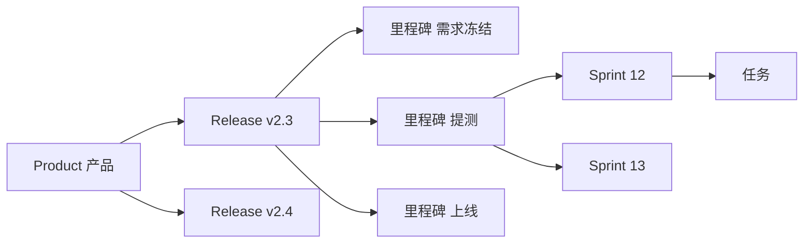

# 项目经理视角的功能缺口

以 PM 的日常交付物倒推，当前设计（M1 骨架 + 工作对象分类）还缺下面这些。按痛感排序。

## 一等：PM 靠它吃饭的四件事

### 1. RAID 台账
PM 的核心交付物，现在这四类东西只能塞进笔记：

| 台账 | 关键字段 | 说明 |
|---|---|---|
| Risk 风险 | 概率 / 影响 / 风险值 / 缓解措施 / 责任人 / 复审日期 / 状态 | 风险值 = 概率×影响，用于排序；到复审日期自动提醒 |
| Assumption 假设 | 假设内容 / 依赖方 / 验证方式 / 验证截止 / 已验证? | 未验证的假设是最常见的翻车源 |
| Issue 问题 | 描述 / 严重度 / 升级路径 / 责任人 / 目标解决日 | 已经发生的风险 |
| Dependency 依赖 | 依赖方 / 依赖内容 / 承诺日期 / 状态 / 备选方案 | 跨团队依赖必须有承诺日期 |

实现方式：不新建四张表，注册为四个新的**工作对象类型**（risk/assumption/issue/dependency），复用现有的 objects + categories + links + revisions 全套能力。这正是单表多态设计的红利。

### 2. 决策记录 ADR
三个月后有人问「当初为什么不做 X」，没有这个就只能靠记忆。字段：背景 / 决定 / 考虑过的替代方案 / 后果与代价 / 拍板人 / 拍板时间 / 状态（提议 / 已采纳 / 被取代）。

ADR 属于 Agent 知识分层的 L2（见 `spec-baseline.md`），是少数**过期了也仍然有价值**的内容——它记录的是判断过程，不是当前事实。

### 3. 变更控制
- 需求基线冻结（冻结后改动必须走 CR）
- 变更申请 CR：变更内容 / 原因 / 影响分析 / 审批人 / 结果
- **影响分析自动化**：提交 CR 时自动列出受影响的未完成任务、引用该方案的文档、绑定该基线的需求
- 版本 diff：两版方案的文本差异高亮

这是范围蔓延（scope creep）唯一的防线。

### 4. 发布与里程碑层级
当前只有扁平的 project，缺时间轴上的交付节奏：

配套：发布清单（release notes 自动从关联需求生成）、上线检查单（Go-Live Checklist 模板）。

## 二等：显著提效

| 功能 | 内容 |
|---|---|
| 容量与负载 | 按人视图、在手任务数与工作量、超载预警；排期不再靠拍脑袋 |
| 干系人管理 | 干系人清单（角色 / 影响力 / 关注点）、汇报对象、沟通记录、周报收件人 |
| 会议闭环 | 议题收集 → 纪要模板 → 待办自动抽取 → 决议进 ADR；会议是产出落地率最低的环节 |
| 验收管理 | 验收标准 AC 清单、UAT 记录、缺陷关联；给「做完了」一个客观判定 |
| 度量看板 | 吞吐量、周期时间 cycle time、各状态停留时长、按时交付率、范围变更次数 |
| 汇报产出 | 一键周报 / 月报 / 汇报材料，可导出 Markdown / PDF / 推 Confluence |

## 三等：成熟度提升

- 工时记录（可选开启，不强制）
- 模板库：立项清单、需求模板、复盘模板、上线检查单
- 外部同步：Jira 任务双向、Confluence 文档双向、Slack 通知与快速捕获
- 预算与成本（若涉及外包或采购）
- 供应商 / 外部团队跟踪

## 与现有设计的衔接

好消息是这些**基本不需要改架构**：

| 缺口 | 落地方式 |
|---|---|
| RAID 四本台账 | 注册 4 个新 object_type，零代码 |
| ADR | 1 个新 object_type + knowledge_tier='decision' |
| 里程碑 / Release / Sprint | 3 个新 object_type + links 的 parent 关系 |
| 干系人 | 1 个新 object_type（person） |
| 变更控制 | 新增 `change_requests` 表 + 影响分析查询 |
| 度量 | 全部从 `revisions` 表算得出来（状态停留时长 = 相邻两条 status 修订的时间差），这就是第一天就要建修订历史的原因 |
| 容量 | 从 objects 的 owner + 未完成任务聚合 |

需要新表的只有：`specs` / `spec_versions` / `decisions` / `change_requests`。其余都是数据配置。

**这验证了 M1 的架构选择是对的**：单表多态 + 分类树 + 万物关联 + 字段级修订，四件事撑得起后面所有 PM 场景。
