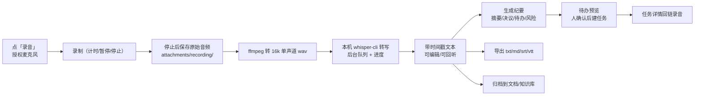

# 录音转写（recording）需求确认稿

- 状态：**已确认，开始实现**（设计文档：[docs/recording-transcription-design.md](recording-transcription-design.md)）
- 版本：v0.3，2026-11-10
- 变更：按「优先实现本地的服务」，引擎顺序改为**本地 whisper.cpp 优先**；腾讯云等云引擎整体推迟到 M4（可选）
- v0.3 确认：默认先用 `small` 跑通（可切 medium/turbo）；模型一键下载＋手动放置都做；依赖本机已装的 `whisper-cli`/`ffmpeg`；纪要模型走本地 Ollama
- v0.3 落地（2026-11-10）：M1（浏览器录音、本地 whisper.cpp 转写、带时间戳段落、全文编辑、删除、设置、工具检测、模型下载/删除/手动放置）已实现；真装真跑的集成用例走了 ffmpeg + whisper-cli small 全流程。M2（纪要/待办转任务）和 M3（导出/归档/搜索）未做
- 关联：[docs/plugin-api.md](plugin-api.md)（插件清单、权限、扩展点）、[docs/efficiency-roadmap.md](efficiency-roadmap.md)（会议纪要 → 待办抽取，未实现）

## 0. 结论摘要

| 维度 | 结论 |
|---|---|
| 形态 | 新插件 `recording`，一级模块「录音」，可独立安装、启停、授权 |
| 入口 | 浏览器内直接录音（MediaRecorder）；本地上传、IM 语音、视频素材转写首版不做，接口预留 |
| 引擎 | **本地 whisper.cpp 优先**（调本机 `whisper-cli` 子进程）；统一 ASR 适配层，云引擎（腾讯云极速版）放 M4 按需接 |
| 默认模型 | **先 `small`（466MB）跑通**；benchmark 显示 turbo 质量最好，跑通后可在设置页切 medium/turbo |
| 依赖 | 本机已装 `whisper-cli 1.9.5`（Homebrew）与 `ffmpeg 7.1.1`；模型文件默认不随包，需下载或手动放置 |
| 结果 | 可编辑、带时间戳的转写文本；自动纪要（摘要/决议/待办/风险）；待办一键转任务；导出 txt/md/srt/vtt；归档到文档/知识库并可全文检索 |
| 说话人 | 首版不区分，`speaker` 字段预留（whisper.cpp 有 stereo diarize 能力，二期评估） |
| 纪要模型 | 录音插件设置里单独指定服务商与模型；可选本机 Ollama 实现全本地闭环 |
| 隐私 | 音频**不出本机**；首版唯一联网点是「下载模型」（可关、可手动放文件） |
| 实时转写 | 首版不做，录完再转；分片/流式接口预留 |

## 1. 背景与目标

工作台（一人之下）已经有任务、项目、文档、知识库、IM、SOP，但「开会/口述产生的语音」进不来，路线图里「会议纪要 → 待办抽取」因为缺上游一直没做（[docs/efficiency-roadmap.md](efficiency-roadmap.md) 第 168 行）。本功能补上这条链路：

> 浏览器录音 → 本地转写 → 纪要 → 待办 → 任务（关联项目/负责人）→ 归档/导出

本地优先的理由：录音和会议内容敏感，单二进制运行、数据在本机是产品原则；且本机已有 whisper.cpp 和 ffmpeg，离线可跑。

### 非目标（首版明确不做）

- 云转写（腾讯云极速版等）：适配层接口保留，M4 再接
- 实时/边说边出字（接口预留，不做流式 ASR）
- 说话人分离的展示与编辑（字段预留，UI 不做）
- IM 语音消息自动转写、视频素材/成片转写、本地上传（二期评估）
- 超过 2 小时的超长录音的断点续跑/分片方案（先限制 + 提示，M4 再优化）

## 2. 本地能力现状与实测（本机：Apple M4，10 核，32GB）

已确认的环境（2026-11-10）：

| 工具 | 版本 | 位置 | 说明 |
|---|---|---|---|
| whisper.cpp | 1.9.5（Homebrew） | `/opt/homebrew/bin/whisper-cli` | 支持 Metal；CoreML/OpenVINO 未编译 |
| ffmpeg | 7.1.1 | `/opt/homebrew/bin/ffmpeg` | 负责 webm/mp4 → 16k 单声道 wav |
| 模型 | 未随包 | 需下载/放置 | 官方 `ggerganov/whisper.cpp` 的 ggml 模型 |

用 65.7 秒中文语音（会议场景文本，TTS 合成）实测，统一参数 `-l zh -t 8 -nfa`：

| 模型 | 大小 | Metal（`-nfa`） | CPU（`-ng`） | 字符错误率 CER | 30 分钟会议预计（Metal） |
|---|---|---|---|---|---|
| base | 141MB | 未测（见下） | 11.0s / 6.0x | 10.9% | — |
| small | 466MB | 9.6s / **6.9x** | 19.5s / 3.4x | 6.6% | ≈4–5 分钟 |
| medium | 1.4GB | 15.6s / **4.2x** | 43.7s / 1.5x | 4.7% | ≈7 分钟 |
| **large-v3-turbo** | 1.5GB | 15.5s / **4.2x** | 37.8s / 1.7x | **2.7%** | ≈7 分钟 |

关键发现（直接影响实现）：

1. **不能开 flash attention**：whisper.cpp 默认 `-fa true`，在 Homebrew 这套 Metal 构建上会把 base 模型拖到 90 秒（比 CPU 还慢 8 倍）；显式加 `-nfa` 后同一模型 9.6 秒。插件必须固定传 `-nfa`。
2. **turbo 是质量最好的模型，但先用 small 跑通**：small 只有 466MB、Metal 6.9x 实时，适合先验证整条链路；turbo 与 medium 同速、CER 从 4.7% 降到 2.7%，功能稳定后建议把默认切到 turbo。
3. **输出带句级时间戳**：`-oj` 输出的 JSON 里 `transcription[].timestamps/offsets/text` 正好是段落表和 srt/vtt 需要的数据，不需要二次切分。
4. **进度可取**：`-pp` 时 stderr 有 `whisper_print_progress_callback: progress = 41%`，可解析给界面做进度条。
5. **首次 Metal 运行**可能有内核编译缓存开销（几十秒后消失）；转写任务本来就在后台队列，可接受。
6. 以上 CER 基于干净 TTS 音频，真实会议（噪声、多人重叠、口音）会更差，需要用真实录音复测后再定默认模型。

## 3. 用户流程



异常路径：

- 没装 `whisper-cli` 或 `ffmpeg`：录音可保存，设置页与录音页提示安装命令（`brew install whisper.cpp ffmpeg`），不静默失败。
- 没有模型：提示到设置页下载或手动放置模型文件；已下载后可立即重试。
- 转写失败（模型损坏、内存不足、进程被杀）：任务置失败、保留原始音频、可重试；stderr 尾部原样展示。
- 插件停用/重装、内核重启：录音与待处理任务持久化，重新启用后继续。
- 应用退出时正在转写：任务标记为「已中断」，重启后可重跑（v1 不支持从中间续跑）。

## 4. 功能需求

### FR-1 浏览器录音

- 新一级模块「录音」：列表页（时间倒序、按项目/状态筛选、关键字过滤）+「开始录音」。
- 录音页：麦克风授权、计时、音量提示、暂停/继续、停止并转写、放弃。
- 录音时可选：标题、关联项目、语言、模型（默认取设置）。
- 停止后立即保存原始音频（webm/opus，Safari 为 mp4/aac），再进入转写队列；页面轮询状态与进度。
- 权限：`getUserMedia` 需要安全上下文；`http://127.0.0.1` 满足，内网 HTTP 域名不满足（见待确认事项）。

### FR-2 本地转写

- 服务端链路：原始音频 → ffmpeg 转 `16k 单声道 wav` → `whisper-cli` 子进程 → 解析 `-oj` JSON → 段落入库。
- 固定参数：`-m <模型路径> -f <wav> -l <语言> -t <线程数> -nfa -pp -oj -of <输出前缀> --no-prints`；线程数默认 `min(8, 核数)`，设置可改。
- 转写在后台 Job 里跑（`Registrar.Job` + 持久化任务表），同一时间只跑一个转写（避免抢 CPU），其余排队。
- 进度：解析 stderr 的 `progress = N%` 写回任务，前端轮询展示；完成/失败都有终态。
- 超时与取消：子进程带 context，插件停用/应用退出时取消；失败重试最多 3 次（模型文件缺失、参数错误不自动重试）。
- 时长：本地引擎没有 2 小时硬限制，但单条超过 2 小时时提示「预计耗时较长」并允许继续；30 分钟会议在 M4 上约 7 分钟（turbo/Metal）。
- 音频与文本都留在本机，不上传。

### FR-3 引擎抽象与云引擎预留

- 内部接口：`Transcriber.Transcribe(ctx, audioPath, opts, onProgress) ([]Segment, error)`，`Segment{StartMs, EndMs, Text, Speaker}`。
- 首版只注册 `whisper_local`；设置页引擎下拉显示「本地 whisper.cpp（可用/不可用）」和置灰的「腾讯云（二期）」。
- M4 加 `tencent_flash` 实现时只换 adapter + 连接器，不动上层流程；[docs/plugin-api.md](plugin-api.md) 的 `network:<group>` 与 `secrets:<scope>` 机制直接复用。

### FR-4 模型与工具管理

- 设置页「录音转写 → 本地引擎」：
  - 检测 `whisper-cli`、`ffmpeg`：自动找 PATH 与常见 Homebrew 路径（`/opt/homebrew/bin`、`/usr/local/bin`），找不到可手填绝对路径（GUI 启动的进程 PATH 可能不全）。
  - 模型目录：默认 `CacheDir()/models`（可从设置改成本机任意目录，如已有 `~/models`）。
  - 模型列表：base / small / medium / large-v3-turbo，显示大小、是否已下载、实测速度与 CER 参考；支持一键下载（带进度）、删除、手动放置（刷新后识别）。
  - 默认模型：`small`（先跑通）；可选 `large-v3-turbo`（质量最好）与 `medium`；语言默认 `zh`，可切 `auto`/`en`/`yue` 等。
- 模型文件属可再生成内容，放 CacheDir 不入备份；换机后重新下载。
- 下载源默认 HuggingFace（本机实测可达 ~5MB/s），设置里可换镜像（如 hf-mirror）；下载失败给出手动下载指引和校验（文件大小/哈希）。

### FR-5 转写文本

- 段落/句列表：时间戳（`mm:ss`）、文本；点击跳转音频对应位置（`<audio>` + `currentTime`）。
- 全文与分段可编辑、自动保存（防抖）；原始转写结果只读留档，编辑不改原始结果。
- 支持复制全文、按段落复制；`speaker` 入库但首版不显示、不可编辑。
- 音频播放走插件自己的 `GET /api/recording/recordings/{id}/audio`，支持 Range 以便拖动进度条。

### FR-6 纪要

- 在转写文本上调 `Core.Agent().Complete`，服务商与模型取录音插件设置（单独指定，候选来自 `/api/agent-providers`；可选本机 Ollama）。
- 默认 prompt 输出 JSON：`summary`、`decisions[]`、`todos[]`（`title`、`owner_hint`、`due_hint`、`project_hint`）、`risks[]`。
- JSON 解析失败保留模型原文并提示「纪要格式没解析出来，可重试或换模型」。
- 纪要可重新生成、可手工编辑；记录每次生成用的模型与时间。

### FR-7 待办转任务

- 待办逐条「转任务」，默认标题取待办文字；可改标题、项目、负责人、截止时间。
- 走 `Core.ObjectWriter().Create`（`TypeID=task`，带 `ProjectID`、`OwnerID`、`DueAt`、正文回链录音），`recording_todos` 幂等映射防重复。
- 任务详情看到来源录音链接；录音详情看到已建任务。

### FR-8 导出

- `txt`、`md`（标题/时间/纪要/全文）、`srt`、`vtt`（按句级时间戳生成）。
- 后端生成文件流下载，不落额外文件；srt/vtt 默认一句一条。

### FR-9 归档与全文检索

- 「归档到文档」：`Core.ObjectWriter().Create` 建 `doc` 对象，正文为 Markdown（转写 + 纪要），可指定分类/项目。
- 「归档到知识库」：`Core.Knowledge().Sync`，`Kind=note`、`Key=recording:<id>`，内容为转写全文 + 纪要；知识库 FTS5 直接可搜；重复归档是覆盖更新。
- 录音模块自身按标题/转写文本过滤（v1 用 LIKE）；命令面板搜索源 `recording` 跳转录音详情。

### FR-10 列表与详情

- 列表字段：标题、时长、状态/进度、项目、创建时间、是否已生成纪要、已转任务数。
- 详情：音频播放器、转写文本、纪要、待办、导出、归档、删除（二次确认，同时删音频文件）。

## 5. 关键命令与输出解析

转写命令模板：

```
/opt/homebrew/bin/whisper-cli \
  -m <model_dir>/ggml-large-v3-turbo.bin \
  -f <attachments>/recording/<id>/audio16k.wav \
  -l zh -t 8 -nfa -pp -oj -of <tmp>/<id> --no-prints
```

- 结果读 `<tmp>/<id>.json`：`transcription[]` 每项取 `offsets.from/to`（毫秒）与 `text`，按顺序写 `recording_segments`，再拼全文存 `recording_transcripts.text`。
- 进度解析 stderr：`regexp "progress = *([0-9]+)%"`。
- 失败时取 stderr 最后 20 行放进任务错误信息（截断展示）。
- 临时文件放 `CacheDir()/tmp`，结束后清理。

## 6. 云引擎（M4 参考，首版不做）

保留这些已核实结论，M4 接腾讯云时直接用（来源：<https://cloud.tencent.com/document/product/1093/52097>）：

- 腾讯云「录音文件识别极速版」：HTTPS POST 直接上传音频 body、同步返回，不需要 COS，单次 ≤100MB 且 ≤2 小时，30 分钟音频通常 10 秒内出结果。
- 格式支持 wav/pcm/ogg-opus/speex/silk/mp3/m4a/aac/amr（不含 webm，所以仍要先转码）。
- 凭证用连接器机制（AppID/SecretID/SecretKey 进保险箱），需新增 `network:asr` 域名组。

## 7. 数据模型

插件自己的表，前缀 `recording_`，迁移放 `internal/plugins/recording/migrations/`：

| 表 | 字段（主要） | 说明 |
|---|---|---|
| `recording_recordings` | id、title、status、engine、model、language、audio_path、audio_mime、audio_size、duration_ms、transcript、minutes_json、minutes_model、project_id、error、attempts、created_at、updated_at | 一条录音；`engine` 首版为 `whisper_local`；`audio_path` 相对 attachments 目录 |
| `recording_segments` | id、recording_id、seq、start_ms、end_ms、text、speaker | 时间戳段落；`speaker` 预留 |
| `recording_jobs` | id、recording_id、kind、status、progress、attempts、next_run_at、last_error、created_at、updated_at | 转写/纪要后台任务；持久化队列与进度 |
| `recording_todos` | recording_id、todo_index、task_id、created_at | 待办 → 任务幂等映射 |
| ~~`recording_models`~~ | — | 不建表：按模型目录扫描 + 文件大小校验判断是否下载好，下载进度放进程内内存（v0.3 实现） |
| `recording_settings` | id=1、default_engine、model、model_dir、whisper_path、ffmpeg_path、language、threads、default_project_id、minutes_provider、minutes_model、auto_summarize、retention_mode、updated_at | 插件设置单行 |

状态机：`recording → uploaded → transcribing → transcribed → summarizing → ready`，失败回 `failed`（可重试）。音频存 `attachments/recording/<recording_id>/audio.webm`（原始）与 `audio16k.wav`（转码临时，可删），随数据目录备份；删除录音时一起删。

## 8. 接口（插件路由，前缀 `/api/recording/`）

| 方法 + 路径 | 作用 |
|---|---|
| `GET /meta` | 工具/模型/ffmpeg/服务商候选的可用状态与默认值 |
| `GET /recordings` | 列表（分页、按项目/状态/关键字） |
| `POST /recordings` | 建录音草稿（标题、项目、引擎、模型） |
| `POST /recordings/{id}/audio` | multipart 上传原始音频，返回时长/大小，进入转写队列 |
| `GET /recordings/{id}/audio` | 流式播放（Range） |
| `GET /recordings/{id}` | 详情（文本、纪要、待办、任务、状态、进度） |
| `PATCH /recordings/{id}` | 改标题/项目/文本/纪要 |
| `POST /recordings/{id}/transcribe` | 重新转写（重试） |
| `POST /recordings/{id}/summarize` | 生成/重生成纪要 |
| `POST /recordings/{id}/todos/{index}/task` | 待办转任务（幂等） |
| `GET /recordings/{id}/export?format=srt` | 导出 txt/md/srt/vtt |
| `POST /recordings/{id}/archive` | 归档到文档或知识库 |
| `DELETE /recordings/{id}` | 删除录音与音频文件 |
| `GET/PUT /settings` | 插件设置 |
| `POST /models/{name}/download` | 下载模型（后台任务，可查进度） |
| `DELETE /models/{name}` | 删除模型文件 |

## 9. 插件清单草稿（v1，本地引擎）

`internal/plugins/recording/plugin.json`：

```json
{
  "id": "recording",
  "name": "录音转写",
  "description": "浏览器录音，用本机 whisper.cpp 转写为带时间戳的文字，生成会议纪要与待办，待办可转任务，结果可导出字幕、归档到文档或知识库",
  "icon": "mic",
  "version": "0.1.0",
  "core": ">=1.1.0 <2.0.0",
  "depends": {},
  "optional_depends": {},
  "provides": {
    "modules": ["recording"],
    "settings": ["recording"],
    "object_types": [],
    "connectors": [],
    "skills": [],
    "agent_tools": [],
    "sop_nodes": [],
    "today_cards": [],
    "commands": [],
    "search": ["recording"]
  },
  "emits": ["recording.transcribed", "recording.minutes_ready", "recording.failed"],
  "subscribes": [],
  "permissions": ["fs:read:attachments", "fs:write:attachments", "process:spawn", "network:model"],
  "migrations": "migrations",
  "table_prefix": "recording_"
}
```

说明：

- `network:model` 是新增内核域名组（HuggingFace 下载模型用）：`huggingface.co`、`*.huggingface.co`、`hf.co`、`*.hf.co`、`cdn-lfs*.hf.co`，可选加 `hf-mirror.com`。若不做应用内下载，可去掉这条权限、只支持手动放模型。
- 凭证/云引擎相关权限（`network:asr`、`secrets:*`、连接器）M4 再随版本升。
- 外壳图标 `mic` 需要新增到 `frontend/src/core/shell/icons.tsx`（现有图标没有麦克风）。
- 后台 Job、路由、审计、对象/任务、知识库、模型、CacheDir/AttachmentDir 都是现成内核句柄，无需新扩展点。

## 10. 权限与隐私

| 权限 | 用途 | 风险 |
|---|---|---|
| `fs:read:attachments` / `fs:write:attachments` | 读写 `attachments/recording/` 下的音频 | 普通 |
| `process:spawn` | 调 `whisper-cli`、`ffmpeg` 子进程 | 高，安装时单独确认 |
| `network:model` | 仅用于下载模型文件到本机 | 普通（新增组） |

隐私约定：

- 首版音频与转写结果全程在本机，唯一联网点是可选的一键下载模型；下载可以关闭、也可以手动放模型文件。
- 设置页明确写「本地转写，音频不出本机」；M4 加云引擎时再单独提示「音频将上传」。
- 转任务、归档、删除、模型下载都记审计（操作者记插件），不记音频内容。

## 11. 里程碑

| 阶段 | 内容 | 验收 |
|---|---|---|
| M1 录音与本地转写闭环 | 插件骨架、录音页、附件存储、工具/模型检测与模型管理、ffmpeg 转码、whisper-cli adapter、后台队列与进度、文本+时间戳展示、失败重试、列表/详情 | 录 10 分钟中文可出文本，可重试，音频不出本机 |
| M2 纪要与待办 | 设置页（模型/语言/线程/服务商）、纪要生成/编辑、待办抽取、转任务预览与幂等、任务回链 | 30 分钟会议出纪要，待办能一键成任务 |
| M3 导出、归档与检索 | txt/md/srt/vtt、归档文档、归档知识库、命令面板搜索源、删除与保留策略 | srt 可播放，知识库能搜到 |
| M4 可选增强 | 腾讯云云引擎、>2h 长录音断点/分片、说话人分离、实时转写、IM 语音、前端直出 WAV 去 ffmpeg 依赖 | 另议 |

## 12. 验收标准

- 一段 10 分钟中文会议录音：停止后 ≤2 分钟出文本（本机 turbo/Metal 参考值），段落带时间戳、可编辑、可回听跳转。
- 一段 30 分钟会议：≤8 分钟出文本；纪要含摘要/决议/待办/风险；待办转任务后任务列表出现且回链录音。
- 导出的 srt 在播放器中按时间正常显示；md 含标题、时间、纪要与全文。
- 归档到知识库后，用知识库搜索能命中转写内容；重复归档不产生重复篇目。
- 全程断网可完成录音、转写、编辑、导出、归档（除模型首次下载）。
- 缺 whisper-cli/ffmpeg/模型时：录音仍能保存，界面给出可照做的安装/下载指引，不白屏、不静默失败。
- 插件停用再启用、内核重启后，待处理任务继续跑（队列持久化）。

## 13. 已确认决策与剩余待确认事项

已确认（2026-11-10，用户）：

| 项 | 结论 |
|---|---|
| 默认模型 | 先用 `small` 跑通，设置页可切 medium/turbo |
| 模型获取 | 插件内一键下载 **和** 手动放置，两种都要 |
| 依赖 | 依赖本机已安装的 `whisper-cli`/`ffmpeg`，应用不自带 |
| 纪要模型 | 本地实现：走本机 Ollama（现有 Agent 服务商体系里的 ollama 类型） |

仍需确认（不阻塞 M1 开工）：

1. **访问方式**：是否只用 `http://127.0.0.1:xxxx` 打开工作台？内网域名/手机访问需要 HTTPS 才能用麦克风。
2. **验收样本**：能否提供 1–2 段真实中文会议录音（10–30 分钟，最好多人），用于复测准确率与默认模型（本地跑，不上传）。
3. ~~**交付节奏**：先做 M1 验收，还是一次做完 M1–M3 再验收？~~ 已定：先做 M1 验收（用户 2026-11-10 指示「先用 small 跑通」），M2/M3 之后按需要再做。
4. **云引擎是否还要**：既然本地优先，M4 的腾讯云引擎是「保留待定」还是直接砍掉？

## 14. 风险与缓解

| 风险 | 影响 | 缓解 |
|---|---|---|
| whisper.cpp 的 Metal/flash-attention 组合有性能坑 | 转写耗时异常长 | 固定 `-nfa`；设置页可切 CPU（`-ng`） |
| 缺 whisper-cli/ffmpeg 或模型 | 无法转写 | 启动时检测，给出 brew 命令与下载入口；录音照常保存 |
| GUI 进程 PATH 不全会找不到 brew 工具 | 检测失败 | 设置页可手填绝对路径，默认探测 Homebrew 常见路径 |
| 真实会议准确率低于 TTS 基准 | 纪要与待办质量差 | 用真实样本复测；默认 turbo；纪要模型可换；待办必须人工确认 |
| CPU 回退时 turbo 只有 1.7x 实时 | 30 分钟会议 CPU 需 ~18 分钟 | 提示预计耗时；可切 small |
| 长任务被应用退出打断 | 需从头重跑 | 任务标记中断、可重跑；M4 做 offset 断点续跑 |
| 模型占磁盘（turbo 1.5GB） | 数据目录变大 | 放 cache 目录不入备份；可删除/换小模型 |
| whisper.cpp 版本漂移 | CLI 参数/JSON 结构变化 | 启动时校验版本（实测 1.9.5），设置页显示版本；解析做容错 |
| 前端直录格式（webm/mp4）whisper 不认 | 必须转码 | 依赖 ffmpeg；M4 可选前端直出 WAV 去掉该依赖 |

## 15. 追加需求（2026-11-10，第二批）

用户提出 4 项新增能力，确认后的决策：

| # | 需求 | 决策 |
|---|---|---|
| 1 | 录音/文件重命名 | 重命名 = 改录音标题（列表/详情行内改），磁盘固定文件名不变 |
| 2 | 转写触发 SOP 做 Agent 会议纪要；纪要带流程图、树形结构图；录音/转写/纪要归到同一音频的文件目录 | 每录音一个文件夹 `attachments/recording/<id>/`（`audio.*`、`transcript.md`、`minutes.md`、`minutes.json`、`diagrams/*.mmd`）；插件内置 SOP 流程「会议纪要整理」+ 设置可选自动触发 + 详情页手动发起；纪要由本机 Agent 生成；图表结构化 JSON + 前端自绘 + 导出 mermaid |
| 3 | 声纹绑定联系人、后续自动识别并标记说话人 | **已实现（M5，0.3.0）**；引擎选本机 Python + FunASR/ModelScope（先做本机小样验证）；本批只保留 speaker 字段 |
| 4 | 纪要手工 SOP：项目识别、工作任务/目标识别、AI 给置信度、高置信度推送确认 | 内置 SOP 流程里做「生成纪要 → 识别候选」；候选写入 DB 带置信度；≥ 阈值（默认 0.7）发通知推送；详情页卡片确认/忽略；任务/目标候选确认后建任务、挂识别出的项目、props 关联录音；项目候选确认后把录音挂到项目 |

交付节奏：先做 1/2/4（M4a，插件 0.2.0），验收后再做 3（M5）。

新增/变更接口、数据结构、SOP 节点与文件目录见设计文档 §13（`docs/recording-transcription-design.md`）与 API 契约「录音转写插件 recording」。

落地状态（2026-11-10）：1/2/4 已实现并验证（插件 0.2.0，`internal/plugins/recording` + 前端插件页），
真实实例库 0.1.0→0.2.0 升级通过，内置 SOP 流程「会议纪要整理」已写入；真 Ollama qwen3.5:0.8b/4b 冒烟产出可解析纪要。
3（声纹）已实现（插件 0.3.0，2026-11-10）：本机 Python + FunASR 说话人分离、说话人绑定联系人、后续录音自动认人；POC 见 `docs/recording-voiceprint-poc.md`，实现与验证见 `docs/recording-transcription-design.md` §14。真实会议录音（远场/交叉说话）还需样本校准阈值。

---

由 DeepSeek Harness（dsh）协助完成。

[](https://github.com/deepseek-ai/deepseek-harness)
