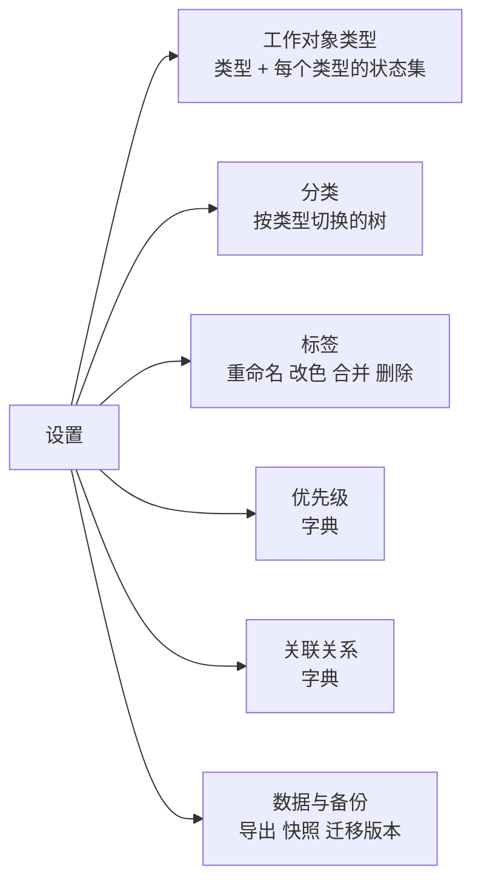

# 设置模块 · 枚举统一管理（M1.3 设计）

## 现状：枚举散落在四个地方

| 枚举 | 当前存储 | 有无管理界面 |
|---|---|---|
| 工作对象类型 | `object_types` 表 | 无 |
| 状态集 | `object_types.statuses` JSON 列 | 无 |
| 分类 | `categories` 表 | 有，但在一个弹窗里 |
| 标签 | `tags` 表 | 无，只能在对象详情上临时加 |
| 优先级 | **前端硬编码** `ui.tsx:13 PRIORITIES` | 无 |
| 关联关系 | **后端硬编码** `domain.go:145 RelRelates...` | 无 |
| 快捷访问分组 | `shortcut_groups` 表 | 有，在快捷访问页内 |

问题不只是「没有入口」：优先级和关联关系写死在代码里，用户想加一个 `P4` 或一种 `阻塞于` 关系就得改代码。而后面 PM 场景要的枚举只会更多——RAID 台账的概率/影响分级、ADR 的状态、方案基线的版本状态、发布的里程碑类型。

## 设计：通用字典表 + 统一设置入口

### 存储：只把硬编码的搬进字典表

```sql
CREATE TABLE dictionaries (
  id          TEXT PRIMARY KEY,   -- 'priority' | 'link_relation' | ...
  name        TEXT NOT NULL,
  description TEXT NOT NULL DEFAULT '',
  scope       TEXT NOT NULL DEFAULT 'global',  -- global | type（按工作对象类型隔离）
  builtin     INTEGER NOT NULL DEFAULT 0,      -- 内置字典不可删，但条目可增删改
  sort_order  INTEGER NOT NULL DEFAULT 0,
  created_at  TEXT NOT NULL,
  updated_at  TEXT NOT NULL
);

CREATE TABLE dict_items (
  id          TEXT PRIMARY KEY,
  dict_id     TEXT NOT NULL REFERENCES dictionaries(id) ON DELETE CASCADE,
  type_id     TEXT REFERENCES object_types(id) ON DELETE CASCADE,  -- scope='type' 时用
  key         TEXT NOT NULL,      -- 落在业务表里的值，如 'P0'
  label       TEXT NOT NULL,      -- 显示名，如 '最高'
  color       TEXT NOT NULL DEFAULT '',
  description TEXT NOT NULL DEFAULT '',
  sort_order  INTEGER NOT NULL DEFAULT 0,
  meta        TEXT NOT NULL DEFAULT '{}',  -- JSON，放各字典特有的属性
  archived_at TEXT,               -- 停用，不是删除
  created_at  TEXT NOT NULL,
  updated_at  TEXT NOT NULL
);
CREATE UNIQUE INDEX idx_dict_items_key ON dict_items(dict_id, IFNULL(type_id,''), key);
```

**不迁移的两个**，理由充分：

- **状态集留在 `object_types.statuses`**。它是 type-scoped 且被 `terminalClause` 这类 SQL 直接读，迁到字典表要改一圈查询，收益只是「存储形式统一」。设置页给它一个结构化编辑器即可——**UI 统一不要求存储统一**。
- **分类留在 `categories`**。它是树、有物化路径和子树查询，不是扁平枚举。

### 核心约束：停用而非删除

枚举值一旦被数据引用，删掉就会留下悬空值——列表里出现一个没有标签没有颜色的 `P4`，而且没人知道它从哪来。所以：

- `dict_items` 只有 `archived_at`，**没有软删也没有硬删**
- 停用的条目：已有数据照常显示（标「已停用」），但新建/编辑时不再出现在下拉里
- 真要删除，先看引用数：`SELECT COUNT(*) FROM objects WHERE priority = ?`。引用数为 0 才允许删，否则只能停用
- 同样的规则适用于标签删除、分类删除（分类已有 `reassign_to` 机制，保持）、对象类型删除（已有「下挂对象非空返回 409」，保持）

**`key` 一经创建不可改**（它落在业务表里），只能改 `label` / `color` / `sort_order` / `description`。这和「SKILL.md 的 name 一经发布不许改」是同一个道理。

### 内置字典（migration 种子）

| dict_id | scope | 条目 | meta |
|---|---|---|---|
| `priority` | global | P0 最高 / P1 高 / P2 中 / P3 低 | — |
| `link_relation` | global | relates 相关 / blocks 阻塞 / duplicates 重复 / parent 父级 / references 引用 | `{"inverse":"blocked_by"}` 之类，供反向显示 |

现有数据零迁移：`objects.priority` 和 `links.relation` 存的就是 `key`，字典只是给它们补上 label 和颜色。

## 设置模块的二级页面



布局：左侧设置导航（窄列），右侧内容区。整页占据主内容区，不再是弹窗。

### 各页要点

**工作对象类型**：列表 + 选中后右侧编辑。可改 名称/复数名/图标/色/排序；`id` 和 `ref_prefix` 一经创建不可改（ref 已经发出去了）。内置类型只能改 icon/color/sort_order/statuses（后端已有此约束）。**状态集编辑器**在同一页：拖拽排序、改标签/色、勾选「终态」、增删；删除某状态前检查是否有对象正处于该状态。

**分类**：把现在的 `CategoryManager` 弹窗内容整个搬进来，不再从侧栏弹。侧栏的「管理分类」改成跳到这一页。功能不变（增删改、上下移、改挂父级、删除时 reassign）。

**标签**：现在完全没有管理界面。需要：列表 + 引用计数、重命名（对象上的关联自动跟着走，因为是 id 关联）、改色、**合并**（把 A 的对象全部打上 B 再删 A——这是标签管理最常用的操作，手工加了同义标签之后必然需要）、删除（引用数 > 0 时警告并显示数量）。

**优先级 / 关联关系**：通用字典编辑器，一个组件复用。增改条目（key 仅创建时可填）、改色、排序、停用/启用、删除（引用数为 0 才可删）。

**数据与备份**：db 路径与体积、对象数、迁移版本与 checksum 列表（`schema_migrations`）、「立即快照」（`VACUUM INTO`）、「导出 JSON / Markdown」、上次备份时间。这页是信任基础——本地单文件工具要让人对自己的数据有掌控感。

## API

| 方法 | 路径 | 说明 |
|---|---|---|
| GET | `/api/dictionaries?with_items=true` | 字典列表，可带条目 |
| GET | `/api/dictionaries/{id}/items?type={typeID}&include_archived=true` | 条目列表 |
| POST | `/api/dictionaries/{id}/items` | 新建条目，`key` 必填且同字典内唯一 |
| PATCH | `/api/dict-items/{id}` | 改 label/color/sort_order/description/meta；**拒绝改 key** |
| POST | `/api/dict-items/{id}/archive` | 停用 / 启用（body `{archived: bool}`） |
| DELETE | `/api/dict-items/{id}` | 引用数 > 0 返回 409 并在 message 里带数量 |
| GET | `/api/dict-items/{id}/usage` | 引用计数，供界面在删除前提示 |
| POST | `/api/dictionaries/{id}/items/reorder` | `{type_id, ids}` 全量重排，与 shortcuts 的 reorder 同语义 |

引用计数的实现按 dict_id 分派：`priority` 查 `objects.priority`，`link_relation` 查 `links.relation`。新增字典时在这里加一个 case。
