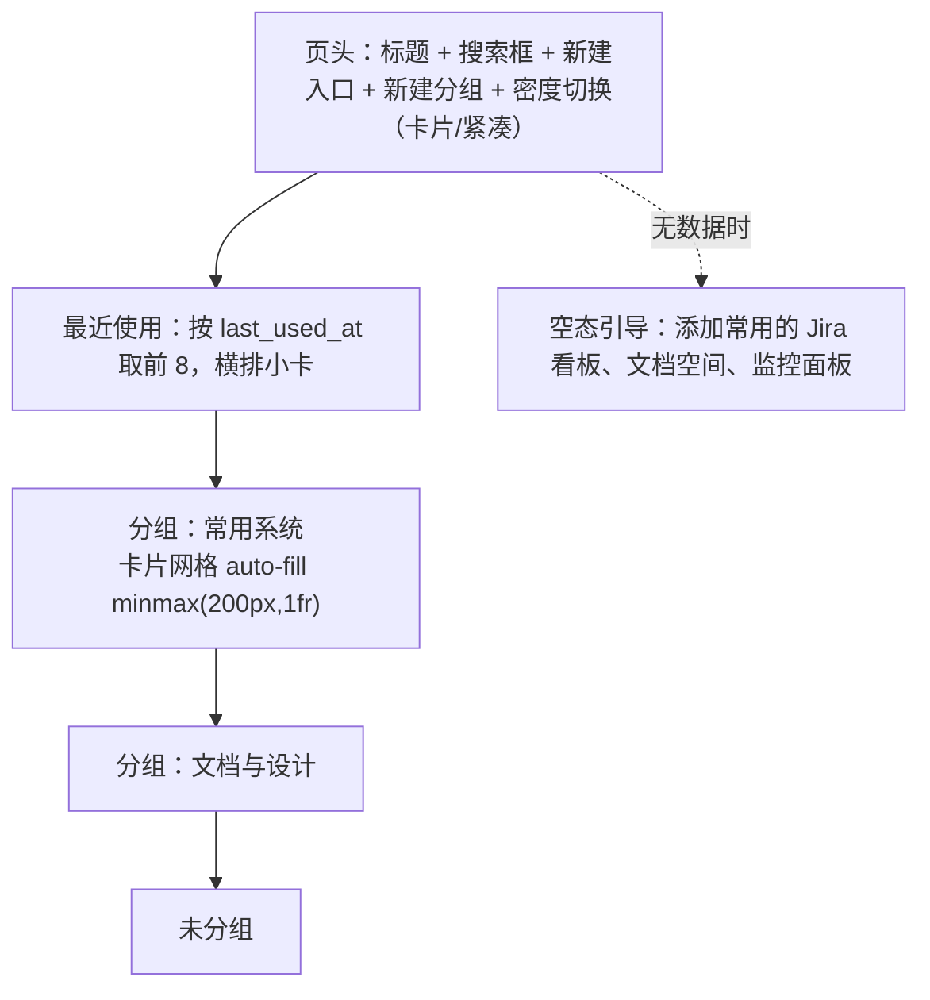

# 快捷访问区 规格（M1.2，M1 骨架落地后实施）

日常高频访问的目标（Jira 看板、Confluence 空间、Figma、GitHub、测试环境后台、监控面板）不该每次都去翻浏览器书签。工作台里开一个可自定义的快捷访问区。

## 三种跳转目标

不只是外链，这是它比浏览器书签栏值钱的地方：

| target_kind | 含义 | 例子 |
|---|---|---|
| `url` | 外部链接 | `https://example.atlassian.net/jira/software/projects/AAA/boards/1` |
| `internal` | 工作台内部导航 | 跳到「需求池 / 云端平台 / 仅 P0」这个组合视图 |
| `command` | 触发一个动作 | 打开快速捕获并预选「需求」类型 |

## 变量替换（真正的提效点）

`url` 支持占位符，渲染时用**当前选中的工作对象**填充：

| 占位符 | 含义 |
|---|---|
| `{{ref}}` | 对象编号，如 REQ-0142 |
| `{{title}}` | 标题 |
| `{{id}}` | 内部 ID |
| `{{owner}}` / `{{status}}` / `{{category}}` | 对应字段 |
| `{{today}}` | 当天日期 YYYY-MM-DD |

例：`https://example.atlassian.net/issues/?jql=text~"{{title}}"` —— 选中一条需求后点它，直接在 Jira 里搜同名内容。没有选中对象时，含变量的快捷入口置灰并提示「需先选中一个工作对象」。

## 数据结构

```sql
CREATE TABLE shortcut_groups (
  id         TEXT PRIMARY KEY,
  name       TEXT NOT NULL,
  color      TEXT NOT NULL DEFAULT '',
  collapsed  INTEGER NOT NULL DEFAULT 0,
  sort_order INTEGER NOT NULL DEFAULT 0,
  created_at TEXT NOT NULL,
  updated_at TEXT NOT NULL
);

CREATE TABLE shortcuts (
  id           TEXT PRIMARY KEY,
  group_id     TEXT REFERENCES shortcut_groups(id) ON DELETE SET NULL,
  label        TEXT NOT NULL,
  target_kind  TEXT NOT NULL DEFAULT 'url',    -- url | internal | command
  url          TEXT NOT NULL DEFAULT '',       -- target_kind=url，支持 {{变量}}
  nav          TEXT NOT NULL DEFAULT '{}',     -- target_kind=internal，JSON NavSelection
  command      TEXT NOT NULL DEFAULT '',       -- target_kind=command
  icon         TEXT NOT NULL DEFAULT '',       -- 1-2 个字符的文字标，或预置图形名
  color        TEXT NOT NULL DEFAULT '',
  description  TEXT NOT NULL DEFAULT '',
  open_in      TEXT NOT NULL DEFAULT 'new_tab',-- new_tab | same_tab
  pinned       INTEGER NOT NULL DEFAULT 0,     -- 置顶到顶栏图标条
  sort_order   INTEGER NOT NULL DEFAULT 0,
  last_used_at TEXT,
  use_count    INTEGER NOT NULL DEFAULT 0,
  created_at   TEXT NOT NULL,
  updated_at   TEXT NOT NULL
);
CREATE INDEX idx_shortcuts_group ON shortcuts(group_id, sort_order);
CREATE INDEX idx_shortcuts_pinned ON shortcuts(pinned, sort_order);
```

`use_count` / `last_used_at` 不是摆设：命令面板里按使用频率排序，用得多的自然浮上来。

## API

| 方法 | 路径 | 说明 |
|---|---|---|
| GET | `/api/shortcuts?grouped=true` | `grouped=true` 返回按组嵌套，否则扁平；按 sort_order |
| POST | `/api/shortcuts` | 创建 |
| PATCH | `/api/shortcuts/{id}` | 更新 |
| DELETE | `/api/shortcuts/{id}` | 删除 |
| POST | `/api/shortcuts/{id}/visit` | 记一次使用（use_count+1、last_used_at=now），前端 fire-and-forget |
| POST | `/api/shortcuts/reorder` | `{ids: [...], group_id}` 批量重排 |
| GET/POST | `/api/shortcut-groups` | 分组列表 / 创建 |
| PATCH/DELETE | `/api/shortcut-groups/{id}` | 更新 / 删除（删组时组内条目变为未分组，不级联删） |

## 界面

快捷访问是**独立页面**（launchpad），不是侧栏里的一个小分组——入口多起来之后侧栏塞不下，而且只有在整页里才好做分组网格、拖拽排序和批量管理。

### 导航入口
`NavSelection` 扩展了一种 `kind: 'page'`，侧栏底部固定区放一个「快捷访问」条目，点击 `setNav({ kind: 'page', page: 'shortcuts' })`。App 检测到 `nav.kind === 'page'` 时，中栏渲染 `ShortcutsPage` 而不是对象列表；此时不发对象列表请求，右侧抽屉自动收起。

### 页面结构



### 卡片
- 左上角图标色块（1-2 个字符的文字标 + `color` 背景）
- 名称（粗）、描述（faint 小字）
- 目标预览：外链显示域名，内跳显示目标视图名，动作显示动作名
- 右上角类型徽标：`外链` / `内跳` / `动作`，含变量的额外标 `变量`
- 悬停浮出：编辑 / 复制链接 / 置顶切换 / 删除
- 含变量但当前无选中对象时，卡片半透明 + 提示「需先选中一个工作对象」

### 分组
- 组标题行：名称（可就地重命名）、条目数、折叠箭头、组色点、组操作（上移 / 下移 / 删除）
- 折叠状态落库 `collapsed`
- 未分组的条目固定排在所有分组之后，标题为「未分组」

### 排序
组内拖拽排序，也支持跨组拖拽改归属（原生 HTML5 drag events，不引库）；落下后调 `POST /api/shortcuts/reorder`。

### 编辑
页面右侧滑出一个内联编辑面板（不复用对象详情抽屉，两者互不干扰）：
名称、类型（url / internal / command 三选一，切换时字段联动）、目标、图标文字、颜色（8 个预设）、描述、所属分组、是否置顶、打开方式。
- `url` 类型下方显示变量提示 + **实时预览**（用当前选中对象渲染出最终 URL）
- `internal` 类型提供「把当前视图存为快捷入口」一键填充
- URL 校验：必须 http/https/file 协议

### 页面内搜索
页头搜索框实时过滤名称/描述/URL，命中时展开所有折叠分组。

### 顶栏 pinned 图标条
`pinned=1` 的条目在顶栏搜索框右侧显示为一排小图标（最多 6 个），悬停出名称。这是唯一在页面之外出现的快捷入口展示。

### 键盘
- `G` 后接 `1..9`：跳转第 N 个快捷入口（全局可用，不必在该页面）
- 命令面板里可直接搜快捷入口，按 `use_count` 倒序
- 页面内 `N` 新建入口，`Esc` 关闭编辑面板

## 安全

- URL 只允许 `http` / `https` / `file` 协议，显式拒绝 `javascript:` 等（即便是本地单人工具，也不给自己留 XSS 面）
- 外链一律 `rel="noopener noreferrer"`
- 变量替换时对值做 URL encode，避免标题里的特殊字符破坏 URL 结构

## 与「资源」类型的关系

`resource` 工作对象类型仍然存在，管的是需要归档、打标签、被关联引用的资源（合同、素材、账号说明）。快捷入口是**纯导航**，轻量、无需建对象。两者互通：资源详情页可「提升为快捷入口」，一键生成一条 shortcut 指向它的 url。

---

由 DeepSeek Harness（dsh）协助完成。

[](https://github.com/deepseek-ai/deepseek-harness)
