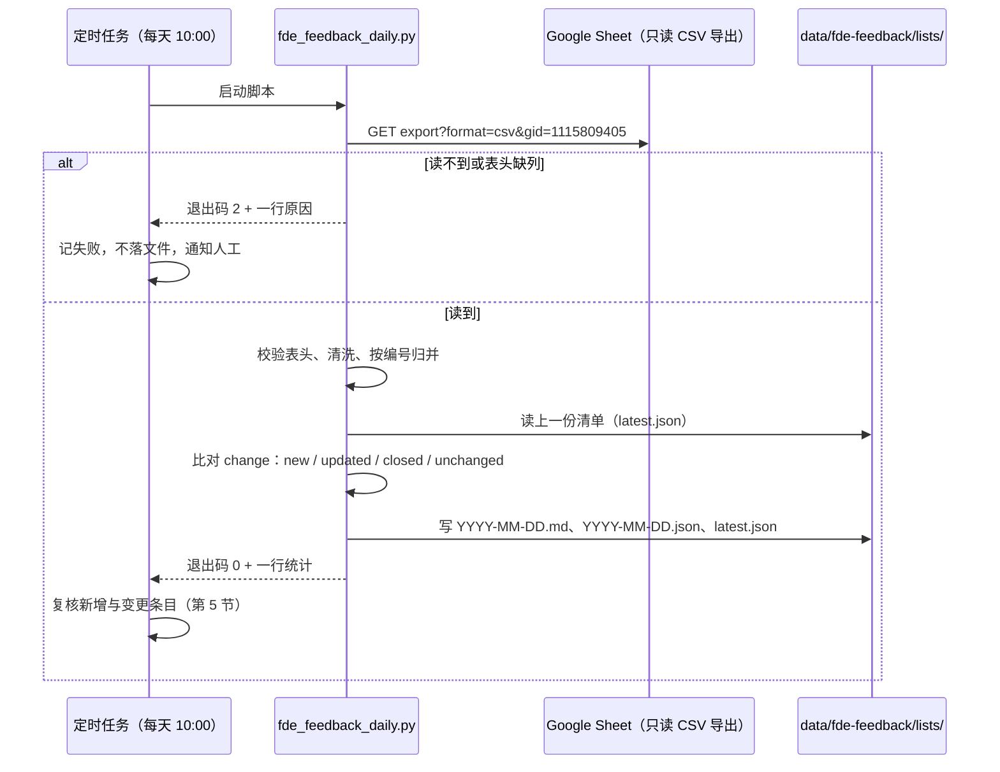

# SOP：FDE 反馈需求清单（TSK-0429）

| 项 | 值 |
|---|---|
| SOP ID | SOP-FDE-01 |
| 来源任务 | TSK-0429（P2，Octok）「每日 10:00 由 Claude Code 从目标 Google Sheet 获取 FDE 反馈需求清单」 |
| 触发 | 每天 10:00（执行机本地时区），错过不补跑 |
| 执行者 | 定时任务调用 `scripts/fde_feedback_daily.py`，再按第 5 节复核 |
| 数据源 | Google Sheet `1f6DUdwuf7pJKKQ0HiquLKCFXZTO2e1POxmbWRMlsBWw`，工作表 gid `1115809405`，只读导出 CSV |
| 产出目录 | `data/fde-feedback/lists/`（`.gitignore` 已忽略 `/data/`，清单不入库） |
| 幂等 | 同一天重跑覆盖当天文件，不产生第二份 |
| 失败 | 不写任何文件，`latest.json` 保持上一份 |

## 1. 流程

## 2. 步骤

| 步 | 动作 | 判定 |
|---|---|---|
| 1 | 运行 `python3 scripts/fde_feedback_daily.py` | 退出码 0 继续，2 直接报失败原因 |
| 2 | 脚本内部：下载 CSV，超时 30s，失败重试 3 次（间隔 3/6s） | 403/401 报「没有访问权限」，404 报「表格或工作表不存在」，网络失败重试后报错 |
| 3 | 校验表头含 `编号、反馈时间、反馈人、模块、反馈事项、优先级、状态` | 缺列即停，报「表结构变了：缺少列 X」，不猜列位 |
| 4 | 清洗、按编号归并、与上一份比对（第 3、4 节） | 无可归并行即停，报「表里没有可用的反馈行」 |
| 5 | 写 `.md`、`.json`、覆盖 `latest.json` | 三步都成功才算本次成功 |
| 6 | 人工侧复核：只对 `change` 为 `new` / `updated` 的条目看标题是否通顺、是否与既有编号重复 | 重复的在当天 `.md` 追加「合并建议」小节，不改编号、不改 `.json` |

## 3. 列映射

表头实测（14 列），缺任何必需列即失败。

| 表头 | 目标字段 | 说明 | 必需 |
|---|---|---|---|
| 编号 | `id` | 已是 `FDE-NNN` 形式，直接作需求编号锚 | 是 |
| 反馈时间 | `first_seen` / `last_seen` | 归一成 `YYYY-MM-DD`，组内取最小/最大 | 是 |
| 反馈人 | `reporters` | 去重列表 | 是 |
| 模块 | `module` | 多值取首个非空 | 是 |
| 反馈事项 | `summary` / `title` | 原文作摘要；标题取首句截断 50 字 | 是 |
| 优先级 | `severity` | 组内取最高：P0 > P1 > P2 > P3 > 空 | 是 |
| 状态 | `status` | 去重列表；用于关闭判定 | 是 |
| 反馈类型 | `feedback_types` | `Bug`/`bug` 原样保留 | 否 |
| 负责人、开发、Jira 号、上线时间、需求文档、备注 | `owner`、`jira`、`released_at` | 组内取首个非空；仅随 `.json` 落盘 | 否 |

表里没有客户列，`customers` 不设；客户信息只体现在反馈人。

## 4. 判定规则

**跳过**（计入统计的「跳过 d 行」）：整行为空、`编号` 行是重复表头、`反馈事项` 为空。

**归并**：一条需求 = 一个编号下的全部反馈行。编号重复出现即视为同一诉求的多次提及，`mentions` 加 1、`source_rows` 记 CSV 行号。编号为空但有内容的行，按内容摘要生成 `TXT-xxxxxxxx` 临时编号单独成条。

**change**（与上一份清单比，基准为最近一份不同日期的清单）：

| change | 判定 |
|---|---|
| `new` | 上一份没有这个编号；第一份清单全部为 `new` |
| `updated` | 编号在，`mentions` 增加，或支撑行原文变化（文本摘要不同） |
| `closed` | 本次支撑行状态全部落在 `已上线`、`暂不处理`，且上一份不是全部关闭 |
| `unchanged` | 其余 |

上一份有、本次表里没有的编号，写进 `.json` 的 `missing_since_last`，并在 `.md` 末尾「表里已消失」一节列出，供人确认是否删行。

**排序**：`severity` 高在前，同级 `mentions` 多在前，再按 `last_seen` 新在前。

**同日重跑**：覆盖 `YYYY-MM-DD.md` 与 `YYYY-MM-DD.json`，比对基准仍取更早日期的清单，结果与首次运行一致。

## 5. 输出

`.md`：标题「FDE 需求清单 · YYYY-MM-DD」，一行统计（反馈 N 行、需求 M 条、新增 a、变更 b、关闭 c、跳过 d 行），数据源与生成时间，然后「新增 / 变更 / 已关闭 / 其余」四节各一张表（编号、标题、模块、反馈人、类型、次数、优先级、状态、首次、最近、行号）。

`.json`：

| 字段 | 内容 |
|---|---|
| `generated_at` | 生成时刻（含时区） |
| `list_date` | 清单日期 |
| `sheet_id`、`gid`、`sheet_url` | 数据源定位 |
| `task` | 固定 `TSK-0429` |
| `stats` | `rows`、`requirements`、`new`、`updated`、`closed`、`unchanged`、`skipped` |
| `missing_since_last` | 上一份有、本次消失的编号 |
| `requirements[]` | `id`、`title`、`module`、`summary`、`reporters`、`feedback_types`、`source_rows`、`mentions`、`first_seen`、`last_seen`、`severity`、`status`、`owner`、`jira`、`released_at`、`text_digest`、`uncertain_merge`、`change` |

`latest.json` 与当天 `.json` 同内容，只保留最近一份成功结果。

## 6. 失败口径

| 情形 | 报错 | 落盘 |
|---|---|---|
| 无权限 / 工作表不存在 | `读不到表格（403，没有访问权限）` 或 `（404，表格或工作表不存在）` | 不写 |
| 网络失败（重试 3 次后） | `读不到表格（网络失败，重试 3 次）：原因` | 不写 |
| 表头缺列 | `表结构变了：缺少列 X` | 不写 |
| 无可归并行 | `表里没有可用的反馈行` | 不写 |
| 上一份 `latest.json` 损坏 | `上一份清单读不了，拒绝在坏基准上比对` | 不写，等人工删掉坏文件 |

失败只打印一行原因到 stderr，退出码 2；连续两天失败按定时任务的运行异常处理。

## 7. 验收断言

| 编号 | 断言 | 命令 / 操作 |
|---|---|---|
| A1 | 首次运行产出三件文件 | `ls data/fde-feedback/lists/` 有当天 `.md`、`.json`、`latest.json` |
| A2 | `.json` 可解析且字段齐全 | `python3 -c "import json;d=json.load(open('data/fde-feedback/lists/latest.json'));print(len(d['requirements']), d['stats'])"` |
| A3 | 同日重跑不产生第二份 | 同一天连跑两次，`ls` 当天文件数仍为 2（`.md`/`.json`） |
| A4 | 新增行识别为 `new` | `FDE_CSV_FILE=<加了一行的 CSV> python3 scripts/fde_feedback_daily.py --date 次日`，统计行「新增 1」 |
| A5 | 同编号加一行识别为 `updated` | 同上方式加同编号行，`mentions` 加 1、编号不变 |
| A6 | 状态全部转已上线识别为 `closed` | 改状态后重跑，条目落「已关闭」节 |
| A7 | 缺列失败不落盘 | `FDE_CSV_FILE=<删掉状态列的 CSV>`，退出码 2，`lists/` 无新文件 |
| A8 | 只读 | 运行前后 Google Sheet 修改历史无本次改动 |

## 8. 变更记录

| 日期 | 版本 | 变更 |
|---|---|---|
| 2026-11-06 | v1.0 | 首版：按生产任务 TSK-0429 与 `docs/fde-feedback-daily-prd.md` 落地，列映射改为实测表头（原 PRD 假设的客户列不存在） |

---

由 DeepSeek Harness（dsh）协助完成。

