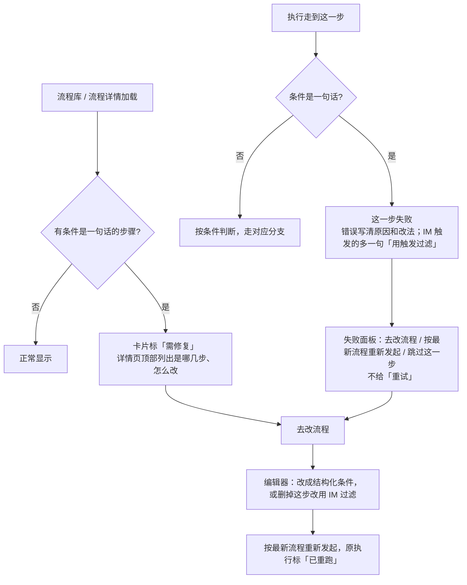

# TSK-0498 SOP 条件是一句话时的提前发现与修复指引

- 来源：运行异常「忽略 ai-octok-platform 自动消息 · 判断来源群组且未@我」失败（执行 spr_06gtz9q1ps0qgb9y，2026-11-06 14:58:31，1 次）
- 优先级：P1
- 关联：TSK-0490（结构化条件，进行中、未提交）、TSK-0481（IM 触发按会话 / 与我的关系过滤 + 拦截，已上线 sop 0.14.0）
- 状态：已实现（sop 0.20.0，插件迁移 `0011_run_step_error_code.sql`，正式前端 `frontend/`；2026-11-09）

## 1. 问题是什么

这条流程的「判断来源群组且未@我」是条件分支，条件存的是一句话：

> IM 消息来源群组 = C0BNCBRL5C0 且 消息中未 @ 我

执行器只认「字段 等于 / 不等于 / 包含 / 不包含 值」这一种写法（`internal/plugins/sop/nodes.go` `evalRule`），这句话两处不符合：用的是 `=` 不是「等于」；用「且」连了两个条件，而且第二个条件没有字段名。所以执行到这一步就报「写法不对」并失败。

根因有三层：

| 层 | 现状 | 后果 |
|---|---|---|
| 保存 | TSK-0490 之前，条件存成一句话也能保存 | 已经存进来的这类流程无人知道有问题 |
| 执行 | 失败信息只说「要写成字段 等于 值」，没说要去哪改、改成什么 | 用户不知道怎么修，只能找人 |
| 配置方式 | 「按来源会话、是否 @我 筛消息」本来该配在 IM 触发过滤里（TSK-0481），不该用判断步骤 | 走了一条本就不顺的路 |

TSK-0490 解决了「以后存不进来」，没解决「已经存进来的流程」。本需求补上这一段：**提前发现、失败时告诉你怎么改、改完一键重跑**。

另外，这条消息本身 @了「Broleez Li 李钊」，按流程意图（群里没 @我 的才忽略）它本就不该被忽略。所以本次失败没有造成漏处理；但这条流程每遇到一条该群的消息都会失败一次。

## 2. 这条流程怎么改（给用户的直接答案）

去掉「判断来源群组且未@我」这一步，改用 IM 触发自己的过滤：

| 触发设置 | 填什么 |
|---|---|
| 触发方式 | IM 消息 |
| 只接这些会话 | ai-octok-platform（slack C0BNCBRL5C0） |
| 与我的关系 | 除了：@我 |
| 命中后不再触发后面的 IM 流程 | 打开 |
| 第几个判断 | 排在其他 IM 流程前面（第 1 个） |

效果：该群里没 @我 的消息由这条流程接住并标为忽略，后面的 IM 流程不再处理；@我 的消息这条流程不接、不留执行记录，照常走其他流程。这正是 `imfilter_test.go` 里的样例（「C0BNCBRL5C0 里非 @我 的消息由第一条流程接住」），列表显示为「会话 ai-octok-platform（slack C0BNCBRL5C0，cv_octok）；排除 @我；第 1 个判断；命中后不再触发后面的 IM 流程」。

## 3. 修复后的流转

## 4. 功能要求

### 4.1 什么算「条件是一句话」

条件分支（decide）和条件回退（loopback）步骤：没有结构化条件（cond），旧规则（rule）有内容，但不符合「字段 空格 等于|不等于|包含|不包含 空格 值」。判断口径同 `cond.go` 的 `legacyCond` 和 `check.go` 的 `codeRuleText`。旧写法能解析的（如「status 等于 done」）不算，仍按 TSK-0490 只给警告。

### 4.2 提前发现

- 流程库卡片：右上角显示红色「需修复」，悬停写明是哪几个步骤。
- 流程详情页：标题下方一块红色提示「需修复」，逐条列「步骤名：原因和改法」，带「去改流程」按钮。
- 后端：流程列表、流程详情接口带回这条流程的体检问题（复用 TSK-0490 的 check，读的时候算，不是只在保存时算），前端据此显示。

### 4.3 执行失败时的信息

失败信息统一为：

> 条件「<原句>」是一句话，程序没法照着判断。到流程编辑里把这一步的条件改成「字段 + 运算符 + 值」（从这一步能拿到的字段里选，可多条且 / 或），这句话可以留在步骤说明里

流程的触发方式是 IM 消息时，后面再加一句：

> ；按来源会话、是否 @我 筛消息不用判断步骤，在触发方式「IM 消息」下面选「只接这些会话」和「与我的关系」，要拦住后面的流程就打开「命中后不再触发后面的 IM 流程」

运行异常（「【运行异常】SOP · 错误」那类自动建的任务）的「现象」用同一段文字。

### 4.4 失败面板的操作

因这个原因失败的步骤，失败面板：

- 不给「重试」（原执行沿用发起时的流程版本，重试必然原样失败）。
- 给「去改流程」（打开这条流程的编辑页）、「按最新流程重新发起」（同现有失败重跑）、「跳过这一步」。
- 其他原因的失败，面板不变（仍是「重试 / 跳过这一步」）。

### 4.5 不做的

- 不把这句话自动翻译成结构化条件（用户 2026-11-06 已定：程序没法把自然语言自动转成规则）。
- 不自动停用这条流程的触发（停了会改变 IM 流程的拦截顺序，后面的流程会突然开始接这些消息；是否要做见问题 1）。
- 不改编辑器里结构化条件的编辑方式（TSK-0490 的范围）。

## 5. 验收标准

每条都能单独测：

1. 准备一条流程，条件分支的 rule 是「IM 消息来源群组 = C0BNCBRL5C0 且 消息中未 @ 我」，没有 cond。打开流程库，这张卡片显示「需修复」；悬停文字含该步骤名。
2. 同一条流程，rule 改为「status 等于 done」：卡片不显示「需修复」。
3. rule 为空的条件分支（人工判断）：卡片不显示「需修复」。
4. 打开第 1 条的流程详情：标题下有「需修复」提示，列出「判断来源群组且未@我」及 4.3 的说明文字，点「去改流程」进入这条流程的编辑页。
5. 第 1 条的流程触发方式是 IM 消息：发起一次执行，这一步状态为失败，错误文字等于 4.3 两段拼接的全文。
6. 触发方式改为手动，再执行：错误文字只有 4.3 第一段，不含「IM 消息」那句。
7. 条件回退步骤的 rule 是一句话：执行到它同样失败，文字同第 5 / 6 条规则。
8. 第 5 条的失败面板：没有「重试」按钮；有「去改流程」「按最新流程重新发起」「跳过这一步」三个按钮；点「去改流程」进入编辑页。
9. 其他原因失败的步骤（如 Agent 步骤报错）：面板仍是「重试」「跳过这一步」，没有「去改流程」。
10. 把第 1 条流程按第 2 节改成 IM 过滤、删掉判断步骤并保存：卡片「需修复」消失；在 C0BNCBRL5C0 发一条不 @我 的消息，这条流程发起执行并完成，排在后面的 IM 流程不发起；发一条 @我 的消息，这条流程不发起、不留记录，后面的 IM 流程照常发起。
11. 后端：`GET` 流程列表 / 详情接口对第 1 条流程返回 rule_text 体检问题（code 与 check.go 一致），对第 2、3 条不返回。
12. 运行异常自动建的任务，「现象」一栏文字与第 5 条的错误文字一致。

## 6. 原型

已改 `web-next`（原型只当规格与演示）：

| 文件 | 改动 |
|---|---|
| `web-next/src/nodetypes.tsx` | 新增 `ruleIsSentence`、`ruleSentenceError`：判断条件是不是一句话、生成 4.3 的错误文字 |
| `web-next/src/sopflow.ts` | 模拟执行：条件分支的 rule 是一句话时失败（原来原型会假装判断成功）；条件回退的失败文字换成新说明 |
| `web-next/src/sop.tsx` | 流程库卡片「需修复」；流程详情顶部提示 + 「去改流程」；失败面板按 4.4 换按钮 |
| `web-next/src/App.tsx` | 执行详情传入「去改流程」回调，打开该流程的编辑页 |
| `web-next/src/styles.css` | 「需修复」红色标签、详情页提示间距 |

## 7. 后端待做（交 pmw-delivery 实施，不在本次范围）

1. `internal/plugins/sop/cond.go` `judge`：rule 不是旧写法时返回 4.3 的错误文字（需拿到流程的触发方式）；`nodes.go` `evalRule` 的旧文字只在内部用。
2. 流程列表 / 详情接口带回 check 结果（含 `rule_text`）；契约写进 `docs/api-contract.md`。
3. 执行步骤失败记录带错误码（如 `rule_text`），前端据此决定不给「重试」。
4. 运行异常任务的「现象」取同一段文字。
5. 补测试：第 5、6、7、11 条验收各一个用例。

## 8. 需要提出人回答的问题

1. 条件是一句话的流程，执行失败后要不要自动停用它的触发？停用能避免同一群每条消息都失败一次，但这条流程开了「拦截后续」，停用后后面的 IM 流程会开始接这个群的消息。本 PRD 默认不停用。
2. 「忽略 ai-octok-platform 自动消息」这条线上流程，要不要我直接按第 2 节改掉（改的是生产 7796 的数据）？

---

由 DeepSeek Harness（dsh）协助完成。

