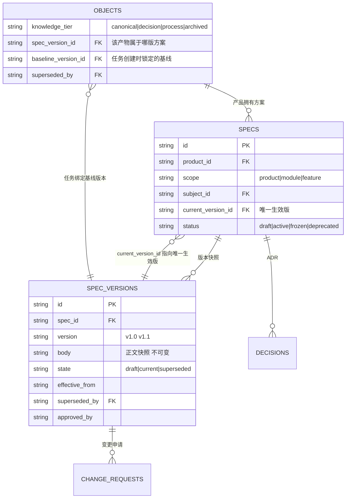
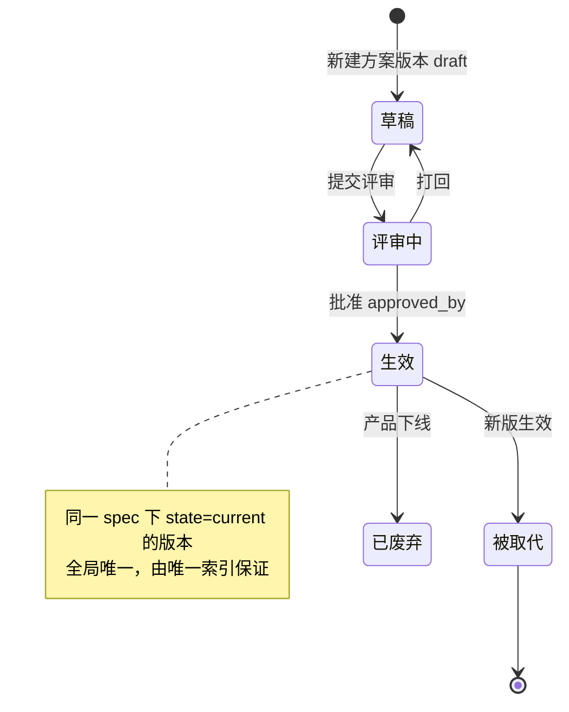

# 产品实现方案基线 与 Agent 检索边界（M1.5 设计）

## 要解决的问题

工作台跑半年后，库里会同时存在：8 版 PRD 草稿、3 次被推翻的技术方案、2 份过期的会议纪要、1 份当前真正生效的实现方案。此时：

- 人靠肉眼还能分辨哪份是最新的（看时间、看文件名）；
- **Agent 分辨不了**。RAG 召回时旧方案和新方案文本相似度一样高，Agent 会把 2026-03 的废弃方案当成现行设计，然后自信地做出错误评估。

这比没有 Agent 更糟——它产出的是**带权威感的错误**。

结论：不能靠 prompt 让 Agent「注意甄别时效」，必须**从数据层划死检索边界**。

## 知识三层

| 层 | tier 值 | 内容 | 进 Agent 默认上下文 |
|---|---|---|---|
| L1 当前基线 | `canonical` | 每个产品/模块**当前生效**的实现方案，全局唯一 | 是 |
| L2 决策记录 | `decision` | ADR：为什么这么定、否决了什么、谁拍板 | 是 |
| L3 过程产物 | `process` | 历版方案快照、讨论、纪要、草稿、被否方案 | 否（显式请求才进） |
| 已废弃 | `archived` | 明确作废、不再有参考价值 | 否 |

过程产物**一条都不删**，人照样能查能翻能追溯，只是不进 Agent 的默认召回范围。这同时满足「统一管理所有过程产物」和「不影响 Agent 评估」。

## 数据结构



### 四个硬机制

**1. 唯一生效版**
`specs.current_version_id` 全局唯一指向一条 `spec_versions`。取「最终版本实现方案」永远只有一个地址：`GET /api/specs/{id}/current`。发布新版时在一个事务里：旧版 `state='superseded'` + `superseded_at` + `superseded_by`，新版 `state='current'`，`specs.current_version_id` 改指向。正文快照不可变，历史永远可复现。

**2. Agent 检索边界（数据层强制）**
```sql
CREATE VIEW agent_context AS
SELECT o.* FROM objects o
WHERE o.deleted_at IS NULL
  AND o.knowledge_tier IN ('canonical', 'decision')
  AND (o.effective_to IS NULL OR o.effective_to > datetime('now'));
```
eino 的检索工具只允许查这个视图。要读过程产物必须显式传 `include_process=true`，且该参数只能由人在界面上勾选触发，Agent 不能自己给自己放宽。

**3. 任务绑基线 + 漂移检测**
任务创建时写入 `baseline_version_id`。方案升版后：
```sql
-- 未完成、且绑在非当前版本上的任务 = 需复核
SELECT o.* FROM objects o
JOIN spec_versions sv ON o.baseline_version_id = sv.id
JOIN specs s ON sv.spec_id = s.id
WHERE o.status NOT IN (终态) AND o.baseline_version_id != s.current_version_id;
```
这批任务在界面上标「基线已变更 v2.1 → v2.3，需复核」，推送到 Jira/Slack 时也带这个标记。这就是「后续任务推送按最新状态统一管理」。

**4. Agent 引用必须带版本号**
Agent 的回答里，凡引用方案内容，必须输出「依据《XX 实现方案》v2.3，生效于 2026-09-10」。这是可验证性的最后一道保险——人扫一眼就知道它读的是不是最新的。工具返回给 Agent 的 payload 里强制带 version 与 effective_from 字段，prompt 里要求引用时原样带出。

### 冲突哨兵

同一 `(product_id, scope, subject_id)` 下出现多于一条 `canonical` 是数据错误，加唯一索引在数据层挡掉；Agent 检索到相互矛盾的 canonical 内容时，不得自行裁决，必须把冲突抛回给人。

## 变更流程



变更申请 CR 与影响分析：提交 CR 时自动列出受影响面——关联的未完成任务、引用该方案的文档、绑定该基线的需求，让人在批准前看到代价。

## 与 eino Agent 的接口约定

Agent 工具集里与基线相关的三个工具：

| 工具 | 作用 | 边界 |
|---|---|---|
| `get_current_spec(product_id, subject?)` | 取当前生效方案全文 | 只返回 current 版，带 version/effective_from |
| `search_knowledge(query, tier?)` | 语义检索 | 默认 `tier in (canonical, decision)`，process 需显式放宽 |
| `list_stale_tasks(product_id)` | 列出基线漂移的任务 | 只读 |

Agent 的**写操作一律产出草稿**（落 `knowledge_tier='process'` + 待确认标记），人工采纳后才由系统升为 canonical。Agent 永远不能自己把东西写成 canonical。

---

由 DeepSeek Harness（dsh）协助完成。

[](https://github.com/deepseek-ai/deepseek-harness)
