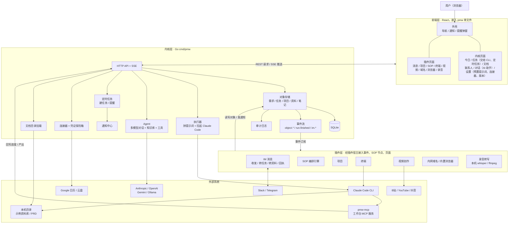
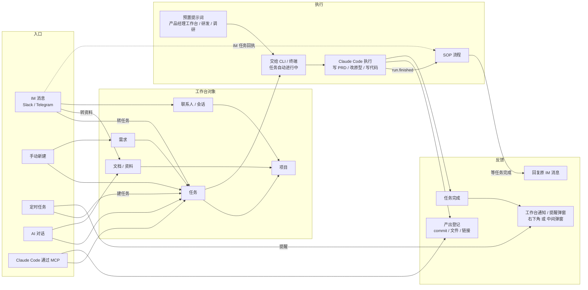
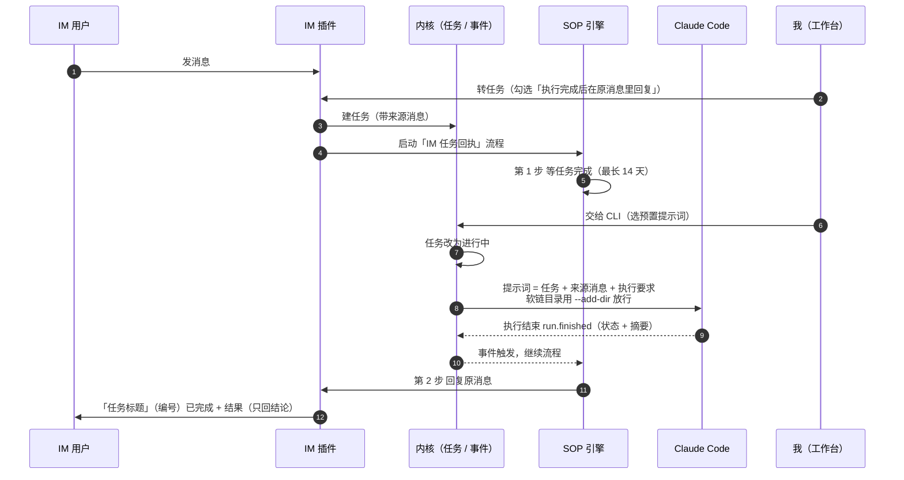

# 一人之下 · 系统结构与功能关联

> 2026-11-04 依据 feat/prototype-dev-loop 分支代码整理，2026-11-11 补录音转写插件。7796（data-dev）为生产实例。

## 1. 系统结构

## 2. 功能关联（任务从哪来、到哪去）

## 3. 已打通的自动化链路：IM 消息 → 任务 → Claude Code → 回复

## 4. 模块与代码位置

| 层 | 模块 | 代码位置 |
| --- | --- | --- |
| 前端外壳 | 导航、通知、提醒弹窗 | frontend/src/core/shell |
| 前端模块 | 今日、任务、文档、联系人、对话、设置 | frontend/src/modules/* |
| 前端插件 | 消息、项目、SOP、终端、视频、浏览器、域名、录音 | frontend/src/plugins/* |
| 内核 | HTTP API、执行器、Agent、定时任务、通知、连接器、保险箱、审计 | internal/{api,runner,agent,schedule,notify,connector,vault,audit} |
| 插件 | IM、SOP、项目、终端、视频、域名、浏览器、录音 | internal/plugins/* |
| MCP | 给 Claude Code 用的工作台工具 | cmd/pmw-mcp |
| 原型与规格 | 演示原型、SPEC 文档 | web-next/、web-next/docs/spec |

交易套件（internal/plugins/trade）整体暂停，图中未画。

---

由 DeepSeek Harness（dsh）协助完成。

