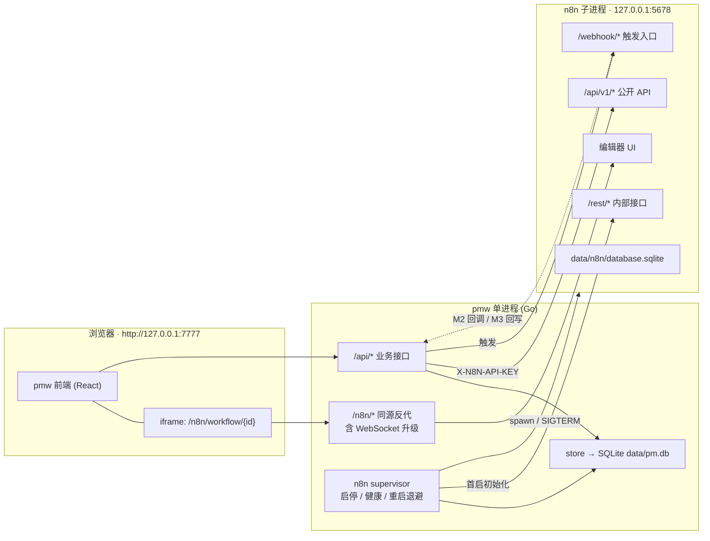
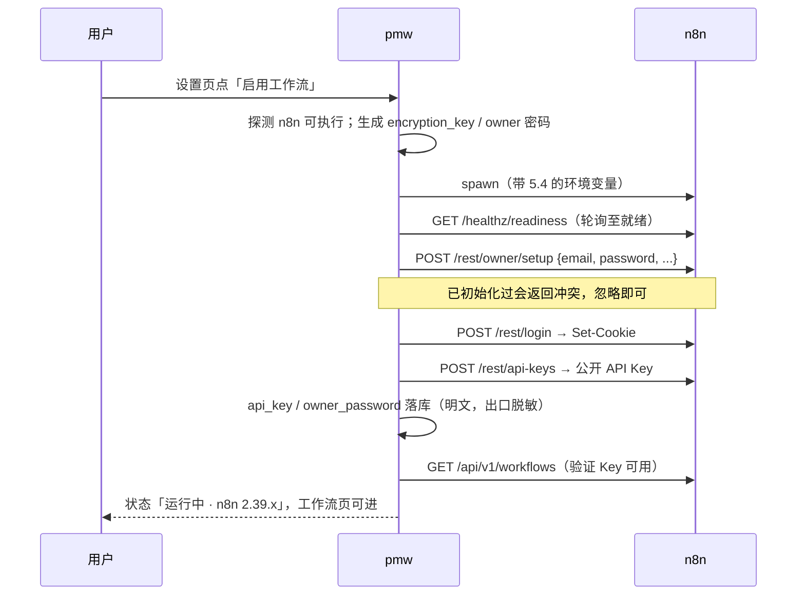
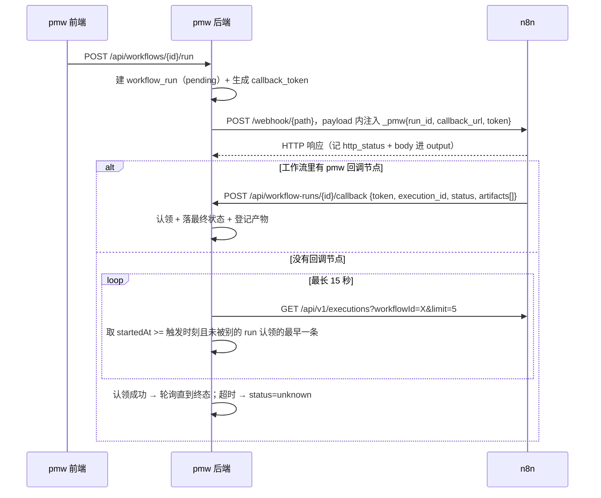

# 工作流：集成 n8n

设计日期：2026-09-21 · 状态：待评审，未动代码
目标：在工作台里增加「工作流」能力，n8n 作为引擎嵌入系统内，配置与管理都在 pmw 完成。

---

## 零、先把结论摆出来

| 决策 | 结论 | 一句话理由 |
|---|---|---|
| 引擎 | 用 n8n，不自研 | 自研等于重做节点生态，而用户要的就是 n8n |
| 部署形态 | pmw 托管 n8n 子进程（`managed`），同时保留连外部实例（`external`） | 「在系统中配置和管理」只有托管才成立；external 是给已有实例的人留的口子 |
| 呈现方式 | pmw 同源反代 `/n8n/*` + iframe 嵌 n8n 画布，开 `N8N_CANVAS_ONLY` | n8n 默认 `X-Frame-Options: sameorigin`，同源反代是唯一不改 n8n 安全配置的嵌法 |
| 登录 | pmw 首启时无人值守建 owner、取 API Key，用户永远看不到 n8n 登录页 | n8n 2.x 已无「关掉用户管理」的开关，只能替用户走完 setup |
| 集成深度 | 中 + 预留深（见第二节） | 托管形态下「触发 + 执行回流」是必需品，不是加分项 |
| 触发方式 | Webhook 节点，不是 API | n8n 公开 API **没有**执行工作流的端点，这是地基级约束 |
| 数据模型 | 新增 `n8n_instance` / `workflows` / `workflow_runs` 三张表 + 给 `artifacts` 加一列 | 见第六节 |
| 分期 | M1 嵌入可用 → M2 触发与回流 → M3 双向事件 | 见第十一节 |

有一件事必须先讲清楚，它改变的是这个产品的性质而不只是功能表：

**n8n 是 Node 应用，编译不进 Go 单二进制。**它的 `engines.node` 要求 `>= 24.0.0`。所以「嵌入」这个词在这里只能是三件事的合称——pmw 管它的生命周期、pmw 反代它的界面、pmw 存它的配置。装不装 n8n 仍然是用户机器上的一件事。本机现状：Node `v24.9.0`（`/opt/homebrew/bin/node`）、npm 11.6，满足要求；Docker 装了但 daemon 没起，所以推荐走 npm 而不是容器。

代价是「单文件分发」这个卖点在工作流这一块破了。不接受这个代价，就只能退回「连外部实例」，而那正是用户明确不要的那个形态。

---

## 一、用户要的是什么

原话是「把工作流嵌入到系统中，可以在系统中配置和管理」。拆成可验收的三条：

1. 不用离开 pmw 去开 n8n 的界面——工作流的画布在 pmw 的页面里。
2. n8n 的地址、密钥、启停这些配置，在 pmw 的设置页里，不在 shell 里敲环境变量。
3. 工作流跟工作台的数据是通的——能对着一条需求跑一个工作流，跑完在这条需求下面看得到。

第 3 条不是我加的戏。托管形态一旦成立，「工作流跑完了什么」就必须落在 pmw 里：用户已经不去 n8n 的界面了，执行历史只留在 n8n 那边等于看不见。这是下一节的答案。

---

## 二、集成深度：为什么是「中 + 预留深」

用户让我基于部署形态再定深度。托管形态直接推出三条：

| 能力 | 浅（只嵌） | 选定 | 理由 |
|---|---|---|---|
| 实例注册与启停 | 有 | 有 | 托管的前提 |
| 画布嵌入 | 有 | 有 | 用户的第 1 条诉求 |
| 从 pmw 触发 | 无 | **有** | 不做的话，「运行」这个动作要回 n8n 界面点，第 1 条诉求就破了 |
| 执行记录落 pmw | 无 | **有** | 同上，用户不去 n8n 界面，执行历史就必须在这边 |
| 产物回流 artifacts | 无 | **有** | `artifacts` 表（0012）建的时候就写了「产物来自四个地方」，工作流是第五个。不接进来，「一共产出了什么」这个数字又会偏小——这个库已经在同一个坑里栽过 |
| 绑定到工作对象 | 无 | **有（类型级）** | 「对着这条需求跑」是唯一能让工作流跟 PM 工作台产生关系的接口 |
| pmw 事件出站触发 n8n | 无 | M3 | 需要事件总线，pmw 现在没有；不挡前两期 |
| n8n 回写 pmw | 无 | M3 | pmw 的 MCP 已能写，n8n 有 MCP 客户端节点，M3 主要是给它一条可鉴权的路 |

所以：中，且数据模型给 M3 预留位置（`workflow_runs.trigger` 的取值里先留 `object_event`）。

---

## 三、n8n 侧的硬事实

设计不能建在猜测上。下面每条都在 2026-09-21 核实过，版本以 `n8n@2.39.8`（2026-09-18 发布）为准。

| 事实 | 出处 | 对设计的影响 |
|---|---|---|
| 公开 API v1 **没有**执行/运行工作流的端点。workflows 下只有 list/get/create/update/delete/activate/deactivate/publish/unpublish/archive/transfer/tags/history/versions | `packages/cli/src/public-api/v1/handlers/workflows/spec/paths/*` | **触发只能走 Webhook 节点。**这是整个设计的地基，网上不少文章说有 `/workflows/{id}/execute` 或 `/run`，仓库里没有 |
| executions 有 stop / retry / delete / get / list | 同上 `handlers/executions/spec/paths/*` | pmw 的「取消」「重试」有真实落点，不用假装 |
| 认证头 `X-N8N-API-KEY` | 公开 API 规范 | 管理类调用统一走它 |
| `X-Frame-Options: sameorigin`，仅在 `N8N_PREVIEW_MODE=true` / 开发 / E2E 下关闭 | `packages/cli/src/server.ts` helmet 配置 | 跨端口 iframe 一定被挡。**同源反代**是正路；靠 preview mode 关掉它是歪路（preview mode 另有语义） |
| `N8N_CANVAS_ONLY=true`（2.15.0 起）：打开单个工作流时隐藏头部菜单、侧栏、命令栏、AI 按钮，保留画布/节点面板/执行日志面板 | `docs/deploy/host-n8n/configure-n8n/deploy-n8n-in-canvas-only-mode.md` | 这是官方给的嵌入姿势，嵌进来不会出现「界面套界面」 |
| `N8N_PATH` 默认 `/`；文档仍警告「子路径 + 反代会有导航问题」，但对应 issue #19635 已于 2026-04-06 关闭 | 部署环境变量文档 + n8n-io/n8n#19635 | 子路径可用，但**必须在选定版本上实跑验证**，并留「在新标签页打开」的退路 |
| 无 `N8N_USER_MANAGEMENT_DISABLED` 这类开关 | user-management 环境变量文档全表 | owner 账号绕不过去，只能由 pmw 替用户建 |
| 内部 REST 有 `POST /rest/owner/setup`（skipAuth）、`POST /rest/login`、`POST /rest/api-keys` | `packages/cli/src/controllers/{owner,auth,api-keys}.controller.ts` | 首启初始化可以无人值守跑完。但这是**内部**接口，不在公开契约里，随时可能变——只在首启用它，且失败要能退化 |
| `N8N_PUSH_BACKEND` 默认 `websocket` | 部署环境变量文档 | 反代必须支持 WebSocket 升级，否则画布是死的 |
| `N8N_ENCRYPTION_KEY` 不给就随机生成 | 部署环境变量文档 | 必须由 pmw 生成并持久化。丢了等于 n8n 里所有凭据全部解不开 |
| 许可证：Sustainable Use License | 仓库 LICENSE.md / 公开 API 规范 info 段 | 本机单人自用落在允许范围。**若将来这个工作台要分发给第三方用，嵌入 n8n 需要 n8n Embed 商业授权**，这个结论会变，届时重新评估 |

---

## 四、总体架构



两条链路要分清：**控制面**（pmw 调 n8n 的 API，服务端到服务端）和**呈现面**（浏览器经 pmw 反代访问 n8n 的界面）。它们的鉴权方式不同——控制面用 API Key，呈现面用 n8n 的会话 cookie。

---

## 五、部署形态与生命周期

### 5.1 两种模式

| | `managed` | `external` |
|---|---|---|
| 进程归谁 | pmw 拉起、监控、关闭 | 用户自己（docker / systemd / 手动） |
| 配置来源 | pmw 生成并写环境变量 | 用户在设置页填 base_url + API Key |
| 反代与嵌入 | 有 | 有，但 iframe 是否可用取决于对方的 `X-Frame-Options`（反代同源后一般可用） |
| 首启初始化 | pmw 自动做 | 不做，用户自己已经有账号了 |

默认 `managed`。`external` 不是次要形态，是**故障退路**：托管链路任何一环出问题（npm 装不上、端口冲突、内部 REST 变了），用户手动起一个 n8n 填地址就能继续用。

### 5.2 不自动安装 n8n

pmw 不替用户跑 `npm i -g n8n`。装 400MB 依赖是用户机器上的一件大事，不该由一个点了「启用工作流」的动作顺手替他决定。

启用流程是：检测 → 缺失则在页面上给一条可复制的命令 → 用户装完点「重新检测」。

检测顺序：`--n8n-bin` 指定的路径 → `PATH` 里的 `n8n` → `npx n8n`（存在但慢，提示用户装全局）。

### 5.3 启动参数

新增命令行参数，都能被设置页里的配置覆盖（命令行优先，便于排障）：

| 参数 | 默认 | 说明 |
|---|---|---|
| `--n8n` | `auto` | `auto` 按库里的配置决定 / `off` 本次不启动 / `external` 强制外部模式 |
| `--n8n-bin` | 空 | n8n 可执行文件路径，留空则自动探测 |
| `--n8n-port` | `5678` | 被占用时启动失败并报清楚，不自动换端口（换了 webhook URL 就跟用户手填的对不上） |
| `--n8n-data` | `./data/n8n` | `N8N_USER_FOLDER` 指向它，跟 `pm.db` 放在同一个 data 目录下 |

**默认不随 pmw 启动**：`enabled` 初值为 0，用户在设置页点了「启用工作流」才拉起。理由——不用工作流的人不该在每次开工作台时背一个几百 MB 的 Node 进程。启用之后，pmw 启动时顺带拉起。

### 5.4 传给 n8n 的环境变量

```
N8N_USER_FOLDER=<data_dir>          # n8n 自己的库与凭据都在这
N8N_PORT=<port>
N8N_HOST=127.0.0.1
N8N_LISTEN_ADDRESS=127.0.0.1        # 明确只绑回环，不跟 pmw 的 --addr 走
N8N_PATH=/n8n/                      # 与 pmw 反代前缀一致，见 6.1
N8N_CANVAS_ONLY=true                # 嵌入时隐藏 n8n 自己的头部与侧栏
N8N_ENCRYPTION_KEY=<pmw 生成并持久化>
N8N_DIAGNOSTICS_ENABLED=false       # 本地个人工具，不外发遥测
N8N_VERSION_NOTIFICATIONS_ENABLED=false
N8N_TEMPLATES_ENABLED=true          # 模板库是 n8n 的主要价值之一，保留
GENERIC_TIMEZONE=<跟随本机>
```

### 5.5 进程管理

- 启动后轮询 `GET {base}/healthz/readiness`（n8n 全部初始化完成才放行，`/healthz` 只代表进程活着），最长 90 秒——首次启动要建库，慢。就绪后改用 `/healthz` 做存活探测。
- 退出即重启，指数退避 1s/2s/4s/…/60s；连续 5 次失败停止重试并把最后 200 行 stderr 落进实例状态，让设置页能显示原因。
- 关闭走 `SIGTERM` + 20 秒宽限（n8n 的 `N8N_GRACEFUL_SHUTDOWN_TIMEOUT` 默认 30，我们给它比 30 短是不对的——取 35 秒）后 `SIGKILL`。
- 进程组管理沿用 `internal/runner` 里那套（它已经踩过「杀父进程留下孤儿」的坑）。
- n8n 的 stdout/stderr 落 `logs/n8n.log`，滚动切分，不进 pm.db。

### 5.6 首启初始化



这一串里只有 `/rest/*` 三个调用是内部接口。任何一步失败，**不要重试到天荒地老**：直接把实例标成 `needs_setup`，工作流页显示「n8n 已启动，但自动初始化没走通，请在下面的画面里手动完成设置」并把 iframe 指向 `/n8n/setup`。用户自己点完，pmw 再让他把 API Key 粘进设置页。这条退路必须有——内部接口不在契约里，n8n 升一个版本就可能改。

---

## 六、同源反代与嵌入

### 6.1 前缀不剥离

pmw 把 `/n8n/*` 原样转发到 `127.0.0.1:<port>/n8n/*`，**不剥前缀**，同时给 n8n 设 `N8N_PATH=/n8n/`。两边前缀一致，n8n 生成的资源与接口地址天然正确。官方文档警告的那类「子路径 + 反代」问题，绝大多数来自「反代剥了前缀但 n8n 不知道」的配置。

要点：

- WebSocket 升级必须透传（`N8N_PUSH_BACKEND=websocket`），否则画布上的执行状态永远不动。
- 不缓存：n8n 的资源带 hash，但 index 与 `/rest/*` 绝不能缓存。
- 响应头处理：显式删掉上游的 `X-Frame-Options` 与 CSP 里的 `frame-ancestors`。同源下本来就通得过，删是为了防 n8n 将来把默认值改成 `DENY`——那会让画布毫无征兆地变成一片空白。
- 请求体不走 `limitBody`：pmw 的 2MB 限制是给自己的 API 的，n8n 导入工作流可能更大。反代链路要绕开它。

### 6.2 会话 cookie

登录发生在服务端（5.6），拿到的 `Set-Cookie` 原样透给浏览器。因为同源，之后浏览器访问 `/n8n/*` 会自己带上，iframe 里不会出现登录页。

cookie 过期（默认 JWT 有效期若干小时）时，反代收到 401 就在服务端重登一次并重放请求，对用户无感。

### 6.3 一个必须堵的洞

pmw 默认监听 `127.0.0.1`。**如果用户把 `--addr` 改成 `0.0.0.0`，那么 `/n8n/*` 也跟着暴露了，而且 pmw 注入的 cookie 让任何人都免登录进 n8n——n8n 的 Code 节点是任意代码执行。**

所以：`managed` 模式下，若 `--addr` 不是回环地址，拒绝启动 n8n，并在设置页写明原因和解法。这不是可选的加固，是这个功能能不能开的前置条件。

顺带说清楚安全的增量：pmw 本来就有「调本机 Claude Code 执行任务」的能力，本机任意代码执行的口子早就开着了。所以对**本地单人**场景，工作流带来的新增风险主要是上面那条暴露面，而不是执行能力本身。

---

## 七、数据模型（迁移 0013）

沿用这个库的老规矩：迁移文件头写清楚为什么这么建，而不只是建了什么。

### 7.1 `n8n_instance`：单行表

```sql
CREATE TABLE n8n_instance (
  id             TEXT PRIMARY KEY CHECK (id = 'default'),
  mode           TEXT    NOT NULL DEFAULT 'managed',  -- managed | external
  enabled        INTEGER NOT NULL DEFAULT 0,
  base_url       TEXT    NOT NULL DEFAULT '',   -- external 由用户填；managed 由 pmw 算
  port           INTEGER NOT NULL DEFAULT 5678,
  data_dir       TEXT    NOT NULL DEFAULT '',
  bin_path       TEXT    NOT NULL DEFAULT '',
  api_key        TEXT    NOT NULL DEFAULT '',   -- 明文，取舍同 0006
  owner_email    TEXT    NOT NULL DEFAULT '',
  owner_password TEXT    NOT NULL DEFAULT '',   -- 明文，仅 managed 用于重登
  encryption_key TEXT    NOT NULL DEFAULT '',   -- 丢失 = n8n 凭据全废，备份必须带上
  canvas_only    INTEGER NOT NULL DEFAULT 1,
  version        TEXT    NOT NULL DEFAULT '',   -- 上次探测到的 n8n 版本
  last_ok_at     TEXT,
  created_at     TEXT    NOT NULL,
  updated_at     TEXT    NOT NULL
);
```

为什么是单行而不是像 `agent_providers` 那样多行：一个本地个人工具同时连两个 n8n 没有真实场景，而多行会立刻带出「当前用哪个」这个问题——0006 为这个问题付过一个部分唯一索引的代价，没必要再付一次。`CHECK (id = 'default')` 把「只有一行」写进库里，不靠应用层自觉。

密钥存明文的取舍与 0006 完全一致（单人本地库、防线放在出口侧）。三个敏感字段（`api_key` / `owner_password` / `encryption_key`）在所有读取路径一律脱敏，明文只有服务端调用点能取。

### 7.2 `workflows`：pmw 侧的登记与绑定

```sql
CREATE TABLE workflows (
  id               TEXT PRIMARY KEY,            -- pmw 自己的 id
  n8n_id           TEXT NOT NULL,               -- n8n 侧的 workflow id
  name             TEXT NOT NULL DEFAULT '',    -- 缓存，权威在 n8n
  active           INTEGER NOT NULL DEFAULT 0,  -- 缓存，权威在 n8n
  missing_at       TEXT,                        -- 同步时在 n8n 找不到了；NULL = 健在
  trigger_kind     TEXT NOT NULL DEFAULT 'webhook',  -- webhook | manual_only
  webhook_path     TEXT NOT NULL DEFAULT '',
  webhook_method   TEXT NOT NULL DEFAULT 'POST',
  webhook_test     INTEGER NOT NULL DEFAULT 0,  -- 走 /webhook-test/ 而非 /webhook/
  payload_template TEXT NOT NULL DEFAULT '{}',  -- 触发默认入参，可含占位符
  bind_type_id     TEXT REFERENCES object_types(id) ON DELETE SET NULL,
  note             TEXT NOT NULL DEFAULT '',
  sort_order       INTEGER NOT NULL DEFAULT 0,
  last_synced_at   TEXT,
  created_at       TEXT NOT NULL,
  updated_at       TEXT NOT NULL
);
CREATE UNIQUE INDEX idx_workflows_n8n ON workflows(n8n_id);
```

为什么要在本地存一份而不是每次实时问 n8n 要：

1. 绑定关系和入参模板是 pmw 的数据，n8n 那边没地方放。
2. `workflow_runs` 需要一个稳定外键。挂 n8n 的 id 上，n8n 换个库这些历史就全成孤儿了。
3. n8n 没起来或那条被删了，界面要能显示「失联」，而不是整页空白。

但**权威仍在 n8n**：`name` / `active` 是缓存，同步时以 n8n 为准，且 pmw 不提供在自己这边改名字的入口——两个能改名的地方就是两个真相。删除也一样：`DELETE /api/workflows/{id}` 只取消 pmw 的登记，不动 n8n 上的工作流，接口文档里要写死这句。

`missing_at` 用时间戳而不是布尔：知道「什么时候发现它没的」，比只知道「它没了」有用。

### 7.3 `workflow_runs`

```sql
CREATE TABLE workflow_runs (
  id               TEXT PRIMARY KEY,
  workflow_id      TEXT NOT NULL REFERENCES workflows(id) ON DELETE CASCADE,
  object_id        TEXT REFERENCES objects(id) ON DELETE SET NULL,
  trigger          TEXT NOT NULL,               -- manual | object_event | agent | mcp
  payload          TEXT NOT NULL DEFAULT '{}',
  n8n_execution_id TEXT NOT NULL DEFAULT '',    -- 空 = 还没认领到
  status           TEXT NOT NULL,               -- pending|running|success|error|canceled|unknown
  http_status      INTEGER NOT NULL DEFAULT 0,  -- webhook 的 HTTP 响应码
  output           TEXT NOT NULL DEFAULT '',    -- 响应体 / 执行摘要，截断策略同 task_runs
  error            TEXT NOT NULL DEFAULT '',
  callback_token   TEXT NOT NULL DEFAULT '',    -- 一次性，见 9.2
  started_at       TEXT NOT NULL,
  finished_at      TEXT,                        -- NULL = 还在跑
  reconciled_at    TEXT                         -- 最后一次跟 n8n 对齐的时间
);
CREATE INDEX idx_workflow_runs_wf ON workflow_runs(workflow_id, started_at DESC, id DESC);
CREATE INDEX idx_workflow_runs_object ON workflow_runs(object_id, started_at DESC);
CREATE INDEX idx_workflow_runs_exec ON workflow_runs(n8n_execution_id) WHERE n8n_execution_id <> '';
```

两处和 `task_runs`（0009）不一样，都是故意的：

- **`object_id` 用 `ON DELETE SET NULL`，`task_runs` 用 `CASCADE`。**因为主体不同：一次 task_run 的主体就是那个工作对象，对象没了记录是无主语的日志；一次 workflow_run 的主体是那条工作流，对象只是入参之一，删了对象这次运行照样是这条工作流的历史。
- **多一个 `unknown` 状态。**触发成功了但认领不到对应的 execution（见 9.2）时落它。诚实地记「不知道跑成没跑成」，比记成 `success` 好——后者会让用户以为事情办完了。

不把它和 `task_runs` 合并成一张「运行」表：两边字段交集不到一半（一边 `exit_code`/`prompt`/`workdir`，一边 `execution_id`/`payload`/`http_status`），合了之后每行有一半列恒为空。合并只在读的时候做——运行中心用一个联合视图把两种运行按时间排在一起。

### 7.4 `artifacts` 加一列

```sql
ALTER TABLE artifacts ADD COLUMN workflow_run_id TEXT REFERENCES workflow_runs(id) ON DELETE SET NULL;
CREATE INDEX idx_artifacts_workflow_run ON artifacts(workflow_run_id);
CREATE UNIQUE INDEX idx_artifacts_wfrun_path
  ON artifacts(workflow_run_id, path) WHERE workflow_run_id IS NOT NULL AND path <> '';
```

外加 `domain.ArtifactSource` 增加 `workflow`。这完全是照 0012 已经定好的规矩走：第五个产物来源，自动来源在自己范围内去重，手工登记不受约束。

---

## 八、store 接口新增

一律加在 `store.Store` 上，API 层不碰 SQL（这条规矩不破）。

```go
// n8n 实例
N8NInstance(ctx) (*domain.N8NInstance, error)                  // 脱敏
UpdateN8NInstance(ctx, domain.N8NInstanceInput) (*domain.N8NInstance, error)
N8NSecrets(ctx) (domain.N8NSecrets, error)                     // 明文，仅服务端调用点

// 工作流登记
ListWorkflows(ctx, domain.WorkflowFilter) ([]*domain.Workflow, error)
GetWorkflow(ctx, id string) (*domain.Workflow, error)
UpsertWorkflows(ctx, []domain.WorkflowInput) (synced, marked int, err error) // 同步用，一个事务
UpdateWorkflow(ctx, id string, p domain.WorkflowPatch) (*domain.Workflow, error)
DeleteWorkflow(ctx, id string) error                            // 只取消登记

// 执行
ListWorkflowRuns(ctx, domain.WorkflowRunFilter) ([]*domain.WorkflowRun, int, error)
GetWorkflowRun(ctx, id string) (*domain.WorkflowRun, error)
CreateWorkflowRun(ctx, *domain.WorkflowRun) (*domain.WorkflowRun, error)
ClaimExecution(ctx, runID, executionID string) error            // 认领，串行化见 9.2
FinishWorkflowRun(ctx, id, status string, httpStatus int, output, errMsg string) (*domain.WorkflowRun, error)
PendingWorkflowRuns(ctx, olderThan time.Duration) ([]*domain.WorkflowRun, error) // 对账用
```

`DefaultWorkflowRunLimit` 放在 store 包里，跟 `DefaultRunLimit` / `DefaultArtifactLimit` 并列——三处各写一个数字的毛病这个库已经在注释里骂过一次了。

n8n 的 HTTP 客户端单独一个包 `internal/n8n`（client + supervisor），不塞进 store。store 只认自己的库。

---

## 九、接口契约

`docs/api-contract.md` 要同步加下面这些（`TestEveryRouteIsInTheContractDoc` 会逐条比对，漏一条就红）。

### 9.1 路由表

| 方法 | 路径 | 说明 |
|---|---|---|
| GET | `/api/n8n/instance` | 实例配置 + 运行状态（进程状态、版本、最后健康时间、最近错误），密钥脱敏 |
| PATCH | `/api/n8n/instance` | `N8NInstanceInput`，`api_key` 指针语义：nil 不改、空串清除 |
| POST | `/api/n8n/instance/start` | managed 才有效；非回环监听时返回 409 并说明原因 |
| POST | `/api/n8n/instance/stop` | 优雅关闭 |
| POST | `/api/n8n/instance/test` | 连通性 + 版本 + API Key 是否可用，返回 `ProviderTestResult` 同构的结果 |
| GET | `/api/workflows` | `WorkflowFilter`：`bind_type_id` / `q` / `include_missing` |
| POST | `/api/workflows/sync` | 从 n8n 拉全量，新的登记、消失的标 `missing_at`，返回 `{synced,marked}` |
| GET | `/api/workflows/{id}` | 单条，带 n8n 侧的最新状态 |
| PATCH | `/api/workflows/{id}` | 只允许改 pmw 侧字段（触发配置、入参模板、绑定、备注、排序） |
| POST | `/api/workflows/{id}/activate` | 代理 n8n 公开 API |
| POST | `/api/workflows/{id}/deactivate` | 同上 |
| DELETE | `/api/workflows/{id}` | **只取消 pmw 登记，不删 n8n 上的工作流** |
| POST | `/api/workflows/{id}/run` | `{object_id?, payload?}`，返回新建的 `WorkflowRun` |
| GET | `/api/workflows/{id}/runs` | 最近 N 条，倒序 |
| GET | `/api/workflow-runs` | 全局执行列表（运行中心用），支持 `object_id` / `status` |
| GET | `/api/workflow-runs/{id}` | 单条 |
| POST | `/api/workflow-runs/{id}/cancel` | 走 n8n `stopExecution` |
| POST | `/api/workflow-runs/{id}/retry` | 走 n8n `retryExecution`，新建一条 run 指向同一 execution 谱系 |
| POST | `/api/workflow-runs/{id}/callback` | 给工作流回调用，带一次性 token；见 9.2 |
| GET | `/api/objects/{id}/workflows` | 这个对象能跑哪些（按类型绑定）+ 跑过哪些 |

反代路径 `/n8n/*` 不在 `/api` 下，不进契约表，但要在文档里单列一节说明它的存在和「不做鉴权、继承 pmw 监听地址」的性质。

### 9.2 触发与认领

这是整个设计里最别扭的一段，别扭来自第三节第一条事实：公开 API 不能执行工作流，只能用 webhook；而 **webhook 的响应里不包含 execution id**。于是「我刚触发的那次，在 n8n 那边是哪条执行记录」需要单独解决。



三点说明：

1. **回调优先。**pmw 自带一个「回调 pmw」的节点片段（文档 + 可一键复制的 JSON），贴到工作流末尾即可。这条路准确、即时、能顺带回传产物清单。
2. **没有回调就靠认领。**并发触发同一条工作流时可能认错，所以同一 `workflow_id` 的认领要串行化（进程内互斥 + `idx_workflow_runs_exec` 兜底）。认不到就落 `unknown`，不猜。
3. **`webhook_test` 是个陷阱。**`/webhook-test/` 只在编辑器里点了「Listen for test event」之后一次有效，而且工作流未激活时生产 URL 根本不存在。界面上要直说：没激活的工作流，只能用测试触发，且要先去画布上点监听。这个规则不解释清楚，用户会以为是 pmw 坏了。

另有一个后台对账循环：每 30 秒把 `pending`/`running` 且超过一定时长的 run 拿出来，问 n8n 要 execution 状态，补终态。pmw 重启后仍在跑的执行靠它收尾。

---

## 十、前端

### 10.1 侧栏

底部模块区在「输出产物」下面加「工作流」（那里现在还有一个 disabled 的「Agent 中心（M4）」占位）。未启用时仍然显示，点进去是引导页——功能藏起来用户就不知道有。

### 10.2 工作流页 `views/WorkflowsPage.tsx`

左右分栏：

- 左：工作流列表（名称、激活状态、绑定类型、最近一次执行结果）。顶部「同步」「新建」（新建 = iframe 打开 n8n 的新建页）。
- 右：`iframe src="/n8n/workflow/{n8n_id}"`，上面一条 pmw 自己的工具条（运行、激活/停用、在新标签页打开、执行记录）。
- 底部抽屉：这条工作流的执行记录，点开看 payload / 响应 / 错误 / 产物。

iframe 加载失败（被挡、n8n 没起）要有明确的降级卡片，而不是一片白。

### 10.3 对象详情抽屉

加「工作流」区：列出绑定到该类型的工作流，每条一个「运行」按钮，下面是这个对象跑过的执行记录。这是工作流跟 PM 数据产生关系的地方，也是第 2 节里「深度选中」的落点。

### 10.4 设置页

新增「工作流」section：模式切换、启停按钮、运行状态与版本、数据目录、检测结果与安装引导、API Key 状态（脱敏）、**加密密钥的备份提醒**（丢了 n8n 里所有凭据解不开，这句要显眼）。

---

## 十一、分期与验收

| 期 | 范围 | 验收标准 |
|---|---|---|
| **M1 嵌入可用** | 0013 迁移（三张表 + artifacts 加列）、`internal/n8n` 的 client + supervisor、实例接口、`/n8n/*` 反代、首启初始化、设置页 section、工作流页（列表 + iframe + 同步） | 装好 n8n 后，用户全程不离开 pmw，能建一条工作流、在画布里改并保存、在列表里看到它 |
| **M2 触发与回流** | `workflow_runs` 全链路、run/cancel/retry、回调接口 + 认领 + 对账循环、类型级绑定、对象抽屉的工作流区、产物回流 `artifacts`、运行中心合并展示 task_runs 与 workflow_runs | 在一条需求的抽屉里点「运行」，能看到执行状态从 running 走到 success，产出的文件出现在产物页并归属到这条需求 |
| **M3 双向事件** | pmw 事件出站（新建/状态变更/停滞/到期）按规则推 webhook；给 n8n 一条可鉴权的回写通道（复用 MCP 或带 token 的 REST） | 一条需求被标成「停滞」时，n8n 侧的工作流自动收到并发出通知；工作流能反过来在 pmw 里建一条待办 |

每期都要带测试。这个库的习惯是 store 有 sqlite 测试、API 有 fakestore 测试、契约文档有路由比对测试——三样都不能少。`internal/n8n` 的 client 用 `httptest` 假 n8n，supervisor 用假二进制（`ClaudeBin` 那套已经验证过这个套路好使）。

---

## 十二、风险与未决

| 风险 | 性质 | 应对 |
|---|---|---|
| `/rest/*` 是内部接口，n8n 升级可能改 | 中，会让首启初始化失效 | 只在首启用；失败就退化成「用户在 iframe 里自己点完 setup」；锁定并记录验证过的 n8n 版本 |
| 子路径 + 反代的历史问题 | 中 | 对应 issue 已修（2026-04-06 关闭），但 **M1 第一件事就是拿选定版本实跑验证**，不通就退到「新标签页打开 + 只在 pmw 里做管理」 |
| pmw 的 `Snapshot` 只备份 `pm.db`，n8n 的库和凭据不在里面 | **高**，静默丢数据 | M1 就要在设置页写明；M2 把 `data/n8n/` 纳入快照与导出 |
| `encryption_key` 丢失 | 高 | 落库 + 备份带上 + 设置页显眼提示 |
| `--addr` 非回环时 n8n 被连带暴露且免登录 | 高 | 直接拒绝启动，见 6.3 |
| 400MB 依赖与常驻内存 | 中，影响体验不影响正确性 | 默认不启用；不自动安装 |
| 单二进制分发这个卖点破了 | 设计取舍，已接受 | README 要写明「工作流需要本机 Node >= 24」 |
| 许可证边界 | 低（当前自用），将来分发时变高 | 第三节最后一行；分发前重新评估 n8n Embed |

未决、留给评审拍板的：

1. **绑定粒度**。当前设计是类型级（这个类型的对象都能跑这条工作流）。对象级绑定（只有这一条需求能跑）要不要做？我倾向不做——绑定关系会迅速长成第二套分类树。
2. **要不要在 pmw 里做工作流模板库**。n8n 自带模板站，重做一遍价值不大，但「pmw 专用模板」（回调片段、取对象数据的片段）确实需要一个地方放。倾向：先放文档 + 可复制 JSON，不建库。
3. **运行中心**是新开一个页面，还是把执行记录并进「输出产物」旁边。倾向新开，但这会让底部模块区变成四项。

---

## 十三、明确不做

- 不自研工作流引擎。
- 不在 pmw 里重画 n8n 的画布（只嵌，不复刻）。
- 不做多 n8n 实例。
- 不把 n8n 的凭据管理搬进 pmw 设置页（凭据留在 n8n，它有自己的加密）。
- 不做队列模式 / 多 worker（本地个人工具，用不上）。
- 不自动安装 n8n。
