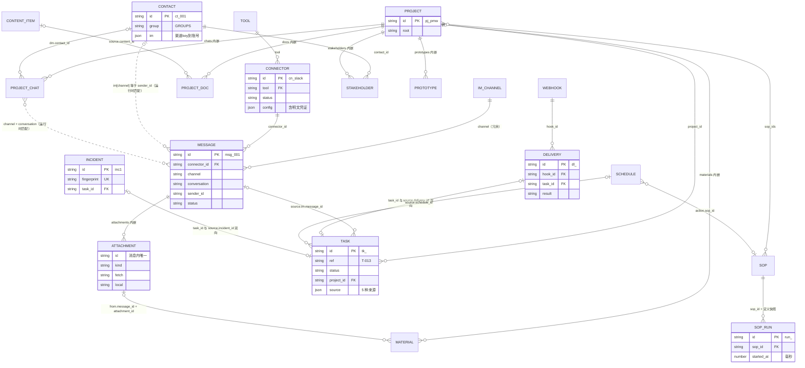
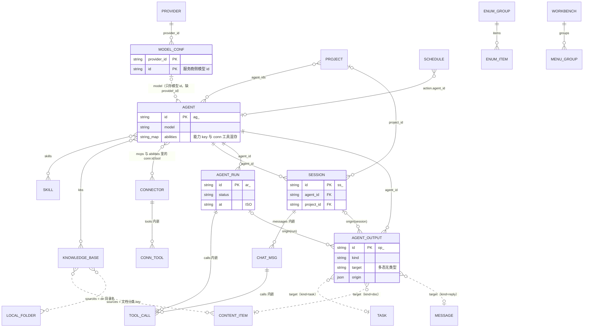
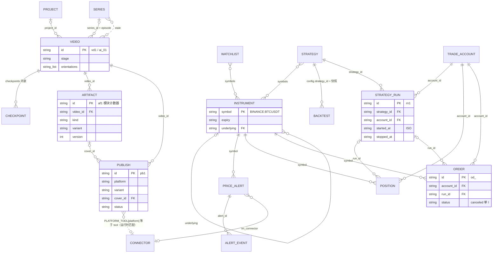

# 一人之下 web-next 数据层分析

## 0. 范围与方法

- 对象：`/Volumes/project/0xBroleez/pm-workspace/web-next/src` 的 13 个数据定义文件和 `App.tsx` 里的状态与跨模块写操作，另外看了会改数据的组件（trading、videos、videopublish、monitor、projects、projecttabs、sessions、browser、strategy）。
- 只读代码，没改任何文件，没启动任何服务。
- 快照时间：2026-10-28 17:25 左右。分析期间有别的会话在并行改 `src`（`videodata.ts` 从 211 行变成 236 行，新增了 32 集的「AI 工具 100 讲」系列；`App.tsx` 多了 1 行，`newVideo` 改成带 `seriesId`）。下文行号按快照时的文件；后续再改，行号可能偏 1 到几行。
- 一致性检查脚本：`/private/tmp/claude-501/-Volumes-project-0xBroleez-pm-workspace/332d2cac-6041-4a72-bd2a-96d5db218df9/scratchpad/check-seeds.ts`，输出在同目录 `out.txt`。运行方式：

```bash
cd /private/tmp/claude-501/-Volumes-project-0xBroleez-pm-workspace/332d2cac-6041-4a72-bd2a-96d5db218df9/scratchpad
npx -y tsx --tsconfig /Volumes/project/0xBroleez/pm-workspace/web-next/tsconfig.json check-seeds.ts
```

  脚本只 import 数据文件。有一处例外：`sopflow.ts` 自己 import 了 `nodetypes.tsx`（节点类型表，里面有图标 JSX，不是页面组件），所以要带上项目的 tsconfig 让 JSX 能编译。这本身也是一个问题，见 4.6。

---

## 1. 实体清单

说明：「主键」列写种子里的形态和运行时生成的形态；「谁写」列出所有会改这类数据的地方。App 指 `App.tsx`。

### 1.1 联系人、连接器、IM 消息、文档（data.ts）

| 实体 | 定义 | 主键 | 关键字段 | 谁写 |
|---|---|---|---|---|
| ImChannel（渠道表，常量） | data.ts:8，数据 data.ts:20 | `key`（wechat / lark / slack / telegram / qq） | label、link() | 只读 |
| Contact 联系人 | data.ts:28，种子 data.ts:60 | 种子 `ct_001`（data.ts:53）；新建 `ct_<base36 时间>`（App:753） | group（GROUPS 联合类型）、im（渠道 key 到账号编号）、last_contact_at、starred | App ContactDrawer onSave / onDelete（App:751-757）；`actOnMessage` 回复时改 last_contact_at（App:329-330）；enum 合并 `migrateEnum`（App:395） |
| ToolCategory | data.ts:81 | `key` | label | 只读 |
| Tool 工具目录（常量） | data.ts:122，数据 data.ts:145、183 | `key` | category、canSend、fields、auth、oauth、catalog | 只读；`TOOLS.push` 在模块加载时追加 |
| Connector 连接器实例 | data.ts:317，种子 data.ts:340 | `cn_<名字>`；新建 `cn_<base36 时间>`（App:785）；Google 登录建的是固定 `cn_gdrive` / `cn_gcal`（App:595） | tool（指 Tool.key）、status、config（含明文凭证）、auth.oauth、tools（ConnTool 带 mode）、direction | App `connectConn` / `disconnectConn`（App:527、544）、Drawer onSave / onDelete（App:782-788）、`googleLogin` / `googleLogout`（App:578、600） |
| Message IM 消息 | data.ts:395，种子 data.ts:420 | `msg_001`（data.ts:417），按出现顺序编号；运行时没有新建入口 | channel、connector_id、conversation、sender_id、sender_name、status、snooze_until、replies、attachments | App `actOnMessage`（App:312）、`patchMsg`、`fetchAttachment`（App:277）、TaskDrawer 转任务时标已处理（App:807）、`executeAgentCall` 回复（App:439） |
| Reply | data.ts:377 | `r1` / `r_<base36>`（App:325） | text、at | 内嵌在 Message.replies |
| MsgAttachment 附件 | data.ts:380 | 种子 `att1`…，只在消息内唯一 | kind、size、url、fetch、local | `fetchAttachment`（App:277） |
| ContentItem 文档库条目 | data.ts:483，种子 data.ts:496 | 种子 `ct1`…`ct7`；Agent 写文档时 `ct_<base36>`（App:431） | category、body（Markdown）、source（自由文本）、tags、starred | `executeAgentCall` write_content（App:430-436）、LibraryReader 加星（App:970 附近）、enum 合并（App:396） |

### 1.2 项目（projectdata.ts）

| 实体 | 定义 | 主键 | 关键字段 | 谁写 |
|---|---|---|---|---|
| Project | projectdata.ts:63，种子 :111 | `pj_pmw`；新建 `pj_<base36>`（App:649） | root、agent_ids、chats、stakeholders、sop_ids、materials、docs、prototypes、skipped_attachments | ProjectPage onChange 整体替换（App:1047）、`newProject`、onDelete（App:1048）、`addAttachmentToProject`（App:296）、`patchProto`（App:550） |
| Material 支持材料 | projectdata.ts:7 | `mt1`；附件加入时 `mt_<base36>`（App:303） | kind（file / folder / link / note）、value（路径或正文）、from（message_id、attachment_id、sender、conversation） | projects.tsx 移除（projects.tsx:340）、`addAttachmentToProject` |
| ProjectDoc 产品文档 | projectdata.ts:22 | `pd1` | title、kind（自由文本，DOC_KINDS 只是建议）、status（DocStatus）、source（library: content_id 或 file: path）、updated_at | projects.tsx |
| Prototype 原型 | projectdata.ts:33 | `pt1` | dir、command、port、status（ProtoStatus）、started_at、logs | App `startProto` / `stopProto`（App:552、567） |
| ProjectChat 沟通渠道 | projectdata.ts:49 | `ch1` | group（channel + conversation）或 dm（contact_id） | projecttabs.tsx 绑定 / 解绑（projecttabs.tsx:78） |
| Stakeholder 干系人 | projectdata.ts:61 | 无独立 id，按 contact_id | role（StakeRole）、focus | projecttabs.tsx |
| RelatedDir | projectdata.ts:46 | 无 id，按数组下标删（projects.tsx:458） | path、label | projects.tsx |

### 1.3 任务、Webhook、定时任务、运行异常

| 实体 | 定义 | 主键 | 关键字段 | 谁写 |
|---|---|---|---|---|
| Task | taskdata.ts:26，种子 :183 | id `tk_<base36><3 位随机>`（taskdata.ts:142）；另有人看的 `ref` `T-013`，取现有最大值 +1（taskdata.ts:140） | status、priority、assignee（自由文本）、due（yyyy-mm-dd）、source（5 种）、project_id | `newTask` 被 6 处调用：TaskDrawer（App:805）、Webhook `ingest`（taskdata.ts:128）、定时任务（App:358）、异常转任务（App:865）、Agent write_tasks（App:425）；`patchTask`（App:342）；onDelete（App:802） |
| TaskSource | taskdata.ts:19 | 无 | manual / im（message_id + 冗余 channel、sender、text）/ webhook（hook_id、delivery_id）/ schedule（schedule_id + 冗余 name）/ incident（incident_id + 冗余 title） | 随 Task |
| Webhook | taskdata.ts:43，种子 :154 | `wh_sentry`；新建 `wh_<base36>`（tasks.tsx:310） | token、secret（明文）、mapping、filter、dedupe、defaults | WebhookPage onSave / onDelete（App:988-991） |
| Delivery 推送记录 | taskdata.ts:61，种子 :175 | `dl_<base36><随机>`（taskdata.ts:115） | hook_id、payload、result、task_id、reason、mapped | `ingest` 经 App onTest（App:993-998） |
| Schedule 定时任务 | scheduledata.ts:31，种子 :114 | `sc_<名字>`；新建 `sc_<base36>`（schedule.tsx:73） | rule（ScheduleRule）、action（task / sop / agent）、history（ScheduleRun[]） | ScheduleDrawer onSave / onDelete（App:877-878）、`runScheduleNow`（App:351） |
| ScheduleRun | scheduledata.ts:29 | 无 id，内嵌 | at、ok、text、ref（存的是 Task.ref 不是 id） | `runScheduleNow` |
| Incident 运行异常 | incidentdata.ts:17，种子 :76 | `inc1`；新建 `inc_<base36><随机>`（incidentdata.ts:45）；业务键是 `fingerprint` | level、module、context、count、occurrences、status、task_id | App `report` → `mergeIncident`（App:124）；被 10 处上报：SOP 失败、页面报错、附件、连接器、原型端口、回测、交易、Webhook；IncidentDrawer 改状态 / 转任务（App:862-868） |

### 1.4 SOP、Agent、会话、模型、枚举、工作台

| 实体 | 定义 | 主键 | 关键字段 | 谁写 |
|---|---|---|---|---|
| Sop | sopflow.ts:56，数据 sopflow.ts:172 | `sop_feedback`；新建 `sop_<base36>`（sopedit.tsx:686） | trigger（自由文本）、fields、steps、layout | SopEditor onSave → `upsertSop` 改模块级数组 `SOPS`，再 `setSops([...SOPS])`（App:1024-1025） |
| SopStepDef | sopflow.ts:22 | `key`，SOP 内唯一 | kind、after、branch、cases、run / fail / decide（函数） | SopEditor |
| SopRun 执行 | sopflow.ts:92 | `run_<base36><随机>`（sopflow.ts:433）；种子改名 `run_seed0`…（sopflow.ts:559） | sop_id、sop（定义快照）、input、steps（RunStep）、started_at / ended_at 是毫秒数字 | App `startRun`（App:887、366）、定时器 `tick`（App:253）、`actOnRun`（App:1012） |
| RunStep | sopflow.ts:75 | `key` | status（StepStatus）、input、output、route、attempts、log | 引擎 |
| Agent | agentdata.ts:29，种子 :124 | `ag_<名字>`；新建 `ag_<base36>`，没有随机后缀（agentdata.ts:117） | model（只存模型 id）、abilities（能力 key 和 `conn:<连接器>:<工具>` 混存）、skills、mcps（连接器 id）、kbs、triggers | AgentEditor onSave / onDelete（App:1173-1176）、启停（App:1166）、删技能 / 知识库时级联（App:842、853） |
| Ability（常量） | agentdata.ts:10，数据 :12 | `key` | write | 只读 |
| Skill 技能 | agentdata.ts:69，数据 :71 | `sk_<名字>`；新建 `sk_<base36>`（kbskills.tsx:215） | uses（显示名字符串）、instructions | SkillDrawer onSave / onDelete（App:851-853） |
| KnowledgeBase | agentdata.ts:91，种子 :178 | `kb_<名字>`；新建 `kb_<base36>`（kbskills.tsx:80、agents.tsx:467） | sources（文档分类 key 或 `dir:<目录名>`）、docs（冗余计数）、status | KbDrawer、`reindexKb`（App:831）、AgentEditor 里直接建（App:1171） |
| Session 会话 | agentdata.ts:96，种子 :184 | `ss1`；新建 `ss_<base36>`（App:654） | agent_id、project_id、messages（ChatMsg[]） | `newSession`（App:652）、ChatsView onMsgs / onRename / onDelete（App:1150-1160） |
| ChatMsg | agentdata.ts:95 | 数字 `id`，会话内自增 | role、text、calls（ToolCall[]） | ChatPane（agents.tsx:273） |
| AgentRun 执行记录 | agentdata.ts:52，种子 :148 | `ar1`；新建 `ar_<base36>`（App:374） | agent_id、trigger（自由文本）、summary、calls、status | `runScheduleNow`（App:374）、`settleAgentRun`（App:447） |
| ToolCall | agentdata.ts:50 | 无 id，按数组下标确认（App:448） | tool、input、output、state | 内嵌 |
| AgentOutput 产出 | agentdata.ts:100，种子 :205 | `op1`；新建 `op_<base36><随机>`（App:422） | agent_id、kind、title、target（未分类型的 id 字符串）、origin（session / run） | `executeAgentCall` 的 `record`（App:421） |
| Provider 模型服务商 | modeldata.ts:158，种子 :185 | `pv_<名字>` | kind、values（含明文 API Key）、status | ProviderDrawer onSave / onDelete（App:818-823） |
| ModelConf 模型 | modeldata.ts:169，种子 :194 | 没有自己的 id；`id` 是服务商侧模型 id，只有 `provider_id + id` 唯一 | enabled、temperature、max_output | ProviderDrawer 保存时按 provider_id 整体替换（App:820） |
| EnumGroup / EnumItem | enumdata.ts:22 / :13，种子 :40 | 组 `key`、项 `key` | locked、enabled、default_key | EnumsPage（App:1199-1202）、`migrateEnum`（App:393） |
| Workbench 工作台 | workspacedata.ts:29，种子 :63 | `ws_pm`…；分组 `g<base36><序号>`（workspacedata.ts:32） | groups、modules（派生）、home | WorkspacesPage（App:1183-1187）；唯一一个写 localStorage 的业务数据（workspacedata.ts:115） |

### 1.5 视频（videodata.ts）

| 实体 | 定义 | 主键 | 关键字段 | 谁写 |
|---|---|---|---|---|
| Video | videodata.ts:129，种子 :195（含 `aiSeries()` 生成的 32 集，:180） | `vd1`、`ai_01`；新建 `vd_<base36>`（App:637 起） | project_id、series_id、episode、orientations、stage、checkpoints、root | VideoDetail onChange / onDelete（App:1104-1111）、SeriesPage 改集数和归属（videopublish.tsx:184-193） |
| Checkpoint | videodata.ts:76 | `stage` | state、at、note | 内嵌 |
| Artifact 产出物 | videodata.ts:52，种子 :208 | `af1`…，用模块级计数器按出现顺序编号（videodata.ts:203-205）；运行时 videos.tsx 的 `uid` | video_id、kind、variant、option、version、status、source（type + label 显示名）、reviews、picked | VideoDetail onArtifacts（videos.tsx:563、575） |
| Series 系列 | videodata.ts:117，种子 :164 | `sr_pmw` | intro / outro / template（自由文本）、stale（视频 id） | SeriesPage（videopublish.tsx:80、140-141、193） |
| Publish 发布记录 | videodata.ts:100，种子 :231 | `pb1`；新建 videopublish.tsx 的 `uid` | video_id、platform、variant、cover_id（Artifact id）、status、metrics | PublishPage（videopublish.tsx:371 `runPublish`、:495 删除）、删视频时级联（App:1111） |

### 1.6 交易（tradedata.ts）

| 实体 | 定义 | 主键 | 关键字段 | 谁写 |
|---|---|---|---|---|
| Instrument 标的（常量） | tradedata.ts:26，数据 :54 | `symbol`（`BINANCE:BTCUSDT`）；期权按 symbol 现场解析（:106） | market、kind、venue、expiry、underlying、multiplier | 只读 |
| Watchlist 自选 | tradedata.ts:259，种子 :260 | `wl_core` | symbols | MarketsPage（markets.tsx:136-137） |
| PriceAlert 提醒 | tradedata.ts:280，种子 :301 | `al1`；新建 `al_<base36><随机>`（monitor.tsx:400） | symbol、cond、notify、im_connector、last_fired_at | MonitorPage；App 每 5 秒 `checkAlerts` 后改 last_fired_at（App:159-170） |
| AlertEvent | tradedata.ts:296，种子 :307 | `ae1`；`ae_<base36><序号>`（App:167） | alert_id、symbol（冗余）、price、read | App 提醒定时器、MonitorPage 标已读（monitor.tsx:489、498） |
| Strategy 策略 | tradedata.ts:333，种子 :361 | `st_macross`；新建 `st_<base36>`（App:631） | symbols、interval、entry / exit（RuleGroup）、params、code | StrategyEditor onChange / onDelete（App:1133-1136）、`newStrategy` |
| Backtest 回测 | tradedata.ts:428 | `bt_<base36>`（App:611） | config.strategy_id、strategy_snapshot、status、progress、result | `startBacktest`（App:610），App state 初值是空数组（App:150），没有种子 |
| TradeAccount 账户 | tradedata.ts:445，种子 :550 | `ac_bn`；新建 AccountDrawer | broker、markets、paper、equity / available / margin_used、status、permissions | trading.tsx 撮合后改资金（trading.tsx:359）、连接 / 断开（:1308、:1312）、新增（:478）；没有删除入口 |
| Position 持仓 | tradedata.ts:468，种子 :558 | `ps1`；`applyFills` 生成 | account_id、symbol、side、qty、avg_price、run_id | trading.tsx 撮合（:358） |
| Order 委托 | tradedata.ts:490，种子 :567 | `od1`；新建 `od_<base36><随机>`（trading.tsx:35、427） | account_id、symbol、type、status、run_id | trading.tsx `place`（:426）、撮合（:350）、撤单（:734、740）、一键全停（:420） |
| StrategyRun 策略运行 | tradedata.ts:514，种子 :575 | `rn1`；新建 RunDrawer | strategy_id、account_id、symbols、params、capital、status、started_at / stopped_at（ISO）、logs | trading.tsx 新建（:475）、改状态（:1074-1077）、每 15 秒写日志改盈亏（:376-389）、一键全停（:419） |
| RiskRules 风控 | tradedata.ts:533，种子 :588 | 单例，无 id | 各上限、halted | trading.tsx（:421、:423、:1487） |
| HaltRec 熔断记录 | trading.tsx:213 | 无 id | at、reason、released_at | 模块级可变数组 `haltLog`（trading.tsx:214），不在 App state |

### 1.7 浏览器、终端、本地目录

| 实体 | 定义 | 主键 | 关键字段 | 谁写 |
|---|---|---|---|---|
| BrowserTab | browserdata.ts:5 | `bt<base36><随机>`（browser.tsx:19） | url、kind、history、cursor、pinned | BrowserPage 组件内 state（browser.tsx:69） |
| GoogleAccount | browserdata.ts:16 | email | scopes、connected_at | App `google` state（App:137）、`googleLogin`（App:578） |
| DriveFile（假数据） | browserdata.ts:26，数据 :56 | Drive 文件 id | mime、parent、owner（自由文本） | 只读 |
| TermTab / Pane | terminal.tsx:12 / :11 | `tb…` / 面板 uid（terminal.tsx:15） | cwd、lines、history | App `termTabs` state（App:176） |
| LocalFolder | localdir.ts:15 | 本地生成 id | files、handle（FileSystemDirectoryHandle）、read_at（毫秒数字） | App `folders` state（App:114）、`loadFolder`（App:712） |

---

## 2. 关系

### 2.1 引用字段汇总

| 从 | 字段 | 到 | 形态 | 说明 |
|---|---|---|---|---|
| Connector | tool | Tool.key | 外键 | IM 类工具 key 与渠道 key 相同（data.ts:141） |
| Message | connector_id | Connector.id | 外键 | |
| Message | channel | ImChannel.key | 冗余 | 能从 connector.tool 推出来，两处都存 |
| Message | channel + sender_id | Contact.im[channel] | 运行时匹配 | `contactFor`（messages.tsx:46）；联系人没有反向 id，改了联系人的 IM 编号，历史消息就对不上了 |
| ProjectChat(group) | channel + conversation | Message.channel + conversation | 运行时匹配 | `chatOf`（projecttabs.tsx:21），群名改了就断 |
| ProjectChat(dm) | contact_id | Contact.id | 外键 + 匹配 | 私聊再经 `contactFor` 对到消息 |
| Stakeholder | contact_id | Contact.id | 外键 | |
| Project | agent_ids / sop_ids | Agent.id / Sop.id | 外键数组 | |
| Material.from | message_id + attachment_id | Message.id + MsgAttachment.id | 复合外键 | sender、conversation 是冗余快照 |
| Project.skipped_attachments | 附件 id | MsgAttachment.id | 外键数组 | 只存附件 id，不带 message_id，靠附件 id 全局唯一，而附件 id 只在消息内生成 |
| ProjectDoc.source(library) | content_id | ContentItem.id | 外键 | title、updated_at 冗余一份 |
| Task | project_id | Project.id | 外键（可空） | |
| Task.source(im) | message_id | Message.id | 外键 | channel、sender、text 冗余快照 |
| Task.source(webhook) | hook_id、delivery_id | Webhook.id、Delivery.id | 外键 | 与 Delivery.task_id 双向 |
| Task.source(schedule) | schedule_id | Schedule.id | 外键 | |
| Task.source(incident) | incident_id | Incident.id | 外键 | 与 Incident.task_id 双向 |
| Delivery | hook_id、task_id | Webhook.id、Task.id | 外键 | |
| Schedule.action | sop_id / agent_id | Sop.id / Agent.id | 多态外键 | |
| ScheduleRun | ref | Task.ref | 按人看的编号引用 | 不是 id |
| SopRun | sop_id | Sop.id | 外键 + 快照 | 带整份 sop 定义快照 |
| Incident | fingerprint | `conn:<id>`、`provider:<id>`、`webhook:<id>`、`sop:<id>` | 编码在字符串里 | |
| Incident | task_id | Task.id | 外键 | |
| Agent | model | ModelConf.id | 不完整外键 | 缺 provider_id，同一模型 id 挂两个服务商时有歧义 |
| Agent | skills / mcps / kbs | Skill.id / Connector.id / KB.id | 外键数组 | |
| Agent.abilities | `conn:<connector_id>:<tool>` | Connector.id + ConnTool.name | 编码在 key 里 | |
| Skill | uses | 能力或工具的显示名 | 自由文本 | |
| KnowledgeBase | sources | 文档分类 key 或 `dir:<目录名>` | 混合 | 本地目录按名字引用，不是 id |
| Session | agent_id、project_id | Agent.id、Project.id | 外键 | |
| AgentRun | agent_id | Agent.id | 外键 | |
| AgentOutput | agent_id、origin.id | Agent.id、Session.id / AgentRun.id | 外键 + 多态 | |
| AgentOutput | target | Task.id / ContentItem.id / Message.id | 多态，类型只能看 kind | 文档产出没有 target 时按标题找（App:662） |
| ModelConf | provider_id | Provider.id | 外键 | |
| Video | project_id、series_id | Project.id、Series.id | 外键（可空） | |
| Series | stale | Video.id | 外键数组 | |
| Artifact | video_id | Video.id | 外键 | |
| Publish | video_id、cover_id | Video.id、Artifact.id | 外键 | cover 必须是同一视频、同一比例的封面，没有约束 |
| Publish.platform | PLATFORM_TOOL[platform] | Connector.tool | 运行时匹配 | `connectors.find(x => x.tool === …)` 取第一个（App:1087） |
| Watchlist / PriceAlert / Position / Order / StrategyRun / Strategy | symbol(s) | Instrument.symbol | 外键 | |
| Instrument | underlying | Instrument.symbol | 自引用 | |
| PriceAlert | im_connector | Connector.id | 外键 | 必须是 IM 类 |
| AlertEvent | alert_id | PriceAlert.id | 外键 | symbol 冗余 |
| Backtest.config | strategy_id | Strategy.id | 外键 + 快照 | |
| StrategyRun | strategy_id、account_id | Strategy.id、TradeAccount.id | 外键 | |
| Position / Order | account_id、run_id | TradeAccount.id、StrategyRun.id | 外键 | |
| Task / Webhook | assignee / defaults.assignee | 「我」或联系人姓名 | 自由文本 | 候选只来自同事分组（App:349） |
| GoogleAccount | email | Connector.account（gdrive、gcal） | 运行时匹配 | 登出时按 email 断开（App:602） |

### 2.2 沟通、项目、任务、流程



### 2.3 Agent、会话、模型与配置



### 2.4 视频与交易



---

## 3. 种子数据一致性检查结果

脚本共报 76 条（error 19，warn 57），完整列表见 `out.txt`。下面按严重程度归类，去掉了重复项，并补了几条脚本查不到、读代码发现的。

### 3.1 悬空引用（目标不存在）

| 位置 | 问题 |
|---|---|
| scheduledata.ts:119 | `sc_weekly_agenda` 的执行记录 `ref: 'T-005'`、`'T-002'`，任务里没有这两个编号。而且 ScheduleRun.ref 存的是人看的编号，不是 Task.id；也没有任何 `source.kind = 'schedule'` 的任务指回这条定时任务 |
| agentdata.ts:168、:200 | AgentRun `ar3` 和会话 `ss2` 的 write_content 产出 `content_id: 'ct_w43'`，文档库里没有这一篇。定时任务记录（scheduledata.ts:125）说「已存进文档」，实际不存在 |
| agentdata.ts:207-208 | 产出 `op2`、`op3`（kind=doc）没有 target，打开时 `openOutputTarget` 只能按标题找（App:662），这篇文档又不存在 |

### 3.2 内容错配（引用指得到，但内容对不上）

| 位置 | 问题 |
|---|---|
| agentdata.ts:193、:206 | 会话 `ss1` 说建了任务「确认演示环境能不能打开自定义角色」→ `T-010`；产出 `op1` 的 target 是 `tk_i1`。但 `tk_i1`（T-010）的标题是「月底演示带上按部门自定义角色」，来源是 IM 消息不是 Agent。一条任务被两个来源同时认领 |
| agentdata.ts:150-151 | `ar1` 触发写「收到飞书消息 · 梁晚晴」、认成采购经理，摘要里的诉求却是许知行（msg_003，data.ts:426）发的「按部门自定义角色」 |
| tradedata.ts:61、:66、:70 | 期货代码里的年月与到期日对不上：`OKX:BTC-USD-251226`、`CFFEX:IF2512`、`HKEX:HSI2511` 的代码表示 2025 年到期，`expiry` 写的是 2026 年。当前日期是 2026-10-28，按代码看这三张合约已经过期 |

### 3.3 冗余字段与原始数据不一致

| 位置 | 问题 |
|---|---|
| taskdata.ts:187 | `tk_i1` 的 `source.channel = 'wechat'`，原消息 msg_003 是 `lark` |
| taskdata.ts:188 | `tk_i2` 的 `source.channel = 'lark'`，原消息 msg_005 是 `slack`；`source.sender = '周屿'`，消息里是 `Zhou Yu` |
| data.ts:421、432、444、450、454 | 5 条 Slack 消息的 sender_name 是英文名（Lin Yuan、Zhou Yu、Chen Ruoxi），联系人是中文名。按平台原样存显示名是对的，但 `executeAgentCall` 的回复按 `sender_name === input.to` 找消息（App:438），Agent 用联系人中文名回复就找不到消息 |
| tradedata.ts:303 | 提醒 `al2` 有触发事件 `ae2`（:309），`last_fired_at` 却是空 |
| agentdata.ts:179-181 | KB.docs 是冗余计数，目前和实际一致，但 reindex 之外没人维护它（App:833） |
| projectdata.ts:135 | `pd1` 复制了文档库 `ct1` 的标题和 updated_at，文档库改了这边不跟 |

### 3.4 时间不合理

| 位置 | 问题 |
|---|---|
| taskdata.ts:187 | `tk_i1` 创建于 90 分钟前，来源消息 msg_003 是 35 分钟前收到的 |
| taskdata.ts:188 | `tk_i2` 创建于 360 分钟前，来源消息 msg_005 是 80 分钟前收到的 |
| videodata.ts:232-233 | `pb1`、`pb2` 发布于 6 天、5 天前，早于 vd1 分发包检查点通过的时间（`cps()` 统一写成 3 天前，videodata.ts:161） |
| videodata.ts:161 | 28 个视频的检查点通过时间晚于视频自己的 `updated_at`（vd1、ai_01 到 ai_27）。`cps()` 不看视频自己的时间线 |
| videodata.ts:205、:210 | 产出物 `created_at` 一律写成 4 天前：`af2` 的两条验收记录在 15、14 天前，早于产出物本身；`af25`（vd3 的口播稿，:225）早于 vd3 的创建时间（1 天前） |
| trading.tsx:206、:1076 | 种子之外的运行时问题：一键全停和手动停止把 StrategyRun 改成 `stopped`，但都不写 `stopped_at` / `stop_reason`，只有种子 `rn4` 有。`strategyruns.tsx:15` 只能拿最后一条日志的时间顶替 |

没发现 `stopped_at` 早于 `started_at`、`ended_at` 早于 `started_at`、日志早于启动这类倒挂。

### 3.5 状态矛盾

| 位置 | 问题 |
|---|---|
| videodata.ts:235 | `pb4` 在 YouTube 已定时，但没有 YouTube 连接器，没人会去执行这次定时发布 |
| videodata.ts:233 | `pb2` 在视频号已发布且有播放数据，没有视频号连接器，数据只能是手填的；也没有 url |
| videodata.ts:189 | AI 系列 18 集已完成（分发包检查点通过），却没有任何产出物和发布记录 |
| videodata.ts:217-218、:232-235 | 发布用了封面 af10、af14，封面上的 `picked`（「同一比例里选用的那张」）一张都没标；`status: 'published'` 和 `picked` 是两套标记，互相不维护 |
| tradedata.ts:584 | `rn5` 用 `st_grid` 跑 `OKX:ETH-USDT-SWAP`，策略的适用标的只有 `BINANCE:BTCUSDT.P` |
| tradedata.ts:559 | `ps1` 持仓成本 54570 超过所属运行 `rn1` 的资金上限 50000 |
| tradedata.ts:571 | `od4` 成交 2 ETH @ 3301.2，同账户同一天开的持仓 `ps3` 是 6.2 ETH @ 3280，数量和均价都对不上 |
| data.ts:343、:363，tradedata.ts:552 | 抖音、Notion 连接器、OKX 账户种子就是 error，但运行异常种子里没有它们。连接器只有用户点「连接」失败才上报（App:532），交易账户要打开交易页才补报（trading.tsx:306-311） |
| agentdata.ts:126、:133 | `ag_triage`、`ag_weekly` 挂了 MCP（cn_github、cn_notion），但 abilities 里没有任何 `conn:<连接器>:<工具>` 权限键，挂了等于没给工具 |
| data.ts:341-346 | B 站、抖音、Binance、富途四个应用类连接器没有 `tools` 清单，App 的 `mountableConns` 只收有 tools 的（App:412），所以它们挂不到 Agent 上，技能 `sk_video_review`、`sk_premarket` 用到的工具实际拿不到 |

### 3.6 枚举与自由文本

| 位置 | 问题 |
|---|---|
| sopflow.ts:176、:271、:318 | `Sop.trigger` 是自由文本（「手动 / IM 消息」），枚举 `sop_trigger`（enumdata.ts:67）的 key 是 manual / im / daily / weekly，两者没有挂钩 |
| agentdata.ts:72、:78 | 技能 `uses` 存显示名：「终端」「查持仓」「查委托」既不是能力名也不是工具名 |
| taskdata.ts:167、:186 | 负责人「王一帆」不在联系人里；`sopflow.ts:274` 周会转写稿里的王一帆、林舟也不是联系人 |
| browserdata.ts:68、75、81、82 | Drive 文件 owner「周宁」「陈默」「林夏」是自由文本 |
| videodata.ts:225 | 产出物来源 Agent 只存显示名「周报助手」，没有 agent_id，也没有对应的 AgentOutput |
| browserdata.ts:46 与 data.ts:196 | 浏览器 Google 登录申请 `calendar.readonly`，gcal 连接器定义的 scope 是 `calendar.events`。登录联动把只读 scope 写进连接器（App:583-591），连接器工具里却有 create_event 等写工具 |

所有 status、priority、group、category、kind、market、cond 都在定义范围内，没有越界值。

### 3.7 主键与匹配

| 位置 | 问题 |
|---|---|
| data.ts:53 与 data.ts:497 | 联系人 `ct_001` 和文档 `ct1` 共用 `ct` 前缀；运行时新建联系人（App:753）和 Agent 写文档（App:431）都生成 `ct_<base36 时间>`，两类 id 从形态上分不开 |
| data.ts:429、448、456 | Kevin Wu（U07KEVINWU）、NewsBot 在联系人里对不上。这是正常的陌生人场景，列出来是因为这类消息转任务、加材料时 sender 只能存显示名 |
| tradedata.ts:60、61、66 | OKX 的永续和交割合约把标的指向 Binance 现货，IF 指向上交所 ETF，跨交易所取标的价，接真行情时要分开 |

没发现主键重复、IM 编号对到多个联系人、端口冲突。

---

## 4. 概念重复与口径不一致

### 4.1 「运行」至少有六种意思

| 名字 | 定义 | 实际是什么 | 状态集 | 时间字段 |
|---|---|---|---|---|
| SopRun | sopflow.ts:92 | 一次流程执行，带定义快照，可暂停等人 | RunStatus：running / waiting / done / failed / stopped（sopflow.ts:73），而且是 `runStatus()` 现算的，没有存 | started_at / ended_at，毫秒数字 |
| AgentRun | agentdata.ts:52 | 一次触发的执行记录，核心是待确认的工具调用 | done / waiting / rejected / failed | at，ISO |
| StrategyRun | tradedata.ts:514 | 策略部署到账户上长期跑，有资金上限和盈亏 | RunStatus：running / paused / stopped / error（tradedata.ts:510） | started_at / stopped_at，ISO |
| Backtest | tradedata.ts:428 | 一次离线计算任务 | queued / running / done / failed；`queued` 定义了、页面有展示，但 App 直接建成 running（App:614），从来不会出现 | created_at / finished_at |
| ScheduleRun | scheduledata.ts:29 | 定时任务的一行执行日志 | ok 布尔 | at |
| Prototype status=running | projectdata.ts:24 | 进程在跑 | stopped / starting / running / stopping / error | started_at |

问题：

- `RunStatus`、`RUN_STATUS`、`seedRuns` 三个名字在 sopflow.ts 和 tradedata.ts 里各定义一份，含义完全不同。App 靠 `seedRuns as seedTradeRuns` 改名区分（App:44），projecttabs.tsx:7 import 的 `RUN_STATUS` 是 SOP 的，一不留神就会拿错。
- StrategyRun 不是「一次运行」，是「一个部署」。它有 paused，能从 paused 回到 running，生命周期可能几周，和另外几个一次性执行不是一类。
- 同样叫「运行中」：SOP 是 `running`，策略是 `running`，原型是 `running`；同样表示失败：SOP 和回测叫 `failed`，策略运行、原型、连接器、服务商叫 `error`。

建议：

- 一次性的执行统一叫「执行（Execution）」：SopExecution、AgentExecution、BacktestJob，统一状态集 `queued / running / waiting / succeeded / failed / canceled`，统一 `started_at / ended_at`（ISO），统一 `trigger: { type, ref_id }`。
- 长期运行的叫「部署（Deployment）」：StrategyDeployment，状态 `running / paused / stopped / error`，单独一套。
- 定时任务的执行记录直接复用 Execution（trigger.type = schedule），不再单独存一个只有文本的 history。
- 类型和常量名带上模块前缀：`SopRunStatus`、`DeploymentStatus`，种子名 `seedSopRuns`、`seedStrategyRuns`。

### 4.2 「产出 / 资料 / 文档」五个概念边界不清

| 概念 | 定义 | 是什么 | 和别人重叠的地方 |
|---|---|---|---|
| ContentItem 文档库 | data.ts:483 | 有正文的文档（Markdown），按分类组织 | 是唯一真正存正文的地方 |
| ProjectDoc 项目文档 | projectdata.ts:22 | 项目对一篇文档的引用，可以指文档库或项目目录里的文件 | 复制了标题和更新时间；`status` draft / review / final 是项目视角的评审状态，文档库本身没有状态 |
| Material 支持材料 | projectdata.ts:7 | 项目对文件、文件夹、链接、笔记的引用 | `kind: 'note'` 时 value 直接存正文，就是一篇没有进文档库的笔记；种子 `mt5`（projectdata.ts:158）和文档库 `ct4`（data.ts:561）是同一件事的两份 |
| Artifact 视频产出物 | videodata.ts:52 | 视频制作流程里的文件，带版本、比例、验收记录 | 和 ProjectDoc 一样有 draft / review / final，标签却一个叫「评审中」一个叫「待验收」；来源只存显示名，不链到 Agent / SOP 的执行 |
| AgentOutput Agent 产出 | agentdata.ts:100 | Agent 写操作落地的审计记录 | 不是实体本身，是一条「谁、从哪次会话、建了什么」的溯源；target 不带类型 |

另外 SOP 的步骤也声称在产出东西，但没有真的落地：「存为内容摘录」「归档到内容」只返回一个编出来的 `content_id`（sopflow.ts:224、:305），「建缺陷单」返回 `BUG-xxxx`（:229），「发送回复」返回 `im_xxx`（:257），「标记消息已处理」只输出 `message_status: 'done'`（:263），「写入新联系人」返回 `c_xxx`（:362）。SOP 执行完，文档库、任务、消息、联系人都没变化。

建议：

- 一张「文件 / 资源」表（File：存储路径、哈希、大小、MIME、来源），二进制只存一份。消息附件下载后变成 File；项目材料、视频产出物都引用 File。
- 一张「文档」表（ContentItem），所有有正文的东西都进来。Material 的 note、周报、SOP 摘录都写成文档。
- 项目侧只保留一张「项目资源链接」表（project_id、resource_type: document / file / link / folder、resource_id 或 url、role: material / doc、status、tags），把 ProjectDoc 和 Material 合成一张，标题和时间从目标读，不再复制。
- Artifact 保留视频语义（kind、variant、option、version、review），文件本体引用 File。
- AgentOutput 改名为「操作溯源」（Provenance / Activity）：actor（agent / sop / schedule / webhook / user）、origin（execution_id）、target_type + target_id。所有自动化（Agent、SOP、定时、Webhook、异常转任务）建出来的东西都记一条，Task.source 也可以从这里派生，避免 3.2 里一条任务被两个来源认领。

### 4.3 状态枚举命名

- 拼写不统一：Task 用 `cancelled`（taskdata.ts:6），Order 用 `canceled`（tradedata.ts:485）。
- `pending` 有五种意思：消息「待处理」（data.ts:376）、步骤「未开始」（sopflow.ts:72）、委托「提交中」（tradedata.ts:485）、检查点「待验收」（videodata.ts:75）、工具调用「待确认」（agentdata.ts:50）。
- 「完成」有 done、filled、passed、final、published、ok 六种写法。
- 「失败」分 failed 和 error 两派（见 4.1）。
- `review` 在 SOP 步骤里是「等人处理」，在 ProjectDoc 是「评审中」，在 Artifact 是「待验收」。
- 枚举有两份来源：设置里的枚举 `task_status`、`task_priority`、`msg_status`、`content_category`（enumdata.ts:40-65）可以改显示名和颜色，但任务页、项目页用的是写死的 `TASK_STATUS`（tasks.tsx:141、:252，projecttabs.tsx:187），消息页标签也是写死的（messages.tsx:168）。只有联系人分组真的读枚举（contacts.tsx:14、ui.tsx:44）。改了枚举显示名，大部分页面不跟。
- 联系人分组在类型上是固定联合类型 `Group`（data.ts:4），枚举页却允许新增分组值，新增的值在类型层面不合法，`migrateEnum` 只能用 `as` 硬转（App:395）。
- `SopField` 的 select、`DOC_KINDS`、`Sop.trigger` 这些「选项」没进枚举表。

建议：状态值统一为小写英文、美式拼写（`canceled`），同一语义同一个词：`pending` 只表示「还没开始」，等人的统一叫 `waiting_review` / `waiting_confirm`，完成统一叫 `succeeded`（流程类）或保留领域词（`filled`、`published`），失败统一 `failed`，外部连接断了的统一 `error`。枚举只保留一个来源：要么全进枚举表、页面全读 `useEnum`，要么系统锁定的状态不进枚举表。

### 4.4 时间字段

- 时间格式三种：ISO 字符串（大多数）、毫秒数字（SopRun、RunStep、LocalFolder.read_at、Bar.t、SopRun 日志）、日期字符串 `yyyy-mm-dd`（Task.due、ScheduleRule.date、Instrument.expiry），还有 `HH:mm`（ScheduleRule.time）。
- 「发生时间」有时叫 `at`（Message、Reply、AgentRun、Delivery、AlertEvent、ScheduleRun、ChatMsg），有时叫 `*_at`。
- 「最后修改」的名字各不同：updated_at、modified_at（DriveFile）、checked_at（Provider）、tools_at（Connector）、last_sync_at、read_at；而 Message、Connector、Agent、Project、Webhook、Schedule、Provider 根本没有 updated_at。
- 「创建」也有 created_at、added_at（Material）、opened_at（Position）、connected_at（GoogleAccount）、first_at（Incident）。
- 种子全部用 `Date.now()` 相对时间生成，每次刷新都在变，周期规则（比如每周一 18:00）和执行记录对不齐，跨文件引用的时间顺序（3.4 里的几条）也没人校验。

建议：所有时间戳统一 ISO 8601 UTC 字符串，命名统一 `<动作>_at`（created_at、updated_at、started_at、ended_at、occurred_at、received_at）；纯日期用 `<名>_date`（due_date、expiry_date）；每张表都有 created_at 和 updated_at。种子改成以一个固定基准时间加偏移生成，并在种子脚本里做顺序断言。

### 4.5 id 风格

| 风格 | 例子 |
|---|---|
| 前缀加下划线加名字 | `cn_slack`、`pj_pmw`、`ag_triage`、`st_macross`、`ac_bn`、`wl_core`、`pv_openai`、`sr_pmw`、`ws_pm` |
| 前缀加下划线加序号 | `ct_001`、`msg_001`、`ai_01` |
| 前缀直接加序号 | `ct1`、`mt1`、`pd1`、`pt1`、`ch1`、`ar1`、`op1`、`ss1`、`inc1`、`af1`、`vd1`、`pb1`、`ps1`、`od1`、`rn1`、`al1`、`ae1`、`att1`、`r1` |
| 运行时：前缀加下划线加时间 | `ct_`、`cn_`、`pj_`、`ss_`、`st_`、`vd_`、`bt_`、`ag_`、`sc_`、`sop_`、`wh_`、`kb_`、`sk_`（只有 base36 毫秒，同一毫秒建两个会撞） |
| 运行时：前缀加时间加随机 | `tk_`、`dl_`、`inc_`、`op_`、`al_`；还有 10 个各自的 `uid` 函数，有的带下划线（projects.tsx:28、videopublish.tsx:13、trading.tsx:35），有的不带（projecttabs.tsx:18、strategy.tsx:37、terminal.tsx:15、videos.tsx:17、browser.tsx:19） |
| 没有 id | ModelConf（靠 provider_id + 模型 id）、Stakeholder（靠 contact_id）、RelatedDir（靠下标）、ToolCall（靠下标）、ScheduleRun、HaltRec、RiskRules |
| 业务键当主键 | Instrument.symbol、EnumItem.key、Tool.key、Incident.fingerprint（另有 id） |

前缀冲突：`ct` 同时是联系人和文档；`bt` 同时是浏览器标签页和回测；`run_` 是 SOP 执行、`rn` 是策略运行、`ar` 是 Agent 执行。Task 另有人看的 `ref`，由前端取最大值加一（taskdata.ts:140），Agent 建任务时用的是旧闭包里的 tasks，撞了再补救一次（App:425-426）。

建议：统一一个 id 生成函数，格式 `<类型前缀>_<ULID>`，前缀登记成一张表并保证唯一（比如 `con_` 联系人、`doc_` 文档、`msg_`、`tsk_`、`prj_`、`sxe_` SOP 执行、`sdp_` 策略部署、`btj_` 回测）。人看的编号（T-013）由后端序列分配。子实体（ToolCall、Stakeholder、ScheduleRun）都给 id，别再按下标改。

### 4.6 其他结构问题

- 双份状态：SOP 定义存在模块级可变数组 `SOPS`（sopflow.ts:172），`upsertSop` 直接改它（sopflow.ts:378），App 再复制一份到 state 触发重渲染（App:116、1024-1025）；`sopById` 读的是模块数组，不是 state。熔断记录 `haltLog`、委托附加信息 `orderMeta`、已上报账户 `reportedAcct` 都是 trading.tsx 的模块级变量（trading.tsx:143、214、217），不在 App state 里，也不会被持久化。
- 数据文件依赖 UI：`sopflow.ts` import `nodetypes.tsx`（含 JSX 图标），`tradedata.ts` import React 的 `useEffect` / `useState`（tradedata.ts:6），`enumdata.ts` import `createContext`（enumdata.ts:7）。数据层不能脱离 React 单独跑，后端也不能直接复用这些类型文件。
- 两个 `MODULES`：enumdata.ts:34 和 workspacedata.ts:8 各导出一个同名常量，含义不同。
- 敏感信息明文：Connector.config（含 secret、bot_token、api_hash）、Provider.values（API Key）、Webhook.secret 都是明文放在前端 state 里。

---

## 5. 删除与级联

| 删除对象 | 处理位置 | 现在做了什么 | 留下的悬空引用 |
|---|---|---|---|
| 项目 | App:1048 | 只从 projects 里过滤掉 | Task.project_id、Session.project_id、Video.project_id 全部悬空（页面显示「已删除的项目」，videos.tsx:126）；删除确认文案说「运行中的原型会先停掉」（projects.tsx:468），代码没有停进程这一步，只是记录没了；终端里指向项目目录的标签页不受影响 |
| 联系人 | App:757 | 只过滤 contacts | Project.stakeholders.contact_id、Project.chats(dm).contact_id 悬空（projecttabs.tsx:41 显示「已删除的联系人」）；该联系人的历史消息从此对不上人，转任务时只剩显示名 |
| 连接器 | App:788 | 只过滤 connectors | Message.connector_id 悬空，这些消息再也取不到附件、回复不了（App:281-282 当作「渠道连接异常」）；Agent.mcps、Agent.abilities 里的 `conn:<id>:*` 键悬空；PriceAlert.im_connector 悬空，推 IM 静默失败；Incident 指纹 `conn:<id>` 悬空。另外 Google 登录建的 `cn_gdrive` / `cn_gcal` 删掉后再登录会用同一个 id 重建（App:595） |
| 视频 | App:1111 + videos.tsx:563 | 同时删 publishes 和 artifacts | Series.stale 里的 id 悬空；视频在本地的目录不动（页面已说明） |
| 策略 | App:1136 | 只过滤 strategies | StrategyRun.strategy_id 悬空，而且没有先停掉正在跑的运行，`running` 的部署继续每 15 秒写日志改盈亏（trading.tsx:376-389），页面显示「已删除的策略」（trading.tsx:562、1091）；Backtest.config.strategy_id 悬空（有快照，能看不能「打开策略」）；持仓、委托经 run_id 间接挂在一个没有策略的运行上 |
| 账户 | 无 | 没有删除入口，只能断开（trading.tsx:1312） | 现在不会悬空；接后端时要决定：有持仓、挂单、运行中的部署时禁止删除 |
| Agent | App:1176 | 只过滤 agents | Project.agent_ids、Session.agent_id、AgentRun.agent_id、AgentOutput.agent_id、Schedule.action.agent_id 悬空（定时任务执行时会写「Agent 已删除」，App:372）；SOP 里 `agent` 类型节点的配置也悬空 |
| 任务 | App:802 | 只过滤 tasks | Incident.task_id 悬空，且异常状态还停在 `tasked`；Delivery.task_id 悬空，去重逻辑还会认为「已经建过任务」（taskdata.ts:123-124）；AgentOutput.target 悬空 |
| Webhook | App:991 | 只过滤 hooks | Delivery.hook_id、Task.source.hook_id 悬空 |
| 定时任务 | App:878 | 只过滤 schedules | Task.source.schedule_id 悬空 |
| 会话 | App:1160 | 只过滤 sessions | AgentOutput.origin(session) 悬空 |
| 服务商 | App:823 | 连带删掉该服务商的模型 | Agent.model 悬空，Agent 卡片上找不到这个模型（modelChoices 里也没有了，App:403） |
| 知识库、技能 | App:842、853 | 连带从所有 Agent 上摘掉 | 无。这两处是现在唯一做了级联的 |
| 提醒 | monitor.tsx:408 | 只过滤 alerts | AlertEvent.alert_id 悬空 |
| 系列 | 无删除入口 | | |
| 文档库条目 | 没找到删除入口 | | 若以后加，ProjectDoc.source.content_id、AgentOutput.target 会悬空 |

建议：接后端时每条外键明确删除策略（RESTRICT / SET NULL / CASCADE / 软删除），前端删除前先问后端「有哪些依赖」并在确认框里列出来。偏向：

- 有执行中状态的（策略部署、原型、SOP 执行）：RESTRICT，先停再删。
- 审计和溯源类（Delivery、AgentOutput、Incident、AgentRun、执行记录）：被引用方软删除，引用方保留并显示「已删除」。
- 纯归属关系（Task.project_id、Video.project_id、Session.project_id）：SET NULL，或者项目软删除后在回收站里可恢复。
- 内嵌关系（Project 里的 materials、docs，Video 的 artifacts、publishes）：CASCADE。

---

## 6. 接真后端前要补的

### 6.1 只在内存或组件内部的状态

| 状态 | 位置 | 现状 | 是否需要持久化 |
|---|---|---|---|
| 全部业务数据（联系人、消息、任务……共 40 多个 state） | App:100-205 | App 的 useState，刷新恢复种子 | 需要 |
| SOP 定义 | sopflow.ts:172 模块数组 + App:116 | 改了只在内存 | 需要 |
| 回测记录与结果 | App:150 | 初值空数组，刷新全丢，结果体积可能很大 | 需要，结果单独存（资金曲线、成交可放对象存储或压缩 JSON） |
| 参数扫描结果 | strategy.tsx:994 附近组件 state | 关掉报告就没了 | 按需，可作为回测的子记录 |
| 浏览器标签页、最近访问 | browser.tsx:69-74 组件 state | 浏览器模块一直挂着，切页不丢，刷新丢 | 需要（标签页、固定标签、最近访问），按设备存 |
| Google 账号 | App:137 | 刷新就退出登录，但连接器那边还显示已连接，两边对不上 | 需要，令牌放后端 |
| 终端标签页与输出 | App:176 | 刷新丢 | 标签布局需要，输出可不存 |
| 本地目录 | App:114 | FileSystemDirectoryHandle 只在内存（App:711 注释已说明） | handle 可存 IndexedDB；真后端下应改为后端读本地目录 |
| Agent 调试对话 | agents.tsx:361 组件 state | 关掉就丢 | 可不存 |
| 熔断历史、委托附加信息、已上报账户 | trading.tsx:143、214、217 模块变量 | 刷新丢，且不在 App state | 熔断历史需要 |
| SOP 步骤失败已上报集合 | App:230 | 刷新后会对同一失败重报 | 改成后端按执行和步骤去重 |
| 工作台、侧栏、主题 | localStorage（workspacedata.ts:115、App:207、213） | 已持久化，仅本机 | 工作台配置建议进后端，侧栏和主题留本地 |

### 6.2 建议的表结构分组

按依赖从底到上分 7 组：

1. 基础与配置：`enum_group`、`enum_item`、`workbench`、`menu_group`、`setting`、`secret`（统一加密存凭证，其他表只存 secret_id）。
2. 人与渠道：`contact`、`contact_identity`（contact_id、channel、external_id，唯一约束 channel + external_id，替代 Contact.im 的 map，消息匹配改成外键）、`connector`、`connector_tool`、`oauth_token`、`provider`、`model`（provider_id + model_key，自带 id）。
3. 内容与文件：`file`（存储路径、哈希、大小、MIME）、`document`（原 ContentItem）、`local_folder`。
4. 沟通：`conversation`（connector_id、external_id、kind group / dm、title）、`message`（conversation_id、identity_id、text、received_at、status）、`message_reply`、`message_attachment`（message_id、file_id、fetch_status）。
5. 工作对象：`project`、`project_member`（原 Stakeholder）、`project_conversation`（原 ProjectChat，指向 conversation_id）、`project_resource`（合并 Material 和 ProjectDoc）、`prototype`、`task`（ref 用后端序列）、`webhook`、`webhook_delivery`、`incident`、`incident_occurrence`。
6. 自动化：`sop`、`sop_version`（执行引用版本而不是整份快照）、`execution`（统一的执行表：kind sop / agent / backtest / schedule，status，trigger，started_at，ended_at）、`execution_step`、`tool_call`、`schedule`、`agent`、`agent_skill`、`agent_kb`、`agent_tool_grant`（agent_id、connector_tool_id、mode，替代 abilities 里的 `conn:` 键）、`skill`、`knowledge_base`、`kb_source`、`session`、`session_message`、`provenance`（原 AgentOutput，覆盖所有自动化建出的东西）。
7. 领域模块：
   - 视频：`video`、`video_checkpoint`、`series`、`series_stale`、`artifact`（引用 file_id）、`artifact_review`、`publish`、`publish_metric_snapshot`（按时间存多次，不是只存最新一份）。
   - 交易：`instrument`（含期权合约表）、`watchlist`、`watchlist_item`、`price_alert`、`alert_event`、`strategy`、`strategy_version`、`backtest`（结果大字段分表）、`trade_account`、`position`、`order`、`fill`（成交明细，现在只有 avg_fill）、`strategy_deployment`（原 StrategyRun）、`deployment_log`、`risk_rule`、`halt_event`。

### 6.3 迁移顺序

按外键依赖和风险排：

1. 第 1、2 组（配置、联系人、连接器、模型）。先把 `contact_identity` 建出来，后面消息匹配全靠它。同时把凭证移进 `secret`。
2. 第 3、4 组（文件、文档、消息）。把附件下载改成后端任务，产出 `file`。
3. 第 5 组（项目、任务、Webhook、异常）。Task.ref 改后端序列；把 ProjectDoc、Material 合并迁移。
4. 第 6 组（SOP、执行、Agent、会话、溯源）。这一步要把 SOP 节点的写操作接上真实接口（见 6.4），并把 SopRun、AgentRun 合到 `execution`。
5. 第 7 组视频：依赖 project、file、connector。
6. 第 7 组交易：最后迁，依赖真实行情和券商接口，风险最大；先只迁模拟盘账户和回测，实盘账户最后接。

每一步上线前跑一次第 3 节的一致性脚本（改成查数据库），外键约束打开后再导数据。

### 6.4 要换成真接口的模拟逻辑

| 模拟 | 位置 | 现在怎么做 | 换成 |
|---|---|---|---|
| 行情 | tradedata.ts:138-206 | 价格由时间和 symbol 哈希决定的正弦叠加，盘口、成交量都是编的 | 行情连接器（Binance、OKX、Deribit、富途、Tushare、Polygon，data.ts:278-295），后端统一订阅、落 K 线，前端走推送 |
| 期权链与希腊值 | tradedata.ts:79、:223 | 简化 Black-Scholes 现算 | 交易所期权链接口 |
| 撮合 | trading.tsx:313-373 | 每 0.5 秒扫委托，价格越过就整笔成交 | 券商 / 交易所下单接口和成交回报，部分成交、撤单回报都以交易所为准；`orderMeta` 里预置的拒单原因去掉 |
| 策略运行 | trading.tsx:376-389 | 每 15 秒随机改盈亏写日志 | 后端策略执行进程 |
| 回测 | backtest.ts:459、App:610 | 前端同步计算，模拟进度 | 后端回测任务队列（这时 `queued` 才有意义），用真实历史 K 线 |
| 风控熔断 | trading.tsx:391-403 | 页面打开时才检查当日亏损 | 后端常驻风控，不能依赖页面开着 |
| 盯盘提醒 | App:159-170 | 页面打开时每 5 秒检查 | 后端常驻任务，推 IM 走连接器 |
| 视频发布 | videopublish.tsx:371 | 1.2 秒后直接标为已发布，编一个链接，不校验连接器状态 | B 站、YouTube、抖音上传接口；定时发布由后端执行；数据定期拉取存快照 |
| 附件下载 | App:277-294 | 0.8 秒后拼一个 `~/Downloads/一人之下/附件/<文件名>` 路径 | 各 IM 平台的文件下载接口，落到 `file` 表，重名要处理 |
| OAuth 与 Google 登录 | App:527-547、578-604，browser.tsx:806 | 点一下就算授权成功，凭证带 `expired` 字样就算失败 | 真实 OAuth 授权码流程，令牌和刷新令牌放后端，过期自动刷新，失败写异常 |
| 连接器测试与工具发现 | data.ts:305、modeldata.ts:211 | 写死的工具清单、按字符串判断成败 | 调对方接口、MCP 的 tools/list、OpenAPI 文档解析 |
| IM 收消息与回复 | App:312-333 | 回复只追加到本地 replies | 连接器真发出，回执确认后再记已回复 |
| Webhook 接收 | taskdata.ts:114、App:992 | 页面里「测试推送」手动调用 | 后端公开接收地址，校验 secret 签名，去重落库 |
| 定时任务 | scheduledata.ts:67、App:351 | 只算「下次执行」用于展示，只有「立即执行」会真跑 | 后端调度器 |
| SOP 引擎 | sopflow.ts:404-517、App:253 | 前端定时器推进，步骤产出是写死规则 | 后端执行引擎；把 3.6 和 4.2 提到的几个「假落地」节点接上真实写操作 |
| Agent 对话 | agents.tsx:207 | 按关键字规则编回复 | 模型服务商真实调用，工具调用经 `agent_tool_grant` 授权 |
| 原型启停 | App:552-570、projectdata.ts:102 | 不起进程，日志是编的，只按端口规则判断 | 后端起子进程、真实检测端口；保留 7777 保护（projectdata.ts:88） |
| 知识库索引 | App:831-834 | 1.2 秒后数一下篇数 | 真实切块和向量索引 |
| Drive 文件 | browserdata.ts:56 | 写死的假文件 | Google Drive API |

---

## 7. 结论

### P0（会导致数据错、接后端时直接出问题）

1. 删除没有级联也没有拦截：删策略不停运行中的部署（App:1136），删连接器后消息、Agent 工具权限、提醒推送全部悬空（App:788），删任务后 Webhook 去重仍认为已建过（App:802，taskdata.ts:123）。接后端前每条外键必须定删除策略（第 5 节）。
2. 凭证明文：Connector.config、Provider.values、Webhook.secret 明文存在前端 state 里（data.ts:347-354、modeldata.ts:186-187、taskdata.ts:156）。后端要有加密的 `secret` 表，前端只拿脱敏提示。
3. 消息和联系人靠「渠道 + 编号」运行时匹配（messages.tsx:46），项目群聊靠群名匹配（projecttabs.tsx:21），Agent 回复靠 sender_name 匹配（App:438）。改一次 IM 编号或群名，历史关联就全断。要先建 `contact_identity` 和 `conversation` 两张表，改成外键。
4. id 方案：联系人和文档共用 `ct_` 前缀（data.ts:53、App:431、App:753），多数运行时 id 只有毫秒时间戳没有随机段，模型没有自己的 id（Agent.model 不带 provider_id，agentdata.ts:34），Task.ref 前端自增（taskdata.ts:140）。统一 id 生成和后端序列。
5. 种子里的任务来源互相矛盾：`tk_i1` 同时被 IM 消息和 Agent 会话认领（taskdata.ts:187，agentdata.ts:193、206），且 `source.channel` 与原消息不符（taskdata.ts:187-188），任务早于来源消息创建。种子如果要作为迁移初始数据或演示数据，这几条必须先改。
6. 策略运行停止时不写 `stopped_at` / `stop_reason`（trading.tsx:206、1076），交易审计缺关键字段。

### P1（口径和结构，迁移前要统一）

1. 「运行」六种含义，`RunStatus` / `RUN_STATUS` / `seedRuns` 在两个文件重名（sopflow.ts:73、117、546，tradedata.ts:510、511、575）。按 4.1 拆成「执行」和「部署」两类。
2. 文档、材料、项目文档、产出物、Agent 产出五个概念重叠（4.2）。合并 ProjectDoc 和 Material，二进制统一进 `file`，AgentOutput 扩成通用溯源。
3. SOP 的写操作节点是假落地（sopflow.ts:224、229、257、263、305、362），执行完数据没变化；Agent 的 run_sop 也只返回 `queued: true`（App:443）。
4. 枚举两份来源：设置里可改的任务状态、优先级、消息状态、文档分类，页面上大多不读（tasks.tsx:141、252，projecttabs.tsx:187，messages.tsx:168）；联系人分组的 TS 类型是固定联合，枚举却允许新增（data.ts:4）。
5. 状态命名不统一：`cancelled` 与 `canceled`、failed 与 error、`pending` 五种意思（4.3）。
6. 时间格式不统一：SopRun 用毫秒数字，其余用 ISO；多数表缺 updated_at（4.4）。
7. 模块级可变状态：`SOPS`、`haltLog`、`orderMeta`、`reportedAcct`（sopflow.ts:172、trading.tsx:143、214、217），以及数据文件依赖 React 和 JSX（tradedata.ts:6、enumdata.ts:7、sopflow.ts:12）。
8. 回测记录、浏览器标签页、Google 账号刷新即丢（App:150、browser.tsx:69、App:137），Google 账号丢了而连接器仍显示已连接。
9. Agent 挂了 MCP 却没有任何 `conn:` 工具权限（agentdata.ts:126、133）；四个应用类连接器没有 tools 清单，挂不上 Agent（data.ts:341-346）。

### P2（种子数据质量和小问题）

1. 期货代码年份与到期日不符：`OKX:BTC-USD-251226`、`CFFEX:IF2512`、`HKEX:HSI2511`（tradedata.ts:61、66、70）。
2. 悬空的展示引用：定时任务记录 `T-005`、`T-002`（scheduledata.ts:119），周报文档 `ct_w43`（agentdata.ts:168、200）。
3. 视频时间线：发布早于分发包检查点通过（videodata.ts:232-233），`cps()` 统一写 3 天前导致 28 个视频检查点晚于 updated_at（videodata.ts:161），产出物统一 4 天前导致验收记录早于产出物、产出物早于视频（videodata.ts:205、210、225）。
4. AI 系列 18 集已完成但没有任何产出物和发布（videodata.ts:189）；pb4 定时发 YouTube 却没有 YouTube 连接器（videodata.ts:235）；封面 picked 与发布用封面两套标记（videodata.ts:217-218）。
5. `ar1` 的触发人与摘要内容错配（agentdata.ts:150-151）；`al2` 有触发事件但 last_fired_at 为空（tradedata.ts:303）。
6. 交易种子数值：`rn5` 跑的标的不在策略适用范围（tradedata.ts:584），`ps1` 超出运行资金上限（tradedata.ts:559），`od4` 与 `ps3` 数量均价对不上（tradedata.ts:571）。
7. 自由文本引用：负责人「王一帆」、Drive owner、技能 uses「终端 / 查持仓 / 查委托」、SOP trigger、产出物来源 Agent 只存显示名（3.6）。
8. Google 登录申请 `calendar.readonly`，gcal 连接器带写工具（browserdata.ts:46、data.ts:194-196）。
9. 回测状态 `queued` 永远不会出现（tradedata.ts:427、App:614）；`cps()` 的 `pending` 参数两个分支都返回 `'pending'`，参数无效（videodata.ts:160）。
