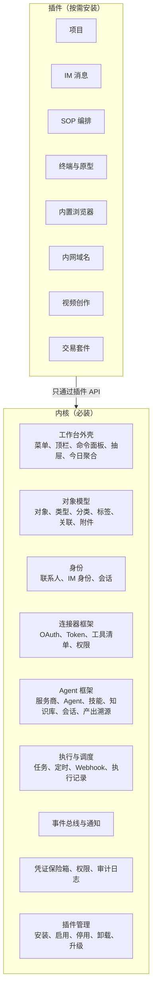
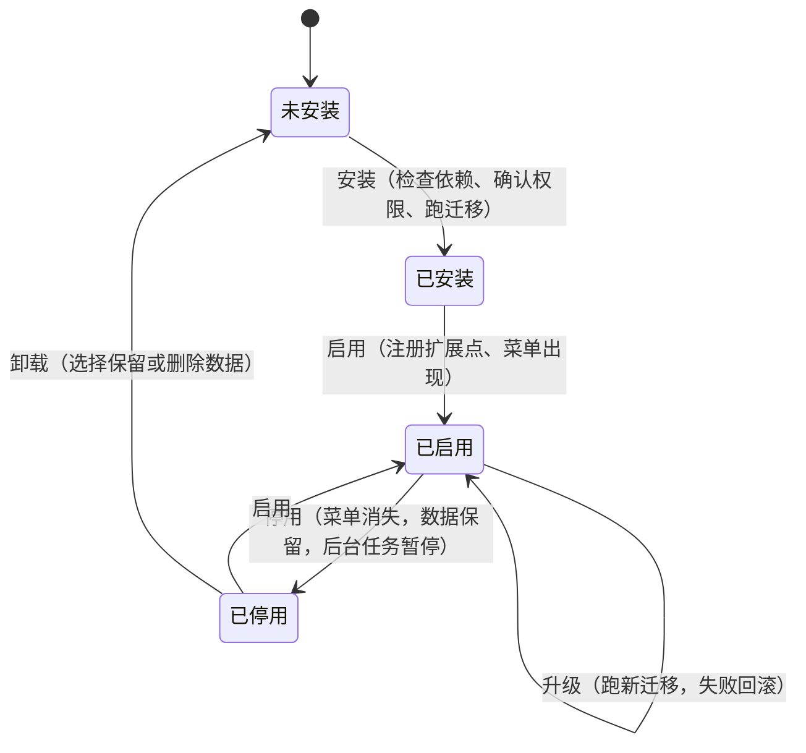
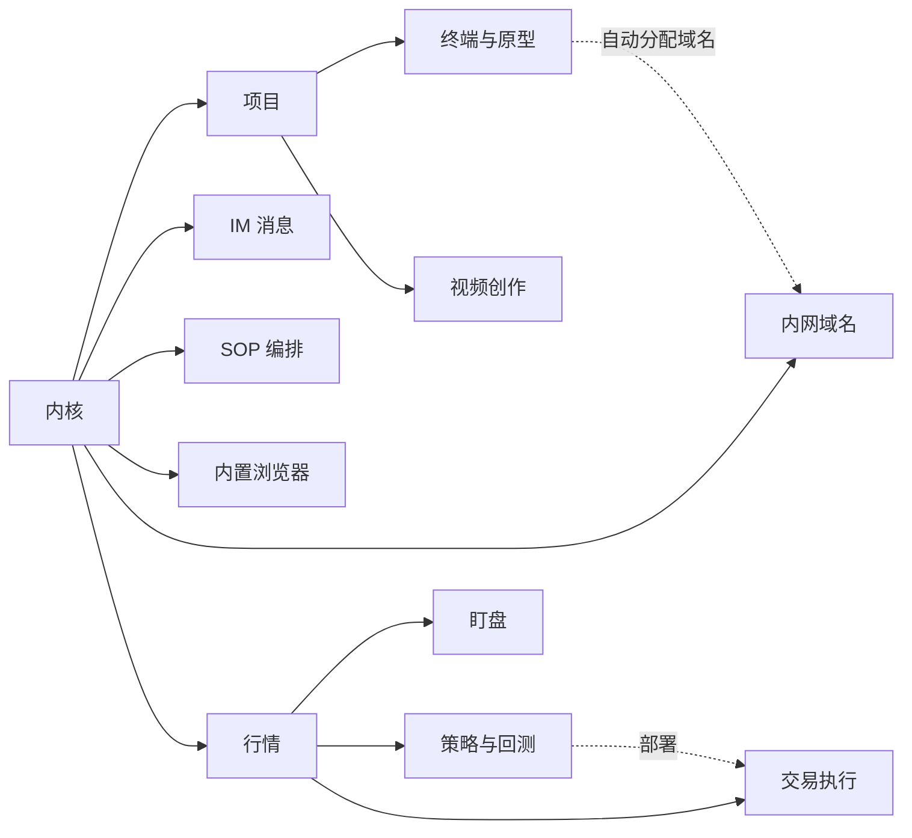
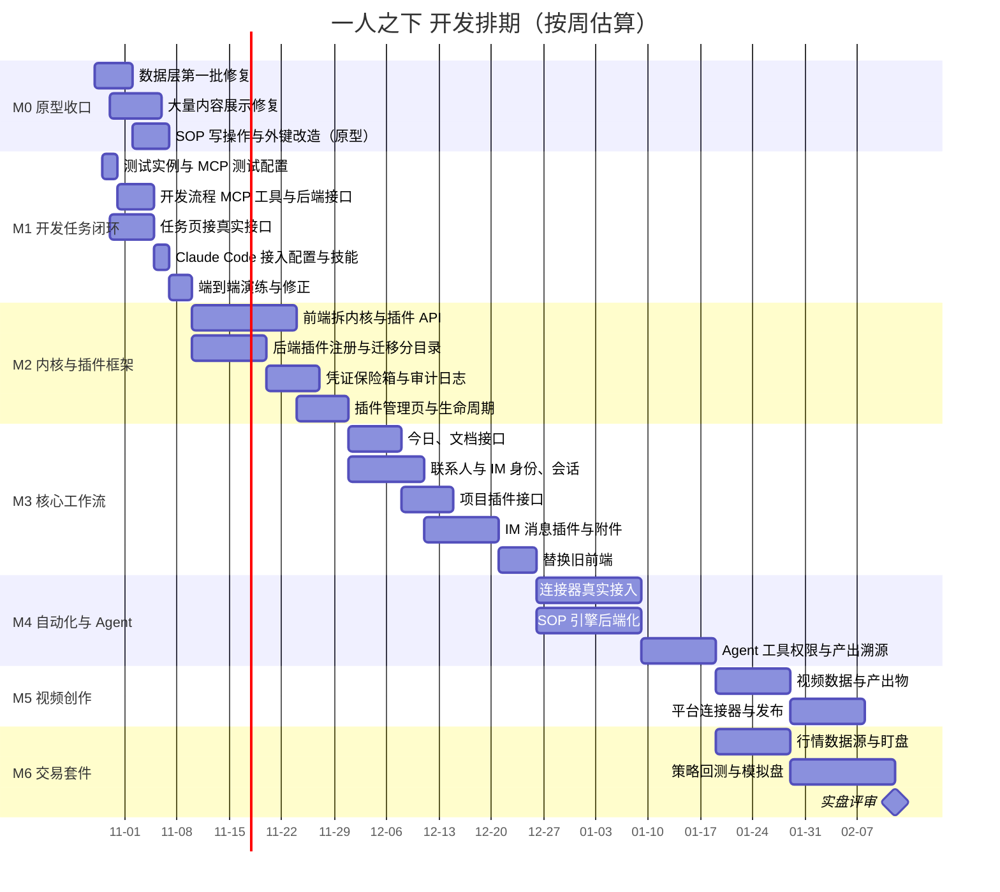
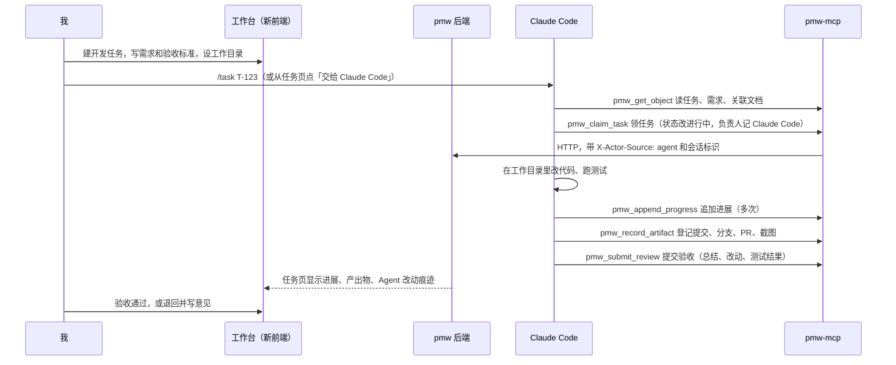
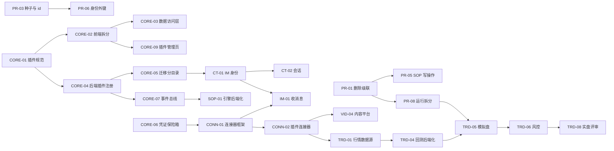

# 一人之下 开发计划

- 版本：v3（2026-10-28）：运行中的服务已停（pmw 从 launchd 卸下并禁用自启，真实库已清空并备份），只保留原型；按原型开发，原型就是规格
- v2：调整顺序，先做「开发任务闭环」，用来测试 Claude Code 通过 MCP 协助开发的流程
- 范围：把 `web-next` 原型落成真实产品，接上现有 Go 后端（`pmw`，127.0.0.1:7777，SQLite），替换旧前端 `web/`
- 第一优先：开发任务闭环。任务相关功能和对应的 MCP 工具一起开发，Claude Code 能通过 MCP 领任务、记进展、登记产出、提交验收
- 主线：内核加插件。功能模块做成插件，可以单独安装、启用、停用、卸载；工作台模板就是「一组插件加菜单分组」的预设
- 依据：`docs/data-model-analysis.md`（数据层问题）、`docs/video-creator-analysis.md`（视频博主缺口）、`docs/bulk-content-audit.md`（大量内容下的展示问题，审查中）、仓库根目录 `docs/api-contract.md`、`docs/local-domain.md`、`docs/efficiency-roadmap.md`

---

## 0. 按原型开发：原型就是规格

现在的状态：

| 项 | 状态 |
|---|---|
| 原型 `web-next`（7778） | 运行中，只做规格和演示：内容保持干净，修完展示问题后冻结 |
| 正式前端 | 新建独立工程，放在仓库根目录 `frontend/`，不在原型上演进 |
| 工作台 | 不隔离：所有工作台共用一份数据，切工作台只换菜单和插件组合 |
| 任务状态 | 待办类型加了「待验收」（review），迁移 0013，下次启动 pmw 时应用 |
| 后端 pmw（7777） | 已停，launchd 已卸下并禁用自启；恢复命令见文末附录 |
| 真实库 `data/pm.db` | 已清空，清空前的备份在 `data/backups/pm-before-reset-20261028-174735.db` |
| 开发任务闭环的后端和 MCP | 已开发完（未提交），测试实例上端到端演练通过 |
| 旧前端 `web/` | 不再迭代，新前端上线后删除 |

开发方式：

1. **原型冻结成规格**。每个模块以原型的页面、交互和 `*data.ts` 里的类型为准；冻结前修完 M0（数据层问题、大量内容展示问题）。冻结后原型只改规格错误，新想法先进需求池。
2. **规格包**。按模块整理一份「原型规格包」：页面截图（亮暗、桌面和手机宽度）、交互清单（每个按钮做什么、空状态、异常状态）、数据结构（从 `*data.ts` 导出）、和其它模块的联动。每个开发任务都指向规格包里的一节，验收就是「真实产品和原型一致」。
3. **正式前端是独立工程**。在仓库根目录新建 `frontend/`，从第一天就按内核加插件的结构搭，数据全部走接口层，构建产物嵌进 Go 二进制（替换旧前端 `web/`）。原型的交互和样式是参考：可以照着写、挑着搬，但两个工程互不依赖，正式前端不 import 原型的代码。
4. **原型保持干净**。原型只做两件事：当规格、给人看。所以：
   - 示例数据是一套前后对得上的演示故事线，不放测试数据、压测数据、调试用的东西；
   - 不放开发残留（截图、临时脚本、调试开关）；
   - 有一个总览入口，按模块列出每页是做什么的、对应规格包哪一节，方便以后提需求时快速找到；
   - 原型改动只有两种：规格本身要改（需求变了），或者原型和规格对不上（修错）。工程化的东西（接口、状态管理、权限、性能）都不进原型。
5. **后端按原型的数据结构建表**。原型里的实体大多是强类型的（视频、策略、委托、连接器……），通用「工作对象」表放不下，新表按插件分目录建（见 2.6）。需求、任务、文档继续用现有的对象表。
6. **每个开发任务都走开发任务闭环**：在工作台里建任务、写验收标准，用 Claude Code 的 `/task` 去做，进展和产出都记在任务上。后端起来之前，先用测试实例（`scripts/dev-instance.sh`）跑。

规格包的整理可以和 M0 收尾并行：先做已经稳定的模块（今日、任务、文档、联系人、IM 消息、项目），视频、交易等 M0 修完再做。

---

## 1. 现状

### 1.1 原型与后端的对照

原型（`web-next`）已经有 15 个功能模块，数据全在内存里。后端已经有通用的「工作对象」模型和一批接口。对照如下。

| 原型模块 | 后端现状 | 差距 |
|---|---|---|
| 今日 | 无专门接口，可由对象查询拼出 | 需要聚合接口（待办、到期、等确认、运行中） |
| 项目 | objects（类型可配）、links、workdir（0008）、stakeholders（0010） | 沟通渠道绑定、支持材料、原型启停没有 |
| 任务 | objects + runs（0009 任务执行） | Webhook、定时任务、IM 转任务没有 |
| 文档 | objects + categories + tags + fs 浏览 | 本地目录挂载、阅读器基本可复用 |
| 联系人 | stakeholders 名册 | IM 身份（contact_identity）没有 |
| IM 消息 | 无 | 连接器收消息、会话（conversation）、附件全部要做 |
| 会话 / Agent | agent-providers（0006）、agent sessions（0007、0011） | Agent 配置、技能、知识库、工具权限、产出物溯源 |
| 产出物 | artifacts（0012，未提交） | 视频产出物的版本、比例、验收要扩字段 |
| SOP | 无 | 引擎、节点、运行记录全部要做 |
| 终端 / 浏览器 | fs 接口 | 终端会话、原型进程管理、浏览器为纯前端 |
| 内网域名 | 已有真实方案：`bro.vip` + hosts + pf + mkcert（`docs/local-domain.md`） | 原型的设置页默认 `pmw.lan`，要和真实方案对齐 |
| 视频 | 无 | 全部要做 |
| 交易 | 无 | 全部要做，且涉及真实资金 |
| 设置 | dictionaries（0005）、agent-providers | 连接器、工作台、插件管理、外观 |

### 1.2 原型自身的问题（来自数据层分析）

| 级别 | 问题 | 处理 |
|---|---|---|
| P0 | 删除不级联也不拦截 | 第一批修复中 |
| P0 | 凭证明文存在前端 | 接后端时做加密的 secret 表，前端只拿脱敏提示 |
| P0 | 消息、联系人、群聊靠名字和编号匹配 | 建 contact_identity、conversation，改外键 |
| P0 | id 前缀冲突、运行时 id 会撞 | 第一批修复中 |
| P0 | 种子数据自相矛盾 | 第一批修复中 |
| P1 | 枚举两份来源 | 第一批修复中 |
| P1 | SOP 写操作是假的 | 第二批 |
| P1 | 「运行」一词六种含义，类型重名 | 插件化时按「执行」和「部署」两类拆开 |
| P1 | 文档、材料、项目文档、产出物、Agent 产出五个概念重叠 | 统一成 file + artifact + 溯源 |

---

## 2. 架构：内核加插件

### 2.1 为什么插件化

- 不同角色用的模块差很多：交易员不需要视频，视频博主不需要交易，装上不用的模块只会增加菜单、数据和风险
- 交易、视频这类垂直模块迭代节奏和风险等级跟内核完全不同，绑在一起发布会互相拖累
- 交易插件涉及真实资金，要能单独审计、单独停用

### 2.2 内核负责什么



内核模块（今日、任务、文档、联系人、会话、设置）默认装好不能卸载；其余都是插件。

### 2.3 插件能往内核里注册什么

| 扩展点 | 说明 | 例子 |
|---|---|---|
| 功能模块 | 一级菜单项和它的页面、二级菜单 | 视频、行情 |
| 设置分节 | 设置里的一节 | 内网域名 |
| 对象类型 | 带字段定义的对象类型，数据放内核对象表或插件自己的表 | 视频、策略 |
| 数据迁移 | 插件自己的表，表名带插件前缀，迁移按插件分目录、单独记版本 | `video_*`、`trade_*` |
| 连接器 | 连接器定义（认证方式、工具清单） | B 站、Binance 行情 |
| 技能、Agent 工具 | 给 Agent 用的技能和工具 | 网页演示做视频、盘前简报 |
| SOP 节点 | 自定义节点类型 | 发布到平台 |
| 今日卡片 | 今日页上的一块 | 待验收的视频、触发的提醒 |
| 命令面板命令 | 可搜索的操作 | 新建视频、下单 |
| 事件订阅 | 订阅内核事件 | 消息到达、任务完成 |

### 2.4 插件清单

每个插件带一份清单，内核按它决定能不能装、装什么。

```json
{
  "id": "video",
  "name": "视频创作",
  "version": "0.3.0",
  "core": ">=1.2 <2",
  "depends": { "projects": ">=1.0" },
  "provides": {
    "modules": ["videos"],
    "settings": [],
    "connectors": ["bilibili", "youtube", "douyin", "channels", "xiaohongshu", "tts"],
    "skills": ["sk_video", "sk_video_review"],
    "sop_nodes": ["publish_video"],
    "today_cards": ["video_waiting"]
  },
  "permissions": ["fs:read:project", "fs:write:project", "network:media-platforms", "secrets:media"],
  "migrations": "migrations/video"
}
```

权限需要在安装时让用户确认。交易插件额外要求 `trade:live` 权限，并且默认只开模拟盘。

### 2.5 前端怎么加载

- 每个插件一个独立的代码块，用动态 `import()` 加 `React.lazy` 按需加载；没装的插件不进首屏包
- 插件通过插件 API 注册扩展点，不直接读写别的模块的状态；数据只能走内核的数据访问层（将来就是 REST）
- 内核把现在 `App.tsx` 里各模块的状态和接线拆出来，每个插件自己管自己的状态（这是第一大块重构）
- 第一方插件和内核放在同一个仓库里一起构建，第三方插件以后再考虑

### 2.6 后端怎么加载

| 方案 | 优点 | 缺点 | 结论 |
|---|---|---|---|
| Go `plugin` 包加载 .so | 真正的动态加载 | 只支持 Linux 和 macOS，必须用同一版本编译器和依赖，几乎不可维护 | 不用 |
| 第一方插件编译进二进制，按插件启停 | 简单可靠，迁移、接口统一管理 | 加新插件要重新发版 | 第一方插件用这个 |
| 进程外插件（子进程，走 HTTP 或 MCP 协议） | 隔离好，能用任何语言写 | 要定义协议、管理进程 | 第三方插件以后用这个 |

迁移按插件分目录，每个插件单独记版本。已经应用过的迁移不能再改（0001 到 0004 没有校验和，更要小心），插件的迁移从新编号开始，不碰现有表。

### 2.7 生命周期



- 停用时，被别的插件依赖的要先提示（比如停用「项目」会影响「视频」）
- 交易插件停用前必须先「一键全停」：没有在跑的部署、没有挂单才允许停用
- 卸载时默认保留数据，删除数据需要二次确认，并且先自动备份（后端已有 backup 接口）

### 2.8 现有模块怎么分

| 归属 | 模块 | 依赖 |
|---|---|---|
| 内核 | 今日、任务（含定时、Webhook）、文档、联系人、会话与 Agent、设置 | 无 |
| 插件：项目 | 项目、干系人、支持材料、原型启停 | 内核 |
| 插件：IM 消息 | 消息收件箱、与我相关、附件 | 内核（连接器框架） |
| 插件：SOP 编排 | 编辑器、节点、执行 | 内核 |
| 插件：终端与原型 | 分屏终端、原型进程 | 项目 |
| 插件：内置浏览器 | 浏览器、Google 登录 | 内核 |
| 插件：内网域名 | 域名、证书、代理 | 内核；和「终端与原型」联动但不强依赖 |
| 插件：视频创作 | 制作流程、产出物、系列、发布 | 项目 |
| 插件：交易套件 | 行情、盯盘、策略与回测、交易执行 | 内核；四个子插件可以单独装，交易执行依赖行情 |



---

## 3. 里程碑

| 里程碑 | 目标 | 完成标志 |
|---|---|---|
| M0 原型收口 | 修完数据层问题（进行中的三批），大量内容展示修复放到 M2 之前做完 | check-seeds 0 error |
| M1 开发任务闭环（优先） | 任务功能接真实后端，补齐开发流程需要的 MCP 工具，Claude Code 端到端走通一条开发任务 | 见第 4.0 节验收；在测试实例上演练通过后再切到真实库 |
| M2 内核与插件框架 | 前端拆出内核和插件 API，后端插件注册、迁移分目录、凭证保险箱、事件总线；M1 做好的任务功能成为内核的第一块 | 「项目」插件能安装、停用、卸载 |
| M3 核心工作流上线 | 今日、文档、联系人、项目、IM 消息接上真实接口，替换旧前端 | 日常用新前端，旧前端保留一个版本做回退 |
| M4 自动化与 Agent | SOP 引擎真落地、Agent 工具权限、连接器真实接入、技能和知识库 | 一条「IM 转任务再由 Agent 处理」的流程端到端跑通 |
| M5 视频创作插件 | 制作流程、产出物、系列、发布、数据回填接真实数据 | 一个系列完整周更一次 |
| M6 交易套件插件 | 行情接真实数据源，策略回测，模拟盘部署；实盘最后单独评审 | 模拟盘连续跑两周无异常 |



M5 和 M6 互不依赖，人手够可以并行。排期按一个人加子代理并行开发估算，每次里程碑结束复盘一次再调整。

---

## 4. 分模块任务

规模：S 是一天以内，M 是两到三天，L 是一周左右。负责：前端、后端、全栈。编号规则：`模块缩写-序号`。

### 4.0 开发任务闭环（M1，优先）

目标：在工作台里建一条开发任务，Claude Code 通过 MCP 把它从「待办」做到「待验收」，你在新前端的任务页里能看到全过程。



两种入口都要支持：在 Claude Code 里用 `/task` 主动领任务；在任务页点「交给 Claude Code」，走后端已有的 `POST /api/objects/{id}/run`。

| 编号 | 任务 | 负责 | 规模 | 依赖 | 验收 |
|---|---|---|---|---|---|
| DEV-01 | 测试实例：临时编译 pmw，在另一个端口跑真实库的副本；一条脚本完成复制、启动、停止 | 后端 | S | 无 | 不碰 7777 和 data/pm.db；脚本按 pid 停进程 |
| DEV-02 | MCP 测试配置：一份指向测试实例的 MCP 配置，Claude Code 用 `--mcp-config` 加载 | 后端 | S | DEV-01 | `/mcp` 里能看到测试实例的工具 |
| DEV-03 | 任务字段补齐：验收标准、工作目录（已有）、关联仓库；能复用现有表就不加迁移，要加从 0013 开始只加不改 | 后端 | M | 无 | 0001 到 0012 一行不动 |
| DEV-04 | 追加进展接口：服务端追加，不是读出来再整体替换，避免并发覆盖 | 后端 | S | 无 | 两个会话同时追加不丢内容 |
| DEV-05 | MCP 工具：`pmw_claim_task`、`pmw_append_progress`、`pmw_submit_review`、`pmw_next_task`、`pmw_create_subtasks`、`pmw_list_runs`、`pmw_get_run`；`pmw_record_artifact` 补提交、分支、PR 几种类型 | 后端 | L | DEV-03、DEV-04 | 工具描述写清读写、参数和约定；写工具都带「会写入数据」标注 |
| DEV-06 | 改动痕迹带会话标识：MCP 写入时带上 Claude Code 会话 id，变更记录能看出是哪次会话改的 | 后端 | S | DEV-05 | 任务页能按会话分组看 Agent 改动 |
| DEV-07 | 任务页接真实接口：列表、详情、新建、改状态，类型和状态从后端读，不写死 | 前端 | L | DEV-01 | 刷新数据不丢；和旧前端看到的是同一份 |
| DEV-08 | 任务详情：进展时间线、产出物、执行记录（SSE 流式显示）、Agent 改动痕迹、验收和退回 | 前端 | L | DEV-05、DEV-07 | 能看到 Claude Code 每一步做了什么 |
| DEV-09 | 「交给 Claude Code」：选工作目录、只读或允许写入、附加说明，调用执行接口并实时显示 | 前端 | M | DEV-08 | 默认只读；允许写入要明确勾选 |
| DEV-10 | Claude Code 接入：项目级 `/task` 命令或技能，写清领任务、记进展、登记产出、提交验收的流程；只读工具加入免确认清单，写工具保留确认 | 后端 | M | DEV-05 | 新会话里一条 `/task T-xxx` 就能开工 |
| DEV-11 | 端到端演练：在测试实例上建演示任务，用 Claude Code 在沙箱仓库里完成，检查状态、进展、产出物、改动痕迹 | 全栈 | M | DEV-08、DEV-10 | 演练脚本可重复跑；问题记进任务 |
| DEV-12 | 文档同步：`docs/api-contract.md`、`docs/mcp.md` 更新新接口和工具 | 后端 | S | DEV-05 | 契约测试通过 |

切到真实库的条件：DEV-11 在测试实例上连续跑通三次、没有误写；切换时先备份 data/pm.db，并且由你来重启 7777 上的服务。

### 4.0b 原型维护与正式前端工程

| 编号 | 任务 | 负责 | 规模 | 依赖 | 验收 |
|---|---|---|---|---|---|
| PROTO-01 | 示例数据整理成一套干净的演示故事线：一个人、几个项目、一周的工作，各模块数据互相对得上 | 前端 | M | PR-03 | 每个模块打开都有能看懂的内容；没有测试、压测、调试数据 |
| PROTO-02 | 清理原型里的开发残留（`src/` 下的截图、临时代码、调试开关） | 前端 | S | 无 | `web-next/src` 只剩原型代码 |
| PROTO-03 | 原型总览页：按模块列出页面、一句话说明、对应规格包章节 | 前端 | S | 规格包 | 提需求时能从总览一步找到对应页面 |
| PROTO-04 | 规格包：每个模块的截图、交互清单、数据结构、联动 | 前端 | L | M0 | 每个开发任务都能指向一节 |
| FE-00 | 新建独立前端工程 `frontend/`：React + TypeScript + Vite，路由、接口层、状态管理、内核加插件目录结构 | 前端 | M | CORE-01 | 空壳能跑，能按插件清单加载模块 |
| FE-01 | 设计基础：从原型抽出颜色、字号、间距等设计变量和基础组件（按钮、输入框、抽屉、表格、二级菜单、可搜索选择器） | 前端 | M | FE-00 | 亮暗主题和原型一致 |
| FE-02 | 接口层和类型：按 `docs/api-contract.md` 生成或手写类型，统一错误处理和加载状态 | 前端 | M | FE-00 | 组件里不直接 fetch |
| FE-03 | 构建产物嵌入 Go 二进制，替换旧前端 `web/` | 全栈 | S | FE-00 | `make build` 产出的 pmw 带新前端 |
| FE-04 | 截图对照测试：同一页面在原型和正式前端各截一张，人工或半自动比对 | 前端 | M | FE-01 | 每个模块上线前过一遍 |

### 4.1 原型收口（M0）

| 编号 | 任务 | 负责 | 规模 | 依赖 | 验收 |
|---|---|---|---|---|---|
| PR-01 | 删除级联与拦截（15 种删除） | 前端 | M | 无 | 删策略会停掉部署并撤单；删连接器先列出影响；不留悬空引用。进行中 |
| PR-02 | 枚举统一来源 | 前端 | M | 无 | 设置里改状态名和颜色，各页面同步变化。进行中 |
| PR-03 | 种子数据修复、统一 id 生成 | 前端 | M | 无 | check-seeds 0 error；文档 id 改用 dc_ 前缀。进行中 |
| PR-04 | 大量内容展示修复 | 前端 | L | 审查报告 | 报告里的 P0、P1 全修完，菜单不平铺几十项 |
| PR-05 | SOP 写操作真落地（原型内） | 前端 | M | PR-01 | 建任务、写文档、回复消息、写联系人这些节点执行后数据真的变了 |
| PR-06 | 联系人身份与会话改外键（原型内） | 前端 | L | PR-03 | 消息改指向 identity_id 和 conversation_id；改群名、改编号不断关联 |
| PR-07 | 内网域名与 bro.vip 方案对齐 | 前端 | S | 无 | 默认后缀、HTTPS、端口转发说明和 local-domain.md 一致 |
| PR-08 | 「运行」概念拆分与重命名 | 前端 | M | PR-01 | 「执行」和「部署」两类分开，类型不再重名 |

### 4.2 内核与插件框架（M2）

| 编号 | 任务 | 负责 | 规模 | 依赖 | 验收 |
|---|---|---|---|---|---|
| CORE-01 | 定义插件清单格式和插件 API（扩展点见 2.3） | 全栈 | M | 无 | 有文档和类型定义，评审通过 |
| CORE-02 | 正式前端的外壳、内核模块、插件注册表（在 FE-00 的工程里做，不改原型） | 前端 | L | CORE-01、FE-00 | 每个插件独立目录、独立状态，按需加载 |
| CORE-03 | 正式前端的数据访问层：统一的读写接口，直接对接 REST | 前端 | L | CORE-02、FE-02 | 组件里不直接改别的模块的状态 |
| CORE-04 | 后端插件注册：第一方插件编译进二进制，按配置启停 | 后端 | M | CORE-01 | 停用的插件接口返回 404，后台任务不跑 |
| CORE-05 | 迁移按插件分目录、单独记版本，带校验和 | 后端 | M | CORE-04 | 新插件迁移不改动已应用的 0001 到 0012 |
| CORE-06 | 凭证保险箱：连接器配置、API Key、Webhook 密钥加密存储，接口只返回脱敏提示 | 后端 | M | 无 | 前端拿不到明文；有轮换接口 |
| CORE-07 | 事件总线和通知（消息到达、任务完成、提醒触发） | 后端 | M | CORE-04 | 插件可以订阅；今日页可以消费 |
| CORE-08 | 审计日志：配置变更、删除、Agent 写操作、下单 | 后端 | M | CORE-07 | 可按对象、时间查询 |
| CORE-09 | 插件管理页：已装、可装、启停、卸载、权限确认、依赖检查 | 前端 | M | CORE-02 | 「项目」插件走完整生命周期 |
| CORE-10 | 工作台模板改成插件组合预设，切换工作台时提示缺哪些插件；工作台之间数据不隔离，只换菜单和插件 | 前端 | S | CORE-09 | 选「交易员」模板会提示安装交易套件 |
| CORE-11 | 统一 id 和编号：后端生成 id，任务编号由后端序列发 | 后端 | S | 无 | 前端不再自增编号 |

### 4.3 今日、任务、文档（内核，M3）

| 编号 | 任务 | 负责 | 规模 | 依赖 | 验收 |
|---|---|---|---|---|---|
| TODAY-01 | 今日聚合接口：等确认、到期、运行中、各插件今日卡片 | 后端 | M | CORE-07 | 一次请求拿全，插件可以往里加卡片 |
| TODAY-02 | 今日页接真实接口，插件卡片按启用情况显示 | 前端 | S | TODAY-01 | 停用插件后对应卡片消失 |
| TASK-01 | 任务接口对齐原型其余字段（来源、项目），基础读写在 DEV-07 已完成 | 后端 | S | DEV-07 | 原型任务页能完整读写 |
| TASK-02 | Webhook 收件和去重（删任务后可重新建） | 后端 | M | TASK-01 | 同一投递不重复建任务 |
| TASK-03 | 定时任务调度（复用 runs 执行记录） | 后端 | M | TASK-01 | 到点执行，记录可查 |
| TASK-04 | 任务页、定时任务页、Webhook 页接接口 | 前端 | M | TASK-01..03 | 刷新后数据还在 |
| DOC-01 | 文档接对象模型、分类、标签、本机目录挂载 | 全栈 | M | CORE-03 | 本地目录选择后能持久保存 |

### 4.4 联系人与会话（内核，M3）

| 编号 | 任务 | 负责 | 规模 | 依赖 | 验收 |
|---|---|---|---|---|---|
| CT-01 | contact_identity 表：一个联系人多个渠道身份 | 后端 | M | CORE-05 | 消息按 identity_id 关联联系人 |
| CT-02 | conversation 表：群聊和私聊有稳定 id，名字可改 | 后端 | M | CT-01 | 改群名不断项目绑定 |
| CT-03 | 联系人页、干系人接接口 | 前端 | M | CT-01 | 原型功能全部可用 |
| AG-01 | Agent 配置、技能、知识库接口（复用 agent-providers、sessions） | 后端 | L | CORE-06 | Agent 记的模型带服务商 id |
| AG-02 | Agent 工具权限：按连接器工具逐项授权（自动、确认、关闭） | 全栈 | M | AG-01、CONN-01 | 没授权的工具 Agent 调不到 |
| AG-03 | 产出溯源：Agent 产出、视频产出物、项目材料统一进 artifact 和 file | 后端 | M | 0012 artifacts | 五个概念合成两个 |

### 4.5 项目插件（M3）

| 编号 | 任务 | 负责 | 规模 | 依赖 | 验收 |
|---|---|---|---|---|---|
| PJ-01 | 项目做成插件：清单、迁移、扩展点 | 全栈 | M | CORE-09 | 能单独安装、停用 |
| PJ-02 | 沟通渠道绑定（按 conversation_id） | 全栈 | M | CT-02 | 项目沟通页只看绑定的会话 |
| PJ-03 | 支持材料、项目文档合并成「项目资料」 | 全栈 | M | AG-03 | 附件、文件、链接、笔记统一管理 |
| PJ-04 | 原型进程管理：启停、端口冲突检查、日志 | 后端 | M | PJ-01 | 进程崩溃能看到原因并记运行异常 |

### 4.6 IM 消息插件（M3、M4）

| 编号 | 任务 | 负责 | 规模 | 依赖 | 验收 |
|---|---|---|---|---|---|
| IM-01 | 收消息框架：每个 IM 连接器一个拉取或回调适配器 | 后端 | L | CONN-01、CT-01 | 先接 Slack 和 Telegram，消息落库 |
| IM-02 | 回复、稍后提醒、转任务 | 全栈 | M | IM-01、TASK-01 | 原型里的处理动作全部可用 |
| IM-03 | 与我相关：按账号身份识别 @我、@所有人、私聊 | 后端 | S | IM-01 | 「我」的称呼从连接器账号来，不写死 |
| IM-04 | 附件获取：下载到本地附件目录，可加进项目资料 | 全栈 | M | IM-01、PJ-03 | 渠道异常时获取失败并记运行异常 |

### 4.7 连接器与模型服务商（内核，M4）

| 编号 | 任务 | 负责 | 规模 | 依赖 | 验收 |
|---|---|---|---|---|---|
| CONN-01 | 连接器框架：OAuth 回调、Token、工具清单拉取、单工具单账号 | 后端 | L | CORE-06 | GitHub、Google Drive、Google 日历真实接通 |
| CONN-02 | 插件可以注册连接器（内容平台、行情数据源归各自插件） | 全栈 | S | CONN-01、CORE-01 | 停用视频插件后内容平台连接器隐藏 |
| CONN-03 | 删除连接器的影响检查（消息、Agent 工具、提醒） | 后端 | S | CONN-01 | 与原型 PR-01 的策略一致 |
| MP-01 | 模型服务商真实连通测试、可用模型列表 | 后端 | M | CORE-06 | 至少 Anthropic、OpenAI、DeepSeek、Ollama |

### 4.8 SOP 编排插件（M4）

| 编号 | 任务 | 负责 | 规模 | 依赖 | 验收 |
|---|---|---|---|---|---|
| SOP-01 | 执行引擎搬到后端：DAG、并行、分支、人工检查点、断点续跑 | 后端 | L | CORE-07 | 后端重启后运行能继续 |
| SOP-02 | 写操作节点真落地（建任务、写文档、回复消息、写联系人、发布视频） | 后端 | M | SOP-01 | 节点执行有审计记录 |
| SOP-03 | 插件可以注册节点类型 | 全栈 | M | SOP-01、CORE-01 | 视频插件的「发布到平台」节点出现在编辑器里 |
| SOP-04 | 编辑器和运行页接接口，AI 协助生成流程 | 前端 | M | SOP-01 | 原型功能全部可用 |

### 4.9 终端、浏览器、内网域名插件（M3、M4）

| 编号 | 任务 | 负责 | 规模 | 依赖 | 验收 |
|---|---|---|---|---|---|
| TERM-01 | 真终端：后端 pty 加 WebSocket，2x2 分屏 | 全栈 | M | PJ-04 | 能跑项目原型命令 |
| BR-01 | 浏览器标签页持久化；Google 账号状态存后端，与连接器一致 | 全栈 | S | CONN-01 | 刷新不丢；退出 Google 后连接器同步断开 |
| BR-02 | 不能嵌入的站点：给出系统浏览器打开、地址白名单 | 前端 | S | 无 | 无报错空白页 |
| DOM-01 | 内网域名插件接现有 bro.vip 方案：hosts、pf 转发、mkcert 证书状态检测 | 后端 | M | CORE-04 | 设置页显示真实状态，生成的配置可以直接用 |
| DOM-02 | 原型自动分配域名并写入代理（内置代理按域名转发） | 后端 | M | DOM-01、PJ-04 | 原型启动后域名可访问 |

### 4.10 视频创作插件（M5）

| 编号 | 任务 | 负责 | 规模 | 依赖 | 验收 |
|---|---|---|---|---|---|
| VID-01 | 视频、系列、检查点、产出物数据表和接口 | 后端 | M | CORE-05、AG-03 | 原型数据结构全部落库 |
| VID-02 | 产出物结构对齐 web-video-presentation 技能（封面 4:3、3:4，横竖两套文稿） | 全栈 | M | VID-01 | 抖音要的 3:4 封面能登记 |
| VID-03 | 制作阶段调技能、SOP、Agent（一键跑某个阶段） | 全栈 | L | VID-01、SOP-03 | 规划检查通过后能直接开始网页开发 |
| VID-04 | 内容平台连接器：B 站、YouTube、抖音的上传和数据拉取 | 后端 | L | CONN-02 | 至少 B 站完整打通 |
| VID-05 | 发布记录和数据按天存快照，曝光、点击率、留存 | 后端 | M | VID-04 | 能做封面 A/B 对比 |
| VID-06 | 内容日历（复用定时任务，新增「发布」动作） | 全栈 | M | TASK-03、VID-04 | 日历上能看到排期并到点发布 |
| VID-07 | 今日页卡片：待验收、待发布、发布失败 | 前端 | S | TODAY-01 | 停用插件后卡片消失 |
| VID-08 | 选题库、评论收件箱、商单（P1，来自视频博主分析） | 全栈 | L | VID-01、IM-01 | 评论可以转选题 |

### 4.11 交易套件插件（M6）

| 编号 | 任务 | 负责 | 规模 | 依赖 | 验收 |
|---|---|---|---|---|---|
| TRD-01 | 行情数据源适配：Binance、OKX 公开行情先接，富途 OpenD、Tushare、Polygon 后接 | 后端 | L | CONN-02 | K 线、盘口、资金费率与交易所一致 |
| TRD-02 | 行情推送（WebSocket）和本地缓存 | 后端 | M | TRD-01 | 行情页不再用模拟价格 |
| TRD-03 | 盯盘提醒放后端定时检查，推送走事件总线 | 后端 | M | TRD-02、CORE-07 | 页面关着也能提醒 |
| TRD-04 | 回测引擎搬到后端，用真实历史数据，结果持久化 | 后端 | L | TRD-01 | 回测记录刷新不丢 |
| TRD-05 | 模拟盘撮合和策略部署（「部署」与 SOP「执行」分开建模） | 后端 | L | TRD-04、PR-08 | 模拟盘连续跑两周 |
| TRD-06 | 风控：仓位上限、日亏损熔断、单笔上限、一键全停，全部在后端强制 | 后端 | M | TRD-05 | 前端绕不过风控 |
| TRD-07 | 交易账户接入：API Key 存保险箱，默认只读，交易权限单独开启 | 后端 | M | CORE-06 | 永不申请提币权限 |
| TRD-08 | 实盘评审：审计日志、对账、异常处理、停用插件前强制全停 | 全栈 | M | TRD-06、CORE-08 | 评审通过前实盘开关不可用 |

### 4.12 质量与发布（贯穿）

| 编号 | 任务 | 负责 | 规模 | 依赖 | 验收 |
|---|---|---|---|---|---|
| QA-01 | 前端单元测试和组件测试框架（Vitest） | 前端 | M | CORE-02 | 关键纯函数有测试：回测、提醒、级联、迁移 |
| QA-02 | Playwright 冒烟测试固定下来，进 Makefile | 前端 | S | 无 | 所有模块、亮暗、三种宽度一条命令跑完 |
| QA-03 | 大量数据压测数据集，作为固定的测试夹具 | 前端 | S | PR-04 | 每次改列表和菜单都跑一遍 |
| QA-04 | 后端接口契约测试与 api-contract.md 同步 | 后端 | M | 持续 | 契约文档和实现不一致时测试失败 |
| REL-01 | 正式前端构建产物嵌入二进制，替换旧前端 `web/`（同 FE-03） | 全栈 | S | M3 | 旧前端保留一个版本作为回退 |
| REL-02 | 迁移前自动备份、迁移失败回滚 | 后端 | S | CORE-05 | 真实库在 data/pm.db，上线前先演练 |

---

## 5. 依赖关系



关键路径：插件规范、前端拆分、数据访问层、连接器框架，然后才是各插件接真实数据。插件规范定下来之前，不要开始任何插件的后端开发。

---

## 6. 风险与待决策

| 事项 | 影响 | 建议 |
|---|---|---|
| 真实库 data/pm.db 和 7777 服务在日常使用 | 迁移出错会损坏真实数据 | 迁移先在备份副本上演练；不重启用户在跑的服务，测试用临时二进制和临时端口 |
| 已应用的迁移不能改 | 插件化和开发任务都可能动表结构 | 真实库已应用到 0012（2026-10-23），新迁移从 0013 开始，只加新表、旧表只加列不改；0001 到 0004 没有校验和，CORE-05 先补 |
| MCP 写工具能改真实库，且没有鉴权 | Claude Code 任何会话都能写 | M1 全程在测试实例上做；写工具保留人工确认；改动痕迹带会话标识 |
| 交易涉及真实资金 | 一旦出错有直接损失 | 默认只开模拟盘；实盘要过 TRD-08 评审；后端强制风控；不申请提币权限 |
| 视频号、小红书不开放发布接口 | 发布无法全自动 | 这两个平台只做「登记加回填链接加拉数据」 |
| 个人微信、Telegram 用户账号接入 | 有封号风险 | 优先企业微信、Bot API；用户账号接入单独提示风险 |
| 前端拆分工作量大 | M1 可能拖期 | 先拆「项目」一个插件跑通整条链路，再批量拆 |
| 插件 API 定得太早会频繁改 | 插件反复返工 | CORE-01 只定第一方需要的扩展点；第三方插件到 M3 之后再开放 |

已定（2026-10-28）：工作台不隔离；正式前端放 `frontend/`；待办类型加「待验收」状态；开发任务闭环代码已提交。

还需要你拍板的三件事：

1. 第三方插件要不要做。建议这一版只做第一方插件，第三方等 M3 之后再看。
2. 交易实盘放在哪个阶段。建议 M6 只到模拟盘，实盘单独立项。
3. 旧前端 `web/` 什么时候下线。建议 M3 完成后保留一个版本做回退，再下一个版本删除。

---

## 7. 当前进行中

| 任务 | 状态 |
|---|---|
| PR-01 删除级联与拦截 | 子代理进行中 |
| PR-02 枚举统一来源 | 子代理进行中 |
| PR-03 种子数据修复、统一 id | 子代理进行中 |
| 大量内容展示审查（PR-04 的输入） | 子代理进行中，报告写到 `docs/bulk-content-audit.md` |

下一批：M1 开发任务闭环。DEV-01 到 DEV-06（后端和 MCP）和 DEV-07（任务页接接口）可以并行，前者只改 Go 代码和 MCP，后者只改 web-next 的任务相关文件。

之后再做：PR-04 大量内容展示修复、PR-05 SOP 写操作、PR-06 身份外键、PR-07 内网域名对齐、CORE-09 插件管理页（原型）。

---

## 附录：恢复后端服务

```bash
launchctl enable gui/$(id -u)/vip.broleez.pmw
launchctl bootstrap gui/$(id -u) ~/Library/LaunchAgents/vip.broleez.pmw.plist
```

恢复旧数据：先停服务，再用 `data/backups/pm-before-reset-20261028-174735.db` 替换 `data/pm.db`（同时删掉 `pm.db-wal`、`pm.db-shm`），然后启动。
