# 浏览器 规格（SPEC-browser）

| 项 | 内容 |
|---|---|
| 模块 key | `browser` |
| 原型入口 | 一级菜单「浏览器」，http://127.0.0.1:7778 |
| 源码 | `web-next/src/browser.tsx`（`BrowserPage`、`Toolbar`、`AccountButton`、`TabMenu`、`AllTabs`、`HomeView`、`FrameView`、`DriveView`、`FilePreview`、`LoginModal`）；接线在 `web-next/src/App.tsx`（`openInBrowser`、`browserReq`、`google`、`googleLogin`、`googleLogout`、`protoRefs`） |
| 数据文件 | `web-next/src/browserdata.ts`（`BrowserTab`、`TabKind`、`GoogleAccount`、`GOOGLE_SCOPES`、`DriveFile`、`DriveMime`、`DriveRoute`、`classify`、`normalize`、`displayUrl`、`sameUrl`、`portOf`、`parseDrive`、`driveUrl`、`avatarColorFor`） |
| 截图 | [`shots/browser/`](shots/browser/) |
| 负责任务 | PROTO-04f2 |
| 对应开发任务 | 见下表「引用本规格的开发任务」 |
| 状态 | 已整理 |
| 最后对照 | 2026-10-29，原型提交 `1e85740` |

### 引用本规格的开发任务

| 任务 | 内容 | 对照的节 |
|---|---|---|
| BR-01a | 浏览器插件后端：标签页持久化、地址白名单和 Google 账号状态 | `SPEC-browser-0`（`BrowserTab`、`GoogleAccount`、`GOOGLE_SCOPES`）、`SPEC-browser-4` |
| BR-01b | 浏览器页：多标签、地址栏、原型标签和 Google 账号 | `SPEC-browser-1` 到 `SPEC-browser-4`；`SPEC-browser-5`（Drive）不搬 |
| BR-02a（原 BR-02） | 处理不能嵌入的站点 | `SPEC-browser-3`（`SPEC-browser-3.6` 到 `3.12`） |
| DOM-01b、DOM-02b | 内网域名分节（点域名在这里打开） | 复核结论见文末「联动：内网域名（SPEC-settings-20 复核）」 |

项目详情里的浏览器展开区域是 `SPEC-projects-14`，和这里是同一个组件（`embedded` 模式）。

## SPEC-browser-0 模块概述

工作台里的浏览器：多标签，看项目原型（本机端口）和普通网页，连上 Google 账号。别的模块里的「打开」（原型卡片、视频预览、发布链接、内网域名、附件链接）都交给它；工作台没开浏览器模块时改用系统浏览器打开。原型和网页用真 iframe 加载；Google Drive 是原型里模拟的文件浏览器，正式版不搬。

### 页面清单

| 节 | 页面 | 入口 | 说明 |
|---|---|---|---|
| [SPEC-browser-1](#spec-browser-1-标签栏和地址栏) | 标签栏和地址栏 | 一级菜单「浏览器」 | 多标签、固定、右键菜单、地址栏、前进后退刷新、账号按钮 |
| [SPEC-browser-2](#spec-browser-2-新标签页) | 新标签页 | 新开的标签；地址栏清空回车 | 最近打开、项目原型、Google Drive 入口 |
| [SPEC-browser-3](#spec-browser-3-原型标签和网页标签) | 原型标签和网页标签 | 地址栏输入端口或网址；别的模块里的「打开」 | 原型没运行时的启动提示、iframe 加载、不能嵌入时的提示和「在系统浏览器打开」 |
| [SPEC-browser-4](#spec-browser-4-google-账号) | Google 账号 | 地址栏右边「登录 Google」或头像 | 登录弹窗、授权范围、账号面板、退出登录 |
| [SPEC-browser-5](#spec-browser-5-google-drive正式版不搬) | Google Drive（正式版不搬） | 新标签页的 Drive 入口；Drive 地址 | 模拟的文件浏览和预览，正式版不搬，见 BR-01b |

### 共用数据结构

`BrowserTab`（`web-next/src/browserdata.ts`）

| 字段 | 类型 | 必填 | 说明 | 取值 / 示例 |
|---|---|---|---|---|
| `id` | `string` | 是 | 编号，`newId('bt')`（前缀 `bt` 已为 BR-01a 预留） | `bt_…` |
| `url` | `string` | 是 | 当前地址，已经过 `normalize` | `http://127.0.0.1:7778`、`about:home` |
| `title` | `string` | 是 | 标签上的名字，按地址算（`titleOf`）或打开时外面给的 | `新版前端原型 · 产品工作台新版`、`新标签页` |
| `kind` | `TabKind` | 是 | 种类，按地址算（`classify`） | `home` 新标签页 / `proto` 原型（本机地址）/ `drive` Google Drive / `web` 网页 |
| `history` | `string[]` | 是 | 这个标签的地址历史 | `['about:home', 'http://127.0.0.1:7790']` |
| `cursor` | `number` | 是 | 当前在 `history` 的第几条，从 0 起 | `1` |
| `loading` | `boolean` | 否 | iframe 还没 `load`（只有 `proto`、`web` 会是 `true`） | |
| `pinned` | `boolean` | 否 | 固定的标签：排最前、只显示图标、不能关 | |

`TabKind` 的判定（`classify`）：空、`about:home`、`about:` 开头是 `home`；主机是 `localhost`、`127.0.0.1`、`0.0.0.0`、`[::1]` 是 `proto`；主机是 `drive.google.com`、`docs.google.com` 是 `drive`；其它是 `web`。

`GoogleAccount`（`web-next/src/browserdata.ts`）

| 字段 | 类型 | 必填 | 说明 | 取值 / 示例 |
|---|---|---|---|---|
| `email` | `string` | 是 | 账号邮箱 | `chen.yi.pm@gmail.com` |
| `name` | `string` | 是 | 显示名；手填邮箱登录时取 `@` 前面 | `陈一` |
| `avatarColor` | `string` | 是 | 头像底色，按邮箱算（`avatarColorFor`，从 `AVATAR_COLORS` 六色里取） | `#3d4fd6` |
| `scopes` | `string[]` | 是 | 授权了的范围，`GOOGLE_SCOPES` 的 key | `['drive.readonly', 'drive.file', 'calendar.events']` |
| `connected_at` | `string` | 是 | 登录时间，ISO 8601 | `2026-10-29T04:12:00.000Z` |

`GOOGLE_SCOPES`：申请的授权范围，`{ key; label; desc }[]`

| `key` | `label` | `desc` |
|---|---|---|
| `drive.readonly` | 查看 Google Drive 文件 | 在内置浏览器里浏览、预览你的云端硬盘 |
| `drive.file` | 管理本应用创建的文件 | 只能读写由「一人之下」创建或打开过的文件 |
| `calendar.events` | 查看和编辑 Google 日历日程 | 把日程同步到工作台的日程页，也允许助手建日程 |

`ProtoEntry`（`web-next/src/browser.tsx`，由 `App.tsx` 的 `protoRefs` 从项目原型算出）：`id`、`name`、`project`（项目名）、`projectId`（可选）、`port`、`status`（`running` 运行中 / `stopped` 未运行 / `starting` 启动中 / `stopping` 停止中 / `error` 启动失败）。

最近打开（原型未导出类型，`browser.tsx` 里的 `Recent`）：`url`、`title`、`kind`（`TabKind`）、`at`（ISO 时间）。只在内存，最多 8 条。

`BrowserPage` 的入参（原型未定义成单独类型）：`openRequest`（`{ url; title?; n }`，`n` 变一次处理一次）、`prototypes`、`onStartProto`、`google`、`onGoogleLogin`、`onGoogleLogout`，可选 `hidden`、`embedded`、`startUrl`、`onCount`、`onEmpty`（后四个是项目里用的，见 `SPEC-projects-14`）。

原型里标签页只在组件内存：切菜单时浏览器只是藏起来（组件不卸载，已加载的页面不重载），刷新就没了。正式版标签整体存后端（BR-01a `GET/PUT /api/browser/tabs`，最多 50 个，字段同 `BrowserTab` 加顺序和是否当前），标签变化防抖后整体 PUT，启动时恢复（BR-01b）。

### 联动总表

| 方向 | 对方模块 | 触发 | 结果 | 见 |
|---|---|---|---|---|
| 进来 | 项目 | 原型卡片、概览原型块的「打开」 | 在这里打开原型地址；已经开着同一地址就切过去 | `SPEC-projects-12` |
| 进来 | 视频、文档附件、开发闭环 | 预览、发布链接、附件链接 | 在这里打开；没开浏览器模块时用系统浏览器 | `SPEC-browser-1.15` |
| 进来 | 设置 / 内网域名 | 点域名 | 在这里打开 `http(s)://<域名>` | `SPEC-settings-20.15` |
| 进来 | 今日 | 「正在运行」块 | 切到浏览器并开一个新标签页 | `SPEC-today-1` |
| 改动 | 项目 | 「启动并打开」「启动原型」 | 启动那个原型 | `SPEC-projects-12` |
| 改动 | 设置 / 连接器 | Google 登录、退出 | Google Drive、Google 日历连接器连上或断开 | `SPEC-settings-5` |
| 相关 | 项目里的浏览器 | 项目详情「浏览器」 | 同一个组件，标签互不相干，Google 账号共用 | `SPEC-projects-14` |

## SPEC-browser-1 标签栏和地址栏

整页没有顶栏：最上面一排标签，下面一行工具栏（后退、前进、刷新、地址栏、「在系统浏览器打开」、账号），再下面是当前标签的内容。

### 截图

| | 亮 | 暗 |
|---|---|---|
| 桌面 1440 | 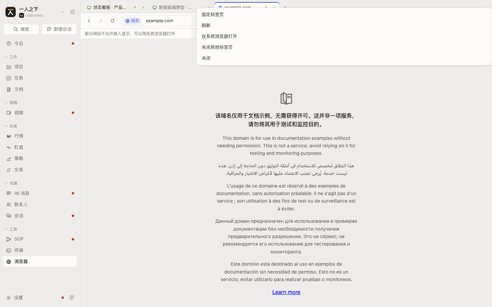 | 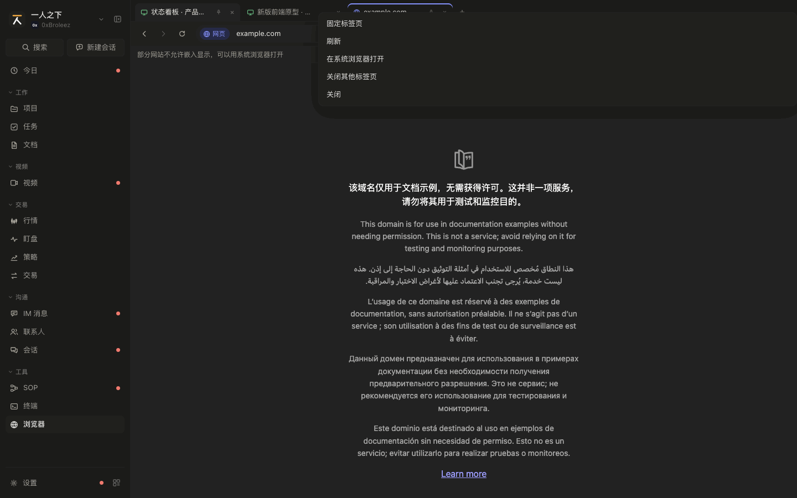 |
| 手机 375 | 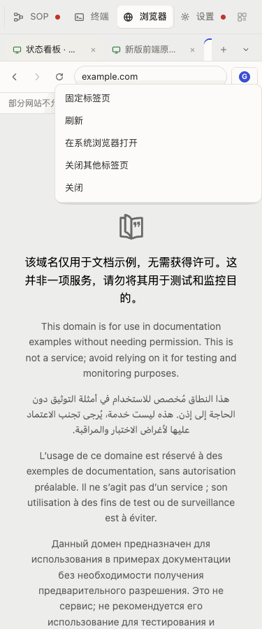 | 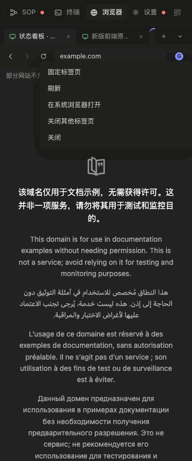 |

由 `shots.py` 按步骤截（`browser_tabs`）：开了原型、原型、网页三个标签后右键第一个标签。

### 交互

| 编号 | 元素 | 操作 | 结果 |
|---|---|---|---|
| SPEC-browser-1.1 | 标签 | 看 | 种类图标（加载中或等原型启动时换成转圈）、标题（截断，悬停看全名）、图钉「固定标签页」、叉号「关闭标签页」。当前标签高亮。固定的标签只有图标，悬停写「<标题>（右键可取消固定）」 |
| SPEC-browser-1.2 | 标签 | 点击 | 切过去；当前标签在窄屏横向滚动的标签栏里自动滚进可视范围 |
| SPEC-browser-1.3 | 标签 | 中键点击 | 关掉（固定的不响应） |
| SPEC-browser-1.4 | 图钉 | 点击 | 固定，挪到最前面 |
| SPEC-browser-1.5 | 叉号 | 点击 | 关掉；关的是当前标签时切到它左边那个。关掉最后一个时自动补一个新标签页（项目里的浏览器交给外面处理，见 `SPEC-projects-14.11`） |
| SPEC-browser-1.6 | 标签 | 右键 | 贴着鼠标弹菜单（不超出视口）：「固定标签页 / 取消固定」「刷新」「在系统浏览器打开」（新标签页置灰）「关闭其他标签页」（只剩一个时置灰；固定的留着）「关闭」（固定的置灰）。点外面、Esc、窗口缩放时收起 |
| SPEC-browser-1.7 | 标签栏「+」 | 点击 | 开一个新标签页并切过去。满 12 个时置灰，悬停「最多 12 个标签页」 |
| SPEC-browser-1.8 | 「全部标签」下拉 | 点击 | 标签挤到最窄还放不下时，「+」右边出现向下箭头（悬停「全部标签（N 个）」）；点开列出「全部标签 · N 个」，每行图标和标题，当前的高亮，点一行切过去；点外面、Esc 收起 |
| SPEC-browser-1.9 | 后退、前进 | 点击 | 在这个标签的历史里走一步；到头时置灰 |
| SPEC-browser-1.10 | 刷新 | 点击 | 原型、网页标签重新加载 iframe；新标签页、Drive 不变 |
| SPEC-browser-1.11 | 地址栏 | 看 | 显示去掉协议和末尾斜杠、解码后的地址；新标签页显示空，占位「输入网址、端口号或搜索内容」；不在编辑时左边有种类标签（原型 / 网页 / Google Drive） |
| SPEC-browser-1.12 | 地址栏 | 聚焦 | 全选；种类标签藏起来。切到新标签页时光标自动进地址栏 |
| SPEC-browser-1.13 | 地址栏 | 回车 | 按 `normalize` 转成地址在当前标签打开，记进历史和最近打开：空 → 新标签页；有协议或 `about:` 原样；纯端口（`7790`、`:7790`）→ `http://127.0.0.1:<端口>`；`localhost`、`127.0.0.1`、`0.0.0.0`、IP 地址补 `http://`；像域名的（`example.com`）补 `https://`；其它当搜索词 → `https://www.google.com/search?q=…` |
| SPEC-browser-1.14 | 地址栏 | Esc | 放弃输入，恢复当前地址 |
| SPEC-browser-1.15 | 别的模块的「打开」 | 点击 | 切到浏览器；已经有同一地址的标签（忽略末尾斜杠和 `localhost` / `127.0.0.1` 的差别）就切过去，否则新开一个；满 12 个时改在当前标签打开。工作台没开浏览器模块时用系统浏览器打开 |
| SPEC-browser-1.16 | 切菜单 | 离开再回来 | 标签和已加载的页面都在（原型只在内存，刷新就没了；正式版刷新后从后端恢复标签和各自的历史） |

### 空状态和异常状态

| 编号 | 场景 | 显示 | 可做的操作 |
|---|---|---|---|
| SPEC-browser-1.17 | 没有标签 | 一级菜单不会出现：关掉最后一个就补一个新标签页。项目里的会出现，见 `SPEC-projects-14.13` | |
| SPEC-browser-1.18 | 已满 12 个标签 | 「+」置灰；别的模块再打开时在当前标签打开 | 关掉几个 |
| SPEC-browser-1.19 | 保存标签失败（后端不可用） | 原型未做；正式版不打断浏览，地址栏右边出一个提示「标签没保存上，刷新会丢」，下次变化时再试 | 重试 |

### 数据

见 `SPEC-browser-0` 的 `BrowserTab`。上限 `MAX_TABS = 12`（正式版存后端上限 50，见 BR-01a；前端同时开的仍按 12）。

### 联动

| 方向 | 对方模块 | 触发 | 结果 | 见 |
|---|---|---|---|---|
| 进来 | 各模块 | 「打开」 | 新开或切到已有标签 | `SPEC-browser-1.15` |

## SPEC-browser-2 新标签页

新标签页是工作台自己的一页，不是网页：最近打开、项目原型、Google Drive 三块卡片。

### 截图

| | 亮 | 暗 |
|---|---|---|
| 桌面 1440 | 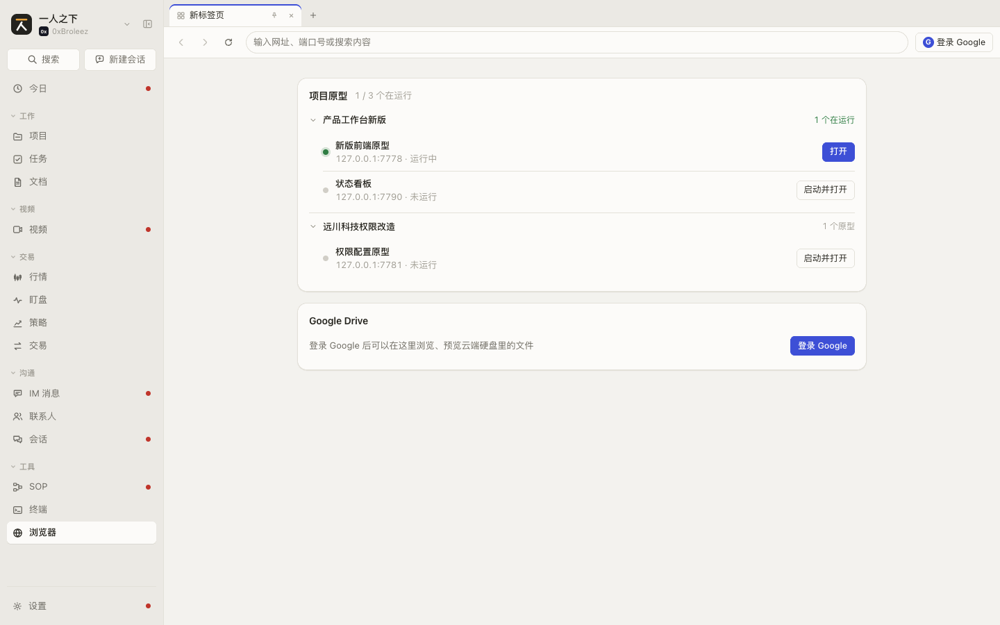 | 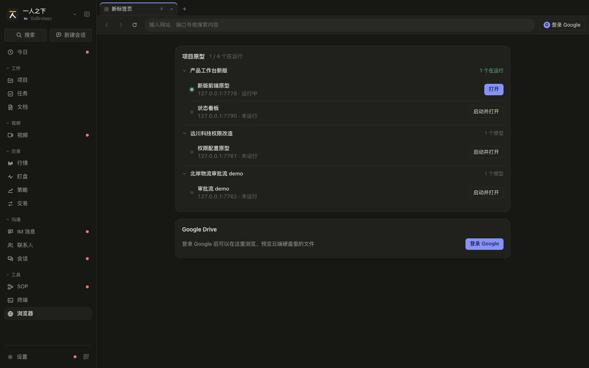 |
| 手机 375 | 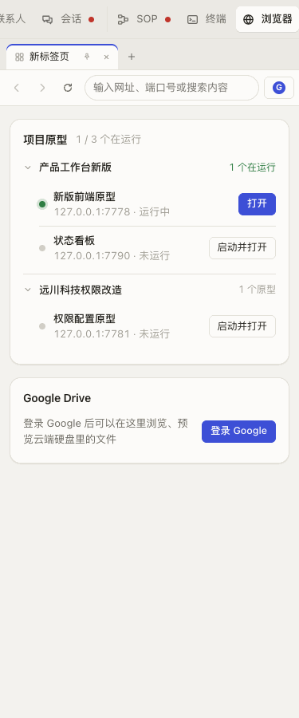 | 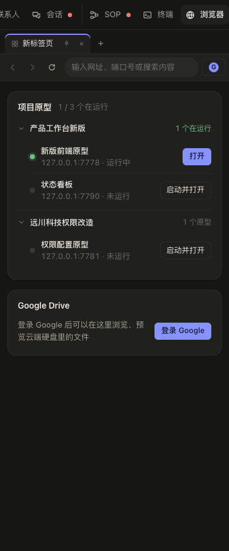 |

### 交互

| 编号 | 元素 | 操作 | 结果 |
|---|---|---|---|
| SPEC-browser-2.1 | 「最近打开」 | 看、点击 | 在最上面，还没打开过就不显示；最多 8 条，最新的在前，同一地址只留一条；每行图标、标题、地址、时间；点一行在当前标签打开 |
| SPEC-browser-2.2 | 「项目原型」头 | 看 | 「项目原型」「N / M 个在运行」；原型多于 8 个时出搜索框「搜原型、项目、端口」（按名字、项目、端口，多个词都要命中；Esc 清空） |
| SPEC-browser-2.3 | 项目分组 | 看、点击 | 按项目分组：有原型在跑（或启动中）的组排前，其次有启动失败的；组头写项目名和「N 个在运行」或「N 个原型」，有失败的加红字「N 个启动失败」；点组头展开收起。默认展开：原型总数不超过 8 个时全展开，否则只展开有在跑的组和正等着启动的那组；手动展开收起过的按手动的。搜索时命中的组全展开、组头写「N 个匹配」，不能收起 |
| SPEC-browser-2.4 | 组里的原型 | 看 | 状态灯、名字、「127.0.0.1:<端口> · <状态>」；在跑的排前。展开的组先露 6 条，其余「还有 N 个原型」点开 |
| SPEC-browser-2.5 | 原型行按钮 | 点击 | 运行中「打开」：在当前标签打开。未运行「启动并打开」、启动失败「重新启动并打开」：启动它，按钮变成「启动后自动打开」（置灰），起来后在这个标签打开；启动中「启动中」、停止中「停止中」置灰 |
| SPEC-browser-2.6 | 「Google Drive」卡片 | 看、点击 | 登录了：头部写邮箱，「我的云端硬盘」「与我共享」「最近」三个入口（正式版不搬，见 `SPEC-browser-5`）。没登录：「登录 Google 后可以在这里浏览、预览云端硬盘里的文件」+「登录 Google」（打开 `SPEC-browser-4` 的登录弹窗） |

### 空状态和异常状态

| 编号 | 场景 | 显示 | 可做的操作 |
|---|---|---|---|
| SPEC-browser-2.7 | 没有原型 | 「「项目」里还没有登记原型」 | 去项目登记原型 |
| SPEC-browser-2.8 | 搜索没结果 | 「没有匹配「…」的原型」 | 改搜索词 |
| SPEC-browser-2.9 | 搜索命中太多 | 最多显示 60 条，下面写「还有 N 个匹配的没显示，继续输入筛选」 | 继续输入 |
| SPEC-browser-2.10 | 「启动并打开」后启动失败 | 不再等，标签留在新标签页；那一行变成「启动失败」「重新启动并打开」 | 重新启动 |

### 数据

见 `SPEC-browser-0` 的 `ProtoEntry`、最近打开。常量：`PROTO_SEARCH_MIN = 8`、`PROTO_GROUP_SHOW = 6`、`PROTO_MATCH_LIMIT = 60`。正式版原型列表和状态读项目插件的接口（经数据访问层），浏览器插件不存原型。

### 联动

| 方向 | 对方模块 | 触发 | 结果 | 见 |
|---|---|---|---|---|
| 读取 | 项目 | 打开新标签页 | 列出全部项目的原型和状态 | `SPEC-projects-12` |
| 改动 | 项目 | 「启动并打开」 | 启动原型 | `SPEC-projects-12` |

## SPEC-browser-3 原型标签和网页标签

本机地址的标签是「原型」，用 iframe 加载；登记过的原型没在运行时不加载，显示启动提示。别的网址是「网页」，也用 iframe 加载，但很多站点不允许被嵌入。

### 截图

由 `shots.py` 按步骤截（`browser_tabs`）：地址栏输入 `7790`（项目里登记了、没在运行的状态看板）。

| | 亮 | 暗 |
|---|---|---|
| 桌面 1440 | 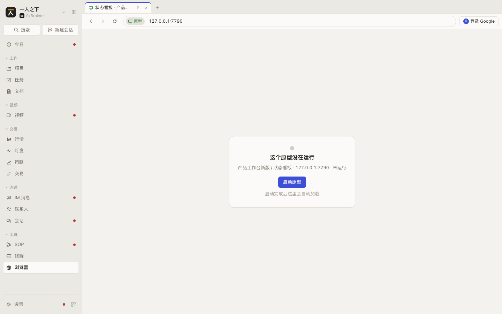 | 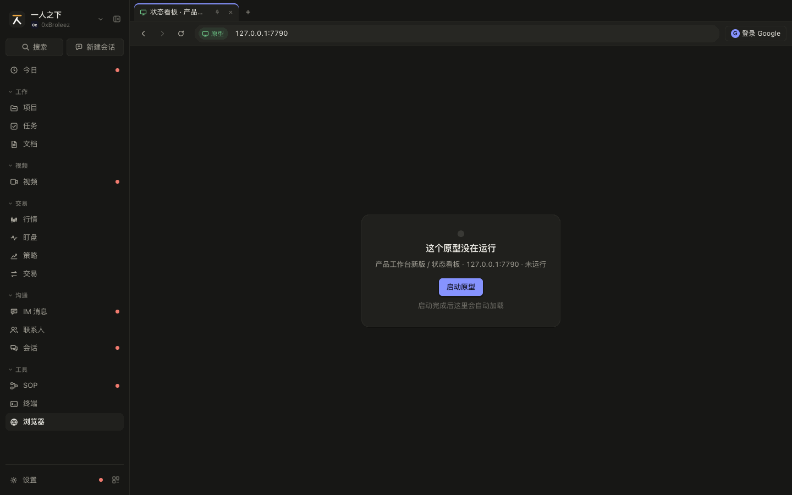 |
| 手机 375 | 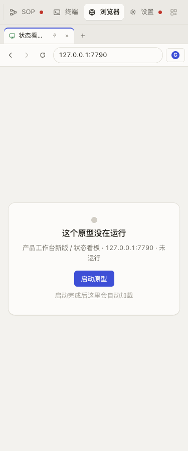 | 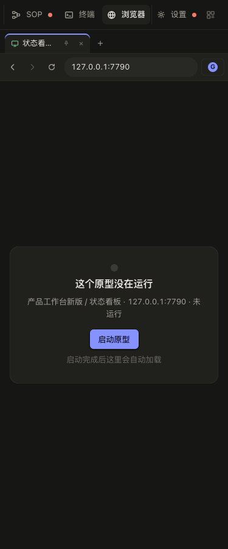 |

| 场景 | 步骤 | 桌面 1440 亮 | 桌面 1440 暗 | 手机 375 亮 | 手机 375 暗 |
|---|---|---|---|---|---|
| 原型标签（在跑，iframe 里是原型本身） | 新标签页里点「新版前端原型」的「打开」 | 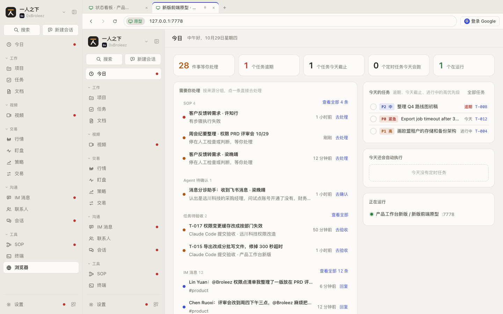 | 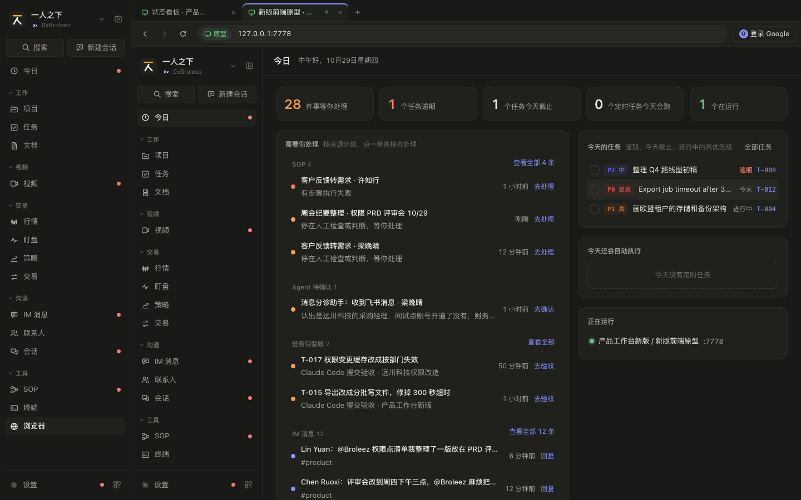 | 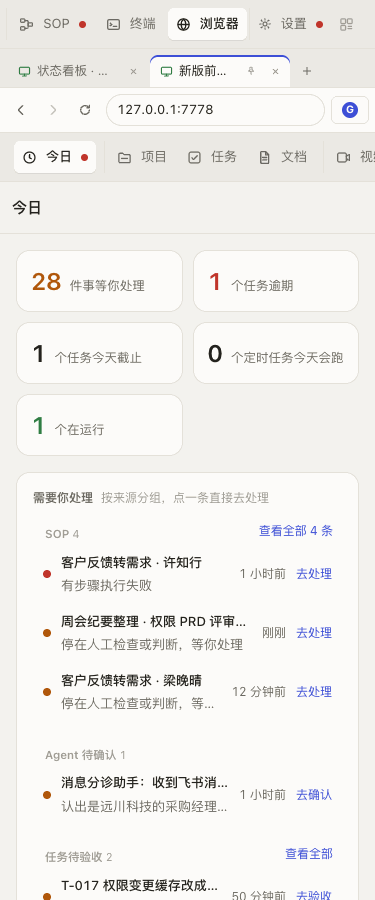 | 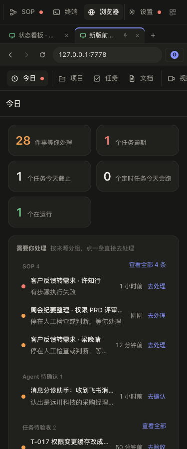 |
| 网页标签和嵌入提示 | 新标签页地址栏输入 `example.com`（能不能加载出来看网络，截图里可能是空白） | 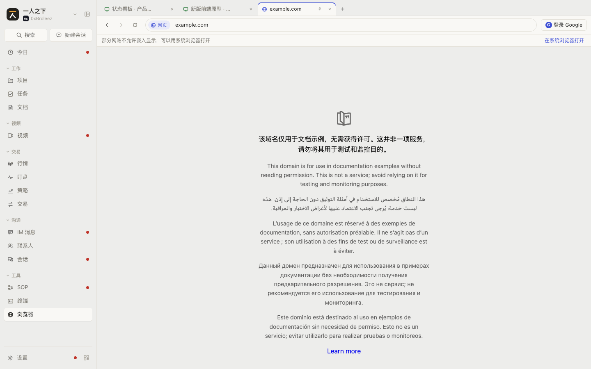 | 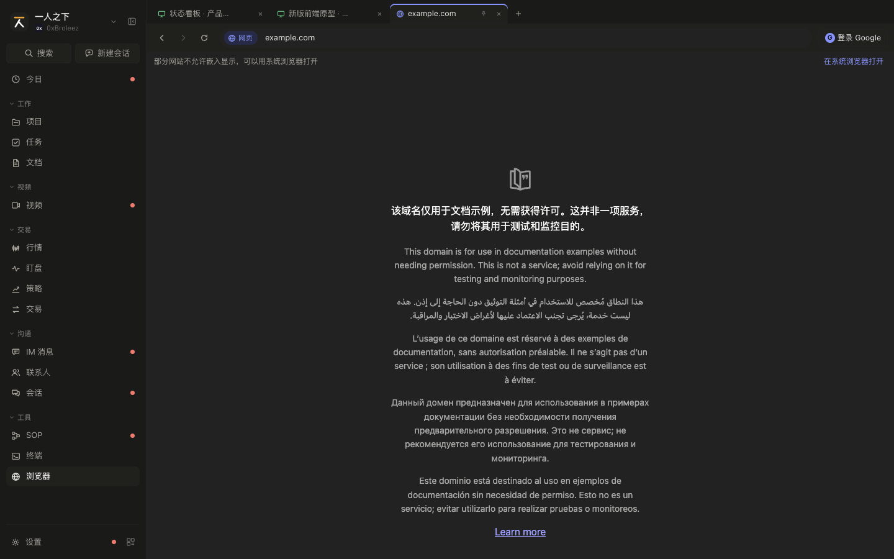 | 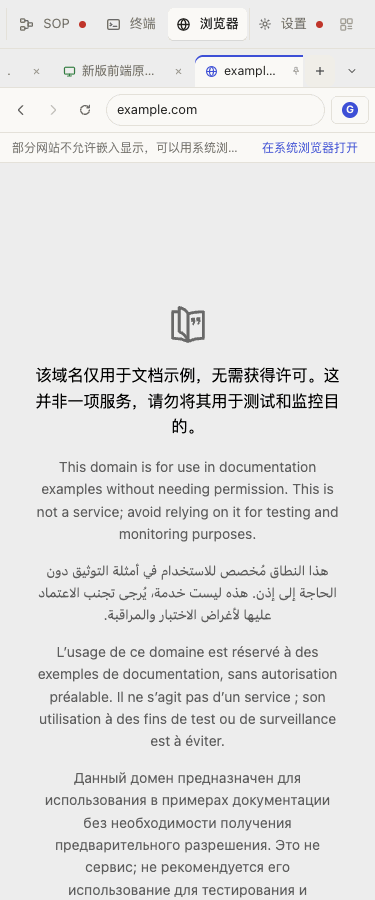 | 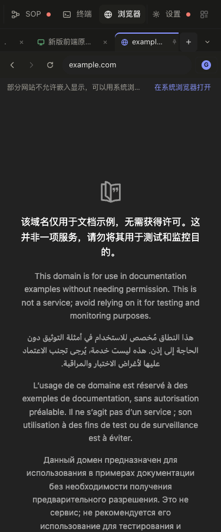 |

### 交互

| 编号 | 元素 | 操作 | 结果 |
|---|---|---|---|
| SPEC-browser-3.1 | 原型标签 | 打开 | 标题「<原型> · <项目>」（端口对不上登记的原型时是地址）；在跑时 iframe 加载，加载中工具栏下有进度条、标签图标转圈 |
| SPEC-browser-3.2 | 原型没在运行 | 打开 | 不加载 iframe、不转圈，居中卡片：状态灯、「这个原型没在运行」、「<项目> / <原型> · 127.0.0.1:<端口> · <状态>」、「启动原型」、灰字「启动完成后这里会自动加载」 |
| SPEC-browser-3.3 | 「启动原型」 | 点击 | 启动那个原型（未运行、启动失败时）；启动中、停止中按钮写「启动中」「停止中」并置灰；起来后这个标签自动加载 |
| SPEC-browser-3.4 | 原型在别处停掉 | 停 | 已加载的原型标签变回 `SPEC-browser-3.2` 的提示 |
| SPEC-browser-3.5 | 本机地址但没登记成原型 | 打开 | 当原型标签直接 iframe 加载，标题是地址 |
| SPEC-browser-3.6 | 网页标签 | 打开 | 标题是主机名（去掉 `www.`）；Google 搜索写「<搜索词> - 搜索」。iframe 带 `sandbox="allow-scripts allow-same-origin allow-forms allow-popups"` |
| SPEC-browser-3.7 | 网页标签能不能嵌入 | 看、点击 | 按白名单判断（`SPEC-browser-3.12`）：白名单内的才挂 iframe；不在白名单的不挂，显示卡片。原来每个网页标签都有的通用提示条已去掉 |
| SPEC-browser-3.8 | 「在系统浏览器打开」 | 点击 | 在系统浏览器（新窗口、`noopener`）打开当前地址；入口：工具栏地址栏右边的图标按钮（悬停「在系统浏览器打开」，新标签页时置灰）、不能嵌入的卡片、标签右键菜单、Drive 文件预览的「在 Google Drive 打开」。新标签页没有这个操作 |

### 空状态和异常状态

| 编号 | 场景 | 显示 | 可做的操作 |
|---|---|---|---|
| SPEC-browser-3.9 | 原型没在运行 | 见 `SPEC-browser-3.2` | 启动原型 |
| SPEC-browser-3.10 | 原型启动失败 | 卡片状态写「启动失败」，按钮「启动原型」可再点 | 再启动；去项目看日志 |
| SPEC-browser-3.11 | 站点不能嵌入（原型） | 按 `SPEC-browser-3.12` 做：白名单是本机地址、内网域名后缀（设置里开着内网域名时）和用户加的主机（原型只存内存）。卡片「这个站点不能在这里打开」+「<主机> 不在白名单里，多数网站不允许嵌入显示」；8 秒超时的卡片写「<主机> 8 秒还没加载完，可能不允许嵌入显示」，盖在 iframe 上面。白名单内但站点自己拒绝嵌入、`load` 照样触发时仍是空白或浏览器自带的拒绝页，这时用工具栏的「在系统浏览器打开」 | 在系统浏览器打开、加进白名单再试、继续等 |
| SPEC-browser-3.12 | 站点不能嵌入（正式版，BR-02a） | 原型已按这条做（见 `SPEC-browser-3.11`）。决策：跨域读不到 `X-Frame-Options`，用地址白名单加加载超时判断，不做后端探测。白名单内（本机地址、内网域名后缀、用户加的主机）才用 iframe；不在白名单的标签直接显示卡片「这个站点不能在这里打开」+「在系统浏览器打开」「加进白名单再试」；白名单内的 iframe 8 秒没 `load` 时显示同样的卡片，并多一个「继续等」。白名单读写走 BR-01a 的 `/api/browser/allowlist` | 在系统浏览器打开、加进白名单再试、继续等 |
| SPEC-browser-3.13 | 地址打不开（端口没人监听、断网） | iframe 里是浏览器自带的错误页 | 刷新、在系统浏览器打开 |

### 数据

用 `BrowserTab` 的 `url`、`kind`、`loading`（见 `SPEC-browser-0`）和 `ProtoEntry`（按端口对：`portOf(url)` 等于原型的 `port`）。正式版白名单（BR-01a `browser_allowlist`）：主机名、备注；默认带 `127.0.0.1`、`localhost` 和内网域名后缀（后缀由前端带上，插件之间不互读）。

### 联动

| 方向 | 对方模块 | 触发 | 结果 | 见 |
|---|---|---|---|---|
| 读取 | 项目 | 打开本机地址 | 按端口认出原型和它的状态 | `SPEC-projects-12` |
| 改动 | 项目 | 「启动原型」 | 启动原型 | `SPEC-projects-12` |
| 读取 | 设置 / 内网域名 | 判断白名单 | 内网域名后缀下的主机都算白名单内 | `SPEC-settings-20` |

## SPEC-browser-4 Google 账号

工具栏右边的账号按钮。浏览器的 Google 账号和连接器里的 Google Drive、Google 日历是同一个：在这里登录就把两个连接器连上，退出就一起断开。

### 截图

由 `shots.py` 按步骤截（`browser_google`）：登录弹窗里选第一个账号，取消勾选「查看 Google Drive 文件」。

| | 亮 | 暗 |
|---|---|---|
| 桌面 1440 | 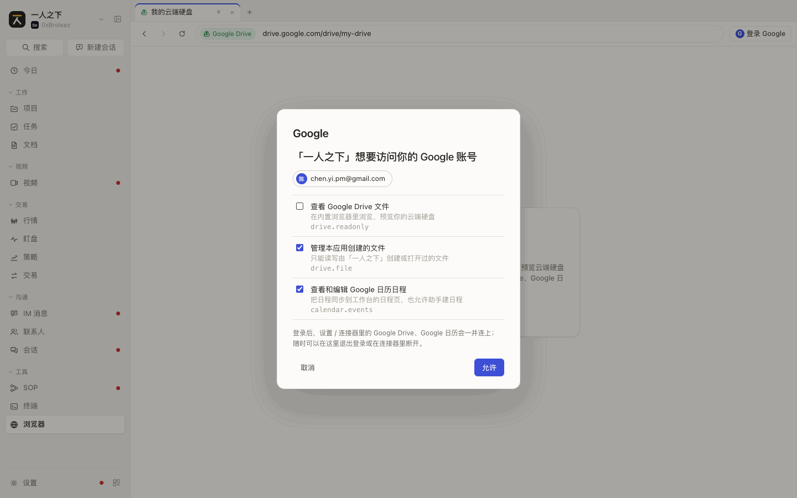 | 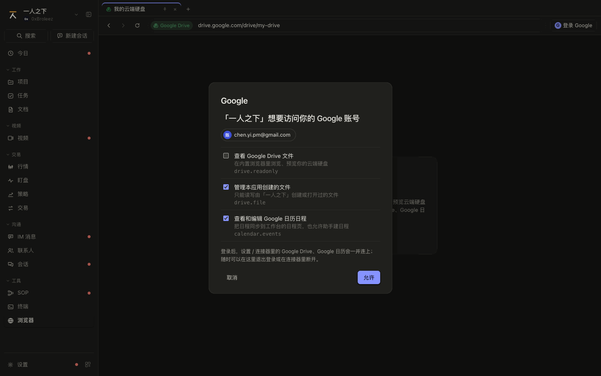 |
| 手机 375 | 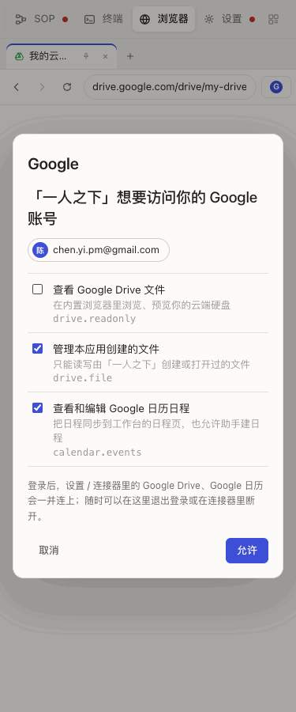 | 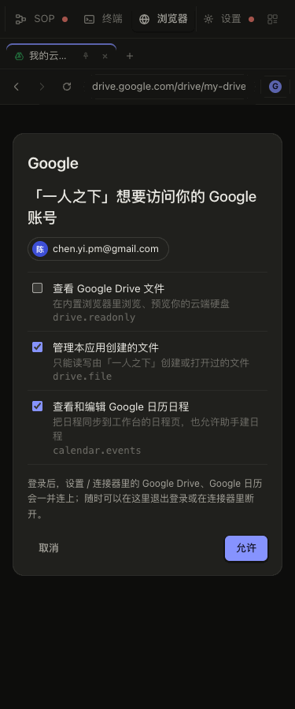 |

| 场景 | 步骤 | 桌面 1440 亮 | 桌面 1440 暗 | 手机 375 亮 | 手机 375 暗 |
|---|---|---|---|---|---|
| 选择账号 | 点「登录 Google」 | 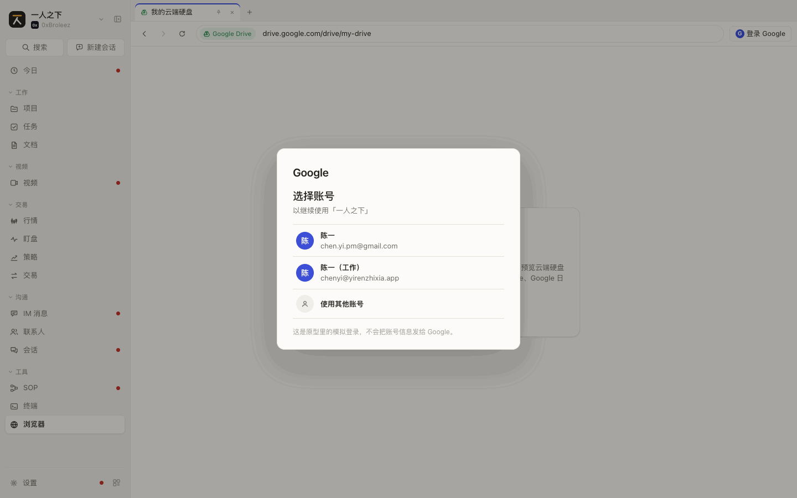 | 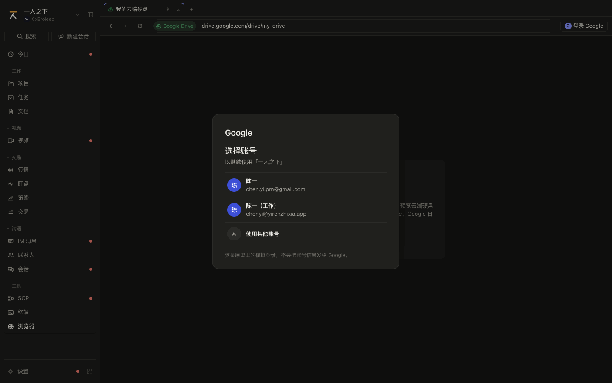 | 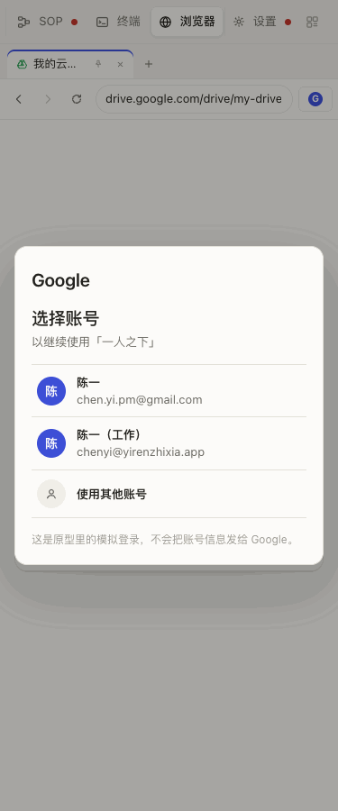 | 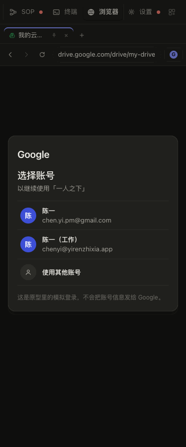 |
| 手填邮箱不对 | 「使用其他账号」，填 `chen.yi` 点「下一步」 | 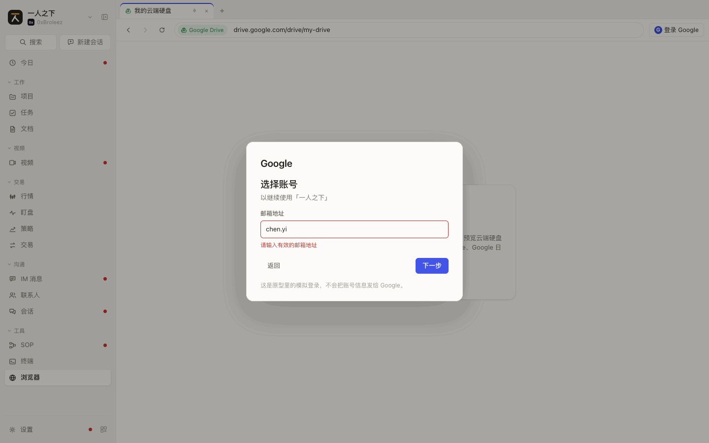 | 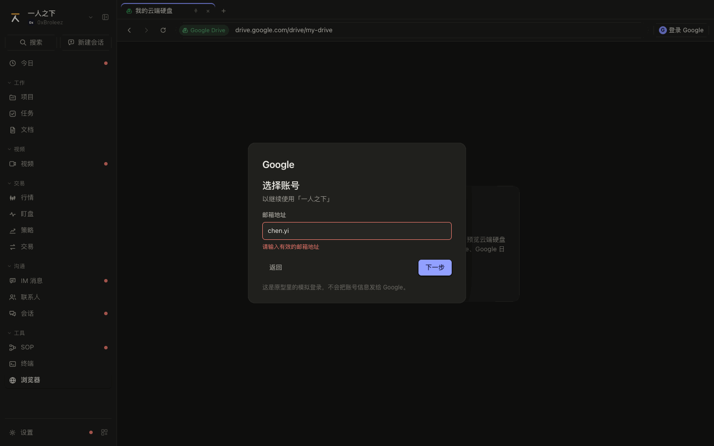 | 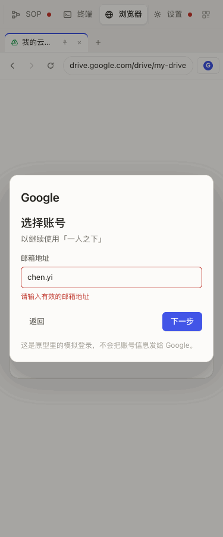 | 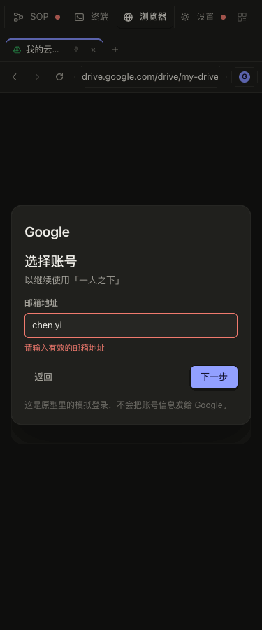 |
| 账号面板（有一项没授权） | 不勾 Drive 登录后点头像 | 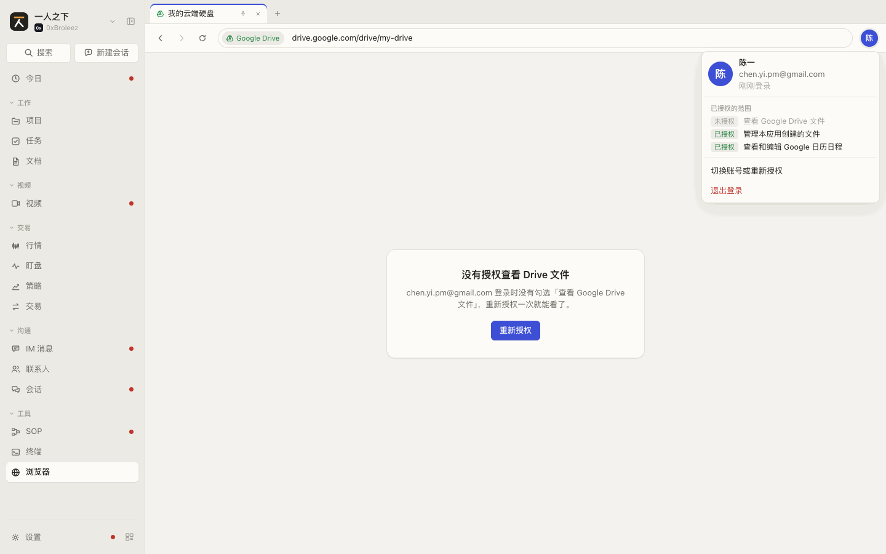 | 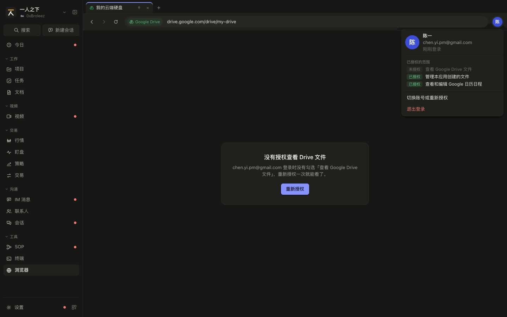 | 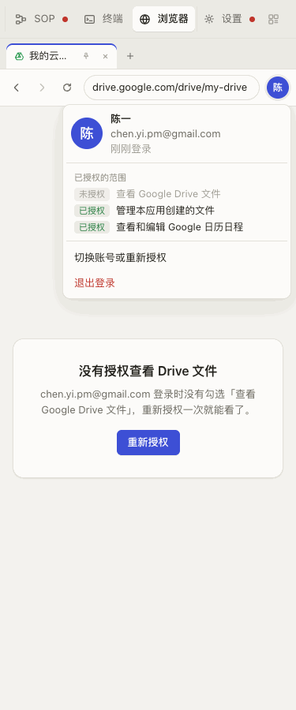 | 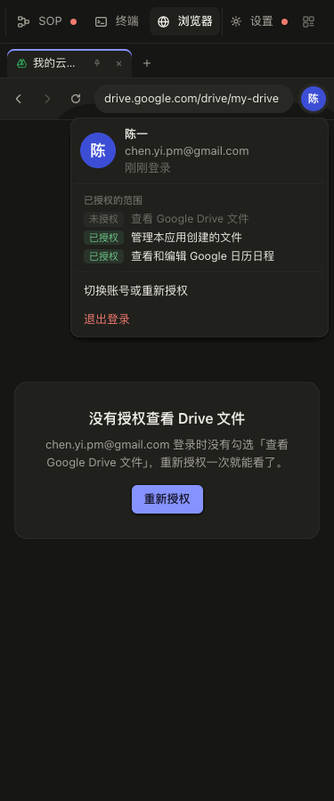 |

### 交互

| 编号 | 元素 | 操作 | 结果 |
|---|---|---|---|
| SPEC-browser-4.1 | 「登录 Google」 | 看、点击 | 没登录时工具栏右边是「G 登录 Google」（窄屏只留 G）；点开登录弹窗。新标签页 Drive 卡片、Drive 标签里的「登录 Google」同样打开它 |
| SPEC-browser-4.2 | 登录弹窗：选择账号 | 看、点击 | 「Google」「选择账号」「以继续使用「一人之下」」；列出建议的账号（头像、名字、邮箱）和「使用其他账号」；点一个账号进授权页；底部「取消」（手填邮箱时换成「返回」「下一步」）。底部灰字「这是原型里的模拟登录，不会把账号信息发给 Google。」（正式版没有这一步：转到 Google 的 OAuth 页面，由 Google 选账号） |
| SPEC-browser-4.3 | 「使用其他账号」 | 点击 | 换成「邮箱地址」输入框（占位 `name@gmail.com`）、「返回」「下一步」；邮箱合法才进授权页，名字取 `@` 前面 |
| SPEC-browser-4.4 | 登录弹窗：授权 | 看 | 「「一人之下」想要访问你的 Google 账号」；账号条（头像和邮箱，点它回选择账号）；`GOOGLE_SCOPES` 每项一个勾选框，写名称、说明和 scope key，默认全勾；说明「登录后，设置 / 连接器里的 Google Drive、Google 日历会一并连上；随时可以在这里退出登录或在连接器里断开。」；「取消」「允许」 |
| SPEC-browser-4.5 | 「允许」 | 点击 | 一项都没勾时置灰。点后显示转圈「正在完成授权…」（原型 0.8 秒），完成后弹窗关掉、工具栏换成头像；按授权范围把连接器连上：勾了 `drive.*` 的连 Google Drive，勾了 `calendar.*` 的连 Google 日历，已有就更新账号和状态、没有就新建一个 |
| SPEC-browser-4.6 | 弹窗关闭 | Esc、点遮罩、「取消」 | 关掉，不登录；授权进行中不能关 |
| SPEC-browser-4.7 | 头像 | 点击 | 展开账号面板：大头像、名字、邮箱、「<多久前>登录」；「已授权的范围」每项写「已授权 / 未授权」和名称（未授权的变淡）；「切换账号或重新授权」；红字「退出登录」。点外面收起 |
| SPEC-browser-4.8 | 「切换账号或重新授权」 | 点击 | 打开登录弹窗从选择账号开始，完成后替换当前账号和授权范围 |
| SPEC-browser-4.9 | 「退出登录」 | 点击 | 不弹确认；工具栏换回「登录 Google」；账号是这个邮箱的 Google Drive、Google 日历连接器变成已断开（清掉授权里的账号和过期时间） |

### 空状态和异常状态

| 编号 | 场景 | 显示 | 可做的操作 |
|---|---|---|---|
| SPEC-browser-4.10 | Google 没登录 | 工具栏「登录 Google」；新标签页 Drive 卡片和 Drive 标签写登录提示（`SPEC-browser-2.6`、`SPEC-browser-5.6`） | 登录 Google |
| SPEC-browser-4.11 | 手填邮箱不合法 | 输入框红框，下面「请输入有效的邮箱地址」，不进下一步 | 改邮箱 |
| SPEC-browser-4.12 | 一项授权都没勾 | 「允许」置灰 | 勾上至少一项 |
| SPEC-browser-4.13 | 在连接器里断开了 Drive | 以 Drive 连接器为准：在连接器里断开或删掉这个账号的 Google Drive，浏览器就算退出登录，工具栏变回「登录 Google」；Google 日历连接器不受影响。正式版 `GET /api/browser/google` 回未登录 | 重新登录 |
| SPEC-browser-4.14 | 授权失败、用户在 Google 页面拒绝 | 原型未做；正式版弹窗写「授权没完成：<原因>」+「重试」，不改当前账号 | 重试、取消 |
| SPEC-browser-4.15 | 没配 Google 的 OAuth 客户端 | 原型未做；正式版「登录 Google」点开写「先在设置 / 连接器里配好 Google Drive 的 OAuth 客户端」+「去配置」 | 去连接器 |

### 数据

见 `SPEC-browser-0` 的 `GoogleAccount`、`GOOGLE_SCOPES`。原型里 `google` 存在 `App.tsx`，一级菜单和项目里的浏览器共用。正式版（BR-01a）Google 账号不单独存，以 Google Drive 连接器实例作为浏览器的 Google 账号：`GET /api/browser/google` 回实例的账号邮箱、授权范围、状态；`POST /api/browser/google/login` 转调该实例的 OAuth 授权；`POST /api/browser/google/logout` 断开 Drive 和日历两个实例。

### 联动

| 方向 | 对方模块 | 触发 | 结果 | 见 |
|---|---|---|---|---|
| 改动 | 设置 / 连接器 | 登录 | Google Drive、Google 日历连接器按授权范围连上 | `SPEC-settings-5` |
| 改动 | 设置 / 连接器 | 退出登录 | 两个连接器断开 | `SPEC-settings-5` |
| 读取 | 设置 / 连接器 | 在连接器里断开或删掉 Drive | 浏览器显示未登录 | `SPEC-browser-4.13` |

## SPEC-browser-5 Google Drive（正式版不搬）

原型里模拟的 Drive：打开 `drive.google.com`、`docs.google.com` 的地址时不加载网页，显示一个假的文件浏览器和预览，数据是 `seedDriveFiles`。**正式版不搬，见 BR-01b**：决策是真实 Drive 列表等连接器工具能调用后再做，在那之前 Drive 地址按普通网页处理（`SPEC-browser-3`）。这一节只留作以后做 Drive 时的参考，BR-01b 验收不对照这一节。

### 截图

由 `shots.py` 按步骤截（`browser_drive`）：登录后点新标签页的「我的云端硬盘」。

| | 亮 | 暗 |
|---|---|---|
| 桌面 1440 | 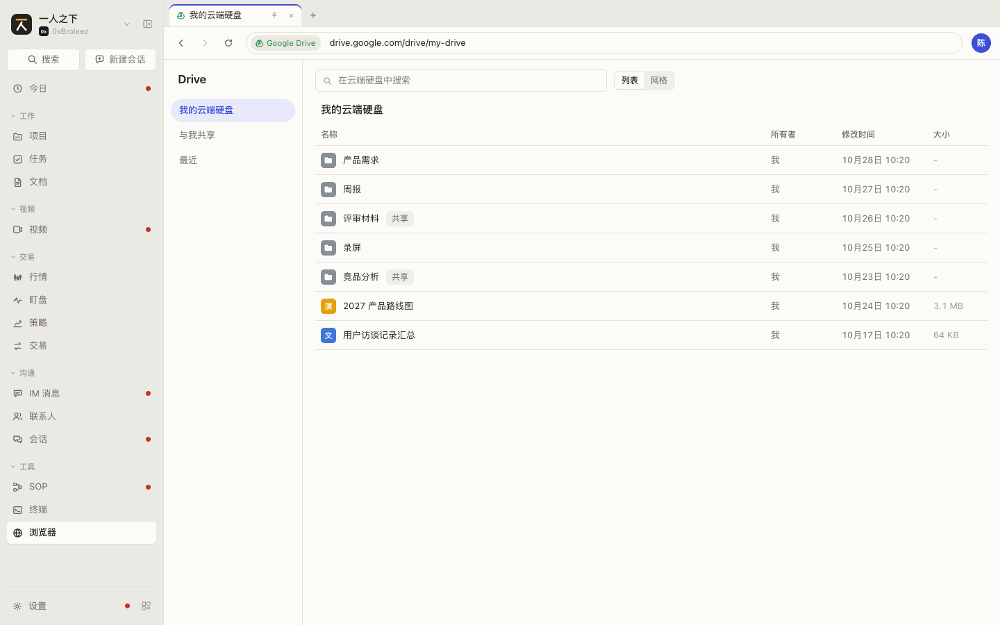 | 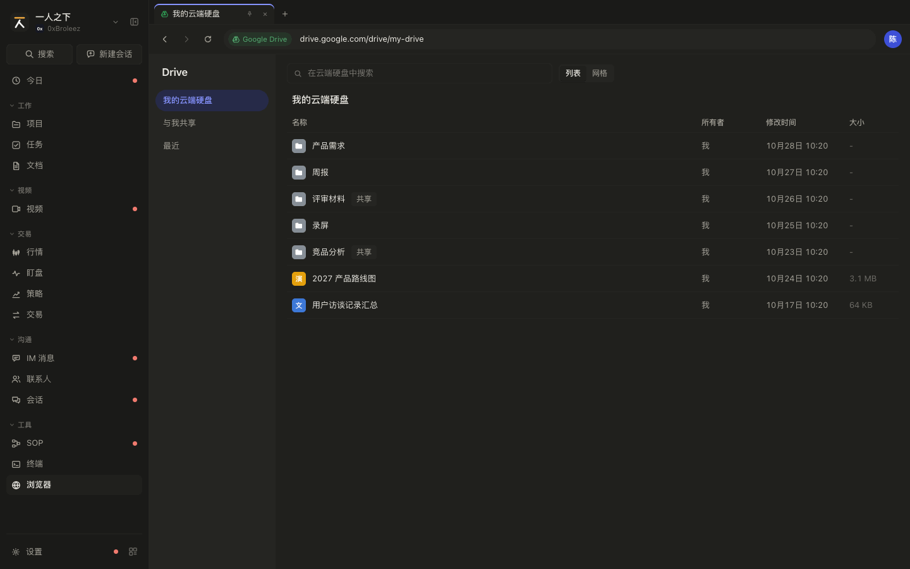 |
| 手机 375 | 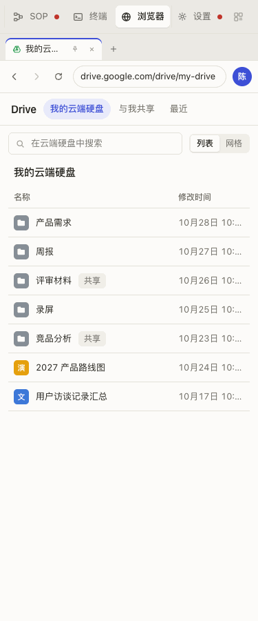 | 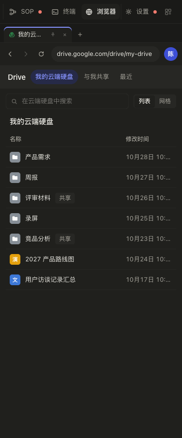 |

| 场景 | 步骤 | 桌面 1440 亮 | 桌面 1440 暗 | 手机 375 亮 | 手机 375 暗 |
|---|---|---|---|---|---|
| 文件预览 | 接上一步点「2027 产品路线图」 | 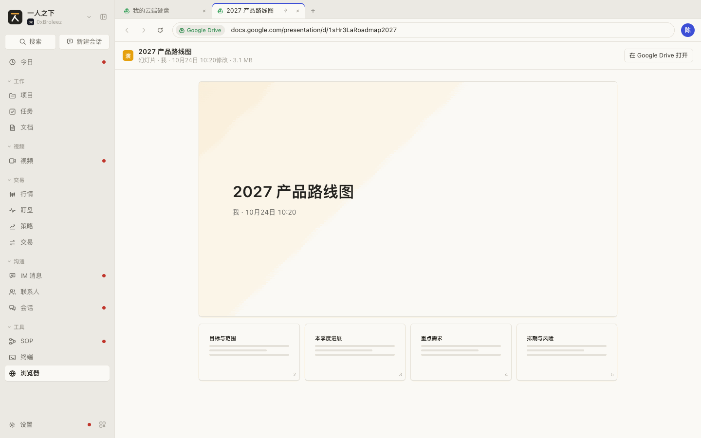 | 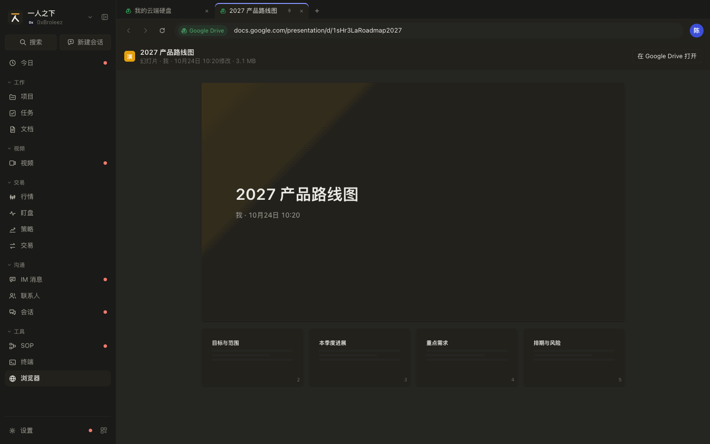 | 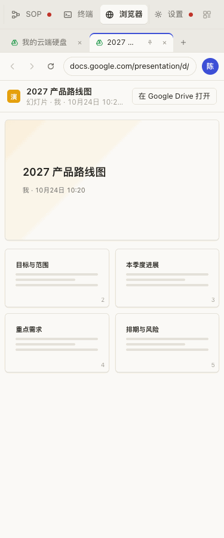 | 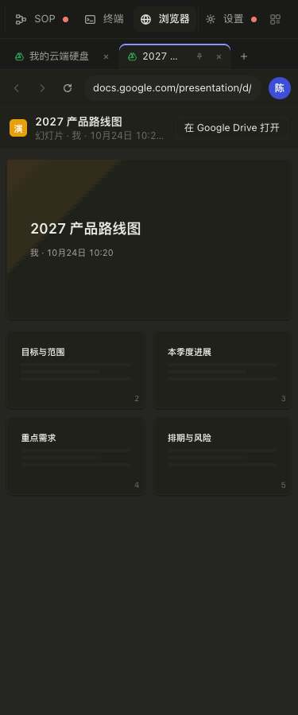 |
| 没登录 | 没登录时地址栏输入 `drive.google.com/drive/my-drive`（`browser_google`） | 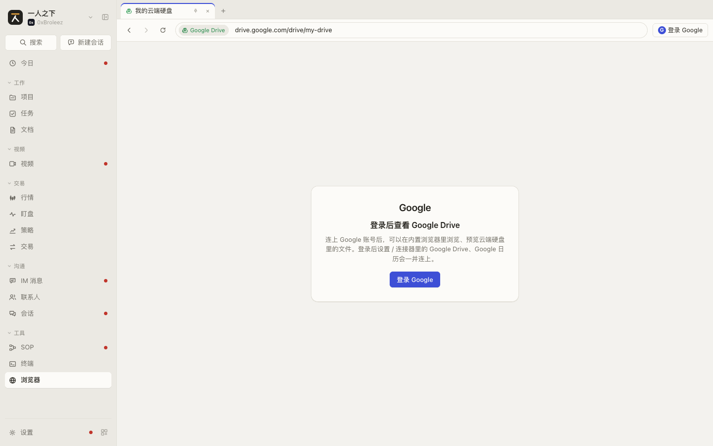 | 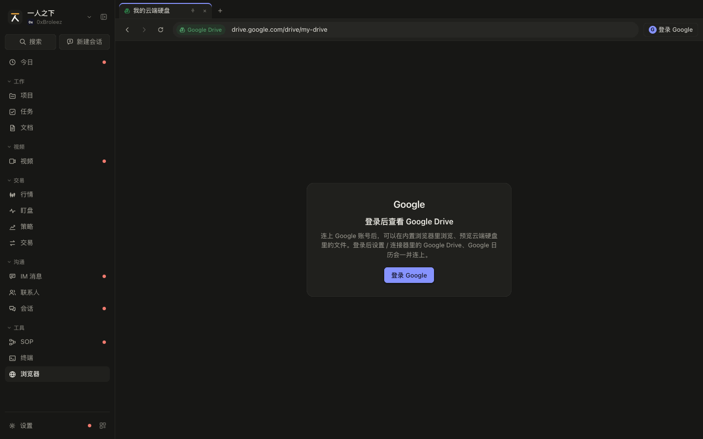 | 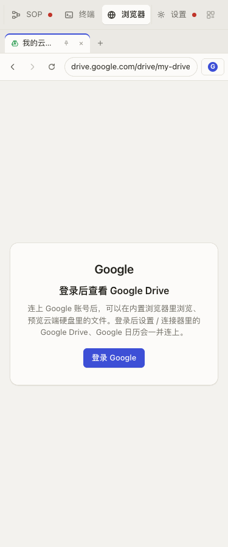 | 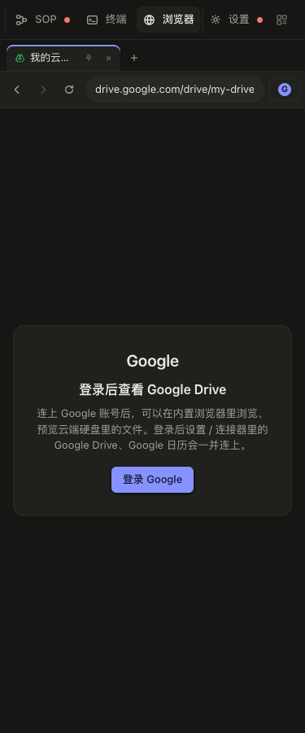 |
| 没授权查看 Drive | 登录时不勾「查看 Google Drive 文件」（`browser_google`） | 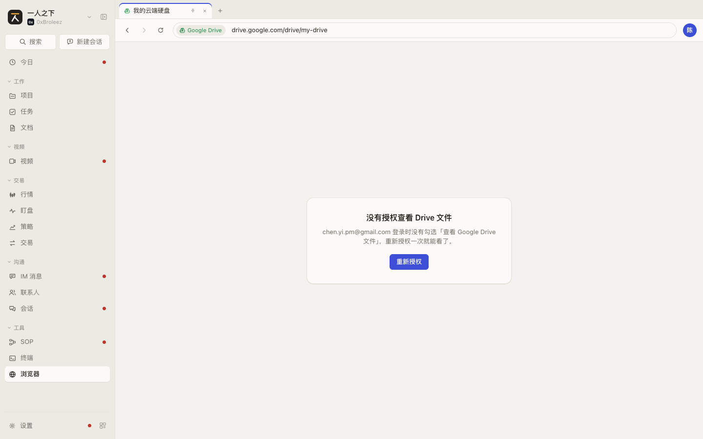 | 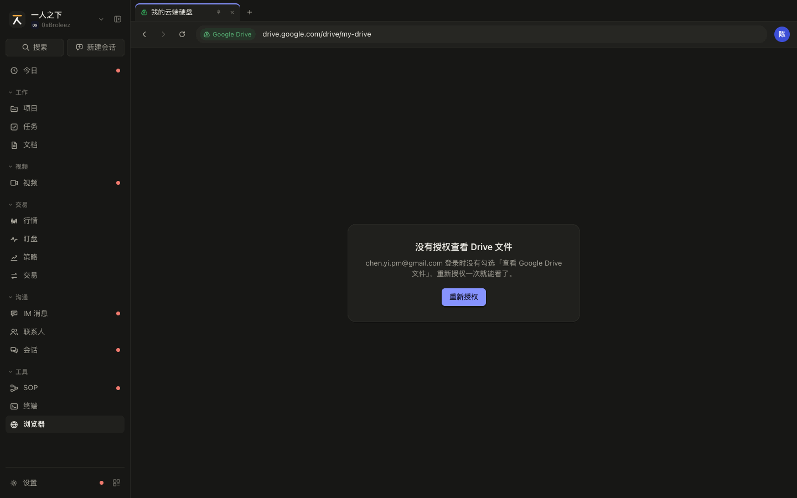 |  |  |

### 交互

| 编号 | 元素 | 操作 | 结果 |
|---|---|---|---|
| SPEC-browser-5.1 | 左栏 | 点击 | 「Drive」和三个视图：我的云端硬盘（顶层、我自己的）、与我共享（共享的、别人的）、最近（不含文件夹，按修改时间最近 12 个）；文件夹里时「我的云端硬盘」高亮 |
| SPEC-browser-5.2 | 搜索「在云端硬盘中搜索」 | 输入 | 按文件名在全部文件里搜，面包屑换成「搜索「…」 · N 项」 |
| SPEC-browser-5.3 | 「列表 / 网格」 | 切换 | 列表：名称（图标、名字、「共享」标）、所有者、修改时间、大小；网格：缩略卡片。文件夹排前，其余按修改时间新的在前 |
| SPEC-browser-5.4 | 面包屑、文件夹 | 点击 | 进文件夹（在当前标签，记进历史，可后退） |
| SPEC-browser-5.5 | 文件 | 点击 | 新开一个标签预览：顶部图标、名字、「类型 · 所有者 · 修改时间修改 · 大小」和「在 Google Drive 打开」；文档、表格、幻灯片、PDF / 图片 / 视频各有一种假预览 |

### 空状态和异常状态

| 编号 | 场景 | 显示 | 可做的操作 |
|---|---|---|---|
| SPEC-browser-5.6 | 没登录 | 「Google」「登录后查看 Google Drive」，说明登录后连接器里的 Google Drive、Google 日历会一并连上，「登录 Google」 | 登录 |
| SPEC-browser-5.7 | 登录了但没授权 `drive.readonly` | 「没有授权查看 Drive 文件」「<邮箱> 登录时没有勾选「查看 Google Drive 文件」，重新授权一次就能看了。」「重新授权」 | 重新授权 |
| SPEC-browser-5.8 | 文件夹是空的、搜索没结果 | 「这里还没有文件」/「没有找到匹配的文件」 | |
| SPEC-browser-5.9 | 文件不在演示数据里 | 预览区「原型里预览不了这个文件」「只有演示数据里的文件能在这里预览，可以去 Google Drive 打开原文件。」 | 在 Google Drive 打开 |

### 数据

`DriveFile`（`web-next/src/browserdata.ts`，只是原型的演示数据，正式版不建表）

| 字段 | 类型 | 必填 | 说明 | 取值 / 示例 |
|---|---|---|---|---|
| `id` | `string` | 是 | Drive 文件 id | `1sHr3LaRoadmap2027` |
| `name` | `string` | 是 | 文件名 | `2027 产品路线图` |
| `mime` | `DriveMime` | 是 | 类型 | `doc` 文档 / `sheet` 表格 / `slide` 幻灯片 / `pdf` PDF / `folder` 文件夹 / `image` 图片 / `video` 视频 |
| `parent` | `string` | 否 | 所在文件夹 id，没有是顶层 | `fd0PrdReqs7Qm` |
| `owner` | `string` | 是 | 所有者，自己的写「我」 | `我` |
| `modified_at` | `string` | 是 | 修改时间，ISO 8601 | |
| `size` | `string` | 否 | 大小，已格式化 | `3.1 MB` |
| `shared` | `boolean` | 是 | 是否共享 | |

`DriveRoute`（`parseDrive` 解析地址）：`{ view: 'my' | 'shared' | 'recent' }`、`{ view: 'folder'; id }`、`{ view: 'file'; id }`。`driveUrl` 按类型拼回 `docs.google.com/document|spreadsheets|presentation/d/<id>`、`drive.google.com/drive/folders/<id>`、`drive.google.com/file/d/<id>`。常量 `DRIVE_HOME`、`DRIVE_SHARED`、`DRIVE_RECENT`。

### 联动

| 方向 | 对方模块 | 触发 | 结果 | 见 |
|---|---|---|---|---|
| 读取 | Google 账号 | 打开 Drive 地址 | 按登录和 `drive.readonly` 授权决定显示什么 | `SPEC-browser-4` |

## 原型和规格对不上的地方

整理时发现的问题，PROTO-12 已按下表修好原型，正文和原型一致。

| 编号 | 位置 | 问题 | 建议 | 处理 |
|---|---|---|---|---|
| B-1 | `SPEC-browser-3.8` | 「在系统浏览器打开」本来放在顶栏，但浏览器页隐藏了顶栏（`styles.css`「终端和浏览器不要顶部标题栏」），工具栏里没有这个按钮：原型标签只能从右键菜单打开，手机上没有右键，原型标签就没有入口；`BrowserPage` 往顶栏放的标题和按钮成了用不到的代码 | 工具栏地址栏右边加一个「在系统浏览器打开」图标按钮（新标签页置灰），删掉 `PageTitle` 那段 | 已修（PROTO-12）：工具栏加了图标按钮，删掉 `PageTitle` 那段，见 `SPEC-browser-3.8` |
| B-2 | `SPEC-browser-4.6` | 登录弹窗的「选择账号」一步没有「取消」按钮，只能 Esc 或点遮罩关；手机上只能点遮罩 | 选择账号一步底部也放「取消」 | 已修（PROTO-12）：选择账号一步底部有「取消」，见 `SPEC-browser-4.2` |
| B-3 | `SPEC-browser-3.11`、`3.12` | 网页标签不管能不能嵌入都显示通用提示条，不能嵌入的站点是空白页；和 BR-02a 定的「白名单 + 8 秒超时 + 提示卡片」不一致 | 正式版按 `SPEC-browser-3.12` 做；原型是否跟着改成白名单卡片另定（不改也不影响 BR-02a 验收） | 已修（PROTO-12）：原型改成白名单加 8 秒超时卡片，通用提示条去掉，见 `SPEC-browser-3.7`、`3.11` |
| B-4 | `SPEC-browser-4.13` | 原型里 `google` 和连接器是两份状态：在连接器里断开 Drive 后，浏览器仍显示已登录 | 原型让 `google` 跟着 Drive 连接器的状态走，和正式版「以 Drive 连接器为准」一致 | 已修（PROTO-12）：断开或删掉这个账号的 Drive 连接器时浏览器退出登录，见 `SPEC-browser-4.13` |

## 联动：内网域名（SPEC-settings-20 复核）

复核 `SPEC-settings-20` 是否覆盖 DOM-01a 到 DOM-02b 要用的内容（真实状态检测的每一项、生成的配置、自动分配的原型域名）。原有交互（`SPEC-settings-20.1` 到 `20.28`）覆盖原型能演示的部分；原型里没有的真实状态、pf 和 sudo 命令、自动路由入库和 502 页、点域名时的白名单，补在 `SPEC-settings-20` 末尾「正式版补充」（`SPEC-settings-20.29` 起），没改别的节。

| 方向 | 对方模块 | 触发 | 结果 | 复核结论 | 见 |
|---|---|---|---|---|---|
| 进来 | 设置 / 内网域名 | 点域名 | 在内置浏览器打开 `http(s)://<域名>`，标签种类是网页（主机不是本机地址） | 已覆盖；正式版这些域名在白名单内直接 iframe 加载（后缀由前端带给浏览器插件），补在 `SPEC-settings-20.38` | `SPEC-settings-20.15`、`SPEC-browser-3.12` |
| 读取 | 设置 / 内网域名 | DOM-01a 状态检测：hosts、pf anchor、80 / 443 经 Host 头可达、mkcert 根证书、`certs/` 证书覆盖和到期 | 设置分节显示每一项的真实状态 | 原型只有「本地根证书装没装」一个开关（`20.6`）和模拟的解析测试（`20.17`），缺状态区；补在 `20.29` 到 `20.32` | `SPEC-settings-20.29` |
| 读取 | 设置 / 内网域名 | DOM-01a 配置生成 | hosts、pf、Caddy、Nginx 片段和要用户自己执行的 sudo 命令 | 原型有 hosts / dnsmasq / 路由器泛解析和内置 / Caddy / Nginx（`20.20`），缺 pf anchor 和 sudo 命令，「安装证书」按钮正式版不能真装；补在 `20.33` 到 `20.35` | `SPEC-settings-20.33` |
| 读取 | 设置 / 内网域名 | DOM-01a 工作台自己的域名（`bro.vip`、`broleez.vip`） | 生成的 hosts 行要和 `docs/local-domain.md` 一致 | 原型的完整域名只能是 `<子域名>.<后缀>`，表达不了 `bro.vip` 这种不带子域名的；补在 `20.36`，列为 DOM-01a 开工时定 | `SPEC-settings-20.36` |
| 改动 | 项目 | DOM-02a 原型启停、删除 | 自动路由跟着建、删；内置代理按 Host 转发，原型没在运行回 502 中文说明页 | 原型的自动分配规则已覆盖（`20.11`、`20.13`、`20.16`、`20.19`）；缺「自动路由入库」和 502 页；补在 `20.37` | `SPEC-settings-20.37` |
| 读取 | 设置 / 内网域名 | DOM-02b 自动域名标「自动」、跟着原型状态显示能不能访问、不能手动删 | 路由列表 | 已覆盖：`20.14`（标「自动」、「原型没在运行」）、`20.19`（只有手动的有删除）、`20.11`（关掉自动分配） | `SPEC-settings-20.11`、`20.14`、`20.19` |
| 读取 | 设置 / 内网域名 | DOM-01b 解析测试 `POST /api/domains/routes/{id}/check` | 测试结果 | 原型是模拟的（`20.17`）；正式版的检查项补在 `20.39` | `SPEC-settings-20.39` |
