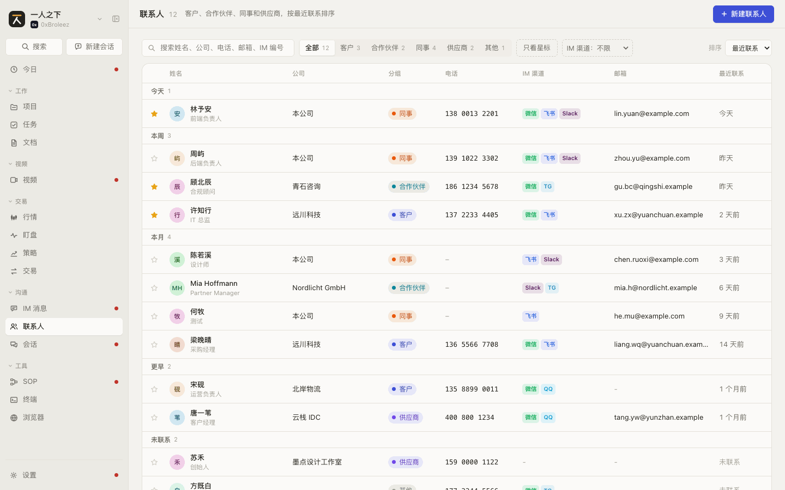
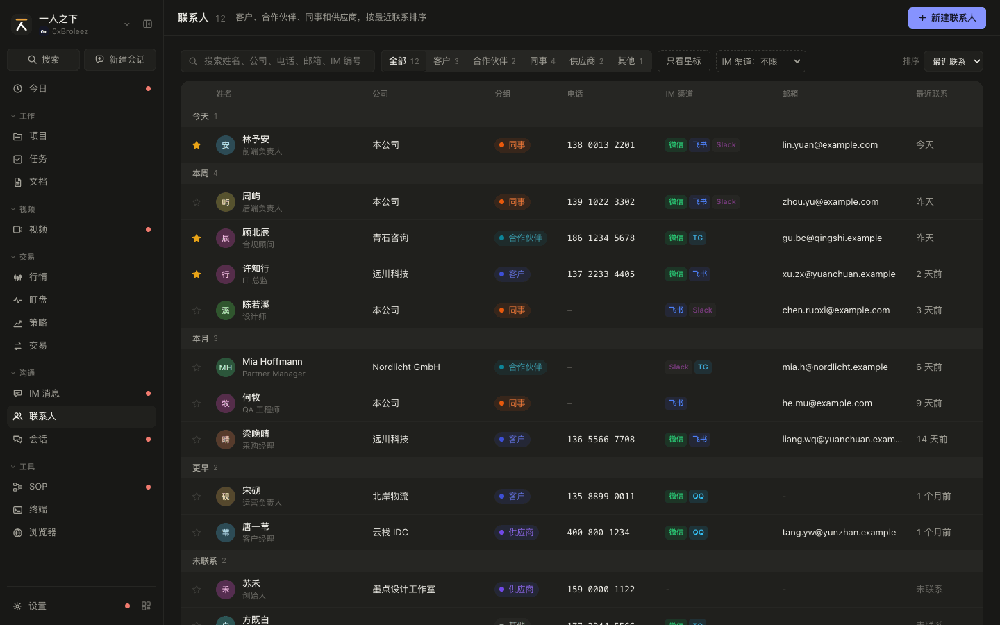
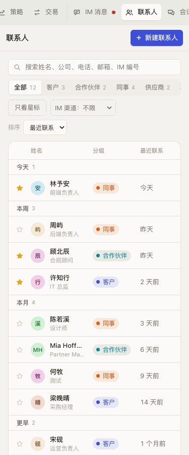
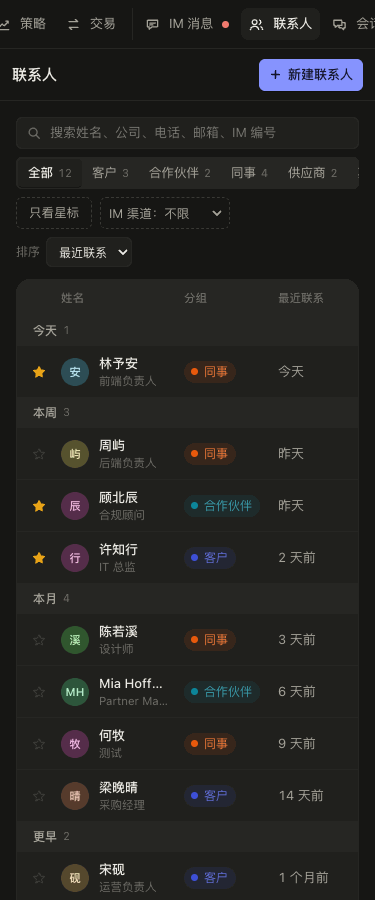

# 联系人 规格（SPEC-contacts）

| 项 | 内容 |
|---|---|
| 模块 key | `contacts` |
| 原型入口 | 一级菜单「联系人」，http://127.0.0.1:7778 |
| 源码 | `web-next/src/contacts.tsx`（列表页 `ContactsPage`、抽屉 `ContactDrawer`）；接线在 `web-next/src/App.tsx`（`patchContact`、`contactPlan`、`deleteContact`） |
| 数据文件 | `web-next/src/data.ts`（`Contact`、`Group`、`ImChannel`、`IM_CHANNELS`）、`web-next/src/enumdata.ts`（`contact_group` 枚举） |
| 截图 | [`shots/contacts/`](shots/contacts/) |
| 负责任务 | PROTO-04c |
| 对应开发任务 | CT-03a 实现联系人列表页：与 `SPEC-contacts-1` 对照；CT-03b 实现联系人抽屉和 IM 身份编辑：与 `SPEC-contacts-2`、`SPEC-contacts-3` 对照（数据结构见 `SPEC-contacts-0`） |
| 状态 | 已整理 |
| 最后对照 | 2026-10-28，原型提交 `932555b` |

## SPEC-contacts-0 模块概述

常打交道的人：客户、合作伙伴、同事、供应商。记下公司、职位、电话、邮箱和各 IM 渠道上的编号，IM 消息靠渠道编号认出是谁，项目干系人和任务负责人也从这里选。

### 页面清单

| 节 | 页面 | 入口 | 说明 |
|---|---|---|---|
| [SPEC-contacts-1](#spec-contacts-1-联系人列表) | 联系人列表 | 一级菜单「联系人」 | 搜索、分组和渠道筛选、排序分段的表格 |
| [SPEC-contacts-2](#spec-contacts-2-联系人抽屉查看) | 联系人抽屉（查看） | 列表里点一行；或从 IM 消息、项目干系人、命令面板打开 | 资料、快捷动作、IM 渠道、备注、删除 |
| [SPEC-contacts-3](#spec-contacts-3-新建和编辑联系人) | 新建和编辑联系人 | 「新建联系人」；抽屉里点「编辑」；IM 消息「存为联系人」 | 同一个抽屉的表单态，含 IM 身份编辑 |

### 共用数据结构

`Contact`（`web-next/src/data.ts`）

| 字段 | 类型 | 必填 | 说明 | 取值 / 示例 |
|---|---|---|---|---|
| `id` | `string` | 是 | 编号 | `ct_001` |
| `name` | `string` | 是 | 姓名，保存时去掉首尾空白；允许重名（见 `docs/dev-decisions.md`「干系人名字重名」） | `许知行` |
| `company` | `string` | 是 | 公司，可为空串 | `远川科技` |
| `title` | `string` | 是 | 职位，可为空串 | `IT 总监` |
| `phone` | `string` | 是 | 电话，可为空串，可含空格 | `137 2233 4405` |
| `email` | `string` | 是 | 邮箱，可为空串；非空时要符合格式。有 Slack 身份的联系人可以从 Slack 资料补（只填空的，见 `SPEC-settings-4.7d`） | `xu.zx@yuanchuan.example` |
| `group` | `Group` | 是 | 分组，存枚举 key；可多个，用「、」连接存成一个字符串 | 内置 `客户` / `合作伙伴` / `同事` / `供应商` / `其他`，设置里可新增。正式产品：一人可在多个分组（如 `Acme、Globex`），读时按「、」拆开（也认逗号、斜杠、分号），原型只有单个 |
| `tags` | `string[]` | 是 | 标签，可为空数组 | `['试点', '决策人']` |
| `im` | `Record<string, string>` | 是 | 渠道 key 到该渠道账号编号；没填的渠道不存 key | `{ wechat: 'xuzhixing', lark: 'ou_xuzx' }` |
| `photo` | `string` | 否 | 上传的头像，data URL；没有就按名字生成 | |
| `note` | `string` | 是 | 备注，多行，可为空串 | |
| `starred` | `boolean` | 是 | 星标 | `false` |
| `last_contact_at` | `string \| null` | 是 | 最近联系时间，ISO 8601；没联系过为 `null` | |
| `created_at` | `string` | 是 | 添加时间，ISO 8601 | |

`Group`：`(typeof GROUPS)[number] | (string & {})`，内置值来自 `GROUPS = ['客户', '合作伙伴', '同事', '供应商', '其他']`；分组可在设置的枚举里新增，所以类型放宽成任意字符串。

联系人分组枚举：`EnumGroup` key `contact_group`（`web-next/src/enumdata.ts`），`default_key` 为 `其他`。每项 `EnumItem`：`key`（存进 `Contact.group`）、`label`（显示名）、`color`（分组标签颜色，内置：客户 `#3d4fd6`、合作伙伴 `#0c8599`、同事 `#e8590c`、供应商 `#7048e8`、其他 `#868e96`）、`desc`、`enabled`、`locked?`。字段定义同 `SPEC-library-0` 的 `EnumItem` 表。

`ImChannel`（`web-next/src/data.ts`）：IM 渠道定义，加渠道只改 `IM_CHANNELS` 这张表。

| 字段 | 类型 | 必填 | 说明 | 取值 / 示例 |
|---|---|---|---|---|
| `key` | `string` | 是 | 渠道 key，`Contact.im` 的键 | `wechat` |
| `label` | `string` | 是 | 全名 | `微信` |
| `short` | `string` | 是 | 列表格子里的短名 | `TG` |
| `color` | `string` | 是 | 渠道色 | `#07c160` |
| `hint` | `string` | 是 | 表单里提示填什么 | `微信号，不是昵称` |
| `link` | `(id: string) => string` | 否 | 能直达会话的给链接，没有公开 deep link 的只提供复制 | Telegram：`https://t.me/<name>` |

`IM_CHANNELS` 的五个渠道：

| key | label | short | hint | link |
|---|---|---|---|---|
| `wechat` | 微信 | 微信 | 微信号，不是昵称 | 无 |
| `lark` | 飞书 | 飞书 | 飞书 / Lark 的用户 ID 或登录邮箱 | 无 |
| `slack` | Slack | Slack | Member ID，形如 U01ABCDEF | 无 |
| `telegram` | Telegram | TG | 用户名，形如 @name | `https://t.me/<去掉 @ 的用户名>` |
| `qq` | QQ | QQ | QQ 号 | 无 |

IM 身份：原型一个渠道只存一个编号（`im[渠道 key]`）。正式产品按 CT-01 落到 `contact_identity` 表（一个联系人多个渠道身份，消息按 `identity_id` 关联联系人）；界面上仍按渠道分行显示，规格的交互以本文件为准。

### 联动总表

| 方向 | 对方模块 | 触发 | 结果 | 见 |
|---|---|---|---|---|
| 进来 | IM 消息 | 消息抽屉里「查看联系人」 | 打开发信人的联系人抽屉 | `SPEC-messages-2.11`、`SPEC-contacts-2` |
| 进来 | IM 消息 | 发信人不在联系人里：「关联到联系人」或「新建联系人」（正式产品 IM-05，原型是「存为联系人」跳到新建抽屉） | 在 IM 页就地认人：给选中的联系人挂上该渠道编号的身份；或只填姓名、公司、分组新建联系人再挂身份，不跳走，之后「去联系人页补全」打开这个人的抽屉。认错了「不是这个人」改挂或解除（只删身份，联系人不动） | `SPEC-messages-2.12`、`SPEC-messages-2.27`~`2.31` |
| 进来 | 项目 | 干系人标签、概览里点某个干系人 | 打开联系人抽屉 | `SPEC-projects-6.4`、`SPEC-projects-3.4` |
| 进来 | 命令面板 | 「新建联系人」；或搜到「联系人」组的条目 | 打开新建抽屉；或打开该联系人抽屉（按电话、邮箱、IM 编号也能搜到） | 全局 |
| 被改动 | IM 消息 | 回复了某人的消息 | 该联系人的 `last_contact_at` 改成回复时间 | `SPEC-messages` |
| 改动 | 项目 | 删除联系人 | 从各项目干系人里移除；项目里和 TA 的私聊绑定解除；历史消息不动 | `SPEC-contacts-2.12` |
| 被引用 | IM 消息 | 显示发信人 | 按「渠道 + 编号」匹配联系人（同一编号取第一个），不按名字 | `SPEC-messages` |
| 被引用 | 任务 | 选负责人 | 负责人候选是「我」+ 分组为「同事」的联系人 | `SPEC-tasks` |
| 被引用 | 设置 / Agent | Agent 开了「查联系人」「新建 / 修改联系人」权限 | Agent 能按姓名、公司、IM 账号查人 | `SPEC-settings`（Agent 节）、`SPEC-sessions-1` |
| 被改动 | 设置 / 枚举值 | 改联系人分组的名字、颜色、顺序、启停，或合并分组 | 分组标签、筛选跟着变；合并时 `group` 一起迁移 | `SPEC-settings`（枚举值节） |
| 显示 | 一级菜单 | 始终 | 「联系人」菜单角标是联系人总数 | 全局 |

## SPEC-contacts-1 联系人列表

一张表列出所有联系人，默认按最近联系排序并分段（正式产品：没联系过的人多于一半时默认按姓名，见 `SPEC-contacts-1.9`）。

### 截图

| | 亮 | 暗 |
|---|---|---|
| 桌面 1440 |  |  |
| 手机 375 |  |  |

### 交互

| 编号 | 元素 | 操作 | 结果 |
|---|---|---|---|
| SPEC-contacts-1.1 | 页面标题 | 显示 | 「联系人」+ 总人数（不受筛选影响）+ 说明「客户、合作伙伴、同事和供应商，按最近联系排序」。正式产品：说明里的排序跟当前排序走，按姓名时写「按姓名排序」 |
| SPEC-contacts-1.2 | 右上「新建联系人」 | 点击 | 打开新建抽屉（`SPEC-contacts-3`），焦点在姓名 |
| SPEC-contacts-1.3 | 搜索框 | 输入 | 实时过滤，不区分大小写，匹配姓名、公司、职位、电话、邮箱、标签和各渠道 IM 编号；电话忽略空格（输「13722」能搜到「137 2233 4405」）。正式产品：还匹配备注和角色（别名、职责常写在备注里）；整串没命中时按空格拆词，每个词都要命中某个字段，可以是不同字段（「Globex 信用卡」） |
| SPEC-contacts-1.4 | 搜索框右侧 x | 点击 | 有内容时出现；清空搜索 |
| SPEC-contacts-1.5 | 分组切换 | 点击 | 「全部 N」+ 各分组「名 N」单选。列出的分组：启用的，加上停用但还有人在用的；顺序按设置里的枚举顺序。人数是全部联系人里的人数，不受其他筛选影响。正式产品：按包含匹配，在几个分组里的人每个分组都筛得到、各算一次，「全部 N」按人数不重复算 |
| SPEC-contacts-1.6 | 「更多分组 N」下拉 | 选择 | 分组多于 6 个时出现：切换里只放人数最多的 5 个，其余收进可搜索的下拉，每项提示「N 人」，停用的加「· 已停用」；选中后按该分组筛选 |
| SPEC-contacts-1.7 | 「只看星标」 | 点击 | 开关；开着时只显示星标联系人，按钮高亮 |
| SPEC-contacts-1.8 | 「IM 渠道」下拉 | 选择 | 「IM 渠道：不限」或「有微信（N）」等五项，只显示该渠道填了编号的人；选了渠道时按钮高亮 |
| SPEC-contacts-1.9 | 「排序」下拉 | 选择 | 「最近联系」：按 `last_contact_at` 倒序，没联系过的排最后；「姓名」：按拼音首字母（英文名和中文名混排，非字母开头的归到 `#` 排最后），同字母内按中文排序规则。正式产品：没选过排序时，没联系过的人多于一半默认「姓名」，否则「最近联系」；选过就按选的 |
| SPEC-contacts-1.10 | 分段标题 | 显示 | 每段第一行前插一行标题和人数。按最近联系：今天 / 本周（周一起）/ 本月 / 更早 / 未联系；按姓名：首字母 A 到 Z 和 `#` |
| SPEC-contacts-1.11 | 表格行 | 点击，或聚焦后按 Enter | 打开该联系人的抽屉（`SPEC-contacts-2`）；抽屉打开时这一行高亮 |
| SPEC-contacts-1.12 | 行首星标 | 点击 | 切换星标，不打开抽屉 |
| SPEC-contacts-1.13 | 表格列 | 显示 | 桌面：星标、姓名（头像 + 姓名 + 职位）、公司、分组标签（正式产品：多个分组时显示第一个加「+N」，超出列宽截断，悬停显示全部，用「、」隔开；抽屉资料表里全部列出）、电话（等宽）、IM 渠道（已填渠道的短名徽标，悬停显示「渠道：编号」）、邮箱、最近联系（今天 / 昨天 / N 天前 / N 个月前 / N 年前）。没填的显示「-」，没联系过显示「未联系」。手机只留星标、姓名、分组、最近联系；表格窄于 680px 时最近联系一列靠右，窄于 460px 时姓名列不设最小宽度、收窄内边距，整行不超出表格（B-11） |
| SPEC-contacts-1.14 | 头像 | 显示 | 有上传图片显示图片；否则按名字生成：英文名取各词首字母最多两个大写，中文名取最后一个字，底色按名字算色相 |
| SPEC-contacts-1.15 | 「显示更多 还有 N 人」 | 点击 | 先渲染 100 行，每点一次多 100 行；筛选、搜索或排序一变就回到前 100 行 |
| SPEC-contacts-1.16 | 键盘 Esc | 抽屉打开时按 | 关闭抽屉 |

### 空状态和异常状态

| 编号 | 场景 | 显示 | 可做的操作 |
|---|---|---|---|
| SPEC-contacts-1.17 | 一个联系人都没有 | 「还没有联系人」+「把常打交道的人记下来，找人时不用翻聊天记录」 | 「新建第一个联系人」打开新建抽屉 |
| SPEC-contacts-1.18 | 筛选或搜索后没有结果 | 「没有匹配的联系人」+「换个关键词，或清掉分组、星标和渠道筛选」 | 原型没有一键清除按钮，要手动清；正式产品同原型 |
| SPEC-contacts-1.19 | 停用的分组还有人 | 照常出现在分组切换里，这些人能筛到 | |
| SPEC-contacts-1.20 | 联系人的分组 key 已从枚举删除 | 分组标签按原值显示，颜色用灰 `#868e96` | 编辑时改成现有分组 |
| SPEC-contacts-1.21 | 加载失败 | 原型未做；正式产品在表格位置显示错误信息和「重试」 | 重试 |
| SPEC-contacts-1.22 | 重名 | 原型照常显示两行，靠职位、公司区分。正式产品按决策：重名时在名字后附公司或渠道账号 | |

### 数据

见 SPEC-contacts-0 的 `Contact`、`ImChannel`、`contact_group`。页面自己的状态（原型在 `ContactsPage` 里，不落库）：

| 字段 | 类型 | 说明 | 取值 |
|---|---|---|---|
| `q` | `string` | 搜索词 | |
| `group` | `Group \| null` | 分组筛选，`null` 为全部 | |
| `starredOnly` | `boolean` | 只看星标 | |
| `channel` | `string` | IM 渠道筛选，空串为不限 | `IM_CHANNELS` 的 key |
| `sort` | `'recent' \| 'name'` | 排序 | `recent` 最近联系 / `name` 姓名 |
| `SEG_MAX` | 常量 | 分组切换里最多放几个 | `5` |
| `PAGE` | 常量 | 一次渲染行数 | `100` |

### 联动

| 方向 | 对方模块 | 触发 | 结果 | 见 |
|---|---|---|---|---|
| 出去 | 本模块 | 点行或「新建联系人」 | 打开抽屉 | `SPEC-contacts-2`、`SPEC-contacts-3` |
| 改动 | 无 | 行首星标 | 只改 `starred` | |

## SPEC-contacts-2 联系人抽屉（查看）

右侧抽屉，看一个人的全部资料，能直接打电话、发邮件、记一次联系、复制或打开 IM 编号。

### 截图

截图脚本截不到抽屉，图先空着。操作：一级菜单「联系人」，点任意一行（如「许知行」）。

| | 亮 | 暗 |
|---|---|---|
| 桌面 1440 | 待截图脚本支持 | 待截图脚本支持 |
| 手机 375 | 待截图脚本支持 | 待截图脚本支持 |

### 交互

| 编号 | 元素 | 操作 | 结果 |
|---|---|---|---|
| SPEC-contacts-2.1 | 抽屉头 | 显示 | 左边小字「联系人」；右边「编辑」图标和「关闭 (Esc)」 |
| SPEC-contacts-2.2 | 「编辑」图标 / 底部「编辑」 | 点击 | 用当前资料进入编辑态（`SPEC-contacts-3`） |
| SPEC-contacts-2.3 | 关闭按钮 / Esc | 点击 / 按键 | 关闭抽屉 |
| SPEC-contacts-2.4 | 头像 | 点击 | 弹出「更换图像」：「上传图片」（选 `image/*`，1MB 以内）和「移除图片」（有图时才有），提示「没有图片时按名字生成」；选完立即保存 |
| SPEC-contacts-2.5 | 姓名旁星标 | 点击 | 切换星标，立即保存 |
| SPEC-contacts-2.6 | 姓名下一行 | 显示 | 「职位 · 公司」，都没填显示「未填写职位与公司」 |
| SPEC-contacts-2.7 | 「打电话」 | 点击 | 有电话时打开 `tel:`（去掉空格）；没电话时置灰不可点 |
| SPEC-contacts-2.8 | 「发邮件」 | 点击 | 有邮箱时打开 `mailto:`；没邮箱时置灰 |
| SPEC-contacts-2.9 | 「记一次联系」 | 点击 | `last_contact_at` 改为现在；列表里这个人移到「今天」分段 |
| SPEC-contacts-2.10 | 资料表 | 显示 | 分组（标签）、电话（等宽，带「复制」）、邮箱（带「复制」）、标签、事项、最近联系、添加于（`zh-CN` 日期）；没填的显示「未填写」。「事项」写「负责 N · 参与 M」，都是 0 时灰字「没有负责或参与的事」，数字来自 `owned_count`、`participating_count`（不含回收站，见 `docs/api-contract.md`）；删除前的引用检查（`SPEC-contacts-2.12`）也看这两个数。这一行是正式前端补的，原型没有 |
| SPEC-contacts-2.11 | IM 渠道 | 显示和点击 | 五个渠道各一行，固定顺序。填了的显示编号（等宽）和「复制」；有 deep link 的渠道（Telegram）多一个「打开」，新窗口打开；没填的显示「未填写」，没有按钮 |
| SPEC-contacts-2.12 | 底部「删除」 | 点击 | 底部换成确认条：「确定删除「姓名」？删除后<影响>」+「取消」「删除」。影响按实际数据列出：「会从项目 A、B 的干系人里移除」「项目 A 里和 TA 的私聊绑定会解除」，没有影响时只问「确定删除」；确认后删除并关闭抽屉，历史消息不动 |
| SPEC-contacts-2.13 | 确认条「取消」 | 点击 | 回到普通底栏 |
| SPEC-contacts-2.14 | 备注 | 显示 | 按换行分段显示 |

### 空状态和异常状态

| 编号 | 场景 | 显示 | 可做的操作 |
|---|---|---|---|
| SPEC-contacts-2.15 | 没有备注 | 「还没有备注」 | 编辑 |
| SPEC-contacts-2.16 | 一个 IM 渠道都没填 | 五行都显示「未填写」 | 编辑 |
| SPEC-contacts-2.17 | 上传的图片超过 1MB | 头像菜单里红字「图片不能超过 1MB」，不保存 | 换一张 |
| SPEC-contacts-2.18 | 浏览器不给剪贴板权限 | 原型静默失败，没有提示；正式产品应提示「复制失败」 | |
| SPEC-contacts-2.19 | 打开的联系人已被删除（如另一处删掉） | 原型：`contact` 为空时会落到新建态。正式产品应显示「这个联系人已删除」并只给「关闭」 | 关闭 |
| SPEC-contacts-2.20 | 删除失败 | 原型未做；正式产品保留抽屉、底部红字提示原因 | 重试 |

### 数据

见 SPEC-contacts-0 的 `Contact`。删除影响 `delImpact: string[]` 由 `App.tsx` 的 `contactPlan` 算出：查 `Project.stakeholders[].contact_id` 和 `Project.chats[]` 里 `kind === 'dm'` 且 `contact_id` 等于该联系人的项。

### 联动

| 方向 | 对方模块 | 触发 | 结果 | 见 |
|---|---|---|---|---|
| 改动 | 项目 | 删除 | 干系人里移除，私聊绑定解除 | `SPEC-projects` |
| 改动 | 本模块列表 | 记一次联系、星标、换头像 | 列表对应行立即更新 | `SPEC-contacts-1` |
| 出去 | 系统 | 打电话、发邮件、打开 Telegram | 交给系统的 `tel:`、`mailto:` 和浏览器新窗口 | |

## SPEC-contacts-3 新建和编辑联系人

抽屉的表单态。新建、编辑、从 IM 消息「存为联系人」共用。

### 截图

截图脚本截不到，图先空着。操作：新建是点「新建联系人」；编辑是打开任意联系人后点「编辑」。

| | 亮 | 暗 |
|---|---|---|
| 桌面 1440 | 待截图脚本支持 | 待截图脚本支持 |
| 手机 375 | 待截图脚本支持 | 待截图脚本支持 |

### 交互

| 编号 | 元素 | 操作 | 结果 |
|---|---|---|---|
| SPEC-contacts-3.1 | 抽屉头 | 显示 | 新建为「新建联系人」，编辑为「编辑联系人」；只有关闭按钮 |
| SPEC-contacts-3.2 | 头像 | 点击 | 同 `SPEC-contacts-2.4`，但只改表单里的值，保存时才落库；没名字时头像显示「新」 |
| SPEC-contacts-3.3 | 姓名（必填，带 *） | 输入 | 打开时自动聚焦；占位「例如 许知行」 |
| SPEC-contacts-3.4 | 公司、职位、电话、邮箱 | 输入 | 占位分别为「所在单位」「例如 IT 总监」「手机或座机」「name@company.com」 |
| SPEC-contacts-3.5 | 任意单行输入框（含 IM 编号） | 按 Enter | 等同点「创建」/「保存」 |
| SPEC-contacts-3.6 | 分组 | 点击或选择 | 可选项是启用的分组，加上当前值（即使已停用）；不超过 6 个时是一排切换按钮，多了换成可搜索下拉，停用项提示「已停用」。新建时默认取枚举的默认值（内置为「其他」）。正式产品：可多选，点按钮选上或去掉，至少留一个；下拉换成多选；存时按可选项顺序用「、」连接 |
| SPEC-contacts-3.7 | IM 渠道 | 输入 | 标题旁提示「填各渠道上能搜到这个人的编号，没有的留空」；五个渠道各一行，占位是该渠道的 `hint` |
| SPEC-contacts-3.8 | 标签输入 | 回车或失焦 | 把输入的文字（去首尾空白）加成标签，重复的不加；没有标签时占位「输入后回车添加」 |
| SPEC-contacts-3.9 | 标签输入 | 输入框为空时按退格 | 删掉最后一个标签 |
| SPEC-contacts-3.10 | 标签上的 x | 点击 | 移除该标签 |
| SPEC-contacts-3.11 | 备注 | 输入 | 多行，占位「怎么认识的、关心什么、下次聊什么」 |
| SPEC-contacts-3.12 | 「取消」 | 点击 | 新建：关闭抽屉，不保存。编辑：回到查看态，改动丢弃，校验提示清掉 |
| SPEC-contacts-3.13 | 「创建」/「保存」 | 点击 | 先校验（见下）。通过后：姓名去首尾空白；IM 编号去首尾空白，清空的渠道直接删掉（清空一个渠道等于删掉这个身份）。新建：生成 `id`、`created_at`，插到列表最前，抽屉切到这个人的查看态。编辑：保存后回到查看态。从 IM 消息「存为联系人」进来时预填姓名（发信人名）、该渠道编号（发信人编号）、分组「其他」（原型；正式产品在 IM 页就地新建，见 `SPEC-messages-2.28`） |

### 空状态和异常状态

| 编号 | 场景 | 显示 | 可做的操作 |
|---|---|---|---|
| SPEC-contacts-3.14 | 姓名为空就提交 | 姓名框标红，下方「姓名必填」；不保存、不关抽屉 | 补全后再提交 |
| SPEC-contacts-3.15 | 邮箱非空但格式不对 | 邮箱框标红，下方「邮箱格式不对」 | 改对或清空 |
| SPEC-contacts-3.16 | 校验提示出现的时机 | 第一次点提交之前不提示；提交过一次后随输入实时更新 | |
| SPEC-contacts-3.17 | 电话格式 | 不校验，原样保存 | |
| SPEC-contacts-3.18 | 和已有联系人重名，或 IM 编号已被别人占用 | 原型不提示，照常保存。正式产品：重名允许保存；同一渠道编号已属于另一个联系人时提示「这个编号已经是 <姓名> 的」，不阻止保存（消息匹配按第一个） | |
| SPEC-contacts-3.19 | 保存失败 | 原型未做；正式产品保留表单，底部红字提示原因 | 重试 |

### 数据

`Draft`（`web-next/src/contacts.tsx`）：`Omit<Contact, 'id' | 'created_at'>`，字段同 SPEC-contacts-0 的 `Contact` 去掉 `id`、`created_at`。新建的空白值：

| 字段 | 默认值 |
|---|---|
| `name`、`company`、`title`、`phone`、`email`、`note` | `''` |
| `group` | 枚举默认值（内置 `其他`）；取不到时 `客户` |
| `tags` | `[]` |
| `im` | `{}` |
| `starred` | `false` |
| `last_contact_at` | `null` |

预填 `initial: Partial<Draft>` 覆盖在空白值上；IM 消息「存为联系人」传 `{ name: 发信人名, im: { [渠道]: 发信人编号 }, group: '其他' }`。

校验规则：

| 字段 | 规则 | 提示 |
|---|---|---|
| `name` | 去首尾空白后非空 | 姓名必填 |
| `email` | 空，或匹配 `^[^\s@]+@[^\s@]+\.[^\s@]+$` | 邮箱格式不对 |

### 联动

| 方向 | 对方模块 | 触发 | 结果 | 见 |
|---|---|---|---|---|
| 进来 | IM 消息 | 「存为联系人」（原型）；正式产品改为 IM 页就地新建，不进这个表单 | 原型预填新建 | `SPEC-messages-2.12`、`SPEC-messages-2.28` |
| 改动 | IM 消息 | 保存了渠道编号 | 该渠道、该编号的消息从此显示为这个联系人 | `SPEC-messages` |
| 改动 | 任务 | 分组改成或改离「同事」 | 任务负责人候选跟着增减 | `SPEC-tasks` |

## 原型和规格对不上的地方

ALIGN-15 补了一处：正式前端资料表多出的「事项」行写进 `SPEC-contacts-2.10`（原型没有这一行，原型不补）。

PROTO-09 对照时联系人模块没有要修的地方：列表、抽屉、新建编辑的行为和本文件一致，空状态已经分开说（`SPEC-contacts-1.17` 一个都没有、`SPEC-contacts-1.18` 筛选后为空）。正文里标「原型未做」「原型静默失败」的几条（加载失败、保存失败、复制失败、打开的联系人已被删除、IM 编号被占用）是正式产品要做的异常处理，原型不补。截图已按当前原型重截。
