# 宽基监控 规格（SPEC-etf）

| 项 | 内容 |
|---|---|
| 模块 key | `etf` |
| 原型入口 | 一级菜单「宽基监控」，http://127.0.0.1:7778（默认在「交易工作台」的「行情」组、「0xBroleez」的「交易」组） |
| 源码 | `web-next/src/etf.tsx`（页面 `EtfPage`、份额与资金流 `FlowTab`、迷你折线 `Spark`、异动 `EventsTab`、规则 `RulesTab`、规则抽屉 `RuleDrawer`）；样式 `web-next/src/etf.css`；接线在 `web-next/src/App.tsx`（`page === 'etf'`）、`web-next/src/workspacedata.ts`（`MODULES`、预设工作台） |
| 数据文件 | `web-next/src/etfdata.ts`（`EtfFund`、`EtfDaily`、`EtfMetrics`、`EtfRule`、`EtfAnomaly`、`METRICS`、`OPERATORS`、`SEVERITY`、`STATUS`、`BASIS`、`SCOPE`、`ETF_FUNDS`、`seedRules`、`buildDataset`、`computeMetrics`、`evaluateDay`、`seedEvents`） |
| 截图 | [`shots/etf/`](shots/etf/) |
| 负责任务 | ETF-01b（TSK-0450） |
| 状态 | 已整理 |
| 最后对照 | 2026-11-04，原型基于提交 `9dab614` 的工作区改动（本规格随 ETF-01b 一起提交） |

### 引用本规格的开发任务

| 任务 | 内容 | 对照的节 |
|---|---|---|
| ETF-01a | 宽基清单、每日份额与行情采集落库（`etf_funds`、`etf_daily`） | `SPEC-etf-0`「共用数据结构」里 `EtfFund`、`EtfDaily` |
| ETF-01b（TSK-0450） | 跟踪指数行情、派生指标、异动规则与命中记录、通知；前端宽基监控页 | `SPEC-etf-0` 到 `SPEC-etf-3` |

宽基监控是独立插件 `etf`（不是交易套件 `trade` 的子插件），只读公开数据，没有任何下单、撤单、划转能力。模块 key 是 `etf`，不占用交易套件的「盯盘」`monitor`。设计依据见仓库 `docs/etf-anomaly-design.md`。

## SPEC-etf-0 模块概述

盯 A 股宽基 ETF 的份额变动和资金进出：每天收盘后采集份额与行情，补跟踪指数行情和 IOPV，算派生指标（份额变动、估算净流入、连续流入流出天数、量比、折溢价、跟踪误差、历史分位），按规则判定异动，命中的记一条并发通知。页面没有二级菜单，顶栏下面三个标签。

### 截图

模块入口（默认打开「份额与资金流」）：

| | 亮 | 暗 |
|---|---|---|
| 桌面 1440 | 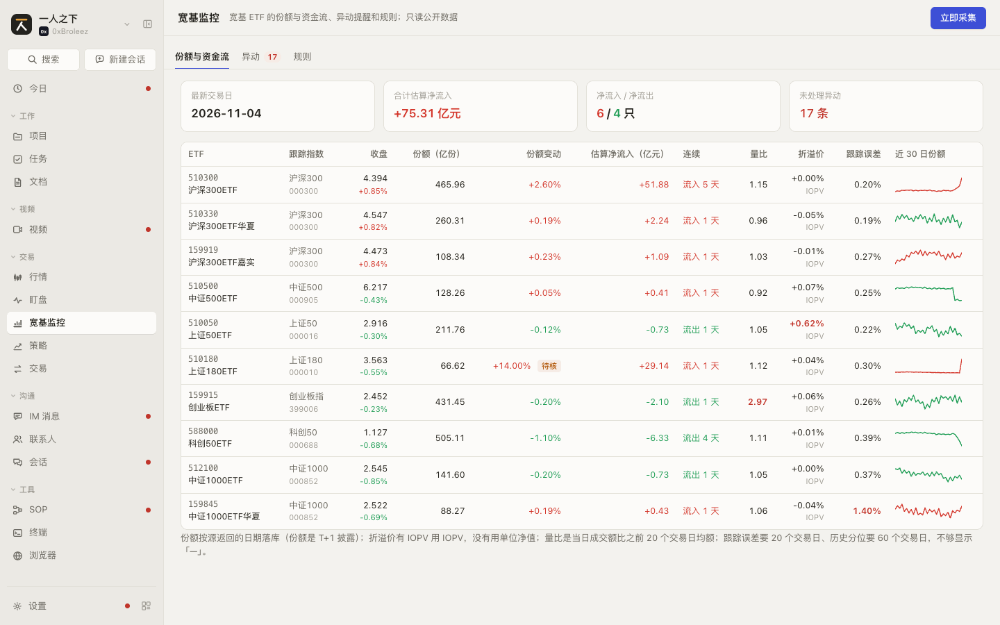 | 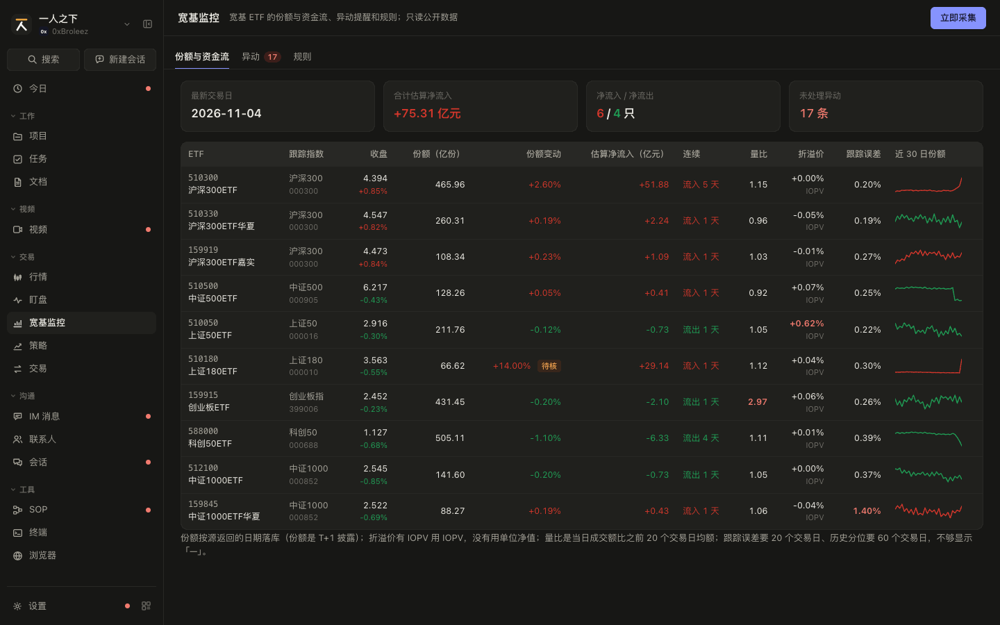 |
| 手机 375 | 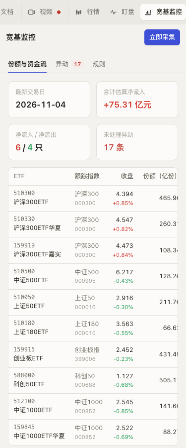 |  |

### 页面清单

| 节 | 页面 | 入口 | 说明 |
|---|---|---|---|
| [SPEC-etf-1](#spec-etf-1-份额与资金流) | 份额与资金流 | 标签「份额与资金流」（默认） | 摘要四格 + 每只宽基一行的指标表和近 30 日份额趋势 |
| [SPEC-etf-2](#spec-etf-2-异动) | 异动 | 标签「异动」；摘要里的「未处理异动」 | 命中记录，按状态、严重度筛选，确认、忽略、撤回 |
| [SPEC-etf-3](#spec-etf-3-规则和规则抽屉) | 规则和规则抽屉 | 标签「规则」 | 规则表（启停、编辑），新建和编辑抽屉 |

### 共用数据结构

字段名照后端 `internal/plugins/etf` 的 JSON（snake_case），原型类型在 `web-next/src/etfdata.ts`。

`EtfFund`（宽基静态元信息，后端 `EtfFund` 的子集）

| 字段 | 类型 | 必填 | 说明 | 取值 / 示例 |
|---|---|---|---|---|
| `symbol` | `string` | 是 | 6 位代码 | `510300` |
| `name` | `string` | 是 | 名称 | `沪深300ETF` |
| `track_index` | `string` | 是 | 跟踪指数名 | `沪深300` |
| `manager` | `string` | 是 | 基金公司 | `华泰柏瑞基金` |
| `market` | `'SH' \| 'SZ'` | 是 | 交易所 | `SH` |
| `underlying` | `string` | 是 | 跟踪指数代码 | `000300` |

覆盖的 10 只同后端 `source.go` 的 `broadBased`：510300、510330、159919（沪深300），510500（中证500），510050（上证50），510180（上证180），159915（创业板指），588000（科创50），512100、159845（中证1000）。

`EtfDaily`（一天一只的份额与行情，后端 `EtfDaily` 的子集）

| 字段 | 类型 | 必填 | 说明 | 取值 / 示例 |
|---|---|---|---|---|
| `date` | `string` | 是 | 交易日，以源返回的日期为准（份额 T+1 披露） | `2026-11-04` |
| `symbol` | `string` | 是 | 代码 | `510300` |
| `shares` | `number` | 是 | 份额（份），取不到为 0 | `46596000000` |
| `nav` | `number` | 是 | 单位净值（元），没有为 0 | |
| `iopv` | `number` | 是 | 盘中参考净值（元），只有最近交易日能拿到，历史日期为 0 | `4.1728` |
| `price` | `number` | 是 | 收盘价（元） | `4.394` |
| `amount` | `number` | 是 | 成交额（元） | |
| `change_pct` | `number` | 是 | 涨跌幅（%） | `0.85` |
| `aum` | `number` | 是 | 估算规模（元）= 份额 × 净值，没有净值依次用 IOPV、收盘价 | |
| `premium_discount` | `number` | 是 | 折溢价（%） | `0.62` |
| `premium_basis` | `PremiumBasis` | 是 | 折溢价口径 | `iopv` IOPV / `nav` 净值 / `none` 不可用 |

`EtfMetrics`（派生指标，一天一只一行；样本不足的为 `null`，页面显示「—」，判定时跳过）

| 字段 | 类型 | 必填 | 说明 | 取值 / 示例 |
|---|---|---|---|---|
| `date`、`symbol` | `string` | 是 | 交易日、代码 | |
| `share_change_pct` | `number \| null` | 是 | 份额日变动（%），前一天或当天缺份额为 null | `2.6` |
| `net_inflow` | `number \| null` | 是 | 估算净流入（元）= 份额差 × 净值（没有净值用 IOPV，再没有用收盘价） | `5188000000` |
| `inflow_streak` | `number` | 是 | 连续净流入天数（正）/ 连续净流出天数（负），份额不变或缺数据为 0 | `5`、`-3` |
| `amount_ratio` | `number \| null` | 是 | 量比 = 当日成交额 / 之前 20 个交易日均额（不含当日） | `2.97` |
| `share_pctile`、`aum_pctile`、`premium_pctile` | `number \| null` | 是 | 当日值在近 250 个交易日里的分位（0-100），有效样本不足 60 天为 null | `100` |
| `tracking_error` | `number \| null` | 是 | 近 20 日（ETF 日收益 - 指数日收益）样本标准差 × √252（%） | `1.40` |
| `excess_return` | `number \| null` | 是 | 近 20 日 ETF 累计收益减指数累计收益（%） | |
| `aum_change_pct` | `number \| null` | 是 | 规模日变动（%） | |
| `premium_discount` | `number \| null` | 是 | 同 `EtfDaily`，口径 `none` 时为 null | |
| `premium_basis` | `PremiumBasis` | 是 | 同 `EtfDaily` | |
| `review_flag` | `'' \| 'pending_review'` | 是 | 待核：份额单日变动超过 10% 且量比不到 2（没有行情配合），疑似分红、拆分、份额折算 | |
| `updated_at` | `string` | 是 | 计算时间 | |

`EtfRule`（异动规则）

| 字段 | 类型 | 必填 | 说明 | 取值 / 示例 |
|---|---|---|---|---|
| `id` | `string` | 是 | `ear_` 前缀；内置 7 条是固定 id | `ear_share_jump` |
| `name` | `string` | 是 | 名称，最多 50 字 | `份额单日骤变` |
| `scope` | `RuleScope` | 是 | 范围 | `all` 全部 / `symbol` 某只 ETF / `index` 某个跟踪指数 |
| `scope_value` | `string` | 是 | 范围值：ETF 代码或指数代码（后端也认指数名），`all` 时为空串 | `510300`、`000300` |
| `metric` | `MetricKey` | 是 | 指标，见下「指标」 | `share_change_pct` |
| `operator` | `RuleOperator` | 是 | 比较 | `gt` > / `gte` ≥ / `lt` < / `lte` ≤ / `abs_gt` 绝对值 > |
| `threshold` | `number` | 是 | 阈值，单位同指标 | `2` |
| `window_days` | `number` | 是 | 指标窗口（量比、跟踪误差 20，分位 250，其余 1），目前只做展示 | `20` |
| `severity` | `Severity` | 是 | 严重度 | `info` 提示 / `warn` 警告 / `critical` 严重 |
| `enabled` | `boolean` | 是 | 启用 | |
| `builtin` | `boolean` | 是 | 内置规则，不能删 | |
| `created_at`、`updated_at` | `string` | 是 | | |

`EtfAnomaly`（命中记录；同日同标的同规则一条）

| 字段 | 类型 | 必填 | 说明 | 取值 / 示例 |
|---|---|---|---|---|
| `id` | `string` | 是 | `eae_` 前缀 | |
| `date`、`symbol`、`fund_name` | `string` | 是 | 交易日、代码、名称 | |
| `rule_id`、`rule_name` | `string` | 是 | 命中的规则（名称是命中时的快照） | |
| `metric`、`operator`、`threshold`、`severity` | | 是 | 命中时规则的快照 | |
| `value` | `number` | 是 | 指标值 | `2.6` |
| `status` | `EventStatus` | 是 | 处理状态 | `open` 未处理 / `acked` 已确认 / `ignored` 已忽略 |
| `flag` | `'' \| 'pending_review'` | 是 | 份额类指标在待核那天命中时标待核 | |
| `detail` | `string` | 是 | 说明文案 | `份额日变动 2.60%，规则 绝对值 > 2.00%` |
| `created_at`、`updated_at`、`handled_at` | `string` | 是 | `handled_at` 是确认或忽略的时间，未处理为空串 | |

### 指标（`METRICS`，规则下拉和条件文案用）

| key | 显示 | 单位 | 由份额推出（待核时命中标待核） |
|---|---|---|---|
| `share_change_pct` | 份额日变动 | % | 是 |
| `net_inflow` | 估算净流入 | 元（显示按亿元、万元换算） | 是 |
| `inflow_streak` | 连续净流入天数 | 天（流出为负） | 是 |
| `amount_ratio` | 量比 | 倍 | 否 |
| `premium_discount` | 折溢价 | % | 否 |
| `aum_change_pct` | 规模日变动 | % | 是 |
| `tracking_error` | 跟踪误差（20 日年化） | % | 否 |
| `excess_return` | 超额收益（20 日） | % | 否 |
| `share_pctile` | 份额历史分位 | 0-100 | 是 |
| `aum_pctile` | 规模历史分位 | 0-100 | 是 |
| `premium_pctile` | 折溢价历史分位 | 0-100 | 否 |

口径（同 `docs/etf-anomaly-design.md` 第七节、后端 `metrics.go`）：量比去掉当日，之前不足 20 天不算；跟踪误差和超额收益要近 20 个交易日都有指数数据；历史分位至少 60 个有效交易日、最多看 250 个；折溢价有 IOPV 用 IOPV，没有用单位净值，两样都没有为不可用；份额跳变超过 10% 且量比不到 2 记待核。

### 首批内置规则（`seedRules`，同后端 `rules.go` 的 `defaultRules`）

| id | 名称 | 条件 | 严重度 |
|---|---|---|---|
| `ear_share_jump` | 份额单日骤变 | 份额日变动 绝对值 > 2% | 警告 |
| `ear_inflow_streak` | 连续净流入 | 连续净流入天数 ≥ 3 | 提示 |
| `ear_outflow_streak` | 连续净流出 | 连续净流入天数 ≤ -3 | 警告 |
| `ear_volume_spike` | 放量 | 量比 > 2 | 提示 |
| `ear_premium` | 折溢价异常 | 折溢价 绝对值 > 0.5% | 警告 |
| `ear_aum_jump` | 规模骤变 | 规模日变动 绝对值 > 3% | 警告 |
| `ear_tracking_error` | 跟踪误差扩大 | 跟踪误差（20 日年化） > 1% | 严重 |

内置规则安装时补种，用户改过阈值或停用的不再覆盖；只能改、停用，不能删（本期没有删除接口）。

### 判定和命中记录（`evaluateDay`，同后端 `evaluateDay`）

- 每次采集算完当天指标后，按启用的、范围覆盖这只的规则逐条判定；指标为 null（样本不足）不判定。
- 命中：没有记录就新建一条 `open`；已有记录覆盖值、阈值、文案，状态不动（确认、忽略过的保持）。
- 不再命中：未处理的记录撤掉；确认、忽略过的保留。
- 这次新增的命中汇总成一条通知（有严重的用错误级别），重跑同一天不重复通知。原型只在「立即采集」的提示条里写「已发通知」，不真的进通知中心。

### 原型里模拟、正式版要真做的

| 原型 | 正式版 |
|---|---|
| `buildDataset` 生成 10 只宽基截至 2026-11-04 的 70 个交易日确定性数据；写好几处异动（510300 连续流入且当天骤增、588000 连续流出、510180 份额跳 14% 待核、159915 放量、510050 溢价 0.62%、159845 跟踪误差大），三天前 510500 骤减一条已确认、五天前 512100 放量一条已忽略 | 后台任务 `etf_daily` 每 24 小时采集，数据来自东方财富公开接口 |
| 「立即采集」把演示数据往后推一个交易日，按当前规则判定这一天，顶部提示条写采集的日期和新增条数 | `POST /api/etf/collect`：采集最近交易日（或指定日期），补指数行情、算指标、判定、发通知；回 `EtfCollect`（含 `indexes`、`metrics`、`hits`、`new_hits`） |
| 改规则只改本页 state，从下一次「立即采集」起生效 | `PATCH /api/etf/rules/{id}`，同样从下一次采集起生效 |
| 数据刷新页面就回到初始 | 落库 |

### 联动总表

| 方向 | 对方模块 | 触发 | 结果 | 见 |
|---|---|---|---|---|
| 出去 | 通知（顶栏通知中心） | 采集后有新增命中 | 发一条「宽基异动：日期 新增 N 条」通知，kind `etf.anomaly` | 正式版；原型只在提示条里写 |
| 进来 | 设置 > 工作台与模块 | 工作台里加上「宽基监控」 | 一级菜单出现本模块 | `SPEC-settings` |

## SPEC-etf-1 份额与资金流

每只宽基一行的当日指标和近 30 日份额趋势。

### 截图

| | 亮 | 暗 |
|---|---|---|
| 桌面 1440 |  |  |
| 手机 375 |  | 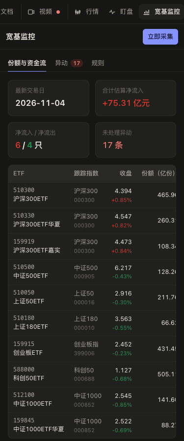 |

### 交互

| 编号 | 元素 | 操作 | 结果 |
|---|---|---|---|
| SPEC-etf-1.1 | 顶栏 | 显示 | 标题「宽基监控」，说明「宽基 ETF 的份额与资金流、异动提醒和规则；只读公开数据」；在「份额与资金流」「异动」标签时右上是「立即采集」，在「规则」标签时是「新建规则」 |
| SPEC-etf-1.2 | 标签栏 | 点击 | 切换三个标签；「异动」后面红色数字徽标是未处理条数，为 0 不显示，悬停提示「N 条异动未处理」 |
| SPEC-etf-1.3 | 「立即采集」 | 点击 | 采集一轮（原型：往后推一个交易日），标签下方出现提示条「已采集 日期：10 只宽基的份额与行情、跟踪指数行情，算完指标，新增 N 条异动，已发通知」（没有新增写「没有新的异动」），「知道了」关掉 |
| SPEC-etf-1.4 | 摘要四格 | 显示 | 最新交易日；合计估算净流入（亿元，正红负绿）；净流入只数 / 净流出只数；未处理异动条数（大于 0 为红） |
| SPEC-etf-1.5 | 摘要「未处理异动」 | 点击 | 切到「异动」标签 |
| SPEC-etf-1.6 | 表格列 | 显示 | ETF（代码 + 名称）、跟踪指数（名称 + 代码）、收盘（价格 + 涨跌幅，正红负绿）、份额（亿份）、份额变动 %、估算净流入（亿元）、连续（「流入 N 天」红 / 「流出 N 天」绿 / 「—」）、量比、折溢价 %（下面小字是口径 IOPV / 净值 / 不可用）、跟踪误差（%）、近 30 日份额迷你折线（期末高于期初红、否则绿） |
| SPEC-etf-1.7 | 越过默认规则阈值的格子 | 显示 | 量比 > 2、折溢价绝对值 > 0.5%、跟踪误差 > 1% 的数字标红加粗（固定按内置阈值高亮，不跟着用户改的规则变） |
| SPEC-etf-1.8 | 份额变动旁「待核」标签 | 悬停 | `review_flag` 为 `pending_review` 时显示，提示「份额单日变动超过 10% 且没有放量配合，疑似分红、拆分或份额折算」 |
| SPEC-etf-1.9 | 表格下方说明 | 显示 | 份额 T+1、折溢价口径、量比和跟踪误差的窗口、分位样本门槛 |
| SPEC-etf-1.10 | 跟踪误差表头 | 悬停 | 「近 20 个交易日 ETF 和指数日收益差的年化标准差」 |

### 空状态和异常状态

| 编号 | 场景 | 显示 | 可做的操作 |
|---|---|---|---|
| SPEC-etf-1.11 | 指标样本不足（量比前 20 天、跟踪误差前 20 天、分位前 60 天、份额缺失） | 格子显示「—」，悬停「样本不足」 | 无 |
| SPEC-etf-1.12 | 折溢价口径不可用（没有 IOPV 也没有净值） | 「—」，悬停「没有 IOPV 也没有净值」，下面小字「不可用」 | 无 |
| SPEC-etf-1.13 | 还没采集过任何数据 | 原型未做（演示数据总有）；正式产品显示空状态「还没有数据，点『立即采集』拉一次」 | 「立即采集」 |
| SPEC-etf-1.14 | 采集失败（源出错、网络权限没确认） | 原型未做；正式产品在提示条里显示失败原因（`EtfCollect.errors` 或接口错误），已落库的数据照常显示 | 重试 |
| SPEC-etf-1.15 | 手机宽度 | 摘要两列；表格在自己的框里横向滚动，页面本身不横向滚动 | |

### 数据

见 `SPEC-etf-0` 的 `EtfFund`、`EtfDaily`、`EtfMetrics`。每行取这只最后一天的 `EtfDaily` 和 `EtfMetrics`，趋势取最后 30 天的 `shares`。正式版取数：`GET /api/etf/funds`、`GET /api/etf/daily?from=`、`GET /api/etf/metrics?from=`。

### 联动

| 方向 | 对方模块 | 触发 | 结果 | 见 |
|---|---|---|---|---|
| 内部 | 异动 | 点摘要「未处理异动」 | 切到异动标签 | `SPEC-etf-2` |

## SPEC-etf-2 异动

命中记录列表：确认、忽略、撤回。

### 截图

| | 亮 | 暗 |
|---|---|---|
| 桌面 1440 | 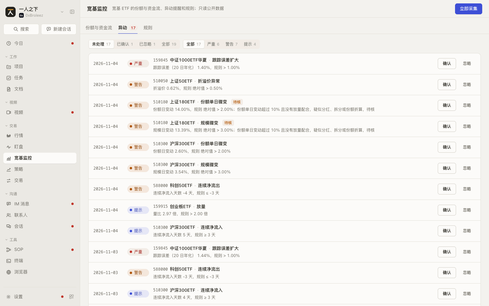 | 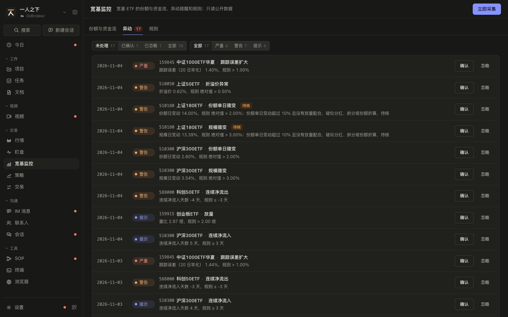 |
| 手机 375 | 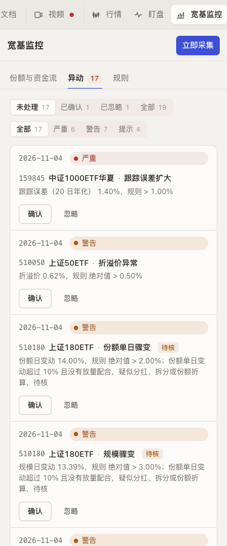 | 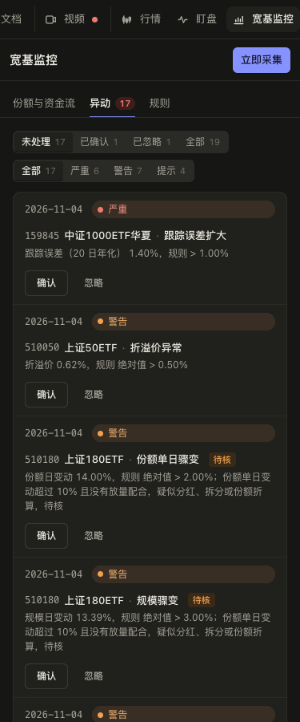 |

### 交互

| 编号 | 元素 | 操作 | 结果 |
|---|---|---|---|
| SPEC-etf-2.1 | 状态分段 | 点击 | 未处理（默认）/ 已确认 / 已忽略 / 全部，每段后面是条数 |
| SPEC-etf-2.2 | 严重度分段 | 点击 | 全部 / 严重 / 警告 / 提示，条数按当前状态筛选后算 |
| SPEC-etf-2.3 | 列表排序 | 显示 | 日期新的在前，同一天按严重、警告、提示，再按代码 |
| SPEC-etf-2.4 | 每一条 | 显示 | 日期、严重度胶囊（严重红、警告橙、提示蓝）、代码 + 名称 · 规则名、`flag` 为待核时「待核」标签，下一行是说明文案 `detail` |
| SPEC-etf-2.5 | 未处理的「确认」 | 点击 | 状态变已确认、记处理时间；从「未处理」筛选里消失，标签徽标减一 |
| SPEC-etf-2.6 | 未处理的「忽略」 | 点击 | 状态变已忽略、记处理时间；同上 |
| SPEC-etf-2.7 | 已处理的条目 | 显示 | 不再有确认、忽略按钮，显示「已确认 / 已忽略 月-日 时:分」和「撤回」；整条变淡 |
| SPEC-etf-2.8 | 「撤回」 | 点击 | 回到未处理、清掉处理时间 |
| SPEC-etf-2.9 | 重跑同一天 | 采集 | 已确认、已忽略的保持状态，值和文案更新；不重复通知（见 `SPEC-etf-0`「判定和命中记录」） |

### 空状态和异常状态

| 编号 | 场景 | 显示 | 可做的操作 |
|---|---|---|---|
| SPEC-etf-2.10 | 一条命中都没有 | 「还没有异动。每天采集后按规则判定，命中的会出现在这里并发通知」 | 无 |
| SPEC-etf-2.11 | 筛选后没有结果 | 「没有符合条件的异动」 | 「清除筛选」（两组都回到全部） |
| SPEC-etf-2.12 | 确认、忽略失败 | 原型未做；正式产品按钮恢复可点，提示失败原因 | 重试 |

### 数据

见 `SPEC-etf-0` 的 `EtfAnomaly`。正式版：`GET /api/etf/anomalies?status=&severity=&date=&symbol=`，确认、忽略、撤回都是 `POST /api/etf/anomalies/{id}/ack`，body `{status: 'acked' | 'ignored' | 'open'}`。

### 联动

| 方向 | 对方模块 | 触发 | 结果 | 见 |
|---|---|---|---|---|
| 进来 | 通知 | 点「宽基异动」通知 | 正式版打开本标签；原型未做 | |

## SPEC-etf-3 规则和规则抽屉

### 截图

| | 亮 | 暗 |
|---|---|---|
| 桌面 1440 | 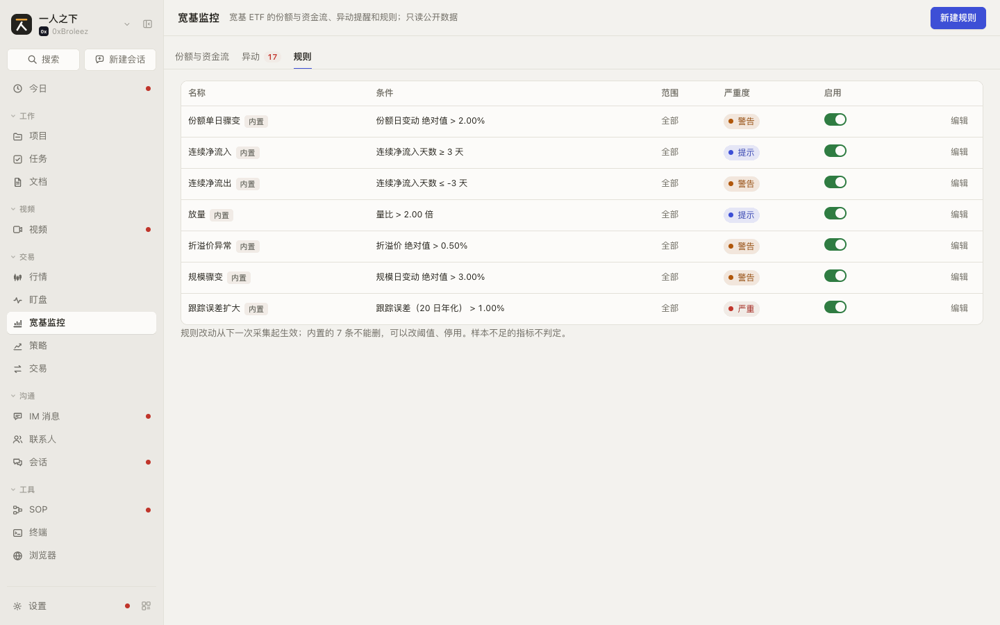 | 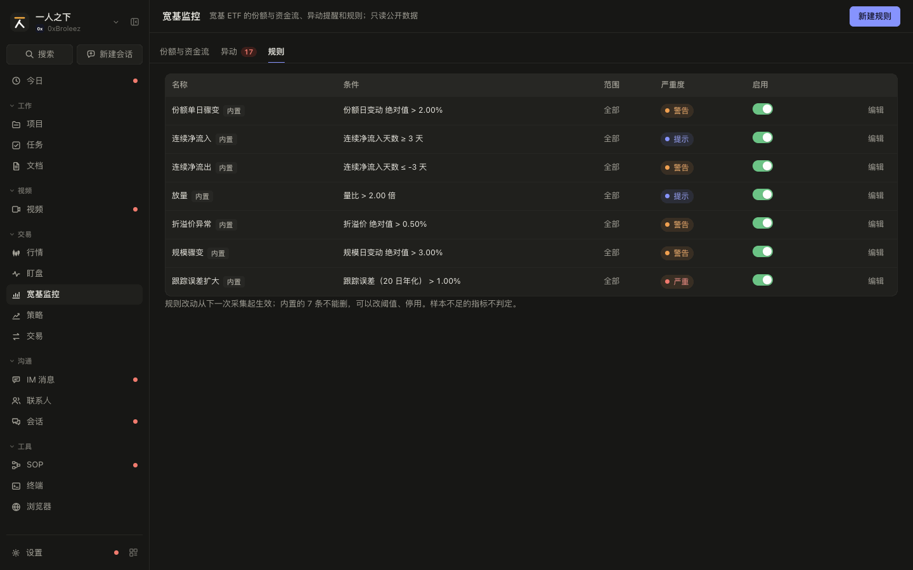 |
| 手机 375 |  | 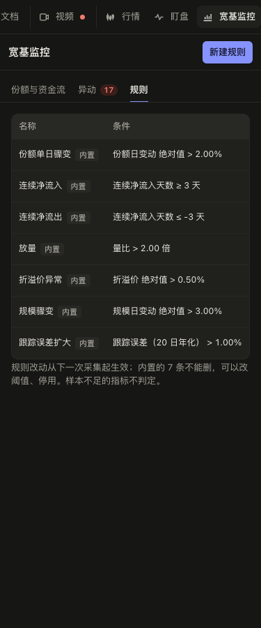 |

规则抽屉要点「编辑」或「新建规则」才出现，截图脚本不截：在「规则」标签点任一行的「编辑」即可看到。

### 交互

| 编号 | 元素 | 操作 | 结果 |
|---|---|---|---|
| SPEC-etf-3.1 | 规则表 | 显示 | 列：名称（内置的后面灰色「内置」小标）、条件（`指标 比较 阈值单位`，例「份额日变动 绝对值 > 2.00%」）、范围（全部 / `510300 沪深300ETF` / `跟踪 沪深300`）、严重度胶囊、启用开关、「编辑」；内置在前、按新建先后 |
| SPEC-etf-3.2 | 启用开关 | 切换 | 立即停用或启用，停用的整行变淡；从下一次采集起生效 |
| SPEC-etf-3.3 | 「编辑」 | 点击 | 右侧打开规则抽屉，抽头「编辑规则」，这一行高亮 |
| SPEC-etf-3.4 | 顶栏「新建规则」 | 点击 | 打开空的规则抽屉，抽头「新建规则」；默认指标份额日变动、比较「绝对值 >」、范围全部、严重度警告、启用 |
| SPEC-etf-3.5 | 抽屉「名称」 | 输入 | 必填，最多 50 字；内置规则的名称旁标「内置规则」 |
| SPEC-etf-3.6 | 抽屉「指标」 | 选择 | 11 个指标（见 `SPEC-etf-0`「指标」），选项带单位；标签旁提示窗口天数 |
| SPEC-etf-3.7 | 抽屉「比较」「阈值」 | 选择、输入 | 比较五种；阈值是数字，单位跟指标走，不是数字时输入框标红；指标是连续天数时下面提示「连续流入记正数、流出记负数，例如流出 3 天用『≤ -3』」 |
| SPEC-etf-3.8 | 抽屉「范围」 | 选择 | 全部 / 某只 ETF（再选一只，10 只宽基）/ 某个跟踪指数（再选一个，按指数代码去重的 7 个）；选了后两种没选值时红字提示，「保存」不可点 |
| SPEC-etf-3.9 | 抽屉「严重度」 | 点击 | 提示 / 警告 / 严重三段 |
| SPEC-etf-3.10 | 抽屉「启用」 | 切换 | 同表里的开关 |
| SPEC-etf-3.11 | 「保存」 | 点击（或在阈值框回车） | 名称、阈值、范围都合法才可点；保存后关抽屉，表里更新或在末尾多一行（`builtin` 为 false） |
| SPEC-etf-3.12 | 「取消」、右上关闭、Esc | 点击 / 按键 | 关抽屉，不保存 |
| SPEC-etf-3.13 | 表格下方说明 | 显示 | 「规则改动从下一次采集起生效；内置的 7 条不能删，可以改阈值、停用。样本不足的指标不判定。」 |

### 空状态和异常状态

| 编号 | 场景 | 显示 | 可做的操作 |
|---|---|---|---|
| SPEC-etf-3.14 | 删除规则 | 本期不做（后端没有删除接口）；要不用的规则就停用 | 停用 |
| SPEC-etf-3.15 | 保存失败（后端校验不过） | 原型未做；正式产品在抽屉底部显示后端的错误信息，抽屉不关 | 改后重试 |
| SPEC-etf-3.16 | 手机宽度 | 表格在自己的框里横向滚动；抽屉全宽 | |

### 数据

见 `SPEC-etf-0` 的 `EtfRule`。原型的抽屉草稿 `Draft` 是 `EtfRule` 去掉 `window_days`、`threshold` 换成输入框的字符串；保存时 `window_days` 取指标的默认窗口。正式版：`GET /api/etf/rules`、`POST /api/etf/rules`、`PATCH /api/etf/rules/{id}`（只传要改的字段）。

### 联动

| 方向 | 对方模块 | 触发 | 结果 | 见 |
|---|---|---|---|---|
| 内部 | 异动 | 下一次采集 | 按改过的规则判定；没处理的旧命中不再满足时撤掉 | `SPEC-etf-2` |
