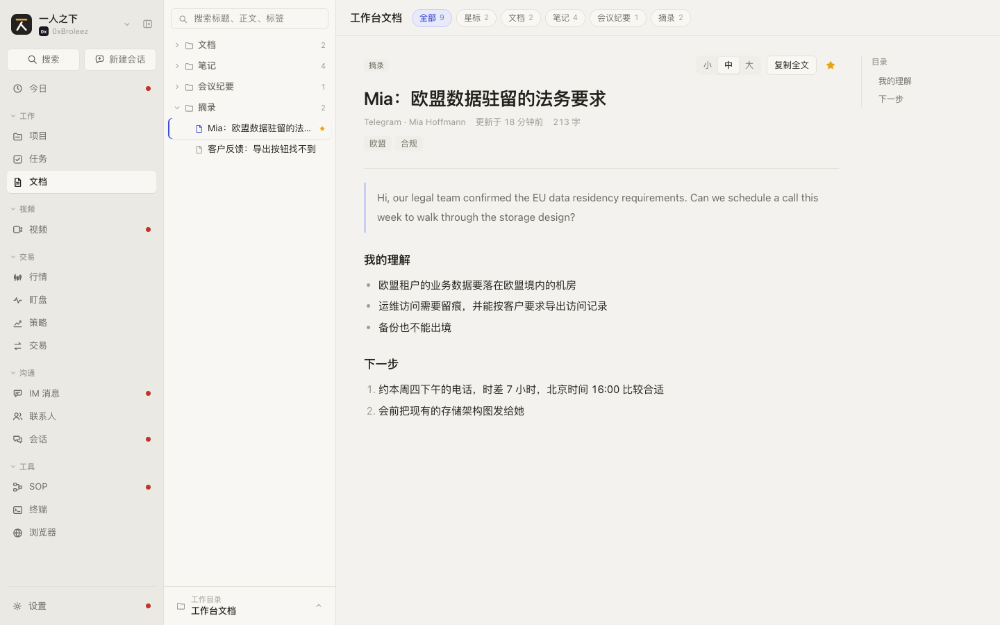
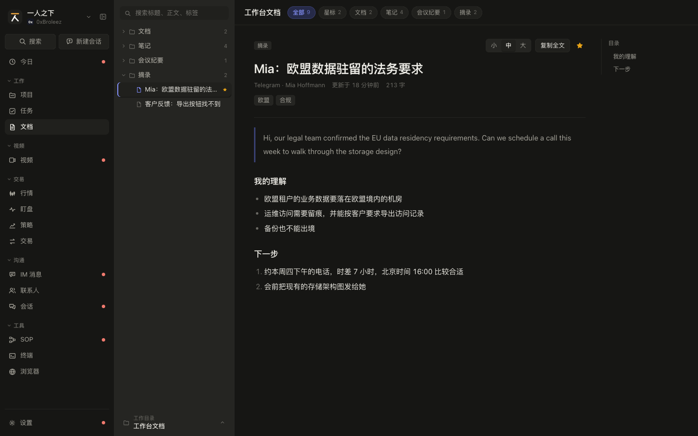

# 文档 规格（SPEC-library）

| 项 | 内容 |
|---|---|
| 模块 key | `library` |
| 原型入口 | 一级菜单「文档」，http://127.0.0.1:7778 |
| 源码 | `web-next/src/library.tsx`（内容树、顶栏、阅读区）、`web-next/src/localdir.ts`（读本地目录）；接线在 `web-next/src/App.tsx`（`libraryModel`、`loadFolder`、`switchWs`） |
| 数据文件 | `web-next/src/data.ts`（`ContentItem`、`CONTENT_CATEGORIES`）、`web-next/src/localdir.ts`（`LocalFolder`、`LocalFile`）、`web-next/src/enumdata.ts`（`content_category` 枚举） |
| 截图 | [`shots/library/`](shots/library/) |
| 负责任务 | PROTO-04c |
| 对应开发任务 | DOC-01b 实现文档页：与 `SPEC-library-1` 对照（数据结构见 `SPEC-library-0`） |
| 状态 | 已整理 |
| 最后对照 | 2026-10-28，原型提交 `932555b`，加 PROTO-09 的修改 |

## SPEC-library-0 模块概述

读文档的地方：工作台自己存的文档（PRD、笔记、会议纪要、摘录）和临时选进来的本地目录，都按「工作目录 + 内容树 + 阅读区」的同一套方式看。原型里文档只能看、加星标，新建和编辑不在这个模块（Agent 写文档见 `SPEC-sessions-1`）。

### 页面清单

| 节 | 页面 | 入口 | 说明 |
|---|---|---|---|
| [SPEC-library-1](#spec-library-1-文档页) | 文档页 | 一级菜单「文档」 | 二级菜单位置是内容树和工作目录切换，顶栏是目录名和筛选，右边阅读区 |

页面只有一个，三块的职责：

| 区域 | 位置 | 内容 |
|---|---|---|
| 内容树 | 二级菜单（桌面左侧第二栏；手机在顶栏下面占满） | 搜索框、按文件夹分组的文档树、底部「工作目录」切换按钮 |
| 顶栏 | 正文区顶部 | 当前工作目录名、刷新按钮（本地目录）、分类或文件类型筛选 |
| 阅读区 | 正文区 | 工具条、标题、元信息、标签、正文、右侧目录 |

### 共用数据结构

`ContentItem`（`web-next/src/data.ts`）：工作台文档。

| 字段 | 类型 | 必填 | 说明 | 取值 / 示例 |
|---|---|---|---|---|
| `id` | `string` | 是 | 编号 | `dc_001` |
| `category` | `ContentCategory` | 是 | 分类，就是内容树的一级文件夹 | `doc` 文档 / `note` 笔记 / `meeting` 会议纪要 / `clip` 摘录；设置里可新增，见下面的枚举 |
| `title` | `string` | 是 | 标题 | `租户级权限模型 PRD v0.3` |
| `body` | `string` | 是 | 正文，轻量 Markdown（支持的写法见 `SPEC-library-1.22`） | |
| `source` | `string` | 是 | 从哪来：手写 / 某条 IM 消息 / 外部链接 / Agent | `手写`、`Telegram · Mia Hoffmann`、`Agent` |
| `tags` | `string[]` | 是 | 标签，可为空数组 | `['云端', '权限']` |
| `starred` | `boolean` | 是 | 星标 | `true` |
| `updated_at` | `string` | 是 | 更新时间，ISO 8601 | `2026-10-28T12:20:00.000Z` |

`ContentCategory`：`(typeof CONTENT_CATEGORIES)[number]['key']`，内置 `doc`、`note`、`meeting`、`clip`。

文档分类枚举：`EnumGroup` key `content_category`（`web-next/src/enumdata.ts`），`default_key` 为 `note`。每项是 `EnumItem`：

| 字段 | 类型 | 必填 | 说明 | 取值 / 示例 |
|---|---|---|---|---|
| `key` | `string` | 是 | 存在 `ContentItem.category` 里的值 | `doc` |
| `label` | `string` | 是 | 显示名，内容树文件夹名和筛选名都用它 | `文档` |
| `color` | `string` | 是 | 颜色 | `#3d4fd6` |
| `desc` | `string` | 是 | 说明 | |
| `enabled` | `boolean` | 是 | 停用后没有文档的分类不再列出，有文档的照常列出 | `true` |
| `locked` | `boolean` | 否 | 系统值不可删 | 文档分类都不锁 |

`LocalFolder`（`web-next/src/localdir.ts`）：选进来的本地目录。原型只在内存里，刷新页面就没了。

| 字段 | 类型 | 必填 | 说明 | 取值 / 示例 |
|---|---|---|---|---|
| `id` | `string` | 是 | 编号，前端生成 | `dirm9x1k2` |
| `name` | `string` | 是 | 目录名 | `pm-workspace` |
| `files` | `LocalFile[]` | 是 | 读进来的文本文件 | |
| `skipped` | `number` | 是 | 因为太大、太多或不是文本跳过的文件数 | `12` |
| `read_at` | `number` | 是 | 读取时间，毫秒时间戳 | |
| `handle` | `DirHandle` | 否 | 只有 `showDirectoryPicker` 拿得到；有它才能原地重新读取 | |

`LocalFile`（`web-next/src/localdir.ts`）：

| 字段 | 类型 | 必填 | 说明 | 取值 / 示例 |
|---|---|---|---|---|
| `path` | `string` | 是 | 相对目录根的路径，含文件名 | `docs/spec/README.md` |
| `name` | `string` | 是 | 文件名 | `README.md` |
| `ext` | `string` | 是 | 小写扩展名 | `md` |
| `size` | `number` | 是 | 字节数 | `6587` |
| `modified` | `number` | 是 | 修改时间，毫秒时间戳 | |
| `text` | `string` | 是 | 文件全文 | |

读本地目录的规则（`localdir.ts` 常量）：

| 规则 | 值 |
|---|---|
| 只读这些扩展名（`TEXT_EXT`） | `md` `markdown` `txt` `text` `log` `csv` `json` `yaml` `yml` `toml` `xml` `html` `sql` |
| 单个文件上限（`MAX_FILE`） | 2MB，超过的跳过并计入 `skipped` |
| 文件数上限（`MAX_FILES`） | 1000，超出的跳过并计入 `skipped` |
| 不进的目录（`SKIP_DIRS`） | `node_modules` `.git` `dist` `build` `.venv` `__pycache__`，以及以 `.` 开头的文件和目录 |
| 按 Markdown 渲染的扩展名 | `md`、`markdown`；其他按纯文本显示 |

视图模型（原型在 `library.tsx` 里定义，不落库，正式产品可以照搬）：

`Workspace`：`'builtin'`（工作台文档）或 `` `dir:${LocalFolder.id}` ``（某个本地目录）。

`Doc`：工作台文档和本地文件统一转成它再显示。

| 字段 | 类型 | 必填 | 说明 | 工作台文档取自 | 本地文件取自 |
|---|---|---|---|---|---|
| `id` | `string` | 是 | 编号 | `ContentItem.id` | `` `${folder.id}:${file.path}` `` |
| `title` | `string` | 是 | 标题 | `title` | `name` |
| `body` | `string` | 是 | 正文 | `body` | `text` |
| `markdown` | `boolean` | 是 | 是否按 Markdown 渲染 | 恒为 `true` | `md` / `markdown` 为 `true` |
| `kind` | `string` | 是 | 筛选用的 key | `category` | `ext` |
| `kindLabel` | `string` | 是 | 工具条上的类型标签 | 分类显示名 | 扩展名大写，如 `MD` |
| `updated` | `number` | 是 | 毫秒时间戳 | `updated_at` | `modified` |
| `meta` | `string[]` | 是 | 元信息行 | `[source]` | `[目录名/路径, 文件大小]` |
| `dirs` | `string[]` | 是 | 在树里的文件夹路径 | `[分类显示名]` | 路径去掉文件名后按 `/` 拆开 |
| `tags` | `string[]` | 是 | 标签 | `tags` | 恒为 `[]` |
| `starred` | `boolean` | 否 | 星标；`undefined` 表示不支持星标 | `starred` | 不设 |

`LibraryModel`：`folder`（当前本地目录或 `null`）、`title`（顶栏和工作目录按钮上的名字，工作台为「工作台文档」）、`docs`（当前工作目录全部 `Doc`）、`kinds`（筛选项 `{ key, label, count }[]`，「全部」由界面自己加）、`rows`（筛选和搜索后的 `Doc`）、`kind`（当前筛选 key，空状态按它分情况说）、`order`（工作台一级文件夹的顺序，按枚举顺序）。

浏览器本地存储：`pmw-next-reader-size`，阅读区字号 `sm` / `md` / `lg`，默认 `md`。

### 联动总表

| 方向 | 对方模块 | 触发 | 结果 | 见 |
|---|---|---|---|---|
| 进来 | 会话 | 产出结果里点文档类产出的标题 | 切到「工作台文档」，打开那篇文档 | `SPEC-sessions-3.4` |
| 进来 | 项目 | 项目详情「文档」标签里点来自文档库的条目 | 切到「工作台文档」，打开那篇文档 | `SPEC-projects-8.9` |
| 进来 | 命令面板 | 搜到「文档」组的条目并回车 | 切到「工作台文档」，打开那篇文档 | 全局 |
| 改动 | 会话 | Agent 的「写文档」（`write_content`）被执行 | 「笔记」分类里多一篇，`source` 为 `Agent`、标签 `Agent`，正文是草稿占位 | `SPEC-sessions-1.17`、`SPEC-sessions-2.5` |
| 改动 | 设置 / 枚举值 | 改文档分类的名字、顺序、启停，或把一个分类合并到另一个 | 内容树文件夹名、顺序和筛选项跟着变；合并时文档的 `category` 一起迁移 | `SPEC-settings`（枚举值节） |
| 被引用 | 设置 / 知识库 | 知识库的来源选文档分类 | 该分类下的文档进入知识库 | `SPEC-settings`（知识库节） |
| 被引用 | 设置 / Agent | Agent 开了「读文档」「写文档」权限 | Agent 能读、写这里的文档 | `SPEC-settings`（Agent 节） |
| 显示 | 一级菜单 | 始终 | 「文档」菜单角标是工作台文档总数 | 全局 |

## SPEC-library-1 文档页

左边内容树挑文档，右边读。工作目录在内容树底部切换；工作台文档的一级文件夹就是分类，本地目录按真实的文件夹层级。

### 截图

| | 亮 | 暗 |
|---|---|---|
| 桌面 1440 |  |  |
| 手机 375 |  |  |

截图脚本截不到的状态（图先空着）：

- 工作目录菜单：点内容树底部「工作目录」按钮。
- 本地目录：菜单里点「选择本地目录…」选一个含 Markdown 的目录（需要 Chrome 或 Edge 才有刷新按钮）。
- 手机阅读态：375 宽下点内容树里任意一篇文档。

### 交互

| 编号 | 元素 | 操作 | 结果 |
|---|---|---|---|
| SPEC-library-1.1 | 内容树顶部搜索框 | 输入 | 实时过滤当前工作目录，匹配标题、正文、文件夹路径、标签，不区分大小写；有关键词时所有文件夹强制展开。占位文案：工作台为「搜索标题、正文、标签」，本地目录为「搜索文件名、路径、正文」 |
| SPEC-library-1.2 | 文件夹行 | 点击 | 展开或收起，`aria-expanded` 跟着变；行尾数字是这个文件夹下（含子文件夹）符合当前筛选的篇数 |
| SPEC-library-1.3 | 文件夹默认展开规则 | 进入页面、换文档、换工作目录 | 默认全部收起，只展开当前阅读文档所在路径的各级父文件夹；换工作目录先全部收起再展开新路径；手动展开的保留 |
| SPEC-library-1.4 | 文件夹层级显示 | 超过 4 层 | 缩进最多 4 层，更深的文件夹名前加「…/」，鼠标悬停显示完整路径 |
| SPEC-library-1.5 | 文件夹排序 | 显示 | 工作台文档的一级文件夹按文档分类枚举的顺序；本地目录和更深的层级按名字排序。文件按工作台文档的更新时间倒序，本地目录按读取顺序 |
| SPEC-library-1.6 | 文件行 | 点击 | 阅读区显示这篇，行高亮；有星标的行尾显示小星 |
| SPEC-library-1.7 | 底部「工作目录」按钮 | 点击 | 向上弹出「切换工作目录」菜单，再点或点菜单外关闭。按钮上小字「工作目录」，跳过了文件时追加「· 跳过 N 个」（悬停提示「跳过了 N 个非文本或过大的文件」）；大字是当前目录名，读取中显示「正在读取…」 |
| SPEC-library-1.8 | 菜单「工作台文档」 | 点击 | 切到工作台文档；筛选、搜索、当前阅读一起清空；菜单关闭 |
| SPEC-library-1.9 | 菜单里的本地目录项 | 点击 | 切到这个目录，清空规则同 1.8；当前项高亮。没有句柄的目录悬停提示「（只读快照，看新改动需重新选择）」 |
| SPEC-library-1.10 | 本地目录项右侧 x | 点击 | 从列表移除，提示「从列表移除，不动本地文件」；移除的是当前目录时切回工作台文档。桌面悬停才显示，手机常显 |
| SPEC-library-1.11 | 菜单「选择本地目录…」 | 点击 | 关闭菜单并打开系统选目录框：Chrome、Edge 用 `showDirectoryPicker`（只读），能保留句柄；其他浏览器退到 `<input webkitdirectory>`，只拿到一次快照。读取中菜单项禁用、文案「正在读取…」。读完自动切到这个目录；选的是已在列表里的同一个目录（`isSameEntry` 判断）时原地替换，不新增一项 |
| SPEC-library-1.12 | 顶栏目录名 | 悬停 | 本地目录显示「目录名，读取于 X 前」；过长省略 |
| SPEC-library-1.13 | 顶栏刷新按钮 | 点击 | 只在本地目录有句柄时出现，提示「目录里的文件有改动时重新读一遍」；重新读取并替换内容，状态同 1.11 |
| SPEC-library-1.14 | 顶栏筛选 chip | 点击 | 「全部 N」清除筛选；其余 chip 单选，再点一次取消。工作台文档：「星标」+ 各分类（启用的，或停用但还有文档的，再加上枚举里没有的旧分类 key），空分类也列出；本地目录：实际出现过的扩展名（大写），按字母序。每个 chip 带篇数（不受搜索影响）。筛选项不超过 1 个时整行不显示；手机上横向滑动 |
| SPEC-library-1.15 | 阅读区默认选中 | 宽度 ≥ 761px 时当前阅读的不在筛选结果里 | 自动选中结果第一条，右侧不留空；手机上不自动选，停在内容树 |
| SPEC-library-1.16 | 「返回目录」按钮 | 点击 | 只在手机宽度（≤ 760px）显示；清空当前阅读，回到内容树 |
| SPEC-library-1.17 | 工具条类型标签和路径 | 显示 | 左边是 `kindLabel`（分类名或扩展名）；本地目录再显示文件所在路径「a / b」 |
| SPEC-library-1.18 | 字号「小 / 中 / 大」 | 点击 | 正文字号切换，记在本地存储 `pmw-next-reader-size`，下次打开沿用 |
| SPEC-library-1.19 | 「复制全文」 | 点击 | 工作台文档复制「标题 + 空行 + 正文」，本地文件只复制正文；成功后按钮变「已复制」，换文档后复原 |
| SPEC-library-1.20 | 星标按钮 | 点击 | 只有工作台文档有；切换星标，内容树行尾小星和「星标」筛选的计数同步变化 |
| SPEC-library-1.21 | 目录（右侧栏 / 工具条下拉） | 点击某个标题 | 正文里标题多于 1 个才出现；宽屏是右侧栏，阅读区变窄时收成工具条上的「目录」下拉。点击平滑滚动到该标题，下拉随之关闭 |
| SPEC-library-1.22 | 正文渲染 | 显示 | Markdown 文件只认 `#`、`##`、`###` 标题、`-` 列表、`1.` 有序列表、`>` 引用、三个反引号代码块、`**粗体**`、`` `行内代码` ``，连续普通行合成一段；直接生成元素、不走 innerHTML，正文里的 HTML 不会执行。非 Markdown 文件按等宽纯文本原样显示 |
| SPEC-library-1.23 | 元信息行 | 显示 | 工作台文档：来源、「更新于 X 前」、字数；本地文件：「目录名/路径」、文件大小（B / KB / MB）、「修改于 X 前」、字数。字数去掉空白和 `# > * \` -` 后计。有标签时下面一行显示标签 |
| SPEC-library-1.24 | 换文档 | 选了另一篇 | 阅读区滚回顶部，「已复制」和目录下拉复原 |
| SPEC-library-1.25 | 手机布局 | ≤ 760px | 内容树和阅读区二选一：没选文档时顶栏（目录名和筛选）在上、内容树占满下面，工作目录按钮贴底；选了文档后顶栏下面只显示阅读区，「返回目录」回来 |

### 空状态和异常状态

| 编号 | 场景 | 显示 | 可做的操作 |
|---|---|---|---|
| SPEC-library-1.26 | 搜索没有结果 | 内容树「没有匹配的内容」；阅读区「没有可查看的内容」 | 改关键词或清空搜索 |
| SPEC-library-1.27 | 工作台文档在当前筛选下为空 | 空分类：内容树「这个分类下还没有内容」；「星标」下没有：「还没有加星标的文档」；其他筛选后为空：「没有符合筛选的内容」。阅读区「没有可查看的内容」 | 点「全部」 |
| SPEC-library-1.28 | 本地目录里没有可读的文本文件 | 内容树「这个目录下没有可读的文本文件」；工作目录按钮显示跳过数 | 换一个目录 |
| SPEC-library-1.29 | 有内容但没选中（手机，或桌面换筛选的瞬间） | 阅读区「从左侧选一条内容查看」 | 点内容树里的文档 |
| SPEC-library-1.30 | 选目录时拒绝了读取权限 | 工作目录按钮上方红字「没有拿到读取权限，请重新选择」 | 重新「选择本地目录…」 |
| SPEC-library-1.31 | 读目录出错 | 红字「读取失败：<错误信息>」 | 重新选择 |
| SPEC-library-1.32 | 用户在选目录框里点了取消 | 不提示，保持原来的工作目录 | |
| SPEC-library-1.33 | 部分文件被跳过（太大、太多、非文本） | 工作目录按钮「工作目录 · 跳过 N 个」，悬停说明原因 | |
| SPEC-library-1.34 | 只读快照（非 Chrome / Edge 选的目录） | 顶栏没有刷新按钮；菜单项悬停提示要重新选择 | 重新「选择本地目录…」 |
| SPEC-library-1.35 | 刷新页面后本地目录 | 原型：目录列表清空，回到工作台文档。正式产品：选过的目录要持久保存（DOC-01 的验收），重新打开时能直接看到；拿不到权限时按 1.30 提示 | |
| SPEC-library-1.36 | 分类被停用 | 没有文档的停用分类不再出现在内容树和筛选里；还有文档的照常显示 | |
| SPEC-library-1.37 | 复制失败（浏览器不给剪贴板权限） | 原型：按钮保持「复制全文」，没有提示。正式产品应提示「复制失败」 | 再点一次 |
| SPEC-library-1.38 | 工作台文档加载失败 | 原型未做；正式产品在内容树位置显示错误信息和「重试」 | 重试 |
| SPEC-library-1.39 | 工作台一篇文档都没有 | 内容树「还没有文档」（不论选了哪个筛选），顶栏仍列出全部分类（计数为 0） | |

### 数据

全部字段见 SPEC-library-0 的 `ContentItem`、`LocalFolder`、`LocalFile`、`Doc`、`LibraryModel`，这一页没有额外字段。页面状态（原型放在 `App.tsx`）：

| 字段 | 类型 | 说明 |
|---|---|---|
| `ws` | `Workspace` | 当前工作目录，默认 `builtin` |
| `folders` | `LocalFolder[]` | 选进来的本地目录列表 |
| `libKind` | `string` | 当前筛选 key，空串为全部；工作台多一个 `starred` |
| `libQ` | `string` | 搜索词 |
| `reading` | `string \| null` | 当前阅读的 `Doc.id` |
| `folderBusy` | `boolean` | 正在读取目录 |
| `folderError` | `string` | 读取目录的错误文案 |

### 联动

| 方向 | 对方模块 | 触发 | 结果 | 见 |
|---|---|---|---|---|
| 进来 | 会话、项目、命令面板 | 打开某篇工作台文档 | 先切到工作台文档（清空筛选和搜索），再选中该文档 | SPEC-library-0 联动总表 |
| 改动 | 无 | | 本页只改 `ContentItem.starred`；其他模块读到的星标跟着变 | |

## 原型和规格对不上的地方

整理时发现的问题，PROTO-09 按下表处理，正文已同步。

| 编号 | 位置 | 问题 | 建议 | 处理 |
|---|---|---|---|---|
| L-1 | `SPEC-library-1.25` 手机宽度 | 375 宽没选文档时，顶栏（目录名和筛选条）掉到内容树和工作目录按钮下面，下半屏空白（见 PROTO-09 之前的 `shots/library/入口-375-light.png`） | 顶栏放在内容树上面，内容树占满剩下的高度 | 已修（PROTO-09）：手机树态顶栏排在内容树前面、正文区收起，见 `SPEC-library-1.25` |
| L-2 | `SPEC-library-1.27`、`SPEC-library-1.39` | 空分类、星标为空、一篇文档都没有都显示「这个分类下还没有内容」 | 分开说：这个分类下还没有内容 / 筛选后为空 / 一条都没有 | 已修（PROTO-09）：按搜索、一篇都没有、星标、分类、其他筛选分开说，见 `SPEC-library-1.27`、`SPEC-library-1.39` |
