# 行情 规格（SPEC-markets）

| 项 | 内容 |
|---|---|
| 模块 key | `markets` |
| 原型入口 | 一级菜单「行情」，http://127.0.0.1:7778（交易工作台的首页） |
| 源码 | `web-next/src/markets.tsx`（页面 `MarketsPage`、左栏自选 `WatchPanel`、K 线 `KChart`、标的头 `SymbolHead`、右栏盘口和数据源 `BookPanel`、期权 T 型报价 `OptionBoard`、期权详情 `OptionDetail`）；资金费率和时段标签来自 `web-next/src/monitor.tsx`（`fundingRate`、`SessionPill`、`fmtSpan`）；接线在 `web-next/src/App.tsx`（`watchlists`、`chartFocus`、`openChart`、`newAlertFor`、`tradeFor`） |
| 数据文件 | `web-next/src/tradedata.ts`（市场、标的、期权链、交易时段、确定性行情、自选），交易套件四个模块共用 |
| 截图 | [`shots/markets/`](shots/markets/) |
| 负责任务 | PROTO-04f4 |
| 对应开发任务 | 见下表「引用本规格的开发任务」 |
| 状态 | 已整理 |
| 最后对照 | 2026-10-29，原型提交 `444aee8`（交易相关源码最后改动在 `5e24117`）；2026-11-04 TRD-02b 同步了数据源相关的改动（`SPEC-markets-1.22` 起） |

### 引用本规格的开发任务

| 任务 | 内容 | 对照的节 |
|---|---|---|
| TRD-01a | 交易套件插件的壳：清单、标的、自选、行情源适配接口 | `SPEC-markets-0`「共用数据结构」的 `Instrument`、`MarketKey`、`InstKind`、`Watchlist`；`SPEC-markets-2` |
| TRD-01b | 接入 Binance 公开行情 | `SPEC-markets-0`「原型里模拟、正式版要真做的」行情源、K 线、盘口、资金费率 |
| TRD-01c | 接入 OKX 公开行情 | 同上 |
| TRD-02a | 行情缓存和推送 | `SPEC-markets-0` `Quote`、`Bar`、`BarInterval`；「原型里模拟、正式版要真做的」推送和缓存 |
| TRD-02b | 前端行情页接真实数据 | `SPEC-markets-1` 到 `SPEC-markets-3` |
| TRD-05c、TRD-08c、TRD-08d | 下单入口 | `SPEC-markets-1.13`、`SPEC-markets-3.6`（买入、卖出打开的下单抽屉见 `SPEC-trading-5`） |

交易套件拆成四个可以单独装的子插件（开发计划 2.8）：行情（本文件）、盯盘（`SPEC-monitor`）、策略与回测（`SPEC-strategy`）、交易执行（`SPEC-trading`）。盯盘、策略、交易执行都依赖行情。

### 实盘标记

交互清单里凡是会动到真实资金的操作（下单、实盘部署、交易账户开交易权限），都在「结果」列末尾标 **【实盘，要过 TRD-08 评审，默认只开模拟盘】**。正式产品在 TRD-08 评审通过、用户本人打开实盘开关之前，这些操作只对模拟盘账户可用（开发计划 2.4、6 节，`docs/plugin-api.md` 的 `trade:live`）。本模块只有下单入口带这个标记，抽屉里的规则见 `SPEC-trading-5`。

## SPEC-markets-0 模块概述

看盘工具：数币交易所、A 股、港股、美股四个市场，现货、永续、交割期货、期权四类品种。一个页面两个标签：「看盘」是左自选、中 K 线、右盘口与成交；「期权」是 T 型报价加右侧期权详情。从这里可以对任一标的设盯盘提醒、打开下单抽屉。原型没有后端，行情是「时间决定价格」的确定性模拟，同一时刻同一个标的在哪个页面算都是同一个价。

### 截图

模块入口（看盘标签，第一个自选组的第一个标的 BTC/USDT）：

| | 亮 | 暗 |
|---|---|---|
| 桌面 1440 | 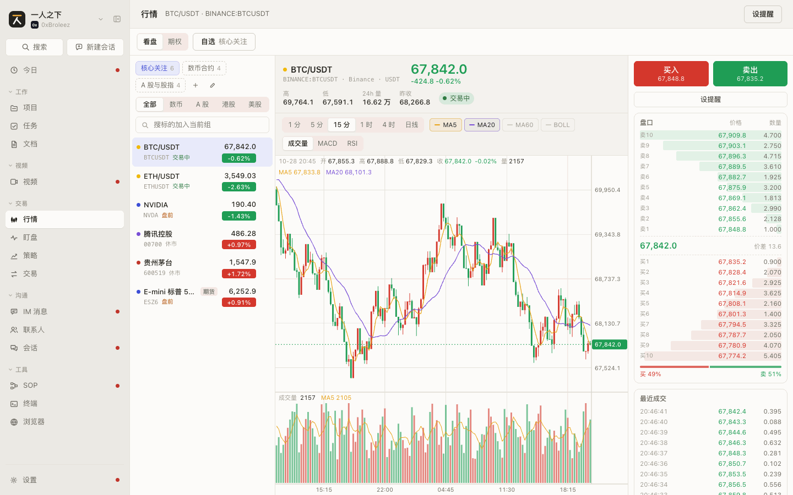 | 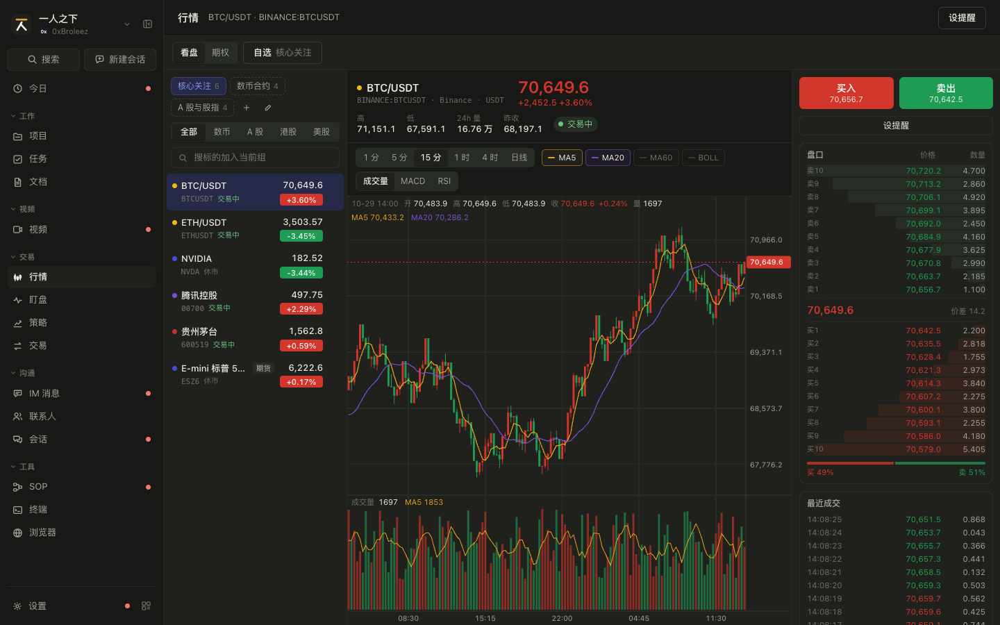 |
| 手机 375 | 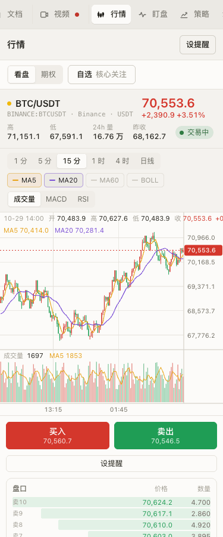 | 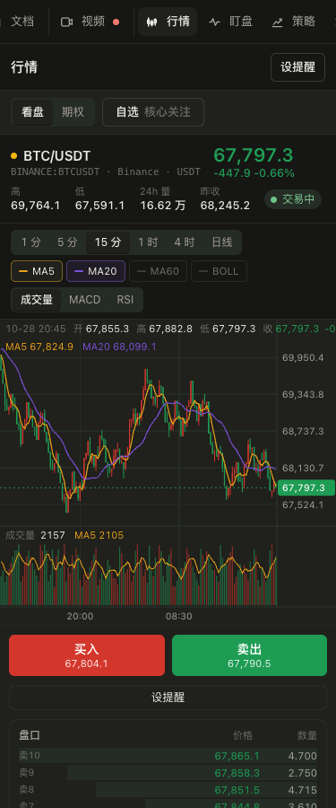 |

### 页面清单

| 节 | 页面 | 入口 | 说明 |
|---|---|---|---|
| [SPEC-markets-1](#spec-markets-1-看盘) | 看盘 | 一级菜单「行情」（默认标签「看盘」）；盯盘墙格子、触发记录、持仓「看图」跳来 | 标的头、K 线（周期、均线、BOLL、副图）、盘口、最近成交、买入卖出、设提醒 |
| [SPEC-markets-2](#spec-markets-2-自选) | 自选 | 「看盘」标签的左栏；手机宽度点「自选」按钮从左侧滑出 | 自选组切换、新建、改名、删除，按市场筛，搜标的加入当前组，移出 |
| [SPEC-markets-3](#spec-markets-3-期权-t-型报价) | 期权 T 型报价 | 标签「期权」；从盯盘、持仓打开一个期权标的 | 标的和到期日、认购认沽 T 型报价、期权详情、买入卖出、设提醒 |

### 共用数据结构

字段名和类型照抄 `web-next/src/tradedata.ts`。

`MarketKey` 市场：`crypto` 数币 / `cn` A 股 / `hk` 港股 / `us` 美股。每个市场的属性在 `MARKETS: Record<MarketKey, {...}>`：

| 字段 | 类型 | 说明 | 取值 |
|---|---|---|---|
| `label` | `string` | 显示名 | `数币`、`A 股`、`港股`、`美股` |
| `currency` | `string` | 计价币种 | `USDT`、`CNY`、`HKD`、`USD` |
| `tz` | `string` | 交易时段用的时区 | `UTC`、`Asia/Shanghai`、`Asia/Hong_Kong`、`America/New_York` |
| `color` | `string` | 市场色点 | `#f0b90b`、`#c0352b`、`#7a4fd6`、`#3d4fd6` |
| `t1` | `boolean` | 是否 T+1 | 只有 `cn` 为 `true` |
| `desc` | `string` | 一句话说明 | `7x24 小时，现货、永续、交割、期权`；`T+1，涨跌停 10% / 20%，股指期货、ETF 期权`；`T+0，无涨跌停，恒指期货、个股期权`；`T+0，盘前盘后，股指期货、个股期权` |

`InstKind` 品种：`spot` 现货 / 股票（短名「现货」）/ `perp` 永续合约（「永续」）/ `future` 交割期货（「期货」）/ `option` 期权（「期权」）。显示名在 `INST_KIND: Record<InstKind, { label: string; short: string }>`；`web-next/src/symbolpick.tsx` 的 `KIND_SHORT` 是同一组短名。

`Instrument` 标的

| 字段 | 类型 | 必填 | 说明 | 取值 / 示例 |
|---|---|---|---|---|
| `symbol` | `string` | 是 | 全局唯一代码，`<场所>:<代码>`；期权是 `<标的 symbol>-<到期日>-<行权价>-<C 或 P>` | `BINANCE:BTCUSDT`、`SSE:600519`、`HKEX:00700`、`NASDAQ:AAPL`、`CFFEX:IF2612`、`BINANCE:BTCUSDT-2026-11-28-70000-C` |
| `name` | `string` | 是 | 显示名 | `BTC/USDT`、`贵州茅台`、`BTC 永续`、`BTC/USDT 11-28 70000 购` |
| `market` | `MarketKey` | 是 | 市场 | `crypto` |
| `kind` | `InstKind` | 是 | 品种 | `perp` |
| `venue` | `string` | 是 | 交易场所 | `Binance`、`OKX`、`上交所`、`深交所`、`中金所`、`港交所`、`纳斯达克`、`纽交所`、`CME`、`Deribit`、`CBOE` |
| `base` | `number` | 是 | 模拟用的基准价（正式版不要） | `67000` |
| `vol` | `number` | 是 | 模拟用的年化波动率（正式版不要；期权 IV 也从它推） | `0.55` |
| `digits` | `number` | 是 | 价格小数位 | 基准价大于 1000 取 1，大于 10 取 2，否则 3；可单独指定 |
| `lot` | `number` | 是 | 最小下单量 | A 股、港股 `100`，美股 `1`，`BTCUSDT` `0.0001` |
| `multiplier` | `number` | 是 | 合约乘数，现货为 1 | `IF2612` `300`、恒指期货 `50`、E-mini `50`；期权：数币 1、A 股 10000、港美股 100 |
| `expiry` | `string` | 否 | 期货、期权的到期日（ISO 日期） | `2026-12-25` |
| `underlying` | `string` | 否 | 永续、期货、期权的标的 symbol | `BINANCE:BTCUSDT` |
| `strike` | `number` | 否 | 期权行权价 | `70000` |
| `right` | `'call' \| 'put'` | 否 | 期权看涨（认购）/ 看跌（认沽） | `call` |
| `limit` | `number` | 否 | A 股涨跌停幅度 | `0.1`（主板）、`0.2`（创业板） |

演示标的 `INSTRUMENTS`（17 个）：数币 `BINANCE:BTCUSDT`、`BINANCE:ETHUSDT`、`BINANCE:SOLUSDT`、`BINANCE:BTCUSDT.P`（BTC 永续）、`OKX:ETH-USDT-SWAP`（ETH 永续）、`OKX:BTC-USD-261225`（BTC 季度交割 1225）；A 股 `SSE:600519`、`SZSE:300750`、`SSE:510300`、`CFFEX:IF2612`；港股 `HKEX:00700`、`HKEX:09988`、`HKEX:HSI2611`；美股 `NASDAQ:AAPL`、`NASDAQ:NVDA`、`NYSE:TSLA`、`CME:ESZ6`。

期权链 `optionChain(underlying, expiry, strikes = 11)`：不在 `INSTRUMENTS` 里，按标的、到期日现算。行权价间距是标的基准价 2.5% 取整到 1、2、2.5、5、10 乘 10 的幂；以离基准价最近的一档为中心上下各 5 档。场所：数币 `Deribit`、A 股 `上交所`、港股 `港交所`、美股 `CBOE`。能看期权的标的 `OPTION_UNDERLYINGS`：`BINANCE:BTCUSDT`、`BINANCE:ETHUSDT`、`SSE:510300`、`HKEX:00700`、`NASDAQ:AAPL`、`NASDAQ:NVDA`；到期日 `OPTION_EXPIRIES`：`2026-11-07`、`2026-11-28`、`2026-12-26`、`2027-03-26`。`instOf(symbol)` 按 symbol 找标的，期权 symbol 现场解析（在 41 档的链里找行权价）。

`SessionState` 交易时段：`pre` 盘前 / `open` 交易中 / `break` 午休 / `post` 盘后 / `closed` 休市（显示名 `SESSION_LABEL`）。`sessionOf(market, at)` 按市场时区算，不算节假日：

| 市场 | 盘前 | 交易中 | 午休 | 盘后 | 周末 |
|---|---|---|---|---|---|
| 数币 | 无 | 全天 | 无 | 无 | 交易中 |
| A 股 | 9:15 到 9:30 | 9:30 到 11:30、13:00 到 15:00 | 11:30 到 13:00 | 无 | 休市 |
| 港股 | 9:00 到 9:30 | 9:30 到 12:00、13:00 到 16:00 | 12:00 到 13:00 | 16:00 到 16:10 | 休市 |
| 美股 | 4:00 到 9:30 | 9:30 到 16:00 | 无 | 16:00 到 20:00 | 休市 |

`Quote` 报价（`quoteOf(symbol, at)`）

| 字段 | 类型 | 必填 | 说明 | 取值 / 示例 |
|---|---|---|---|---|
| `symbol` | `string` | 是 | 标的 | `BINANCE:BTCUSDT` |
| `last` | `number` | 是 | 最新价 | `70509.7` |
| `prev` | `number` | 是 | 昨收；数币用 24 小时前的价（`prevClose`） | `68454.3` |
| `change` | `number` | 是 | 涨跌额 `last - prev` | `2055.4` |
| `pct` | `number` | 是 | 涨跌幅，小数 | `0.03` |
| `high` | `number` | 是 | 最近 96 根 15 分钟 K 线和最新价里的最高 | |
| `low` | `number` | 是 | 同上，最低 | |
| `volume` | `number` | 是 | 同一段的成交量合计 | |
| `bid` | `number` | 是 | 买一，最新价减一跳 | |
| `ask` | `number` | 是 | 卖一，最新价加一跳 | |
| `at` | `number` | 是 | 报价时刻（毫秒） | |

`BarInterval` K 线周期：`1m` 1 分 / `5m` 5 分 / `15m` 15 分 / `1h` 1 时 / `4h` 4 时 / `1d` 日线；`INTERVALS: Record<BarInterval, { label: string; ms: number }>`。

`Bar` K 线（`bars(symbol, interval, count, end)` 返回截至 `end` 的最近 `count` 根，最后一根是没走完的）

| 字段 | 类型 | 必填 | 说明 |
|---|---|---|---|
| `t` | `number` | 是 | 开盘时刻（毫秒，对齐到周期整点） |
| `o` | `number` | 是 | 开 |
| `h` | `number` | 是 | 高 |
| `l` | `number` | 是 | 低 |
| `c` | `number` | 是 | 收；没走完的那根是最新价 |
| `v` | `number` | 是 | 量，非负 |

盘口 `orderBook(symbol, at, n = 10)` 返回 `{ bids: [number, number][]; asks: [number, number][] }`，每档 `[价格, 数量]`，买卖各 `n` 档，一跳是 `max(10^-digits, 最新价 x 0.0001)`。原型没定义成具名类型。

`Greeks` 期权报价（`greeks(opt, at)`，简化 Black-Scholes，无利率，IV 带一点微笑）

| 字段 | 类型 | 说明 |
|---|---|---|
| `price` | `number` | 理论价，按标的精度取整，最小一跳 |
| `iv` | `number` | 隐含波动率，小数 |
| `delta` | `number` | Delta |
| `gamma` | `number` | Gamma |
| `theta` | `number` | Theta，每天 |
| `vega` | `number` | Vega，IV 每变动 1 个百分点 |

`Watchlist` 自选组

| 字段 | 类型 | 必填 | 说明 | 取值 / 示例 |
|---|---|---|---|---|
| `id` | `string` | 是 | 编号，新建用 `newId('wl')` | `wl_core` |
| `name` | `string` | 是 | 组名 | `核心关注` |
| `symbols` | `string[]` | 是 | 标的 symbol，按加入顺序，不重复 | `['BINANCE:BTCUSDT', 'NASDAQ:NVDA']` |

演示自选 `seedWatchlists`：`wl_core` 核心关注（BTC/USDT、ETH/USDT、NVIDIA、腾讯控股、贵州茅台、E-mini 标普 500 2612）、`wl_crypto` 数币合约（BTC 永续、ETH 永续、BTC 季度交割 1225、SOL/USDT）、`wl_cn` A 股与股指（贵州茅台、宁德时代、沪深300ETF、沪深300股指 2612）。自选组在行情和盯盘墙之间共用（`SPEC-monitor-1`）。

工具函数：`priceAt(symbol, at)` 某一时刻的价格（期权按 `greeks` 现算）；`prevClose(symbol, at)` 昨收；`fmtPrice(symbol, p)` 按标的精度加千分位；`fmtPct(x)` 带正负号的百分比，两位小数；`round(x, d)`；`useNow(ms)` 每 `ms` 毫秒刷新一次的「现在」。涨跌色 `UP = var(--trade-up, #d4372c)`、`DOWN = var(--trade-down, #1f9d55)`，默认红涨绿跌。

`MarketsPage` 的入参（原型未定义成单独类型）：`watchlists`、`onWatchlists`、`focus`（`{ symbol, n } | null`，外部要打开某个标的，`n` 变一次处理一次）、`onNewAlert(symbol)`、`onTrade(symbol, side)`。页面自己的状态：`tab`（`chart` 看盘 / `option` 期权）、当前自选组、当前标的、周期（默认 `15m`）、主图叠加（默认 MA5、MA20 开，MA60、BOLL 关）、副图（默认成交量）、期权的标的（默认 `BINANCE:BTCUSDT`）和到期日（默认第二个 `2026-11-28`）、选中的期权。

### 原型里模拟、正式版要真做的

| 部分 | 原型 | 正式版 |
|---|---|---|
| 价格 | `priceAt`：基准价乘以几组正弦叠加的「随机游走」，相位按 symbol 哈希定 | 从行情源取：Binance、OKX 公开行情已接（TRD-01b、TRD-01c，数币现货和 USDT 永续），富途 OpenD、Tushare、Polygon 后接；每个源登记一个「行情数据」类连接器（`binance_market`、`okx_market`，`SPEC-settings-3`），源异常时连接器跟着变成异常 |
| 刷新 | `useNow(1000)` 每秒整页重算 | 后端缓存加推送，订阅的标的每秒左右推一次最新价（TRD-02a）；断开数据源后价格停住并提示，不继续跳（TRD-02b） |
| K 线 | `bars()` 现算，历史按（标的、周期、分钟）缓存，最后一根每秒单独算 | 历史从行情源取并在本地缓存，同一区间第二次不再请求交易所；最后一根随推送更新 |
| 盘口 | `orderBook` 按哈希造 10 档 | 真实前 10 档盘口（TRD-01b） |
| 最近成交 | 已撤下（TRD-02b）：原来按整秒往前取 16 个价造的 | 逐笔成交还没有接口，正式页不显示；右栏这个位置换成「数据源」框（`SPEC-markets-1.22`）。以后接了逐笔成交再加回来 |
| 资金费率 | `fundingRate` 几组正弦叠加，每 8 小时结算 | 交易所的资金费率和下次结算时间 |
| 期权链和希腊值 | `optionChain`、`greeks` 用简化 Black-Scholes 现算 | 期权行情源（Deribit、富途 OpenD、Polygon）的报价和 IV；没有接期权行情时期权标签显示「未接期权行情」。开发计划 4.11 的 TRD-01 只列了现货、永续，期权行情排在后面 |
| 交易时段 | `sessionOf` 只按时区和星期，不算节假日 | 加交易日历，节假日显示休市 |
| 未接数据源的标的 | 原型按正式版口径演示（TRD-02b）：只有数币现货、永续算有源，A 股、港股、美股、交割合约显示「数据源未接」 | 后端返回 `no_source`（TRD-02a），界面显示「数据源未接」，不显示价格（`SPEC-markets-1.24`） |
| 自选 | 存在 `App.tsx` 的 `watchlists` 里，刷新就回到演示数据 | 后端增删改查（TRD-01a），刷新不丢 |

### 联动总表

| 方向 | 对方模块 | 触发 | 结果 | 见 |
|---|---|---|---|---|
| 进来 | 盯盘 | 点盯盘墙格子、触发记录 | 切到行情，打开那个标的；标的不在当前自选组时切到包含它的组；期权标的切到期权标签并选中那张 | `SPEC-monitor-1.6`、`SPEC-monitor-2.10` |
| 进来 | 交易 | 持仓行「看图」 | 同上 | `SPEC-trading-3.6` |
| 出去 | 盯盘 | 「设提醒」 | 切到盯盘，打开新建提醒抽屉，标的带上当前标的（期权标签下是选中的期权，没选是期权的标的） | `SPEC-monitor-3` |
| 出去 | 交易 | 「买入」「卖出」 | 切到交易的「委托」，打开下单抽屉，带上标的和方向 | `SPEC-trading-5` |
| 共用 | 盯盘 | 自选组 | 盯盘墙按自选组排格子，行情里改了组，盯盘墙跟着变 | `SPEC-monitor-1` |
| 共用 | 设置 | 「行情数据」连接器 | 原型里行情页不读连接器状态；正式版按连接器决定标的有没有行情，连接器异常时行情停住并提示 | `SPEC-settings-3`、`SPEC-settings-5` |
| 今日 | 今日 | 无 | 行情本身没有待处理的事，不出今日卡片 | `SPEC-today` |

### 原型和规格对不上的地方

写规格时发现的，没改原型，等另开原型修错任务：

| 编号 | 问题 | 规格的口径 |
|---|---|---|
| SPEC-markets-0.1 | `tradedata.ts` 注释说涨跌色「可切红涨绿跌或绿涨红跌」，但设置里没有这个开关，`--trade-up`、`--trade-down` 也没人设 | 默认红涨绿跌；切换放在「设置 / 外观」（`SPEC-settings-21`），作为交易套件注册的一项外观设置 |
| SPEC-markets-0.2 | 行情页不显示每个标的的行情来自哪个连接器，也不读连接器状态，连接器断开时价格照常跳 | 已在 TRD-02b 修（原型和正式前端都改了）：标的头有「数据时间」和状态点，右栏有「数据源」框（`SPEC-markets-1.22`）；断开后价格停住、标「缓存」（`SPEC-markets-1.19`），没接的显示「数据源未接」（`SPEC-markets-1.24`） |
| SPEC-markets-0.3 | `KChart` 的注释说「tradedata 的模拟量偶尔是负数，显示时取绝对值」，`bars()` 的注释和实现已经保证非负 | 量一律非负，删掉这层取绝对值（正式版接真实数据不存在这个问题） |

## SPEC-markets-1 看盘

左自选（`SPEC-markets-2`）、中间标的头和 K 线、右侧买卖按钮、盘口和最近成交。宽屏三栏；手机宽度下左栏收起成「自选」按钮，K 线下面依次是买卖按钮、盘口、成交。

### 截图

默认（BTC/USDT，15 分，MA5、MA20，副图成交量）：

| | 亮 | 暗 |
|---|---|---|
| 桌面 1440 |  |  |
| 手机 375 |  |  |

永续合约：带资金费率和下次结算，打开 BOLL，副图换 MACD：

| | 亮 | 暗 |
|---|---|---|
| 桌面 1440 | 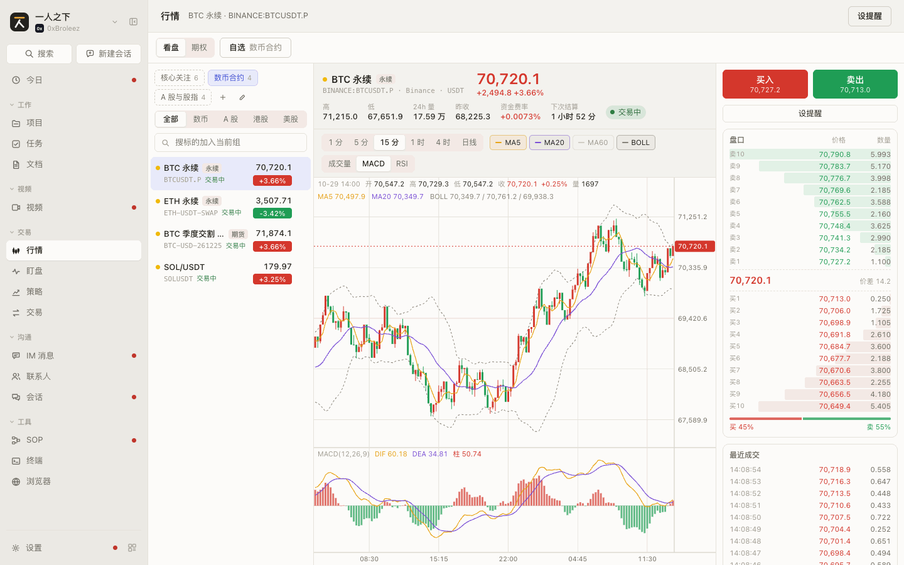 | 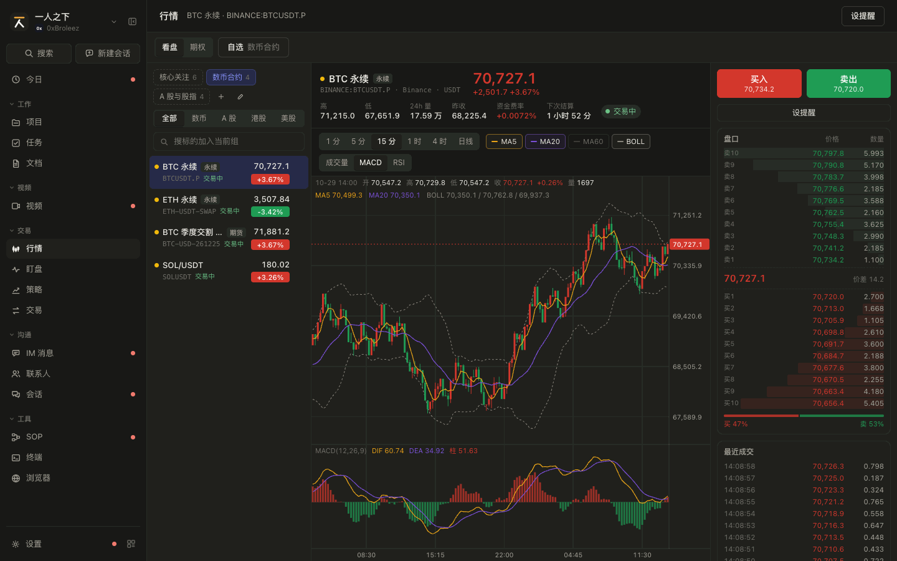 |
| 手机 375 | 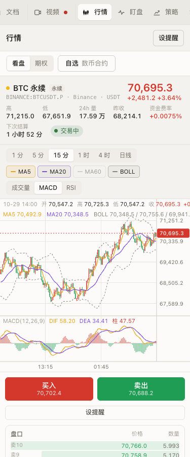 | 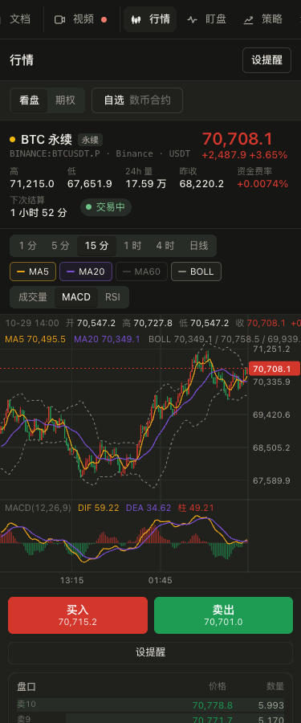 |

A 股：带涨停、跌停价，副图换 RSI：

| | 亮 | 暗 |
|---|---|---|
| 桌面 1440 | 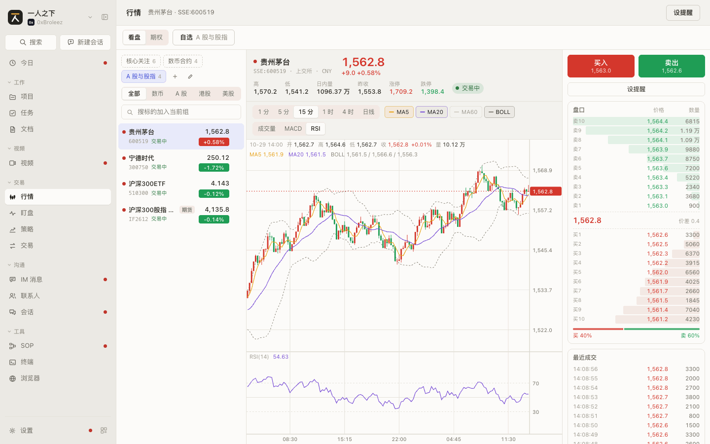 | 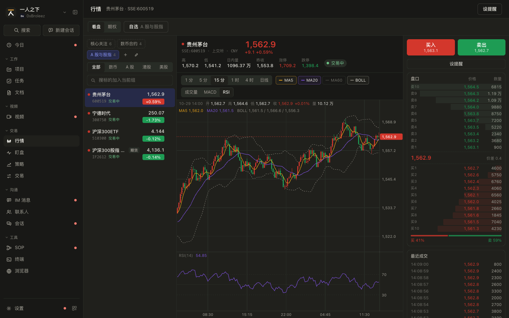 |
| 手机 375 | 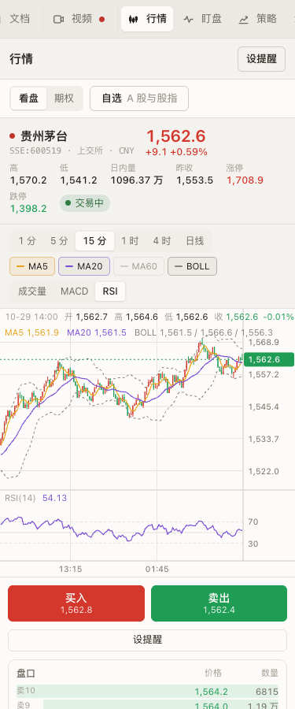 | 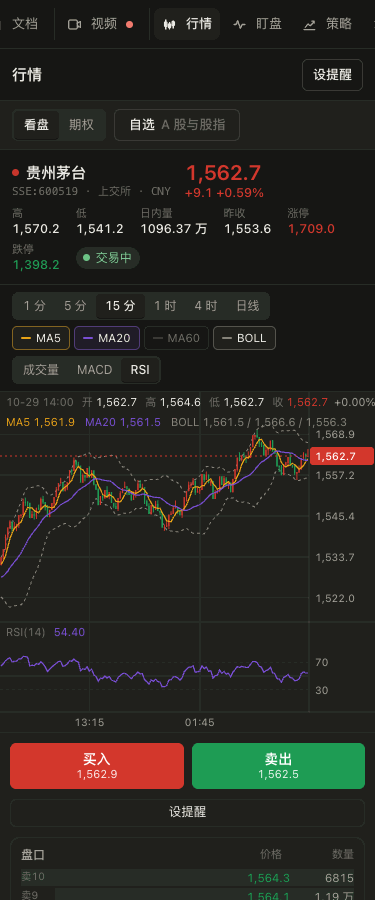 |

### 交互

| 编号 | 元素 | 操作 | 结果 |
|---|---|---|---|
| SPEC-markets-1.1 | 标题栏 | 看 | 标题「行情」，后面是当前标的的「名称 · symbol」；期权标签下是选中的期权，没选是期权的标的 |
| SPEC-markets-1.2 | 标题栏右侧「设提醒」 | 点击 | 见 `SPEC-markets-0` 联动总表「设提醒」 |
| SPEC-markets-1.3 | 「看盘 / 期权」切换 | 点击 | 切标签；切走再切回，看盘的标的、周期、指标保留 |
| SPEC-markets-1.4 | 「自选 <组名>」按钮 | 点击 | 只在手机宽度出现：从左侧滑出自选栏（`SPEC-markets-2`），点遮罩或 Esc 关闭；在里面点一个标的也关闭 |
| SPEC-markets-1.5 | 标的头 | 看 | 市场色点、名称、品种标签（现货不显示）、`symbol · 场所 · 币种`；最新价和涨跌额、涨跌幅（涨红跌绿）；高、低、日内量（数币写「24h 量」，为最近 96 根 15 分钟 K 线合计）、昨收；A 股带涨停、跌停价（昨收乘以 1 加减 `limit`）；期货带到期日和剩余天数、乘数；永续带资金费率（四位小数，带正负号）和距下次结算（每 8 小时整点）；最后是时段标签 |
| SPEC-markets-1.6 | 周期 | 点击 | 1 分、5 分、15 分、1 时、4 时、日线；K 线换周期重画 |
| SPEC-markets-1.7 | 主图叠加 MA5、MA20、MA60、BOLL | 点击 | 各自开关；颜色固定（MA5 橙、MA20 紫、MA60 青、BOLL 灰虚线上下轨加实线中轨），主图价格范围把打开的指标算进去 |
| SPEC-markets-1.8 | 副图「成交量 / MACD / RSI」 | 点击 | 成交量柱（随 K 线涨跌色）加 5 根均量线；MACD(12,26,9) 的 DIF、DEA 和柱；RSI(14) 加 30、50、70 三条参考线 |
| SPEC-markets-1.9 | K 线 | 看 | 显示最近 140 根（共取 200 根，前面的给指标预热）；空心阳线、实心阴线；最新价一条虚线，右侧价格轴上标签随涨跌色；左上图例是当前（或光标所在）那根的时间、开高低收、涨跌幅、量，第二行是打开的均线和 BOLL 的值，副图左上是副图指标的值 |
| SPEC-markets-1.10 | K 线 | 鼠标移动 | 十字光标，价格轴和时间轴上显示光标处的价格（在副图里是副图的值）和那根的完整时间；图例跟着换成那一根；移出恢复最新一根 |
| SPEC-markets-1.11 | 盘口 | 看 | 卖十到卖一在上、买一到买十在下，每档价格、数量和累计深度条；中间是最新价和价差；下面是买卖十档挂单量对比条和百分比 |
| SPEC-markets-1.12 | 最近成交 | 看 | 已撤下（TRD-02b）：逐笔成交没有接口，不再用模拟成交；位置换成「数据源」框（`SPEC-markets-1.22`） |
| SPEC-markets-1.13 | 右栏「买入 <卖一价>」「卖出 <买一价>」 | 点击 | 切到交易，打开下单抽屉，带上当前标的和方向（`SPEC-trading-5`）。**【实盘，要过 TRD-08 评审，默认只开模拟盘】** |
| SPEC-markets-1.14 | 右栏「设提醒」 | 点击 | 同 `SPEC-markets-1.2` |
| SPEC-markets-1.15 | 行情刷新 | 每秒 | 标的头、K 线最后一根、盘口、自选列表的价格跟着变；时段标签每 30 秒重算。正式版：价格走插件的推送（`/api/trade/stream`，每秒），推送连不上时退回 2 秒一次的轮询；K 线一分钟重取一次，之间用实时价更新最后一根 |
| SPEC-markets-1.16 | 从别的模块打开某个标的 | 进来 | 见 `SPEC-markets-0` 联动总表；同一次请求只处理一次，切走再回来不会重复跳 |

### 空状态和异常状态

| 编号 | 场景 | 显示 | 可做的操作 |
|---|---|---|---|
| SPEC-markets-1.17 | 自选组全是空的，第一次进来 | 显示 `INSTRUMENTS` 的第一个（BTC/USDT） | 自选栏里搜标的加入 |
| SPEC-markets-1.18 | 当前标的找不到（被下线） | 原型退回 `INSTRUMENTS` 的第一个。正式产品：标的头写「<symbol> 已下线」，K 线和盘口区显示空状态，不退回别的标的 | 在自选里移出 |
| SPEC-markets-1.19 | 行情源断开或限频 | TRD-02b 已做：价格停在最后一次取到的值，不再跳；标的头的状态点变成黄色「缓存」，涨跌色变灰；自选行的价格后面标「缓存」、涨跌幅色块变灰；「数据源」框写「交易所异常：<原因>，<N> 秒后重试」；K 线上方出一条「交易所暂时取不到，K 线是缓存」。恢复后自动回到实时。原型用「数据源」框里的「演示：断开数据源」演示（`SPEC-markets-1.23`） | 等恢复 |
| SPEC-markets-1.20 | 休市、午休、盘前盘后 | 时段标签显示对应状态，价格照常显示（模拟行情休市也在动）。正式产品：休市时价格不动，标的头显示「休市 · 距开盘 <时长>」 | 无 |
| SPEC-markets-1.21 | K 线历史加载中、加载失败 | 正式前端已做：K 线区显示「加载 K 线」；失败显示「取不到 K 线：<原因>」，一分钟后自动重取，标的头和盘口照常。原型的 K 线是现算的，没有这两种状态 | 等重取 |
| SPEC-markets-1.22 | 「数据源」框（右栏盘口下面，TRD-02b 新增，替换原来的「最近成交」） | 看 | 来源（`Binance 公开行情` / `OKX 公开行情`，没有源写「未接」）、状态（绿点「实时」、黄点「缓存」、灰点「数据源未接」）、数据时间（交易所给的时间，时分秒加「N 秒前」）、更新方式（「推送，每秒」或「轮询，2 秒」）；源异常时最后一行红字写原因和重试倒计时。标的头最后一项「数据时间」同样带状态点 | 无 |
| SPEC-markets-1.23 | 「数据源」框里「演示：断开数据源 / 演示：恢复数据源」 | 点击 | 只在原型里有：模拟交易所被限频，价格停在点下的那一刻，进入 `SPEC-markets-1.19` 的样子；再点恢复。正式版没有这个按钮，状态来自后端 | 演示 |
| SPEC-markets-1.24 | 当前标的没有行情源（A 股、港股、美股、交割合约） | 标的头在名称右边写「数据源未接」和「<市场>的行情源还没接，不显示价格」；K 线区写「<市场>的行情源还没接，不显示 K 线」；盘口写「数据源未接」；买入、卖出按钮不带价格。不显示任何模拟价格 | 换一个有源的标的 |
| SPEC-markets-1.25 | 买入、卖出按钮下方 | 看 | 一行小字「下单去交易页，只到模拟盘」 | 无 |

### 数据

用到 `Instrument`、`Quote`、`Bar`、`BarInterval`、盘口、`SessionState`（见 `SPEC-markets-0`）和 `fundingRate(symbol, at)`（单位 %，只有永续有，见 `SPEC-monitor-0`）。页面本地状态见 `SPEC-markets-0` 末尾；指标（MA、EMA、BOLL、MACD、RSI）在 `markets.tsx` 里按收盘价现算，和回测引擎（`SPEC-strategy-0`）是两份实现，正式版合成一份。

### 联动

| 方向 | 对方模块 | 触发 | 结果 | 见 |
|---|---|---|---|---|
| 进来 | 盯盘、交易 | 打开某个标的 | 切到看盘并选中它 | `SPEC-markets-0` 联动总表 |
| 出去 | 盯盘 | 「设提醒」 | 新建提醒抽屉 | `SPEC-monitor-3` |
| 出去 | 交易 | 「买入」「卖出」 | 下单抽屉 | `SPEC-trading-5` |

## SPEC-markets-2 自选

看盘标签的左栏：一组一组的自选标的。宽屏常驻；手机宽度从左侧滑出。

### 截图

搜「港交所」：已在组里的标「已在组内」，不在的可以「添加」：

| | 亮 | 暗 |
|---|---|---|
| 桌面 1440 | 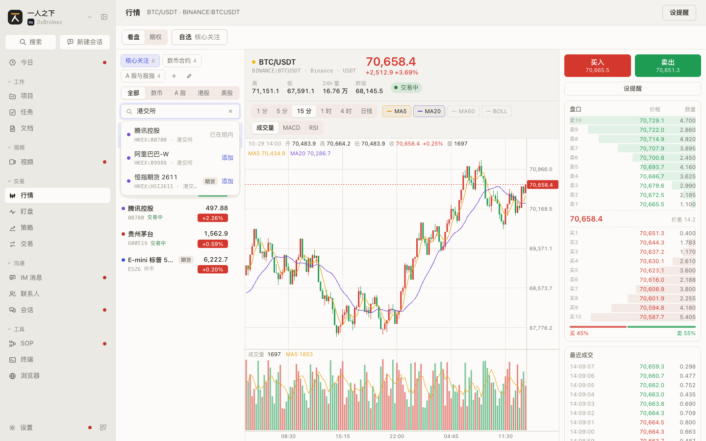 | 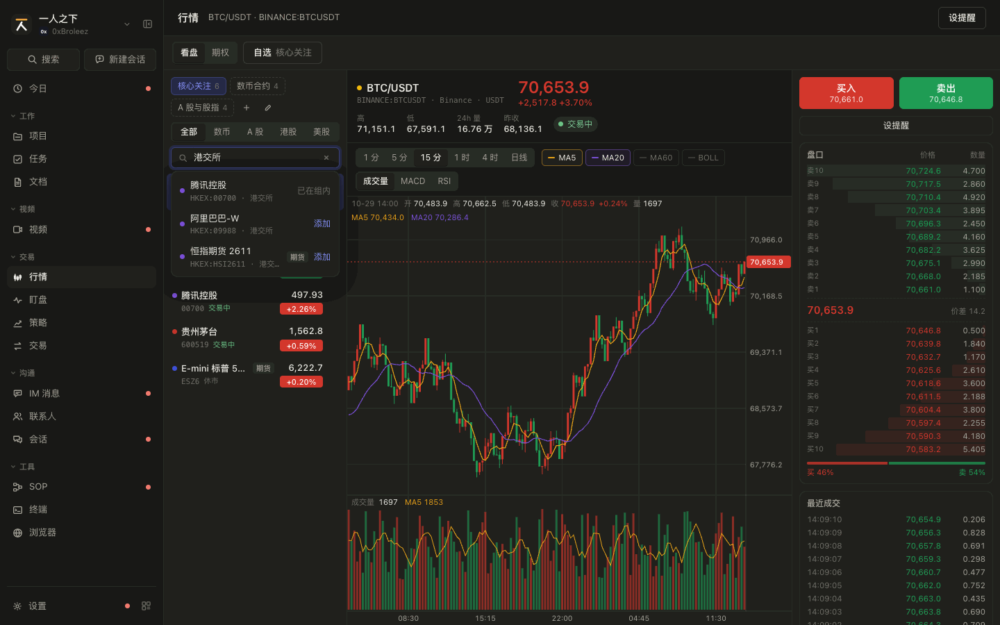 |
| 手机 375 | 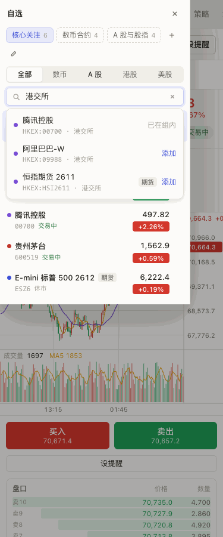 | 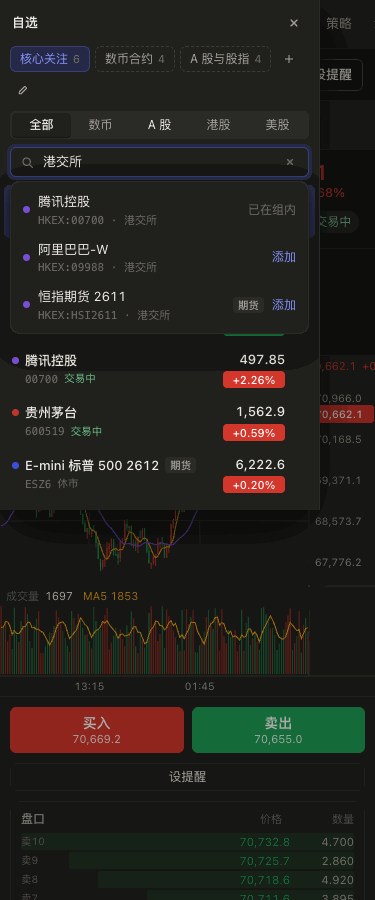 |

改当前组的名字：

| | 亮 | 暗 |
|---|---|---|
| 桌面 1440 | 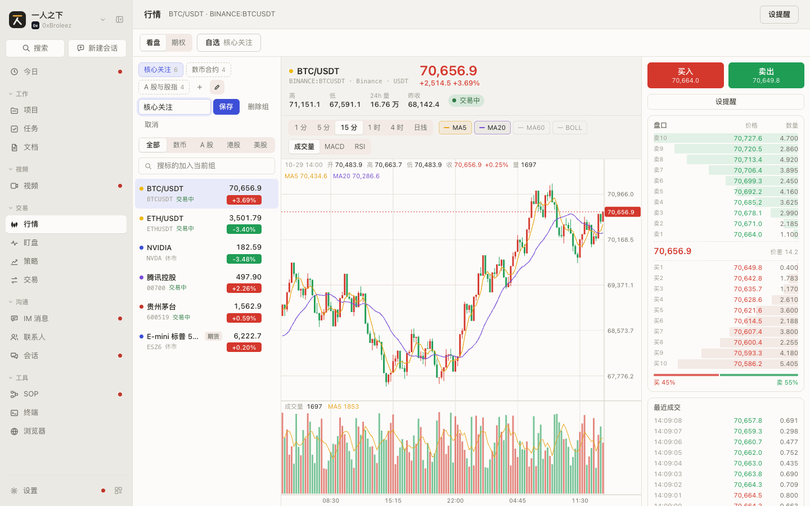 | 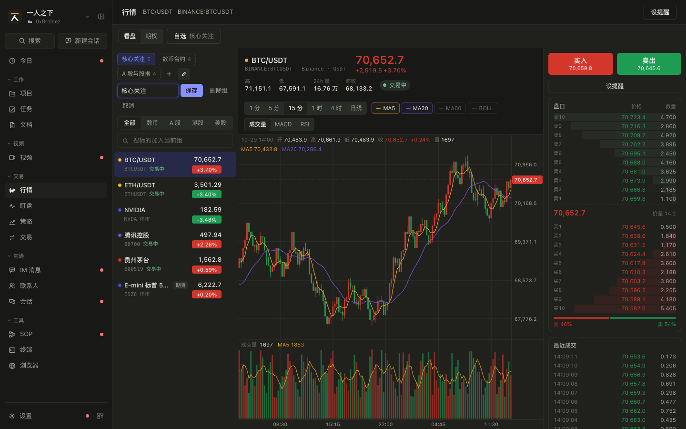 |
| 手机 375 | 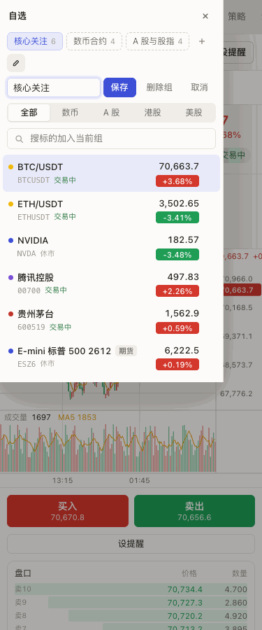 | 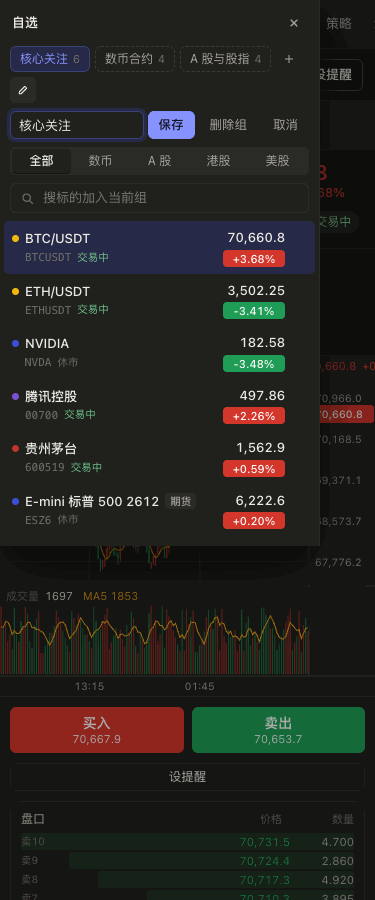 |

新建一个组，自动进入改名，列表是空的：

| | 亮 | 暗 |
|---|---|---|
| 桌面 1440 | 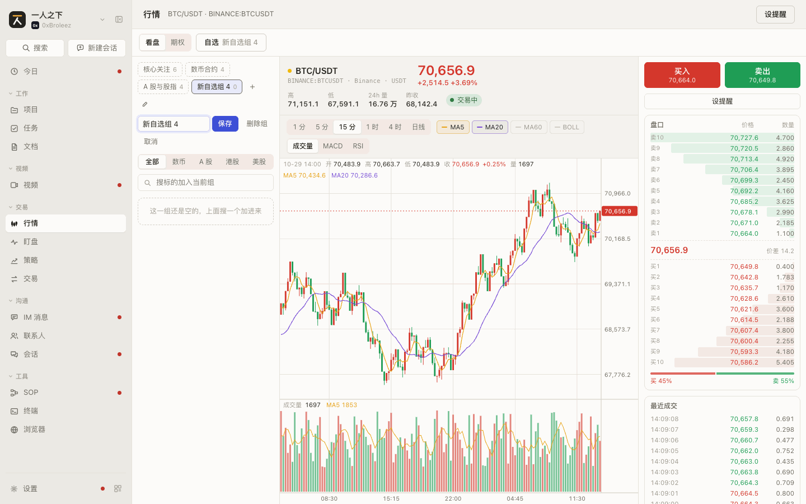 | 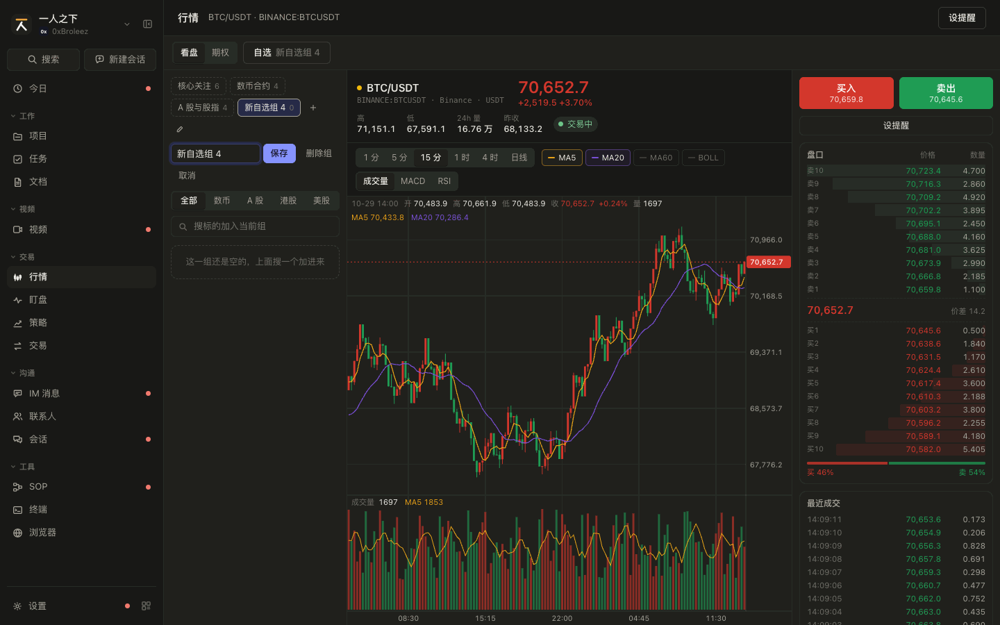 |
| 手机 375 | 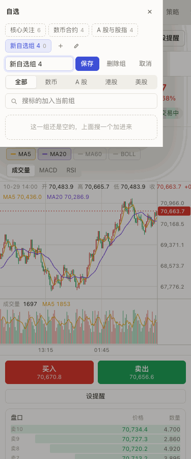 | 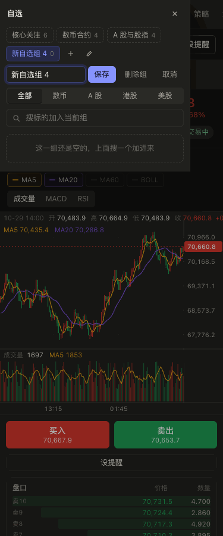 |

### 交互

| 编号 | 元素 | 操作 | 结果 |
|---|---|---|---|
| SPEC-markets-2.1 | 自选组标签 | 看、点击 | 每组一个标签：组名和标的数；点击切到这一组，当前标的不变 |
| SPEC-markets-2.2 | 自选组标签 | 双击 | 进入改名（同 2.5） |
| SPEC-markets-2.3 | 组很多时 | 看 | 超过 6 组时只露前 3 组和当前组，其余收进「全部 N 组」下拉，下拉里可以搜组名，每项带「N 个」 |
| SPEC-markets-2.4 | 「+」新建自选组 | 点击 | 新建「新自选组 <N>」（N 是当前组数加 1），切到它并进入改名 |
| SPEC-markets-2.5 | 铅笔「重命名当前组」 | 点击 | 组标签下面出现改名行：输入框（自动聚焦，带原名）、「保存」（名字为空时不可点）、「删除组」（只剩一组时不出现）、「取消」；回车保存、Esc 取消 |
| SPEC-markets-2.6 | 改名行「删除组」 | 点击 | 直接删掉当前组，切到剩下的第一组；不二次确认（组里只是标的引用，不连带别的数据） |
| SPEC-markets-2.7 | 市场筛选「全部 / 数币 / A 股 / 港股 / 美股」 | 点击 | 只显示当前组里这个市场的标的；搜索结果也按它筛 |
| SPEC-markets-2.8 | 搜索框「搜标的加入当前组」 | 输入 | 按名称、symbol、场所匹配，最多 12 条，每条带市场色点、名称、`symbol · 场所`、品种标签；已在当前组的灰掉并写「已在组内」，其余写「添加」；Esc 或右侧叉清空 |
| SPEC-markets-2.9 | 搜索结果一条 | 点击 | 加到当前组末尾，清空搜索框 |
| SPEC-markets-2.10 | 自选行 | 看 | 市场色点、名称、品种标签、代码（symbol 冒号后面）、时段；右侧最新价和涨跌幅色块；当前标的高亮 |
| SPEC-markets-2.11 | 自选行 | 点击、回车 | 切成当前标的（`SPEC-markets-1`）；手机宽度同时关闭自选栏 |
| SPEC-markets-2.12 | 自选行右侧叉「移出自选」 | 点击 | 从当前组移出，不二次确认；移出的是当前标的时，中间仍显示它 |

### 空状态和异常状态

| 编号 | 场景 | 显示 | 可做的操作 |
|---|---|---|---|
| SPEC-markets-2.13 | 当前组是空的 | 「这一组还是空的，上面搜一个加进来」 | 搜索加入 |
| SPEC-markets-2.14 | 当前组有标的，但筛选的市场没有 | 「这个市场没有自选标的」 | 换市场筛选 |
| SPEC-markets-2.15 | 搜不到 | 搜索结果里写「没有匹配的标的」 | 改关键词 |
| SPEC-markets-2.16 | 改名时名字为空 | 「保存」不可点 | 填名字或取消 |
| SPEC-markets-2.17 | 一个自选组都没有 | 原型里删到最后一组时「删除组」不出现，不会发生。正式产品同样至少保留一组 | 无 |
| SPEC-markets-2.18 | 自选保存失败 | 原型未做。正式产品：改动先在界面上生效，保存失败时回退并提示原因 | 重试 |
| SPEC-markets-2.19 | 自选行的标的没有行情源，或行情是缓存 | 没有源的行右侧不显示价格，换成灰色小标签「数据源未接」；行情是缓存时价格照常显示（停在最后一次），代码后面多一个黄色「缓存」，涨跌幅色块变灰（TRD-02b，原型和正式前端一致） | 无 |
| SPEC-markets-2.20 | 新装后一个自选组都没有（正式前端） | 自选栏显示「还没有自选组」和按钮「建一组：BTC、ETH 现货和永续」，点了建「核心关注」，含 `BINANCE:BTCUSDT`、`BINANCE:ETHUSDT`、`BINANCE:BTCUSDT.P`、`OKX:BTC-USDT-SWAP`。原型有演示数据，不会出现 | 建一组 |

### 数据

`Watchlist`（见 `SPEC-markets-0`）。搜索范围是 `INSTRUMENTS`，不含期权。

### 联动

| 方向 | 对方模块 | 触发 | 结果 | 见 |
|---|---|---|---|---|
| 改动 | 盯盘 | 增删组、增删标的 | 盯盘墙的组下拉和格子跟着变 | `SPEC-monitor-1` |

## SPEC-markets-3 期权 T 型报价

标签「期权」：上面选标的和到期日，中间认购、认沽的 T 型报价，右侧是选中那张期权的详情和买卖按钮。

### 截图

BTC/USDT，到期日 2026-11-28：

| | 亮 | 暗 |
|---|---|---|
| 桌面 1440 | 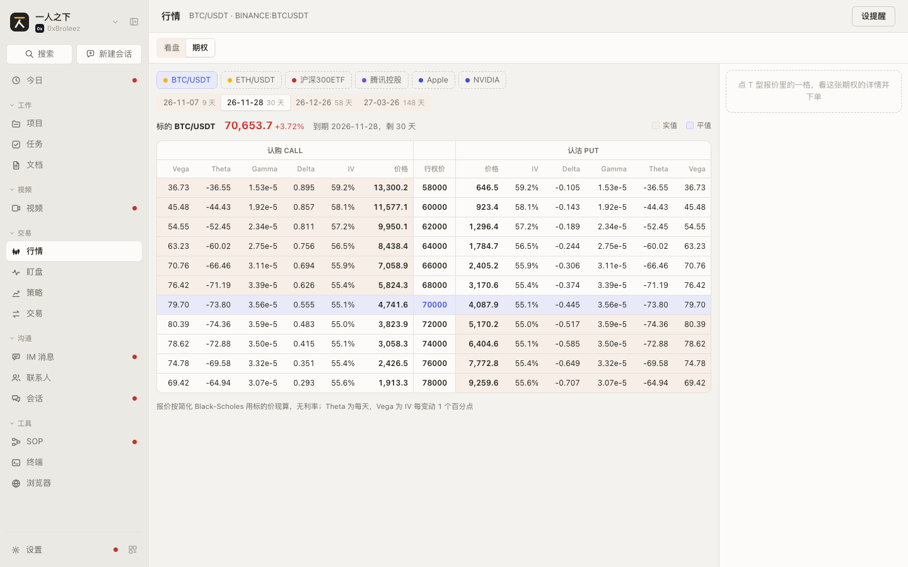 | 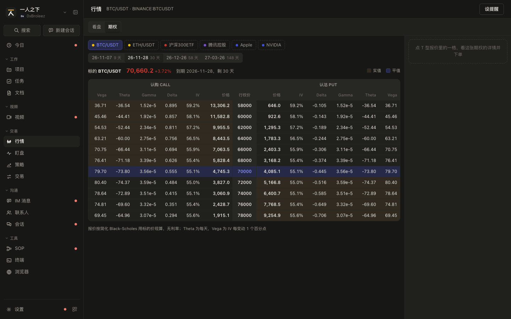 |
| 手机 375 | 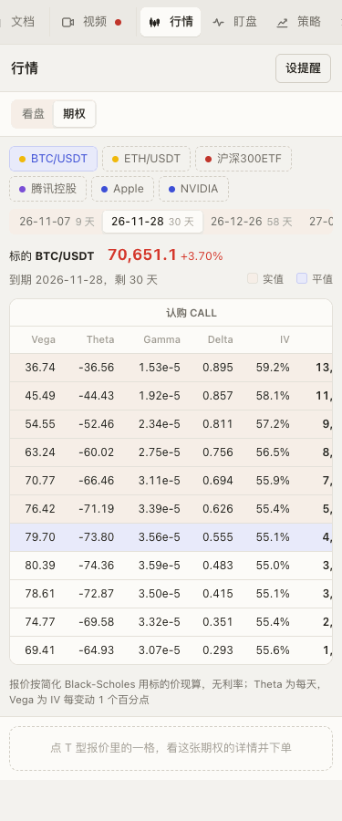 | 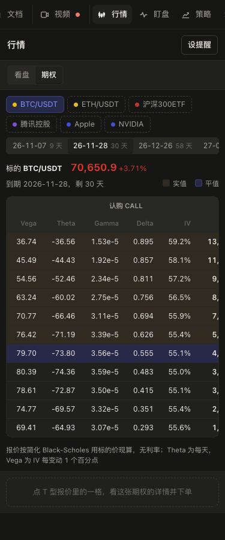 |

点平值那一档的认购价格，右侧（手机在下方）出现详情：

| | 亮 | 暗 |
|---|---|---|
| 桌面 1440 | 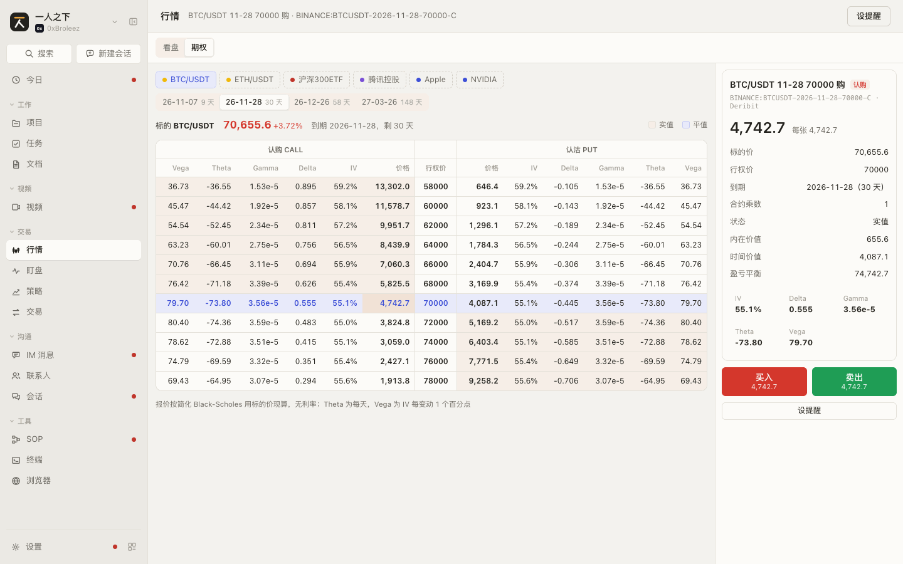 | 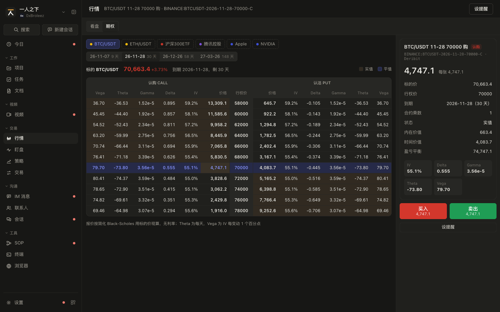 |
| 手机 375 | 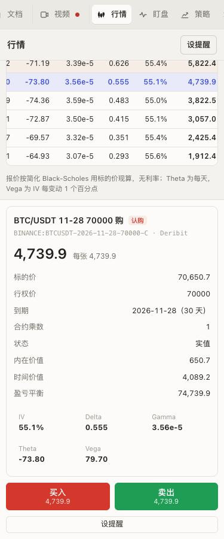 | 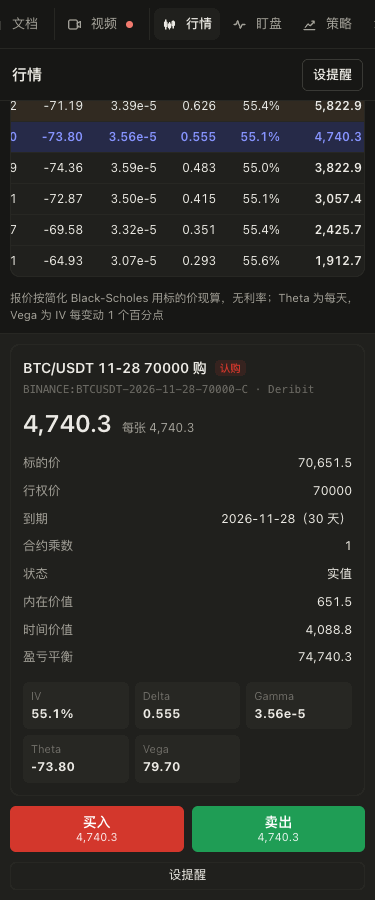 |

### 交互

| 编号 | 元素 | 操作 | 结果 |
|---|---|---|---|
| SPEC-markets-3.1 | 标的标签 | 点击 | `OPTION_UNDERLYINGS` 的 6 个标的，带市场色点；切换后清掉选中的期权 |
| SPEC-markets-3.2 | 到期日 | 点击 | 4 个到期日（显示 `YY-MM-DD` 和剩余天数）；切换后清掉选中的期权 |
| SPEC-markets-3.3 | 信息行 | 看 | 标的名、标的现价和涨跌幅、到期日和剩余天数；右侧「实值」「平值」图例 |
| SPEC-markets-3.4 | T 型报价表 | 看 | 左边认购、右边认沽，中间行权价；每边 6 列：价格、IV、Delta、Gamma、Theta、Vega（认购一侧倒序，价格靠中间）；实值格子底色（认购行权价低于现价、认沽行权价高于现价），离现价最近的一档整行是平值色；选中的格子描边 |
| SPEC-markets-3.5 | T 型报价表的格子 | 点击 | 选中这张期权（点同一行哪一列都行），右侧出现详情：名称和认购 / 认沽标签、`symbol · 场所`、价格和每张价格（乘以乘数）、标的价、行权价、到期和剩余天数、合约乘数、状态（实值 / 平值（离现价 1.25% 以内）/ 虚值）、内在价值、时间价值、盈亏平衡点、IV 和四个希腊值 |
| SPEC-markets-3.6 | 详情「买入」「卖出」 | 点击 | 切到交易，打开下单抽屉，带上这张期权和方向（`SPEC-trading-5`）。**【实盘，要过 TRD-08 评审，默认只开模拟盘】** |
| SPEC-markets-3.7 | 详情「设提醒」、标题栏「设提醒」 | 点击 | 新建提醒，标的是这张期权（`SPEC-monitor-3`，期权可以设「隐含波动率高于」） |
| SPEC-markets-3.8 | 表下说明 | 看 | 「报价按简化 Black-Scholes 用标的价现算，无利率；Theta 为每天，Vega 为 IV 每变动 1 个百分点」。正式版换成数据源说明 |
| SPEC-markets-3.9 | 窄屏 | 看 | 表格横向滚动，详情排在表格下面 |

### 空状态和异常状态

| 编号 | 场景 | 显示 | 可做的操作 |
|---|---|---|---|
| SPEC-markets-3.10 | 还没选期权 | 右侧「点 T 型报价里的一格，看这张期权的详情并下单」 | 点格子 |
| SPEC-markets-3.11 | 期权行情没接 | TRD-02b 已做：期权标签整页是「期权数据源未接」和说明「期权 T 型报价要接 Deribit、OKX 期权或券商的期权行情，接上之前不显示报价，也不用模拟价格」，不显示 T 型报价和详情。原型多一个「看原型演示（模拟报价）」（`SPEC-markets-3.13`） | 无 |
| SPEC-markets-3.12 | 到期日已过 | 原型的到期日写死，不会过期。正式产品：到期日列表从数据源取，过期的不显示 | 无 |
| SPEC-markets-3.13 | 「看原型演示（模拟报价）」/「收起演示」 | 只在原型里有：展开原来的 T 型报价和详情，顶上一条黄底提示「原型演示：下面是模拟报价，不是真实行情」；收起回到 `SPEC-markets-3.11`。`SPEC-markets-3.1` 到 `3.10` 描述的是接上期权行情之后的样子 | 演示 |

### 数据

`optionChain`、`Greeks`、`OPTION_UNDERLYINGS`、`OPTION_EXPIRIES`（见 `SPEC-markets-0`）。T 型报价每档用的是 11 档链；从别处打开的期权 symbol 按 41 档的链解析。

### 联动

| 方向 | 对方模块 | 触发 | 结果 | 见 |
|---|---|---|---|---|
| 进来 | 盯盘、交易 | 打开一个期权标的 | 切到期权标签，标的、到期日跟着换，选中这张 | `SPEC-markets-0` 联动总表 |
| 出去 | 交易 | 「买入」「卖出」 | 下单抽屉（期权不显示杠杆，有「仅减仓」） | `SPEC-trading-5` |
| 出去 | 盯盘 | 「设提醒」 | 新建提醒抽屉 | `SPEC-monitor-3` |
