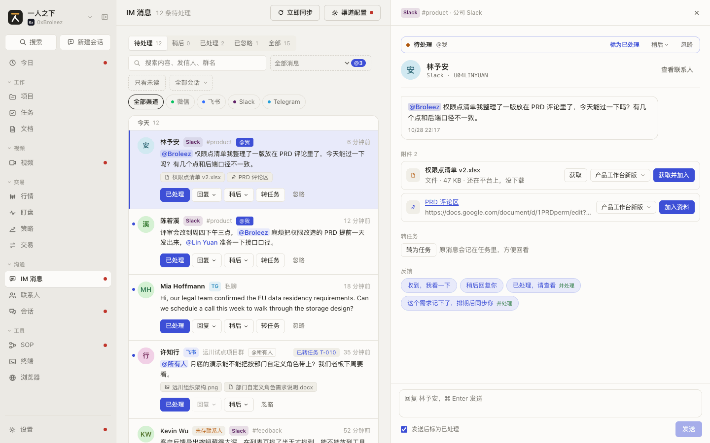
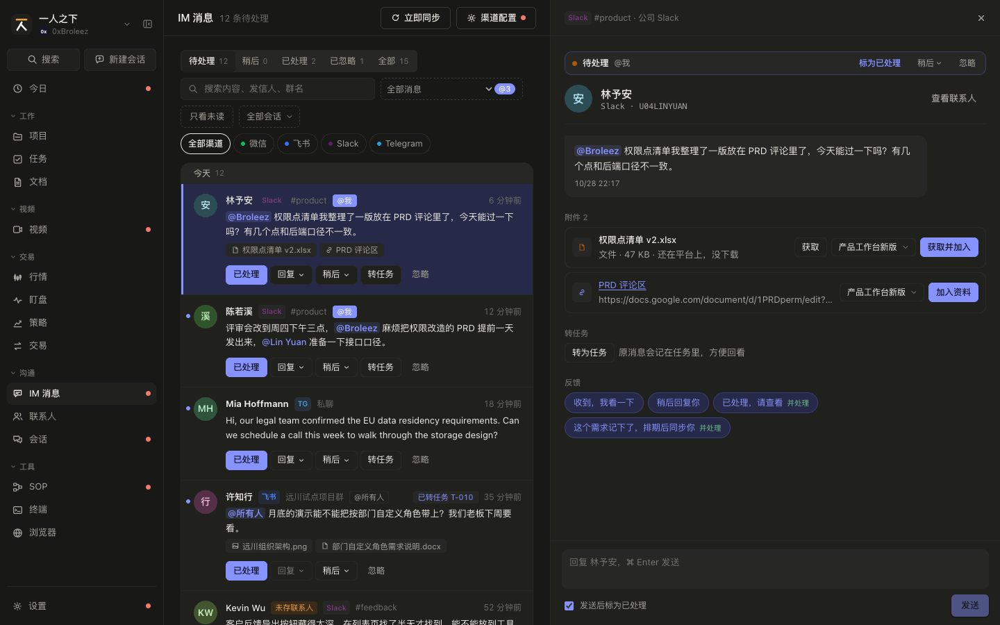
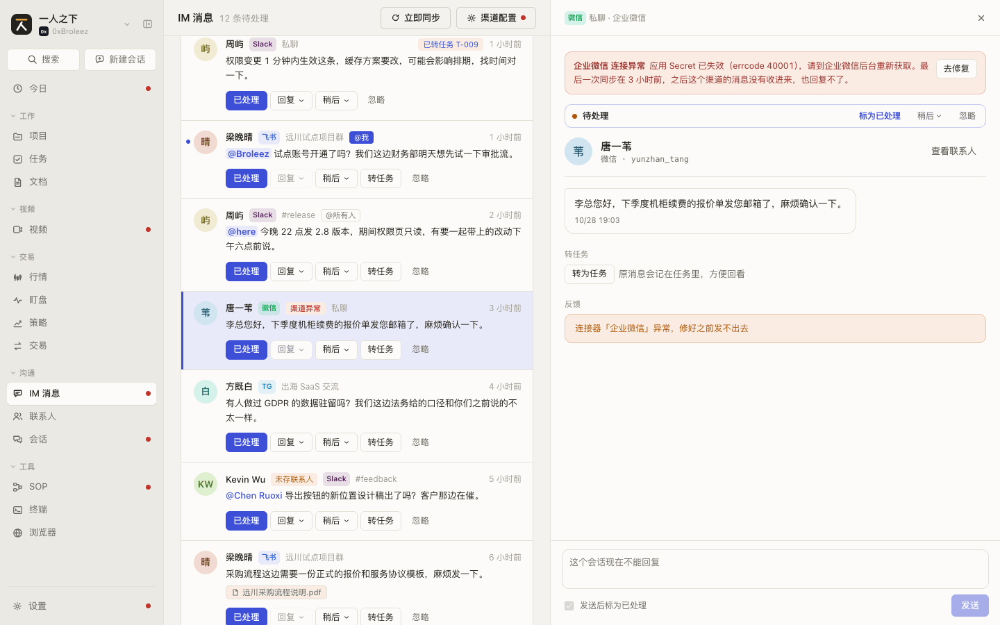
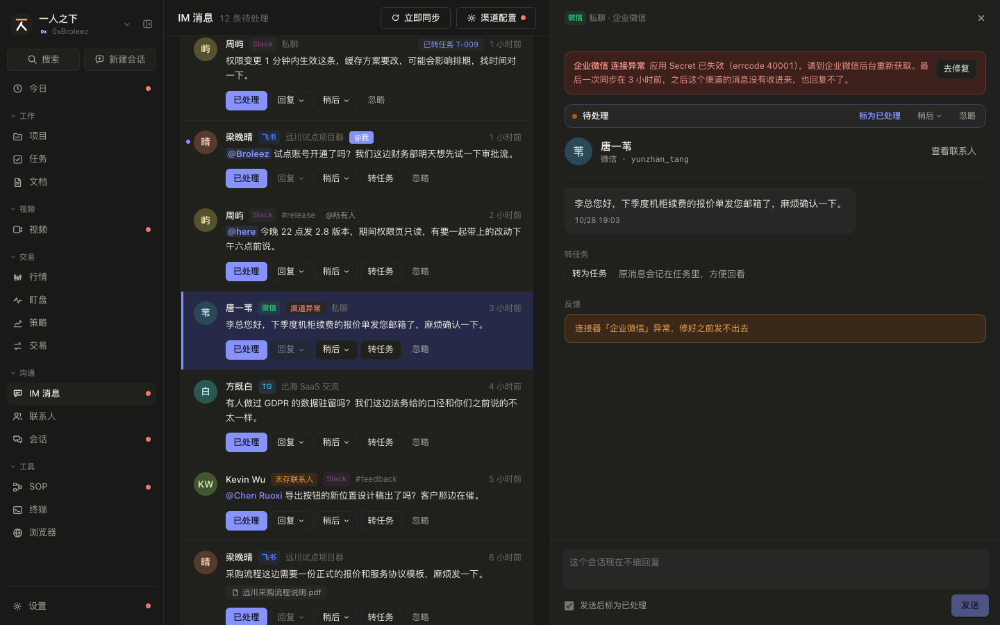
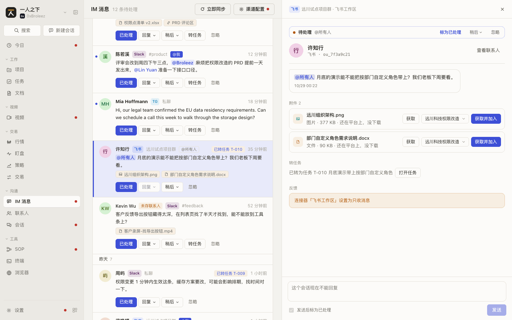
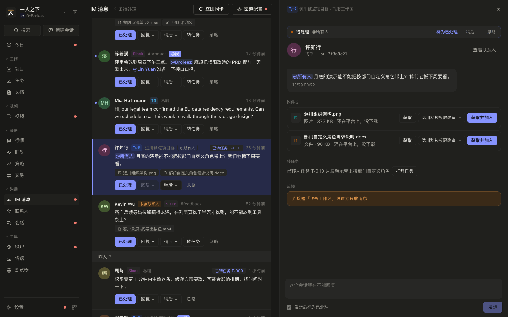
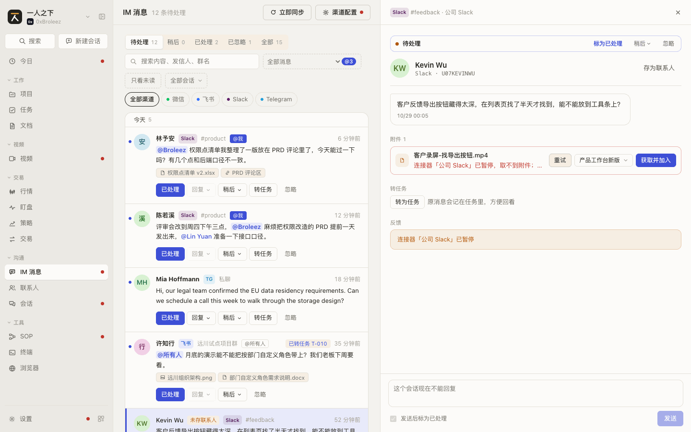
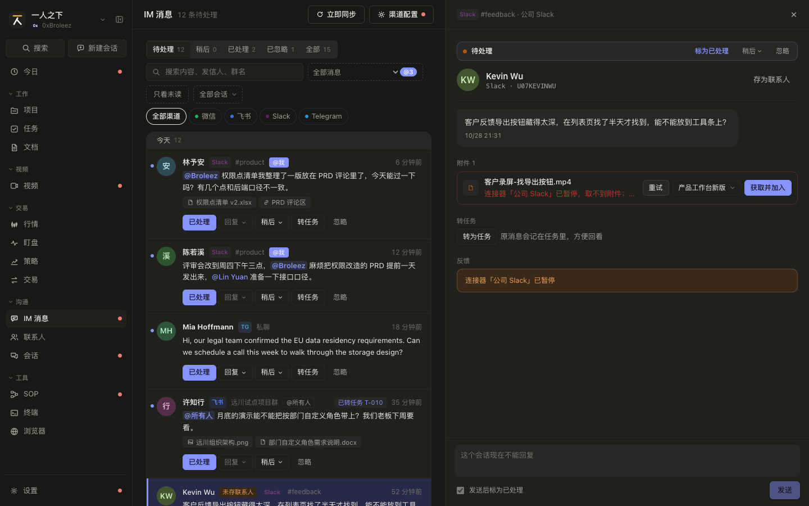

# IM 消息 规格（SPEC-messages）

| 项 | 内容 |
|---|---|
| 模块 key | `messages` |
| 原型入口 | 一级菜单「IM 消息」，http://127.0.0.1:7778 |
| 源码 | `web-next/src/messages.tsx`（列表页 `MessagesPage`、抽屉 `MessageDrawer`、`relevance`、`replyBlocker`、`fetchBlocker`、`isSnoozed`、`contactIndex`）、`web-next/src/attachments.tsx`（`AttachmentChips`、`AttachmentPanel`）、`web-next/src/msgmaterial.tsx`（转项目资料弹窗 `ToMaterialDialog`、抽屉一节 `MaterialSection`、`materialTitle`、`materialBody`、`notesOf`、`priorOf`）；接线在 `web-next/src/App.tsx`（`actOnMessage`、`syncMessages`、`fetchAttachment`、`addAttachmentToProject`、`openTaskFromMessage`） |
| 数据文件 | `web-next/src/data.ts`（`Message`、`MsgStatus`、`IM_EXPIRE_DAYS_DEFAULT`、`Reply`、`MsgAttachment`、`AttachmentKind`、`Connector`、`ConnStatus`、`MY_HANDLES`、`ALL_HANDLES`、`QUICK_REPLIES`、`SYNC_POOL`、`ATTACH_DIR`）、`web-next/src/enumdata.ts`（`msg_status` 枚举） |
| 截图 | [`shots/messages/`](shots/messages/) |
| 负责任务 | PROTO-04d |
| 对应开发任务 | IM-02b 实现 IM 消息页和消息抽屉：与 `SPEC-messages-1`、`SPEC-messages-2` 对照；IM-07 已过期状态和过期天数：与 `SPEC-messages-1.43`~`1.46`、`SPEC-messages-2.32` 对照；IM-04b 实现附件面板和项目附件收件（项目一侧已改成项目详情的「附件」标签）：与 `SPEC-messages-3`、`SPEC-projects-5` 对照（数据结构见 `SPEC-messages-0`） |
| 状态 | 已整理 |
| 最后对照 | 2026-10-28，原型提交 `932555b` |

## SPEC-messages-0 模块概述

各 IM 渠道（微信、飞书、Slack、Telegram、QQ）通过连接器收进来的消息，集中在一个收件箱里处理：标已处理、忽略、稍后提醒、回复、转任务，附件可以取到本地、加进项目的支持材料。

### 页面清单

| 节 | 页面 | 入口 | 说明 |
|---|---|---|---|
| [SPEC-messages-1](#spec-messages-1-消息列表) | 消息列表 | 一级菜单「IM 消息」 | 状态、与我相关、未读、会话、渠道筛选，行内处理，立即同步 |
| [SPEC-messages-2](#spec-messages-2-消息抽屉) | 消息抽屉 | 列表里点一行；或从今日、项目沟通、任务来源卡、会话产出结果、命令面板打开 | 处理状态条、发信人、会话、转任务、快捷回复和回复框 |
| [SPEC-messages-3](#spec-messages-3-附件面板) | 附件面板 | 消息抽屉里「附件 N」一节 | 获取附件到本地，选项目加进支持材料 |
| [SPEC-messages-4](#spec-messages-4-一组消息的抽屉) | 一组消息的抽屉 | 合并显示时点合并的一行 | 按时间看整段，逐条或整组处理，交给 Agent |
| [SPEC-messages-5](#spec-messages-5-发起会话拆分任务) | 发起会话、拆分任务 | 行内「更多」菜单、抽屉「交给 Agent」一节 | 选 Agent，带上消息原文和来源建会话，拆出来的任务建在消息归属的项目下 |
| [SPEC-messages-6](#spec-messages-6-转项目资料) | 转项目资料 | 行内「更多」菜单、抽屉「项目资料」一节 | 把一条消息或一组按时间拼成一段对话记录，存成项目支持材料里的一条笔记，记上出处 |
| [SPEC-messages-7](#spec-messages-7-群组管理) | 群组管理 | 标题行「群组管理」 | 全部群和私聊的默认归属项目：逐个改、批量设和清除、按群名关键字建议 |
| [SPEC-messages-8](#spec-messages-8-主动发消息) | 主动发消息 | 标题行「发消息」、群组管理每行「发消息」、选中会话时列表上方「发消息」 | 发到已有会话或账号所在、还没收过消息的频道；发出的有记录，对方回复能对上 |

### 共用数据结构

`Message`（`web-next/src/data.ts`）

| 字段 | 类型 | 必填 | 说明 | 取值 / 示例 |
|---|---|---|---|---|
| `id` | `string` | 是 | 编号 | `msg_001` |
| `channel` | `string` | 是 | 渠道 key，对应 `IM_CHANNELS`（见 `SPEC-contacts-0` `ImChannel`） | `slack` |
| `connector_id` | `string` | 是 | 收这条消息的连接器 id；连接器删掉后找不到 | `cn_slack` |
| `conversation` | `string` | 是 | 群名 / 频道名；私聊为空串 | `#product`、`远川试点项目群`、`''` |
| `sender_name` | `string` | 是 | 发信人在渠道上的显示名 | `Lin Yuan` |
| `sender_id` | `string` | 是 | 发信人在该渠道上的编号；用「渠道 + 编号」去联系人的 `im` 里对人，不按名字 | `U04LINYUAN`、`@mia_nordlicht` |
| `text` | `string` | 是 | 正文，可含 @ | |
| `at` | `string` | 是 | 收到时间，ISO 8601 | |
| `read` | `boolean` | 是 | 已读；打开抽屉、处理、稍后、回复都会置为 `true` | `false` |
| `status` | `MsgStatus` | 是 | 处理状态 | `pending` 待处理 / `done` 已处理 / `ignored` 已忽略 / `expired` 已过期（IM-07） |
| `snooze_until` | `string \| null` | 是 | 稍后提醒到点时间，ISO 8601；到点前不出现在「待处理」里 | `null` |
| `expired_at` | `string \| null` | 是 | 标为已过期的时间，ISO 8601（IM-07）；不是已过期时为 `null`；处理完、忽略、重新打开时清空 | `null` |
| `expire_from` | `string` | 否 | 从什么时候起算过期，不存时按 `at`；重新打开时设成当时。原型自己的字段，正式产品在后端，接口不出 | |
| `replies` | `Reply[]` | 是 | 我发出的回复，按时间先后 | `[]` |
| `attachments` | `MsgAttachment[]` | 否 | 附件；没有附件时不存或为空 | |
| `project_id` | `string \| null` | 否 | 归到的项目（消息分流）：SOP 节点「消息归到项目」（`im_set_project`）或抽屉里手动设；没归为空。消息自己没归时按所在群的默认归属项目兜底（`SPEC-messages-1.50`）。正式产品接口另回 `project_name`（项目名），项目删了（含回收站）按没归 | `pj_pmw` |
| `project_source` | `'message' \| 'conversation'` | 否 | 归属的来源：`message` 消息上设的，`conversation` 群组默认归属的项目兜底。读出来时算，不存；原型由 `withGroupProjects` 算，正式产品由后端算，没归为空串 | `conversation` |
| `thread` | `{ parent_id: string \| null; parent_sender: string; parent_text: string }` | 否 | 消息列回复（Slack 在消息列回复的，1.62~1.65）属于哪个消息列：`parent_id` 是原消息的 id，原消息还没收到时为 `null`；`parent_sender`、`parent_text` 是原消息发信人和正文的快照（原消息没收到时显示用）。不是消息列回复的不带。正式产品接口是 `thread: {parent_external_id, parent_message_id, parent_sender_name, parent_text} \| null`，原消息另回 `reply_count`（收到的消息列回复条数），见下「消息列回复从哪来」 | |

`Reply`：`{ id: string; text: string; at: string }`，`at` 为发送时间 ISO 8601。

`MsgStatus`：`'pending' | 'done' | 'ignored' | 'expired'`。显示名和颜色读 `msg_status` 枚举（`web-next/src/enumdata.ts`），四个都是系统值（`locked`），`default_key` 为 `pending`：

| key | label | color |
|---|---|---|
| `pending` | 待处理 | `#b0570b` |
| `done` | 已处理 | `#2f7d43` |
| `ignored` | 已忽略 | `#a19d92` |
| `expired` | 已过期 | `#868e96` |

「已过期」（IM-07）：待处理、没在稍后里的消息，从收到时间 `at`（重新打开过的从重新打开时）起超过「过期天数」没处理，自动标为 `expired` 并记 `expired_at`。已过期不算待处理：不进「待处理」、标题和一级菜单的待处理数、今日「需要你处理」、项目沟通的待回复数；但还算没处理，能标已处理、忽略、重新打开、回复，能勾选批量处理，不能稍后。过期天数默认 7（`IM_EXPIRE_DAYS_DEFAULT`），0 到 365 的整数，0 为不过期，在「渠道配置」里改（`SPEC-messages-1.46`）；改短时到期的马上标，改长不会把已过期的改回来。原型在最早的到期时间到点时标（`App.tsx` 的 `nextExpire`）；正式产品由后端定时标（约每 10 分钟）。

「稍后」不是状态：`status === 'pending'` 且 `snooze_until` 晚于现在的消息算「稍后」（`isSnoozed`），到点后自动回到「待处理」：原型在最早的提醒时间到点时清掉 `snooze_until`，列表、今日、项目的计数跟着变；正式产品按 IM-02a 由后端到点改回。

`MsgAttachment`（`web-next/src/data.ts`）

| 字段 | 类型 | 必填 | 说明 | 取值 / 示例 |
|---|---|---|---|---|
| `id` | `string` | 是 | 编号 | `att1` |
| `name` | `string` | 是 | 文件名或链接标题 | `权限点清单 v2.xlsx` |
| `kind` | `AttachmentKind` | 是 | 种类 | `file` 文件 / `image` 图片 / `link` 链接（显示名见 `ATTACH_KIND`） |
| `size` | `number` | 否 | 字节数；链接没有 | `48213` |
| `url` | `string` | 否 | 链接地址；只有链接有 | `https://www.figma.com/design/roles-v4` |
| `fetch` | `'idle' \| 'fetching' \| 'done' \| 'error'` | 否 | 获取状态；链接不用获取，不存。不存时按 `idle` 处理 | `idle` 还在平台上 / `fetching` 获取中 / `done` 已下载到 `local` / `error` 失败 |
| `local` | `string` | 否 | 下载到本地的绝对路径；`fetch === 'done'` 时有 | `~/Downloads/一人之下/附件/远川采购流程说明.pdf` |
| `error` | `string` | 否 | 失败原因；`fetch === 'error'` 时有 | `企业微信连接异常，取不到附件；修好连接器后重试` |

`ATTACH_DIR = '~/Downloads/一人之下/附件'` 只是演示路径。正式产品按决策放在数据目录下的 `attachments/`，按渠道分子目录（见 `docs/dev-decisions.md`「消息附件存在哪」）。

`MsgAction`（`web-next/src/messages.tsx`）：列表和抽屉发出的处理动作，`App.tsx` 的 `actOnMessage` 执行。

| `kind` | 额外字段 | 效果 |
|---|---|---|
| `done` | | `status = 'done'`，`snooze_until = null`，`expired_at = null`，`read = true`；已过期的也能 |
| `ignore` | | `status = 'ignored'`，`snooze_until = null`，`expired_at = null`，`read = true`；已过期的也能 |
| `reopen` | | `status = 'pending'`，`snooze_until = null`，`expired_at = null`，`expire_from` 设为现在（过期重新算）；回复记录保留 |
| `read` | | `read = true` |
| `snooze` | `until: string` | `snooze_until = until`，`read = true`；状态不变 |
| `reply` | `text: string; done: boolean` | 追加一条 `Reply`，`read = true`；`done` 为真时同时 `status = 'done'`、清掉 `snooze_until` 和 `expired_at`；能对上联系人时，该联系人的 `last_contact_at` 改成回复时间 |

`Relevance`（`web-next/src/messages.tsx`）：`'me' | 'all' | 'dm'`，显示名 `RELEVANCE = { me: '@我', all: '@所有人', dm: '私聊' }`。`relevance(m)` 的规则：

1. 正文里的 @ 按正则取名字：先整串匹配 `MY_HANDLES`、`ALL_HANDLES` 里的名字，再匹配「两个首字母大写的英文词」（如 `@Lin Yuan`），最后退回到单词（字母数字、中文、`.`、`-`）。
2. 有任一名字在 `MY_HANDLES`（`Broleez`、`broleez`、`我`）里：`me`。
3. 否则有任一名字在 `ALL_HANDLES`（`所有人`、`全体成员`、`all`、`here`、`channel`、`everyone`）里：`all`。
4. 否则 `conversation` 为空（私聊）：`dm`。
5. 否则和我无关：`null`。

正式产品按 IM-03：「我」的称呼从连接器账号来，不写死 `MY_HANDLES`；另加渠道配置里用户填的「我的称呼」（多个，逗号分隔，PR-19），微信、飞书这类按名字 @ 的渠道靠它认出「@张三」是 @我。

`Connector`（`web-next/src/data.ts`）里本模块用到的字段：`id`、`tool`（渠道 key，`TOOLS` 里 `category === 'im'` 的才算 IM 连接器）、`name`、`status`（`ConnStatus`）、`error`、`direction`（`'receive'` 只收 / `'both'` 收发）、`last_sync_at`。`ConnStatus`：`connected` 已连接 / `connecting` 连接中 / `error` 异常 / `paused` 已暂停 / `disconnected` 已断开。完整定义归设置的连接器节（`SPEC-settings`，PROTO-04e）。

回不了的原因 `replyBlocker(conn)`：返回 `null` 表示能回；否则返回界面上要写出来的原因，按钮灰掉时必须把原因显示出来，不能只是点不动。

| 条件（按顺序判断） | 原因文案 |
|---|---|
| 连接器不存在 | 渠道已删除，这条消息只能查看 |
| `status === 'error'` | 连接器「<name>」异常，修好之前发不出去（正式产品不拦，见 1.35） |
| `status === 'paused'` | 连接器「<name>」已暂停 |
| `status === 'disconnected'` | 连接器「<name>」已断开，去设置里重新连接 |
| `status === 'connecting'` | 连接器「<name>」正在连接 |
| `direction === 'receive'` | 连接器「<name>」设置为只收消息 |

取不到附件的原因 `fetchBlocker(conn)`：分类和 `replyBlocker` 一样，但只收消息的连接器照样能取附件。返回 `null` 表示能取；否则返回原因和要不要记运行异常。

| 条件（按顺序判断） | 原因文案 | 记运行异常 |
|---|---|---|
| 连接器不存在 | 渠道已删除，取不到附件 | 否 |
| `status === 'error'` | 连接器「<name>」异常，取不到附件；修好连接器后重试 | 是 |
| `status === 'paused'` | 连接器「<name>」已暂停，取不到附件；恢复后重试 | 否 |
| `status === 'disconnected'` | 连接器「<name>」已断开，取不到附件；去设置里重新连接 | 否 |
| `status === 'connecting'` | 连接器「<name>」正在连接，连上后重试 | 否 |

`QUICK_REPLIES`（`web-next/src/data.ts`）：`{ text: string; done: boolean }[]`，`done` 为真的发完同时标为已处理。可以在设置里改（`SPEC-messages-1.47`）：原型直接改这份数组，正式产品存在 IM 设置的 `quick_replies` 里，没设过时是这里的四条。

| text | done |
|---|---|
| 收到，我看一下 | `false` |
| 稍后回复你 | `false` |
| 已处理，请查看 | `true` |
| 这个需求记下了，排期后同步你 | `true` |

发信人对人：`contactIndex(contacts)` 建「渠道:编号」到联系人的索引，同一编号取第一个联系人；`contactFor(m, contacts)` 是单条版本。对不上联系人的显示 `sender_name`。

会话键 `convKey`：群聊为 `g:<渠道>|<群名>`，私聊为 `d:<渠道>:<发信人编号>`。原型按名字认群；正式产品按 `conversation` 表的 id（见 `../dev-plan.md` 1.2 P0）。

`IncomingMessage`：`Pick<Message, 'conversation' | 'sender_name' | 'sender_id' | 'text'> & { attachments?: MsgAttachment[] }`。`SYNC_POOL: Record<渠道 key, IncomingMessage[][]>` 是「立即同步」时按顺序陆续到达的演示消息，每同步一次取一批，正式产品没有这张表。

### 联动总表

| 方向 | 对方模块 | 触发 | 结果 | 见 |
|---|---|---|---|---|
| 进来 | 今日 | 「需要你处理」里的 IM 条目点「回复」 | 切到 IM 消息，打开这条消息的抽屉 | `SPEC-today-1`、`SPEC-messages-2` |
| 进来 | 项目 | 沟通标签、概览「最新沟通」、干系人「最近沟通」、支持材料「来自…的消息」 | 打开这条消息的抽屉（不切页面） | `SPEC-projects-3`、`SPEC-projects-4`、`SPEC-projects-6`、`SPEC-projects-11` |
| 进来 | 任务 | 任务抽屉来源卡「查看原消息」 | 切到 IM 消息，打开原消息 | `SPEC-tasks-4` |
| 进来 | 会话 | 产出结果里点回复 | 切到 IM 消息，打开那条消息 | `SPEC-sessions-3.4` |
| 进来 | 命令面板 | 搜到「消息」组的条目（按正文、发信人、群名，新的在前）并回车 | 切到 IM 消息，打开那条消息的抽屉 | 全局 |
| 出去 | 任务 | 「转任务」/「转为任务」 | 没转过：打开「IM 消息转任务」抽屉；转过：打开那条任务 | `SPEC-tasks-4.3` |
| 出去 | 视频（商单） | 消息抽屉「转为商单」（视频模块开着才有这一节） | 没转过：打开新建商单抽屉，按发信人预填询价人、品牌、项目；转过：打开那个商单 | `SPEC-videos-16.11` |
| 出去 | 联系人 | 「查看联系人」；关联、新建后的「去联系人页补全」；409 的「去看这个人」 | 打开联系人抽屉 | `SPEC-contacts-2` |
| 改动 | 联系人 | 「关联到联系人」/「新建联系人」/「不是这个人」 | 给联系人挂、改挂、解除这个渠道编号的 IM 身份；新建时先建联系人。这个编号以前和以后的消息都按新的认人 | `SPEC-messages-2.12`、`SPEC-messages-2.27`~`2.31`、`SPEC-contacts-0` |
| 出去 | 设置 / 连接器 | 「渠道配置」；抽屉「去修复」 | 打开连接器页并定位到即时通讯分类 / 打开该连接器的抽屉 | `SPEC-settings`（连接器节） |
| 改动 | 联系人 | 回复了能对上联系人的消息 | 该联系人 `last_contact_at` 改为回复时间 | `SPEC-contacts-0` |
| 改动 | 项目 | 附件「加入资料」 | 目标项目的支持材料多一条，带出处 | `SPEC-messages-3`、`SPEC-projects-11` |
| 改动 | 项目 | 「转项目资料」 | 目标项目的支持材料多一条笔记（对话记录），带出处；勾了附件的附件也加进去 | `SPEC-messages-6`、`SPEC-projects-11` |
| 出去 | 项目 | 消息上「已转资料」、抽屉里转过的资料、弹窗「打开已有的」 | 切到那个项目的支持材料，高亮并滚到那一条 | `SPEC-projects-11.23` |
| 改动 | 设置 / 运行异常 | 同步失败、附件获取失败 | 记一条 `warn` 级运行异常 | `SPEC-settings`（运行异常节） |
| 被引用 | 联系人 | 显示发信人 | 按「渠道 + 编号」匹配联系人 | `SPEC-contacts-0` |
| 被引用 | 项目 | 沟通渠道绑定、消息归到项目 | 项目看绑定的群和私聊里的消息，加上归到这个项目的消息 | `SPEC-projects-4` |
| 被改动 | SOP | 「消息归到项目」节点（`im_set_project`） | 消息的 `project_id` 改成节点认出的项目 | `SPEC-sop-12.36` |
| 被改动 | 设置 / 连接器 | 即时通讯分类「消息过期」改天数（正式产品在「渠道配置」抽屉里，IM-07） | 改短时到期的待处理马上标为已过期，各处计数跟着变 | `SPEC-messages-1.46` |
| 被改动 | 设置 / 枚举值 | 改 `msg_status` 的显示名、颜色、顺序 | 状态切换、状态标签、按钮文字（「标为已处理」等）跟着变 | `SPEC-settings`（枚举值节） |
| 显示 | 一级菜单 | 始终 | 「IM 消息」角标是待处理数（不含稍后），大于 0 时显示红点 | 全局 |

## SPEC-messages-1 消息列表

收件箱：按时间倒序、按天分段的消息列表，行内能直接处理。

### 截图

| | 亮 | 暗 |
|---|---|---|
| 桌面 1440 |  |  |
| 手机 375 |  |  |

### 交互

| 编号 | 元素 | 操作 | 结果 |
|---|---|---|---|
| SPEC-messages-1.1 | 页面标题 | 显示 | 「IM 消息」+「N 条待处理」（当前渠道、会话、与我相关筛选下的待处理数，不含稍后）+ 说明「各渠道收进来的消息。J K 上下切换，E 标为已处理」 |
| SPEC-messages-1.2 | 右上「立即同步」 | 点击 | 没选渠道时同步全部 IM 连接器，按钮文字「立即同步」；选了渠道时只同步该渠道，按钮文字「同步<渠道名>」。悬停提示「同步全部 IM 渠道」或「只同步<渠道名>」，有同步记录时加「；上次同步 <相对时间>」。同步中按钮置灰、图标旋转、文字「同步中…」。正式产品窄屏（顶栏不到 460 宽，含 375 手机宽）标题行四个按钮（立即同步、发消息、群组管理、渠道配置）都只留图标，文字放进悬停和读屏名，免得 375 宽横向滚动、标题被挤成省略号（TSK-0492） |
| SPEC-messages-1.3 | 同步结果 | 同步结束 | 按钮左边显示结果 6 秒后消失：「收到 N 条新消息」或「没有新消息」；有异常连接器时加「；<名字、名字>同步失败」，文字变红。新消息插到列表最前，未读、待处理 |
| SPEC-messages-1.4 | 同步规则 | 同步 | 只同步 `connected` 和 `error` 的 IM 连接器：`connected` 的取下一批新消息并更新 `last_sync_at`；`error` 的同步失败并记一条运行异常（级别 `warn`、模块「连接器」、标题「<连接器名>同步失败」、内容为连接器的 `error`）；`paused`、`disconnected` 的跳过。原型模拟 1 秒出结果 |
| SPEC-messages-1.5 | 右上「渠道配置」 | 点击 | 打开设置的连接器页，定位到即时通讯分类。有 IM 连接器异常时按钮上带红点，悬停「N 个连接器异常」。渠道异常不在列表顶上铺横幅 |
| SPEC-messages-1.6 | 状态切换 | 点击 | 「待处理 N / 稍后 N / 已处理 N / 已忽略 N / 已过期 N / 全部 N」单选，默认待处理。顺序和名字跟 `msg_status` 枚举走，「稍后」固定插在「待处理」后面。数字是当前渠道、会话、与我相关筛选下的条数，不受搜索和「只看未读」影响。待处理不含稍后；稍后是 `pending` 且没到点的 |
| SPEC-messages-1.7 | 「更多状态 N」下拉 | 选择 | 状态超过 5 个（不算「全部」）时出现：切换里只放前 4 个，其余收进可搜索下拉，每项提示「N 条」；清空选择回到待处理。内置只有 5 个状态（含稍后、已过期），不出现 |
| SPEC-messages-1.8 | 搜索框 | 输入 | 占位「搜索内容、发信人、群名」；实时过滤，不区分大小写，匹配正文、`sender_name`、群名和对上的联系人姓名；没有清空按钮 |
| SPEC-messages-1.9 | 「与我相关」下拉 | 选择 | 「全部消息」/「与我相关」（@我、@所有人和私聊）/「只看 @我（N 条待处理）」，N 为 0 时不显示括号。选了非「全部消息」时下拉高亮。规则见 `SPEC-messages-0` `Relevance` |
| SPEC-messages-1.10 | 「@N」角标 | 显示 | 选「全部消息」且有 @我 的待处理消息时，下拉右侧显示「@N」，悬停「N 条 @我 的消息待处理」 |
| SPEC-messages-1.11 | 「只看未读」 | 点击 | 开关；开着时只显示 `read === false` 的，按钮高亮 |
| SPEC-messages-1.12 | 「全部会话」下拉 | 选择 | 没选渠道、出现过的会话多于 1 个时出现；选了渠道时由群组标签（1.49）代替。分「群聊」「私聊」两组，各按待处理数、再按最近一条消息时间倒序。群聊显示群名，私聊显示联系人姓名（对不上时显示 `sender_name`），提示「<渠道> · N 条待处理」或「<渠道> · N 条」；私聊还能按发信人名和编号搜到。选中后只看这个会话；选中的会话在当前渠道下不存在时显示「这个渠道下没有这个会话」 |
| SPEC-messages-1.13 | 渠道切换 | 点击 | 「全部渠道」+ 用到的渠道（有该渠道的连接器或消息的，按 `IM_CHANNELS` 顺序），带渠道色点。点已选中的渠道回到全部。切渠道时会话筛选清空（群组标签回到「全部」） |
| SPEC-messages-1.14 | 天分段 | 显示 | 每段第一行前插「今天 / 昨天 / 更早」和这一段的条数（按全部筛选结果算，不只是已渲染的） |
| SPEC-messages-1.15 | 消息行 | 显示 | 左侧未读圆点（未读时）、头像（联系人头像或按名字生成）；第一行：姓名（联系人姓名，否则 `sender_name`）、对不上联系人时「未存联系人」、渠道标记、连接器异常时红色「渠道异常」（悬停显示连接器的 `error`）、群名或「私聊」、`@我`（醒目）或 `@所有人` 标签；右边依次是非待处理时的状态标签（枚举颜色）、稍后时「M/D HH:mm 提醒」、「已回复 N」、「已转任务 T-xxx」（可点，悬停「打开这条任务」，打开那条任务的抽屉，不触发行点击）、相对时间。「未存联系人」也可点（正式产品，IM-05）：悬停「关联到已有联系人，或新建联系人」，不触发行点击，直接打开认人弹窗的关联页（`SPEC-messages-2.27`），和行内「转任务」直接开弹窗一样；做完打开这条消息的抽屉显示结果。第二行正文，@ 高亮，@我 和群发 @ 更醒目。有附件时第三行附件小标签 |
| SPEC-messages-1.16 | 附件小标签 | 显示 | 最多 3 个，图标 + 名字，悬停「<种类> · <大小>」；多于 3 个时加「另外 N 个」。只展示，不可点 |
| SPEC-messages-1.17 | 消息行 | 点击，或聚焦后按 Enter | 打开该消息的抽屉（`SPEC-messages-2`），同时标为已读；抽屉打开时这一行高亮。已处理、已忽略的行整体变淡 |
| SPEC-messages-1.18 | 行内「已处理」 | 点击 | 只在待处理（含稍后）的行上有；标为已处理，悬停「标为已处理 (E)」。按钮文字跟枚举的 `done` 显示名 |
| SPEC-messages-1.19 | 行内「回复」菜单 | 点击 | 弹出「快捷回复」菜单，列出 `QUICK_REPLIES`（设置里改过的以设置为准，见 1.47），`done` 为真的项右侧注「并标为已处理」；点一项直接发送；一条都没有时菜单里写「没有快捷回复，到设置的即时通讯里添加」。能不能回见 `replyBlocker`：回不了时按钮置灰，悬停显示原因 |
| SPEC-messages-1.20 | 行内「稍后」菜单 | 点击 | 「1 小时后」、「今晚 20:00」（现在早于 20:00 才有）、「明天 9:00」；选了就设 `snooze_until`，这条移到「稍后」；到点后自动回到「待处理」（见 `SPEC-messages-0`） |
| SPEC-messages-1.21 | 行内「转任务」 | 点击 | 没转过任务时才显示；打开「IM 消息转任务」抽屉（`SPEC-tasks-4.3`） |
| SPEC-messages-1.22 | 行内「忽略」 | 点击 | 标为已忽略 |
| SPEC-messages-1.23 | 行内「重新打开」 | 点击 | 只在已处理、已忽略的行上有，代替上面几个按钮；回到待处理 |
| SPEC-messages-1.24 | 弹出菜单 | 点菜单外 | 收起；点菜单和按钮不会触发行点击 |
| SPEC-messages-1.25 | 「加载更多 还有 N 条」 | 点击 | 先渲染 50 条，每点一次多 50 条；状态、渠道、会话、未读、与我相关、搜索任一变化就回到前 50 条 |
| SPEC-messages-1.26 | 键盘 J / K | 按键 | 在当前筛选结果里打开下一条 / 上一条；还没打开过时 J 和 K 都打开第一条；J 走到已渲染的末尾会自动再加载一页。输入框、文本框、下拉聚焦时，或按着 Cmd / Ctrl 时不生效 |
| SPEC-messages-1.27 | 键盘 E | 按键 | 当前打开的消息是待处理（含稍后）或已过期时标为已处理；已处理、已忽略的不动；条件同 1.26 |
| SPEC-messages-1.28 | 键盘 Esc | 抽屉打开时按 | 关闭抽屉 |
| SPEC-messages-1.29 | 手机宽度 | 显示 | 工具条换行：状态切换、搜索、与我相关和只看未读、会话、渠道各占一行；行内操作按钮排到正文下面，列表宽度不到 460 时不再缩进到头像右边，一行放不下就换行，不裁掉 |
| SPEC-messages-1.40 | 行首勾选框 | 点击 | 只在还没处理的（待处理含稍后、已过期）行上有，在头像左边；合并的一组勾一组 = 勾组里还没处理的（部分勾上显示半选）；勾选不打开抽屉，勾上的行底色变浅。变淡的原消息行（1.62）没有勾选框。原型照做（TSK-0492 起，原型的勾选框在 `web-next/src/messages.tsx` 的 `pickBox`） |
| SPEC-messages-1.41 | 批量处理条和常驻全选 | 显示 / 点击 | 用户 2026-11-06 提（TSK-0492）。浮在列表底部（原型在列表上方）；已加载里有能勾的、或 SOP 插件在跑、或勾了时都在。左边**常驻全选框**「全选」（不用先勾一条）：选中**已加载**的全部能勾的消息——已加载是列表上已经渲染出来的行（先 50 行，点「加载更多」再多 50 行），合并的一组按组里筛得出来、还没处理的算（同 1.40），变淡的原消息行和收起的消息列回复不算；不会偷偷去全选没加载的。全选框旁「已选 N 条」（勾了才有）和灰字「/ 已加载 M 条」（没勾时「已加载 M 条」），M 是已加载里能勾的条数；已加载的都勾上时全选框是勾上的，勾了一部分是半选，再点全选框取消全部勾选；已加载里没有能勾的时全选框置灰。还有没加载的行时灰字「还有未加载的，加载更多后再全选可包含更多」（加载了更多以后全选框回到半选，再点一次把新加载的也勾上）。勾了时右边「批量分诊」（1.51）「标为已处理」「忽略」「处理队列」「取消选择」。**不截断**：勾多少就处理多少，超过后端一次 500 条的上限由前端自动分批调 `POST /api/im/messages/batch`、合并条数（以前只取前 500 条、多的静默丢掉）；「这个会话全部标为已处理」没登记的会话按 id 时同样不截断。处理后清掉勾选，右上提示「已把 N 条标为已处理 / 已忽略」。切筛选后不在列表里的勾选不算；「标为已处理」和提示里的状态名跟枚举的显示名 |
| SPEC-messages-1.42 | 「这个会话全部标为已处理」 | 选了会话、这个会话有待处理时出现在列表上方 | 「「群名」还有 N 条待处理」+ 按钮；N 不受与我相关、搜索、只看未读影响，不含稍后。点了把这个会话里发送时间不晚于最近一条的待处理都标为已处理，之后新到的不动 |
| SPEC-messages-1.43 | 「已过期」状态（IM-07） | 点击 | 状态切换里排在「已忽略」后面，数字口径同 1.6；只列已过期的。已过期的行整体变淡，状态标签「已过期」（枚举颜色），悬停「M/D HH:mm 超期没处理，标为已过期」 |
| SPEC-messages-1.44 | 已过期行的操作（IM-07） | 点击 | 代替「重新打开」一个按钮，给「已处理」（悬停「标为已处理 (E)」）、「重新打开」（悬停「回到待处理，重新计算过期」，回到待处理，过期从现在重新算）、「忽略」；没有「回复」「稍后」「转任务」菜单，要回复打开抽屉 |
| SPEC-messages-1.45 | 已过期行的勾选（IM-07） | 点击 | 已过期的行也有勾选框，常驻全选（1.41）把已加载里已过期的算进去，批量「标为已处理」「忽略」对已过期的同样生效。「这个会话全部标为已处理」只管待处理，不含已过期 |
| SPEC-messages-1.46 | 消息过期天数（IM-07） | 改数字后点「保存」或回车 | 原型在设置的连接器页「即时通讯」分类标题下一行：「消息过期 [N] 天 保存」+ 提示「超过 N 天没处理的消息标为已过期，0 为不过期。从收到（或重新打开）时算起，设了稍后还没到点的不算」。正式产品在本页「渠道配置」抽屉的渠道列表下面一节「消息过期」，同样的输入框、「保存」和提示。默认 7；数字没变时「保存」置灰；不是 0 或正整数时红字「填 0 或正整数」不提交；超过 365 原型红字「过期天数要在 0 到 365 之间」，正式产品交给后端，红字「没保存：<后端原因>」。保存后绿字「已保存：超过 N 天没处理的消息标为已过期」，0 时「已保存：消息不再过期」；改短时到期的待处理马上标为已过期 |
| SPEC-messages-1.47 | 快捷回复设置 | 改动后点「保存」 | 原型在设置的连接器页「即时通讯」分类、「消息过期」下面一块「快捷回复」（`web-next/src/quickreplies.tsx`）；正式产品在本页「渠道配置」抽屉的「消息过期」下面一节。说明「消息详情的「反馈」和列表的「回复」菜单里用。勾「并处理」的，发完同时把消息标为已处理」。每条一行：输入框、「并处理」勾选、上移、删除；底下「加一条」（满 20 条时置灰显示「最多 20 条」）、有改动时「撤销改动」、「保存」。空的红字「不能为空」，和上面重复的「和上面的重复了」，超过 200 字「最多 200 字」，有这些问题或没改动时「保存」置灰；保存时去首尾空白、整组替换，绿字「已保存：N 条快捷回复」，全删光时「已保存：不用快捷回复」；正式产品后端拒绝时红字「没保存：<后端原因>」。没设过时是内置的四条（`QUICK_REPLIES`） |
| SPEC-messages-1.48 | 「从 Slack 补联系人邮箱」 | 点击 | 发件人认上联系人后，Slack 资料里的邮箱可以补进联系人（只填空的，不覆盖已有值，不一样的列出来不改）。原型在设置的连接器页打开 Slack 连接器，抽屉「联系人邮箱」一节；正式产品在本页「渠道配置」抽屉里 Slack 渠道卡片下面一行。按钮、结果、缺 `users:read.email` 时的提示「Slack 应用要加 users:read.email 权限并重新安装」见 `SPEC-settings-4.7d`。正式产品之后收到新身份、新消息时后台顺带补，不用每次手动点 |

| SPEC-messages-1.49 | 群组标签 | 选了渠道后点击 | 工具条下面、列表上面一行下划线标签（样式同项目页标签），只在选了渠道、这个渠道下有消息时出现：「全部」+「私聊」（这个渠道的私聊合成一个，有私聊才有，紧跟「全部」，群多时也看得到）+ 这个渠道下有消息的群（按消息条数多到少、再按群名排；不按待处理数排，处理消息时标签不跳）。每个标签后面是待处理数（不含稍后，不受状态、与我相关、搜索、未读影响），0 不显示；群名太长截断，悬停「<群名>：N 条待处理」。点一个标签只看这个群（「私聊」是这个渠道的全部私聊），状态切换和标题的数字跟着按这个会话算；1.42「这个会话全部标为已处理」照常出现（「私聊」标签下为「「私聊」还有 N 条待处理」）。群多于 8 个（`GROUP_TAB_MAX`）时多出来的群和单个私聊收进右边下拉，占位「更多群组 N」（N 是收进去的群数；群没超出、只有私聊时为「单个私聊」）（分群聊、私聊两组，能按群名、发信人搜，提示待处理数或条数），从那里能只看某一个私聊；标签一行放不下时横向滚动（不显示滚动条），选中的标签自动滚进可见范围，下拉不跟着滚。没选渠道时没有标签，用 1.12 的下拉 |
| SPEC-messages-1.50 | 群组默认归属的项目 | 选中一个群标签时选择 | 列表上方一行「默认归属 [项目下拉]」（正式产品和 1.42 同一行，靠右），下拉第一项「不归项目」，没设时显示「设为项目」，项目删了显示「已删除的项目」；悬停（原型旁边灰字）「这个群里没单独归项目的消息都算到这个项目，项目「沟通」里能看到；单条消息在抽屉里另设的优先」。选一个项目马上生效，选「不归项目」清除；没写成时红字「没改成：<原因>」。一个群最多一个默认项目；只有群有，「私聊」标签和单个私聊没有，正式产品里还没登记的会话也没有。生效口径：消息自己没归项目时按所在群的默认项目算（`project_source = conversation`），设了马上对这个群以前的消息生效，改默认项目、清除时这些消息跟着变；消息上手动或 SOP 设的归属优先，不受影响。和项目页「绑定会话」（`SPEC-projects-4`）是两回事：绑定是让项目沟通显示这个群（一个群能绑几个项目），默认归属是把这个群的消息算到一个项目上（项目沟通里按「归到这个项目的消息」出现）。正式产品存在 IM 插件（`GET /api/im/conversation-projects`、`PUT /api/im/conversation-projects/{conversation_id}`，body `{project_id}`，`null` 为清除），按项目筛消息（`GET /api/im/messages?project_id=`）也算上群组默认。要一次看全部会话、批量设或给私聊设，用标题行「群组管理」（1.61、`SPEC-messages-7`），两处改的是同一份 |
| SPEC-messages-1.61 | 「群组管理」 | 点击 | 标题行「立即同步」右边、「渠道配置」左边，样式同「渠道配置」（描边按钮，正式产品带一个人群图标，窄屏只留图标）；悬停「给群和私聊设默认归属的项目，能批量设」。打开 `SPEC-messages-7` 的右侧抽屉，正式产品地址记 `?groups=1`，刷新后照样打开。放在标题行而不是批量处理条上：批量处理条管的是勾选的消息，群组管理管的是会话，和「渠道配置」一样是管理入口 |
| SPEC-messages-1.62 | 「发消息」和「我发出的」 | 点击 / 显示 | 标题行「立即同步」右边「发消息」（正式产品带纸飞机图标，窄屏只留图标），打开 `SPEC-messages-8` 的弹窗。选中一个会话（群标签、单个私聊、「全部会话」下拉里选的；「私聊」合在一起的标签不算）时，列表上方会话条里多「发消息」（会话带上）和「我发出的 N 条」（有发出过才有，有失败的标「有失败」）：点开列出这个会话主动发出的消息，新的在前，每行相对时间、SOP 发的标「SOP」、正文一行截断、「已发出」或红字「发送失败」（悬停是原因）+「重发」（照原内容、原账号再发一条，原来那条留着）。和「这个会话全部标为已处理」「默认归属」在同一行，都是对这个会话的操作。消息行上：对方回复了我发出的那条（在那条的消息列回复，或我发出之后同会话第一条不在消息列里的来信）时，群名后面小标「回复了我发出的」，悬停「回复了我 N 分钟前发出的「…」」，消息列里的写「在消息列回复了…」 |
| SPEC-messages-1.51 | 「批量分诊」 | 点击 | 在页面下方的批量处理条上（SOP 插件在跑时才有，标题行不再放）：没勾选时左边是全选框和「已加载 M 条」（1.41），灰字「不勾时批量分诊对当前筛选结果 N 条」，右边「批量分诊」「处理队列 N」；勾选后换成「已选 N 条 / 已加载 M 条」和「批量分诊」「标为已处理」「忽略」「处理队列」「取消选择」。范围：勾了的就是勾选的（只有还没处理的能勾，见 1.40），没勾就是当前筛选结果全部（状态、渠道、群组、与我相关、未读、搜索都算）；**自动分批**（用户 2026-11-06 提，TSK-0492）：一次批量发起接口最多 200 条（`TRIAGE_MAX` / `SOP_BATCH_MAX`），超过时不再报错，弹窗里灰字「超过一次 200 条的上限，按每批 200 条分 K 批依次发起；中途可以停止，已发起的保留」，按钮「发起 N 次，分 K 批」；发起后按每批 200 条**串行**调批量发起接口（上一批回来才发下一批，不并发，免得一下子把模型名额排满），弹窗换成进度：「第 k/K 批发起中」、进度条、「已发起 a · 跳过 b · 失败 c · 共 N 条」；发起中「取消」换成「停止」：发出去的这批等它回来，之后的批不再发（已发起的保留，不撤回），弹窗写「已停止：发完 k/K 批，剩 R 条没发起」。某一批整批失败（网络、流程被删）算这批每条失败，不影响其余批照发；某几条没发起成（必填空着）按条记失败。全部发完（或停止）后弹窗留着汇总：「K 批都发完了」、各数、失败原因（同一原因合并写「X 条：原因」，最多列 3 种），确认按钮「重试失败的 X 条」/「继续发起剩下的 R 条」/「重试失败的 X 条并继续 R 条」（只发这些，同样分批、去重口径不变），都没有时「完成」；「关闭」或「完成」后标题行提示同下。只有一批、全部发起成时照旧发起完直接关掉。**总上限** 1000 条（`TRIAGE_TOTAL_MAX`，防误操作：每条都会调模型，1000 条是 5 批）：超过时红字「一次最多分诊 1000 条，现在有 N 条。先勾选，或用状态、渠道、群组、搜索缩小范围」，不能发起。选「分诊流程」：触发方式是 IM 的流程在前（名字后面「（来消息自动跑）」），再列输入字段里有 `message_id` 的其他流程，各按名字排，默认第一个；一个都没有时提示「还没有能分诊消息的流程…」。「已跑过的也重跑」默认不勾：这条流程对这条消息已有执行（任意状态）的跳过，灰字「其中 N 条已经用这个流程跑过，会跳过」；勾上就都发起。按钮「发起 N 次」，N 是实际会发起的条数，为 0 时置灰。每条消息发起一次执行，输入 `{message_id}`（其余字段取默认值），来源记手动、来源名「批量发起」；去重口径不因分批改变：每批都带 `skip_existing_key: message_id`（不勾重跑时），后端按这条流程已有执行跳过，同一批里重复的也跳过。发起后标题行提示「分诊发起 N 条，跳过 M 条已跑过的」，有没发起成的再加「K 条没发起成：<原因>」，勾选清掉。原型选流程、重跑和分批进度在列表上方展开的一条「批量分诊」条里（`TriageBar`），每批之间停 0.7 秒看得到进度；原型发起不会失败，失败汇总和重试只在正式产品 |
| SPEC-messages-1.52 | 「处理队列 N」 | 点击 | 页面下方批量处理条上的按钮（SOP 插件在跑时才有，见 1.51），N 是进行中的分诊执行数，0 不显示。打开右侧抽屉「处理队列」（正式产品地址记 `?queue=1`），列输入里带 `message_id` 的执行（不管是批量分诊、来消息自动跑还是手动发起的）。分两段：「进行中 N」按开始先后（先来的在上），包括执行中、排队等模型名额（SOP-07，状态显示「排队中」，当前步骤写「排队中，前面 N 个」）、等人确认或审核的；「最近结束」按结束时间倒序最多 20 条（完成、失败、终止）。每行：消息摘要（发信人 · 群名或「私聊」+ 正文前 40 字；消息不在当前列表里时「消息 <id>（不在当前列表里）」）、流程名、当前步骤 · 步骤状态、执行状态、进行中的「已等 X」（从开始算，不到 1 分钟 / N 分钟 / N 小时 / N 天）或结束了的「X 前」。点行打开 SOP 运行详情（返回回到消息页的处理队列）；「看消息」打开这条消息的抽屉；进行中的有「终止」；失败且当前步骤失败的有「重试」（重试那一步）。头部「全部终止」只在有进行中的时出现，二次确认「进行中的 N 条分诊执行都会停下，已经做完的步骤（改过的消息状态、归过的项目）不会撤回…」，确认按钮「终止 N 条」；已经结束的跳过，没终止成的红字列出。SOP 插件没在跑时两个按钮都不出现 |
| SPEC-messages-1.53 | 消息行的分诊状态 | 显示 / 悬停 / 点击 | 行上群名后面一个小标，按这条消息最近一次分诊：执行中「分诊中」、等人处理「分诊等确认」、完成「已分诊」、失败「分诊失败」（红）；终止了的、没分诊过的不标。一次分诊 = 一条顶层执行加它起的子执行（如「消息分流」用子流程节点跑「消息分诊」，两条执行输入里都有 `message_id`，子执行带 `parent_run_id`），状态按整次算：有失败（没重跑过）的算失败，再看等确认、执行中，子执行做完而父执行还在建任务时仍是「分诊中」。**已分诊**：悬停时才去读这次的执行详情（2.44），悬停写「<结论>：<建议前 80 字>」（没有建议时写理由，如「可忽略：模型判断属于「忽略」」），第二行「<流程名>：点击查看分诊建议」，还没读到时「<流程名>：读取分诊建议…」；点了打开这条消息的抽屉并滚到「分诊建议」一节（2.41），那一节闪一下。**分诊中、等确认、失败**：悬停「<流程名>：打开处理队列」，点了打开处理队列（不打开消息抽屉）——这几种要看的是排队位置、终止、重试，这些操作在处理队列里；结论要等跑完才有。原型的执行就带着每步输出，悬停直接算 |
| SPEC-messages-1.54 | 「合并显示」开关 | 点击 | 工具条「只看未读」右边的开关，默认开，开关记在本机（正式产品 `localStorage` 的 `im.merge`）；悬停「同一个私聊合成一行，群里同一人连发、重复的消息合成一行；只是显示，消息不变」。开着时按 1.55 把消息合成行；关掉后一条一行，同以前。合并只是展示：库里的消息不动，状态切换和标题的数字、天分段的数字、底栏「已选 N 条」、批量和分诊都还按一条条消息算。分组在前端按全部消息算（列表接口已经按页拉完全部消息，「连发」「插话」要看整段会话，含被筛掉的），渲染时的「加载更多」只截显示的行，所以分页不影响分组；按钮写「还有 N 行」。切换开关也回到前 50 行 |
| SPEC-messages-1.55 | 合并的规则 | 显示 | 三种：**私聊**——同一个私聊会话（同渠道同发信人）的消息合成一行；**连发**——群里同一个人连着发的（按发送时间排，相邻两条之间没有别人插话、间隔不超过 10 分钟）合成一行；**重复**——同一会话里同一个人发的正文相同（压掉空白后相同、非空）的消息，和这组上一条相隔不超过 24 小时，合成一行（机器人刷屏、Slack 重推，中间夹着别人的话也合上）；连发和重复连在一起时合成同一组。组按全部消息算，再按当前筛选只留筛得出来的：比如待处理视图下一个私聊只剩两条待处理，这一行就是这两条，点开仍看整段。只剩一条筛得出来的也照样是这一组的行（不标条数）。行的位置按组里最新一条筛得出来的消息，天分段按它归，那一天的数字加上这一行的条数 |
| SPEC-messages-1.56 | 合并的行 | 显示 / 点击 | 头像、姓名（私聊是对方，群里是发信人）、条数小标（「N 条」，重复的是「重复 N 次」，悬停说明是私聊、连发还是相同内容）、渠道标记、群名或「私聊」、有 @我 时「@我」；右边：组里部分还没处理时「N 条待处理」，都处理过且状态相同时状态标签，私聊有未读时「N 条未读」，1.58、1.60 的小标，相对时间。正文预览：连发按时间顺序用「 / 」拼起来，重复只给一遍，私聊是最新一条；两行截断。附件小标签汇总组里的。有未读时左边未读点、姓名加粗；都处理过时整行变淡。勾选框勾一组 = 勾组里全部还没处理的（部分勾上时显示半选），底栏「已选 N 条」按消息算。行内操作：组里有还没处理的时「已处理」（这一行筛得出来的、还没处理的都标为已处理，按 id 批量）、「回复」快捷回复菜单（回最新一条；选「并标为已处理」的同时把组里其余的也标了）、「更多」菜单（1.57）、「忽略」（同「已处理」的范围）；都处理过时「更多」菜单和「重新打开」（逐条改回待处理）。没有「稍后」「转任务」：要对单条做，打开组抽屉点那一条的「详情」。点行或聚焦后按 Enter 打开组抽屉（`SPEC-messages-4`），正式产品地址记 `?g=<组>`（私聊 `dm:<会话键>`，其余 `grp:<组里最早一条的 id>`），和单条的 `?m=` 互斥。J / K 在行之间走，E 对打开的组把还没处理的全部标为已处理 |
| SPEC-messages-1.57 | 行内「更多」菜单 | 点击 | 单条和合并的行都有（待处理的在「转任务」后面，已处理、已忽略的在「重新打开」前面；已过期的行没有），悬停「交给 Agent 拆分任务、发起会话，或转成项目资料」。分两组：「交给 Agent」下「拆分任务…」「发起会话…」，打开 `SPEC-messages-5` 的弹窗；「资料」下「转项目资料…」（1.59）。都带上这一条，或这一组的全部消息（组里所有消息，不只筛得出来的；最多 200 条） |
| SPEC-messages-1.59 | 「更多」→「转项目资料…」 | 点击 | 打开 `SPEC-messages-6` 的弹窗，带上这一条或这一组 |
| SPEC-messages-1.60 | 「已转资料」 | 显示 / 点击 | 这条（这一组里有消息）转过项目资料（`SPEC-messages-6`，只算正文转的笔记，不算附件加进的）时，行上 1.58 小标右边一个可点的小标「已转资料」，转过多条时「已转资料 N」，悬停逐行列出「<项目>：<资料标题>」；点了切到最近那条资料所在项目的支持材料，高亮并滚到它（`SPEC-projects-11.23`），不打开抽屉。资料移除了、项目删了（含回收站）小标跟着没 |
| SPEC-messages-1.62 | 列表不列消息列回复，原消息行上标未读 | 显示 / 点击 | 消息列回复（`thread` 有值、原消息收到了的）不在列表里显示：不单独成行，也不挂在原消息下面。它们归到原消息那一行（合并的一组里也算，归那一组），原消息行在群名、标签后面一个可点小标：这条原消息的整个消息列（不看筛选）里有没读的回复时「消息列 N 条未读回复」（强调色），没有未读、但当前筛选里有它的回复时「消息列 N 条回复」（灰）；都没有时不标。悬停「消息列里的回复在原消息里看，点开原消息」，点了打开原消息的抽屉（一组里挂了几个原消息时打开最新回复所在的那个），在抽屉的「消息列回复」一节（2.45）里看、逐条处理。打开原消息的抽屉时，它消息列里没读的回复一起标为已读，小标跟着变灰或消失。原消息不在当前筛选结果里（比如已处理）、但消息列里有筛得出来的回复时，照样补一行原消息，那一行变淡、不能勾，悬停「原消息不在当前筛选里，消息列有新回复才显示」，点开照常打开原消息的抽屉。行的位置按「这一行里最新一条（含归来的消息列回复）」排，老话题来了新回复会被顶上来，天分段跟着归。计数口径不变：状态切换、标题、天分段的数字仍按一条条消息算（含消息列回复）；勾选、「全选」只算列表上看得到的消息，不含收起的消息列回复（它们在原消息抽屉里处理） |
| SPEC-messages-1.63 | 消息列回复的处理 | 点击 | 列表上没有消息列回复的行和行内操作；每条在原消息抽屉的「消息列回复」一节里单独处理（2.45），或点姓名打开那一条自己的抽屉（2.46）；要一次处理一整串回复，在同一节里整列处理或勾选批量处理，能连原消息一起（2.51）。列表批量条（1.41）不含收起的消息列回复。批量分诊（1.51）不勾选时对当前筛选结果全部，仍包括筛得出来的消息列回复 |
| SPEC-messages-1.64 | 原消息还没收到的消息列回复 | 显示 / 悬停 / 点击 | 原消息早于第一次拉取、或是我自己发起的消息列时，回复按普通行显示，群名后面一个小标「消息列回复」，正文下一行灰字「回复 <原消息发信人>：<原消息前 40 字>」（超出加「…」，发信人和正文用到达时的快照，都没有时写「回复 原消息」）；悬停小标同灰字后加「（原消息还没收到）」，不能点。原消息收到了的回复不在列表里（1.62） |
| SPEC-messages-1.65 | 消息列回复和合并显示 | 显示 | 消息列回复不参与「连发」「重复」合并（1.55），免得两种分组叠加；原消息照常参与。原消息已处理、消息列又来新回复时原消息不动，只是新回复本身待处理（原消息行补出来、变淡，标「消息列 N 条未读回复」） |
| SPEC-messages-1.58 | 「已发起会话」「已拆分 N 条任务」 | 显示 / 点击 | 从这条（这一组）消息发起过会话时，行上相对时间左边一个可点的小标「已发起会话」，点了打开最近的那个会话（会话页 `/conversations?s=<id>`，不打开消息抽屉）；会话里拆出过任务时换成「已拆分 N 条任务」（N 按任务去重，悬停列出编号和标题），只有一条时点了打开那条任务的抽屉，多条时打开最近的会话。会话删了小标跟着没；任务删了（含软删）不算 |

### 空状态和异常状态

| 编号 | 场景 | 显示 | 可做的操作 |
|---|---|---|---|
| SPEC-messages-1.30 | 选了「只看 @我」后没有结果 | 标题「没有 @我 的消息」；说明按下两条的规则取 | 换筛选 |
| SPEC-messages-1.31 | 待处理清空了（状态为待处理、没选会话） | 「待处理的消息都清完了」+「新消息会按连接器的同步间隔收进来」 | 「立即同步」 |
| SPEC-messages-1.32 | 其它筛选下没有结果 | 「这里没有消息」+「换个状态、渠道或会话看看」 | 原型没有一键清除筛选，要手动清；正式产品同原型 |
| SPEC-messages-1.33 | 还没接入任何 IM 连接器 | 渠道切换只剩「全部渠道」；点「立即同步」显示红字「还没接入 IM 渠道」 | 「渠道配置」去接入 |
| SPEC-messages-1.34 | IM 连接器都暂停或断开了 | 点「立即同步」显示红字「这些渠道都暂停或断开了，没有可同步的」 | 「渠道配置」 |
| SPEC-messages-1.35 | 连接器异常 | 「渠道配置」带红点；该连接器收的消息行上有「渠道异常」；回复按钮置灰并悬停说明原因。正式产品不拦回复：异常多半是收消息那侧的（Telegram 别处也在收这个 Bot 等），发消息照样能发；抽屉回复框上方提示异常原因，「仍可尝试发送，发不出去会显示原因」 | 「渠道配置」或打开消息点「去修复」 |
| SPEC-messages-1.36 | 连接器已删除 | 消息照常显示，回复置灰「渠道已删除，这条消息只能查看」；行上不显示「渠道异常」 | 只能标状态、转任务 |
| SPEC-messages-1.37 | 正在同步时再点 | 按钮置灰，不会重复发起 | |
| SPEC-messages-1.38 | 加载失败 | 原型未做；正式产品在列表位置显示错误信息和「重试」，工具条保留 | 重试 |
| SPEC-messages-1.39 | 处理动作失败（如回复发送失败） | 原型未做，动作总是成功；正式产品按 IM-02a：回复失败要记录，行上保留原状态并提示失败原因 | 重试 |

### 数据

见 SPEC-messages-0 的 `Message`、`MsgAction`、`Relevance`、`Connector`、`QUICK_REPLIES`。列表页自己的状态（原型在 `MessagesPage` 里，不落库）：

| 字段 | 类型 | 说明 | 取值 |
|---|---|---|---|
| `view` | `View` | 状态筛选 | `pending` / `snoozed` / `done` / `ignored` / `expired` / `all`，默认 `pending` |
| `channel` | `string` | 渠道筛选，空串为全部 | 渠道 key |
| `unreadOnly` | `boolean` | 只看未读 | |
| `mine` | `'' \| 'mine' \| 'at'` | 与我相关 | `''` 全部消息 / `mine` 与我相关 / `at` 只看 @我 |
| `q` | `string` | 搜索词 | |
| `conv` | `string` | 会话筛选，空串为全部；群组标签和 1.12 下拉共用 | `convKey`，或 `dm:<渠道>`（这个渠道的全部私聊，`dmTab`） |
| `GROUP_TAB_MAX` | 常量 | 群组标签最多直接摆几个群，其余收进「更多」 | `8` |
| `groupProjects` | `Record<string, string>` | 群组默认归属的项目（`App.tsx`）：群的会话键 `g:<渠道>\|<群名>` → 项目 id；正式产品按会话 id 存在 IM 插件 | |
| `VIEW_SEG_MAX` | 常量 | 状态切换里最多放几个状态 | `4` |
| `PAGE` | 常量 | 一次渲染条数 | `50` |
| `syncResult` | `{ at: string; text: string; bad: boolean } \| null` | 最近一次同步结果（`App.tsx`） | |
| `imExpireDays` | `number` | 过期天数（`App.tsx`，IM-07），传给设置的连接器页 `ConnectorsSettings` | 0 到 365，默认 7，0 为不过期 |

批量分诊、处理队列（1.51~1.53）：`MessagesPage` 多收 `sops`、`runs`（SOP 的流程和执行，按 `input.message_id` 关联消息）、`onBatchTriage(sopId, messageIds, rerun)`（回发起、跳过各几条；超过 200 条时 `TriageBar` 按每批 200 条逐批调它，TSK-0492）、`onOpenQueue()`；处理队列是 `App.tsx` 的抽屉 `{ kind: 'im-queue' }`，组件在 `web-next/src/triage.tsx`（`triageSops`、`latestTriage`、`TriageBar`、`TriageTag`、`QueueDrawer`）。正式产品走 SOP 插件：`POST /api/sop/flows/{id}/runs/batch`（body `{inputs, skip_existing_key: "message_id"}`，回 `{started, skipped, failed}`）、`GET /api/sop/runs?input_key=message_id`（每条带 `input_value`，步骤带排队的 `queue`）、终止和重试用执行的动作接口。

分诊建议（1.53、2.41~2.44、4.10）：一次分诊的执行按 `parent_run_id` 归到一起（`triageAttempts`），整次状态 `attemptStatus`，结论 `summarizeTriage(顶层详情, [子执行详情])` 回 `{verdict, label, reason, advice, project, routeLabel, by, tasks, step, error, flow, subFlow, started_at, ended_at, runId, childId}`，都在 `frontend/src/plugins/im/triageSummary.ts`；抽屉一节和小标在 `TriageAdvice.tsx`。没加后端接口：详情接口已经有全部输出，只在抽屉里、悬停时读，一次一到两个请求。原型 `MessagesPage` 多收 `onOpenTriage(id)`，抽屉 `{ kind: 'message', id, focus: 'triage' }`；组件在 `web-next/src/triage.tsx`（`triageSummary`、`triageBrief`、`TriageAdvice`、`GroupTriageAdvice`），演示数据里有一条「消息分诊：要不要我处理」流程和三次分诊（`sop_triage`）。

消息列回复（1.62~1.65）：`nestThreads(toRows(...), 全部消息)` 把回复归到原消息那一行（行多 `threads: {parent, replies}[]`、`faded`，回复自己不成行），`rowTime` 是排序和分天用的时间，`threadHint` 是灰字；正式产品 `threadBadge(行, 全部消息)` 回 `{parentId, unread, replies}`、`threadBadgeLabel` 出小标文字。原型在 `web-next/src/msggroup.ts`，正式产品 `frontend/src/plugins/im/groupModel.ts`。

消息列回复从哪来（正式产品）：Slack 在消息列回复、没勾「同时发送到频道」的消息不在 `conversations.history` 里。IM 插件 0.16.0 起拉取时：history 拉到的新消息里带回复的原消息（`reply_count > 0` 或有 `latest_reply`）从头拉这个消息列；频道和近期活跃的多人私信每 5 分钟翻一页最近 14 天的历史，看哪些消息列的最新回复比上次拉到的新（一个会话第一次翻时只记下现有的消息列，不往回拉）；有新回复的消息列调 `conversations.replies` 只取上次之后的（不含原消息），每轮每个会话至多 5 个消息列，剩下的下轮接着。撞上限流（429）这一轮停下，不算同步失败。进度按消息列记在 `im_cursors` 的 Slack 进度里。消息编号同普通消息（`频道:ts`），同时发到频道的那条两边来都是同一条，只落一次。插件迁移 `0010_threads.sql` 给 `im_messages` 加 `thread_parent_external_id`（原消息编号）和原消息发信人、正文快照，原消息的 id 读的时候按编号认。一次性补拉 `POST /api/im/connectors/{id}/backfill-threads?days=7`（1 到 30 天，默认 7）：把最近 N 天里有回复、最新回复还没收过的消息列补回来，一次至多 40 个消息列，回 `{threads_checked, replies_added, pending, complete}`，`pending` 大于 0 时再调一次。「与我相关」：消息列回复 @我 的算 @我；我发起的消息列（原消息是我发的）里别人的回复也记成 `relevance = me`。我在消息列里回的（本人身份拉到的）记成这个消息列里在它之前最近一条消息的回复。

`MessagesPage` 的回调：`onOpen(id)`、`onAct(id, MsgAction)`、`onSync(channel?)`、`onGoConnectors()`、`onToTask(id)`、`taskOf(id)`（返回转出来的任务编号）、`onSetGroupProject(convKey, projectId | null)`（设、清除群组默认项目，1.50）。`App.tsx` 里别处读到的消息都先过 `withGroupProjects`（消息自己没归项目时按群组默认项目兜底），写消息仍改原始数据。

### 联动

| 方向 | 对方模块 | 触发 | 结果 | 见 |
|---|---|---|---|---|
| 出去 | 本模块 | 点行 | 打开消息抽屉 | `SPEC-messages-2` |
| 出去 | 任务 | 行内「转任务」 | 打开转任务抽屉 | `SPEC-tasks-4.3` |
| 出去 | 设置 / 连接器 | 「渠道配置」 | 连接器页即时通讯分类 | `SPEC-settings` |
| 改动 | 联系人 | 行内快捷回复 | 联系人最近联系时间更新 | `SPEC-contacts-0` |
| 改动 | 设置 / 运行异常 | 同步时连接器异常 | 记运行异常 | `SPEC-settings` |
| 改动 | 今日、项目 | 任何处理动作 | 今日「需要你处理」、项目沟通的待回复数跟着变 | `SPEC-today-1`、`SPEC-projects-4` |
| 出去 | SOP | 「批量分诊」、处理队列点行 | 发起执行（来源手动「批量发起」）；打开 SOP 运行详情 | `SPEC-sop` |
| 出去 | SOP | 抽屉「分诊建议」的「查看执行」「查看分诊子执行」「发起分诊」 | 打开 SOP 运行详情（返回回到抽屉）；发起执行 | `SPEC-messages-2.41`、`SPEC-sop` |
| 出去 | 任务 | 「分诊建议」里分诊建的任务编号 | 任务抽屉 | `SPEC-messages-2.41` |
| 改动 | SOP | 处理队列「终止」「全部终止」「重试」 | 执行终止、失败步骤重跑 | `SPEC-sop` |
| 改动 | 项目 | 设、改、清除群组默认归属的项目（1.50） | 这个群里没单独归项目的消息出现在（或离开）那个项目的「沟通」里 | `SPEC-projects-4` |

## SPEC-messages-2 消息抽屉

右侧抽屉，看一条消息的上下文并处理：状态、发信人、会话、附件、转任务、回复。

### 截图

按 `shots.py` 的步骤截：一级菜单「IM 消息」，点「林予安」那条（附件）、「唐一苇」（企业微信连接异常）、「许知行」那条 @所有人（飞书只收消息、已转任务 T-010）。看已回复点「已处理」里的「宋砚」（没截）。

| | 亮 | 暗 |
|---|---|---|
| 附件 1440 |  |  |
| 连接异常 1440 |  |  |
| 只收消息、已转任务 1440 |  |  |

### 交互

| 编号 | 元素 | 操作 | 结果 |
|---|---|---|---|
| SPEC-messages-2.1 | 抽屉头 | 显示 | 渠道标记 +「<群名或私聊> · <连接器名>」，连接器删了显示「渠道已删除」；右边「关闭 (Esc)」 |
| SPEC-messages-2.2 | 关闭按钮 / Esc | 点击 / 按键 | 关闭抽屉 |
| SPEC-messages-2.3 | 连接器异常提示 | 显示 | 连接器 `status === 'error'` 时最上面一条提示：「<连接器名> 连接异常<error>。最后一次同步在 <相对时间>，之后这个渠道的消息没有收进来，也回复不了。」（没有同步记录时省掉后一句）+「去修复」 |
| SPEC-messages-2.4 | 「去修复」 | 点击 | 切到设置的连接器页，打开这个连接器的抽屉（替换消息抽屉） |
| SPEC-messages-2.5 | 处理状态条 | 显示 | 左边状态点（枚举颜色）和状态名；稍后时状态名为「稍后提醒」并加「M/D HH:mm 再提醒」；有 @ 时加「@我」或「@所有人」；有回复时加「已回复 N 次」。底色随状态变 |
| SPEC-messages-2.6 | 状态条「标为已处理」 | 点击 | 待处理（含稍后）时才有；标为已处理，抽屉不关 |
| SPEC-messages-2.7 | 状态条「稍后」菜单 | 点击 | 选项同 `SPEC-messages-1.20` |
| SPEC-messages-2.8 | 状态条「忽略」 | 点击 | 标为已忽略，抽屉不关 |
| SPEC-messages-2.9 | 状态条「重新打开」 | 点击 | 已处理、已忽略时代替上面三个；回到待处理 |
| SPEC-messages-2.32 | 已过期的状态条（IM-07） | 显示 / 点击 | 状态名「已过期」（枚举颜色）+「M/D HH:mm 超期没处理」；右边「标为已处理」「重新打开」「忽略」，没有「稍后」；点了抽屉不关。重新打开回到待处理，过期从现在重新算。回复照常能发，勾着「发送后标为已处理」时发完标为已处理 |
| SPEC-messages-2.10 | 发信人 | 显示 | 头像、姓名（联系人姓名，否则 `sender_name`）、「<渠道名> · <sender_id>」（等宽） |
| SPEC-messages-2.11 | 「查看联系人」 | 点击 | 对上联系人时显示；打开该联系人的抽屉（`SPEC-contacts-2`，替换消息抽屉） |
| SPEC-messages-2.12 | 「关联到联系人」「新建联系人」 | 显示 | 对不上联系人时显示这两个（原型是一个「存为联系人」，跳到联系人页新建；正式产品按 IM-05 改成就地认人，不离开 IM 页）。「关联到联系人」打开认人弹窗的关联页（2.27），「新建联系人」打开新建页（2.28）。认人就是给联系人挂一个 IM 身份 `{stakeholder_id, channel, external_id: sender_id, display_name: sender_name, account: 收这条消息的连接器账号（取不到留空）}`；消息读取时按渠道和编号认人，这个人以前和以后在这个渠道的消息都会认上 |
| SPEC-messages-2.27 | 认人弹窗：关联页 | 打开 | 标题「关联到联系人」，说明「选一个联系人，把这个<渠道>编号挂到他名下，以前和以后的消息都会显示为他」，下面「<渠道> · <sender_id> · <sender_name>」。搜索框占位「搜姓名、公司」，匹配姓名、公司、职位；候选按和 `sender_name` 相近程度排（一样 > 互相包含 > 有一个词对上 > 其余），同样近的按姓名；只列在岗的，归档的不列；最多列 8 个，多了提示「还有 N 个，输入搜索缩小范围」。点一个选中，「关联」提交，没选时提示「先选一个联系人」。成功后关掉弹窗、打开这条消息的抽屉，发信人下面绿字「已关联到 XX，他在<渠道>的消息都会显示为 XX」，列表和抽屉立刻换成联系人名和头像。底部「联系人里没有他？新建联系人」切到新建页 |
| SPEC-messages-2.28 | 认人弹窗：新建页 | 打开 | 标题「新建联系人」：姓名（必填，预填 `sender_name`，没有时预填 `sender_id`）、公司（选填）、分组（下拉，`contact_group` 枚举里没停用的，默认「其他」）；提示「电话、邮箱、备注这些建好后到联系人页补全」。「创建并关联」先建联系人再挂身份，一步完成，不跳走；成功后同 2.27，绿字「已新建联系人 XX，……」旁边多一个「去联系人页补全」打开这个人的联系人抽屉。撞名（409）时联系人没建成，原样显示后端原因；联系人建成了而身份没挂上时切到关联页并选中刚建的人，红字「联系人 XX 已建好，但编号没挂上：<原因>」，再点「关联」只重试挂身份。底部「他已经在联系人里了？关联到已有联系人」切回关联页 |
| SPEC-messages-2.29 | 编号已挂在别人身上 | 提交得到 409 | 弹窗不关，红字「没改成：<后端 message 原样>」；身份表里查得到这个编号挂在谁身上时旁边给「去看这个人」，打开那个人的联系人抽屉 |
| SPEC-messages-2.30 | 「不是这个人」 | 点击 | 对上联系人时在「查看联系人」旁边，次要样式，悬停「认错人了：改挂到别人，或解除关联」。打开认人弹窗的改挂页：标题「不是 XX？」，说明「这个<渠道>编号现在挂在 XX 名下。选对的人改挂过去，或者解除关联」，候选同 2.27 但不列现在挂着的人；「改挂」把这个身份改挂到选中的人（PATCH `stakeholder_id`），成功后绿字「已改挂到 YY，……」。底部「谁都不是，解除关联」进 2.31 |
| SPEC-messages-2.31 | 解除关联确认 | 点「谁都不是，解除关联」 | 危险样式确认：标题「解除关联？」，连带影响「XX 的联系人资料不动」「这个<渠道>编号的消息改回显示「未存联系人」」；「解除关联」只删这个身份（DELETE），联系人不动；成功后绿字说明，抽屉回到 2.12 的两个入口 |
| SPEC-messages-2.13 | 会话 | 显示 | 收到的消息一个气泡（正文 @ 高亮，下面「M/D HH:mm」）；我发出的回复各一个气泡，靠右，下面「我 · <相对时间>」。原型只有这一条和对它的回复，不显示群里的上下文 |
| SPEC-messages-2.14 | 附件 | 显示 | 有附件时出现附件面板（`SPEC-messages-3`） |
| SPEC-messages-2.15 | 「转任务」一节「转为任务」 | 点击 | 没转过时显示，旁边说明「原消息会记在任务里，方便回看」；打开「IM 消息转任务」抽屉（`SPEC-tasks-4.3`），标题预填正文前 40 字（空白合并成一个空格）。抽屉里勾着「建好后把这条消息标为已处理」时，建好后这条消息标为已处理。**附上消息列**：这条消息在消息列里（是原消息且有回复，或本身是回复）时，标题下面多一个勾选框「附上消息列（N 条），写进任务正文」，默认勾上，下面预览最近 3 条（「<发信人>（原消息） <时间>：<正文一行>」，多的写「前面还有 N 条，一起附上」）。N 是消息列里除这条以外的消息：原消息是全部回复，回复是原消息（收到了的）加别的回复，都不看列表筛选。勾着建任务时任务正文写「## 消息列（N 条）」，每条一行「- **<发信人>**（原消息） <M/D HH:mm>：<正文>」，正文多行的后面几行缩进两格；超过 12000 字时后面的不附，末尾「还有 K 条没附上，在原消息里看」。不勾不带正文。正式产品前端拼好正文传给 `POST /api/im/messages/{id}/task` 的 `body`（`threadForTask`、`threadTaskBody` 在 `frontend/src/plugins/im/groupModel.ts`） |
| SPEC-messages-2.50 | 转任务后执行完成回复原消息 | 自动 | 用户 2026-11-04 提。转任务时勾着「执行完成后在原消息里回复」（默认勾上，`SPEC-tasks-4.42`）就发起一条内置 SOP「IM 任务回执」（`sop_im_task_reply`，输入 `message_id`、`task_id`），执行关联到新任务，在任务的 SOP 标签里能看到。两步：**等任务执行完成**（节点 `im_wait_task`）：任务交给 Claude Code 执行成功结束，或者被标为已完成时往下走；执行失败、取消接着等（可以改了再交一次），最多等 14 天，到点没完成或任务被删时这一步失败。**回复原消息**（节点 `im_reply_message`）：在原消息所在的串里回复，默认内容只回状态和结果（TSK-0470）：「「<任务标题>」（<编号>）已完成。」加一行「结果：<执行结论>」，结论是执行最后一次工具调用之后的那段文字（不带「我在读…」和「[工具] …」这类执行过程），没有结论（含任务被直接改成已完成）时只回状态一行、不留空的「结果：」；超出回复上限截断。兜底：回复原消息、私信我、回执需求方发送前都去掉以「[工具] 」「[工具失败] 」开头的行。已写进 SOP 的旧版回执流程没改过的自动换成新内容，改过的不覆盖、发一条通知说明怎么改；回复口径同回复框的「发送」（2.20：连接器暂停、只收消息等回不了的不发，这一步失败；发送失败也记一条失败的回复），消息上「已回复」多一条。流程是普通的 SOP：要改回复内容、加步骤直接在 SOP 里改；删了不会被加回来，之后转任务提示「「IM 任务回执」流程已在 SOP 里删掉，执行完成后不会自动回复」。SOP 插件没在运行时任务照建，提示「SOP 编排插件没在运行，执行完成后不会自动回复」。交给 Claude Code 的提示词里多「来源消息」一节，说明结论会回复给对方。原型没做（只有勾选框）；正式产品 IM 插件 0.19.0（`internal/plugins/im/taskreply.go`），接口见 `docs/api-contract.md`「转任务」 |
| SPEC-messages-2.52 | IM 需求自动受理（内置流程，默认停用） | 自动 | AUTO-06（总规划 `docs/auto-delivery-flow.md` 第 1 节 1 到 5 段）。IM 插件把内置 SOP「IM 需求自动受理」（`sop_im_auto_intake`，输入 `message_id`、`conversation_id`）写进 SOP，只写一次，在 SOP 里删了不补回来。**默认停用**：触发方式是「手动」，新消息不会自动跑；在 SOP 编排页把开始节点的触发方式改成「IM 消息」保存后，每条新消息（24 小时内发的）自动跑一次（`SPEC-sop-12.42`）。流程：读取消息 → 模型判断是不是需求（不是：结束，不建任务、不回复）→ **建需求任务**（节点 `im_to_task`，同 2.15 的转任务：来源消息、提出人 `props.requester`、阶段「已接收」，任务 id 记在消息上；这条消息转过任务就用那条）→ **回执需求方**（TSK-0467，节点 `im_ack_task`，见 2.55）：在原消息所在的会话里回复「已创建任务 <编号>，开始进行需求规划」→ 读项目档案摘要，模型给出项目、置信度和候选 → 置信度不低于 0.7：任务绑到该项目；不够：阶段改为「待确认项目」，在原消息串里回复「这条需求（<编号>）我拿不准该归到哪个项目，可能是：<候选>。回复项目名或编号就行。」，等这个会话里对方的下一条消息（最多 2 天），模型认出选的项目后绑定 → 阶段「设计中」，Claude Code 按产品角色在项目档案的原型库目录写 PRD、原型与规格 → 阶段「评审中」，Claude Code 按研发评审角色只读评审 → 不通过退回设计（最多 3 轮，第二轮起提示词带评审意见）→ 通过：阶段「开发中」，在原消息串里回复「需求 <编号> 设计评审通过，进入开发。进度：<看板链接>」，接着以子流程跑「研发 pipeline」（AUTO-09，`SPEC-messages-2.53`）；超过 3 轮：阶段「需人工」，停在人工裁决。各步要改直接在 SOP 里改。原型：`sop_im_auto_intake` 演示流程（IM、项目插件节点用自动执行模拟）；正式产品 IM 插件 0.20.0（`internal/plugins/im/autointake.go`）、项目插件 0.12.0（`internal/plugins/projects/sopnodes.go`） |
| SPEC-messages-2.53 | 研发 pipeline 通知提出人（内置流程，默认停用） | 自动 | AUTO-09。IM 插件把内置 SOP「研发 pipeline」（`sop_im_dev_pipeline`，输入 `task_id`、`message_id`、`conversation_id`）写进 SOP，同 2.52 只写一次、默认停用（手动发起，或由「IM 需求自动受理」末尾接上）。有来源消息时，几处在原消息串里回复提出人（节点 `im_notify`「通知」，同时发平台通知）：自动测试通过后「需求 <编号>「<标题>」开发完成，自动测试通过，请验收。」，下面是测试环境地址（保留到几点）、测试报告链接、看板链接、验收人员、变更说明、验收清单；验收通过「需求 <编号>「<标题>」验收通过，等发布。」；需求偏差「……已退回产品重新设计……」。测试修复超限、验收退回超限只发平台通知。没有来源消息时只发平台通知。流程见 `sop.md` `SPEC-sop-12.43`；正式产品 IM 插件 0.21.0（`internal/plugins/im/devpipeline.go`） |
| SPEC-messages-2.54 | 来消息先私信我确认（内置流程，默认停用） | 自动 | TSK-0411。IM 插件把内置 SOP「来消息确认派发」（`sop_im_task_confirm`，见 `SPEC-sop-12.47`）写进 SOP。消息要建任务时（或接在消息分流建任务之后），私信我本人任务摘要（编号、标题、项目、继承后的工作目录、来源消息、看板链接）和「回复「执行」开工，「分配 某人」交给别人，「不做」取消。」。「我」按连接器认：Slack 我本人身份取连接器账号里的 Member ID，Bot 身份取「我的 Member ID」，都没有时这一步失败并说明去哪里填。我在私信里的回复不进消息页、不触发 IM 消息流程，只交给这次确认：认出「执行 / 确认 / 好」派 Claude Code 在任务继承的工作目录里执行，做完私信回报结论（失败回报原因和任务链接）；「分配 某人」改负责人（名册里没有时回「没找到「X」，任务留着没分配」）；「不做 / 取消」任务标为已取消；认不出时在提问下面再问一次，再认不出就回「两次都没认出你的回复，… 先不执行，留在未开工」；超过「每轮等多久」（默认 1 天）没回复先提醒一次，再到点同样不执行。私信发不出去时这一步失败、记运行异常 |
| SPEC-messages-2.55 | IM 消息转成任务后回执需求方 | 自动 | TSK-0467，用户 2026-11-05 提。SOP 把 IM 消息转成任务后（内置流程「IM 需求自动受理」「来消息确认派发」，或用户自建流程在建任务之后加「回执需求方」一步），在原消息所在的会话里回复需求方「已创建任务 <编号>，开始进行需求规划」（文案在流程里改，变量：任务编号、标题、项目、链接）；原消息在消息列里的回在消息列里。回复记在这条消息的回复里（同手动回复）。同一条消息只回一次：重跑、几条流程都为它建了任务都不重复回；任务是取回的已有任务时不发「已在跟进」，回过就不回。我自己发的、连接器只收不发的不回，步骤输出写明原因。回复失败不影响已经建好的任务，记一条运行异常，之后再跑能补发。细节见 `SPEC-sop-12.50` |
| SPEC-messages-2.56 | 手动转任务后转发 FDE 反馈（内置流程，默认停用） | 自动 | TSK-0468，用户 2026-11-05 提。在「渠道配置」抽屉的 IM 设置里勾上「手动转任务后转发 FDE 反馈」（默认不勾；原型在设置 > 连接器 > 即时通讯下面）后，我在消息页点「转任务」（2.15）或「拆分任务」建出任务时，IM 插件发起内置 SOP「FDE 反馈转发」（`sop_im_fde_forward`，见 `SPEC-sop-12.51`）：私信联系人 Robot.CyberBroleez 的 Slack 身份 U0BQZG8LSTB 一条消息，第一行「FDE 反馈」，接着是原始消息（发信人、会话、时间、原文、附件名）和新任务编号、链接。流程自动建的任务不发；同一条消息只发一次（重复点击、转过又拆分都不再发）；拆分出几条任务汇成一条，列出全部任务编号。收件人和开头文字在 SOP 里改。联系人没有这个 Slack 身份时这次执行失败、写明原因；发送失败记运行异常，任务照常建好。用的是 Slack 连接器（我本人身份时以我的账号私信对方） |
| SPEC-messages-2.16 | 「转任务」一节「打开任务」 | 点击 | 转过时显示「已转为任务 T-xxx <标题>」+「打开任务」；打开那条任务的抽屉 |
| SPEC-messages-2.33 | 「项目」一节（消息分流） | 显示 / 选择 | 附件面板下面、转任务上面。可搜索的下拉，没归时显示「归到项目」（选项第一项「不归项目」），归了显示项目名（项目删了显示「已删除的项目」）；旁边灰字：没归「归到项目后，项目「沟通」里能看到这条」，归了「项目「沟通」里能看到这条」。选一个项目马上归过去（正式产品 `POST /api/im/messages/{id}/project`），抽屉不关；没写成时红字「没改成：<原因>」 |
| SPEC-messages-2.34 | 「项目」一节「清除」 | 点击 | 归了项目时在下拉旁边；清掉归属（`project_id: null`），只影响这条消息，项目的绑定会话不动。来消息分流的 SOP 跑过以后，这里显示它归的项目，手动改了以手动为准。清掉后所在群设了默认归属项目（`SPEC-messages-1.50`）的，回到按群组默认算 |
| SPEC-messages-2.35 | 「项目」一节按群组默认归属 | 显示 | 消息自己没归、按群组默认项目算的（`project_source = conversation`）：下拉显示那个项目，旁边灰字「按群组默认归属；在这里改只改这一条」，没有「清除」（要整群改去列表上方的群组默认归属）。在这里选别的项目只改这一条，之后不再跟群走 |
| SPEC-messages-2.36 | 「交给 Agent」一节 | 显示 | 转任务下面（视频插件的两节上面）。只在发起过会话或拆出过任务时出现，内容见 2.37；「拆分任务」「发起会话」两个按钮在底部发送按钮那一行（2.40） |
| SPEC-messages-2.37 | 发起过的会话、拆出来的任务 | 显示 / 点击 | 发起过时下一行「已发起会话 N 个」+「打开最近的」「第 2 个」「第 3 个」（最多三个，拆分任务发起的后面注「（拆分任务）」），点了去会话页打开那个会话；拆出过任务时再一行「已拆分 N 条任务」+ 每条的编号，点编号打开那条任务的抽屉 |
| SPEC-messages-2.38 | 「项目资料」一节 | 显示 | 「交给 Agent」下面。只在转过资料时出现，内容见 2.39；「转项目资料」按钮在底部发送按钮那一行（2.40） |
| SPEC-messages-2.41 | 「分诊建议」一节 | 显示 | SOP 插件在跑时才有，放在正文（会话气泡）下面、附件一节上面。显示这条消息最近一次分诊（1.53 的「一次」）：第一行结论小标 + 理由——「要处理」（绿，有处理建议或输出 `need = yes`，或分类器选了「处理」那类）、「可忽略」（灰，`im_mark_message` 标了 ignore 时理由后加「；已标为已忽略」，或分类器选了「忽略」那类）、「已忽略，未判断」（灰，没有分类器跑过，只有条件分支走了「已忽略」一路，如「已经忽略了吗」）、分类器别的类名、「分诊中」「分诊等确认」（后面写当前步骤和状态，排队时「排队中，前面 N 个」）、「分诊失败」（后面「<失败的步骤>」，下一行红字原因）、「已终止」；理由取分类器或条件分支的 `route_reason`（如「模型判断属于「需要我处理」」）。有建议时下面一块左侧竖线的原文（保留换行）。再下面一组键值：**项目**——做完的「归到项目」节点（`im_set_project`）的 `output.project` 名字和编号，后面「 · 按群名（规则「message.conversation 包含 globex」成立）」或「 · 按内容（模型判断属于「Globex」）」：往上找最近一个做完的分类器（按内容）或条件分支（规则看会话名的算按群名，别的算按规则）；没归项目但子流程前面有路由的（如分到「非项目」）写那一路的名字和判定方式；流程里没有这些步骤就不显示这一行。**任务**——做完的「创建任务」节点（`task`）的 `output.task`，编号 + 标题，点了打开任务抽屉。**流程**——顶层流程名，分流套分诊时「消息分流：按项目归档 → 消息分诊：要不要我处理」。**时间**——「M/D HH:mm 开始，M/D HH:mm 结束」。底部「查看执行」进 SOP 运行页（返回回到这条消息的抽屉），有子执行时再一个「查看分诊子执行」。跑着的时候跟着执行变（事件流，断开时每 5 秒读一次），子执行做完父执行还在跑时建议已经显示。原型没有子流程执行，演示流程也没有归项目、建任务的步骤（输出里有 `project`、`task` 时照样显示，任务编号只展示不可点），没有「查看分诊子执行」 |
| SPEC-messages-2.42 | 历史分诊 | 点击 | 分诊过不止一次时结论块下面「共分诊 N 次，看历史」，展开后逐行列每一次（最近的在前）：开始时间、流程名、状态（分诊中、等确认、已完成、失败、已终止），最近一次后面注「 · 最近一次」；点哪行上面的结论块就换成那一次，选中的行高亮；「收起历史」收起 |
| SPEC-messages-2.43 | 没分诊过 | 显示 / 点击 | 「还没分诊过」+「发起分诊」，点了弹出批量分诊同款确认框（1.51），标题「发起分诊」，范围写「给这条消息各发起一次流程」，选流程、「已跑过的也重跑」同 1.51；发起后标题行提示同 1.51。原型直接用第一条输入带 `message_id` 的分诊流程发起，不弹框 |
| SPEC-messages-2.44 | 分诊建议从哪来 | 数据 | 列表接口 `GET /api/sop/runs?input_key=message_id` 只回每步状态，不带输出；这一节打开时才读这次分诊的执行详情 `GET /api/sop/runs/{id}`（顶层），有子执行时同时读最近一个子执行（列表里 `parent_run_id` 是它的；列表里没有时用顶层详情里子流程步骤的 `child_run_id`）。列表行不逐行读，只在悬停「已分诊」时读（1.53）。取结论不认步骤 key，按节点类型和输出字段认，「分流套分诊」「直接分诊」两种流程都适用：建议是输出里的 `advice`（或子流程节点带回的 `subflow.output.advice`），没有时取做完的 AI 节点配置的输出字段；判断范围（分类器、条件分支、失败的步骤）有子执行时看子执行，分流执行里按内容判项目的分类器不算分诊结论。规则在 `frontend/src/plugins/im/triageSummary.ts`（原型 `web-next/src/triage.tsx` 的 `triageSummary`）。读不出来时这一节红字「分诊详情没读出来：<原因>」 |
| SPEC-messages-2.39 | 转过的资料 | 显示 / 点击 | 转过时下一行「已转资料 N 条」+ 每条「<资料标题>（<项目名>）」，资料来自更大的一组时括号里加「，共 M 条」；点了切到那个项目的支持材料，高亮那一条（`SPEC-projects-11.23`） |
| SPEC-messages-2.40 | 发送按钮那一行的三个动作 | 点击 | 底部回复框下面一行：左边「发送后标为已处理」，右边依次「拆分任务」「发起会话」「转项目资料」，再右是「以 X 身份发送」和「发送」。拆分任务、发起会话打开 `SPEC-messages-5` 的弹窗，转项目资料打开 `SPEC-messages-6` 的弹窗；悬停分别写「让 Agent 把这条消息里的事拆成任务，先给清单让你确认再建」「带上这条消息的原文、发信人、群和归属项目，和 Agent 开一个会话」「把这条消息按时间拼成一段对话记录，存成项目资料里的一条笔记」。会话不能回复时（回复框灰掉）这三个照样能点。窄屏时这一行换行 |
| SPEC-messages-2.45 | 「消息列回复 N」一节 | 显示 / 点击 | 原消息的抽屉里（消息列里有收到的回复时），正文气泡下面、分诊建议上面，按时间正序列出整个消息列（不看列表的筛选）：每条姓名（可点，打开那一条的抽屉）、时间、不是待处理时状态，右边待处理（含已过期）时「标为已处理」「忽略」，已处理、已忽略时「重新打开」；下面正文。已处理、已忽略的那条变淡。没改成时红字「没改成：<原因>」。还没处理的回复前面有勾选框（已处理、已忽略的没有，位置留空对齐），节标题行右边是批量处理（2.51）：没勾选时「全部标为已处理」「全部忽略」，勾了以后换成已选条。批量「重新打开」没有，仍逐条重开 |
| SPEC-messages-2.51 | 消息列回复批量处理 | 勾选 / 点击 | 用户 2026-11-04 提（TSK-0434）。只在原消息抽屉的「消息列回复 N」一节（2.45）里有，消息列回复自己的抽屉（2.46）不加。**整列处理**：节标题行右边「全部标为已处理」（主色）「全部忽略」，范围是这个消息列里所有还没处理的回复（待处理含稍后、已过期），不含原消息；一条都没有时不显示；悬停「这个消息列里 N 条没处理的回复都标为已处理 / 都忽略」。点了先弹确认框，标题「把这个消息列里 N 条没处理的回复标为已处理？」（忽略时「…回复忽略？」），正文「只改还没处理的（待处理、已过期）；已经在别处处理掉的会跳过。原消息不动。」，按钮「取消」「全部标为已处理 / 全部忽略」。**勾选批量**：勾了至少一条后，节标题行右边换成「已选 N 条」、没全选时「全选 M 条」（M 是这个消息列里还没处理的回复数），再右「标为已处理」「忽略」「取消选择」，文案和顺序照列表批量条（1.41、1.51）；勾选批量不弹确认（同列表批量条）。勾上的回复底色变浅；勾了的回复在别处被处理掉后自动不算。**连原消息一起**：原消息自己也还没处理（待处理含稍后、已过期）时，标题行动作左边多一个勾选「连原消息一起」（默认不勾，悬停「原消息也还没处理，勾上后原消息一起标」），勾上后整列和勾选两种批量都把原消息带上，确认框标题写「…回复和原消息标为已处理？」、正文末句改「原消息一起处理。」。放成动作旁边的勾选，是照同一个抽屉回复栏「发送后标为已处理」的放法。**结果**：调 `POST /api/im/messages/batch` `{action: done \| ignore, ids}`，后端只改待处理的（含已过期、稍后），别的跳过；处理完节标题下面灰字「已把 N 条标为已处理」（忽略时「已忽略」，状态名跟枚举显示名），有跳过的加「，跳过 M 条（已经在别处处理过）」，M = 送去的 - 改了的，一条没改时「没有要处理的消息，跳过 M 条…」；勾选和「连原消息一起」清掉；列表上原消息行的「消息列 N 条未读回复」小标、状态切换的计数、原消息抽屉跟着刷新（IM 消息整体失效重取）。没改成时红字「没改成：<后端原因>」，勾选保留。**超过 500 条**：接口一次最多 500 个 id，前端按 500 一批依次调，合并改了的条数再提示；中途有一批失败就停，报那一批的原因（前面几批已改的照样刷新出来）。正式产品 `frontend/src/plugins/im/ThreadReplies.tsx`（规则在 `threadBatch.ts`，分批在 `core/data/im.ts` 的 `useImBatch`）；原型逐条改本地数据，没有部分跳过和失败 |
| SPEC-messages-2.46 | 消息列回复的抽屉 | 显示 / 点击 | 正文气泡上面一行：小标「消息列回复」+ 灰字「回复 <原消息发信人>：<原消息前 40 字>」，原消息收到了的再给「打开原消息」，点了换成原消息的抽屉。回复框占位「回复 <姓名>（发到同一个消息列），⌘ Enter 发送」：回复和快捷回复都发到这个消息列里（正式产品 Slack 带原消息的 `thread_ts`），不另起消息列；在原消息的抽屉里回复也发到它的消息列里 |
| SPEC-messages-2.47 | 回复时 @ 对方 | 勾选 | 群聊消息的回复栏「发送后标为已处理」右边一个开关「回复时 @ 对方」，悬停「发送时在正文开头 @<姓名>，对方会收到通知」（姓名取联系人名，没认上取渠道里的名字）。默认打开，改了记在本机（`localStorage`），下次打开回复框按上次的设置。打开时回复框、抽屉里的快捷回复、列表行「回复」菜单的快捷回复发出去的正文开头加「@<姓名> 」（正文已经以它开头的不重复加），对方在渠道里收到通知；关掉不加。私聊没有这个开关、不加 @。合并的一组消息的抽屉同样有（@ 最新一条的发信人，`SPEC-messages-4`） |
| SPEC-messages-2.48 | 回复框里 @ 别人 | 输入 / 选择 | 回复框里输入 `@`（在开头或空白、标点后面，不算邮箱 `a@b`）弹出候选（在输入框上面），`@` 后面接着打的字当搜索词（名字、渠道里的名字、编号，不分大小写，名字开头匹配的在前，最多 8 个）。候选联系人在前：这个会话里发过言、认上联系人的（显示联系人名，最近发言的在前）→ 联系人里在这个渠道有 IM 身份的别的人（按名字）→ 发过言、没认上联系人的（显示渠道里的名字），每行右边灰字「联系人」或「发过言」。上下键移动，回车或 Tab 选中，Esc 收起，鼠标点也能选；选中后正文里写「@<名字> 」，光标停在后面。没搜到时写「没有叫「X」的人，手打的 @ 照原样发出」。不去渠道拉成员列表（Slack 的成员接口等），只认工作台里已经知道的人 |
| SPEC-messages-2.49 | @ 怎么发出去 | 发送 | 只有正文里还在的、从候选里选的（和 2.47 的对方）才真正 @：请求里带 `mentions [{external_id, name}]`，后端按渠道换写法——Slack 换成 `<@MemberID>`；Telegram 有用户名的换成 `@用户名`，只有数字编号的保留文字、加 `text_mention` 实体；取不到能用的编号的（Slack 的 Bot 等）照原样文字。手打、没从候选里选的 @ 照原样发。工作台里显示自己发出的回复仍是「@<名字>」（回复气泡里 @ 高亮），不显示渠道写法。原型只记正文，不模拟渠道写法 |
| SPEC-messages-2.17 | 「反馈」一节快捷回复 | 点击 | 能回复时列出 `QUICK_REPLIES` 按钮（设置里改过的以设置为准，见 `SPEC-messages-1.47`），`done` 为真的带「并处理」小标，悬停「发送并标为已处理」或「发送」；点了直接发送；一条都没有时写「没有快捷回复，到设置的即时通讯里添加」 |
| SPEC-messages-2.18 | 回复框 | 输入 | 两行文本框，占位「回复 <姓名>，输入 @ 提到别人，⌘ Enter 发送」（@ 见 2.48）；Cmd 或 Ctrl + Enter 发送 |
| SPEC-messages-2.19 | 「发送后标为已处理」 | 勾选 | 默认勾上；决定回复框发送时是否同时标为已处理（快捷回复按各自的 `done`，不看这个勾） |
| SPEC-messages-2.20 | 「发送」 | 点击 | 正文去首尾空白后为空时置灰。发送后：追加一条回复、清空回复框；勾着时标为已处理；能对上联系人时更新其最近联系时间。已处理、已忽略的消息也能继续回复 |
| SPEC-messages-2.20a | 发送身份（IM-06） | 看 | Slack 消息的回复栏在「发送」左边写以谁的身份发出，「发送」悬停同一句（`sendAsText`）：连接器身份是我本人时「以 <本人名> 身份发送」，Bot 时「以 Bot <名> 发送」；名字取连接器账号括号前的部分（`pmw（U0BOT）` 取 `pmw`），账号没有时用连接器名称。回不了（2.21）时不写。别的渠道不写。正式产品里以我本人身份接入时，我自己在 Slack 里发的消息不进列表，记成同一会话里最近一条消息的回复（气泡「我 · 时间」，状态条「已回复 N 次」），那条标为已读，处理状态不动 |

### 空状态和异常状态

| 编号 | 场景 | 显示 | 可做的操作 |
|---|---|---|---|
| SPEC-messages-2.21 | 回不了（`replyBlocker` 非空） | 「反馈」一节换成黄色提示条，文字是原因；回复框置灰，占位「这个会话现在不能回复」；勾选框和「发送」置灰 | 按原因去修连接器 |
| SPEC-messages-2.22 | 没有附件 | 不显示附件一节 | |
| SPEC-messages-2.23 | 没有回复 | 会话里只有收到的那一个气泡；状态条不显示「已回复」 | |
| SPEC-messages-2.24 | 打开的消息已不存在（原型里消息不会被删；正式产品可能被清理或撤回） | 原型不渲染抽屉。正式产品显示「这条消息已不存在」并只给「关闭」 | 关闭 |
| SPEC-messages-2.25 | 回复发送失败 | 原型未做，发送总是成功；正式产品按 IM-02a：经适配器发出，失败要记录，回复框保留内容并在底部红字提示原因，消息状态不变 | 重试 |
| SPEC-messages-2.26 | 渠道不支持回复 | 原型用 `direction === 'receive'` 表示，见 2.21；正式产品后端返回明确错误时同样显示原因 | |

### 数据

见 SPEC-messages-0 的 `Message`、`Reply`、`MsgAction`、`Connector`、`replyBlocker`、`QUICK_REPLIES`。抽屉的入参：

| 字段 | 类型 | 说明 |
|---|---|---|
| `msg` | `Message` | 当前消息 |
| `contact` | `Contact \| undefined` | 对上的联系人（见 `SPEC-contacts-0`） |
| `connector` | `Connector \| undefined` | 收这条消息的连接器，删了为 `undefined` |
| `task` | `{ ref: string; title: string } \| undefined` | 这条消息转出来的任务：`tasks` 里 `source.kind === 'im'` 且 `source.message_id === msg.id` 的那条 |
| `projects` | `Project[]` | 全部项目（附件面板用） |
| `msgProjects` | `string[]` | 这条消息所在的项目 id：绑了它的群或私聊的项目、归到的项目（`projectMessages`） |
| `onSetProject` | `(projectId: string \| null) => void` | 归到项目、清除归属（2.33、2.34） |

| `thread` | `Message[]` | 这条作为原消息时整个消息列回复，按时间正序（`threadOf`）；不是原消息为空（2.45） |
| `threadParent` | `Message \| undefined` | 这条是消息列回复时它的原消息（收到了的才有，2.46） |
| `onOpenMessage` / `onActOther` | `(id) => void` / `(id, MsgAction) => void` | 打开消息列里的另一条、处理消息列里的某一条 |

抽屉自己的状态：`text`（回复框内容）、`alsoDone`（发送后标为已处理，默认 `true`）、「回复时 @ 对方」开关（本机记，默认打开，2.47）、从候选里选过的人（2.48）。

| `members` | `Member[]` | @ 候选（2.48）：`{id, name, sub, source: 'contact' \| 'conversation'}`，原型由 `mentionMembers(messages, contacts, channel, inConv)` 算（`web-next/src/mention.tsx`）；正式产品 `GET /api/im/conversations/{conversation_id}/members` 回 `{external_id, name, sender_name, identity_id, contact_id, source, last_at}[]` |

转出来的任务 `source`：`{ kind: 'im', message_id, channel, sender: sender_name, text }`（见 `SPEC-tasks-0`）。正式产品按 IM-02a：任务来源为 `im`，`props.source_ref` 指向消息，并建关联。

### 联动

| 方向 | 对方模块 | 触发 | 结果 | 见 |
|---|---|---|---|---|
| 出去 | 任务 | 「转为任务」/「打开任务」 | 转任务抽屉 / 任务抽屉 | `SPEC-tasks-4`、`SPEC-tasks-4.3` |
| 进来 | 任务、SOP | 转来的任务执行完成（勾了回复） | SOP「IM 任务回执」在原消息里回复执行结论 | `SPEC-messages-2.50`、`SPEC-tasks-4.42` |
| 进来 | SOP | 启用了「IM 需求自动受理」时来新消息 | 是需求就建任务、回执、按项目档案分类（拿不准在原消息串里问）、推进阶段，评审通过后回复进入开发 | `SPEC-messages-2.52`、`SPEC-sop-12.41` |
| 出去 | 联系人 | 「查看联系人」；「去联系人页补全」「去看这个人」 | 联系人抽屉 | `SPEC-contacts-2` |
| 改动 | 联系人 | 「关联到联系人」/「新建联系人」/「不是这个人」（认人弹窗） | 挂、改挂、解除 IM 身份；新建时先建联系人 | `SPEC-messages-2.12`、`SPEC-messages-2.27`~`2.31` |
| 出去 | 设置 / 连接器 | 「去修复」 | 连接器抽屉 | `SPEC-settings` |
| 改动 | 联系人 | 回复 | 最近联系时间更新 | `SPEC-contacts-0` |
| 改动 | 项目 | 「项目」一节改、清除 | 归到的项目「沟通」里出现或去掉这条（绑定会话里的照常在） | `SPEC-messages-2.33`、`SPEC-projects-4` |
| 改动 | 本模块列表 | 任何动作 | 列表对应行和计数立即更新 | `SPEC-messages-1` |
| 改动 | 本模块列表 | 「消息列回复」一节整列处理、勾选批量（可连原消息） | 原消息行「消息列 N 条未读回复」小标、状态计数、原消息抽屉立即更新 | `SPEC-messages-2.51`、`SPEC-messages-1.62` |

## SPEC-messages-3 附件面板

消息抽屉里的一节：把文件、图片从 IM 平台取到本地，挑项目加进支持材料；链接不用获取，直接能加。

### 截图

按 `shots.py` 的步骤截：一级菜单「IM 消息」，点「林予安」那条（一个文件一个链接）；获取失败：先在设置的连接器里暂停「公司 Slack」，再打开「Kevin Wu」的「导出按钮」那条点「获取」。看已获取点「梁晚晴」的「采购流程」那条（没截）。

| | 亮 | 暗 |
|---|---|---|
| 附件 1440 |  |  |
| 获取失败（连接器已暂停）1440 |  |  |

### 交互

| 编号 | 元素 | 操作 | 结果 |
|---|---|---|---|
| SPEC-messages-3.1 | 标题 | 显示 | 「附件 N」；没有附件时整节不显示 |
| SPEC-messages-3.2 | 附件行 | 显示 | 种类图标、名字、下面一行状态：链接显示地址；已获取「已获取 · <本地路径>」；获取中「获取中…」；失败显示 `error`（没有时「获取失败」），整行标红；还没获取「<种类> · <大小> · 还在平台上，没下载」 |
| SPEC-messages-3.3 | 链接名字 | 点击 | 打开链接：开了浏览器模块时在内置浏览器里开，否则交给系统浏览器新窗口 |
| SPEC-messages-3.4 | 「获取」/「重试」 | 点击 | 文件和图片没获取到时才有，失败后文字为「重试」，获取中为「获取中」并置灰。点了状态变获取中，原型模拟 0.8 秒后出结果 |
| SPEC-messages-3.5 | 获取规则 | 获取 | 连接器 `status === 'connected'`（含只收消息的）：成功，`local = <附件目录>/<name>`。其余按 `fetchBlocker`（`SPEC-messages-0`）失败，原因按连接器实际状态说：已删除、已暂停、已断开、连接中只显示原因，不记运行异常；连接器异常时另记一条运行异常（`warn`、模块「IM 消息」、标题「附件获取失败」、内容「「<附件名>」没取到：连接器「<连接器名>」异常」） |
| SPEC-messages-3.6 | 项目选择 | 选择 | 可搜索下拉，占位「选项目」，悬停「加进哪个项目的支持材料」。分两组：「这条消息所在的项目」（`msgProjects`）和「其他项目」；消息不在任何项目里时只有一组「项目」。已经加过的项目提示「已加入」。选中的项目被删了显示「已删除的项目」 |
| SPEC-messages-3.7 | 默认选中的项目 | 打开 | 默认选这条消息所在的第一个项目；这个附件已经加进那个项目时，改选第一个还没加过的项目；都没有就空着 |
| SPEC-messages-3.8 | 「加入资料」/「获取并加入」 | 点击 | 链接和已获取的显示「加入资料」，没获取的显示「获取并加入」并悬停「会先获取到本地再加入」。没选项目、选的项目已经有这个附件、正在获取时置灰。链接直接加（值为 `url`）；已获取的直接加（值为 `local`）；没获取的先获取，成功后再加，失败则不加、行上显示失败原因 |
| SPEC-messages-3.9 | 加进去的材料 | 加入 | 目标项目 `materials` 最前面多一条：名字同附件名，种类链接为 `link`、文件和图片为 `file`，标签「消息附件」，`from` 记出处（消息 id、附件 id、发信人、群名或「私聊」）。同一附件在同一项目里只加一次；这个附件在该项目里被标过「不加入」的，记录一并清掉 |
| SPEC-messages-3.10 | 「已在 … 的支持材料里」 | 显示 | 附件已加进项目时行下方列出项目名，用顿号隔开 |

### 空状态和异常状态

| 编号 | 场景 | 显示 | 可做的操作 |
|---|---|---|---|
| SPEC-messages-3.11 | 获取失败 | 行标红，状态行显示原因；按钮变「重试」 | 重试；修连接器 |
| SPEC-messages-3.12 | 还没有任何项目 | 下拉里没有选项，「加入资料」置灰 | 去项目新建 |
| SPEC-messages-3.13 | 附件已加进所有项目 | 默认不选项目，「加入资料」置灰；下拉里每项提示「已加入」 | |
| SPEC-messages-3.14 | 附件在平台上已过期或被撤回 | 原型未做；正式产品按 IM-04a：获取失败并记录平台返回的原因，同 3.11 | |
| SPEC-messages-3.15 | 本地磁盘写不进去 | 原型未做；正式产品获取失败，原因写明「写不进附件目录：<路径>」 | 重试 |
| SPEC-messages-3.16 | 附件预览 | 文件、图片每行多「预览」，已获取的多「下载」（原来的「打开」）；已获取的图片左边是 40px 缩略图，点了也是预览。预览是居中弹窗（手机宽度占满屏）：头部图标、文件名、「种类 · 大小 · 第 i / 共 n」，右边「新窗口打开」（图片、PDF、音视频）、「下载」、关闭。内容按扩展名：图片适应窗口显示，点一下看原始大小、再点回去；PDF 内嵌阅读器；音视频播放器；文本类（txt、log、md、csv、tsv、json、yaml、xml 等）显示前 512KB，超了底下提示「只显示了前 512KB，下载看全文」；其他「这种文件不能在页面里看，点右上角「下载」用本机的应用打开」；读出来不是那种格式时「打不开这个文件…」。还没获取的弹窗里写「这个附件还在平台上，获取到本地后就能看」加「获取并预览」，取到后接着显示，失败写原因、按钮变「重试」。同一条消息的文件、图片之间用两侧箭头或 ← → 切换（链接不算），Esc 或点遮罩关，关掉焦点回到原处。原型用占位内容演示。正式产品经 `GET /api/im/attachments/{channel}/{name}?inline=1` 读：只有位图、PDF、音视频按 inline 回，SVG、HTML 等照旧下载。项目「附件」标签用同一个弹窗，← → 在那里按当前筛选出的附件切，可以跨消息（`SPEC-projects-5.11`） | 下载、新窗口打开、获取并预览 |

### 数据

见 SPEC-messages-0 的 `MsgAttachment`、`ATTACH_DIR`；加进去的材料见 `SPEC-projects-0` 的 `Material`（`from` 字段）。

| 函数 / 常量 | 位置 | 说明 |
|---|---|---|
| `ATTACH_KIND` | `attachments.tsx` | `{ file: '文件', image: '图片', link: '链接' }` |
| `fmtSize(n)` | `attachments.tsx` | 小于 1024 显示「N B」，小于 1MB 显示整数「N KB」，否则一位小数「N.N MB」；没有大小返回空串 |
| `addedIn(projects, attId)` | `attachments.tsx` | 已把这个附件加进支持材料的项目：`materials` 里有 `from.attachment_id === attId` 的 |

面板自己的状态：`pick: Record<附件 id, 项目 id>`，记每个附件手动选的项目。

### 联动

| 方向 | 对方模块 | 触发 | 结果 | 见 |
|---|---|---|---|---|
| 改动 | 项目 | 「加入资料」 | 项目支持材料多一条；项目「附件」标签里这个附件的去向变「已加入资料」，标签上待决定的数字减一 | `SPEC-projects-5`、`SPEC-projects-11` |
| 改动 | 设置 / 运行异常 | 获取失败（只在连接器异常时） | 记运行异常 | `SPEC-settings` |
| 出去 | 浏览器 | 点链接 | 内置浏览器或系统浏览器打开 | `SPEC-browser` |
| 共用 | 项目 | 同一个获取、加入、预览 | 项目「附件」标签调的是同一套 `fetchAttachment`、`addAttachmentToProject` 和预览弹窗（`AttachmentPreview`，正式产品放在 `core/ui`） | `SPEC-projects-5` |

## SPEC-messages-4 一组消息的抽屉

合并显示（`SPEC-messages-1.55`）的一行点开后的抽屉：按时间看这一组的全部消息（含已处理的、被筛掉的），逐条处理或整组处理。

### 交互

| 编号 | 元素 | 操作 | 结果 |
|---|---|---|---|
| SPEC-messages-4.1 | 抽屉头 | 显示 | 渠道标记 +「<群名或私聊> · 私聊 / 连发的消息 / 重复的消息」；关闭、Esc 同 2.2。打开时把组里没读的都标为已读（每条只发一次） |
| SPEC-messages-4.2 | 状态条 | 显示 / 点击 | 「N 条」+「M 条还没处理」或「都处理过了」，重复的加「 · 内容相同」；有还没处理的时右边「全部标为已处理」「全部忽略」，按 id 批量（含已过期的），完成后标题行提示「已把 N 条标为…」 |
| SPEC-messages-4.3 | 消息列表 | 显示 / 点击 | 发信人一行（私聊写「和 <姓名> 的私聊」，下面「<渠道> · N 条 · 最近 <相对时间>」），再按时间正序列出每条：时间、非待处理时状态标签、稍后时「M/D HH:mm 提醒」、未读时「未读」、转过任务时「已转任务 T-xxx」；右边还没处理的「已处理」「忽略」，处理过的「重新打开」，都有「详情」（悬停「打开这一条：转任务、附件、归项目、认人」，打开这一条的消息抽屉 `SPEC-messages-2`）。下面气泡是正文（@ 高亮），附件小标签，再下面是这条的回复气泡 |
| SPEC-messages-4.4 | 「交给 Agent」一节 | 点击 | 同 2.36、2.37，带上这一组的全部消息；三个动作在底部那一行（同 2.40，悬停里「这条消息」换成「这组消息」，原型的组抽屉没有回复框，底部只有这一行） |
| SPEC-messages-4.8 | 「项目资料」一节 | 点击 | 同 2.38、2.39，带上这一组的全部消息；「转项目资料」在底部那一行（4.4） |
| SPEC-messages-4.9 | 发信人和联系人 | 点击 | 发信人那一行右边，同单条抽屉（2.x 认人，IM-05）：认上联系人的给「查看联系人」「不是这个人」，没认上的给「关联到联系人」「新建联系人」，第二行带渠道编号。一组是同一个发信人（私聊是对方，连发、重复是那个人），按最新一条的发信人认；认人按 IM 身份，做完这个人所有消息跟着变。做完回到这组的抽屉（地址仍是 `?g=`），下面一行提示结果，新建的给「去联系人页补全」。原型只有「查看联系人」「存为联系人」 |
| SPEC-messages-4.10 | 「分诊建议」一节 | 显示 / 点击 | SOP 插件在跑时才有，放在发信人下面、消息列表上面。标题「分诊建议 · N 条分诊过」；组里分诊过的消息按时间倒序，最新那条展开（组里不止一条分诊过时上面一行灰字「M/D HH:mm · 正文前 30 字」），内容同 2.41、2.42；其余每条一行（时间、正文前 40 字、状态小标），点了展开那条、收起原来那条，一次只读展开那条的详情。一条都没分诊过时「这组还没分诊过」+「发起分诊」，带上整组（2.43，范围写「给这组 N 条消息各发起一次流程」） |
| SPEC-messages-4.5 | 回复框 | 输入 / 发送 | 回最新一条；占位「回复 <姓名>（回最新一条），⌘ Enter 发送」；「发送后把这组都标为已处理」默认勾上：发送时最新一条按回复带的 done 标，其余还没处理的按 id 批量标。回不了时同 2.21 |

### 空状态和异常状态

| 编号 | 场景 | 显示 | 可做的操作 |
|---|---|---|---|
| SPEC-messages-4.6 | 地址里的组已经不在（消息被清理、合并规则算出来的组变了） | 「这组消息已不存在」，底部只有「关闭」 | 关闭 |
| SPEC-messages-4.7 | 处理失败 | 状态条下面红字「没改成：<原因>」；批量失败时标题行下面红字「批量没处理成：<原因>」 | 重试 |

## SPEC-messages-5 发起会话、拆分任务

从一条消息（或合并的一组）和 Agent 开一个会话；「拆分任务」是预置了拆分意图的发起会话：让 Agent 把消息里的事拆成若干条任务，先给清单，确认后建在消息归属的项目下。

### 交互

| 编号 | 元素 | 操作 | 结果 |
|---|---|---|---|
| SPEC-messages-5.1 | 弹窗 | 打开 | 标题「拆分任务」或「发起会话」，顶部切换「拆分任务 / 只是发起会话」（切了第一句话按新意图重拼，改过的作废）。确认按钮「开始拆分」或「发起会话」，建会话时「正在建会话…」并置灰 |
| SPEC-messages-5.2 | 「交给哪个 Agent」 | 选择 | 只列启用的 Agent，可搜索。默认：上次从消息发起会话用的（记在本机）→ 触发方式里有 IM 的 → 名字或说明里有「任务、拆、消息、IM、助理、助手」的 → 第一个启用的。拆分任务时先在「写任务」没关的 Agent 里按这个顺序挑，一个都没有再不看权限。一个都没有时写「还没有 Agent」或「所有 Agent 都停用了」，先到「设置 / Agent」里建或启用；确认置灰 |
| SPEC-messages-5.3 | 授权提示 | 显示 | 拆分任务时按选中 Agent「写任务」的实际档位写一句：需确认「它建任务前会先出确认卡片，你在会话里逐条确认」；自动「它建任务不用确认；第一句话里已经让它列完清单先停下，等你回复再建」；关闭（红字）「它没开「写任务」权限，拆出清单也建不了任务；到「设置 / Agent」里把写任务开成需确认」 |
| SPEC-messages-5.4 | 说明 | 显示 | 「带上这条消息」或「带上这 N 条消息」；消息归了项目时「；拆出来的任务建在项目「<项目名>」下，记上来源消息」，没归时「；消息没归项目，拆出来的任务不挂项目，记上来源消息」。项目取这组里最新一条有归属的（含群组默认项目） |
| SPEC-messages-5.5 | 「工作目录」 | 输入 | 消息归属的项目（含群组默认归属）设了本地目录（工作目录）时预填它，提示「用的是项目的本地目录，Agent 写的文件落在这里」；没设本地目录、但登记了关联目录时预填第一个关联目录（如 Acme、Globex），提示「用的是项目的关联目录，…」；能改、能清空；都没有时空着（提示「可选」） |
| SPEC-messages-5.6 | 「第一句话」 | 显示 / 编辑 | 打开会话后自动发出，能改，改过时提示处有「恢复默认」。默认内容：「下面是 <渠道> 上群「<群名>」里（或「和 <姓名> 的私聊里」）收到的 N 条消息。」、发信人（姓名 +「<渠道> 编号 <编号>」，多人用顿号）、群（私聊写「私聊」）、时间（一条写 M/D HH:mm，多条写起止）、归属项目（没归写「未归项目」）、附件名（有才写）、「消息原文：」逐条「[M/D HH:mm] <姓名>：<正文>」（最多带最近 40 条，多了注明前面还有几条）。拆分任务的结尾：先用列表写出拆分清单（标题、一句说明，消息提到的优先级、截止时间带上，不编），拆不出来直说；需确认时「列完后用 create_object 逐条建成任务（type_id 为 task），每建一条我会在确认卡片上确认或拒绝」，自动时「列完先停下，等我回复确认或修改后再建」；有项目时「任务不用指定项目，会自动挂到项目「X」下，并记上来源消息」。发起会话的结尾：「请先帮我理解这些消息：说的是什么事、需要我做什么、有没有要马上回复的；需要建任务时先告诉我」 |
| SPEC-messages-5.7 | 确认 | 点击 | 建一个挂这个 Agent 的会话：标题「拆分任务：<姓名>「<最新一条前 16 字>」」或「IM 消息：…」，工作目录同 5.5，会话来源指回这组消息（见下）；再把会话记到这组消息上（消息上出现 1.58、2.37）；然后跳到会话页打开它，第一句话自动发出。拆出来的任务在会话里由 Agent 用 `create_object` 建：「写任务」档位是需确认时每条先出确认卡片（会话里已有的机制，`SPEC-sessions-1`），确认才建；建出来的任务 `props.source_ref` 指回消息（同「转任务」的形状，多 `message_ids`），挂到来源里的项目（项目删了不挂），所以消息上显示「已拆分 N 条任务」。会话页头部显示「来源」，点了回到这条消息（`SPEC-sessions-1.42`） |

### 空状态和异常状态

| 编号 | 场景 | 显示 | 可做的操作 |
|---|---|---|---|
| SPEC-messages-5.8 | 建会话失败（Agent 删了、服务出错） | 弹窗里红字「没建成：<原因>」，弹窗不关 | 换个 Agent 重试 |
| SPEC-messages-5.9 | 会话建了、记到消息上失败 | 照样跳到会话（会话能用），消息上暂时看不到「已发起会话」 | 无 |

### 数据

- 会话来源（内核 `agent_sessions.source_ref`，迁移 0047）：`{kind: "im_message", label, message_id（最新一条）, message_ids（这组，按时间正序）, channel, connector_id, external_id, conversation_id, conversation, sender, sender_id, text（正文拼起来截 500 字）, at, project_id?}`，`POST /api/agent/sessions` 带上，之后不改。会话里 Agent 用 `create_object` 新建的对象 `props.source_ref` 缺省就是它；有 `project_id` 时对象缺省挂到这个项目；系统提示词多一段「这个会话的来源」。
- 消息上的会话（IM 插件 `im_message_sessions`，插件迁移 0008）：`POST /api/im/sessions` `{session_id, message_ids, intent: chat|split}`，组里每条各记一行；会话删了一起删。消息多 `sessions: {session_id, intent, at}[]`（新的在前）。
- 拆出来的任务（IM 插件 `im_message_tasks`）：插件订阅 `object.created`，`type=task` 且 `props.source_ref` 的 `message_id` / `message_ids` 是本插件的消息时记下。消息多 `split_tasks: {id, ref, title}[]`，不含转任务那条（`task_id`），软删的不列。

## SPEC-messages-6 转项目资料

把一条消息（或合并显示的一组）按时间拼成一段对话记录，存成项目支持材料里的一条**笔记**，记上出处，两边能互相点过去。

资料种类选「笔记」（`note`）：对话记录是一段文字，没有本机文件可指（「文件」「文件夹」要本机绝对路径），也不是网址（「链接」）；笔记的正文在资料页直接显示、能搜。不建成「文档」模块里的文档：那是要长期编辑、走草稿评审定稿的 PRD 和方案，挂在「文档」标签，不在资料里。笔记正文上限 5000 字（同项目资料的契约），再长的分几次转。

### 截图

截图脚本截不到，操作：IM 消息页任意一行点「更多」→「转项目资料…」；转过的行上有「已转资料」，再点「转项目资料…」看「已经转过」的提示。

### 交互

| 编号 | 元素 | 操作 | 结果 |
|---|---|---|---|
| SPEC-messages-6.1 | 弹窗 | 打开 | 标题「转项目资料」。确认按钮「存成资料」（转过时「再转一份」），存的时候「正在存…」并置灰；「取消」、Esc、点遮罩关掉，不存 |
| SPEC-messages-6.2 | 已经转过的提示 | 显示 / 点击 | 这一条（或这一组的每一条）都在同一条资料里时（正文转的笔记，不算附件加进的；单条在更大的一组里转过也算），顶部黄条「这条消息已经转过资料：」或「这组消息…」，逐行「<项目>：<资料标题>」+「打开已有的」（关掉弹窗，切到那个项目的支持材料并高亮那一条），下面「要再存一份就点「再转一份」」。只有其中几条转进过别的资料时只写一行灰字「其中 N 条已经转进过别的资料」，按钮照常「存成资料」 |
| SPEC-messages-6.3 | 「存到哪个项目」 | 选择 | 可搜索下拉，列全部没删的项目。默认取这组里最新一条有归属的项目（含群组默认项目，`SPEC-messages-1.50`），下拉里它注「消息归到的项目」，提示「默认是消息归到的项目」；消息没归项目时空着，提示「消息没归项目，挑一个」。项目插件没在运行时下拉置灰，上面黄条「项目插件没在运行，存不了资料；先到「设置 / 插件」里启用」 |
| SPEC-messages-6.4 | 「标题」 | 输入 | 默认「<群名或对方> <日期> 的消息」：群里是群名，私聊是对方（认上联系人的用联系人名）；日期「M月D日」，不是今年的带年份，跨天写「M月D日至M月D日」。最多 200 字 |
| SPEC-messages-6.5 | 「正文」 | 显示 / 编辑 | 默认按时间正序拼：头一行「<渠道> · 群「<群名>」（或「和 <姓名> 的私聊」） · N 条消息」，空一行，每条一段「[MM-DD HH:mm] <姓名>：<正文>」，正文多行的后面几行缩进两格，没有正文写「（没有正文）」，有附件的另起一行「  附件：a、b」。能改，改过时提示处多「恢复默认」。提示「<字数> / 5000 字，存成项目资料里的笔记，能改」；超过 5000 字时文本框标红、提示变红字「超过 5000 字（现在 N 字），删掉一些，或分几次转」，确认置灰 |
| SPEC-messages-6.6 | 「连附件一起加入资料（N 个）」 | 勾选 | 这组消息有附件时才有，默认不勾。勾上后逐个列出附件和状态：链接「链接」、已获取「已获取」、上次失败「上次没取到（<原因>），会再试一次」、没获取「还没获取，会先获取到本地」，下面「取不到的附件不加，笔记照样存；已经在这个项目资料里的跳过」 |
| SPEC-messages-6.7 | 确认 | 点击 | 标题、正文去首尾空白后为空、没选项目、超字数时置灰。先在项目支持材料里加一条笔记（名称为标题、正文为正文、标签「IM 消息」），再记出处（见数据）；勾了附件的，逐个走附件「加入资料」同一条路径（`SPEC-messages-3.8`、`3.9`：没获取的先获取，链接直接加；已经在这个项目资料里的跳过；附件的出处也记上）。都成了弹窗关掉，消息上出现「已转资料」（1.60、2.39） |
| SPEC-messages-6.8 | 部分没成 | 显示 | 笔记存了，但有附件没加上或出处没记上时弹窗不关，换成结果：「笔记「<标题>」已经存进项目资料。」、一起加上的附件、跳过的附件、红字「附件「<名>」没加上：<原因>」、红字「出处没记上（资料页看不到「来自 IM 消息」，消息上也不标已转）：<原因>」；按钮「关闭」「去看资料」（切到那个项目的支持材料并高亮） |
| SPEC-messages-6.13 | 「存好后标为已处理」 | 勾选 | 这组里还有没处理的（待处理、已过期）时才有，默认勾上（同回复框的「发送后标为已处理」）；一组里只有部分没处理时后面注「（还没处理的 N 条）」。笔记存上后把这些没处理的批量标为已处理（已处理、已忽略的不动），列表里跟着从待处理移走；没标成时弹窗不关，红字「没标成已处理，回列表里手动标：<原因>」，笔记已经存了 |
| SPEC-messages-6.14 | 「带上消息列（另外 N 条），按时间并进对话记录」 | 勾选 | 选中的这条（这一组）在消息列里、消息列里还有不在所选范围的消息时才有，默认勾上；N 是这些另外的消息（各条所在消息列去重，不看列表筛选，`threadForMany`）。勾上时它们和选中的一起按时间拼进正文（头一行条数跟着变）、附件一起列进 6.6、出处的 `message_ids` 也算上；不勾只用选中的。默认项目、默认标题、已经转过的提示、「存好后标为已处理」只看选中的，不动带上的消息列。正文改过后再切勾选不改正文，旁边提示「正文改过，要按新的范围重拼点「恢复默认」」 |

### 空状态和异常状态

| 编号 | 场景 | 显示 | 可做的操作 |
|---|---|---|---|
| SPEC-messages-6.9 | 还没有项目 | 下拉里「还没有项目」，确认置灰 | 去项目新建 |
| SPEC-messages-6.10 | 建笔记失败（项目删了、服务出错） | 弹窗里红字「没存上：<原因>」，弹窗不关 | 换个项目重试 |
| SPEC-messages-6.11 | 资料在项目里被移除 | 正式产品移除时一并清掉出处，消息上的「已转资料」跟着没；项目删了（含回收站）也不显示 | 再转一份 |
| SPEC-messages-6.12 | 消息后来被清理 | 资料和出处的快照（渠道、会话、发信人、时间）还在，资料页照样写「来自 IM 消息」；点出处时打开的是这组里还在的最新一条，都不在了时消息抽屉写「这条消息已不存在」 | 无 |

### 数据

- 原型：材料的 `from` 多 `message_ids`（这组消息，按时间正序），`attachment_id` 为空串，`message_id` 是最新一条、`sender` 是最新一条的发信人、`conversation` 是群名或「私聊」；`notesOf(projects, ids)` 按它反查消息转成的笔记（新的在前），`priorOf` 判断整组转过没有。附件加进的材料没有 `message_ids`。
- 正式产品：插件之间不能互调，前端组合请求：`POST /api/projects/{id}/materials` 建笔记 `{kind: "note", name, value, tags: ["IM 消息"]}`，再 `POST /api/im/materials` `{material_id, project_id, message_ids, title, kind: "messages"}` 记出处（IM 插件 0.14.0，插件迁移 `0009_message_materials.sql`：`im_material_sources` 一条资料一行，存登记时的快照：渠道、会话、发信人、首末时间；`im_material_messages` 是资料和消息的对应）。附件「加入资料」加上后也记一条，`kind: "attachment"` 带 `attachment_id`。消息多 `materials: {material_id, project_id, project_name, kind, attachment_id, title, count, at}[]`（新的在前，项目删了的不列，`count` 是那条资料一共来自几条消息）；资料页按 `GET /api/im/materials?project_id=` 取出处；资料在项目里移除时前端调 `DELETE /api/im/materials/{material_id}` 清掉；项目硬删时外键级联。

### 联动

| 方向 | 对方模块 | 触发 | 结果 | 见 |
|---|---|---|---|---|
| 改动 | 项目 | 确认 | 目标项目支持材料最前面多一条笔记（标签「IM 消息」，带出处）；勾了附件的附件也加进去，项目「附件」标签里对应的变「已加入资料」 | `SPEC-projects-11`、`SPEC-projects-5` |
| 出去 | 项目 | 「打开已有的」「去看资料」 | 那个项目的支持材料，高亮那一条 | `SPEC-projects-11.23` |
| 改动 | 本模块 | 确认 | 消息上出现「已转资料」 | `SPEC-messages-1.60`、`SPEC-messages-2.39` |

## SPEC-messages-7 群组管理

给全部群和私聊设默认归属的项目（`SPEC-messages-1.50` 的批量版）：会话里没单独归项目的消息都算到这个项目；消息上手动或 SOP 设的归属优先。分诊流程「消息分流：按项目归档」会优先用这里设的默认归属，所以要能一次把群设好。原型 `web-next/src/groupadmin.tsx`（`GroupAdminDrawer`）；正式产品 `frontend/src/plugins/im/GroupAdmin.tsx`、规则在 `groupAdminModel.ts`。

### 交互

| 编号 | 元素 | 操作 | 规则 |
|---|---|---|---|
| SPEC-messages-7.1 | 抽屉头 | 显示 | 右侧抽屉，左上「IM 消息」，标题「群组管理」，说明「给群和私聊设默认归属的项目：会话里没单独归项目的消息都算到这个项目，项目「沟通」里能看到；单条消息上另设的优先。选了马上生效。」；Esc、关闭按钮关掉（正式产品去掉地址里的 `?groups=1`） |
| SPEC-messages-7.2 | 工具条 | 输入 / 点击 | 搜索框「搜群名、成员、项目」（群名、私聊对方、发过言的人、渠道编号、项目名、项目编号，不分大小写）；类型切换「全部 / 群聊 / 私聊」；开关「没设归属的 N」（N 是当前渠道下没设的会话数，0 不显示）；有两个以上渠道时一行渠道切换「全部渠道」+ 各渠道（再点一次取消）。换筛选回到前 100 行 |
| SPEC-messages-7.3 | 会话列表 | 显示 | 表头：全选框、「N 个会话」（超过 200 时加「，一次最多勾 200 个」）、「消息」「待处理」「默认归属」。每行：勾选框；渠道标记（只有一个渠道时不显示）；名字——群用群名，Slack 多人私信（会话名都是「多人私信」）显示「多人私信：甲、乙、丙 等」，私聊显示对方（认上联系人的是联系人名，否则渠道上的名字，都没有时用编号）；第二行灰字是发过言的人（最近发言的在前，最多 5 个；私聊写「私聊」）和最近一条的相对时间；消息总数；待处理数（不含稍后、已过期，0 显示「—」，口径同 1.49 的群组标签）；默认归属下拉。排序：最近一条消息新的在前，只设了默认归属、还没消息的排最后。先显示 100 行，底部「加载更多 还有 N 个」 |
| SPEC-messages-7.4 | 名字 | 点击 | 关掉抽屉，回到消息列表切到这个渠道、只看这个会话（同 1.49 选了这个群的标签；私聊同「更多」里选这个私聊） |
| SPEC-messages-7.5 | 默认归属下拉 | 选择 | 可搜索下拉（项目名、编号），第一项「不归项目」，没设时显示「设为项目」，项目删了显示「已删除的项目」；悬停「这个会话里没单独归项目的消息都算到这个项目；单条消息上另设的优先」。选了马上保存，保存时这一行的下拉置灰；成功后列表上方绿字「已设为「<项目>」：1 个会话」或「已清除归属：1 个会话」，失败红字「<会话>：<原因>」。私聊也能设（1.50 的群标签那一行只有群有） |
| SPEC-messages-7.6 | 按群名建议 | 显示 / 点击 | 只给没设归属、有名字的群（私聊、多人私信不给）。群名先规整：转小写、去掉开头 `#`、空白和下划线换成 `-`、两头补 `-`。命中下面任一条的项目都是候选：内置关键字（`acme` → 项目「Acme」，`globex` → 「Globex」，`-ns-` → 「NS 系统」，按项目名或编号认，项目不在时这条不算；`-ns-` 能认出 `#fde-bi-ns-support`、`#ns-ops`，认不出 `#dns`）、项目编号（`PRJ-0009`）、项目名（不少于 3 个字）。候选按在群名里出现的先后排。下拉下面一行：一个候选时「建议 [Acme]」，几个时「可能是 [Globex] [Acme]」（如 `#globex-acme-智能客服支持`），悬停「群名里有「globex」、「acme」」；点项目名就设成它（同 7.5）。规则写在前端（`SUGGEST_RULES`），不能在界面里改；原型的项目没有编号，只按关键字和项目名 |
| SPEC-messages-7.7 | 建议条 | 点击 | 当前筛选结果里有建议时，列表上方一条虚线框：「按群名能认出 N 个群的项目」，有几个候选的再加「（M 个有几个候选，要在行上挑）」；右边「全部采纳 K 个」只采纳只有一个候选的（悬停「只采纳只有一个候选的；群名里同时有几个项目关键字的不动」），K 为 0 时不显示按钮。超过 200 个时按 200 个一批依次发 |
| SPEC-messages-7.8 | 勾选和批量条 | 勾选 / 点击 | 勾了会话后抽屉底部一条：「已选 N 个」、没勾满时「全选 M 个」（M 是当前筛选结果，最多 200）、项目下拉「选项目」、「设为默认归属」（没选项目时置灰）、「清除归属」（勾的都没设时置灰）、「取消选择」。表头全选框勾当前筛选结果的前 200 个，部分勾上时半选；最多勾 200 个，再勾不进去。换了筛选，看不见的勾选不算进「已选」。全部成功时清掉勾选和下拉；有没设成的保留勾选，方便再来一次 |
| SPEC-messages-7.9 | 批量结果 | 显示 | 全部成功绿字「已设为「Globex」：N 个会话」「已清除归属：N 个会话」「已采纳建议：N 个会话」；有没设成的红字「已设为「Globex」：N 个会话；M 个没设成：<会话>：<原因>；…」（最多列 3 个，多了加「等」）；整批被拒（如超过上限）红字「没<动作>：<原因>」 |
| SPEC-messages-7.10 | 「发消息」 | 点击 | 每行名字右边，打开 `SPEC-messages-8` 的弹窗，会话带上；还没收到过消息（只设了默认归属）的会话置灰，悬停「这个会话还没收到过消息，不知道用哪个账号发」。发过的行第二行灰字多「已发 N 条」（只算发成功的，悬停最近一次的时间） |

### 空状态和异常状态

| 情形 | 显示 | 操作 |
|---|---|---|
| 一个会话都没有 | 「还没有会话」「收到消息后，群和私聊会自动登记到这里」 | 无 |
| 筛选后没有 | 开了「没设归属的」时「这里的会话都设好归属了」，否则「没有匹配的会话」，都带「换个渠道、类型或搜索词看看」 | 改筛选 |
| 会话没加载出来 | 「会话没加载出来」+ 原因 + 重试；已有数据时刷新失败只在上方红字「刷新没成功：<原因>」 | 重试 |
| 项目没加载出来 | 下拉里「项目没加载出来」 | 关掉重开 |

### 数据

- 原型：会话从消息里汇总（群按渠道 + 群名，私聊按渠道 + 发信人），默认归属存在 `App.tsx` 的 `groupProjects`（会话键 → 项目 id，私聊的键是 `d:<渠道>:<发信人>`），`withGroupProjects` 对群和私聊都兜底。
- 正式产品（IM 插件 0.15.0，不加迁移）：`GET /api/im/conversations/summary?channel=` 一次列出有消息或设了默认项目的会话 `{conversation_id, channel, kind, name, external_id, participants, total, pending, unread, last_at, project_id, project_ref, project_name}`；`PUT /api/im/conversation-projects` 批量设，body `{items: [{conversation_id, project_id}]}` 或 `{conversation_ids, project_id}`（`project_id` 认 id、编号、名字，`null` 或空串清除），一次最多 200 个，逐条校验（会话不存在、项目不存在或已删、同一会话出现两次），回 `{updated, failed: [{conversation_id, project_id, code, message}]}`；每个值有变化的会话记一条审计（`action=update`、`target_type=conversation`，detail 带 `from`、`to`、`batch`），单个的 `PUT /api/im/conversation-projects/{conversation_id}` 改了也记。

### 联动

| 方向 | 对方模块 | 触发 | 结果 | 见 |
|---|---|---|---|---|
| 改动 | 项目 | 设、改、清除默认归属 | 这个会话里没单独归项目的消息出现在（或离开）那个项目的「沟通」里 | `SPEC-projects-4` |
| 改动 | SOP | 设好默认归属后 | 分诊流程「消息分流：按项目归档」优先用群组默认归属 | `SPEC-sop` |
| 改动 | 本模块 | 同上 | 消息抽屉「项目」一节显示「按群组默认归属」，按项目筛消息算上；选中这个群标签时 1.50 那一行跟着变 | `SPEC-messages-1.50`、`SPEC-messages-2.34` |

## SPEC-messages-8 主动发消息

主动发一条到群或私聊，不针对哪条消息、不挂在哪条消息的消息列里（回复某条消息用抽屉里的回复框）。原型 `web-next/src/msgsend.tsx`；正式产品 `frontend/src/plugins/im/SendDialog.tsx`、`SentStrip.tsx`、`sendModel.ts`，后端 IM 插件 0.17.0（迁移 `0011_outbox.sql`）。

### 交互

| 编号 | 元素 | 操作 | 规则 |
|---|---|---|---|
| SPEC-messages-8.1 | 弹窗 | 打开 | 标题「发消息」。从标题行打开时依次：渠道（接入了的 IM 渠道，分段切换，默认第一个）→ 这个渠道有多个账号（连接器实例）时「用哪个账号」（默认会话最近收消息的那个，其次第一个正常的）→「发到哪个会话」→「内容」。从群组管理、会话条打开时会话已带上，只显示「发到 <会话> · <渠道>（· <账号>）」和内容 |
| SPEC-messages-8.2 | 「发到哪个会话」 | 选择 | 可搜索下拉（群名、联系人、编号），分三组：「群聊」「私聊」（这个渠道收到过消息的会话，多账号时只列最近一条在这个账号上的，各按最近一条消息倒序，私聊显示对方），「还没收过消息的频道」（只有 Slack：账号所在、没归档、还没收过消息的频道和多人私信，来自渠道配置里监听频道的那个列表；原型取监听频道里写了、还没收过消息的）。提示「能发给收到过消息的群和私聊，以及账号所在、还没收过消息的频道；不能新开私聊」；频道列表没取到时提示原因，只列收到过消息的 |
| SPEC-messages-8.3 | 「内容」 | 输入 | 多行输入框，占位「不挂在哪条消息的消息列里，直接发到会话里」，右边「N / 4000」，超过时红字；Cmd/Ctrl + Enter 发送。下面一行写身份，同回复框（`SPEC-messages-2`）：Slack 我本人身份「以 <本人名> 身份发送」，Bot 身份「以 Bot <名> 发送」 |
| SPEC-messages-8.4 | 「发送」 | 点击 | 没选会话红字「先选发到哪个会话」，没写内容「内容还没写」；账号暂停、断开、正在连接、只收消息时红字说明原因（同回复受阻的原因）、不能发。发出去后关掉弹窗，标题行绿字「已发到「<会话>」」，会话条「我发出的」多一条。发送失败（渠道报错）弹窗里红字「发送失败：<原因>（已记下，能在发出的记录里重发）」，失败的也记一条 |
| SPEC-messages-8.5 | 发到还没收过消息的频道 | 发送 | 先把这个频道登记成会话（群聊，名字是 `#频道名`，同收消息时的规则），再发；之后它出现在群组管理、会话下拉里 |
| SPEC-messages-8.6 | 对上对方的回复 | 显示 | 对方在我发出的那条的消息列回复（Slack 记下发出后的编号），或我发出之后同会话第一条不在消息列里的来信，算「回复了我发出的」（`SPEC-messages-1.62`）；之后的来信不算 |
| SPEC-messages-8.7 | 以我本人身份发的 | 拉取 | Slack 以我本人身份接入时，发出去的这条下次拉取时又会看到（本人发的）；按发件记录的编号认出来，不再记成某条消息的回复 |
| SPEC-messages-8.8 | 内容里 @ 别人 | 输入 / 选择 | 同回复框（2.48、2.49）：输入 `@` 弹出所选会话的候选（在输入框下面），联系人在前，选中写「@<名字> 」，发送时带上 `mentions`。还没收过消息的频道没有候选，手打的 @ 照原样发。主动发消息不默认 @ 谁（没有「回复时 @ 对方」开关）。发件记录里的正文仍是「@<名字>」 |

### 数据

- 原型：发件记录在消息页的本地状态（`Sent[]`，刷新就没了），发送按连接器状态模拟，能发的都算发出。
- 正式产品：`POST /api/im/send`，body `{text, conversation_id?, connector_id?, conversation_external_id?, conversation_name?, mentions?}`（`mentions` 同回复，8.8），已登记的会话给 `conversation_id`（`connector_id` 可省，会话没收过消息时必须给），还没登记的频道给 `connector_id` + `conversation_external_id`；回发件记录 `{id, conversation_id, channel, connector_id, text, status: sent/failed, error, external_id, source: manual/sop, run_id, created_at}`；渠道失败 502 `send_failed`（记录留着）。`GET /api/im/conversations/{conversation_id}/sent` 列一个会话发出的，新的在前。会话统计多 `connector_id`（最近一条消息的连接器）、`sent`、`last_sent_at`。消息多 `replied_sent: {outbox_id, text, at, via: thread/next}`。每次发送记审计（`action=send`、`target_type=conversation`，失败也记）。SOP 节点「发消息」（`im_send_message`）走同一段发送逻辑，行为不变，发出的也记进发件记录（`source=sop`）。

### 联动

| 方向 | 对方模块 | 触发 | 结果 | 见 |
|---|---|---|---|---|
| 改动 | 会话 | 发到还没收过消息的频道 | 多登记一个群聊会话 | `SPEC-contacts` |
| 进来 | SOP | 节点「发消息」发出 | 会话条「我发出的」里多一条，标「SOP」 | `SPEC-sop` |
| 改动 | 本模块 | 对方回复 | 来信行上「回复了我发出的」 | `SPEC-messages-1.62` |

## 原型和规格对不上的地方

整理时发现的问题，PROTO-10 按下表处理，正文已同步。

| 编号 | 位置 | 问题 | 建议 | 处理 |
|---|---|---|---|---|
| M-1 | `SPEC-messages-1` 手机宽度 | 375 宽下行内操作按钮一行放不下，最后的「忽略」被裁掉一半（见 `shots/messages/入口-375-light.png`） | 手机宽度下操作按钮换行，或把「转任务」「忽略」收进「更多」 | 已修（PROTO-10）：列表宽度不到 460 时操作按钮不缩进，放不下就换行，见 `SPEC-messages-1.29` |
| M-2 | `SPEC-messages-3.5` | 连接器是「已暂停」「已断开」「连接中」时获取附件，失败原因也写「连接异常」，和回复受阻的原因（`replyBlocker`）口径不一致 | 获取失败原因复用 `replyBlocker` 的分类文案（不含「只收消息」这一条） | 已修（PROTO-10）：新增 `fetchBlocker`，分类同 `replyBlocker`；只有连接器异常记运行异常，见 `SPEC-messages-3.5` |
| M-3 | `SPEC-messages-1.27` | 按 E 对已处理、已忽略的消息也会改成已处理，没有提示 | 只对待处理（含稍后）的生效 | 已修（PROTO-10）：E 只对待处理（含稍后）生效，见 `SPEC-messages-1.27` |
| M-4 | `SPEC-messages-1.15` | 「已转任务 T-xxx」标签只展示不可点，列表上转过的任务没有入口，要打开抽屉再点「打开任务」 | 标签可点，打开那条任务 | 已修（PROTO-10）：标签可点，打开那条任务，见 `SPEC-messages-1.15` |
| M-5 | 稍后到点 | 稍后到点后不会自动刷新回「待处理」，要等别的状态变化触发重渲染 | 正式产品按 IM-02a 由后端到点改回；原型可以加一个分钟级的刷新 | 已修（PROTO-10）：原型在最早的提醒时间到点时清掉 `snooze_until`（比分钟级刷新更准），见 `SPEC-messages-0` |
