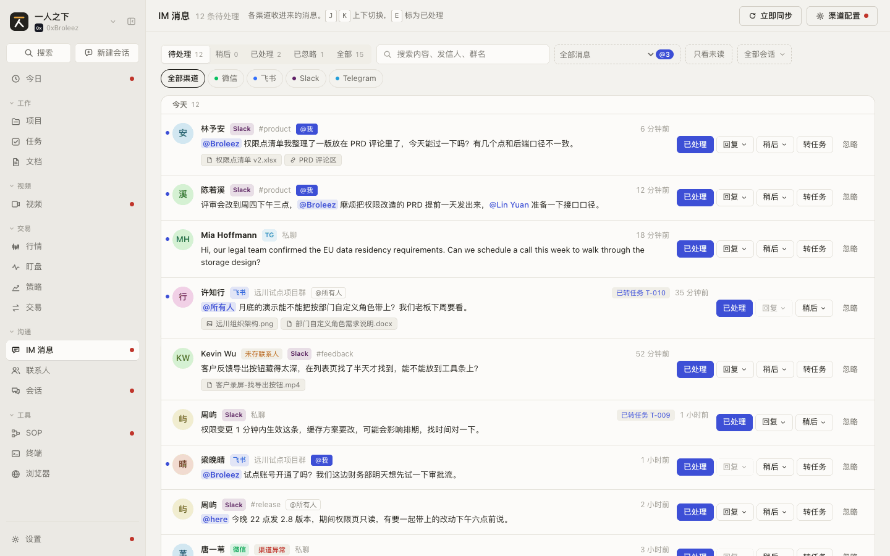
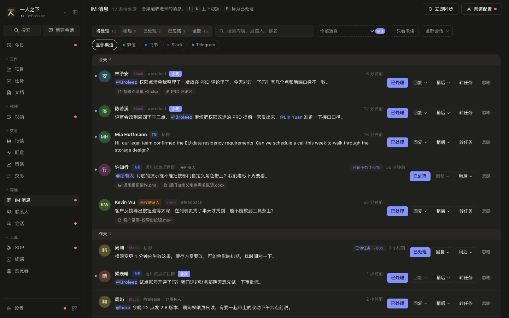
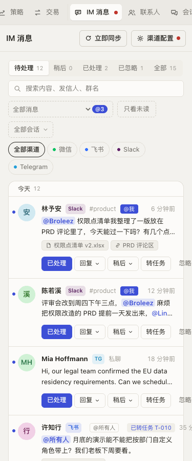
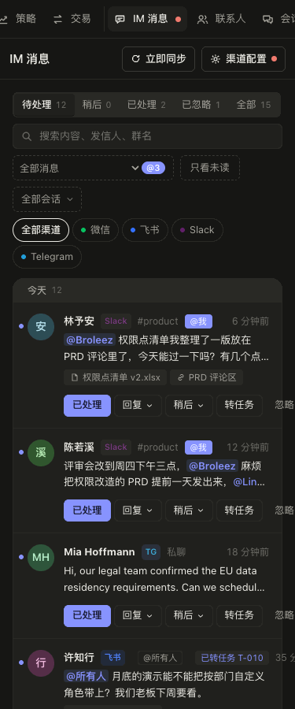

# IM 消息 规格（SPEC-messages）

| 项 | 内容 |
|---|---|
| 模块 key | `messages` |
| 原型入口 | 一级菜单「IM 消息」，http://127.0.0.1:7778 |
| 源码 | `web-next/src/messages.tsx`（列表页 `MessagesPage`、抽屉 `MessageDrawer`、`relevance`、`replyBlocker`、`contactIndex`）、`web-next/src/attachments.tsx`（`AttachmentChips`、`AttachmentPanel`）；接线在 `web-next/src/App.tsx`（`actOnMessage`、`syncMessages`、`fetchAttachment`、`addAttachmentToProject`、`openTaskFromMessage`） |
| 数据文件 | `web-next/src/data.ts`（`Message`、`MsgStatus`、`Reply`、`MsgAttachment`、`AttachmentKind`、`Connector`、`ConnStatus`、`MY_HANDLES`、`ALL_HANDLES`、`QUICK_REPLIES`、`SYNC_POOL`、`ATTACH_DIR`）、`web-next/src/enumdata.ts`（`msg_status` 枚举） |
| 截图 | [`shots/messages/`](shots/messages/) |
| 负责任务 | PROTO-04d |
| 对应开发任务 | IM-02b 实现 IM 消息页和消息抽屉：与 `SPEC-messages-1`、`SPEC-messages-2` 对照；IM-04b 实现附件面板和项目附件收件：与 `SPEC-messages-3`、`SPEC-projects-5` 对照（数据结构见 `SPEC-messages-0`） |
| 状态 | 已整理 |
| 最后对照 | 2026-10-28，原型提交 `932555b` |

## SPEC-messages-0 模块概述

各 IM 渠道（微信、飞书、Slack、Telegram、QQ）通过连接器收进来的消息，集中在一个收件箱里处理：标已处理、忽略、稍后提醒、回复、转任务，附件可以取到本地、加进项目的支持材料。

### 页面清单

| 节 | 页面 | 入口 | 说明 |
|---|---|---|---|
| [SPEC-messages-1](#spec-messages-1-消息列表) | 消息列表 | 一级菜单「IM 消息」 | 状态、与我相关、未读、会话、渠道筛选，行内处理，立即同步 |
| [SPEC-messages-2](#spec-messages-2-消息抽屉) | 消息抽屉 | 列表里点一行；或从今日、项目沟通、任务来源卡、会话产出结果、命令面板打开 | 处理状态条、发信人、会话、转任务、快捷回复和回复框 |
| [SPEC-messages-3](#spec-messages-3-附件面板) | 附件面板 | 消息抽屉里「附件 N」一节 | 获取附件到本地，选项目加进支持材料 |

### 共用数据结构

`Message`（`web-next/src/data.ts`）

| 字段 | 类型 | 必填 | 说明 | 取值 / 示例 |
|---|---|---|---|---|
| `id` | `string` | 是 | 编号 | `msg_001` |
| `channel` | `string` | 是 | 渠道 key，对应 `IM_CHANNELS`（见 `SPEC-contacts-0` `ImChannel`） | `slack` |
| `connector_id` | `string` | 是 | 收这条消息的连接器 id；连接器删掉后找不到 | `cn_slack` |
| `conversation` | `string` | 是 | 群名 / 频道名；私聊为空串 | `#product`、`远川试点项目群`、`''` |
| `sender_name` | `string` | 是 | 发信人在渠道上的显示名 | `Lin Yuan` |
| `sender_id` | `string` | 是 | 发信人在该渠道上的编号；用「渠道 + 编号」去联系人的 `im` 里对人，不按名字 | `U04LINYUAN`、`@mia_nordlicht` |
| `text` | `string` | 是 | 正文，可含 @ | |
| `at` | `string` | 是 | 收到时间，ISO 8601 | |
| `read` | `boolean` | 是 | 已读；打开抽屉、处理、稍后、回复都会置为 `true` | `false` |
| `status` | `MsgStatus` | 是 | 处理状态 | `pending` 待处理 / `done` 已处理 / `ignored` 已忽略 |
| `snooze_until` | `string \| null` | 是 | 稍后提醒到点时间，ISO 8601；到点前不出现在「待处理」里 | `null` |
| `replies` | `Reply[]` | 是 | 我发出的回复，按时间先后 | `[]` |
| `attachments` | `MsgAttachment[]` | 否 | 附件；没有附件时不存或为空 | |

`Reply`：`{ id: string; text: string; at: string }`，`at` 为发送时间 ISO 8601。

`MsgStatus`：`'pending' | 'done' | 'ignored'`。显示名和颜色读 `msg_status` 枚举（`web-next/src/enumdata.ts`），三个都是系统值（`locked`），`default_key` 为 `pending`：

| key | label | color |
|---|---|---|
| `pending` | 待处理 | `#b0570b` |
| `done` | 已处理 | `#2f7d43` |
| `ignored` | 已忽略 | `#a19d92` |

「稍后」不是状态：`status === 'pending'` 且 `snooze_until` 晚于现在的消息算「稍后」（`isSnoozed`），到点后自动回到「待处理」。

`MsgAttachment`（`web-next/src/data.ts`）

| 字段 | 类型 | 必填 | 说明 | 取值 / 示例 |
|---|---|---|---|---|
| `id` | `string` | 是 | 编号 | `att1` |
| `name` | `string` | 是 | 文件名或链接标题 | `权限点清单 v2.xlsx` |
| `kind` | `AttachmentKind` | 是 | 种类 | `file` 文件 / `image` 图片 / `link` 链接（显示名见 `ATTACH_KIND`） |
| `size` | `number` | 否 | 字节数；链接没有 | `48213` |
| `url` | `string` | 否 | 链接地址；只有链接有 | `https://www.figma.com/design/roles-v4` |
| `fetch` | `'idle' \| 'fetching' \| 'done' \| 'error'` | 否 | 获取状态；链接不用获取，不存。不存时按 `idle` 处理 | `idle` 还在平台上 / `fetching` 获取中 / `done` 已下载到 `local` / `error` 失败 |
| `local` | `string` | 否 | 下载到本地的绝对路径；`fetch === 'done'` 时有 | `~/Downloads/一人之下/附件/远川采购流程说明.pdf` |
| `error` | `string` | 否 | 失败原因；`fetch === 'error'` 时有 | `企业微信连接异常，取不到附件；修好连接器后重试` |

`ATTACH_DIR = '~/Downloads/一人之下/附件'` 只是演示路径。正式产品按决策放在数据目录下的 `attachments/`，按渠道分子目录（见 `docs/dev-decisions.md`「消息附件存在哪」）。

`MsgAction`（`web-next/src/messages.tsx`）：列表和抽屉发出的处理动作，`App.tsx` 的 `actOnMessage` 执行。

| `kind` | 额外字段 | 效果 |
|---|---|---|
| `done` | | `status = 'done'`，`snooze_until = null`，`read = true` |
| `ignore` | | `status = 'ignored'`，`snooze_until = null`，`read = true` |
| `reopen` | | `status = 'pending'`，`snooze_until = null`；回复记录保留 |
| `read` | | `read = true` |
| `snooze` | `until: string` | `snooze_until = until`，`read = true`；状态不变 |
| `reply` | `text: string; done: boolean` | 追加一条 `Reply`，`read = true`；`done` 为真时同时 `status = 'done'`、清掉 `snooze_until`；能对上联系人时，该联系人的 `last_contact_at` 改成回复时间 |

`Relevance`（`web-next/src/messages.tsx`）：`'me' | 'all' | 'dm'`，显示名 `RELEVANCE = { me: '@我', all: '@所有人', dm: '私聊' }`。`relevance(m)` 的规则：

1. 正文里的 @ 按正则取名字：先整串匹配 `MY_HANDLES`、`ALL_HANDLES` 里的名字，再匹配「两个首字母大写的英文词」（如 `@Lin Yuan`），最后退回到单词（字母数字、中文、`.`、`-`）。
2. 有任一名字在 `MY_HANDLES`（`Broleez`、`broleez`、`我`）里：`me`。
3. 否则有任一名字在 `ALL_HANDLES`（`所有人`、`全体成员`、`all`、`here`、`channel`、`everyone`）里：`all`。
4. 否则 `conversation` 为空（私聊）：`dm`。
5. 否则和我无关：`null`。

正式产品按 IM-03：「我」的称呼从连接器账号来，不写死 `MY_HANDLES`。

`Connector`（`web-next/src/data.ts`）里本模块用到的字段：`id`、`tool`（渠道 key，`TOOLS` 里 `category === 'im'` 的才算 IM 连接器）、`name`、`status`（`ConnStatus`）、`error`、`direction`（`'receive'` 只收 / `'both'` 收发）、`last_sync_at`。`ConnStatus`：`connected` 已连接 / `connecting` 连接中 / `error` 异常 / `paused` 已暂停 / `disconnected` 已断开。完整定义归设置的连接器节（`SPEC-settings`，PROTO-04e）。

回不了的原因 `replyBlocker(conn)`：返回 `null` 表示能回；否则返回界面上要写出来的原因，按钮灰掉时必须把原因显示出来，不能只是点不动。

| 条件（按顺序判断） | 原因文案 |
|---|---|
| 连接器不存在 | 渠道已删除，这条消息只能查看 |
| `status === 'error'` | 连接器「<name>」异常，修好之前发不出去 |
| `status === 'paused'` | 连接器「<name>」已暂停 |
| `status === 'disconnected'` | 连接器「<name>」已断开，去设置里重新连接 |
| `status === 'connecting'` | 连接器「<name>」正在连接 |
| `direction === 'receive'` | 连接器「<name>」设置为只收消息 |

`QUICK_REPLIES`（`web-next/src/data.ts`）：`{ text: string; done: boolean }[]`，`done` 为真的发完同时标为已处理。

| text | done |
|---|---|
| 收到，我看一下 | `false` |
| 稍后回复你 | `false` |
| 已处理，请查看 | `true` |
| 这个需求记下了，排期后同步你 | `true` |

发信人对人：`contactIndex(contacts)` 建「渠道:编号」到联系人的索引，同一编号取第一个联系人；`contactFor(m, contacts)` 是单条版本。对不上联系人的显示 `sender_name`。

会话键 `convKey`：群聊为 `g:<渠道>|<群名>`，私聊为 `d:<渠道>:<发信人编号>`。原型按名字认群；正式产品按 `conversation` 表的 id（见 `../dev-plan.md` 1.2 P0）。

`IncomingMessage`：`Pick<Message, 'conversation' | 'sender_name' | 'sender_id' | 'text'> & { attachments?: MsgAttachment[] }`。`SYNC_POOL: Record<渠道 key, IncomingMessage[][]>` 是「立即同步」时按顺序陆续到达的演示消息，每同步一次取一批，正式产品没有这张表。

### 联动总表

| 方向 | 对方模块 | 触发 | 结果 | 见 |
|---|---|---|---|---|
| 进来 | 今日 | 「需要你处理」里的 IM 条目点「回复」 | 切到 IM 消息，打开这条消息的抽屉 | `SPEC-today-1`、`SPEC-messages-2` |
| 进来 | 项目 | 沟通标签、概览「最新沟通」、干系人「最近沟通」、支持材料「来自…的消息」 | 打开这条消息的抽屉（不切页面） | `SPEC-projects-3`、`SPEC-projects-4`、`SPEC-projects-6`、`SPEC-projects-11` |
| 进来 | 任务 | 任务抽屉来源卡「查看原消息」 | 切到 IM 消息，打开原消息 | `SPEC-tasks-4` |
| 进来 | 会话 | 产出结果里点回复 | 切到 IM 消息，打开那条消息 | `SPEC-sessions-3.4` |
| 出去 | 任务 | 「转任务」/「转为任务」 | 没转过：打开「IM 消息转任务」抽屉；转过：打开那条任务 | `SPEC-tasks-4.3` |
| 出去 | 联系人 | 「查看联系人」/「存为联系人」 | 打开联系人抽屉 / 预填新建 | `SPEC-contacts-2`、`SPEC-contacts-3.13` |
| 出去 | 设置 / 连接器 | 「渠道配置」；抽屉「去修复」 | 打开连接器页并定位到即时通讯分类 / 打开该连接器的抽屉 | `SPEC-settings`（连接器节） |
| 改动 | 联系人 | 回复了能对上联系人的消息 | 该联系人 `last_contact_at` 改为回复时间 | `SPEC-contacts-0` |
| 改动 | 项目 | 附件「加入资料」 | 目标项目的支持材料多一条，带出处 | `SPEC-messages-3`、`SPEC-projects-11` |
| 改动 | 设置 / 运行异常 | 同步失败、附件获取失败 | 记一条 `warn` 级运行异常 | `SPEC-settings`（运行异常节） |
| 被引用 | 联系人 | 显示发信人 | 按「渠道 + 编号」匹配联系人 | `SPEC-contacts-0` |
| 被引用 | 项目 | 沟通渠道绑定 | 项目只看绑定的群和私聊里的消息 | `SPEC-projects-4` |
| 被改动 | 设置 / 枚举值 | 改 `msg_status` 的显示名、颜色、顺序 | 状态切换、状态标签、按钮文字（「标为已处理」等）跟着变 | `SPEC-settings`（枚举值节） |
| 显示 | 一级菜单 | 始终 | 「IM 消息」角标是待处理数（不含稍后），大于 0 时显示红点 | 全局 |

## SPEC-messages-1 消息列表

收件箱：按时间倒序、按天分段的消息列表，行内能直接处理。

### 截图

| | 亮 | 暗 |
|---|---|---|
| 桌面 1440 |  |  |
| 手机 375 |  |  |

### 交互

| 编号 | 元素 | 操作 | 结果 |
|---|---|---|---|
| SPEC-messages-1.1 | 页面标题 | 显示 | 「IM 消息」+「N 条待处理」（当前渠道、会话、与我相关筛选下的待处理数，不含稍后）+ 说明「各渠道收进来的消息。J K 上下切换，E 标为已处理」 |
| SPEC-messages-1.2 | 右上「立即同步」 | 点击 | 没选渠道时同步全部 IM 连接器，按钮文字「立即同步」；选了渠道时只同步该渠道，按钮文字「同步<渠道名>」。悬停提示「同步全部 IM 渠道」或「只同步<渠道名>」，有同步记录时加「；上次同步 <相对时间>」。同步中按钮置灰、图标旋转、文字「同步中…」 |
| SPEC-messages-1.3 | 同步结果 | 同步结束 | 按钮左边显示结果 6 秒后消失：「收到 N 条新消息」或「没有新消息」；有异常连接器时加「；<名字、名字>同步失败」，文字变红。新消息插到列表最前，未读、待处理 |
| SPEC-messages-1.4 | 同步规则 | 同步 | 只同步 `connected` 和 `error` 的 IM 连接器：`connected` 的取下一批新消息并更新 `last_sync_at`；`error` 的同步失败并记一条运行异常（级别 `warn`、模块「连接器」、标题「<连接器名>同步失败」、内容为连接器的 `error`）；`paused`、`disconnected` 的跳过。原型模拟 1 秒出结果 |
| SPEC-messages-1.5 | 右上「渠道配置」 | 点击 | 打开设置的连接器页，定位到即时通讯分类。有 IM 连接器异常时按钮上带红点，悬停「N 个连接器异常」。渠道异常不在列表顶上铺横幅 |
| SPEC-messages-1.6 | 状态切换 | 点击 | 「待处理 N / 稍后 N / 已处理 N / 已忽略 N / 全部 N」单选，默认待处理。顺序和名字跟 `msg_status` 枚举走，「稍后」固定插在「待处理」后面。数字是当前渠道、会话、与我相关筛选下的条数，不受搜索和「只看未读」影响。待处理不含稍后；稍后是 `pending` 且没到点的 |
| SPEC-messages-1.7 | 「更多状态 N」下拉 | 选择 | 状态超过 5 个（不算「全部」）时出现：切换里只放前 4 个，其余收进可搜索下拉，每项提示「N 条」；清空选择回到待处理。内置只有 4 个状态，不出现 |
| SPEC-messages-1.8 | 搜索框 | 输入 | 占位「搜索内容、发信人、群名」；实时过滤，不区分大小写，匹配正文、`sender_name`、群名和对上的联系人姓名；没有清空按钮 |
| SPEC-messages-1.9 | 「与我相关」下拉 | 选择 | 「全部消息」/「与我相关」（@我、@所有人和私聊）/「只看 @我（N 条待处理）」，N 为 0 时不显示括号。选了非「全部消息」时下拉高亮。规则见 `SPEC-messages-0` `Relevance` |
| SPEC-messages-1.10 | 「@N」角标 | 显示 | 选「全部消息」且有 @我 的待处理消息时，下拉右侧显示「@N」，悬停「N 条 @我 的消息待处理」 |
| SPEC-messages-1.11 | 「只看未读」 | 点击 | 开关；开着时只显示 `read === false` 的，按钮高亮 |
| SPEC-messages-1.12 | 「全部会话」下拉 | 选择 | 当前渠道下出现过的会话多于 1 个时出现。分「群聊」「私聊」两组，各按待处理数、再按最近一条消息时间倒序。群聊显示群名，私聊显示联系人姓名（对不上时显示 `sender_name`），提示「<渠道> · N 条待处理」或「<渠道> · N 条」；私聊还能按发信人名和编号搜到。选中后只看这个会话；选中的会话在当前渠道下不存在时显示「这个渠道下没有这个会话」 |
| SPEC-messages-1.13 | 渠道切换 | 点击 | 「全部渠道」+ 用到的渠道（有该渠道的连接器或消息的，按 `IM_CHANNELS` 顺序），带渠道色点。点已选中的渠道回到全部。切渠道时会话筛选清空 |
| SPEC-messages-1.14 | 天分段 | 显示 | 每段第一行前插「今天 / 昨天 / 更早」和这一段的条数（按全部筛选结果算，不只是已渲染的） |
| SPEC-messages-1.15 | 消息行 | 显示 | 左侧未读圆点（未读时）、头像（联系人头像或按名字生成）；第一行：姓名（联系人姓名，否则 `sender_name`）、对不上联系人时「未存联系人」、渠道标记、连接器异常时红色「渠道异常」（悬停显示连接器的 `error`）、群名或「私聊」、`@我`（醒目）或 `@所有人` 标签；右边依次是非待处理时的状态标签（枚举颜色）、稍后时「M/D HH:mm 提醒」、「已回复 N」、「已转任务 T-xxx」、相对时间。第二行正文，@ 高亮，@我 和群发 @ 更醒目。有附件时第三行附件小标签 |
| SPEC-messages-1.16 | 附件小标签 | 显示 | 最多 3 个，图标 + 名字，悬停「<种类> · <大小>」；多于 3 个时加「另外 N 个」。只展示，不可点 |
| SPEC-messages-1.17 | 消息行 | 点击，或聚焦后按 Enter | 打开该消息的抽屉（`SPEC-messages-2`），同时标为已读；抽屉打开时这一行高亮。已处理、已忽略的行整体变淡 |
| SPEC-messages-1.18 | 行内「已处理」 | 点击 | 只在待处理（含稍后）的行上有；标为已处理，悬停「标为已处理 (E)」。按钮文字跟枚举的 `done` 显示名 |
| SPEC-messages-1.19 | 行内「回复」菜单 | 点击 | 弹出「快捷回复」菜单，列出 `QUICK_REPLIES`，`done` 为真的项右侧注「并标为已处理」；点一项直接发送。能不能回见 `replyBlocker`：回不了时按钮置灰，悬停显示原因 |
| SPEC-messages-1.20 | 行内「稍后」菜单 | 点击 | 「1 小时后」、「今晚 20:00」（现在早于 20:00 才有）、「明天 9:00」；选了就设 `snooze_until`，这条移到「稍后」 |
| SPEC-messages-1.21 | 行内「转任务」 | 点击 | 没转过任务时才显示；打开「IM 消息转任务」抽屉（`SPEC-tasks-4.3`） |
| SPEC-messages-1.22 | 行内「忽略」 | 点击 | 标为已忽略 |
| SPEC-messages-1.23 | 行内「重新打开」 | 点击 | 只在已处理、已忽略的行上有，代替上面几个按钮；回到待处理 |
| SPEC-messages-1.24 | 弹出菜单 | 点菜单外 | 收起；点菜单和按钮不会触发行点击 |
| SPEC-messages-1.25 | 「加载更多 还有 N 条」 | 点击 | 先渲染 50 条，每点一次多 50 条；状态、渠道、会话、未读、与我相关、搜索任一变化就回到前 50 条 |
| SPEC-messages-1.26 | 键盘 J / K | 按键 | 在当前筛选结果里打开下一条 / 上一条；还没打开过时 J 和 K 都打开第一条；J 走到已渲染的末尾会自动再加载一页。输入框、文本框、下拉聚焦时，或按着 Cmd / Ctrl 时不生效 |
| SPEC-messages-1.27 | 键盘 E | 按键 | 把当前打开的消息标为已处理（不管它现在是什么状态）；条件同 1.26 |
| SPEC-messages-1.28 | 键盘 Esc | 抽屉打开时按 | 关闭抽屉 |
| SPEC-messages-1.29 | 手机宽度 | 显示 | 工具条换行：状态切换、搜索、与我相关和只看未读、会话、渠道各占一行；行内操作按钮排到正文下面 |

### 空状态和异常状态

| 编号 | 场景 | 显示 | 可做的操作 |
|---|---|---|---|
| SPEC-messages-1.30 | 选了「只看 @我」后没有结果 | 标题「没有 @我 的消息」；说明按下两条的规则取 | 换筛选 |
| SPEC-messages-1.31 | 待处理清空了（状态为待处理、没选会话） | 「待处理的消息都清完了」+「新消息会按连接器的同步间隔收进来」 | 「立即同步」 |
| SPEC-messages-1.32 | 其它筛选下没有结果 | 「这里没有消息」+「换个状态、渠道或会话看看」 | 原型没有一键清除筛选，要手动清；正式产品同原型 |
| SPEC-messages-1.33 | 还没接入任何 IM 连接器 | 渠道切换只剩「全部渠道」；点「立即同步」显示红字「还没接入 IM 渠道」 | 「渠道配置」去接入 |
| SPEC-messages-1.34 | IM 连接器都暂停或断开了 | 点「立即同步」显示红字「这些渠道都暂停或断开了，没有可同步的」 | 「渠道配置」 |
| SPEC-messages-1.35 | 连接器异常 | 「渠道配置」带红点；该连接器收的消息行上有「渠道异常」；回复按钮置灰并悬停说明原因 | 「渠道配置」或打开消息点「去修复」 |
| SPEC-messages-1.36 | 连接器已删除 | 消息照常显示，回复置灰「渠道已删除，这条消息只能查看」；行上不显示「渠道异常」 | 只能标状态、转任务 |
| SPEC-messages-1.37 | 正在同步时再点 | 按钮置灰，不会重复发起 | |
| SPEC-messages-1.38 | 加载失败 | 原型未做；正式产品在列表位置显示错误信息和「重试」，工具条保留 | 重试 |
| SPEC-messages-1.39 | 处理动作失败（如回复发送失败） | 原型未做，动作总是成功；正式产品按 IM-02a：回复失败要记录，行上保留原状态并提示失败原因 | 重试 |

### 数据

见 SPEC-messages-0 的 `Message`、`MsgAction`、`Relevance`、`Connector`、`QUICK_REPLIES`。列表页自己的状态（原型在 `MessagesPage` 里，不落库）：

| 字段 | 类型 | 说明 | 取值 |
|---|---|---|---|
| `view` | `View` | 状态筛选 | `pending` / `snoozed` / `done` / `ignored` / `all`，默认 `pending` |
| `channel` | `string` | 渠道筛选，空串为全部 | 渠道 key |
| `unreadOnly` | `boolean` | 只看未读 | |
| `mine` | `'' \| 'mine' \| 'at'` | 与我相关 | `''` 全部消息 / `mine` 与我相关 / `at` 只看 @我 |
| `q` | `string` | 搜索词 | |
| `conv` | `string` | 会话筛选，空串为全部 | `convKey` |
| `VIEW_SEG_MAX` | 常量 | 状态切换里最多放几个状态 | `4` |
| `PAGE` | 常量 | 一次渲染条数 | `50` |
| `syncResult` | `{ at: string; text: string; bad: boolean } \| null` | 最近一次同步结果（`App.tsx`） | |

`MessagesPage` 的回调：`onOpen(id)`、`onAct(id, MsgAction)`、`onSync(channel?)`、`onGoConnectors()`、`onToTask(id)`、`taskOf(id)`（返回转出来的任务编号）。

### 联动

| 方向 | 对方模块 | 触发 | 结果 | 见 |
|---|---|---|---|---|
| 出去 | 本模块 | 点行 | 打开消息抽屉 | `SPEC-messages-2` |
| 出去 | 任务 | 行内「转任务」 | 打开转任务抽屉 | `SPEC-tasks-4.3` |
| 出去 | 设置 / 连接器 | 「渠道配置」 | 连接器页即时通讯分类 | `SPEC-settings` |
| 改动 | 联系人 | 行内快捷回复 | 联系人最近联系时间更新 | `SPEC-contacts-0` |
| 改动 | 设置 / 运行异常 | 同步时连接器异常 | 记运行异常 | `SPEC-settings` |
| 改动 | 今日、项目 | 任何处理动作 | 今日「需要你处理」、项目沟通的待回复数跟着变 | `SPEC-today-1`、`SPEC-projects-4` |

## SPEC-messages-2 消息抽屉

右侧抽屉，看一条消息的上下文并处理：状态、发信人、会话、附件、转任务、回复。

### 截图

截图脚本截不到抽屉，图先空着。操作：一级菜单「IM 消息」，点任意一行；看异常提示点「唐一苇」（企业微信连接异常）；看只收消息的提示点「许知行」（飞书只收）；看已转任务点「许知行」或「周屿」那条私聊；看已回复点「已处理」里的「宋砚」。

| | 亮 | 暗 |
|---|---|---|
| 桌面 1440 | 待截图脚本支持 | 待截图脚本支持 |
| 手机 375 | 待截图脚本支持 | 待截图脚本支持 |

### 交互

| 编号 | 元素 | 操作 | 结果 |
|---|---|---|---|
| SPEC-messages-2.1 | 抽屉头 | 显示 | 渠道标记 +「<群名或私聊> · <连接器名>」，连接器删了显示「渠道已删除」；右边「关闭 (Esc)」 |
| SPEC-messages-2.2 | 关闭按钮 / Esc | 点击 / 按键 | 关闭抽屉 |
| SPEC-messages-2.3 | 连接器异常提示 | 显示 | 连接器 `status === 'error'` 时最上面一条提示：「<连接器名> 连接异常<error>。最后一次同步在 <相对时间>，之后这个渠道的消息没有收进来，也回复不了。」（没有同步记录时省掉后一句）+「去修复」 |
| SPEC-messages-2.4 | 「去修复」 | 点击 | 切到设置的连接器页，打开这个连接器的抽屉（替换消息抽屉） |
| SPEC-messages-2.5 | 处理状态条 | 显示 | 左边状态点（枚举颜色）和状态名；稍后时状态名为「稍后提醒」并加「M/D HH:mm 再提醒」；有 @ 时加「@我」或「@所有人」；有回复时加「已回复 N 次」。底色随状态变 |
| SPEC-messages-2.6 | 状态条「标为已处理」 | 点击 | 待处理（含稍后）时才有；标为已处理，抽屉不关 |
| SPEC-messages-2.7 | 状态条「稍后」菜单 | 点击 | 选项同 `SPEC-messages-1.20` |
| SPEC-messages-2.8 | 状态条「忽略」 | 点击 | 标为已忽略，抽屉不关 |
| SPEC-messages-2.9 | 状态条「重新打开」 | 点击 | 已处理、已忽略时代替上面三个；回到待处理 |
| SPEC-messages-2.10 | 发信人 | 显示 | 头像、姓名（联系人姓名，否则 `sender_name`）、「<渠道名> · <sender_id>」（等宽） |
| SPEC-messages-2.11 | 「查看联系人」 | 点击 | 对上联系人时显示；打开该联系人的抽屉（`SPEC-contacts-2`，替换消息抽屉） |
| SPEC-messages-2.12 | 「存为联系人」 | 点击 | 对不上联系人时显示；打开新建联系人抽屉，预填姓名 = `sender_name`、`im[渠道] = sender_id`、分组「其他」（`SPEC-contacts-3.13`） |
| SPEC-messages-2.13 | 会话 | 显示 | 收到的消息一个气泡（正文 @ 高亮，下面「M/D HH:mm」）；我发出的回复各一个气泡，靠右，下面「我 · <相对时间>」。原型只有这一条和对它的回复，不显示群里的上下文 |
| SPEC-messages-2.14 | 附件 | 显示 | 有附件时出现附件面板（`SPEC-messages-3`） |
| SPEC-messages-2.15 | 「转任务」一节「转为任务」 | 点击 | 没转过时显示，旁边说明「原消息会记在任务里，方便回看」；打开「IM 消息转任务」抽屉（`SPEC-tasks-4.3`），标题预填正文前 40 字（空白合并成一个空格）。抽屉里勾着「建好后把这条消息标为已处理」时，建好后这条消息标为已处理 |
| SPEC-messages-2.16 | 「转任务」一节「打开任务」 | 点击 | 转过时显示「已转为任务 T-xxx <标题>」+「打开任务」；打开那条任务的抽屉 |
| SPEC-messages-2.17 | 「反馈」一节快捷回复 | 点击 | 能回复时列出 `QUICK_REPLIES` 按钮，`done` 为真的带「并处理」小标，悬停「发送并标为已处理」或「发送」；点了直接发送 |
| SPEC-messages-2.18 | 回复框 | 输入 | 两行文本框，占位「回复 <姓名>，⌘ Enter 发送」；Cmd 或 Ctrl + Enter 发送 |
| SPEC-messages-2.19 | 「发送后标为已处理」 | 勾选 | 默认勾上；决定回复框发送时是否同时标为已处理（快捷回复按各自的 `done`，不看这个勾） |
| SPEC-messages-2.20 | 「发送」 | 点击 | 正文去首尾空白后为空时置灰。发送后：追加一条回复、清空回复框；勾着时标为已处理；能对上联系人时更新其最近联系时间。已处理、已忽略的消息也能继续回复 |

### 空状态和异常状态

| 编号 | 场景 | 显示 | 可做的操作 |
|---|---|---|---|
| SPEC-messages-2.21 | 回不了（`replyBlocker` 非空） | 「反馈」一节换成黄色提示条，文字是原因；回复框置灰，占位「这个会话现在不能回复」；勾选框和「发送」置灰 | 按原因去修连接器 |
| SPEC-messages-2.22 | 没有附件 | 不显示附件一节 | |
| SPEC-messages-2.23 | 没有回复 | 会话里只有收到的那一个气泡；状态条不显示「已回复」 | |
| SPEC-messages-2.24 | 打开的消息已不存在（原型里消息不会被删；正式产品可能被清理或撤回） | 原型不渲染抽屉。正式产品显示「这条消息已不存在」并只给「关闭」 | 关闭 |
| SPEC-messages-2.25 | 回复发送失败 | 原型未做，发送总是成功；正式产品按 IM-02a：经适配器发出，失败要记录，回复框保留内容并在底部红字提示原因，消息状态不变 | 重试 |
| SPEC-messages-2.26 | 渠道不支持回复 | 原型用 `direction === 'receive'` 表示，见 2.21；正式产品后端返回明确错误时同样显示原因 | |

### 数据

见 SPEC-messages-0 的 `Message`、`Reply`、`MsgAction`、`Connector`、`replyBlocker`、`QUICK_REPLIES`。抽屉的入参：

| 字段 | 类型 | 说明 |
|---|---|---|
| `msg` | `Message` | 当前消息 |
| `contact` | `Contact \| undefined` | 对上的联系人（见 `SPEC-contacts-0`） |
| `connector` | `Connector \| undefined` | 收这条消息的连接器，删了为 `undefined` |
| `task` | `{ ref: string; title: string } \| undefined` | 这条消息转出来的任务：`tasks` 里 `source.kind === 'im'` 且 `source.message_id === msg.id` 的那条 |
| `projects` | `Project[]` | 全部项目（附件面板用） |
| `msgProjects` | `string[]` | 这条消息所在的项目 id：绑了它的群或私聊的项目（`projectMessages`） |

抽屉自己的状态：`text`（回复框内容）、`alsoDone`（发送后标为已处理，默认 `true`）。

转出来的任务 `source`：`{ kind: 'im', message_id, channel, sender: sender_name, text }`（见 `SPEC-tasks-0`）。正式产品按 IM-02a：任务来源为 `im`，`props.source_ref` 指向消息，并建关联。

### 联动

| 方向 | 对方模块 | 触发 | 结果 | 见 |
|---|---|---|---|---|
| 出去 | 任务 | 「转为任务」/「打开任务」 | 转任务抽屉 / 任务抽屉 | `SPEC-tasks-4`、`SPEC-tasks-4.3` |
| 出去 | 联系人 | 「查看联系人」/「存为联系人」 | 联系人抽屉 / 新建联系人 | `SPEC-contacts-2`、`SPEC-contacts-3` |
| 出去 | 设置 / 连接器 | 「去修复」 | 连接器抽屉 | `SPEC-settings` |
| 改动 | 联系人 | 回复 | 最近联系时间更新 | `SPEC-contacts-0` |
| 改动 | 本模块列表 | 任何动作 | 列表对应行和计数立即更新 | `SPEC-messages-1` |

## SPEC-messages-3 附件面板

消息抽屉里的一节：把文件、图片从 IM 平台取到本地，挑项目加进支持材料；链接不用获取，直接能加。

### 截图

截图脚本截不到，图先空着。操作：一级菜单「IM 消息」，点「林予安」那条（一个文件一个链接）；看获取失败：先在设置的连接器里暂停「公司 Slack」，再打开「Kevin Wu」的「导出按钮」那条点「获取」；看已获取点「梁晚晴」的「采购流程」那条。

| | 亮 | 暗 |
|---|---|---|
| 桌面 1440 | 待截图脚本支持 | 待截图脚本支持 |
| 手机 375 | 待截图脚本支持 | 待截图脚本支持 |

### 交互

| 编号 | 元素 | 操作 | 结果 |
|---|---|---|---|
| SPEC-messages-3.1 | 标题 | 显示 | 「附件 N」；没有附件时整节不显示 |
| SPEC-messages-3.2 | 附件行 | 显示 | 种类图标、名字、下面一行状态：链接显示地址；已获取「已获取 · <本地路径>」；获取中「获取中…」；失败显示 `error`（没有时「获取失败」），整行标红；还没获取「<种类> · <大小> · 还在平台上，没下载」 |
| SPEC-messages-3.3 | 链接名字 | 点击 | 打开链接：开了浏览器模块时在内置浏览器里开，否则交给系统浏览器新窗口 |
| SPEC-messages-3.4 | 「获取」/「重试」 | 点击 | 文件和图片没获取到时才有，失败后文字为「重试」，获取中为「获取中」并置灰。点了状态变获取中，原型模拟 0.8 秒后出结果 |
| SPEC-messages-3.5 | 获取规则 | 获取 | 连接器 `status === 'connected'`：成功，`local = <附件目录>/<name>`。连接器不存在：失败「渠道已删除，取不到附件」，不记运行异常。连接器不是已连接：失败「<连接器名>连接异常，取不到附件；修好连接器后重试」，并记一条运行异常（`warn`、模块「IM 消息」、标题「附件获取失败」、内容「「<附件名>」没取到：<连接器名>连接异常」） |
| SPEC-messages-3.6 | 项目选择 | 选择 | 可搜索下拉，占位「选项目」，悬停「加进哪个项目的支持材料」。分两组：「这条消息所在的项目」（`msgProjects`）和「其他项目」；消息不在任何项目里时只有一组「项目」。已经加过的项目提示「已加入」。选中的项目被删了显示「已删除的项目」 |
| SPEC-messages-3.7 | 默认选中的项目 | 打开 | 默认选这条消息所在的第一个项目；这个附件已经加进那个项目时，改选第一个还没加过的项目；都没有就空着 |
| SPEC-messages-3.8 | 「加入资料」/「获取并加入」 | 点击 | 链接和已获取的显示「加入资料」，没获取的显示「获取并加入」并悬停「会先获取到本地再加入」。没选项目、选的项目已经有这个附件、正在获取时置灰。链接直接加（值为 `url`）；已获取的直接加（值为 `local`）；没获取的先获取，成功后再加，失败则不加、行上显示失败原因 |
| SPEC-messages-3.9 | 加进去的材料 | 加入 | 目标项目 `materials` 最前面多一条：名字同附件名，种类链接为 `link`、文件和图片为 `file`，标签「消息附件」，`from` 记出处（消息 id、附件 id、发信人、群名或「私聊」）。同一附件在同一项目里只加一次；这个附件在该项目里被标过「不加入」的，记录一并清掉 |
| SPEC-messages-3.10 | 「已在 … 的支持材料里」 | 显示 | 附件已加进项目时行下方列出项目名，用顿号隔开 |

### 空状态和异常状态

| 编号 | 场景 | 显示 | 可做的操作 |
|---|---|---|---|
| SPEC-messages-3.11 | 获取失败 | 行标红，状态行显示原因；按钮变「重试」 | 重试；修连接器 |
| SPEC-messages-3.12 | 还没有任何项目 | 下拉里没有选项，「加入资料」置灰 | 去项目新建 |
| SPEC-messages-3.13 | 附件已加进所有项目 | 默认不选项目，「加入资料」置灰；下拉里每项提示「已加入」 | |
| SPEC-messages-3.14 | 附件在平台上已过期或被撤回 | 原型未做；正式产品按 IM-04a：获取失败并记录平台返回的原因，同 3.11 | |
| SPEC-messages-3.15 | 本地磁盘写不进去 | 原型未做；正式产品获取失败，原因写明「写不进附件目录：<路径>」 | 重试 |

### 数据

见 SPEC-messages-0 的 `MsgAttachment`、`ATTACH_DIR`；加进去的材料见 `SPEC-projects-0` 的 `Material`（`from` 字段）。

| 函数 / 常量 | 位置 | 说明 |
|---|---|---|
| `ATTACH_KIND` | `attachments.tsx` | `{ file: '文件', image: '图片', link: '链接' }` |
| `fmtSize(n)` | `attachments.tsx` | 小于 1024 显示「N B」，小于 1MB 显示整数「N KB」，否则一位小数「N.N MB」；没有大小返回空串 |
| `addedIn(projects, attId)` | `attachments.tsx` | 已把这个附件加进支持材料的项目：`materials` 里有 `from.attachment_id === attId` 的 |

面板自己的状态：`pick: Record<附件 id, 项目 id>`，记每个附件手动选的项目。

### 联动

| 方向 | 对方模块 | 触发 | 结果 | 见 |
|---|---|---|---|---|
| 改动 | 项目 | 「加入资料」 | 项目支持材料多一条，沟通页的附件收件里这一项消失 | `SPEC-projects-5`、`SPEC-projects-11` |
| 改动 | 设置 / 运行异常 | 获取失败（连接器异常） | 记运行异常 | `SPEC-settings` |
| 出去 | 浏览器 | 点链接 | 内置浏览器或系统浏览器打开 | `SPEC-browser` |
| 共用 | 项目 | 同一个获取、加入动作 | 项目沟通的附件收件调的是同一套 `fetchAttachment`、`addAttachmentToProject` | `SPEC-projects-5` |

## 原型和规格对不上的地方

整理时发现的问题，不在本任务里改原型，另开原型修错任务处理：

| 编号 | 位置 | 问题 | 建议 |
|---|---|---|---|
| M-1 | `SPEC-messages-1` 手机宽度 | 375 宽下行内操作按钮一行放不下，最后的「忽略」被裁掉一半（见 `shots/messages/入口-375-light.png`） | 手机宽度下操作按钮换行，或把「转任务」「忽略」收进「更多」 |
| M-2 | `SPEC-messages-3.5` | 连接器是「已暂停」「已断开」「连接中」时获取附件，失败原因也写「连接异常」，和回复受阻的原因（`replyBlocker`）口径不一致 | 获取失败原因复用 `replyBlocker` 的分类文案（不含「只收消息」这一条） |
| M-3 | `SPEC-messages-1.27` | 按 E 对已处理、已忽略的消息也会改成已处理，没有提示 | 只对待处理（含稍后）的生效 |
| M-4 | `SPEC-messages-1.15` | 「已转任务 T-xxx」标签只展示不可点，列表上转过的任务没有入口，要打开抽屉再点「打开任务」 | 标签可点，打开那条任务 |
| M-5 | 稍后到点 | 稍后到点后不会自动刷新回「待处理」，要等别的状态变化触发重渲染 | 正式产品按 IM-02a 由后端到点改回；原型可以加一个分钟级的刷新 |
