# 盯盘 规格（SPEC-monitor）

| 项 | 内容 |
|---|---|
| 模块 key | `monitor` |
| 原型入口 | 一级菜单「盯盘」，http://127.0.0.1:7778 |
| 源码 | `web-next/src/monitor.tsx`（页面 `MonitorPage`、市场时段 `SessionCards`、盯盘墙 `Wall` 和 `WallCell`、提醒规则 `RulesPanel` 和 `AlertRow`、触发记录 `EventsPanel`、提醒抽屉 `AlertDrawer`）；判定纯函数在 `web-next/src/alertcheck.ts`（`checkAlerts`、`checkAlertsOn`、`condFits`、`condValue`、`alertText`、`fundingRate`，`monitor.tsx` 转出）；标的选择 `web-next/src/symbolpick.tsx`（`SymbolPicker`）；接线在 `web-next/src/App.tsx`（`alerts`、`alertEvents`、每 5 秒的 `checkAlerts` 定时器、`alertReq`、`newAlertFor`、`openChart`、连接器删除时的 `connPlan`） |
| 数据文件 | `web-next/src/tradedata.ts`（`PriceAlert`、`AlertEvent`、`AlertCond`、`ALERT_COND`、`AlertNotify`、`seedAlerts`、`seedAlertEvents`） |
| 截图 | [`shots/monitor/`](shots/monitor/) |
| 负责任务 | PROTO-04f4 |
| 对应开发任务 | 见下表「引用本规格的开发任务」 |
| 状态 | 已整理 |
| 最后对照 | 2026-10-29，原型提交 `444aee8`（交易相关源码最后改动在 `5e24117`）；2026-11-05 TRD-03 补：判定抽到 `alertcheck.ts`，修了 `SPEC-monitor-0.2`、`SPEC-monitor-0.3`，正式版的差异写在各节「正式版」 |

### 引用本规格的开发任务

| 任务 | 内容 | 对照的节 |
|---|---|---|
| TRD-03a | 盯盘提醒放后端定时检查，触发走事件总线和通知 | `SPEC-monitor-0`「共用数据结构」「提醒怎么判定」「原型里模拟、正式版要真做的」；夹具和原型 `checkAlerts` 结果一致 |
| TRD-03b | 前端盯盘页接接口 | `SPEC-monitor-1` 到 `SPEC-monitor-3` |
| TRD-02a、TRD-02b | 盯盘墙和当前值用的实时价 | `SPEC-monitor-1`（行情数据结构见 `SPEC-markets-0`） |

盯盘是交易套件的子插件之一，依赖行情（`SPEC-markets`）。盯盘里没有实盘操作，不带「要过 TRD-08 评审」标记；它只发提醒，不下单。

## SPEC-monitor-0 模块概述

盯着市场的一页：上面是各市场的时钟和交易时段，中间是按自选组排的盯盘墙（迷你分时、异动描边），下面左边是价格和异动提醒规则，右边是触发记录。提醒在后台按条件检查，满足就记一条触发记录并按设定的方式通知。

### 截图

模块入口：

| | 亮 | 暗 |
|---|---|---|
| 桌面 1440 | 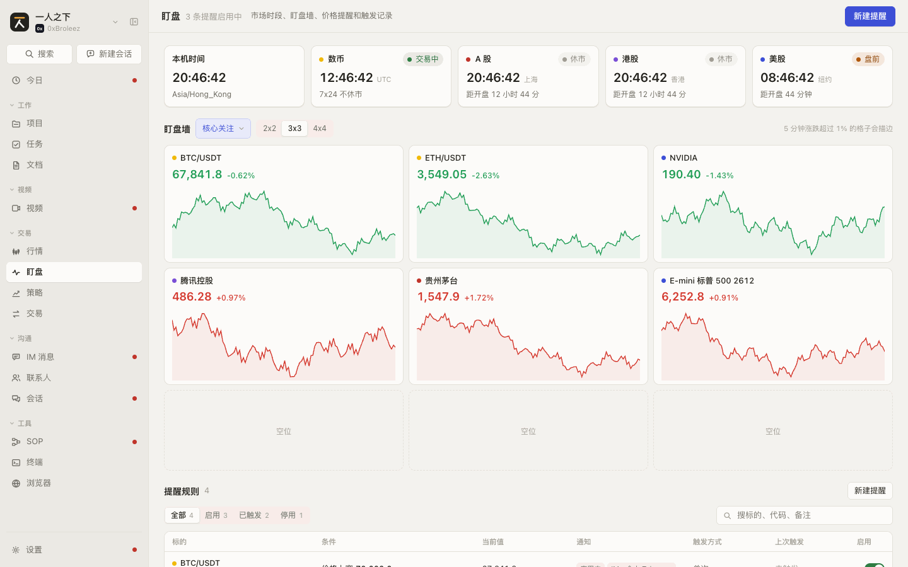 | 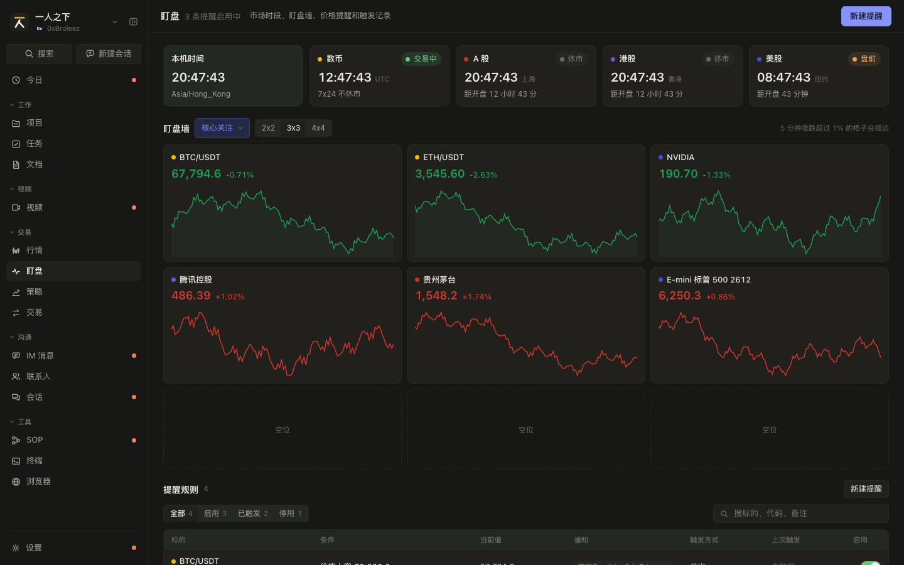 |
| 手机 375 | 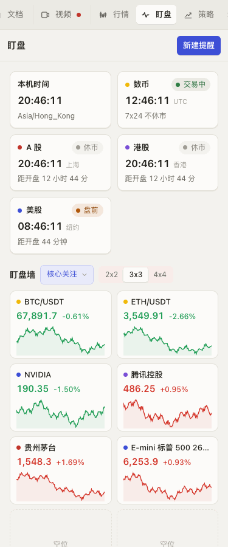 | 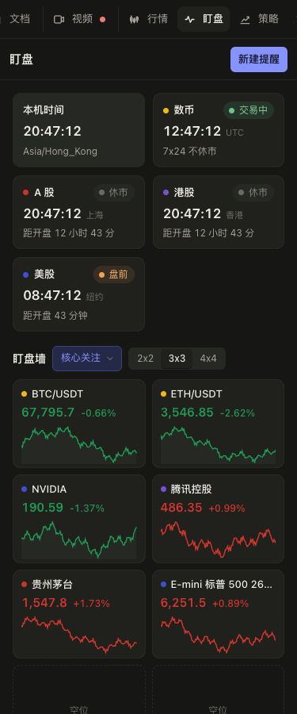 |

### 页面清单

| 节 | 页面 | 入口 | 说明 |
|---|---|---|---|
| [SPEC-monitor-1](#spec-monitor-1-市场时段和盯盘墙) | 市场时段和盯盘墙 | 一级菜单「盯盘」 | 本机、数币、A 股、港股、美股的时钟和时段；按自选组排的 2x2 到 4x4 盯盘墙 |
| [SPEC-monitor-2](#spec-monitor-2-提醒规则和触发记录) | 提醒规则和触发记录 | 盯盘页下半部分 | 规则表（筛选、搜索、启停、重新上膛）；按天分段的触发记录 |
| [SPEC-monitor-3](#spec-monitor-3-提醒抽屉) | 提醒抽屉 | 「新建提醒」；点规则行；行情和期权详情的「设提醒」 | 标的、条件、阈值、通知方式、触发方式、启用、备注 |

### 共用数据结构

字段名和类型照抄 `web-next/src/tradedata.ts`。

`AlertCond` 提醒条件；`ALERT_COND: Record<AlertCond, { label: string; unit: string; kinds?: InstKind[] }>`：

| key | 显示 | 单位 | 只适用于 | 当前值怎么算（`condValue`） | 满足条件 |
|---|---|---|---|---|---|
| `price_above` | 价格上穿 | 价格 | 全部 | 最新价 | 当前值大于等于阈值 |
| `price_below` | 价格下穿 | 价格 | 全部 | 最新价 | 当前值小于等于阈值 |
| `pct_above` | 涨幅超过 | % | 全部 | 相对昨收的涨幅 % | 大于等于阈值 |
| `pct_below` | 跌幅超过 | % | 全部 | 相对昨收的跌幅 %，按正数（跌 4% 记 4） | 大于等于阈值 |
| `volume_spike` | 成交量放大 | 倍于均量 | 全部 | 最新一根 1 分钟成交量除以前 20 根的均量 | 大于等于阈值 |
| `funding_above` | 资金费率高于 | % | `perp` | `fundingRate`，单位 %，每 8 小时一次的费率 | 大于等于阈值 |
| `iv_above` | 隐含波动率高于 | % | `option` | `greeks().iv` 乘以 100 | 大于等于阈值 |
| `limit_near` | 接近涨跌停 | % 以内 | 有 `limit` 的标的（A 股） | 离涨停、跌停较近的那个，占昨收的 % | 当前值小于等于阈值 |

`condFits(cond, inst)`：标的存在、品种在 `kinds` 里（没写 `kinds` 的都适用）、`limit_near` 还要求标的有 `limit`。

`AlertNotify` 通知方式：`app` 应用内 / `im` IM / `sound` 声音。

`PriceAlert` 提醒规则

| 字段 | 类型 | 必填 | 说明 | 取值 / 示例 |
|---|---|---|---|---|
| `id` | `string` | 是 | 编号，新建用 `newId('al')` | `al1` |
| `symbol` | `string` | 是 | 标的 symbol，可以是期权 | `BINANCE:BTCUSDT` |
| `cond` | `AlertCond` | 是 | 条件 | `price_above` |
| `value` | `number` | 是 | 阈值，单位见上表 | `70000` |
| `repeat` | `boolean` | 是 | `false` 单次：触发一次就停；`true` 重复：每次满足都提醒，有冷却 | `false` |
| `cooldown_min` | `number` | 是 | 冷却分钟数，只对重复提醒有用；非负整数 | `30` |
| `notify` | `AlertNotify[]` | 是 | 通知方式，至少一种 | `['app', 'im']` |
| `im_connector` | `string` | 否 | 推 IM 用哪个连接器（`Connector.id`，「即时通讯」类）；`notify` 不含 `im` 时不存 | `cn_tg` |
| `enabled` | `boolean` | 是 | 启用；停用后保留规则，不再检查 | `true` |
| `note` | `string` | 是 | 备注，触发时一起显示；可以为空串 | `突破前高考虑加仓` |
| `last_fired_at` | `string` | 否 | 最近一次触发（ISO 时间）；单次提醒有值就不再检查，「重新上膛」清掉它 | |
| `created_at` | `string` | 是 | 创建时间 | |

`AlertEvent` 触发记录

| 字段 | 类型 | 必填 | 说明 | 取值 / 示例 |
|---|---|---|---|---|
| `id` | `string` | 是 | 编号；原型用 `ae_<时间 36 进制><序号>` | `ae1` |
| `alert_id` | `string` | 是 | 哪条规则触发的（规则删了也保留记录） | `al3` |
| `symbol` | `string` | 是 | 标的 | `BINANCE:BTCUSDT.P` |
| `text` | `string` | 是 | 触发说明，按条件拼（见 `SPEC-monitor-2.11`） | `BTC 永续资金费率 0.061%，高于 0.05%` |
| `price` | `number` | 是 | 触发时的最新价 | `67120` |
| `at` | `string` | 是 | 触发时间 | |
| `read` | `boolean` | 是 | 是否已读 | `false` |

正式版（TRD-03a，后端 `TradeAlert`、`TradeAlertEvent`，契约见 `docs/api-contract.md`「交易套件插件 trade / 盯盘提醒」）字段同上，另外：`PriceAlert` 多 `updated_at`，没触发过的 `last_fired_at`、没选 IM 的 `im_connector` 是空串；`AlertEvent` 多 `cond`、`value`（触发时的当前值）、`note`（规则备注的快照）、`im_status`、`im_error`（IM 推送结果）。规则和记录存在后端，刷新不丢；条件对品种不适用的保存时直接拒绝。

演示数据：`seedAlerts` 4 条：`al1` BTC/USDT 价格上穿 70000，单次，应用内加 IM（个人 Telegram），备注「突破前高考虑加仓」；`al2` NVIDIA 跌幅超过 4%，重复冷却 60 分，两天前触发过；`al3` BTC 永续资金费率高于 0.05%，重复冷却 480 分，应用内加 IM，三小时前触发过；`al4` 宁德时代接近涨跌停 2% 以内，单次，应用内加声音，停用。`seedAlertEvents` 2 条：`ae1`（`al3`，未读）、`ae2`（`al2`，已读），时间和对应规则的 `last_fired_at` 相同。

### 提醒怎么判定

`checkAlerts(alerts, at)` 是纯函数（`alertcheck.ts`），返回这一刻该触发的 `{ alert, text, price }[]`；`checkAlertsOn(alerts, at, marketOf)` 是同一个判定、行情由调用方给（原型给模拟行情，正式版后端给行情缓存）。后端 `internal/plugins/trade/alerts.go` 的 `evalAlerts` 逐行移植它，用 `internal/plugins/trade/testdata/gen-alert-golden.mjs` 跑原型生成的同一组夹具对拍（判定、说明文字、触发价逐字一致），改了这里的判定或文案要重跑生成脚本。逐条：

1. 停用的跳过；`condFits` 不过的跳过（规则里显示「不适用」，见 `SPEC-monitor-2.5`）。
2. 有 `last_fired_at` 时：单次提醒跳过；重复提醒离上次不到 `cooldown_min` 分钟跳过。
3. 算当前值（见 `AlertCond` 表），算不出或不是有限数跳过；按「满足条件」列判断，满足就触发，`price` 取这一刻的最新价，`text` 按 `SPEC-monitor-2.11` 拼。

调用方（原型是 `App.tsx`，不管当前在哪个页面，每 5 秒调一次）对触发的规则写 `last_fired_at`，并在触发记录最前面追加未读记录。判定没有「穿越」的概念：「价格上穿 70000」在价格一直高于 70000 时也算满足，单次提醒因此只响一次，重复提醒按冷却反复响。

### 原型里模拟、正式版要真做的

| 部分 | 原型 | 正式版（TRD-03a、TRD-03b） |
|---|---|---|
| 检查 | 前端 `App.tsx` 的定时器每 5 秒调 `checkAlerts`，页面关着就不检查 | 后端定时检查，页面关着也能提醒；价格穿过阈值几秒内产生通知；和原型 `checkAlerts` 用同一组夹具结果一致 |
| 通知 | 只写触发记录，「IM」「声音」只记在规则上，不真推、不真响 | 触发走事件总线（`trade.alert_fired`）：应用内通知；`im` 用 `im_connector` 发一条消息（连接器异常时记运行异常）；`sound` 在打开的页面上响一声。TRD-03a 时工作台还没有给插件发 IM 的接口：选了 IM 的触发记录标「IM 未推送」并写原因，同时补发一条应用内通知（不管有没有选应用内），等内核给出发送句柄再接上 |
| 规则和记录 | 存在 `App.tsx` 的 `alerts`、`alertEvents`，刷新回到演示数据 | 后端存，刷新不丢；后端触发的记录实时出现在触发记录里 |
| 价格、资金费率、IV | 模拟行情（`SPEC-markets-0`） | 行情插件的实时数据；某个标的没接行情时这条规则显示「未接行情源」，不检查 |
| 时段 | `sessionOf` 不算节假日 | 交易日历 |

### 联动总表

| 方向 | 对方模块 | 触发 | 结果 | 见 |
|---|---|---|---|---|
| 进来 | 行情 | 看盘、期权详情、标题栏「设提醒」 | 切到盯盘，打开新建提醒抽屉，标的带上；同一次请求只处理一次 | `SPEC-markets-1.2`、`SPEC-markets-3.7` |
| 出去 | 行情 | 点盯盘墙格子、触发记录 | 切到行情打开这个标的 | `SPEC-markets-1.16` |
| 共用 | 行情 | 自选组 | 盯盘墙按自选组排格子，组在行情里管 | `SPEC-markets-2` |
| 改动 | 设置 / 连接器 | 删除「即时通讯」连接器 | 删除确认里列出「N 条盯盘提醒（…）改为只在应用内提醒」；删除后这些规则去掉 `im`、清掉 `im_connector`，没有应用内的补上应用内 | `SPEC-settings-4.16` |
| 读 | 设置 / 连接器 | 提醒抽屉「推送到」 | 列出全部「即时通讯」类连接器（不看连接状态） | `SPEC-settings-3` |
| 今日 | 今日 | 无 | 原型里触发记录不上今日；正式版的口径见 `SPEC-trading-0` 联动总表「今日」 | `SPEC-trading-0` |

### 原型和规格对不上的地方

写规格时发现的，没改原型，等另开原型修错任务：

| 编号 | 问题 | 规格的口径 |
|---|---|---|
| SPEC-monitor-0.1 | 盯盘页上整个文档也能滚动：规则行「启用」开关里隐藏的复选框是绝对定位，没有相对定位的父元素，跑到内容区的滚动范围外面，把页面撑高（1440 宽度多出约 150px，375 宽度多出约 660px）。用滚轮或拖动时侧栏会跟着上移，截图脚本得先把文档滚回顶部 | 只有内容区滚动，文档不滚；开关的父元素加相对定位，或者开关样式统一修 |
| SPEC-monitor-0.2 | 提醒抽屉「推送到」列出所有即时通讯连接器，连已断开、异常的也列，选了也不提示 | 列表里标出连接器状态；选了不可用的连接器时提示「这个连接器现在 <状态>，提醒推不出去」，仍允许保存。已修（TRD-03b，原型和正式前端一起改） |
| SPEC-monitor-0.3 | 「价格上穿」「价格下穿」实际判定的是「高于等于」「低于等于」，不是穿越（见「提醒怎么判定」） | 按现有判定写规格（单次提醒只响一次）；显示名不改，抽屉里「当前值」一行加一句「价格在阈值上方 / 下方时就算满足」。已修（TRD-03b，原型和正式前端一起改） |

## SPEC-monitor-1 市场时段和盯盘墙

### 截图

默认 3x3（核心关注 6 个标的，其余是空位）：

| | 亮 | 暗 |
|---|---|---|
| 桌面 1440 |  |  |
| 手机 375 |  |  |

换成 4x4：

| | 亮 | 暗 |
|---|---|---|
| 桌面 1440 | 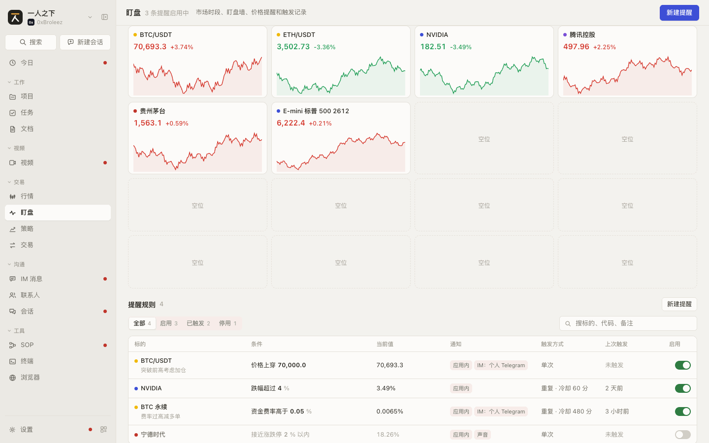 | 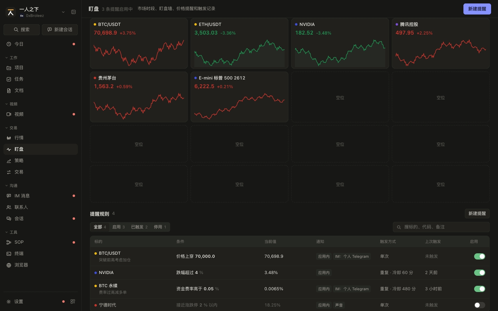 |
| 手机 375 |  | 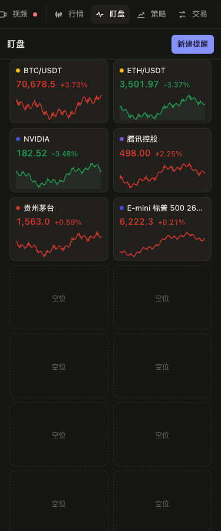 |

### 交互

| 编号 | 元素 | 操作 | 结果 |
|---|---|---|---|
| SPEC-monitor-1.1 | 标题栏 | 看 | 标题「盯盘」，计数「N 条提醒启用中」，说明「市场时段、盯盘墙、价格提醒和触发记录」，右侧「新建提醒」（`SPEC-monitor-3`，标的默认是当前自选组的第一个，组是空的用 `INSTRUMENTS` 第一个） |
| SPEC-monitor-1.2 | 市场时段卡片 | 看 | 一排 5 张，每秒走：「本机时间」（时分秒和本机时区名）；数币（UTC 时钟，时段固定「交易中」，「7x24 不休市」）；A 股（上海）、港股（香港）、美股（纽约）：当地时钟、时段标签、下一行交易中写「距午休 / 距收盘 <时长>」，其余时段写「距开盘 <时长>」 |
| SPEC-monitor-1.3 | 时长 | 看 | `fmtSpan`：超过一天「N 天 N 小时」，超过一小时「N 小时 MM 分」，否则「N 分钟」；下一次时段变化和开盘时间按 5 分钟步长往后找 |
| SPEC-monitor-1.4 | 盯盘墙的自选组下拉 | 选择 | 可搜组名，每项带「N 个」；换组后格子换成这组的标的 |
| SPEC-monitor-1.5 | 「2x2 / 3x3 / 4x4」 | 点击 | 网格大小，默认 3x3；格子按组里顺序取前 N x N 个，不够的是「空位」 |
| SPEC-monitor-1.6 | 盯盘墙格子 | 点击 | 切到行情打开这个标的（`SPEC-markets-1.16`） |
| SPEC-monitor-1.7 | 盯盘墙格子 | 看 | 市场色点、名称、最新价和涨跌幅（涨红跌绿）、最近 120 根 1 分钟收盘价的迷你分时（随涨跌色，下方浅色填充），每秒更新最后一个点；最近 5 分钟涨跌超过 1% 时格子描边，右上角「异动 <涨跌幅> / 5 分」 |
| SPEC-monitor-1.8 | 工具栏右侧说明 | 看 | 「5 分钟涨跌超过 1% 的格子会描边」 |

### 空状态和异常状态

| 编号 | 场景 | 显示 | 可做的操作 |
|---|---|---|---|
| SPEC-monitor-1.9 | 组里的标的比格子多 | 墙下面一行「这组有 N 个标的，只显示前 M 个，换更大的网格看全」 | 换网格 |
| SPEC-monitor-1.10 | 组里的标的比格子少 | 剩下的格子是虚线框「空位」，不可点 | 到行情里往组里加 |
| SPEC-monitor-1.11 | 一个自选组都没有 | 「还没有自选组，到「行情」里建一个」；自选组下拉不出现（原型里行情至少保留一组，正常到不了这里） | 去行情 |
| SPEC-monitor-1.12 | 组里的标的找不到（下线） | 格子显示「<symbol> 已下线」 | 到行情里移出 |
| SPEC-monitor-1.13 | 行情没接或断开 | 原型未做。正式版（TRD-03b）：格子显示最后价格并置灰，右上角「行情已停」（悬停看原因），不描异动；没接过的写「未接行情源」 | 去接入（`SPEC-settings-3`） |

### 数据

`Watchlist`、`Instrument`、`bars`（1 分钟，120 根）、`priceAt`、`prevClose`、`sessionOf`（见 `SPEC-markets-0`）。页面本地状态：当前自选组（默认第一个）、网格大小 `2 | 3 | 4`（默认 3）。异动阈值 `ANOMALY = 0.01`，看的是 5 分钟前的价格。

### 联动

| 方向 | 对方模块 | 触发 | 结果 | 见 |
|---|---|---|---|---|
| 出去 | 行情 | 点格子 | 打开这个标的 | `SPEC-markets-1.16` |
| 共用 | 行情 | 自选组 | 组的增删改在行情里做 | `SPEC-markets-2` |

## SPEC-monitor-2 提醒规则和触发记录

盯盘页下半部分，宽屏左右两栏，手机上下排。

### 截图

规则筛「已触发」：

| | 亮 | 暗 |
|---|---|---|
| 桌面 1440 | 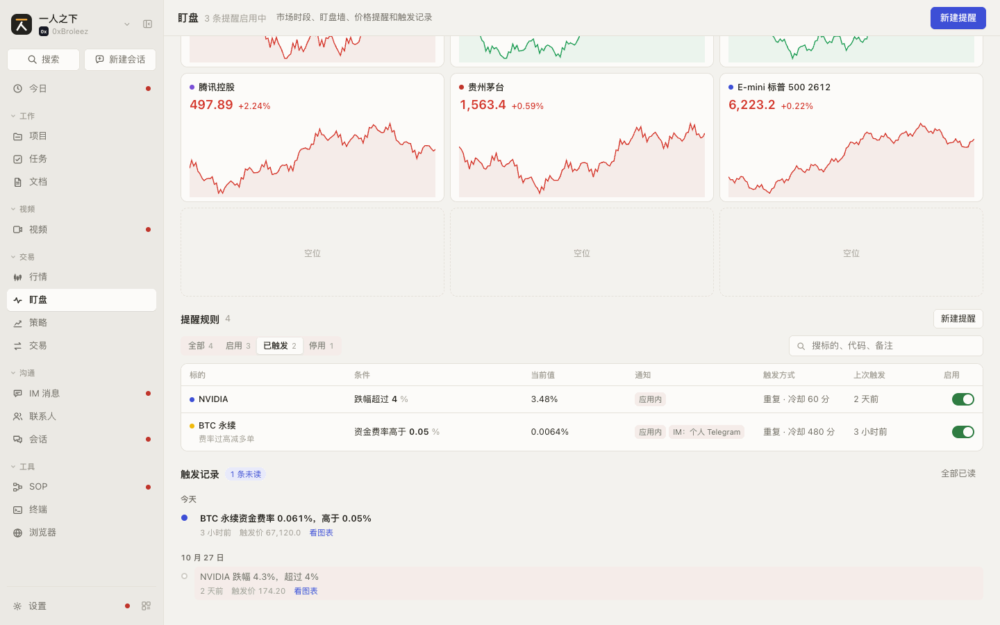 | 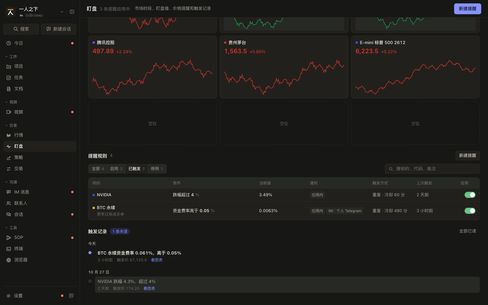 |
| 手机 375 | 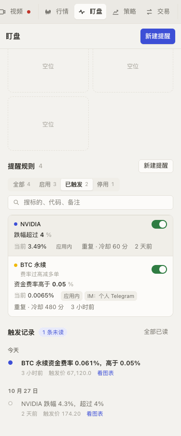 | 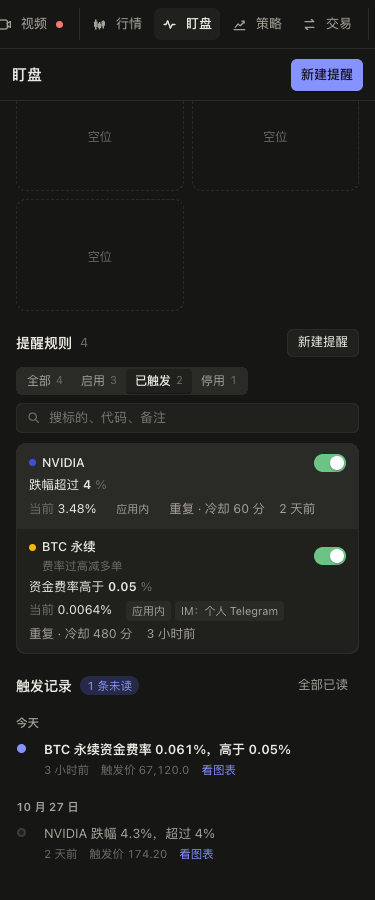 |

搜不到：

| | 亮 | 暗 |
|---|---|---|
| 桌面 1440 | 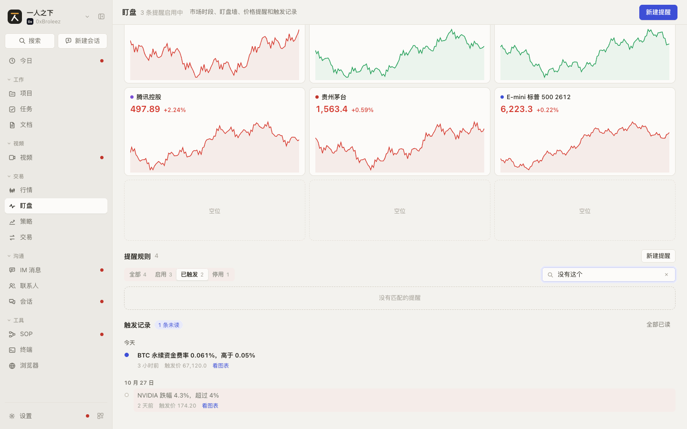 | 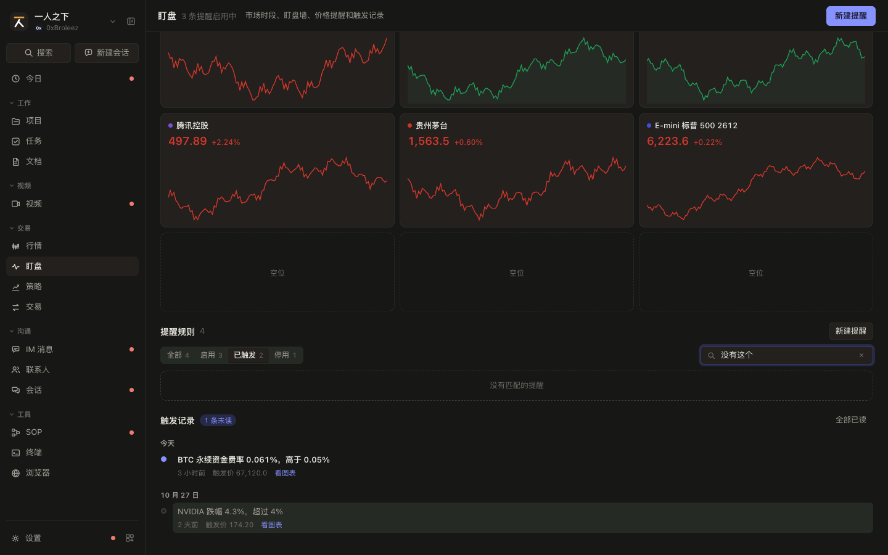 |
| 手机 375 | 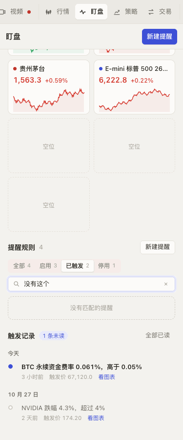 | 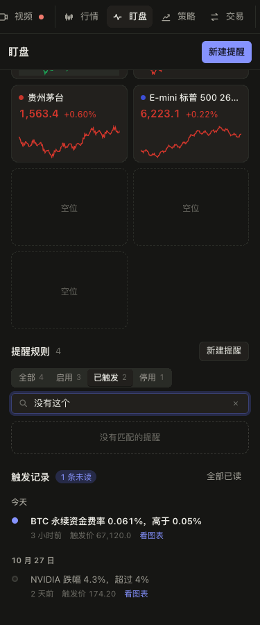 |

触发记录（今天一条未读、两天前一条已读）：

| | 亮 | 暗 |
|---|---|---|
| 桌面 1440 |  |  |
| 手机 375 |  |  |

### 交互

| 编号 | 元素 | 操作 | 结果 |
|---|---|---|---|
| SPEC-monitor-2.1 | 规则区标题 | 看、点击 | 「提醒规则」和总条数，右侧「新建提醒」（同 `SPEC-monitor-1.1`） |
| SPEC-monitor-2.2 | 筛选「全部 / 启用 / 已触发 / 停用」 | 点击 | 各带条数；「已触发」是有 `last_fired_at` 的（不管启停） |
| SPEC-monitor-2.3 | 搜索框「搜标的、代码、备注」 | 输入 | 空格分词，每个词都要命中标的名、symbol、备注或条件名；Esc 清空（有内容时只清空，不关别的） |
| SPEC-monitor-2.4 | 表头 | 看 | 标的、条件、当前值、通知、触发方式、上次触发、启用 |
| SPEC-monitor-2.5 | 规则行 | 看 | 标的：市场色点、名称（找不到写 symbol），有备注时下面一行备注；条件：显示名、阈值（价格类按标的精度）、单位，条件对这个标的不适用时加红色「不适用」；当前值：按条件单位（价格、`N.NN 倍`、资金费率四位小数加 %、其余两位小数加 %），只有启用、并且在可视区附近的行才每秒更新；通知：标签，IM 写「IM：<连接器名>」；触发方式：「单次」或「重复 · 冷却 N 分」；上次触发：相对时间（悬停看完整时间），没有写「未触发」；停用的行整行变淡 |
| SPEC-monitor-2.6 | 规则行 | 点击 | 打开编辑抽屉（`SPEC-monitor-3`），这一行高亮 |
| SPEC-monitor-2.7 | 行末「启用」开关 | 切换 | 直接改 `enabled`，不打开抽屉 |
| SPEC-monitor-2.8 | 「重新上膛」 | 点击 | 只在单次提醒且已经触发过时出现：清掉 `last_fired_at`，重新开始检查；不打开抽屉 |
| SPEC-monitor-2.9 | 「再显示 N 条（共 M 条）」 | 点击 | 规则先露 50 条，每次再多 50 条；换筛选或改搜索时回到 50 条 |
| SPEC-monitor-2.10 | 触发记录一条 | 点击 | 未读的标为已读，并切到行情打开这个标的（`SPEC-markets-1.16`） |
| SPEC-monitor-2.11 | 触发记录 | 看 | 按天分段（「今天」「昨天」「M 月 D 日」，跨年带年份），新的在前；每条：未读圆点加粗、说明、相对时间（悬停看完整时间）、「触发价 <价格>」、「看图表」。说明按条件拼：「<名称> 价格 <现价>，上穿 / 下穿 <阈值>」「<名称> 涨幅 / 跌幅 N%，超过 N%」「<名称> 1 分钟成交量是 20 根均量的 N 倍，超过 N 倍」「<名称> 资金费率 N%，高于 N%」「<名称> 隐含波动率 N%，高于 N%」「<名称> 距涨跌停 N%，在 N% 以内」 |
| SPEC-monitor-2.12 | 「N 条未读」「全部已读」 | 看、点击 | 有未读时标题旁显示条数；「全部已读」把所有记录标为已读，没有未读时不可点 |
| SPEC-monitor-2.13 | 「更早的 N 条（每次再显示 M 条）」 | 点击 | 触发记录先露 20 条，每次再多 50 条 |
| SPEC-monitor-2.14 | 后台检查 | 每 5 秒（正式版后端每 2 秒） | 按「提醒怎么判定」（`SPEC-monitor-0`）检查，不管当前在哪个页面；触发的规则「上次触发」更新，触发记录最前面多一条未读。正式版页面关着也检查；页面开着时随 `trade.alert_fired` 实时刷新，规则选了「声音」的响一声 |

### 空状态和异常状态

| 编号 | 场景 | 显示 | 可做的操作 |
|---|---|---|---|
| SPEC-monitor-2.15 | 一条提醒都没有 | 「还没有提醒。价格上穿下穿、涨跌幅、放量、资金费率、隐含波动率、接近涨跌停都能盯」，筛选和搜索不出现 | 「新建提醒」 |
| SPEC-monitor-2.16 | 筛选或搜索后没有 | 「没有匹配的提醒」 | 换筛选、清空搜索 |
| SPEC-monitor-2.17 | 没有触发记录 | 「提醒触发后记在这里」 | 无 |
| SPEC-monitor-2.18 | 条件对标的不适用 | 条件后红色「不适用」，当前值「-」，不检查 | 打开抽屉换条件 |
| SPEC-monitor-2.19 | 推 IM 的连接器被删除 | 规则改成只在应用内提醒（`SPEC-monitor-0` 联动总表） | 打开抽屉重新选 |
| SPEC-monitor-2.20 | 通知发送失败（IM 推不出去） | 原型未做。正式产品：触发记录照常记，这条记录上标「IM 未送达」，同时记一条运行异常。TRD-03b 时 IM 还推不了（见 `SPEC-monitor-0`「原型里模拟、正式版要真做的」），记录上一律标「IM 未推送」，悬停看原因 | 去连接器看看 |
| SPEC-monitor-2.21 | 当前值算不出来（正式版） | 规则行「当前值」写原因的短语：「未接行情源」「行情已停」（交易所取不到、给的是缓存，这时后端不判定）「加载中」「取不到」（行情源给不了这项数据，如期权的隐含波动率），悬停看详细原因；停用的规则写「-」 | 无 |

### 数据

`PriceAlert`、`AlertEvent`、`ALERT_COND`（见 `SPEC-monitor-0`）；通知标签里的连接器名从「设置 / 连接器」按 `im_connector` 查。

### 联动

| 方向 | 对方模块 | 触发 | 结果 | 见 |
|---|---|---|---|---|
| 出去 | 行情 | 点触发记录 | 打开这个标的 | `SPEC-markets-1.16` |
| 读 | 设置 / 连接器 | 通知标签 | 显示连接器名 | `SPEC-settings-3` |

## SPEC-monitor-3 提醒抽屉

右侧滑出；新建和编辑共用。

### 截图

新建（标的默认 BTC/USDT，条件价格上穿）：

| | 亮 | 暗 |
|---|---|---|
| 桌面 1440 | 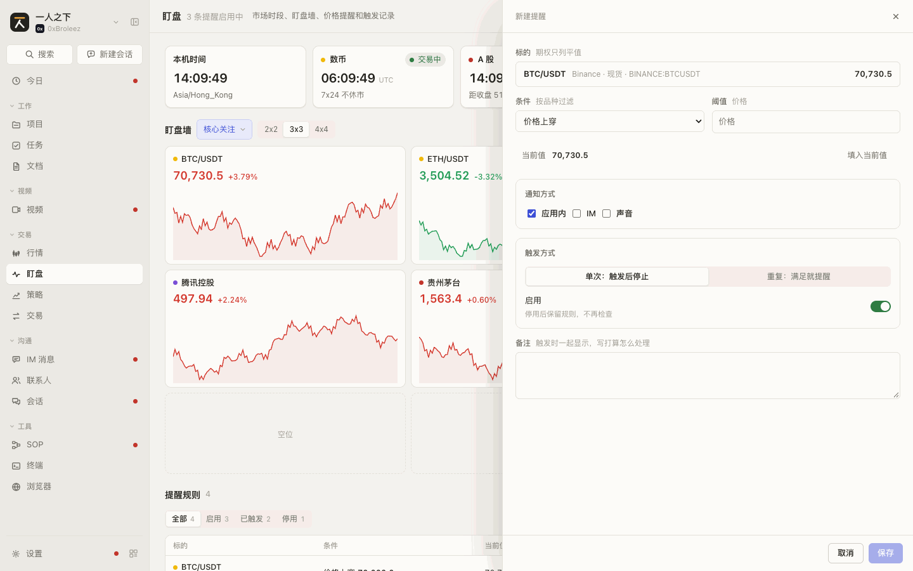 | 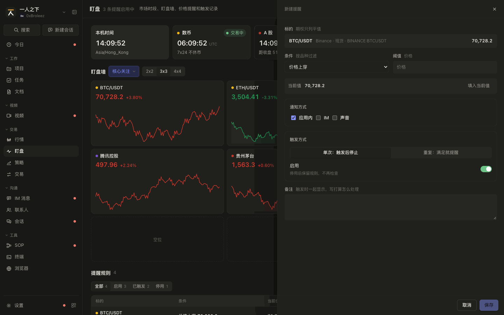 |
| 手机 375 | 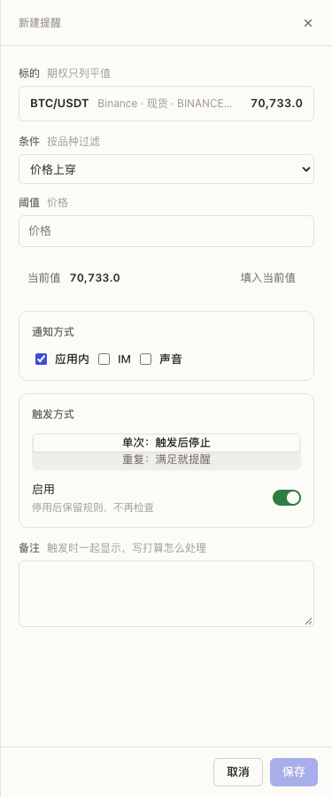 | 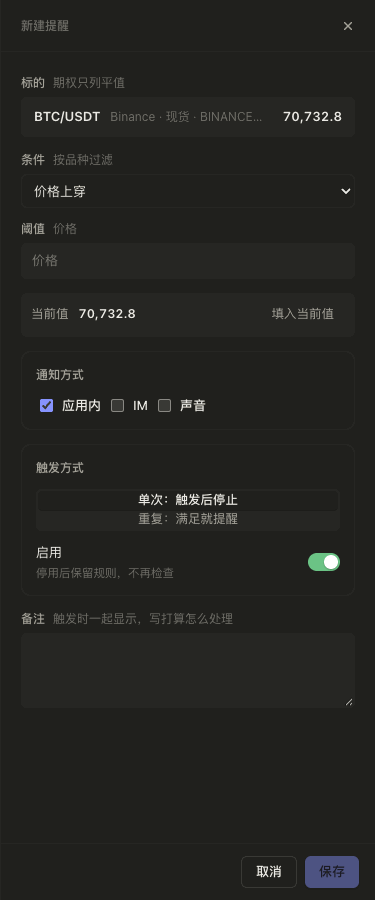 |

勾上 IM、选重复：

| | 亮 | 暗 |
|---|---|---|
| 桌面 1440 | 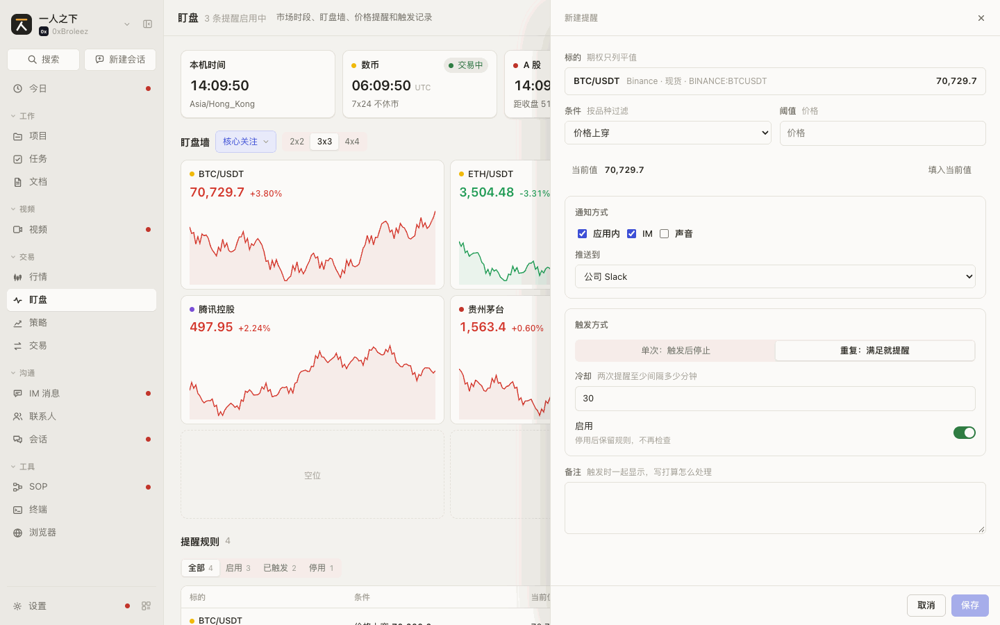 | 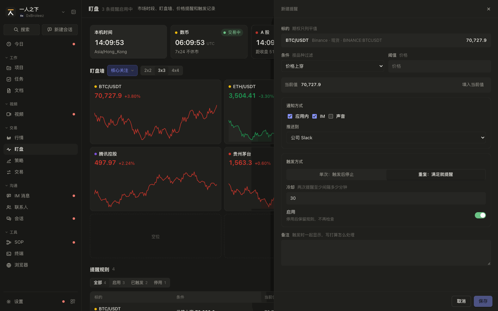 |
| 手机 375 | 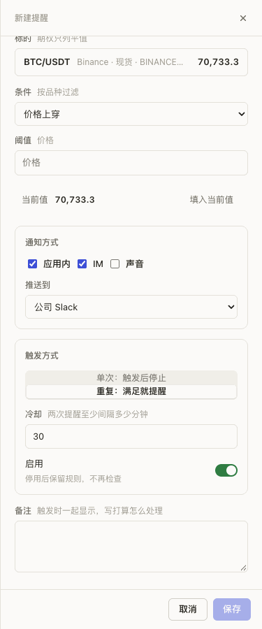 | 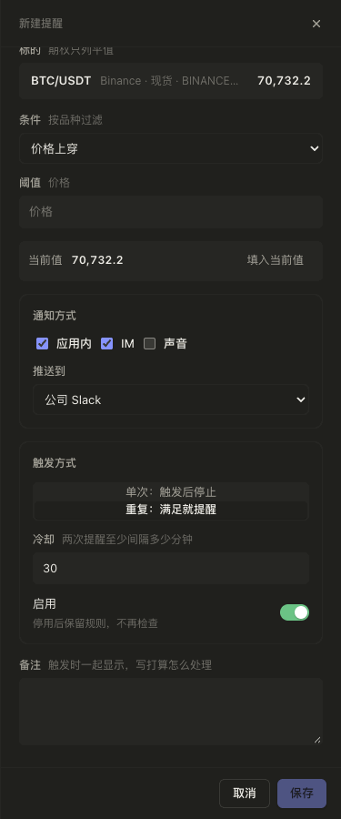 |

编辑一条（BTC/USDT 价格上穿 70000），点「删除」后的确认：

| | 亮 | 暗 |
|---|---|---|
| 桌面 1440 | 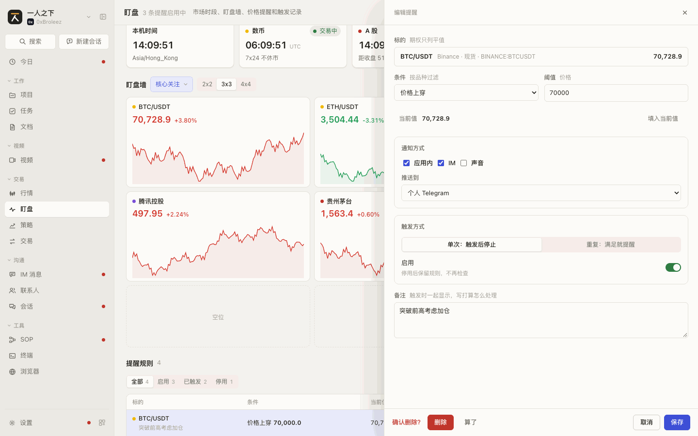 | 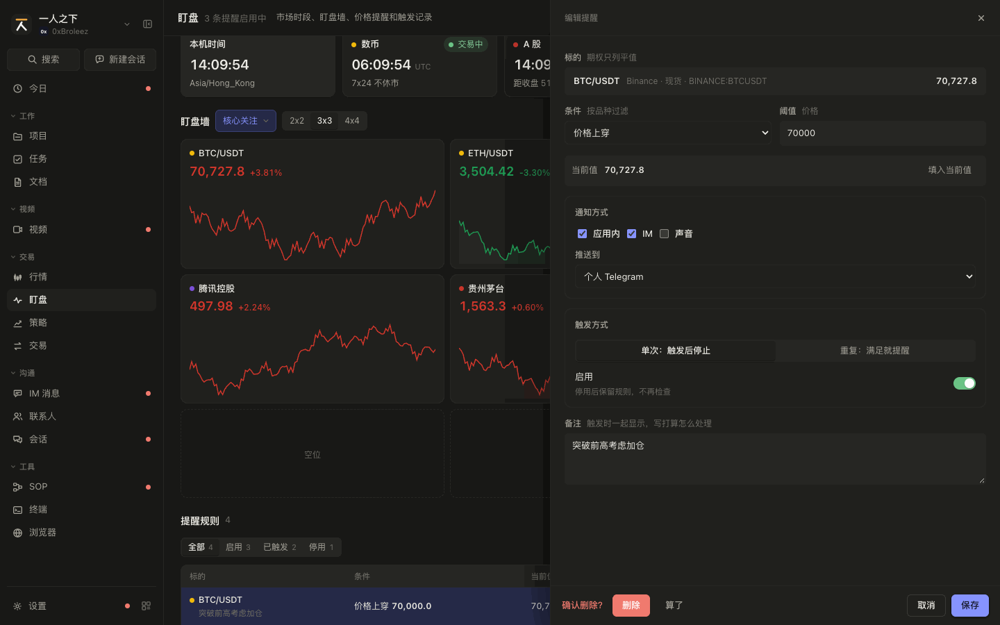 |
| 手机 375 | 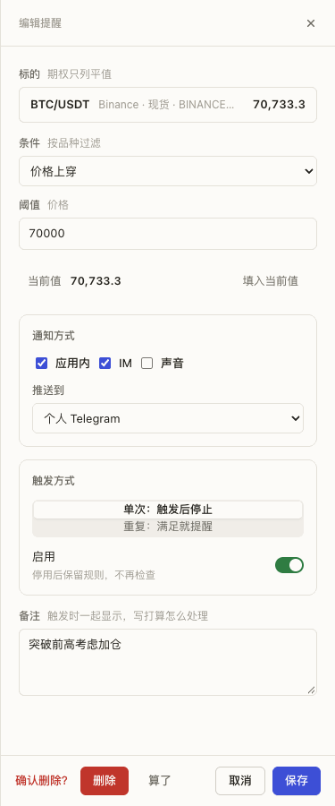 | 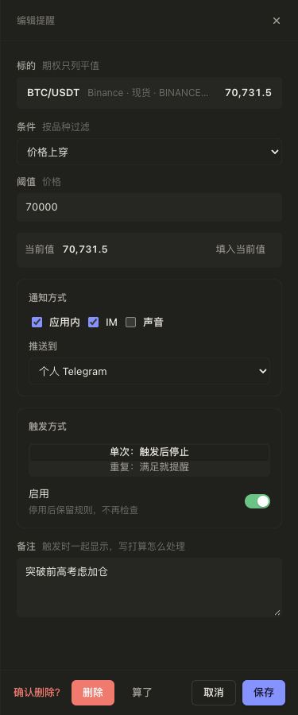 |

### 交互

| 编号 | 元素 | 操作 | 结果 |
|---|---|---|---|
| SPEC-monitor-3.1 | 抽屉标题 | 看 | 「新建提醒」或「编辑提醒」，右上关闭（Esc 同） |
| SPEC-monitor-3.2 | 标的 | 选择 | 搜索选择器（代码、名称、交易所、市场、品种），右侧显示现价；可选的是全部标的（按数币、A 股、港股、美股排）加上 6 个期权标的第二个到期日的平值认购和认沽（提示「期权只列平值」）；当前标的不在里面时放最前。换标的时阈值清空，原条件不适用新标的就换回「价格上穿」。正式版（TRD-03b）：点标的那一行展开搜索框，搜后端的标的表（名称、代码），没输入时列自选里的标的；标的表里还没有的可以直接输入完整的「交易场所:代码」使用 |
| SPEC-monitor-3.3 | 条件 | 选择 | 只列适用于这个标的的条件（`condFits`）；换条件时阈值清空 |
| SPEC-monitor-3.4 | 阈值 | 输入 | 小数键盘；提示是单位；不是数字时红框；回车等于保存 |
| SPEC-monitor-3.5 | 当前值行 | 看、点击 | 「当前值」每秒更新（单位同 `SPEC-monitor-2.5`；正式版由后端现算，2 秒取一次，算不出时写原因）；价格上穿、下穿时提示「价格在阈值上方 / 下方时就算满足」（`SPEC-monitor-0.3`）；跌幅超过时提示「跌幅按正数填，例如 4 表示跌 4%」，接近涨跌停时提示「离涨停或跌停的距离，占昨收的百分比」；「填入当前值」把当前值填进阈值（价格去掉千分位，资金费率四位小数，其余两位小数） |
| SPEC-monitor-3.6 | 通知方式「应用内 / IM / 声音」 | 勾选 | 可多选；勾上 IM 出现「推送到」下拉，列出即时通讯连接器，新建时默认第一个 |
| SPEC-monitor-3.7 | 触发方式「单次：触发后停止 / 重复：满足就提醒」 | 点击 | 选重复时出现「冷却」（两次提醒至少间隔多少分钟，只收数字，默认 30） |
| SPEC-monitor-3.8 | 「启用」开关 | 切换 | 默认开；说明「停用后保留规则，不再检查」 |
| SPEC-monitor-3.9 | 备注 | 输入 | 多行；提示「触发时一起显示，写打算怎么处理」 |
| SPEC-monitor-3.10 | 「保存」 | 点击 | 新建：加到规则最前面；编辑：改这一条，单次提醒改了标的、条件或阈值时清掉 `last_fired_at`（重新上膛）。冷却按非负整数存；没勾 IM 时不存 `im_connector`。保存后关闭抽屉 |
| SPEC-monitor-3.11 | 「删除」（只有编辑时有） | 点击 | 抽屉底部变成「确认删除？」「删除」「算了」；确认后删掉规则，已有的触发记录保留 |
| SPEC-monitor-3.12 | 「取消」、关闭、Esc | 点击 | 直接关闭，不保存，不提示 |

### 空状态和异常状态

| 编号 | 场景 | 显示 | 可做的操作 |
|---|---|---|---|
| SPEC-monitor-3.13 | 阈值没填或不是数字 | 「保存」不可点；填了非数字时输入框红框 | 填数字 |
| SPEC-monitor-3.14 | 通知方式一个都没勾 | 红字「至少选一种通知方式」，「保存」不可点 | 勾一种 |
| SPEC-monitor-3.15 | 勾了 IM，但没有即时通讯连接器 | 「还没有可用的 IM 连接器，到 设置 > 连接器 里接一个」，「保存」不可点 | 取消勾选 IM，或去接连接器 |
| SPEC-monitor-3.16 | 勾了 IM，「推送到」选了「选一个 IM 连接器」 | 「保存」不可点 | 选一个 |
| SPEC-monitor-3.17 | 当前值算不出来 | 当前值「-」，「填入当前值」不可点 | 手填 |
| SPEC-monitor-3.18 | 保存失败 | 原型未做。正式产品：抽屉不关，底部显示原因 | 重试 |

### 数据

`PriceAlert`（见 `SPEC-monitor-0`）。抽屉里的草稿是 `PriceAlert` 去掉 `id`、`created_at`，`value` 先按字符串存，保存时转数字。`MonitorPage` 的入参：`alerts`、`events`、`watchlists`、`imConnectors`（`{ id, name }[]`，即时通讯类连接器）、`onAlerts`、`onEvents`、`onOpenChart`、`newRequest`（`{ symbol, n } | null`）。

### 联动

| 方向 | 对方模块 | 触发 | 结果 | 见 |
|---|---|---|---|---|
| 进来 | 行情 | 「设提醒」 | 新建抽屉，标的带上 | `SPEC-markets-1.2` |
| 读 | 设置 / 连接器 | 「推送到」 | 即时通讯类连接器 | `SPEC-settings-3`、`SPEC-monitor-0.2` |
