# 项目 规格（SPEC-projects）

| 项 | 内容 |
|---|---|
| 模块 key | `projects` |
| 原型入口 | 一级菜单「项目」，http://127.0.0.1:7778 |
| 源码 | `web-next/src/projects.tsx`（列表页 `ProjectsListPage`、详情页 `ProjectPage`，含概览、文档、支持材料、原型、设置标签和 `ProtoCard`）、`web-next/src/projecttabs.tsx`（沟通 `CommsTab`、干系人 `StakeholdersTab`、任务 `ProjectTasksTab`、SOP `ProjectSopTab`、Agent `ProjectAgentTab`、`projectMessages`）、`web-next/src/attachments.tsx`（附件标签 `ProjectAttachmentsTab`、沟通里的入口 `AttachmentsHint`）、`web-next/src/projectprofile.tsx`（档案标签 `ProjectProfileTab`）；项目里的终端和浏览器 `ProjectDock` 在 `projects.tsx`，复用 `terminal.tsx` 的 `TerminalPage` 和 `browser.tsx` 的 `BrowserPage`（`embedded` 模式）；接线在 `web-next/src/App.tsx`（`newProject`、`projectPlan`、`deleteProject`、`startProto`、`stopProto`、`recentProjects`、`docks`、`showDock`、`closeDock`） |
| 数据文件 | `web-next/src/projectdata.ts`（`Project`、`ProjectChat`、`Stakeholder`、`StakeRole`、`Material`、`MaterialKind`、`ProjectDoc`、`DocStatus`、`DOC_KINDS`、`Prototype`、`ProtoStatus`、`RelatedDir`、`RESERVED_PORTS`、`portConflict`、`ProjectProfile`、`ProfileCommand`、`PROFILE_COMMANDS`、`PLATFORM_PRESETS`） |
| 截图 | [`shots/projects/`](shots/projects/) |
| 负责任务 | PROTO-04d |
| 对应开发任务 | 见下表「引用本规格的开发任务」 |
| 状态 | 已整理 |
| 最后对照 | 2026-10-28，原型提交 `932555b` |

### 引用本规格的开发任务

| 任务 | 内容 | 对照的节 |
|---|---|---|
| PJ-01c | 项目列表与项目概览、设置标签页 | `SPEC-projects-1`、`SPEC-projects-2`、`SPEC-projects-3`、`SPEC-projects-13`（数据见 `SPEC-projects-0`） |
| PJ-01d | 项目的任务、文档、干系人标签页 | `SPEC-projects-6`、`SPEC-projects-7`、`SPEC-projects-8` |
| PJ-02b | 项目沟通页 | `SPEC-projects-4` |
| PJ-03b | 项目资料页 | `SPEC-projects-11`（支持材料）、`SPEC-projects-8`（文档）；两者合并成「项目资料」的口径见 `SPEC-projects-11` 末尾 |
| PJ-04b | 项目原型卡片的启停与日志 | `SPEC-projects-12` |
| IM-04b | 附件面板和项目附件收件 | `SPEC-projects-5`（消息抽屉一侧见 `SPEC-messages-3`）；收件块已改成独立的「附件」标签（附件独立管理，2026-11-02） |
| PR-09 | 干系人多选和拼音排序，项目沟通筛选和行内已处理 | `SPEC-projects-6.2`、`SPEC-projects-4.22` 到 `SPEC-projects-4.25` |
| AUTO-04 | 项目档案：分类信息、三个目录、六条命令、负责人和验收人员 | `SPEC-projects-15` |
| AUTO-08 | 档案「起测试环境」的就绪检查；构建、测试、起测试环境、冒烟由测试环境执行 | `SPEC-projects-15.7`、`15.7a` |
| AUTO-10 | 档案命令分「测试环境」「发布」两组，加版本号与更新日志、打包、发布前检查、线上冒烟；冒烟明确为测试环境冒烟 | `SPEC-projects-15.7`、`15.16` |
| AUTO-11 | 档案末尾「原型同步」：同步点、三种自动触发、立即同步与设基线、最近一次的差异清单、规格实现状态、同步历史 | `SPEC-projects-15.17` 到 `15.28` |

SOP 标签（`SPEC-projects-9`）由 PR-10 做；Agent 标签（`SPEC-projects-10`）目前没有对应的开发任务，归 Agent 相关任务时再引用。

## SPEC-projects-0 模块概述

把一个产品相关的东西串到一起：沟通（绑定的群聊、私聊）、干系人、任务、文档、SOP、Agent、支持材料、原型和本地目录。任务和会话自己记着属于哪个项目（`project_id`），其余是项目这边记的关联。项目没有二级菜单：一级菜单「项目」进列表页，点卡片进详情页，详情页用标签切换。

### 页面清单

| 节 | 页面 | 入口 | 说明 |
|---|---|---|---|
| [SPEC-projects-1](#spec-projects-1-项目列表) | 项目列表 | 一级菜单「项目」 | 卡片网格，按状态分组，搜索、筛选、排序 |
| [SPEC-projects-2](#spec-projects-2-项目详情的框架) | 项目详情的框架 | 列表里点卡片；命令面板搜项目名 | 顶栏、标签条、各标签的右上按钮 |
| [SPEC-projects-3](#spec-projects-3-概览) | 概览 | 标签「概览」（默认） | 数字卡片和七个摘要块 |
| [SPEC-projects-4](#spec-projects-4-沟通) | 沟通 | 标签「沟通」 | 绑定群聊和私聊，只看这些会话里的消息 |
| [SPEC-projects-5](#spec-projects-5-附件) | 附件 | 标签「附件」（IM 消息开着才有） | 项目消息里的全部附件：筛选、预览、加入资料或不加入，能批量 |
| [SPEC-projects-6](#spec-projects-6-干系人) | 干系人 | 标签「干系人」 | 从联系人里挑人，标角色和关注点 |
| [SPEC-projects-7](#spec-projects-7-任务) | 任务 | 标签「任务」 | 这个项目的任务 |
| [SPEC-projects-8](#spec-projects-8-文档) | 文档 | 标签「文档」 | 产品文档：关联文档库或指向项目目录里的文件 |
| [SPEC-projects-9](#spec-projects-9-sop) | SOP | 标签「SOP」 | 关联的标准流程和最近执行 |
| [SPEC-projects-10](#spec-projects-10-agent) | Agent | 标签「Agent」 | 项目 Agent 和项目里的会话 |
| [SPEC-projects-11](#spec-projects-11-支持材料) | 支持材料 | 标签「支持材料」 | 文件、文件夹、链接、笔记 |
| [SPEC-projects-12](#spec-projects-12-原型) | 原型 | 标签「原型」 | 原型卡片：启停、日志、端口 |
| [SPEC-projects-13](#spec-projects-13-设置) | 设置 | 标签「设置」；概览右上「项目设置」 | 名称、标志、目录、关联目录、删除 |
| [SPEC-projects-15](#spec-projects-15-档案) | 档案 | 标签「档案」 | 给分类 Agent 和各 pipeline 用：简介、关键词、平台，代码库、原型库、PRD 目录，构建到回滚的命令，负责人和验收人员 |
| [SPEC-projects-14](#spec-projects-14-项目里的终端和浏览器) | 项目里的终端和浏览器 | 详情页标题行最右「终端」「浏览器」 | 在底部展开这个项目自己的终端和内置浏览器，可收起、一键全部关闭 |

### 共用数据结构

`Project`（`web-next/src/projectdata.ts`）

| 字段 | 类型 | 必填 | 说明 | 取值 / 示例 |
|---|---|---|---|---|
| `id` | `string` | 是 | 编号 | `pj_pmw` |
| `name` | `string` | 是 | 名称；新建时为「新项目」 | `产品工作台新版` |
| `desc` | `string` | 是 | 说明，可为空串 | `把工作台前端重做一版，先出可点的原型` |
| `color` | `string` | 是 | 标志底色；新建时按 `PROJECT_COLORS` 轮流取 | `#3d4fd6` |
| `mark` | `{ text: string; image?: string; icon?: string }` | 否 | 标志：内置图标 key、上传图片（data URL）或文字；都没有时取名称第一个字，名称也空时为「项」 | `{ text: '', icon: 'layout' }` |
| `root` | `string` | 是 | 本地项目目录，绝对路径，可为空串；原型、文件类材料和文档的路径都相对它 | `/Volumes/project/example/pm-workspace` |
| `related` | `RelatedDir[]` | 是 | 关联目录。SOP 节点「写进项目目录」（`local_append`，`SPEC-sop-11`）只能写进这里列的目录，按顺序（从 1 起）或名称选，默认第一个 | |
| `agent_ids` | `string[]` | 是 | 项目 Agent，第一个是默认 | `['ag_weekly', 'ag_sop']` |
| `chats` | `ProjectChat[]` | 是 | 绑定的沟通渠道 | |
| `skipped_attachments` | `string[]` | 否 | 附件标签里选了「不加入」的附件 id（`SPEC-projects-5`） | `['att5']` |
| `tabs_hidden` | `string[]` | 否 | 这个项目详情页不显示的标签（`ProjectTab` 或插件标签的 key），概览、设置不认；没有时全部显示，以后新加的标签默认也显示（`SPEC-projects-13.19`）。正式产品存在项目对象的 `props.tabs_hidden` | `['sop', 'agents']` |
| `tabs_order` | `string[]` | 否 | 这个项目详情页标签的先后（`ProjectTab` 或插件标签的 key），不含概览、设置（固定一头一尾，写了也不认）；没有或空数组时按默认顺序；认不出的 key（插件没开）跳过但保留；没列进来的标签（以后新加的、插件后来开的）按默认位置插入，即跟在默认顺序里它前一个标签后面（`SPEC-projects-13.20`）。正式产品存在项目对象的 `props.tabs_order` | `['prototypes', 'tasks', 'comms', 'attachments', 'stakeholders', 'docs', 'sop', 'agents', 'materials']` |
| `stakeholders` | `Stakeholder[]` | 是 | 干系人 | |
| `sop_ids` | `string[]` | 是 | 关联的 SOP | `['sop_meeting']` |
| `materials` | `Material[]` | 是 | 支持材料，新加的在前 | |
| `docs` | `ProjectDoc[]` | 是 | 产品文档，新加的在前 | |
| `prototypes` | `Prototype[]` | 是 | 原型，新加的在后 | |
| `created_at` | `string` | 是 | 创建时间，ISO 8601 | |

`PROJECT_COLORS = ['#3d4fd6', '#0f8a8a', '#7a4fd6', '#b0570b', '#2f7d43', '#c0352b']`。

`RelatedDir`：`{ path: string; label: string }`，和项目相关、但不在项目目录里的地方（设计稿、客户资料、别的仓库）。

`ProjectChat`：项目的沟通渠道，联合类型。

| `kind` | 字段 | 说明 |
|---|---|---|
| `group` | `id: string; channel: string; conversation: string` | 群聊，按「渠道 + 群名」认。正式产品按 PJ-02：按 `conversation_id` 绑，改群名后绑定不断 |
| `dm` | `id: string; contact_id: string` | 私聊，按联系人认：这个联系人在任一渠道上发给我的私聊都算 |

消息属于项目：`projectMessages(p, messages, contacts)` 把每条消息换成键（群聊 `g:<渠道>|<群名>`，私聊 `d:<联系人 id>`，私聊对不上联系人时不算），和项目 `chats` 的键比对；另外 `project_id` 是这个项目的消息（消息分流：SOP 节点「消息归到项目」或消息抽屉里手动归的，见 `SPEC-messages-2.33`）也算，同一条只算一次。项目没有绑定任何渠道、也没有归过来的消息时一条也没有。正式产品：绑定会话的按会话逐个取 `GET /api/im/messages?conversation_id=`，归过来的取 `GET /api/im/messages?project_id=`，按消息 id 去重。

项目里的「待回复」：`awaitingReply(m)` = `status === 'pending'`、不在稍后里（`isSnoozed`，见 `SPEC-messages-0`），且与我相关（`relevance` 非空：@我、@所有人、私聊）。群里其余的待处理消息照常在沟通标签里列出（右侧显示状态名），但不算待回复，只在 IM 消息页里处理（B-01，决策见 `docs/dev-decisions.md` 第三十七批）。列表卡片、概览数字、沟通标签红点和渠道红点都按它算。

`Stakeholder`：`{ contact_id: string; role: StakeRole; focus: string }`，`focus` 是这个人关心什么，可为空串。人引用联系人（见 `SPEC-contacts-0` `Contact`）。

`StakeRole`：`STAKE_ROLE` 的 key，显示顺序固定为下表顺序（`STAKE_ORDER`）。

| key | label | desc |
|---|---|---|
| `decider` | 决策人 | 拍板、验收 |
| `contact` | 对接人 | 日常沟通、需求来源 |
| `owner` | 负责人 | 我方交付负责 |
| `member` | 参与 | 一起做事 |
| `informed` | 知会 | 有进展告诉他就行 |

`Material`（支持材料）

| 字段 | 类型 | 必填 | 说明 | 取值 / 示例 |
|---|---|---|---|---|
| `id` | `string` | 是 | 编号 | `mt1` |
| `name` | `string` | 是 | 名称 | `客户访谈纪要 10/20` |
| `kind` | `MaterialKind` | 是 | 种类 | `file` 文件 / `folder` 文件夹 / `link` 链接 / `note` 笔记 |
| `value` | `string` | 是 | 文件、文件夹为相对项目目录的路径；链接为地址；笔记为正文（多行）。从消息附件加进来的文件，`value` 是本地绝对路径，不拼项目目录 | `materials/interview-1020.md` |
| `tags` | `string[]` | 是 | 标签，可为空数组；从消息附件加进来的带「消息附件」 | `['访谈']` |
| `added_at` | `string` | 是 | 加入时间，ISO 8601 | |
| `from` | `{ message_id: string; attachment_id: string; sender: string; conversation: string }` | 否 | 从 IM 消息附件加进来时记出处；`conversation` 私聊为「私聊」 | |

`ProjectDoc`（产品文档）

| 字段 | 类型 | 必填 | 说明 | 取值 / 示例 |
|---|---|---|---|---|
| `id` | `string` | 是 | 编号 | `pd1` |
| `title` | `string` | 是 | 标题 | `租户级权限模型 PRD v0.3` |
| `kind` | `string` | 是 | 文档类型，取 `DOC_KINDS` | `PRD` / `技术方案` / `交互说明` / `测试用例` / `发布说明` / `其他` |
| `status` | `DocStatus` | 是 | 状态 | `draft` 草稿 `#a19d92` / `review` 评审中 `#b0570b` / `final` 定稿 `#2f7d43` |
| `source` | `{ type: 'library'; content_id: string } \| { type: 'file'; path: string }` | 是 | 来源：关联「文档」里的一篇，或项目目录里的一个文件（相对路径） | `{ type: 'file', path: 'web-next/README.md' }` |
| `updated_at` | `string` | 是 | 更新时间，ISO 8601；改状态时刷新 | |

`Prototype`（原型）

| 字段 | 类型 | 必填 | 说明 | 取值 / 示例 |
|---|---|---|---|---|
| `id` | `string` | 是 | 编号 | `pt1` |
| `name` | `string` | 是 | 名称 | `新版前端原型` |
| `dir` | `string` | 是 | 目录，相对项目目录 | `web-next` |
| `command` | `string` | 是 | 启动命令 | `npm run dev` |
| `port` | `number` | 是 | 端口 | `7778` |
| `status` | `ProtoStatus` | 是 | 状态 | 见下表 |
| `error` | `string` | 否 | 启动失败原因 | `启动失败：7777 端口给真实数据的工作台服务用着` |
| `started_at` | `string` | 否 | 本次启动时间，ISO 8601；运行中才有 | |
| `logs` | `string[]` | 是 | 输出日志，一行一项 | |

`ProtoStatus`（`PROTO_STATUS`）

| key | label | color |
|---|---|---|
| `stopped` | 已停止 | `#a19d92` |
| `starting` | 启动中 | `#3d4fd6` |
| `running` | 运行中 | `#2f7d43` |
| `stopping` | 停止中 | `#b0570b` |
| `error` | 启动失败 | `#c0352b` |

端口检查 `portConflict(port, selfId, projects)`：返回 `null` 表示能用，否则返回原因。

| 条件（按顺序判断） | 原因文案 |
|---|---|
| 不是整数，或不在 1024 到 65535 之间 | 端口要在 1024 到 65535 之间 |
| 在 `RESERVED_PORTS` 里 | `<端口>` 端口给`<用途>`用着；内置只有 `7777: '真实数据的工作台服务'` |
| 被任一项目里另一个运行中或启动中的原型占着 | `<端口>` 端口被「<项目名> / <原型名>」占着 |

正式产品按 PJ-04a：保留端口还要加上 7796（测试实例）、7778（原型），并检查本机真实的端口占用。

`ProjectTab`：`'overview' | 'comms' | 'attachments' | 'stakeholders' | 'tasks' | 'deals' | 'docs' | 'sop' | 'agents' | 'materials' | 'prototypes' | 'settings'`，默认的标签顺序和显示名（每个项目可在设置里调，`SPEC-projects-13.20`）：概览、沟通、附件、干系人、任务、商单、文档、SOP、Agent、支持材料、原型、设置。「附件」只在 IM 消息模块开着时出现（`ProjectLinks.imOn`），见 `SPEC-projects-5`。「商单」只在视频模块开着时出现，内容由视频模块给（`ProjectPage` 的 `deals`、`dealAlert`），规格见 `SPEC-videos-16`（VID-08p）。

`ALL_PROJECTS = ':all'`：停在列表页时当前项目 id 用这个值。

### 联动总表

| 方向 | 对方模块 | 触发 | 结果 | 见 |
|---|---|---|---|---|
| 进来 | 一级菜单 | 点「项目」 | 回到项目列表（不管之前停在哪个项目） | `SPEC-projects-1` |
| 进来 | 命令面板 | 「新建项目」；搜到「项目」组的条目（按名称、说明、目录） | 新建并打开设置标签；或打开该项目的概览 | 全局 |
| 进来 | 今日 | 运行中原型的「全部 N 个」，没开浏览器和 SOP 模块时 | 打开项目列表 | `SPEC-today-1` |
| 出去 | IM 消息 | 点消息 | 打开消息抽屉 | `SPEC-messages-2` |
| 出去 | 联系人 | 点干系人 | 打开联系人抽屉 | `SPEC-contacts-2` |
| 出去 | 任务 | 点任务；「新建任务」 | 任务抽屉；新建抽屉预填所属项目 | `SPEC-tasks-4` |
| 出去 | 文档 | 点来自文档库的文档 | 切到「文档」的工作台文档，打开那篇 | `SPEC-library-1` |
| 出去 | 会话 | 「对话」「和它对话」；点会话；「在会话里看全部」 | 新建挂在本项目下的会话并在项目 Agent 标签里就地打开；对话面板「在会话页打开」、「在会话里看全部」才去会话页 | `SPEC-projects-10.13`、`SPEC-sessions-1`、`SPEC-sessions-1.5` |
| 出去 | SOP | 「执行」；点 SOP；点执行记录 | SOP 执行抽屉；SOP 编排页；执行详情 | `SPEC-sop` |
| 出去 | 设置 / Agent | 点 Agent | 设置的 Agent 页打开该 Agent | `SPEC-settings`（Agent 节） |
| 出去 | 浏览器 | 原型「打开」 | 开了浏览器模块时在内置浏览器开，否则系统浏览器新窗口 | `SPEC-browser` |
| 改动 | 设置 / 运行异常 | 原型启动失败 | 记一条 `warn` 级运行异常 | `SPEC-settings`（运行异常节） |
| 被改动 | IM 消息 | 附件「加入资料」 | 支持材料多一条，附件标签里这个附件变「已加入资料」 | `SPEC-messages-3`、`SPEC-projects-5` |
| 被改动 | 联系人 | 删除联系人 | 从干系人里移除，和 TA 的私聊绑定解除 | `SPEC-contacts-2.12` |
| 被改动 | 任务、会话 | 任务、会话选了所属项目 | 任务标签、Agent 标签的会话列表里多一条 | `SPEC-tasks-4`、`SPEC-sessions-1` |
| 改动 | 任务、会话、视频、内网域名 | 删除项目 | 任务、会话、视频移出项目（任务上留「原属项目已删除」）；指向本项目原型的域名一起删 | `SPEC-projects-13.11` |
| 出去 | 终端、浏览器 | 详情页标题行「终端」「浏览器」 | 在项目里展开这个项目自己的终端和浏览器，和一级菜单的两个模块互不相干 | `SPEC-projects-14` |
| 被引用 | 终端、浏览器、内网域名 | 列原型 | 终端能启停原型；浏览器首页按项目分组列原型；域名可以指向原型 | `SPEC-terminal`、`SPEC-browser`、`SPEC-settings`（内网域名节） |
| 显示 | 一级菜单 | 始终 | 「项目」菜单角标是项目总数 | 全局 |

## SPEC-projects-1 项目列表

一级菜单「项目」的入口页：卡片网格，没筛选时按状态分组。

### 截图

| | 亮 | 暗 |
|---|---|---|
| 桌面 1440 | 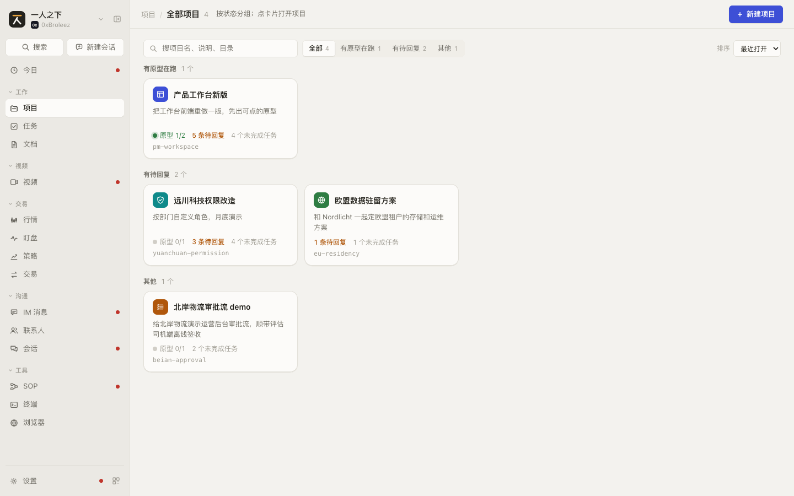 | 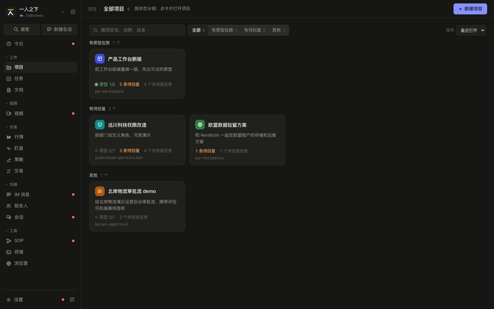 |
| 手机 375 | 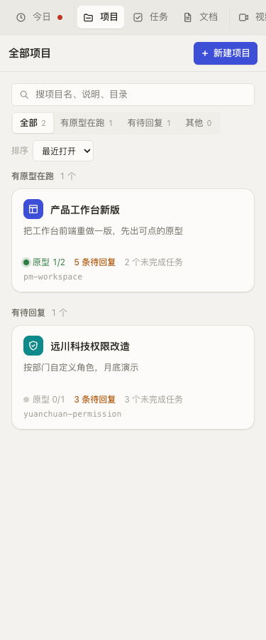 | 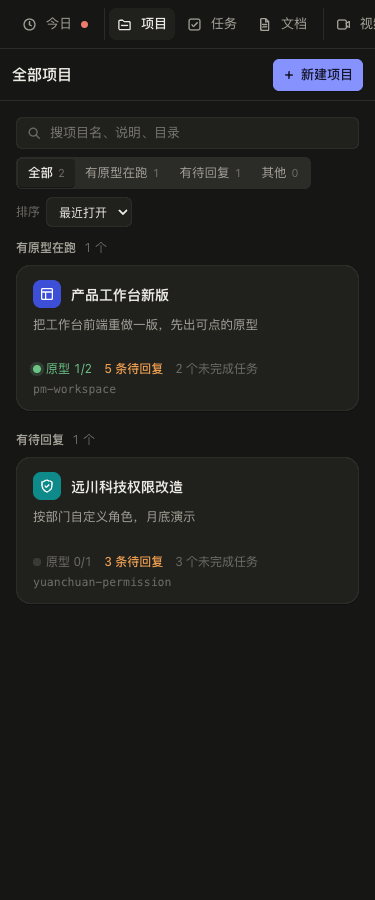 |

### 交互

| 编号 | 元素 | 操作 | 结果 |
|---|---|---|---|
| SPEC-projects-1.1 | 页面标题 | 显示 | 「项目 / 全部项目」+ 项目总数 + 说明「有原型在跑、有待回复的排在前面；点卡片打开项目」（T-01 改，分组见 1.8；原型代码里还是旧说明「按状态分组；点卡片打开项目」） |
| SPEC-projects-1.2 | 右上「新建项目」 | 点击 | 立即建一个「新项目」（图标 `folder`、底色按 `PROJECT_COLORS` 轮流、其余为空），打开它的设置标签（`SPEC-projects-13`）。不弹表单。名称没改就离开时问要不要删，见 `SPEC-projects-13.18`（正式产品，C-05） |
| SPEC-projects-1.3 | 搜索框 | 输入 | 占位「搜项目名、说明、目录」；实时过滤，不区分大小写，匹配名称、说明、项目目录 |
| SPEC-projects-1.4 | 搜索框右侧 x | 点击 | 有内容时出现，悬停「清空」；清空搜索 |
| SPEC-projects-1.5 | 状态切换 | 点击 | 「全部 N / 有原型在跑 N / 有待回复 N / 其他 N」单选，数字是全部项目里的个数，不受搜索影响 |
| SPEC-projects-1.6 | 状态归组规则 | 显示 | 有运行中的原型：有原型在跑；否则项目沟通里有待回复消息（`awaitingReply`，与我相关、不含稍后）：有待回复；否则：其他。一个项目只归一组 |
| SPEC-projects-1.7 | 「排序」下拉 | 选择 | 「最近打开」（默认）：按最近打开的顺序，新的在前，没打开过的排后面、保持原顺序；「名称」：按中文排序规则 |
| SPEC-projects-1.8 | 分组显示 | 显示 | 没选状态、没搜索时按「有原型在跑 / 有待回复 / 其他」分段，每段标题带「N 个」，空的段不显示；每段先露 12 个 |
| SPEC-projects-1.9 | 分组「显示全部 N 个」/「收起」 | 点击 | 段里多于 12 个时出现；展开或收起这一段 |
| SPEC-projects-1.10 | 筛选或搜索后 | 显示 | 不分段，一个网格列出全部结果 |
| SPEC-projects-1.11 | 项目卡片 | 显示 | 标志（28）+ 名称；说明（没有时淡色「没有说明」）；底部一行：有原型时「原型 运行中数/总数」（有运行中的为绿色带亮灯）、有待回复时橙色「N 条待回复」、「N 个未完成任务」或「没有未完成任务」、项目目录的最后一段（等宽，悬停完整路径，没设置时「未设目录」）。悬停整卡显示项目名 |
| SPEC-projects-1.12 | 项目卡片 | 点击 | 打开该项目详情的概览标签（`SPEC-projects-3`），同时记进最近打开 |
| SPEC-projects-1.13 | 最近打开 | 打开项目 | 打开过的项目挪到最近打开的最前，最多记 20 个；原型初始只记着第一个项目。只用来排序，没有单独的入口 |

### 空状态和异常状态

| 编号 | 场景 | 显示 | 可做的操作 |
|---|---|---|---|
| SPEC-projects-1.14 | 一个项目都没有 | 「还没有项目」+「把一个产品相关的沟通、干系人、任务、文档和原型串到一起」 | 「新建第一个项目」，同 1.2 |
| SPEC-projects-1.15 | 筛选或搜索后没有结果 | 「没有匹配的项目」+「换个关键词，或清掉状态筛选」 | 原型没有一键清除；正式产品同原型 |
| SPEC-projects-1.16 | 加载失败 | 原型未做；正式产品在网格位置显示错误信息和「重试」 | 重试 |

### 数据

见 SPEC-projects-0 的 `Project`、`Prototype`。每张卡片的统计（`stats`，组件里算，不落库）：

| 字段 | 说明 |
|---|---|
| `pending` | `projectMessages` 里 `awaitingReply` 的条数（不含稍后） |
| `tasks` | `tasks` 里 `project_id` 为本项目、状态不是 `done`、`cancelled` 的条数（`isOpenTask`） |

页面自己的状态：`q`（搜索词）、`filter`（`'' | 'running' | 'pending' | 'other'`）、`sort`（`'recent' | 'name'`，有最近打开记录时默认 `recent`）、`expanded`（展开了的分组）；常量 `GROUP_PEEK = 12`。最近打开 `recentProjects: string[]` 在 `App.tsx`，原型不落库；正式产品存在本机偏好里。

### 联动

| 方向 | 对方模块 | 触发 | 结果 | 见 |
|---|---|---|---|---|
| 出去 | 本模块 | 点卡片；「新建项目」 | 详情概览；详情设置 | `SPEC-projects-3`、`SPEC-projects-13` |
| 被引用 | IM 消息、任务 | 显示 | 待回复数、未完成任务数随消息和任务实时变 | `SPEC-messages-1`、`SPEC-tasks-2` |

## SPEC-projects-2 项目详情的框架

所有标签共用的顶栏和标签条。

### 截图

默认打开的是概览，所以和概览是同一屏。

| | 亮 | 暗 |
|---|---|---|
| 桌面 1440 | 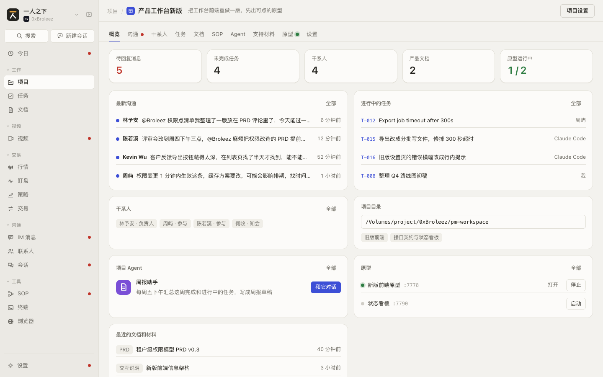 |  |
| 手机 375 |  |  |

### 交互

| 编号 | 元素 | 操作 | 结果 |
|---|---|---|---|
| SPEC-projects-2.1 | 顶栏 | 显示 | 「项目 /」+ 项目标志 + 项目名 + 说明；标志和项目名一起是切换项目的菜单按钮（`SPEC-projects-2.9`） |
| SPEC-projects-2.2 | 顶栏「项目」 | 点击 | 回到项目列表，悬停「回到项目列表」 |
| SPEC-projects-2.3 | 标签条 | 点击 | 切换标签（默认顺序见 `ProjectTab`，项目设置里排过的按排的顺序，`SPEC-projects-13.20`），项目设置里勾掉的不显示（`SPEC-projects-2.10`）；切换时页面滚回顶部。「沟通」上有待回复消息（与我相关、不含稍后）时带红点；「附件」后面带待决定的附件个数（`SPEC-projects-5.1`）；「原型」上有运行中的原型时带绿灯；「商单」上有账期快到的单时带红点（`SPEC-videos-16.1`） |
| SPEC-projects-2.4 | 右上按钮 | 显示 | 随标签变：概览「项目设置」（切到设置标签）；文档「加文档」；支持材料「加材料」；原型「加原型」；其余标签没有。这些按钮右边固定跟着「终端」「浏览器」两个按钮，所有标签都有，见 `SPEC-projects-14` |
| SPEC-projects-2.5 | 手机宽度 | 显示 | 标签条横向滚动；顶栏照样留「项目 /」（回列表的入口），说明收起。抽屉打开、顶栏挤窄时也留着 |
| SPEC-projects-2.6 | 再次进入 | 一级菜单点「项目」 | 回到列表；从列表重新打开时回到概览标签 |
| SPEC-projects-2.9 | 顶栏项目名 | 点击 | 悬停「切换项目」，右边带下拉箭头，按钮没有边框，悬停时浅底。弹出可搜索的项目菜单（同全站的 `SearchSelect`，宽 300）：列全部没删的项目，每项是项目标志 + 名称，当前项目打勾；最近打开的在前（顺序同项目列表的「最近打开」），没打开过的按名称；搜名称、说明、目录。键盘：按钮上按上下键打开，菜单里上下选、回车切、Esc 关并回到按钮。选了别的项目就切过去，停在同一个标签；那个项目藏了这个标签（2.10）或没有这个标签时回概览。切过去算一次打开，记进最近打开 |
| SPEC-projects-2.10 | 被藏掉的标签 | 显示 | 项目设置「显示哪些标签」（`SPEC-projects-13.19`）里勾掉的标签不在标签条上；概览、设置一直在。停在一个被藏掉的标签上（刚在设置里勾掉、从别的项目切过来、地址直接打开）时回概览。「附件」在 IM 消息没开时本来就不显示，「商单」在视频模块没开时本来就不显示，这两条照旧，和勾选叠加。没藏的标签按项目设置里排的顺序（`SPEC-projects-13.20`）；概览固定第一、设置固定最后 |

### 空状态和异常状态

| 编号 | 场景 | 显示 | 可做的操作 |
|---|---|---|---|
| SPEC-projects-2.7 | 打开的项目不存在（被删或 id 不对） | 「这个项目不存在或已删除」+「回到项目列表」 | 回到列表 |
| SPEC-projects-2.8 | 加载失败 | 原型未做；正式产品在标签内容区显示错误信息和「重试」，顶栏和标签条保留 | 重试 |

### 数据

见 SPEC-projects-0 的 `Project`、`ProjectTab`。当前项目 `projectId: string`（`ALL_PROJECTS` 表示在列表页）和当前标签 `projectTab: ProjectTab` 在 `App.tsx`。`ProjectPage` 的回调：`onTab`、`onChange(p)`（整条项目替换）、`onDelete`、`onStart(protoId)`、`onStop(protoId)`、`onOpenDoc(contentId)`、`onChat(agentId)`、`onOpenAgent(agentId)`、`onAll`；跨模块数据和回调放在 `links: ProjectLinks`（`messages`、`contacts`、`tasks`、`sops`、`runs`、`sessions` 和对应的打开、新建回调）。

### 联动

| 方向 | 对方模块 | 触发 | 结果 | 见 |
|---|---|---|---|---|
| 出去 | 本模块 | 顶栏「项目」 | 项目列表 | `SPEC-projects-1` |
| 读取 | 会话 | 快速新建会话时当前停在项目详情 | 默认关联这个项目 | `SPEC-sessions-4` |

## SPEC-projects-3 概览

一屏看项目全貌：五个数字和七个摘要块，每块都能点进对应标签。

### 截图

| | 亮 | 暗 |
|---|---|---|
| 桌面 1440 |  | 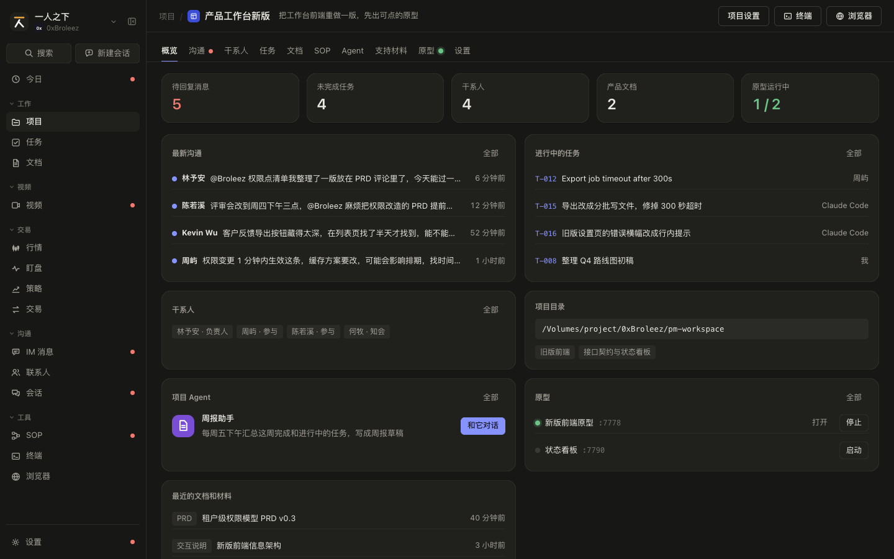 |
| 手机 375 | 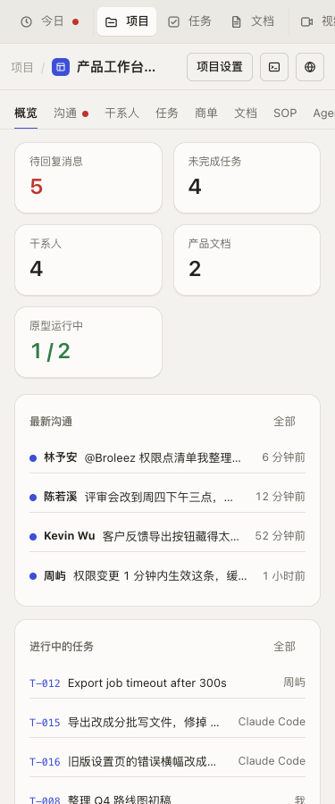 | 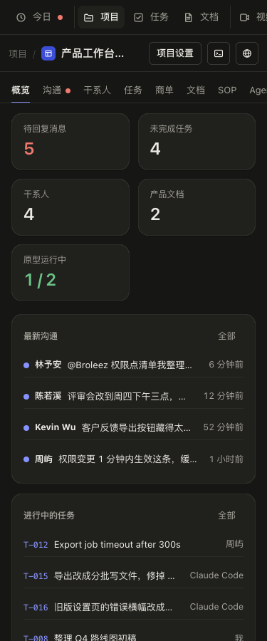 |

### 交互

| 编号 | 元素 | 操作 | 结果 |
|---|---|---|---|
| SPEC-projects-3.1 | 数字卡片 | 显示和点击 | 「待回复消息」（`awaitingReply`，与我相关、不含稍后；大于 0 时红色）、「未完成任务」、「干系人」、「产品文档」、「原型运行中 运行数 / 总数」（绿色）；点哪张切到对应标签：沟通、任务、干系人、文档、原型 |
| SPEC-projects-3.2 | 「最新沟通」 | 显示和点击 | 项目消息里最新 4 条：状态点（待回复蓝、其他灰，稍后算其他）、发信人（联系人姓名，对不上时 `sender_name`，和沟通标签、IM 消息页一致）、正文（单行省略）、相对时间；点一条打开消息抽屉。标题右侧「全部」切到沟通标签 |
| SPEC-projects-3.3 | 「未完成的任务」 | 显示和点击 | 未完成任务（含未开工）按优先级排，前 5 条：编号、标题、负责人；点一条打开任务抽屉。「全部」切到任务标签。块名 T-02 由「进行中的任务」改成「未完成的任务」，和内容、3.11 的空状态一致；原型代码里还是旧块名 |
| SPEC-projects-3.4 | 「干系人」 | 显示和点击 | 按角色顺序排，前 6 个，每个一枚「姓名 · 角色」标签，悬停「姓名：关注点」（没有关注点只显示姓名）；点了打开联系人抽屉。多于 6 个时最后一枚「+N」，点了切到干系人标签。「全部」切到干系人标签 |
| SPEC-projects-3.5 | 「项目目录」 | 显示 | 项目目录（等宽，没设置时「还没设置」）；下面关联目录的名称标签，悬停显示路径。不可点 |
| SPEC-projects-3.6 | 「项目 Agent」 | 显示和点击 | 默认 Agent（`agent_ids[0]`）的头像、名称、说明和「和它对话」；点「和它对话」新建一个挂在本项目下的会话，切到 Agent 标签就地打开（`SPEC-projects-10.13`），不跳到会话页。Agent 已停用时按钮置灰。「全部」切到 Agent 标签 |
| SPEC-projects-3.7 | 「原型」 | 显示和点击 | 按运行中、启动失败、启停中、已停止排，前 5 个：状态灯、名称、`:端口`。运行中的有「打开」「停止」；其余一个按钮，文字和原型卡片一致：已停止「启动」、启动失败「重新启动」、启动中「启动中…」、停止中「停止中…」。启动中、停止中、端口冲突时置灰，端口冲突时悬停显示原因。原型多于 5 个时标题旁「共 N 个」；有原型时才有「全部」 |
| SPEC-projects-3.8 | 「最近的文档和材料」 | 显示 | 文档和支持材料合在一起按时间倒序，前 5 条：种类标签（文档类型或材料种类）、名称、相对时间。不可点 |
| SPEC-projects-3.9 | 手机宽度 | 显示 | 数字卡片两列（五张时最后一张单占一格），摘要块排成一列。B-11 由「数字卡片也排成一列」改来：五张各占一行，要滚两屏才到最新沟通；原型代码里还是一列 |

### 空状态和异常状态

| 编号 | 场景 | 显示 | 可做的操作 |
|---|---|---|---|
| SPEC-projects-3.10 | 项目没有消息 | 没绑定渠道时「还没绑定沟通渠道。去绑定」，「去绑定」切到沟通标签；绑了但会话里还没有消息时「绑定的会话里还没有消息」 | 去绑定 |
| SPEC-projects-3.11 | 没有未完成任务 | 「没有未完成的任务」 | 「全部」 |
| SPEC-projects-3.12 | 没有干系人 | 「还没有干系人」 | 「全部」 |
| SPEC-projects-3.13 | 没有项目 Agent | 「还没设置。去设置」，「去设置」切到 Agent 标签 | 去设置 |
| SPEC-projects-3.14 | 没有原型 | 「还没有原型」，没有「全部」 | |
| SPEC-projects-3.15 | 没有文档和材料 | 「还没有文档和材料」 | |

### 数据

见 SPEC-projects-0 的 `Project`、`Stakeholder`、`Prototype`；任务见 `SPEC-tasks-0` `Task`；Agent 见 `SPEC-sessions-0`。常量：`PROTO_PEEK = 5`、`STAKE_PEEK = 6`。

### 联动

| 方向 | 对方模块 | 触发 | 结果 | 见 |
|---|---|---|---|---|
| 出去 | IM 消息 | 点最新沟通 | 消息抽屉 | `SPEC-messages-2` |
| 出去 | 任务 | 点任务 | 任务抽屉 | `SPEC-tasks-4` |
| 出去 | 联系人 | 点干系人 | 联系人抽屉 | `SPEC-contacts-2` |
| 出去 | 会话 | 「和它对话」 | 新建项目会话，切到 Agent 标签就地打开 | `SPEC-projects-10.13` |
| 出去 | 浏览器 | 原型「打开」 | 打开原型地址 | `SPEC-browser` |
| 改动 | 本模块 | 原型「启动」「停止」 | 同 `SPEC-projects-12.9`、`SPEC-projects-12.10` | `SPEC-projects-12` |

## SPEC-projects-4 沟通

左边是项目绑定的群聊和私聊，右边显示这些会话里的消息，加上归到这个项目的消息（消息分流，`SPEC-messages-2.33`）。

### 截图

| | 亮 | 暗 |
|---|---|---|
| 桌面 1440 | 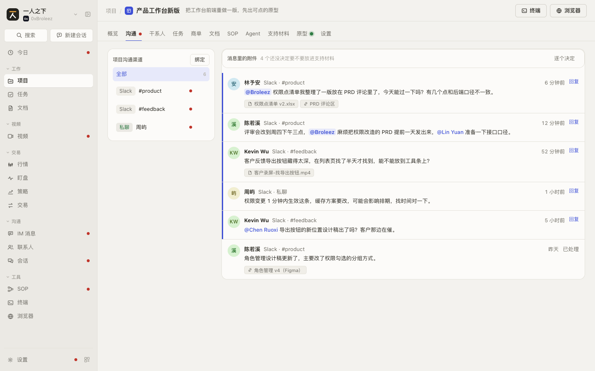 | 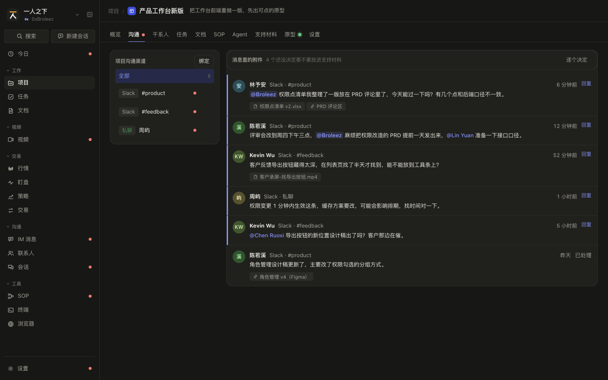 |
| 手机 375 | 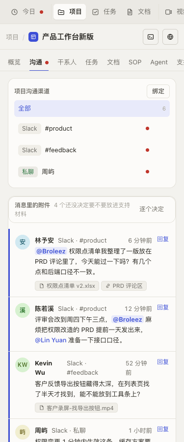 | 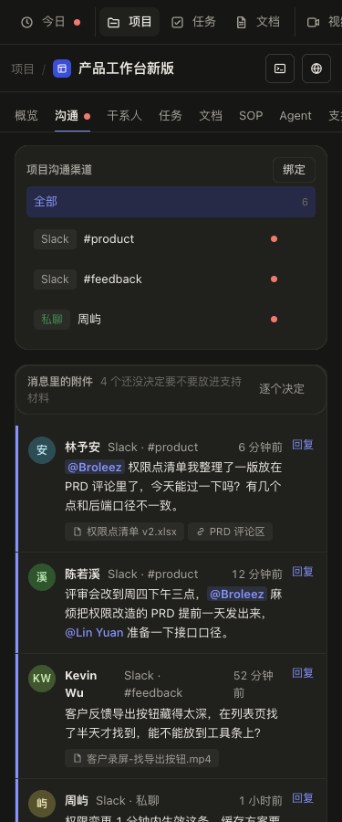 |
| 绑定面板 1440 | 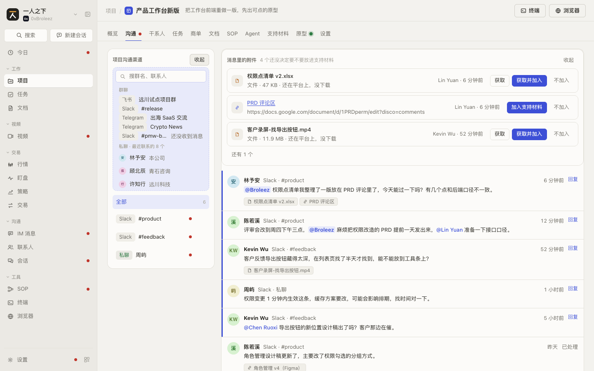 | 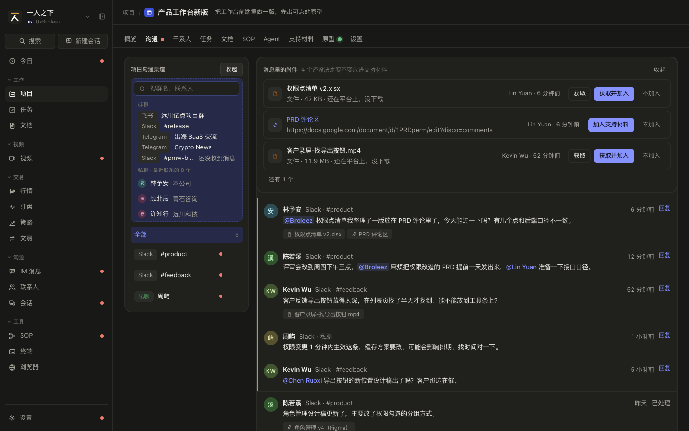 |

### 交互

| 编号 | 元素 | 操作 | 结果 |
|---|---|---|---|
| SPEC-projects-4.1 | 「项目沟通渠道」右侧「绑定」/「收起」 | 点击 | 展开或收起绑定面板，展开时清空面板里的搜索 |
| SPEC-projects-4.2 | 绑定面板搜索框 | 输入 | 自动聚焦，占位「搜群名、联系人」；群按群名、渠道名搜，私聊按联系人姓名、公司、职位搜 |
| SPEC-projects-4.3 | 绑定面板搜索框 | 按 Esc | 有内容时先清空；没内容时收起面板。不会关掉别的抽屉 |
| SPEC-projects-4.4 | 绑定面板「群聊」 | 显示和点击 | 候选是现有消息里出现过的群，加上 IM 连接器配置里监听的频道（`config.channels`，逗号分隔的会话编号或名字；编号按连接器的会话列表换成 `#名字`，对不上的照原文，见 `SPEC-settings-4.7c`），去掉已绑的（按「渠道 + 群名」去重）。正式产品从会话表列：收到没登记过的群的消息时自动登记会话（渠道、编号、群名），所以消息里出现过的群都在；最近有消息的在前，还没收到消息的排最后并注「还没收到消息」；没搜时只露 8 个，标题为「群聊 · 最近有消息的 8 个」（不多于 8 个时只写「群聊」），搜了最多列 50 个。每项是渠道标签 + 群名。点一项绑定并收起面板 |
| SPEC-projects-4.5 | 绑定面板「私聊」 | 显示和点击 | 候选是还没绑的联系人：没搜时按最近联系倒序露 8 个（标题「私聊 · 最近联系的 8 个」），搜了最多列 50 个。每项是头像、姓名、公司，悬停「姓名 · 公司」。点一项绑定并收起。正式产品按会话 id 绑：联系人在某个渠道有 IM 身份时，取这个身份的私聊会话，没有就按身份编号建一个再绑；有几个渠道的身份就列几项，私聊已绑的那个身份不再列；公司后面带渠道名（「公司 · 渠道」）。联系人一个 IM 身份都没有时这一项置灰，悬停和公司位置写「先在联系人里填 IM 编号」，排在能绑的后面 |
| SPEC-projects-4.6 | 绑定面板的超出提示 | 显示 | 候选多于露出的数量时，列表下面写「共 N 个群，输入群名搜」/「共 N 个联系人，输入名字或公司搜」；搜了还有更多时写「还有 N 个，继续输入筛选」 |
| SPEC-projects-4.7 | 渠道列表「全部」 | 点击 | 显示全部项目消息（绑定会话里的加上归到这个项目的，去重），右侧是总条数。归过来的消息所在会话没绑定时，只在「全部」里看得到 |
| SPEC-projects-4.8 | 渠道列表的一项 | 显示和点击 | 群聊：渠道标签 + 群名；私聊：「私聊」标签 + 联系人姓名。有待回复消息（与我相关、不含稍后）时带红点，悬停「N 条待回复」。点了只看这个渠道的消息 |
| SPEC-projects-4.9 | 渠道项上的 x | 点击 | 悬停「解绑（不删消息）」；立即解绑，不确认；正在看这个渠道时回到「全部」。消息本身不动，IM 消息页里照常能看到 |
| SPEC-projects-4.10 | 消息行 | 显示 | 头像、姓名（联系人姓名，否则 `sender_name`）、「渠道 · 群名或私聊」、相对时间、正文（@ 高亮，同 `SPEC-messages-1.15`，复用 `MentionText`）、附件小标签（同 `SPEC-messages-1.16`）；待回复的行左边有色条，右侧「回复」；稍后的右侧「稍后提醒」；其余右侧显示状态名。按时间倒序 |
| SPEC-projects-4.11 | 消息行 | 点击 | 打开消息抽屉（`SPEC-messages-2`），不离开项目 |
| SPEC-projects-4.12 | 「加载更早的消息 还有 N 条」 | 点击 | 先渲染 50 条，每点一次多 50 条；切换渠道筛选、与我相关、搜索时回到前 50 条 |
| SPEC-projects-4.13 | 附件入口 | 显示和点击 | 附件挪到了独立的「附件」标签（`SPEC-projects-5`），沟通里不再列。项目消息里有待决定的附件时，右栏最上面一行「消息里有 N 个附件待决定要不要放进支持材料」+ 右侧「去附件标签」，点整行切到附件标签；没有待决定的时这一行不出现 |
| SPEC-projects-4.14 | 手机宽度 | 显示 | 渠道列表在上，消息在下 |
| SPEC-projects-4.22 | 消息搜索框 | 输入 | 有项目消息时才有筛选条，在附件入口那一行下面、消息列表上面；占位「搜索内容、发信人、群名」，匹配正文、发信人、联系人姓名、群名，按空格切词、每个词都要命中，不区分大小写；有内容时右侧 x 清空，Esc 清空。和渠道筛选叠加；不影响左边渠道的数字和上面的附件入口（B-10） |
| SPEC-projects-4.23 | 「全部消息 / 与我相关 / 只看 @我」下拉 | 选择 | 同 IM 消息页（`SPEC-messages-1`）：与我相关是 @我、@所有人和私聊，只看 @我 后面带「（N 条待回复）」；不是「全部消息」时高亮；筛了以后筛选条右边写「N 条」（B-10） |
| SPEC-projects-4.24 | 消息行「已处理」 | 点击 | 待处理（含稍后）的行悬停或键盘聚焦时，右上出现「已处理」（名字跟字典 `msg_status`），触屏上常驻；点了只把这一条标为已处理，不打开抽屉，口径同 IM 消息页的「已处理」。已处理、已忽略的行没有（B-10） |

### 空状态和异常状态

| 编号 | 场景 | 显示 | 可做的操作 |
|---|---|---|---|
| SPEC-projects-4.15 | 还没绑定任何渠道 | 渠道列表下「还没绑定。把项目群、对接人的私聊绑过来，项目里就只看这些消息」；右侧「没有消息」+「绑定的群和私聊里的消息、归到这个项目的消息会出现在这里」 | 「绑定」 |
| SPEC-projects-4.16 | 绑了但没有消息，或筛选的渠道没有消息 | 右侧同上 | 换渠道 |
| SPEC-projects-4.17 | 没有可绑的群 | 面板「群聊」下「没有可绑的群」；搜了没结果时「没有匹配的群」 | |
| SPEC-projects-4.18 | 私聊没有可绑的 | 按原因写：没有联系人时「还没有联系人」；有联系人但都已绑过时「联系人都已经绑过了」；搜了没结果时「没有匹配的联系人」。联系人都没填 IM 编号时候选照常列出（置灰，见 `SPEC-projects-4.5`），列表下写「联系人都没填 IM 编号，先在联系人里填」 | 去联系人填 IM 编号 |
| SPEC-projects-4.19 | 私聊绑定的联系人被删了 | 原型：删联系人时绑定一起解除（`SPEC-contacts-2.12`）；万一残留，名字显示「已删除的联系人」 | 解绑 |
| SPEC-projects-4.20 | 想绑的群还没收到过消息 | 原型从连接器监听的频道里补候选（如 Slack 的 `#pmw-beta`），能先绑上；正式产品按 PJ-02 从会话表里列，包括还没有消息的群；收到消息的群自动登记进会话表（PR-02） | |
| SPEC-projects-4.21 | 加载失败 | 原型未做；正式产品在消息区显示错误信息和「重试」，渠道列表保留 | 重试 |
| SPEC-projects-4.25 | 搜索或与我相关筛完没有消息 | 「没有匹配的消息」+「换个关键词」（筛了与我相关时加「，或改成「全部消息」」）；标为已处理失败时渠道列表下红字写原因 | 「清掉筛选」 |

### 数据

见 SPEC-projects-0 的 `ProjectChat`、`projectMessages`；消息见 `SPEC-messages-0` `Message`。绑定新渠道时 `id` 按 `ch` 前缀现生成。组件状态：`filter`（选中的渠道 id，空串为全部）、`mine`（`'' | 'mine' | 'at'`，与我相关下拉）、`q`（消息搜索词）、`adding`（绑定面板开着）、`bq`（面板搜索词）；常量 `MSG_PAGE = 50`、`DM_PEEK = 8`（群聊和私聊没搜时都露这么多）。

正式产品按 PJ-02a：绑定存在项目插件自己的表里，按会话 id 绑，改会话名后绑定不断。

### 联动

| 方向 | 对方模块 | 触发 | 结果 | 见 |
|---|---|---|---|---|
| 出去 | IM 消息 | 点消息 | 消息抽屉 | `SPEC-messages-2` |
| 读取 | IM 消息、联系人 | 显示 | 按绑定过滤消息，私聊按联系人的各渠道编号认；再并上 `project_id` 是这个项目的消息 | `SPEC-messages-0`、`SPEC-contacts-0` |
| 被改动 | IM 消息、SOP | 消息抽屉「项目」改、清除；SOP 节点「消息归到项目」 | 这条消息出现在或离开本项目的沟通 | `SPEC-messages-2.33`、`SPEC-sop-12.36` |
| 改动 | 本模块 | 绑定、解绑 | 概览的待回复数、标签红点、列表页的分组跟着变 | `SPEC-projects-1`、`SPEC-projects-3` |

## SPEC-projects-5 附件

标签「附件」：项目沟通消息里的全部附件集中管理——待决定的、已加入支持材料的、选了不加入的都列出来，能筛、能搜、能批量处理。原来是沟通标签顶部的「消息里的附件」收件块（逐个决定），挪成了独立标签；沟通标签只留一行入口（`SPEC-projects-4.13`）。

### 截图

按 `shots.py` 的步骤截：项目「产品工作台新版」，附件标签，切到「全部」；再回「待决定」勾两个。截图要在原型跑着时重新生成（`shots.py --only projects`）。

| | 亮 | 暗 |
|---|---|---|
| 全部 1440 |  |  |
| 批量操作 1440 |  |  |

### 交互

| 编号 | 元素 | 操作 | 结果 |
|---|---|---|---|
| SPEC-projects-5.1 | 标签「附件」 | 显示 | 在「沟通」后面。IM 消息模块（正式产品是 IM 消息插件）没开着时不显示；正式产品里直接打开这个标签的地址时提示「需要 IM 消息插件」+「去插件管理」。标签名后面带数字：待决定的附件个数，为 0 不显示（同视频的「素材收件箱」） |
| SPEC-projects-5.2 | 范围 | 显示 | 全部项目消息里的附件（同沟通标签「全部」：绑定会话里的、归到这个项目的，含群组默认归属），不受沟通标签的渠道筛选影响。一个附件一行，按消息时间倒序；同一条消息的同一个附件只算一次 |
| SPEC-projects-5.3 | 去向 | 显示 | 三种：「已加入资料」（这个附件已经在本项目的支持材料里）、「不加入」（记在 `skipped_attachments`）、「待决定」（其余）。既加过资料又记着不加入时算已加入 |
| SPEC-projects-5.4 | 分段「待决定 / 已加入资料 / 不加入 / 全部」 | 点击 | 默认「待决定」；每段后面带个数，个数跟着种类和搜索变 |
| SPEC-projects-5.5 | 种类下拉 | 选择 | 「全部种类 / 图片（N）/ 文件（N）/ 链接（N）」，N 跟着分段和搜索变；选了以后高亮 |
| SPEC-projects-5.6 | 搜索框 | 输入 | 占位「搜文件名、发信人、群名」；匹配附件名、发信人（联系人姓名和平台上的名字）、群名，按空格切词、每个词都要命中，不区分大小写；Esc 清空 |
| SPEC-projects-5.7 | 附件行 | 显示 | 勾选框、种类图标、名字（链接是超链接）、「种类 · 大小」（链接是「链接 · 地址」，已获取的文件后面带本地路径）、来自（发信人 + 群名或「私聊」）、相对时间、获取状态（没获取 / 获取中 / 已获取 / 获取失败；链接写「不用获取」；失败悬停看原因）、去向、操作。宽屏是表格，表头「附件 / 来自 / 时间 / 获取 / 去向 / 操作」；窄屏表头收起，每行折成三行 |
| SPEC-projects-5.8 | 「来自」 | 点击 | 悬停「打开来源消息：<正文>」；打开那条消息的抽屉 |
| SPEC-projects-5.9 | 去向「已加入资料」 | 点击 | 悬停「到支持材料里看这一条」；切到支持材料标签，高亮并滚到那一条（同 `SPEC-projects-11.23`） |
| SPEC-projects-5.10 | 「获取」/「重试」 | 点击 | 文件和图片没获取、也不在获取中时才有；同 `SPEC-messages-3.4`、`SPEC-messages-3.5` |
| SPEC-projects-5.11 | 「预览」 | 点击 | 文件和图片才有；打开附件预览弹窗（同 `SPEC-messages-3.16`：图片、PDF、音视频、文本在页面里看，没获取的「获取并预览」）；← → 在当前筛选出的附件之间切（可以跨消息，链接跳过） |
| SPEC-projects-5.12 | 「下载」/「打开」 | 点击 | 已获取的文件、图片有「下载」，下载到浏览器；链接有「打开」，新窗口打开 |
| SPEC-projects-5.13 | 「加入资料」/「获取并加入」 | 点击 | 待决定和不加入的才有；加进本项目的支持材料，规则同 `SPEC-messages-3.8`、`SPEC-messages-3.9`（没获取的先获取，获取失败就不加；不加入记录一并清掉）；获取中置灰。加完去向变「已加入资料」 |
| SPEC-projects-5.14 | 「不加入」 | 点击 | 待决定的才有；记进 `skipped_attachments`，去向变「不加入」 |
| SPEC-projects-5.15 | 「撤销不加入」 | 点击 | 不加入的才有；从 `skipped_attachments` 去掉，回到待决定 |
| SPEC-projects-5.16 | 勾选 | 点击 | 已加入资料的不能勾。表头的勾选框全选（取消全选）当前页能勾的。勾了以后表格上方出一条「已选 N 个」+「加入资料」「不加入」「取消选择」；换分段、种类、搜索后，看不见的不算在已选里 |
| SPEC-projects-5.17 | 批量「加入资料」 | 点击 | 逐个加（没获取的先获取），一个失败不挡后面的；全部跑完，成功的从已选里去掉，失败的留着勾，上方红字「N 个没加进去：<名字>（<原因>）…」 |
| SPEC-projects-5.18 | 批量「不加入」 | 点击 | 只对选中里待决定的生效（选中的都不是待决定的时置灰，悬停说明）；一次写进 `skipped_attachments` |
| SPEC-projects-5.19 | 「再显示 N 个」 | 点击 | 先渲染 50 行，每点一次多 50 行；换分段、种类、搜索时回到前 50 行 |

### 空状态和异常状态

| 编号 | 场景 | 显示 | 可做的操作 |
|---|---|---|---|
| SPEC-projects-5.20 | 项目消息里一个附件都没有 | 「消息里还没有附件」+「绑定的群和私聊里、归到这个项目的消息带的文件、图片、链接会出现在这里，逐个决定要不要放进支持材料」 | 去沟通标签绑定 |
| SPEC-projects-5.21 | 「待决定」是空的 | 「都处理过了」+「看全部」 | 看全部 |
| SPEC-projects-5.22 | 别的分段是空的 | 「没有已加入资料的附件」/「没有不加入的附件」+「看全部」 | 看全部 |
| SPEC-projects-5.23 | 种类或搜索筛完没有 | 「没有匹配的附件」+「换个关键词，或清掉种类筛选」 | 「清掉筛选」 |
| SPEC-projects-5.24 | 获取失败 | 获取状态红字「获取失败」，悬停看原因；按钮「重试」；同 `SPEC-messages-3.11` | 重试 |
| SPEC-projects-5.25 | 加入、不加入没写成 | 行下或表格上方红字「没加进去：<原因>」/「没改成：<原因>」 | 再点一次 |
| SPEC-projects-5.26 | 加载失败 | 原型未做；正式产品：消息没加载出来时显示错误和「重试」；支持材料没加载出来时显示「支持材料没加载出来，判断不了哪些已加入」+「重试」（判断去向要用） | 重试 |

### 数据

用到 `SPEC-projects-0` `Project` 的 `materials[].from.attachment_id`（判断已加入）和 `skipped_attachments`（不加入）；附件见 `SPEC-messages-0` `MsgAttachment`。原型的附件 id 全局唯一，`skipped_attachments` 记附件 id；正式产品渠道给的附件 id 只在一条消息里唯一，记「消息 id:附件 id」，已加入按资料的 `value` 认（文件比本地路径、链接比地址）。组件状态：`seg`（`'todo' | 'added' | 'skipped' | ''`，默认 `todo`）、`kind`（`'' | 'image' | 'file' | 'link'`）、`q`、`sel`（勾选的附件）、`preview`（预览中的附件）；常量每页 50 行。

正式产品全在前端：消息来源同沟通标签（项目插件 `projectMessages`），获取、加入、不加入用 `core/data` 的 attachments（和 IM 消息抽屉的附件面板同一套），预览弹窗放在 `core/ui`（插件之间不 import），不加新接口。

### 联动

| 方向 | 对方模块 | 触发 | 结果 | 见 |
|---|---|---|---|---|
| 改动 | 本模块 | 加入 | 支持材料标签多一条，带出处 | `SPEC-projects-11` |
| 出去 | 本模块 | 去向「已加入资料」 | 支持材料标签高亮那一条 | `SPEC-projects-11.23` |
| 出去 | IM 消息 | 点「来自」 | 消息抽屉 | `SPEC-messages-2` |
| 共用 | IM 消息 | 获取、加入、预览 | 和消息抽屉附件面板同一套动作和预览弹窗 | `SPEC-messages-3` |
| 被改动 | IM 消息 | 消息抽屉里「加入资料」、「转项目资料…」带了附件 | 这个附件的去向变「已加入资料」，标签上的数字跟着减 | `SPEC-messages-3`、`SPEC-messages-6` |
| 进来 | 本模块 | 沟通标签「去附件标签」 | 打开附件标签 | `SPEC-projects-4.13` |

## SPEC-projects-6 干系人

谁拍板、谁对接、谁负责，每个人关心什么。人从联系人里挑。

### 截图

| | 亮 | 暗 |
|---|---|---|
| 桌面 1440 | 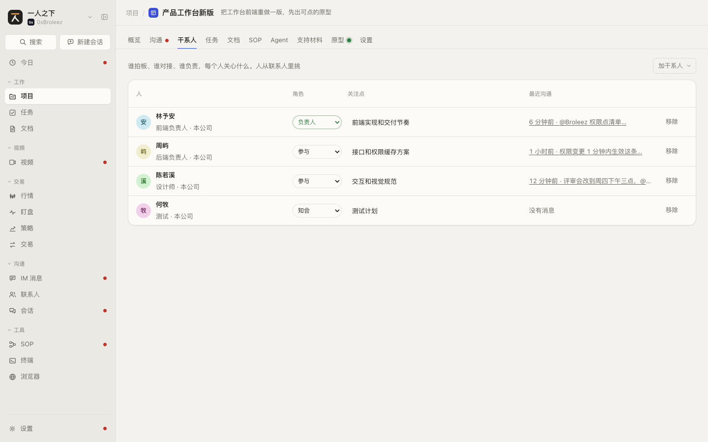 | 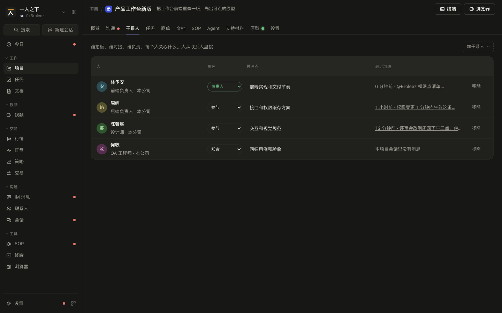 |
| 手机 375 |  |  |

### 交互

| 编号 | 元素 | 操作 | 结果 |
|---|---|---|---|
| SPEC-projects-6.1 | 头部说明 | 显示 | 「谁拍板、谁对接、谁负责，每个人关心什么。人从联系人里挑」 |
| SPEC-projects-6.2 | 「加干系人」 | 选择 | 可搜索的多选下拉，候选是还不是干系人的联系人：头像、姓名、公司，按姓名、公司、职位、分组、标签搜（占位「搜姓名、公司、职位、分组、标签」）；按姓名拼音排、按首字母分段，和联系人页「按姓名」同一套（`SPEC-contacts-1`），全部列出不截断。勾选不关下拉，底部「加 N 人」（没勾时「先勾选要加的人」、置灰）一次加进来，按下拉里的顺序加，角色默认「参与」，关注点为空；加完下拉关掉、勾选清空。有人没加上时其他人照常加，没加上的留在勾选里，头部下面红字「N 人没加上：姓名（原因）」（B-05） |
| SPEC-projects-6.3 | 表格 | 显示 | 列：人、角色、关注点、最近沟通、操作。按角色顺序排（决策人、对接人、负责人、参与、知会），同角色按加入顺序 |
| SPEC-projects-6.4 | 「人」 | 点击 | 头像、姓名、「职位 · 公司」；点了打开联系人抽屉 |
| SPEC-projects-6.5 | 「角色」下拉 | 选择 | 五个角色，悬停显示当前角色的说明（如「拍板、验收」）；改了立即保存，表格按新角色重排 |
| SPEC-projects-6.6 | 「关注点」输入框 | 输入 | 占位「他关心什么」；边输边保存 |
| SPEC-projects-6.7 | 「最近沟通」 | 显示和点击 | 这个人在本项目绑定的会话里发来的最近一条消息（`projectMessages`）：「<相对时间> · <正文前 14 字>…」，正文不超过 14 字时不加省略号；悬停全文；点了打开消息抽屉 |
| SPEC-projects-6.8 | 「移除」 | 点击 | 立即从干系人里移除，不确认；联系人本身不动 |

### 空状态和异常状态

| 编号 | 场景 | 显示 | 可做的操作 |
|---|---|---|---|
| SPEC-projects-6.9 | 没有干系人 | 「还没有干系人」+「从联系人里挑出这个项目相关的人，标上角色和关注点」 | 「加干系人」 |
| SPEC-projects-6.10 | 联系人都已经是干系人 | 下拉里「联系人都已经加进来了」 | |
| SPEC-projects-6.11 | 这个人在本项目会话里没有消息 | 最近沟通列「本项目会话里没有消息」；项目还没绑定渠道时「还没绑定沟通渠道」 | |
| SPEC-projects-6.12 | 干系人引用的联系人已被删 | 这一行不显示（删联系人时会一起移除，见 `SPEC-contacts-2.12`） | |
| SPEC-projects-6.13 | 保存失败 | 原型未做；正式产品保留输入、行内红字提示原因 | 重试 |
| SPEC-projects-6.14 | 角色不是五个之一 | 原型不会出现；正式产品（E-02）接口只收五个 key，其他回 400。库里已有的未知值照原样显示：角色下拉显示原值、红框浅红底，悬停「不认识的角色「<值>」，选一个改掉」，排在表格最后；概览干系人块的标签同样标红 | 选一个角色 |

### 数据

见 SPEC-projects-0 的 `Stakeholder`、`StakeRole`；人见 `SPEC-contacts-0` `Contact`。最近沟通由组件算：`contactIndex` 把本项目的每条消息归到发信的联系人上，取 `at` 最大的一条。

### 联动

| 方向 | 对方模块 | 触发 | 结果 | 见 |
|---|---|---|---|---|
| 出去 | 联系人 | 点人 | 联系人抽屉 | `SPEC-contacts-2` |
| 出去 | IM 消息 | 点最近沟通 | 消息抽屉 | `SPEC-messages-2` |
| 被改动 | 联系人 | 删除联系人 | 干系人里移除 | `SPEC-contacts-2.12` |
| 改动 | 本模块 | 增删、改角色 | 概览的干系人块和数字跟着变 | `SPEC-projects-3` |

## SPEC-projects-7 任务

这个项目的任务；任务本身在任务模块，项目只是按 `project_id` 列出来。

### 截图

| | 亮 | 暗 |
|---|---|---|
| 桌面 1440 | 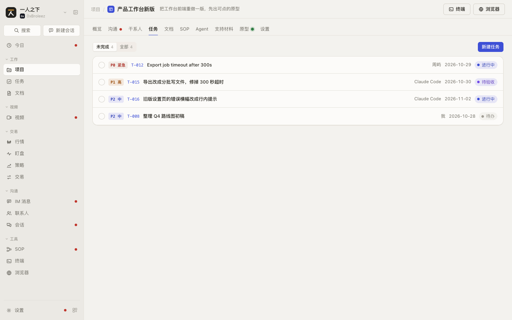 | 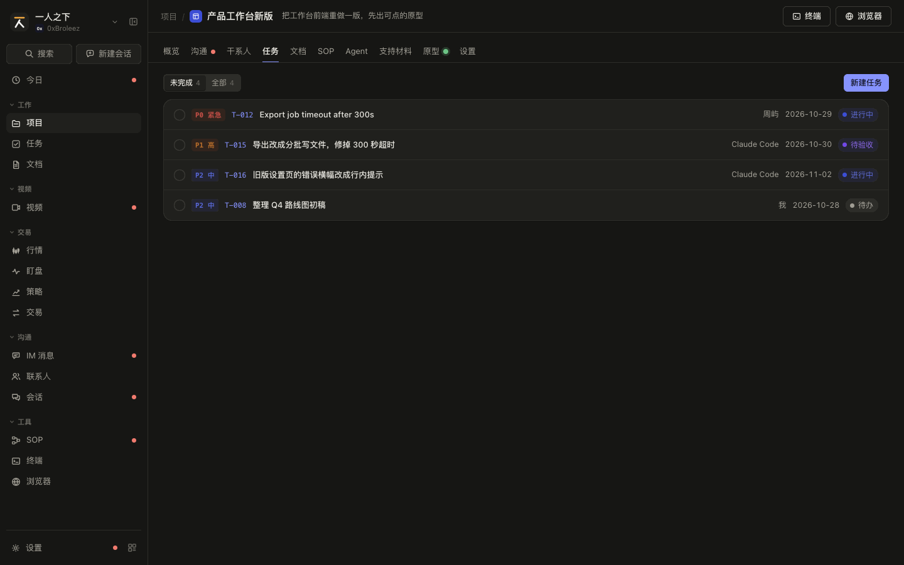 |
| 手机 375 | 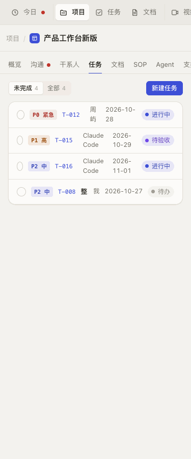 | 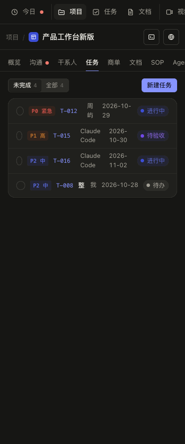 |
| 待验收确认 1440 | 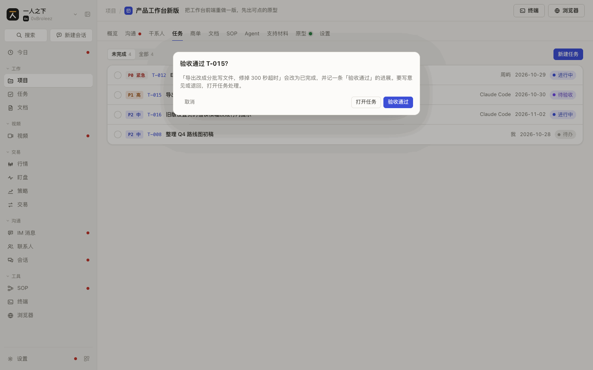 | 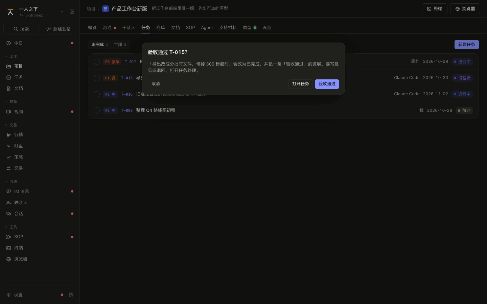 |

### 交互

| 编号 | 元素 | 操作 | 结果 |
|---|---|---|---|
| SPEC-projects-7.1 | 「未完成 N / 全部 N」 | 点击 | 默认未完成（状态不是已完成、已取消）；全部包括已完成和已取消 |
| SPEC-projects-7.2 | 「新建任务」 | 点击 | 打开新建任务抽屉，所属项目预填为本项目（`SPEC-tasks-4`）；建好后出现在这里。任务的工作目录没填时继承项目目录：开发信息里工作目录占位「继承自项目：<项目目录>」，交给 Claude Code 时默认用它（`SPEC-tasks-5`） |
| SPEC-projects-7.3 | 任务行 | 显示 | 完成圆圈、优先级标签、编号、标题、负责人（没有时「未分配」）、截止日（没有时「-」）、状态标签。按优先级排。已完成的行变淡 |
| SPEC-projects-7.4 | 任务行 | 点击 | 打开任务抽屉 |
| SPEC-projects-7.5 | 完成圆圈 | 点击 | 和任务列表同一套：已完成的改回待办，悬停「标为待办」；待验收的先弹「验收通过 T-xxx？」确认（取消 / 打开任务 / 验收通过），确认后等于验收通过，悬停「验收通过」；其余改成已完成，悬停「标为已完成」。不打开抽屉 |

### 空状态和异常状态

| 编号 | 场景 | 显示 | 可做的操作 |
|---|---|---|---|
| SPEC-projects-7.6 | 选「全部」且项目没有任务 | 「这个项目还没有任务」+「在这里新建的任务会自动归到这个项目；其他任务在任务详情里也能改所属项目」 | 「新建任务」 |
| SPEC-projects-7.7 | 选「未完成」且没有未完成任务 | 「没有未完成的任务」+ 同上说明 | 切到「全部」 |
| SPEC-projects-7.8 | 加载失败 | 原型未做；正式产品显示错误信息和「重试」 | 重试 |

### 数据

任务见 `SPEC-tasks-0` 的 `Task`、`TaskStatus`、优先级；本页只读 `project_id === p.id` 的任务。`isOpenTask(s)`：`s !== 'done' && s !== 'cancelled'`。

正式产品按 PJ-01d：任务标签复用任务模块的抽屉（经注册表或数据访问层，不直接 import 任务模块内部）；在这里新建的任务 `project_id` 为本项目。

### 联动

| 方向 | 对方模块 | 触发 | 结果 | 见 |
|---|---|---|---|---|
| 出去 | 任务 | 点行、「新建任务」 | 任务抽屉 | `SPEC-tasks-4` |
| 改动 | 任务 | 完成圆圈 | 任务状态变，任务模块列表跟着变 | `SPEC-tasks-2` |

## SPEC-projects-8 文档

产品文档：关联「文档」模块里的一篇，或指向项目目录里的一个文件。

### 截图

| | 亮 | 暗 |
|---|---|---|
| 桌面 1440 | 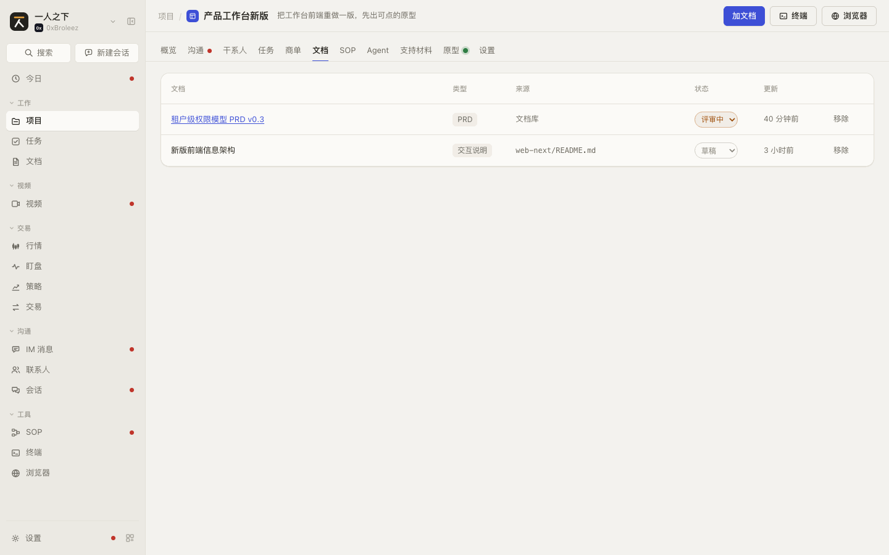 | 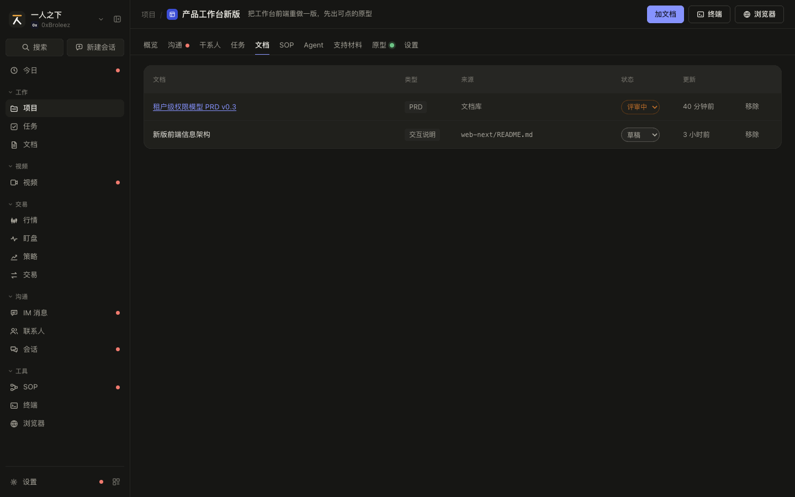 |
| 手机 375 |  |  |

加文档的表单截图脚本截不到，操作：文档标签右上「加文档」。

### 交互

| 编号 | 元素 | 操作 | 结果 |
|---|---|---|---|
| SPEC-projects-8.1 | 右上「加文档」 | 点击 | 在表格上方展开内联表单，默认「关联「文档」里的」、选中文档库第一篇、类型 PRD |
| SPEC-projects-8.2 | 来源切换 | 点击 | 「关联「文档」里的」/「项目目录里的文件」；切到文档库时选中第一篇，切到文件时路径清空 |
| SPEC-projects-8.3 | 选文档 | 选择 | 可搜索下拉，占位「选一篇文档」，按标题搜；已经关联过的提示「已关联」（仍可再选）；标题还空着时自动填成文档标题 |
| SPEC-projects-8.4 | 文件路径 | 输入 | 等宽，占位「相对项目目录的路径，比如 docs/prd.md」 |
| SPEC-projects-8.5 | 标题、类型 | 输入 / 选择 | 标题占位「标题（留空用文档原标题）」；类型取 `DOC_KINDS` |
| SPEC-projects-8.6 | 「加上」 | 点击 | 没选文档或路径为空时置灰。标题去首尾空白后为空时：文档库取文档标题，文件取路径最后一段。状态为草稿，加在最前，表单收起 |
| SPEC-projects-8.7 | 「取消」 | 点击 | 收起表单，不保存 |
| SPEC-projects-8.8 | 表格 | 显示 | 列：文档、类型、来源、状态、更新、操作。来源为「文档库」或文件路径（等宽） |
| SPEC-projects-8.9 | 文档标题 | 点击 | 只有来自文档库的可点：切到「文档」模块的工作台文档，打开那篇（`SPEC-library-1`）；来自文件的不可点 |
| SPEC-projects-8.10 | 状态下拉 | 选择 | 草稿、评审中、定稿，按状态色显示；改了立即保存并刷新「更新」时间 |
| SPEC-projects-8.11 | 「移除」 | 点击 | 立即移除，不确认；文档库里的文档和项目目录里的文件都不动 |
| SPEC-projects-8.16 | 表单里「新建一篇」（C-03 加） | 点击切换、填写、点「新建并去写」 | 表单顶部切换「从「文档」里挑」/「新建一篇」。新建一篇填标题（必填）和分类（同 `SPEC-library-1.42`），点「新建并去写」在「文档」里建一篇归到本项目（`project_id` 为本项目），然后切到「文档」打开这篇的编辑区（`SPEC-library-1.41`）写正文；标题为空时按钮置灰。建失败在表单下红字「没建上：<错误信息>」 |

### 空状态和异常状态

| 编号 | 场景 | 显示 | 可做的操作 |
|---|---|---|---|
| SPEC-projects-8.12 | 没有文档（且没开表单） | 「还没有产品文档」+「可以关联「文档」里的 PRD，也可以指向项目目录里的文件」；正式产品还没接项目目录里的文件，写「把「文档」里的 PRD、方案归到这个项目，或者新建一篇」 | 「加文档」 |
| SPEC-projects-8.13 | 文档库是空的 | 下拉里「「文档」里还没有文档」，「加上」置灰 | 切到「项目目录里的文件」 |
| SPEC-projects-8.14 | 关联的文档已从文档库删除 | 原型：表格照常显示，点标题打开时找不到；下拉里选中值显示「已删除的文档」。正式产品在来源列标「已删除」，标题不可点 | 移除 |
| SPEC-projects-8.15 | 文件路径在项目目录里不存在 | 原型不检查；正式产品在来源列标「文件不存在」 | 移除或改路径 |

### 数据

见 SPEC-projects-0 的 `ProjectDoc`、`DocStatus`、`DOC_KINDS`；文档库条目见 `SPEC-library-0` `ContentItem`。表单状态 `newDoc: { title: string; kind: string; type: 'library' | 'file'; ref: string } | null`，`ref` 为文档 id 或路径。

正式产品按 PJ-03：文档和支持材料合并成「项目资料」，见 `SPEC-projects-11` 末尾。

### 联动

| 方向 | 对方模块 | 触发 | 结果 | 见 |
|---|---|---|---|---|
| 出去 | 文档 | 点来自文档库的标题 | 打开那篇文档 | `SPEC-library-1` |
| 读取 | 文档 | 选文档 | 列文档库条目 | `SPEC-library-0` |
| 改动 | 本模块 | 增删、改状态 | 概览的产品文档数和「最近的文档和材料」跟着变 | `SPEC-projects-3` |

## SPEC-projects-9 SOP

这个项目常用的标准流程，在这里直接执行。

### 截图

| | 亮 | 暗 |
|---|---|---|
| 桌面 1440 | 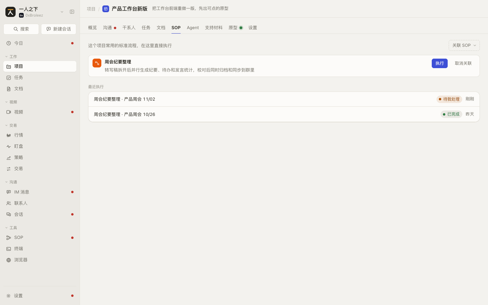 | 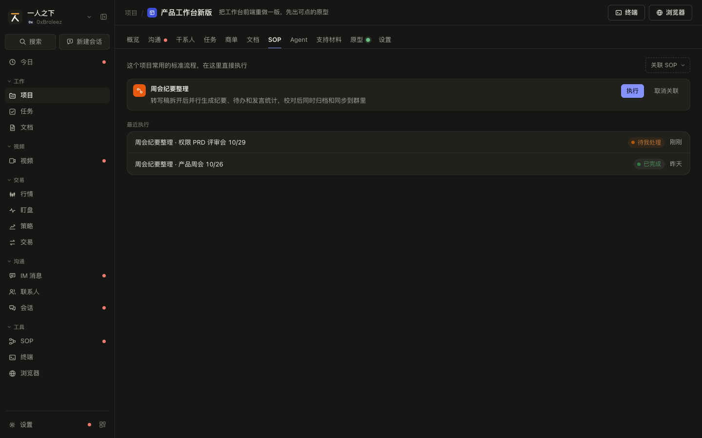 |
| 手机 375 |  |  |

### 交互

| 编号 | 元素 | 操作 | 结果 |
|---|---|---|---|
| SPEC-projects-9.1 | 头部说明 | 显示 | 「这个项目常用的标准流程，在这里直接执行」 |
| SPEC-projects-9.2 | 「关联 SOP」 | 选择 | 可搜索下拉，候选是还没关联的 SOP，按名称、说明搜；选了加到列表末尾 |
| SPEC-projects-9.3 | SOP 卡片名称 | 点击 | 名称和说明；点了切到 SOP 模块打开这个 SOP 的编排页 |
| SPEC-projects-9.4 | 「执行」 | 点击 | 打开这个 SOP 的执行抽屉（正式前端切到 SOP 模块的流程详情再打开，地址 `/sop/flows/<id>?start=1`；发起后进运行页） |
| SPEC-projects-9.5 | 「取消关联」 | 点击 | 立即取消，不确认；SOP 本身和执行记录不动 |
| SPEC-projects-9.6 | 「最近执行」 | 显示和点击 | 有执行记录时出现：关联 SOP 的执行记录按开始时间倒序前 8 条，标题、执行状态、相对时间；点了切到 SOP 模块打开执行详情 |

### 空状态和异常状态

| 编号 | 场景 | 显示 | 可做的操作 |
|---|---|---|---|
| SPEC-projects-9.7 | 没关联 SOP | 「还没关联 SOP」；没有「最近执行」 | 「关联 SOP」 |
| SPEC-projects-9.8 | SOP 都已关联 | 下拉里「SOP 都已经关联了」 | |
| SPEC-projects-9.9 | 关联的 SOP 被删 | 不显示（按 `sop_ids` 在 SOP 列表里找不到就跳过） | |

### 数据

见 SPEC-projects-0 `Project.sop_ids`；SOP 和执行记录 `Sop`、`SopRun`、`RUN_STATUS`、`runStatus` 在 `web-next/src/sopflow.ts`，字段归 `SPEC-sop`（PROTO-04f）。

### 联动

| 方向 | 对方模块 | 触发 | 结果 | 见 |
|---|---|---|---|---|
| 出去 | SOP | 点名称、「执行」、点执行记录 | 编排页、执行抽屉、执行详情 | `SPEC-sop` |

## SPEC-projects-10 Agent

项目 Agent 和挂在这个项目下的会话。

### 截图

| | 亮 | 暗 |
|---|---|---|
| 桌面 1440 | 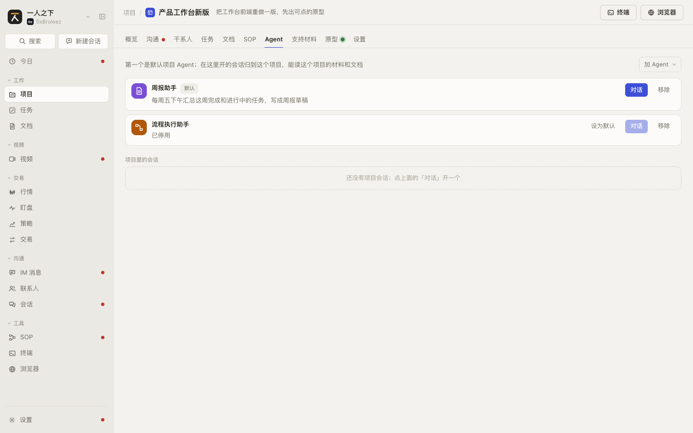 | 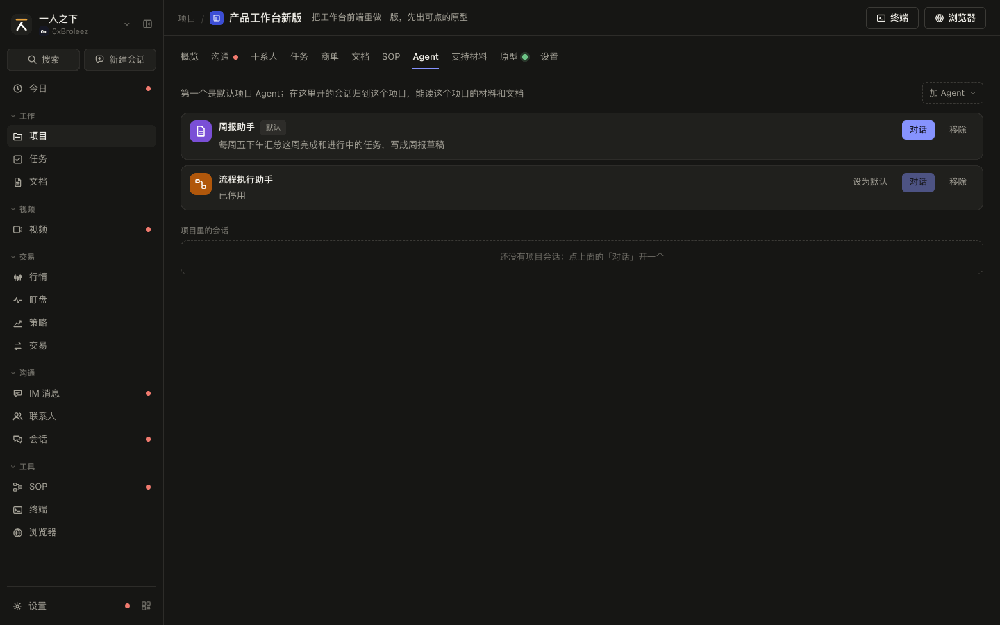 |
| 手机 375 |  |  |

### 交互

| 编号 | 元素 | 操作 | 结果 |
|---|---|---|---|
| SPEC-projects-10.1 | 头部说明 | 显示 | 「第一个是默认项目 Agent；在这里开的会话归到这个项目，能读这个项目的材料和文档」 |
| SPEC-projects-10.2 | 「加 Agent」 | 选择 | 可搜索下拉，候选是还没加的 Agent，按名称、说明搜；停用的提示「已停用」且不可选。选了加到末尾 |
| SPEC-projects-10.3 | Agent 卡片 | 显示和点击 | 头像、名称（第一个带「默认」标签）、说明（停用的显示「已停用」）；点名称切到设置的 Agent 页打开它 |
| SPEC-projects-10.4 | 「设为默认」 | 点击 | 不是第一个的才有；挪到第一个 |
| SPEC-projects-10.5 | 「对话」 | 点击 | 新建一个挂在本项目下的会话，就在本标签里打开（10.13），不切到会话页；Agent 停用时置灰 |
| SPEC-projects-10.6 | 「移除」 | 点击 | 立即从项目移除，不确认；Agent 本身和已有会话不动 |
| SPEC-projects-10.7 | 「项目里的会话」 | 显示和点击 | `project_id` 为本项目的会话，按更新时间倒序，先露 10 条：Agent 头像、标题、Agent 名、相对时间；点了就在本标签里打开它（10.13），打开的那条高亮。多于 10 条时标题旁显示总数 |
| SPEC-projects-10.13 | 项目里就地对话 | 显示和点击 | 打开一个会话时「项目里的会话」一节变成左右两栏：左边会话列表，右边对话面板（同会话页的对话区 `SPEC-sessions-1.14`~`1.20`：历史消息、流式回复、工具调用卡片、等你确认的「确认执行 / 拒绝」、输入框）。面板头部：「返回」（关掉对话回到列表）、会话标题、Agent 名、这一轮在跑时「停止」、「在会话页打开」（切到会话页打开这条，那里有工具面板、产出结果）。正式产品地址记 `?s=<会话 id>`，刷新、后退都还在；会话找不到（删了）时右边「这个会话找不到了（可能已删除）。回到列表」。刚建的空会话也能打开（列表只列有消息的，发出第一句后出现在列表里）。窄屏（900px 以下）只显示对话面板，「返回」回列表 |
| SPEC-projects-10.8 | 「在会话里看全部 N 条」 | 点击 | 多于 10 条时出现；切到会话页并按本项目筛选（`SPEC-sessions-1.5`）。接线没传这个回调时退化为就地「显示全部 还有 N 条」/「收起」，原型里总是传了 |

### 空状态和异常状态

| 编号 | 场景 | 显示 | 可做的操作 |
|---|---|---|---|
| SPEC-projects-10.9 | 没配 Agent | 「还没给项目配 Agent」 | 「加 Agent」 |
| SPEC-projects-10.10 | Agent 都已加入 | 下拉里「Agent 都已经加进来了」 | |
| SPEC-projects-10.11 | 没有项目会话 | 「还没有项目会话；点上面的「对话」开一个」 | 「对话」 |
| SPEC-projects-10.12 | 加入的 Agent 被删 | 不显示（按 `agent_ids` 找不到就跳过）；会话照常列出，Agent 名为空 | |

### 数据

见 SPEC-projects-0 `Project.agent_ids`；Agent、会话见 `SPEC-sessions-0`（`Agent`、`Session.project_id`）。常量 `SESSION_PEEK = 10`。

### 联动

| 方向 | 对方模块 | 触发 | 结果 | 见 |
|---|---|---|---|---|
| 出去 | 会话 | 「对话」、点会话 | 新建会话，在本标签里就地打开（不跳页） | `SPEC-projects-10.13` |
| 出去 | 会话 | 对话面板「在会话页打开」、「在会话里看全部」 | 会话页打开这条、按项目筛选 | `SPEC-sessions-1`、`SPEC-sessions-1.5` |
| 出去 | 设置 / Agent | 点 Agent 名 | Agent 设置页 | `SPEC-settings` |
| 改动 | 本模块 | 设为默认、增删 | 概览的「项目 Agent」跟着变 | `SPEC-projects-3.6` |

## SPEC-projects-11 支持材料

访谈纪要、竞品截图、需求原文、参考链接：文件、文件夹、链接、笔记四种。

### 截图

| | 亮 | 暗 |
|---|---|---|
| 桌面 1440 | 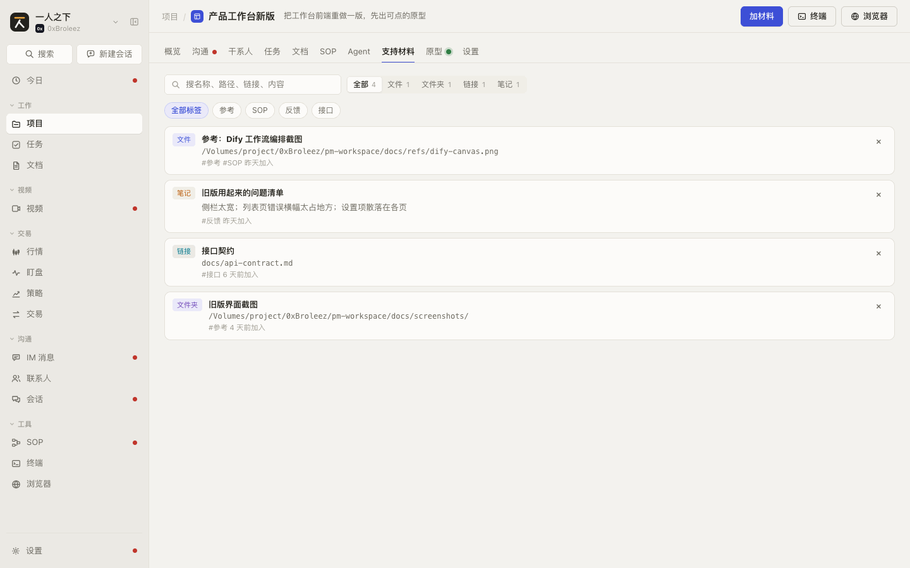 | 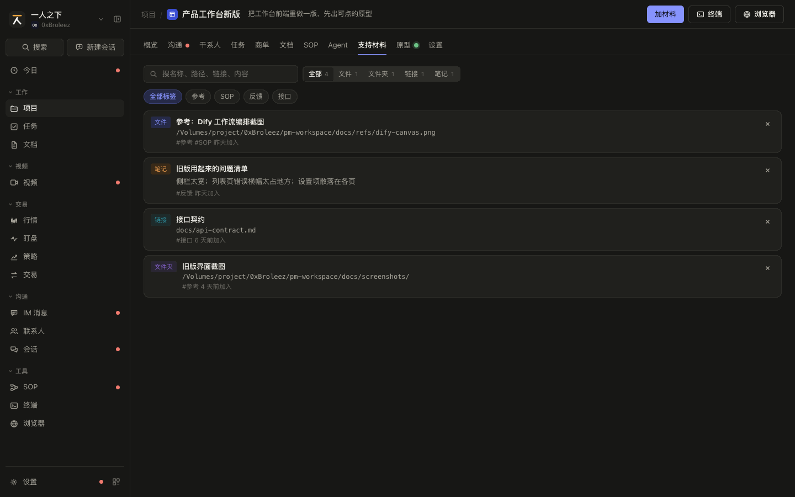 |
| 手机 375 | 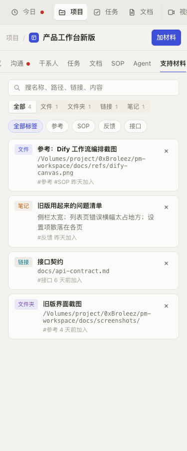 | 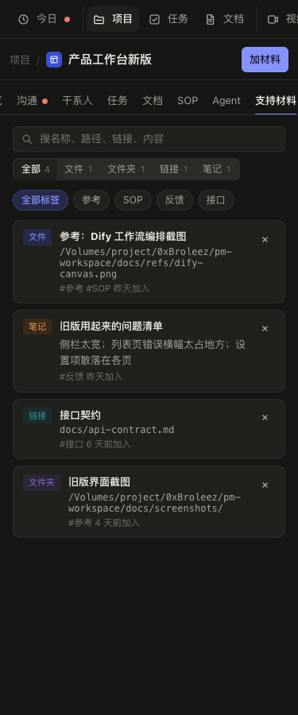 |

加材料的表单截图脚本截不到，操作：支持材料标签右上「加材料」。来自消息附件的材料：先在附件标签里加入一个。来自 IM 消息的笔记：IM 消息页一行「更多」→「转项目资料…」存一条。

### 交互

| 编号 | 元素 | 操作 | 结果 |
|---|---|---|---|
| SPEC-projects-11.1 | 右上「加材料」 | 点击 | 在列表上方展开内联表单，种类默认「文件」 |
| SPEC-projects-11.2 | 种类切换 | 点击 | 文件、文件夹、链接、笔记；下面的输入框随种类变，已填的值保留 |
| SPEC-projects-11.3 | 名称 | 输入 | 占位「名称，比如：客户访谈纪要 10/20」 |
| SPEC-projects-11.4 | 值：笔记 | 输入 | 三行文本框，占位「内容」；右下角「N / 5000」，超过 5000 字（按字数，去首尾空白）红字「超过 5000 字（现在 N 字），删掉一些」，「加上」置灰 |
| SPEC-projects-11.5 | 值：链接 | 输入 | 等宽，占位「https://…」；不校验格式 |
| SPEC-projects-11.6 | 值：文件 / 文件夹 | 输入 | 等宽，占位「相对项目目录的路径，比如 materials/interview.md」或「…比如 materials/screenshots」；下面说明「浏览器只拿得到文件名（或文件夹名），路径按项目目录下的相对路径拼：<项目目录>/…；选多个文件会各加一条」，没设项目目录时省掉冒号后面 |
| SPEC-projects-11.7 | 「选择文件…」 | 选择 | 系统文件选择，可多选。路径前缀取输入框里已有路径的目录部分（没有填时默认 `materials`）。选一个：填进路径，名称为空时用文件名。选多个：每个文件直接加一条材料（标签沿用表单里的），表单收起 |
| SPEC-projects-11.8 | 「选择文件夹…」 | 选择 | 用浏览器的目录选择器；拿到文件夹名后填进路径，名称为空时用文件夹名。浏览器不支持目录选择器时按钮置灰，悬停「这个浏览器不支持选文件夹，请手填路径」；用户取消时不变 |
| SPEC-projects-11.9 | 标签 | 输入 | 占位「标签，逗号隔开」；中英文逗号都能分隔，去首尾空白、去空项 |
| SPEC-projects-11.10 | 「加上」 | 点击 | 名称或值去首尾空白后为空时置灰；加在最前，表单收起 |
| SPEC-projects-11.11 | 「取消」 | 点击 | 收起，不保存 |
| SPEC-projects-11.12 | 搜索框 | 输入 | 有材料时才有工具条；占位「搜名称、路径、链接、内容」，匹配名称、值、标签，不区分大小写；有内容时右侧 x 清空 |
| SPEC-projects-11.13 | 种类切换（工具条） | 点击 | 「全部 N」+ 项目里出现过的种类「<种类> N」，单选 |
| SPEC-projects-11.14 | 标签筛选 | 点击 | 有标签时出现一排：「全部标签」+ 各标签；点已选中的标签回到全部 |
| SPEC-projects-11.15 | 材料卡片 | 显示 | 种类标记、名称；笔记显示正文（保留换行），超过 9 行时先露前 8 行，下面「展开全部（还有 N 行）」，展开后变「收起」；`http(s)` 开头的链接显示为新窗口打开的超链接；其它（文件、文件夹、非 http 的链接）显示等宽路径，文件和文件夹前面拼上项目目录（来自消息附件的不拼），文件夹末尾加 `/`。下面一行：「#标签 … <相对时间>加入」 |
| SPEC-projects-11.16 | 「来自 <发信人>（<群名或私聊>）的消息」 | 点击 | 来自消息附件的材料才有；打开那条消息的抽屉 |
| SPEC-projects-11.22 | 「来自 IM 消息：…」 | 显示 / 点击 | 消息正文转成的笔记（`SPEC-messages-6`）才有：「来自 IM 消息：群「<群名>」 · N 条」，私聊写「和 <姓名> 的私聊」，只有一条时写「<姓名> 的一条」；悬停「打开这组里最新的一条」，点了打开那条消息的抽屉（正式产品切到 IM 消息页 `?m=<id>`）。正式产品的出处由 IM 插件记，IM 插件没在运行时 11.16 和这一条都不显示 |
| SPEC-projects-11.23 | 高亮的材料 | 显示 | 从消息上「已转资料」、转项目资料弹窗的「打开已有的」「去看资料」、附件标签的去向「已加入资料」（`SPEC-projects-5.9`）跳过来时，那条材料卡片描边高亮并滚到视野中间（正式产品地址带 `?mt=<材料 id>`）；换标签后不再高亮 |
| SPEC-projects-11.17 | 卡片右上 x | 点击 | 悬停「移除」；立即移除，不确认；本地文件不动。来自 IM 消息的（11.16、11.22）一并清掉出处，消息上的「已转资料」跟着没 |
| SPEC-projects-11.24 | 卡片右上「编辑」 | 点击 | 在 x 左边，四种材料都有。卡片就地展开编辑表单（同原型卡片的「修改」，一次只开一张），焦点在名称上：种类（见 11.25）、名称、值、标签，「保存」「取消」，Esc 同取消。值按种类：笔记是六行文本框，带字数和 5000 字上限（同 11.4）；链接是等宽输入框；文件、文件夹是路径输入（正式产品带「选择」，相对路径按项目目录补全，没设项目目录时要填绝对路径）。名称清空保存时按内容取默认名（同新建）。标签整体替换，中英文逗号分隔。只把改了的字段发出去，什么都没改时直接收起。来自 IM 消息的笔记（11.22）改了标题、正文、标签，出处照样在；正式产品在卡片时间后面加「· <相对时间>改过」 |
| SPEC-projects-11.25 | 编辑表单的「种类」 | 点击 | 笔记和链接之间、文件和文件夹之间能互换，表单里只列同组的两个，下面写「笔记和链接之间能互换」/「文件和文件夹之间能互换」；路径类和笔记、链接不能互换（要换就删了重加）。换了种类按新种类校验值：链接要以 `http://` 或 `https://` 开头，笔记不超过 5000 字。来自消息附件的材料（11.16）种类和路径都不能改（附件标签按路径认它已加入），表单里没有种类，路径只读，写「来自消息附件，种类和路径不能改」，名称和标签照样能改 |
| SPEC-projects-11.26 | 编辑「保存」 | 点击 | 校验不过时表单里红字写原因（「链接要以 http:// 或 https:// 开头」「超过 5000 字（现在 N 字）」「没设项目目录，路径要填绝对路径…」），不发请求；种类和值都没动时不校验值（早先存下的不合规矩的值，只改名字、标签照样能存）；保存成功收起表单，卡片和概览「最近的文档和材料」跟着变；保存失败留着表单，红字「没保存：<原因>」 |

### 空状态和异常状态

| 编号 | 场景 | 显示 | 可做的操作 |
|---|---|---|---|
| SPEC-projects-11.18 | 没有材料（且没开表单） | 「还没有支持材料」+「访谈纪要、竞品截图、需求原文、参考链接都可以放这里」；没有工具条 | 「加材料」 |
| SPEC-projects-11.19 | 筛选后没有结果 | 「没有匹配的材料」+「换个关键词，或清掉类型和标签筛选」 | 手动清筛选 |
| SPEC-projects-11.20 | 文件或文件夹在本地不存在 | 原型不检查；正式产品在卡片上标「找不到文件」 | 移除或改路径 |
| SPEC-projects-11.21 | 保存失败 | 原型未做；正式产品保留表单，底部红字提示原因；编辑表单同 11.26 | 重试 |

### 数据

见 SPEC-projects-0 的 `Material`、`MaterialKind`、`MATERIAL_KIND`。表单状态 `newMat: Omit<Material, 'id' | 'added_at'> | null`；编辑中的材料 `editMat: string | null`（编辑表单 `MaterialEdit`，能互换的种类 `KIND_GROUPS`，笔记上限 `NOTE_MAX = 5000`）；筛选状态 `matQ`、`matKind`（`MaterialKind | ''`）、`matTag`。新材料 `id` 用 `mt` 前缀现生成。

来自 IM 消息的出处（`SPEC-messages-6`）：原型记在材料的 `from` 上，消息正文转的笔记多 `message_ids`；正式产品由 IM 插件记（`GET /api/im/materials?project_id=` 回 `{material_id, kind: messages|attachment, attachment_id, channel, conversation, senders, message_ids, first_at, last_at, ...}[]`，`message_ids` 按时间正序、已被清理的排在最前），项目插件的 `ProjectMaterial` 不变；移除材料时前端调 `DELETE /api/im/materials/{material_id}` 清掉出处。出处按材料 id 记，编辑材料（`PATCH /api/projects/{id}/materials/{material_id}`）不动出处。

编辑走项目插件已有的 `PATCH /api/projects/{id}/materials/{material_id}`（只传改了的 `name` / `value` / `tags`）；换种类是项目插件 0.9.1 放开的：`kind` 只能在笔记和链接、文件和文件夹之间换，换了值按新种类校验，跨组 400，没有迁移。

正式产品的口径（PJ-03、PJ-03b）：支持材料和产品文档（`SPEC-projects-8`）合并成「项目资料」，附件、文件、文件夹、链接、笔记统一管理，落在 AG-03 的 file 和 artifact 上。原型还是两个标签（见 P-2）。PJ-03b 照本节做资料页的列表、添加和筛选，文档的来源、状态和类型字段照 `SPEC-projects-8` 带过去；合并后的页面在原型补上之前，以本节加 `SPEC-projects-8` 的并集为准。

### 联动

| 方向 | 对方模块 | 触发 | 结果 | 见 |
|---|---|---|---|---|
| 被改动 | IM 消息 | 附件加入 | 多一条带出处的材料 | `SPEC-messages-3`、`SPEC-projects-5` |
| 被改动 | IM 消息 | 「转项目资料」 | 多一条笔记（消息对话记录，标签「IM 消息」），带出处 | `SPEC-messages-6` |
| 进来 | IM 消息 | 消息上「已转资料」、弹窗「打开已有的」「去看资料」 | 切到这个项目的支持材料，高亮那一条 | `SPEC-projects-11.23` |
| 出去 | IM 消息 | 点出处（11.16、11.22） | 消息抽屉 | `SPEC-messages-2` |
| 读取 | 会话 | 项目 Agent 读材料 | 会话里能读这个项目的材料 | `SPEC-sessions-1` |
| 改动 | 本模块 | 增删改 | 概览「最近的文档和材料」跟着变 | `SPEC-projects-3.8` |

## SPEC-projects-12 原型

项目里的原型：配好目录、启动命令和端口，一键启停、看日志。

### 截图

| | 亮 | 暗 |
|---|---|---|
| 桌面 1440 | 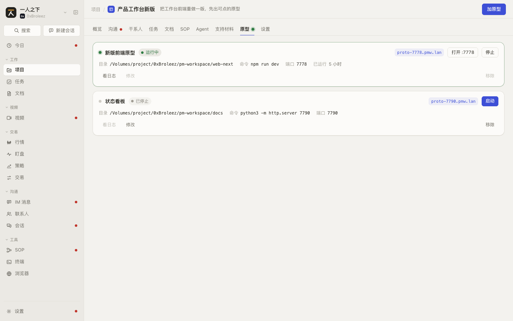 | 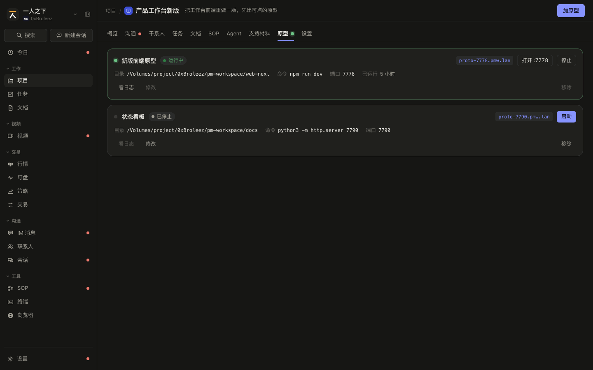 |
| 手机 375 | 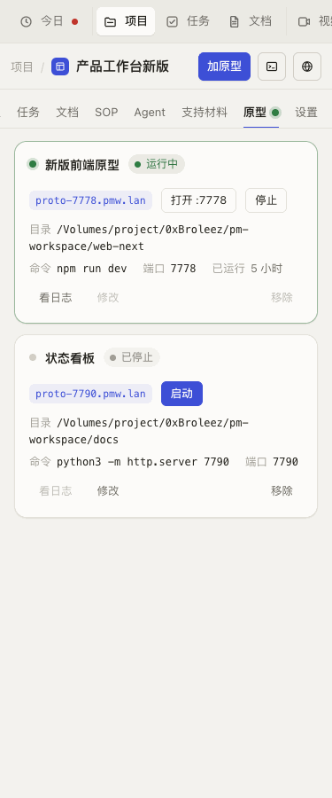 | 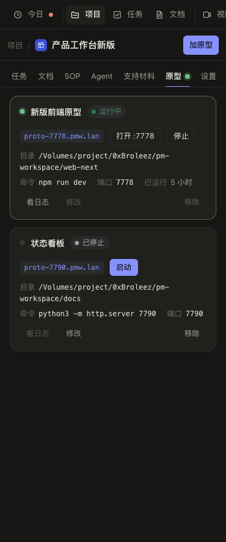 |

日志、修改表单、启动失败截图脚本截不到。操作：点卡片上「看日志」「修改」；启动失败：把「状态看板」的端口改成 7778 后点「启动」（会被正在运行的「新版前端原型」占着），或把端口改成 7777（保留端口，按钮直接置灰）。

### 交互

| 编号 | 元素 | 操作 | 结果 |
|---|---|---|---|
| SPEC-projects-12.1 | 没设项目目录的提示 | 显示 | 项目目录为空时最上面「先在「设置」里填项目目录，原型的目录相对它来算」；不拦着加原型 |
| SPEC-projects-12.2 | 右上「加原型」 | 点击 | 在列表上方展开内联表单：名称（占位「原型名称，比如：权限配置原型」）、端口（数字，默认给一个空闲端口）、目录（占位「目录（相对项目目录），比如 prototype」）、启动命令（默认 `npm run dev`）；旁边说明「端口默认给一个没被占用的」 |
| SPEC-projects-12.3 | 默认端口 | 打开表单 | 从 7780 到 7899 找第一个 `portConflict` 通过、且没有任何项目的原型用着的端口；都占满时给 7899 |
| SPEC-projects-12.4 | 端口冲突提示 | 输入 | 端口不通过 `portConflict` 时表单里红字显示原因 |
| SPEC-projects-12.5 | 「加上」/「取消」 | 点击 | 名称或命令去首尾空白后为空时「加上」置灰；端口冲突不拦（启动时再拦）。加上后状态为已停止、没有日志，加在末尾 |
| SPEC-projects-12.6 | 原型列表排序 | 显示 | 运行中（含外部启动，见 12.25）、启动失败、启动中和停止中、已停止，同状态按加入顺序 |
| SPEC-projects-12.7 | 已停止折叠 | 显示和点击 | 已停止的多于 6 个时收成一行「已停止 N 个」+「展开 / 收起」，点了展开或收起 |
| SPEC-projects-12.8 | 原型卡片 | 显示 | 头部：状态灯、名称、状态标签；有内网域名时一个域名按钮（去掉协议，等宽，悬停「内网域名，点一下复制」，点了复制完整地址）。中间：目录（项目目录 + `/` + `dir`）、命令、端口，运行中加「已运行 <时长>」 |
| SPEC-projects-12.9 | 「启动」/「重新启动」 | 点击 | 已停止为「启动」，启动失败为「重新启动」。启动中、停止中，或端口冲突时置灰，冲突时悬停显示原因。点了状态变启动中，日志先写两行（`$ cd <dir>`、`$ <command>`）；原型模拟 1.2 秒后再查一次端口：冲突则启动失败，`error` 为「启动失败：<原因>」，日志追加 `Error: listen EADDRINUSE: address already in use :::<端口>`，并记一条运行异常（`warn`、模块「项目原型」、标题「「<原型名>」启动失败」、内容是原因、上下文带项目、原型、目录、命令、端口）；不冲突则运行中，记 `started_at`，日志换成按命令编的启动输出 |
| SPEC-projects-12.10 | 「停止」 | 点击 | 运行中时显示；点了变停止中、按钮文字「停止中…」并置灰；原型模拟 0.6 秒后已停止，清掉 `started_at`，日志追加 `^C`、`已停止` |
| SPEC-projects-12.11 | 「打开 :端口」 | 点击 | 运行中时显示，悬停「在内置浏览器里打开」；打开 `http://127.0.0.1:<端口>`：开了浏览器模块时在内置浏览器开，否则系统浏览器新窗口 |
| SPEC-projects-12.12 | 端口冲突提示 | 显示 | 不在运行、也不在启停中，且端口冲突时，卡片里显示「<原因>，换一个端口再启动」 |
| SPEC-projects-12.13 | 启动失败原因 | 显示 | 状态为启动失败时卡片里显示 `error` |
| SPEC-projects-12.14 | 「看日志」/「收起日志」 | 点击 | 展开或收起日志框（等宽，一行一条）；没有日志时置灰 |
| SPEC-projects-12.15 | 「修改」/「收起设置」 | 点击 | 运行中、启停中时置灰，悬停「先停下来再改」（运行中时）。展开表单：名称、端口、目录（说明「相对项目目录」）、启动命令；端口冲突时红字原因 |
| SPEC-projects-12.16 | 修改表单「保存」/「取消」 | 点击 | 名称或命令为空时「保存」置灰；保存后状态重置为已停止、清掉失败原因，表单收起。取消收起，不保存 |
| SPEC-projects-12.17 | 「移除」 | 点击 | 运行中、启停中时置灰；立即移除，不确认；本地目录不动 |
| SPEC-projects-12.18 | 手机宽度 | 显示 | 卡片宽度不到 520 时头部分两行：名称和状态在第一行，域名和按钮换到第二行；中间信息换行 |

### 空状态和异常状态

| 编号 | 场景 | 显示 | 可做的操作 |
|---|---|---|---|
| SPEC-projects-12.19 | 没有原型（且没开表单） | 「还没有原型」+「配好目录、启动命令和端口，就能在这里一键启停」 | 「加原型」 |
| SPEC-projects-12.20 | 端口是保留端口 7777 | 「7777 端口给真实数据的工作台服务用着，换一个端口再启动」，「启动」置灰 | 修改端口 |
| SPEC-projects-12.21 | 端口被别的运行中原型占着 | 「<端口> 端口被「<项目> / <原型>」占着，换一个端口再启动」，「启动」置灰；如果是启动后才冲突（两个同时启动），进入启动失败 | 修改端口；停掉占用的原型 |
| SPEC-projects-12.22 | 端口超出范围 | 「端口要在 1024 到 65535 之间」 | 修改 |
| SPEC-projects-12.23 | 进程崩溃 | 原型未做（模拟里运行中不会自己退出）；正式产品按 PJ-04a：状态变启动失败，`error` 写退出码，日志保留最后的输出，并记运行异常 | 重新启动、看日志 |
| SPEC-projects-12.24 | 启动命令在本地跑不起来（目录不存在、命令找不到） | 原型未做；正式产品同 12.23，原因写明 | 修改 |
| SPEC-projects-12.25 | 外部启动（`external`，PJ-04c） | 原型未做；正式产品：不是这里启动的，但端口在本机能连上（比如自己在终端里跑着的 dev server）。状态灯绿色，标签「运行中（外部启动）」；「打开 :端口」可用；「启动」「停止」都显示但置灰，悬停分别说明「这个端口已经有程序在跑（不是这里启动的），直接打开就行」「不是这里启动的，这里停不了；到启动它的终端里停」；没有「已运行」时长、没有本次日志；「修改」「移除」可用。概览「原型」块同样只给「打开」和置灰的「停止」。项目列表的原型绿灯和计数、概览「原型运行中」、标签条绿灯、今日「正在运行」（端口后注明「外部启动」）、终端格子和浏览器首页都按在跑算。不自动分配内网域名（只有在这里启动才分配），目标是这个原型的域名也不转发；要域名就手动加一条目标是地址 `http://127.0.0.1:<端口>` 的 | 打开；到外面停掉后回到已停止 |

### 数据

见 SPEC-projects-0 的 `Prototype`、`ProtoStatus`、`PROTO_STATUS`、`portConflict`、`RESERVED_PORTS`。日志 `startLogs(p)`（`projectdata.ts`）按命令编：`http.server` 一行 Serving、`next` 三行、`npm` / `pnpm` / `yarn` / `vite` 三行，认不出的只报监听端口；正式产品是真实输出，日志放环形缓冲（PJ-04a）。内网域名来自设置的内网域名路由（`ProtoDomainContext`，`SPEC-settings` 内网域名节）。常量 `STOPPED_FOLD = 6`。

正式产品按 PJ-04a、PJ-04b：只停自己启动的进程（按记录的 pid）；启动后状态从启动中变为运行中，日志实时显示。PJ-04c 起多一种 `external`（外部启动，见 12.25），外面起着的原型认得出、能打开，但不能从这里启停；7778（本仓库原型站点）不再是保留端口。

### 联动

| 方向 | 对方模块 | 触发 | 结果 | 见 |
|---|---|---|---|---|
| 出去 | 浏览器 | 「打开」 | 打开原型地址 | `SPEC-browser` |
| 改动 | 设置 / 运行异常 | 启动失败 | 记运行异常 | `SPEC-settings` |
| 共用 | 终端、浏览器、今日 | 启停 | 终端和浏览器首页也能启停同一个原型，状态共用；今日「运行中的原型」跟着变 | `SPEC-terminal`、`SPEC-browser`、`SPEC-today-1` |
| 被引用 | 设置 / 内网域名 | 域名指向原型 | 卡片上显示域名；删项目时一起删 | `SPEC-settings` |

## SPEC-projects-13 设置

项目的名称、标志、说明、本地目录、关联目录，以及删除项目。所有字段边改边保存，没有「保存」按钮。

### 截图

| | 亮 | 暗 |
|---|---|---|
| 桌面 1440 | 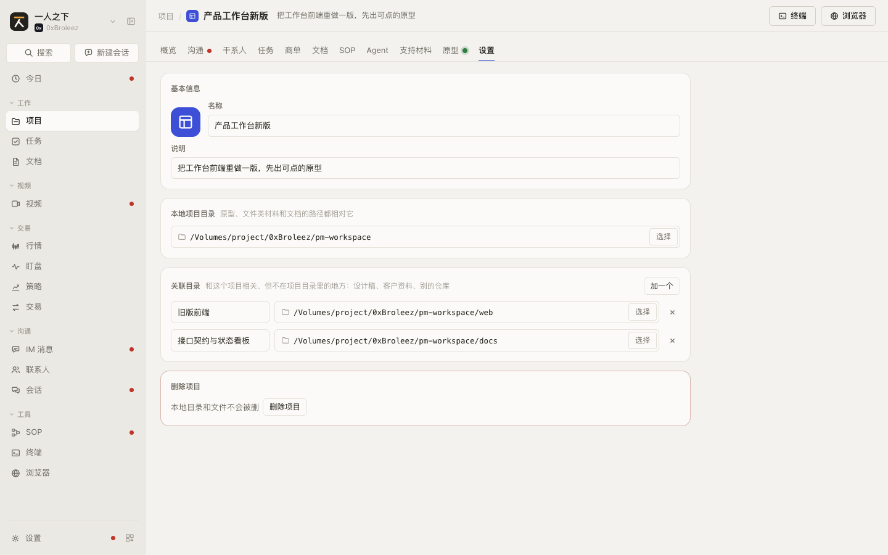 | 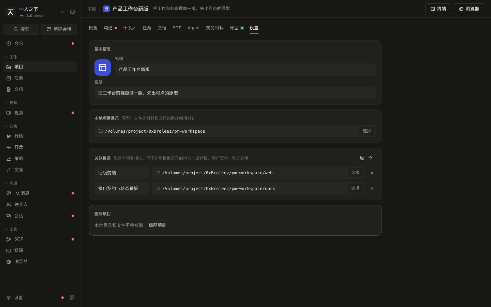 |
| 手机 375 | 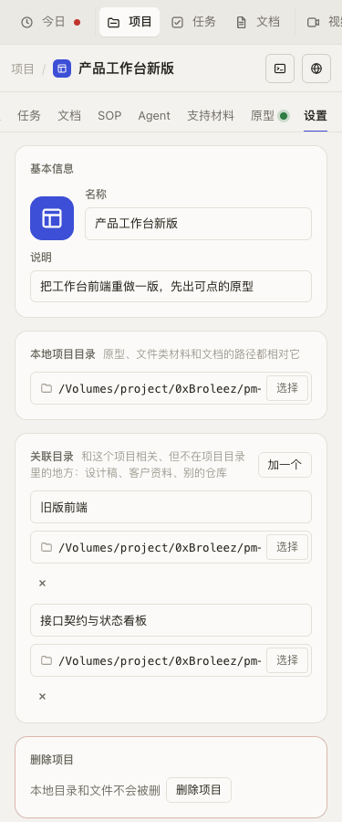 | 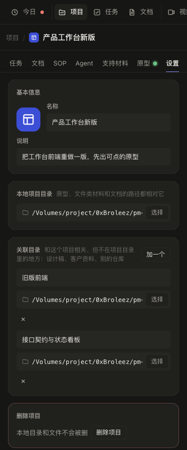 |

删除确认截图脚本截不到，操作：设置标签最下面点「删除项目」。

### 交互

| 编号 | 元素 | 操作 | 结果 |
|---|---|---|---|
| SPEC-projects-13.1 | 标志 | 点击 | 悬停「更换图像」；弹出标志编辑：「图标」（内置图标网格，再点已选的取消，没选时提示「没选，用文字」）、「图片」（上传、移除图片）、文字（选了图标时不显示，占位是名称第一个字）、「底色」（选颜色）。改了立即生效；填了文字会清掉图标 |
| SPEC-projects-13.2 | 名称 | 输入 | 边输边保存，顶栏和列表跟着变 |
| SPEC-projects-13.3 | 说明 | 输入 | 边输边保存，顶栏说明跟着变 |
| SPEC-projects-13.4 | 本地项目目录 | 输入 | 标题旁说明「原型、文件类材料和文档的路径都相对它；任务没设工作目录时用它」（后半句是正式前端补的，说的是 `SPEC-projects-7.2` 的工作目录继承；原型的说明只有前半句）；路径框带文件夹图标，等宽，占位 `/Users/me/projects/xxx` |
| SPEC-projects-13.5 | 路径框「选择」 | 点击 | 悬停「浏览器只能拿到选中目录的名字，上级路径要自己补」；用浏览器的目录选择器，把选中目录名替换路径的最后一段（没有上级时只填目录名）；浏览器不支持时按钮置灰，悬停「这个浏览器不支持选文件夹，请手填路径」；取消时不变 |
| SPEC-projects-13.6 | 关联目录「加一个」 | 点击 | 标题旁说明「和这个项目相关、但不在项目目录里的地方：设计稿、客户资料、别的仓库」；加一行空的 |
| SPEC-projects-13.7 | 关联目录行 | 输入 | 名称（占位「名称」）+ 路径框（同 13.5，占位 `/Volumes/…`），边输边保存 |
| SPEC-projects-13.8 | 关联目录行 x | 点击 | 悬停「删除这个关联目录」；立即删除，不确认 |
| SPEC-projects-13.9 | 「删除项目」 | 点击 | 说明「本地目录和文件不会被删」；点了换成确认条：「只删项目记录，本地目录和文件不动；<影响>」+「取消」「删除」 |
| SPEC-projects-13.10 | 删除影响 | 显示 | 按实际数据列出，分号隔开：「N 个任务、N 个会话、N 个视频会移出项目，记录保留」「运行中的原型 <名字> 会停掉」「域名 <host.后缀> 会一起删除」；没有影响时只有前一句 |
| SPEC-projects-13.11 | 确认「删除」 | 点击 | 删掉项目；任务 `project_id` 清空并记 `project_removed = 项目名`（任务上提示原属项目已删除）；会话、视频的 `project_id` 清空；指向本项目原型的内网域名删除；回到项目列表 |
| SPEC-projects-13.12 | 确认「取消」 | 点击 | 回到「删除项目」按钮 |
| SPEC-projects-13.19 | 「显示哪些标签」 | 勾选 | 在关联目录下面、删除项目上面；标题旁说明「不勾的标签在这个项目的详情页里不显示，数据不动；拖动或用上移、下移调整顺序；概览和设置一直显示、固定一头一尾」。按标签条的顺序（`SPEC-projects-13.20`）列出全部标签（含插件给的「商单」），每个一个勾选框，默认全勾；概览、设置勾着且置灰（悬停「一直显示」）；「附件」悬停「IM 消息模块没开时本来就不显示」。勾掉、勾上立即生效、立即保存，标签条跟着变。存的是「不显示的」（`tabs_hidden`）：以后新加的标签默认显示，不用回来补勾。列表一行一个：拖动把手、勾选框和名称、上移下移两个按钮；概览、设置那行没有把手和按钮，右边注「固定第一」「固定最后」 |
| SPEC-projects-13.20 | 「显示哪些标签」排序 | 拖动 / 点击 | 同一块里调标签先后，标签条跟着变，立即保存到 `tabs_order`（存的是除概览、设置以外的全部 key 的顺序）。**拖动**：除概览、设置外每行都能拖（悬停「拖动调整顺序」），拖到哪一行就占那一行的位置——往下拖落在它后面、往上拖落在它前面，经过的行用上/下边线提示落点；拖到概览上就是第一个、拖到设置上就是最后一个（概览、设置本身不动）。**键盘**：每行「上移「<标签名>」」「下移「<标签名>」」两个图标按钮（悬停同名），第一个能排的上移置灰、最后一个下移置灰；挪完焦点留在同一行的同一个按钮上，到头了换到另一个按钮；读屏念「「<标签名>」移到第 N 个」（N 从概览算起）。被勾掉的标签照样在列表里、照样能排，开回来时就在排好的位置；插件给的「商单」、IM 的「附件」也参与排序，插件没开时它们的位置保留着，再开时回到原位。列表下方「恢复默认顺序」：已经是默认顺序时置灰，点了清空 `tabs_order`（回到 `ProjectTab` 的顺序），不动勾选。概览、设置固定的理由：概览是进项目的默认标签，设置是唯一能把藏掉的标签开回来的地方，两头固定才找得到 |

### 空状态和异常状态

| 编号 | 场景 | 显示 | 可做的操作 |
|---|---|---|---|
| SPEC-projects-13.13 | 没有关联目录 | 「没有关联目录」 | 「加一个」 |
| SPEC-projects-13.14 | 名称清空 | 名称必填：清空时输入框下红字「名称必填；不填的话离开输入框时恢复成「<原名称>」」，不保存这次修改，顶栏和卡片保留原名称；离开输入框时恢复原名称 | 补上 |
| SPEC-projects-13.15 | 项目目录不存在或不是目录 | 原型不检查；正式产品在路径框下提示「找不到这个目录」，仍允许保存 | 改路径 |
| SPEC-projects-13.16 | 关联目录名称或路径为空 | 原型照常保存空行；正式产品路径为空的行不保存 | |
| SPEC-projects-13.17 | 删除失败、保存失败 | 原型未做；正式产品保留当前状态，红字提示原因 | 重试 |
| SPEC-projects-13.18 | 刚新建的项目名称没改就离开 | 原型未做；正式产品（C-05）在列表点「新建项目」进来、名称还是「新项目」时，切标签、回列表、换模块都先拦下，设置顶部红框「这个项目还是空的（名称还是「新项目」），要删掉吗？删了进回收站，可以恢复」。只问这一次：选了「留着」或刷新页面后不再问 | 「继续编辑」回到名称输入框；「留着」照常离开；「删掉」删掉项目，要去本项目别的标签时回列表，否则去原本要去的地方 |

### 数据

见 SPEC-projects-0 的 `Project`（`name`、`desc`、`mark`、`color`、`root`、`related`）。删除影响由 `App.tsx` 的 `projectPlan(pj)` 算：数 `tasks`、`sessions`、`videos` 里 `project_id` 为本项目的条数，列运行中或启动中的原型名，查设置里 `target.kind === 'proto'` 且指向本项目原型的域名路由。

正式产品按 PJ-01c：新建项目设好工作目录后，该项目下新建的任务继承这个目录；原型里任务的开发信息有工作目录字段，没填时用所属项目的目录（`SPEC-projects-7.2`）。

### 联动

| 方向 | 对方模块 | 触发 | 结果 | 见 |
|---|---|---|---|---|
| 改动 | 任务、会话、视频、内网域名 | 删除项目 | 见 13.11 | `SPEC-tasks-4`、`SPEC-sessions-1`、`SPEC-settings` |
| 改动 | 本模块 | 改项目目录 | 原型卡片、文件类材料、概览的目录显示跟着变 | `SPEC-projects-3`、`SPEC-projects-11`、`SPEC-projects-12` |

## SPEC-projects-14 项目里的终端和浏览器

每个项目有自己的终端和内置浏览器：从详情页标题行最右的「终端」「浏览器」两个按钮进，在主区域底部展开一块独立区域，上面的项目内容照常可用。终端默认在项目目录，浏览器第一个标签是这个项目的原型。

### 截图

| | 亮 | 暗 |
|---|---|---|
| 终端（1440） | 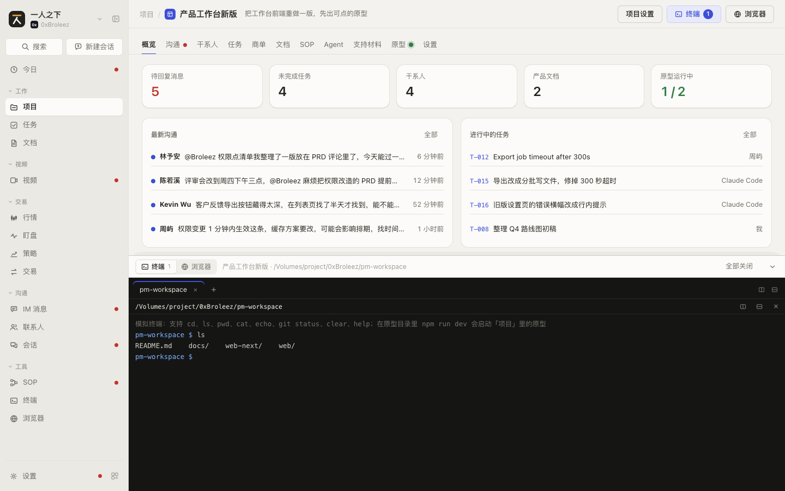 | 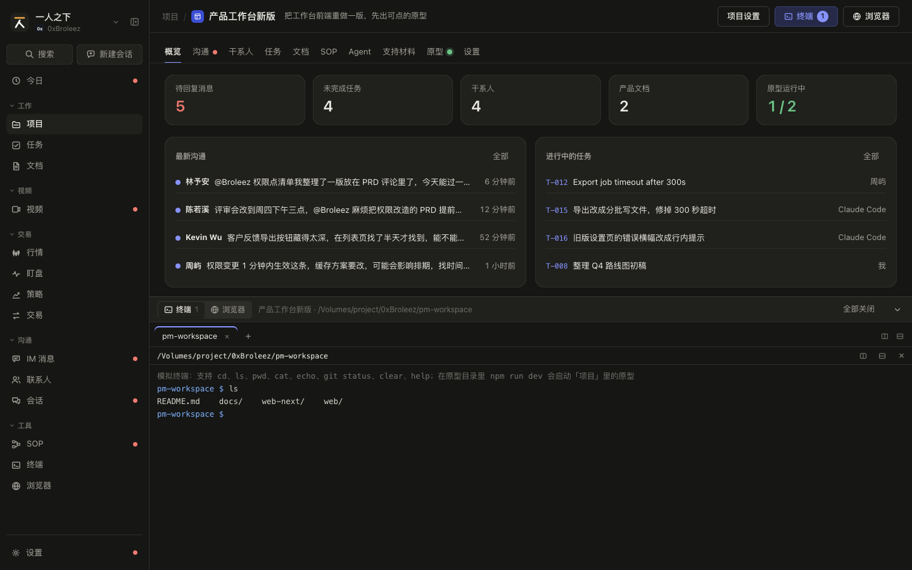 |
| 浏览器（1440） | 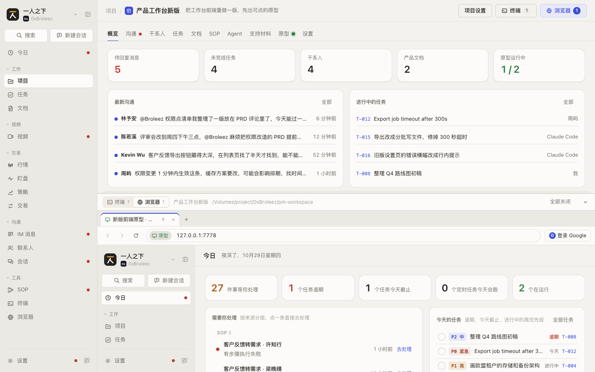 | 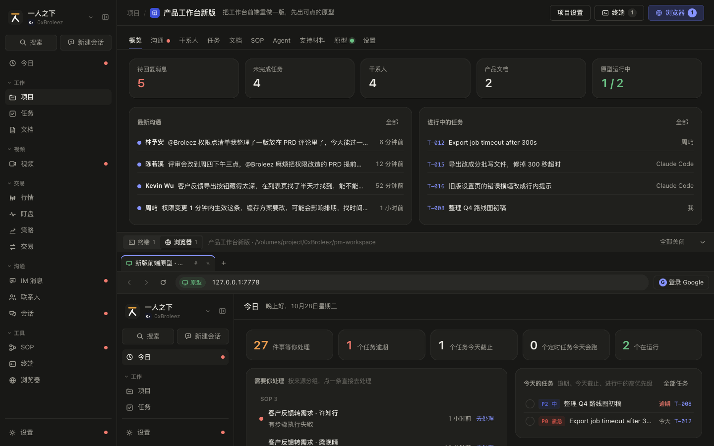 |

### 交互

| 编号 | 元素 | 操作 | 结果 |
|---|---|---|---|
| SPEC-projects-14.1 | 标题行「终端」「浏览器」 | 显示 | 在各标签自己的按钮右边（概览上就在「项目设置」右侧），所有标签都有。图标 + 名称 + 已打开的数量（终端数标签页，浏览器数网页标签）；数量为 0 不显示。展开着的那个按钮高亮。标题行窄于 640 时只留图标和数量 |
| SPEC-projects-14.2 | 「终端」 | 点击 | 展开区域并切到终端；这个项目还没开终端时先开一个，目录是项目目录（没填目录时在 `~`）。展开着并且正显示终端时再点就收起 |
| SPEC-projects-14.3 | 「浏览器」 | 点击 | 展开区域并切到浏览器；还没开时先开一个，第一个标签是这个项目的原型（有在跑的取在跑的，否则取第一个；原型没在跑时显示「这个原型没在运行」+「启动原型」，和一级菜单浏览器里的原型标签一样）；项目没有原型时是新标签页。展开着并且正显示浏览器时再点就收起 |
| SPEC-projects-14.4 | 区域头部 | 显示 | 左边「终端 N」「浏览器 N」切换；项目名和项目目录（手机宽度不显示）；右边「全部关闭」、收起按钮 |
| SPEC-projects-14.5 | 头部「终端」「浏览器」切换 | 点击 | 在两者间切换，不收起；切到的那边一个都没开时先开一个，规则同 14.2、14.3 |
| SPEC-projects-14.6 | 终端 | 使用 | 和一级菜单「终端」是同一套模拟终端：多标签、每个标签最多 2x2 拆分、双击标签改名、在原型目录里 `npm run dev` 启动原型、Ctrl+C 停止。拆分按钮在标签栏右端。新标签页的目录是项目目录 |
| SPEC-projects-14.7 | 浏览器 | 使用 | 和一级菜单「浏览器」是同一套：多标签（最多 12 个）、固定、右键菜单、地址栏、前进后退、Google 登录。新标签页里的「项目原型」只列这个项目的原型 |
| SPEC-projects-14.8 | 收起按钮 | 点击 | 区域收起，已打开的终端（含输出和在跑的原型）和网页（含已加载的页面）都保留；再点标题行按钮展开，内容还在 |
| SPEC-projects-14.9 | 切项目、切菜单 | 离开再回来 | 区域只跟着打开它的项目：换到别的项目，看到的是那个项目自己的（没开过就是收起的、数量为 0）；离开项目详情时区域不显示；回来时保持离开前的展开或收起，内容都在 |
| SPEC-projects-14.10 | 「全部关闭」 | 点击 | 关掉这个项目打开的全部终端和网页，终端里跑着的原型一起停掉，区域收起，标题行两个数量归零；别的项目不受影响。不弹确认。什么都没开时置灰 |
| SPEC-projects-14.11 | 关掉最后一个 | 关掉终端的最后一个标签或浏览器的最后一个网页 | 那一边变成空状态，数量归零；另一边还开着时区域照常显示 |

### 空状态和异常状态

| 编号 | 场景 | 显示 | 可做的操作 |
|---|---|---|---|
| SPEC-projects-14.12 | 终端一个都没开（切到终端那边） | 「没有打开的终端」+「新建终端」 | 新建一个，目录是项目目录 |
| SPEC-projects-14.13 | 浏览器一个都没开 | 「没有打开的网页」+「打开浏览器」 | 打开，规则同 14.3 |
| SPEC-projects-14.14 | 项目没填目录 | 终端在 `~` 打开，头部只显示项目名 | 去设置标签填目录 |

### 数据

`ProjectDockState`（`projects.tsx`），按项目 id 记在 `App.tsx` 的 `docks`：

| 字段 | 类型 | 说明 |
|---|---|---|
| `open` | boolean | 是否展开 |
| `view` | `'term' \| 'browser'` | 展开时显示哪边 |
| `term` | `TermTab[]` | 这个项目的终端标签，结构同一级菜单的终端 |
| `termActive` | string | 当前终端标签 |
| `br` | number | 浏览器实例的 key，0 表示没开；全部关闭后再开换一个新的 |
| `brTabs` | number | 浏览器当前的标签数（标题行数量用） |

浏览器标签状态在 `BrowserPage` 组件里，区域收起或离开项目时组件不卸载，只是藏起来，所以已加载的网页不重载。原型里这些都只在内存，刷新就没了；正式产品终端会话在后端（TERM-01），浏览器标签持久化归 BR-01，按项目分开存。

### 联动

| 方向 | 对方模块 | 触发 | 结果 | 见 |
|---|---|---|---|---|
| 改动 | 本模块原型 | 在项目终端里 `npm run dev` / Ctrl+C；「全部关闭」 | 启停对应原型，原型标签和概览的运行数跟着变 | `SPEC-projects-12` |
| 读取 | 本模块原型 | 项目浏览器第一个标签、新标签页 | 只用这个项目的原型 | `SPEC-projects-12` |
| 读取 | 浏览器 | Google 登录 | 和一级菜单的浏览器共用同一个 Google 账号 | — |

### 和一级菜单「终端」「浏览器」的关系

一级菜单里的「终端」「浏览器」是两个独立模块，先保留：它们不属于任何项目，适合跨项目或临时用；标签和项目里的这块互不相干，在一边开的标签不会出现在另一边。项目里其他地方的「打开」（原型卡片、概览原型块）仍按 `SPEC-projects-12` 交给一级菜单的浏览器。这两个模块以后是去掉、还是改成「全部项目的终端和浏览器」汇总，另行决定。

## SPEC-projects-15 档案

AUTO-04。给分类 Agent 和各 pipeline 用的项目信息：分类 Agent 按简介、关键词、平台判断一条需求或 IM 消息属于哪个项目；产品 Agent 往原型库、PRD 目录里写；研发和发布 pipeline（二、三期）按代码库目录和命令跑。标签在「原型」后、「设置」前，参与「显示哪些标签」的隐藏和排序（`SPEC-projects-13.19`、`13.20`）。和设置一样边改边存，没有「保存」按钮。

### 截图

| | 亮 | 暗 |
|---|---|---|
| 桌面 1440 | 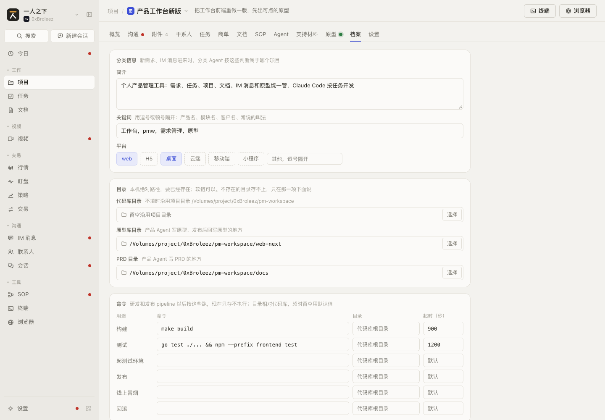 | 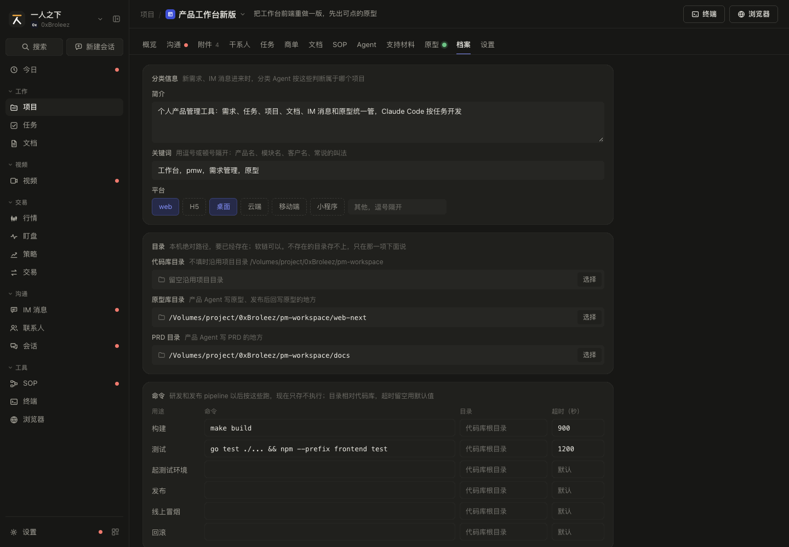 |
| 手机 375 | 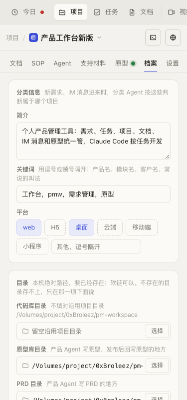 | 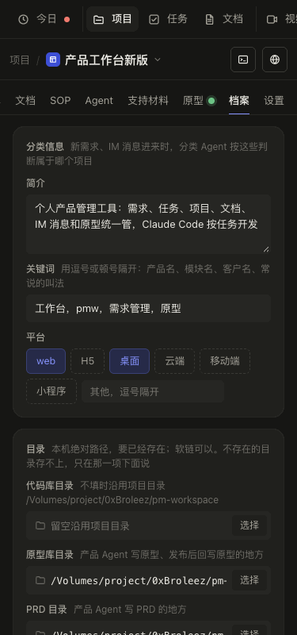 |

### 交互

| 编号 | 元素 | 操作 | 结果 |
|---|---|---|---|
| SPEC-projects-15.1 | 「分类信息」块 | 显示 | 标题旁说明「新需求、IM 消息进来时，分类 Agent 按这些判断属于哪个项目」 |
| SPEC-projects-15.2 | 简介 | 输入 | 多行，占位「这个项目做什么、给谁用、边界在哪；比设置里的一句话说明写得更全」；停手片刻保存，最多 2000 字。和设置里的「说明」（对象 `body`）是两个字段：说明是一句话、列表卡片上显示；简介写给 Agent 看 |
| SPEC-projects-15.3 | 关键词 | 输入 | 一个输入框，说明「用逗号或顿号隔开：产品名、模块名、客户名、常说的叫法」；按中英文逗号、顿号、换行拆开，去空、去重（不分大小写，留第一次的写法），每个最多 30 字、最多 50 个；只改了分隔处的空格不算改动 |
| SPEC-projects-15.4 | 平台 | 点击 / 输入 | 常用项 web、H5、桌面、云端、移动端、小程序，点一下选上（高亮）、再点取消，立即保存；后面「其他，逗号隔开」输入框填常用项以外的平台，和常用项合起来去重。每个最多 30 字、最多 10 个 |
| SPEC-projects-15.5 | 「目录」块 | 输入 | 标题旁说明「本机绝对路径，要已经存在；软链可以」。三个路径框（同 `SPEC-projects-13.5` 的「选择」）：代码库目录（说明「不填时沿用项目目录 <项目目录>」，占位「留空沿用项目目录」；项目没设目录时说明「研发 pipeline 在这里改代码、跑命令；不填时沿用项目目录」）、原型库目录（「产品 Agent 写原型、发布后回写原型的地方」）、PRD 目录（「产品 Agent 写 PRD 的地方」）。停手片刻保存；清空即清掉 |
| SPEC-projects-15.6 | 目录保存 | 保存 | 三个目录各自单独存，不和别的字段一起：不是绝对路径、不存在、不是目录时只这一项存不上，路径框下红字「没保存上：<原因>」，别的字段照存；改对后自动再存、红字消失。存的是填的原样（去首尾空白和末尾斜杠），软链不展开 |
| SPEC-projects-15.7 | 「命令」块 | 输入 | 标题旁说明「目录相对代码库，超时留空用默认值」（AUTO-10 起；AUTO-08 到 AUTO-09 是「构建、测试、起测试环境、冒烟由任务工作区的「运行测试」执行，发布、回滚先只存」）。十行固定，分两组（见 `SPEC-projects-15.16`）：构建、测试、起测试环境、冒烟（测试环境）；版本号与更新日志、打包、发布前检查、发布、线上冒烟、回滚。「冒烟」一直是测试环境上的冒烟，线上冒烟是 AUTO-10 新加的一条（key `prod_smoke`），旧数据不用改；每行三列：命令（等宽，构建行占位 `make build`）、目录（相对代码库目录，占位「代码库根目录」）、超时（秒，占位「默认」；起测试环境的超时是等就绪的时间）。停手片刻保存；命令清空即清掉这一条。命令里可以用 `$PORT`、`{{PORT}}` 等测试时注入的变量（`SPEC-tasks-4.72` 下的说明） |
| SPEC-projects-15.7a | 「就绪检查」 | 输入 | 只在「起测试环境」一行下面（AUTO-08）：灰字「就绪检查」、等宽输入框（占位「留空等 $PORT 能连上；或填 /healthz」）、灰字「回 2xx、3xx 算就绪；超时是等就绪的时间，留空 2 分钟」。留空等测试环境端口能连上；`/` 开头是本机测试环境端口上的路径；也可以写本机地址（`http://127.0.0.1:{{PORT}}/…`、`localhost`、`[::1]`）。有空格、不是 `/` 或本机地址开头时输入框标红、红字说明，改好前命令先不存；后端也挡（非本机地址 400，不让测试借它往外发请求） |
| SPEC-projects-15.8 | 超时 | 输入 | 只收非负整数秒，最多 86400（一天）；填错时输入框标红，行下红字「超时填整数秒」或「超时最多一天（86400 秒）」+「，改好前命令先不存」，这期间所有命令都不保存，改好后一起存 |
| SPEC-projects-15.9 | 「人员」块 | 选择 | 标题旁说明「从联系人里挑；验收人员是自动流程里通知去验收的人」。负责人、验收人员两个多选下拉（同 `SPEC-projects-6.2` 的候选：按姓名、公司、职位、分组、标签搜，按拼音分段），勾一个立即保存。和「干系人」标签的「负责人」角色互不影响：这里是给自动流程用的名单 |
| SPEC-projects-15.10 | 保存状态 | 显示 | 右上角「保存中」→「已保存」；简介、关键词、平台、命令、人员存不上时红字「没保存上：<原因>」+「重试」 |
| SPEC-projects-15.16 | 命令分组 | 显示 | AUTO-10。「命令」块里分两组，组名加粗、后面灰字说明。「测试环境」：构建、测试、起测试环境、冒烟（测试环境），说明「任务工作区的「运行测试」按顺序执行：构建、起测试环境、测试、冒烟；可用变量 PORT、WORKTREE、TASK_REF、TEST_REPORT_DIR」。「发布」：版本号与更新日志、打包、发布前检查、发布、线上冒烟、回滚，说明「发布 pipeline 在任务工作区里执行，审批前只跑版本号与打包；可用变量 WORKTREE、TASK_REF、RELEASE_ID、RELEASE_DIR、RELEASE_VERSION」。每行命令下一行灰字提示用途：版本号「审批前跑：把版本号写进 $RELEASE_DIR/version.txt、更新日志写进 $RELEASE_DIR/changelog.md；没写 version.txt 取输出最后一行」；打包「审批前跑：在工作区里打包，不碰生产」；发布前检查、发布、线上冒烟、回滚都以「上线审批后才跑：」开头（发布前检查「备份数据库、核对密钥；没过不发布、不回滚」，发布「没填就发起不了发布」，线上冒烟「没过自动回滚」，回滚「发布或线上冒烟没过时自动执行」）。执行见 `tasks.md` `SPEC-tasks-4.80` |
| SPEC-projects-15.17 | 「原型同步」块 | 显示 | AUTO-11。档案标签末尾（「人员」之后）。标题旁说明「以上线代码为准回写原型库和规格；只提交到原型库的同步分支 proto-sync/日期，合并由你决定」。流程见 `docs/auto-delivery-flow.md` 第 2 节：取上次同步点到生产分支 HEAD 的代码 diff，原型同步 Agent 在原型库的同步分支上对比，新增、不一致的按代码改原型和规格，未实现、已下线的在规格上标实现状态，拿不准的交产品裁决，只提交到同步分支，记同步点并通知负责人 |
| SPEC-projects-15.18 | 同步点 | 显示 | 一行「同步点：代码 <短提交>，对应原型 <同步分支> <短提交>（<时间>，<状态>）」，原型没改时不写「对应原型」；没有同步点时灰字「还没有同步点：第一次同步会对比整个代码库；代码和原型已经对齐时可以先设为基线」。后面灰字「生产分支 <分支> 现在是 <短提交>」，有同步点时接「，比同步点新」或「，已同步到这里」；取不到时红字原因（没有代码库目录、不在 git 仓库里、分支不存在） |
| SPEC-projects-15.19 | 「立即同步」 | 点击 | 发起一次同步（内置流程「原型同步」，触发方式记「手动」），右侧换成状态徽标「进行中」、「查看执行」（跳到这次的 SOP 执行）和「作废」。同一项目同时只跑一次：有进行中或等裁决的时只显示那一次的状态和操作，不能再发起。取不到生产分支 HEAD 时置灰 |
| SPEC-projects-15.20 | 「设为基线」 | 点击 | 先弹确认「把当前代码设为同步点？」，正文「不对比、不改原型，只记下「原型已经和代码 <短提交> 对齐」。之后的同步只看这之后的改动；原型其实没对齐时，之前的差异就不会再被发现」，按钮「设为基线」「取消」。确认后记一行「设为基线」，同步点改成当前 HEAD |
| SPEC-projects-15.21 | 进行中、等裁决 | 显示 / 点击 | 状态徽标：进行中（蓝）、等产品裁决（黄）。等裁决时链接是「去裁决」，跳到 SOP 执行页，在「产品裁决」一步选当作新设计（再交 Agent 按代码回写）、当作缺陷（给项目建修复任务，原型不动）、暂不处理；进行中时是「查看执行」。「作废」：这次记「已作废」，同步点不动，删掉同步分支的工作目录（分支上没有新提交时连分支一起删），SOP 执行不终止（到执行页终止）；作废的那个 HEAD 不再被「生产分支有新提交」自动发起，要同步就点「立即同步」 |
| SPEC-projects-15.22 | 「自动触发」 | 切换 | 说明「默认都关；同一项目同时只跑一次，有进行中的就等它结束」。三个开关，切换立即保存：「发布成功后同步」（发布 pipeline 上线成功、发布记录变成已上线时发起）；「生产分支有新提交时同步」+ 灰字「每分钟看一次本机代码库的分支，不拉远端」（HEAD 和同步点、上一次发起时的 HEAD 都不同才发起，hotfix、手工提交都算）；「每日巡检」+ 时间输入框（本机时间 HH:MM，默认 09:00）+ 灰字「本机时间；没有新提交时只记一行，不跑流程」：每天到点后第一次检查时巡检一次，HEAD 和同步点相同只记一行「没有界面改动」。时间写错时输入框标红、红字「时间写成 HH:MM，改好前不保存」，改对后离开输入框才保存 |
| SPEC-projects-15.23 | 生产分支 | 输入 | 等宽输入框，占位 `main`，说明「留空依次认 main、master、当前检出的分支」；离开输入框时保存。分支名只能有字母、数字、点、下划线、斜杠、短横线，不合法时后端 400，块下红字「没保存上：<原因>」 |
| SPEC-projects-15.24 | 最近一次 | 显示 | 卡片：标题「最近一次」、状态徽标（已同步绿、没成功红、进行中蓝、等产品裁决黄，其余灰）、时间和触发方式（发布成功 / 生产分支有新提交 / 每日巡检 / 手动 / 设基线）、「查看执行」。一句话结果：已同步「代码 <起> → <止>：新增 n、不一致 n、未实现 n、已下线 n、不确定 n；拿不准的当作缺陷。改动在 proto-sync/<日期>（<短提交>），看过差异清单后再合并」（原型没改时「。原型和规格不用改」，首次同步起点写「首次」）；没有界面改动「代码 a → b 没有涉及界面或接口的改动，同步点前移」（巡检没新提交时「自上次同步后生产分支没有新提交」）；等裁决「…；n 条拿不准，到 SOP 执行页的「产品裁决」里定」；没成功红字原因。下面依次是 Agent 的说明（灰字）、判为缺陷时「拿不准的判为缺陷，已建修复任务（<任务>）」、差异清单表（分类、差异：标题加灰字说明和「裁决：…」、规格条目：编号，没编号写原型页面、实现状态）、折叠的「改动的代码文件（n）」（diff 统计） |
| SPEC-projects-15.25 | 规格实现状态 | 显示 | 「规格实现状态」表，说明「按规格编号取最近一次同步的结论」：规格条目、内容、实现状态（已实现绿、未实现灰、已下线灰、实现有偏差红、待裁决黄）、同步于。作废和没成功的同步不算；没有带规格编号的差异时整表不显示；手机宽度去掉「同步于」列。规格文件里由原型同步 Agent 在条目末尾写「实现状态：已实现（原型同步 <短提交>）」「实现状态：未实现」「实现状态：已下线（代码 <短提交> 删除）」 |
| SPEC-projects-15.26 | 同步历史 | 展开 | 同步过两次以上时显示折叠的「同步历史（n）」，最多 30 次，新的在前；每行时间、触发方式、状态徽标、代码范围（`<起> → <止>`）、同步分支和提交（有的话）、一句话结果 |

### 空状态和异常状态

| 编号 | 场景 | 显示 | 可做的操作 |
|---|---|---|---|
| SPEC-projects-15.11 | 没建过档案 | 全部空着，照常编辑；第一次保存时才建档案 | 填 |
| SPEC-projects-15.12 | 档案加载失败 | 「档案没加载出来」+ 原因 | 「重试」 |
| SPEC-projects-15.13 | 选过的人后来被归档或删除 | 归档的在下拉里显示「已归档的联系人」，可以去掉；删除的读出来时已经滤掉 | 重新挑 |
| SPEC-projects-15.14 | 存过的目录后来被删或改名 | 编辑页照常显示原路径（只在保存时校验）；档案摘要里这一项算「找不到」，目录不齐全 | 改路径 |
| SPEC-projects-15.15 | 项目插件没在跑 | 没有项目详情页（同其它标签） | |
| SPEC-projects-15.27 | 还没同步过 | 「最近一次」的位置是虚线框「还没有同步过」，同步点一行是「还没有同步点…」 | 「立即同步」「设为基线」 |
| SPEC-projects-15.28 | 原型同步没加载出来 | 块里红字「原型同步没加载出来：<原因>」，档案其它部分照常 | 「重试」 |

### 数据

`Project.profile`（`ProjectProfile`，`web-next/src/projectdata.ts`），没建过时没有：

| 字段 | 类型 | 说明 |
|---|---|---|
| `intro` | `string` | 简介 |
| `keywords` | `string[]` | 关键词 |
| `platforms` | `string[]` | 平台标签 |
| `code_dir` / `proto_dir` / `prd_dir` | `string` | 代码库、原型库、PRD 目录，本机绝对路径；空串是没设 |
| `commands` | `Partial<Record<'build' \| 'test' \| 'test_env' \| 'smoke' \| 'version' \| 'package' \| 'preflight' \| 'release' \| 'prod_smoke' \| 'rollback', { command, dir, timeout_sec, ready? }>>`（AUTO-10 加 `version`、`package`、`preflight`、`prod_smoke`） | 只含设了的命令；`dir` 相对代码库目录、不能是绝对路径、不能用 `..` 跑出代码库；`timeout_sec` 为 0 用执行方默认值；`ready` 只有 `test_env`：就绪检查（`SPEC-projects-15.7a`，AUTO-08） |
| `owner_ids` / `acceptor_ids` | `string[]` | 联系人 id |

正式产品存在项目插件的表 `projects_profiles`（插件迁移 0005），一个项目一行，不放对象 `props`：props 的 PATCH 整体替换，会和设置页边改边存互相覆盖。接口 `GET`/`PATCH /api/projects/{id}/profile`（PATCH 每个字段整体替换、没传的不动，并发的两次 PATCH 只改各自传了的列）；分类用的摘要 `GET /api/projects/profiles`：每个建过档案、没进回收站的项目一行（名称、ref、简介、关键词、平台、三个目录的路径和状态 ok / missing / unset、代码库没设时沿用项目目录并标 `inherited`、`dirs_ready`、设了哪些命令）。没建档案的项目不在摘要里（插件读不到对象列表），Agent 用 MCP 只读工具 `pmw_list_project_profiles`，它把项目列表和摘要合起来，没建档案的也列出并注明。

原型同步（AUTO-11）：原型 `Project.proto_sync`（`ProtoSyncInfo`，`web-next/src/protosyncdata.ts`）：`settings`（`on_release`、`on_merge`、`daily`、`daily_at`、`branch`）、`head`（生产分支当前 HEAD，原型里写死）、`history`（`ProtoSyncRun[]`，新的在前：`trigger`、`status`、`base_commit`、`head_commit`、`proto_branch`、`proto_commit`、`items`、`decision`、`fix_task`、`summary`、`error`、`started_at`）；差异 `items` 每项 `{kind, title, detail, spec, page, status, decision}`，`kind` 是 added / changed / unimplemented / removed / uncertain，`status` 是规格实现状态 implemented / unimplemented / offline / deviation / pending。正式产品存在项目插件的表 `projects_proto_syncs`（一次同步一行，同步点是最近一次 done / no_change / baseline 的 `head_commit`）和 `projects_proto_sync_settings`（插件迁移 0010）；接口 `GET`/`PATCH /api/projects/{id}/proto-sync`（概况与开关）、`GET`/`POST /api/projects/{id}/proto-syncs`（历史、手动发起或设基线）、`GET /api/projects/proto-syncs/runs/{sync_id}`、`POST …/cancel`（作废）；变化时发 `projects.proto_sync_changed`。

### 联动

| 方向 | 对方模块 | 触发 | 结果 | 见 |
|---|---|---|---|---|
| 被读 | 分类 Agent、SOP（AUTO-06） | 新需求、IM 消息要定项目 | 读档案摘要（`pmw_list_project_profiles`） | `docs/auto-delivery-flow.md` |
| 被读 | 研发、发布 pipeline（AUTO-07 到 AUTO-10） | 跑构建、测试、部署 | 读代码库目录和命令 | `docs/auto-delivery-flow.md` |
| 读 | 本模块「设置」 | 改项目目录 | 代码库目录没设时的说明和摘要里的沿用目录跟着变 | `SPEC-projects-13.4` |
| 读 | 联系人 | 归档、删除联系人 | 见 15.13 | `SPEC-contacts` |
| 被触发 | 发布（AUTO-10） | 发布记录变成已上线，且开了「发布成功后同步」 | 发起一次原型同步 | `SPEC-projects-15.22` |
| 写 | SOP「原型同步」（IM 插件写入的内置流程） | 发起同步 | 原型库同步分支 proto-sync/日期 的提交、规格条目的实现状态、同步点；判为缺陷时给项目建修复任务；通知负责人 | `docs/auto-delivery-flow.md` 第 2 节 |

## 原型和规格对不上的地方

整理时发现的问题，PROTO-10 按下表处理，正文已同步。

| 编号 | 位置 | 问题 | 建议 | 处理 |
|---|---|---|---|---|
| P-1 | `SPEC-projects-2.7` | 项目不存在时提示「还没有项目，点左下「新建项目」」，项目已经没有二级菜单，左下没有这个按钮 | 改成「这个项目不存在或已删除」+「回到项目列表」 | 已修（PROTO-10）：改成「这个项目不存在或已删除」+「回到项目列表」，见 `SPEC-projects-2.7` |
| P-2 | `SPEC-projects-8`、`SPEC-projects-11` | 开发计划 PJ-03 要把支持材料和产品文档合并成「项目资料」，原型仍是两个标签；附件面板的文案也写「支持材料」 | 定下合并后的原型（标签名、种类、筛选），再改附件相关文案 | 不修：合并成「项目资料」要先定合并后的标签名、种类和筛选，属于 PJ-03 的设计，不是原型和规格对不上；合并定下之前标签仍叫「支持材料」，附件文案和它一致，不单独改 |
| P-3 | `SPEC-projects-1.6`、`SPEC-projects-3.1`、`SPEC-projects-4.8` | 项目里「待回复」按 `status === 'pending'` 数，含稍后提醒没到点的；IM 消息页的待处理不含稍后，两边数字对不上 | 项目里也排除稍后（复用 `isSnoozed`） | 已修（PROTO-10）：项目里按 `awaitingReply` 数，排除稍后，见 `SPEC-projects-0` |
| P-4 | `SPEC-projects-3.10` | 绑了渠道但还没有消息时，概览也说「还没绑定沟通渠道」 | 区分两种情况：没绑定 /「绑定的会话里还没有消息」 | 已修（PROTO-10）：区分没绑定和「绑定的会话里还没有消息」，见 `SPEC-projects-3.10` |
| P-5 | `SPEC-projects-3.13` | 概览「项目 Agent」空状态的「去设置」跳到设置标签，但 Agent 在 Agent 标签里配 | 改成切到 Agent 标签 | 已修（PROTO-10）：切到 Agent 标签，见 `SPEC-projects-3.13` |
| P-6 | `SPEC-projects-2.5` | 手机宽度下顶栏不显示「项目 /」，除了点一级菜单没有回列表的入口 | 手机宽度保留返回入口 | 已修（PROTO-10）：手机宽度和顶栏挤窄时都留「项目 /」，见 `SPEC-projects-2.5` |
| P-7 | `SPEC-projects-3.15` | 「最近的文档和材料」没有空状态，块里只有标题 | 加「还没有文档和材料」 | 已修（PROTO-10）：加「还没有文档和材料」，见 `SPEC-projects-3.15` |
| P-8 | `SPEC-projects-4.20` | 绑定群聊的候选只来自已有消息，新建的项目群收到第一条消息前绑不了 | 正式产品按会话表列；原型可以从连接器的频道配置里补候选 | 已修（PROTO-10）：从 IM 连接器监听的频道补候选，示例数据给 Slack 加了 `#release`、`#pmw-beta`，见 `SPEC-projects-4.4` |
| P-9 | `SPEC-projects-6.7` | 干系人「最近沟通」在所有消息里找，不限本项目绑定的会话；正文截 14 字后总是加「…」，短消息也加 | 先定口径（建议限本项目会话）；短于 14 字不加省略号 | 已修（PROTO-10）：口径定为限本项目绑定的会话；短于 14 字不加省略号，见 `SPEC-projects-6.7` |
| P-10 | `SPEC-projects-7.5` | 项目任务标签点完成圆圈，对待验收任务直接改成已完成，没有确认；和决策「列表上点完成圆圈对待验收任务等于验收通过，先弹确认」不一致 | 与任务列表同一套：待验收时先弹确认（归 PROTO-07 或 PROTO-08 一起改） | 已修（PROTO-10）：和任务列表同一套确认弹窗，见 `SPEC-projects-7.5` |
| P-11 | `SPEC-projects-11.8`、`SPEC-projects-13.5` | 浏览器不支持目录选择器时点「选择文件夹…」「选择」没有任何反应 | 不支持时按钮置灰并悬停说明「这个浏览器不支持选文件夹，请手填路径」 | 已修（PROTO-10）：不支持时按钮置灰并悬停说明，见 `SPEC-projects-11.8`、`SPEC-projects-13.5` |
| P-12 | `SPEC-projects-12.18` | 375 宽下原型卡片头部按钮太多，名称被挤成一字一行，域名只剩一个字（见 `shots/projects/第一个项目_标签_原型-375-dark.png`） | 手机宽度下头部按钮换到第二行 | 已修（PROTO-10）：卡片窄于 520 时按钮换到第二行，见 `SPEC-projects-12.18` |
| P-13 | `SPEC-projects-13.14` | 名称可以清空保存 | 名称必填 | 已修（PROTO-10）：名称必填，见 `SPEC-projects-13.14` |
| P-14 | PJ-01c 验收 | PJ-01c 要求「最近打开的项目出现在二级菜单」，但项目已改成没有二级菜单，最近打开只用于列表排序（`SPEC-projects-1.13`）；「该项目下新建的任务继承工作目录」原型里也没有 | 建议 PJ-01c 这两条验收改成：列表默认按最近打开排序；任务继承工作目录按 DEV 系列任务的工作目录字段补进原型后再验 | 已修：最近打开的口径已按决策「项目的「最近打开」口径」改成列表排序；工作目录继承原型里已有（任务开发信息的工作目录没填时用所属项目目录，PROTO-07 补的），规格补在 `SPEC-projects-7.2` |
| P-15 | `SPEC-projects-3.2` | 概览「最新沟通」显示 `sender_name`（如 Lin Yuan），沟通标签和 IM 消息页显示联系人姓名（林予安），同一个人两个名字 | 概览也先按联系人显示 | 已修（PROTO-10）：概览也按联系人显示，见 `SPEC-projects-3.2` |
| P-16 | `SPEC-projects-3.7` | 概览原型块里启动失败的原型按钮文字是状态名「启动失败」，卡片里是「重新启动」；端口冲突置灰时没有悬停原因 | 和卡片一致：「重新启动」，置灰时悬停原因 | 已修（PROTO-10）：和卡片一致，端口冲突时悬停原因，见 `SPEC-projects-3.7` |
| P-17 | `SPEC-projects-4.10` | 项目沟通里的消息正文不高亮 @，和 IM 消息页不一致 | 复用 `MentionText` | 已修（PROTO-10）：复用 `MentionText`，见 `SPEC-projects-4.10` |
| P-18 | `SPEC-projects-0`、`SPEC-projects-4.5`、`SPEC-projects-4.18` | 待回复口径改成只算与我相关（B-01）；私聊候选按联系人列、没填 IM 编号的置灰、空状态按原因写（A-02、E-01）。原型的 `awaitingReply` 仍按全部待处理算，私聊候选没有置灰项，空状态只有「联系人都已经绑过了」 | 原型跟规格改 | 不修（PR-02）：原型只当规格，正式产品按本规格；原型改动另开任务 |
| P-19 | `SPEC-projects-4.22` 到 `SPEC-projects-4.25`、`SPEC-projects-6.2` | 项目沟通加搜索、与我相关下拉和行内「已处理」（B-10）；加干系人改成多选、按分组和标签搜、按拼音排（B-05）。原型的沟通标签没有筛选条，行上只有「回复」；加干系人是单选、只按姓名公司职位搜、按码位排 | 原型跟规格改 | 不修（PR-09）：原型只当规格，正式产品按本规格；原型改动另开任务 |
| P-20 | `SPEC-projects-15.6`、`15.8` | 原型不校验目录在不在（浏览器拿不到本机路径）；超时填错时原型只标红，不提示「改好前命令先不存」以外的保存状态；原型没有保存状态 | 原型只演示布局和字段，校验以正式产品为准 | 不修（AUTO-04）：目录校验只能在后端做；原型的其它标签也没有保存状态 |
| P-21 | `SPEC-projects-15.21` | 原型里「去裁决」在块里直接给三个选项（当作新设计、当作缺陷、暂不处理）并模拟出结果；正式产品跳到 SOP 执行页，在「产品裁决」一步里选 | 原型没有模拟 SOP 执行，保留块内演示 | 不修（AUTO-11）：裁决要留在 SOP 执行里（有执行记录、能看到 Agent 的输出），块里只给入口 |
