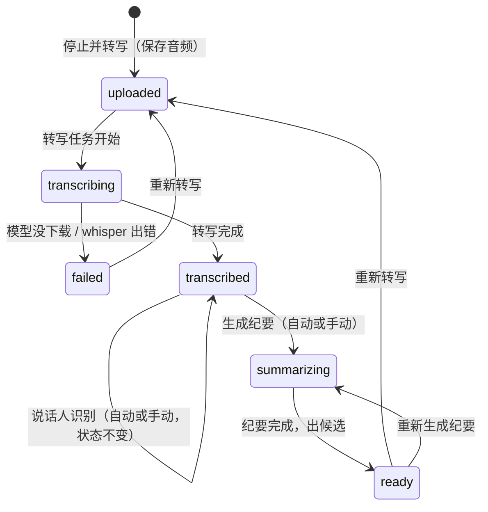

# 录音规格（SPEC-recording）

| 项 | 内容 |
|---|---|
| 模块 key | `recording` |
| 原型入口 | 一级菜单「录音」（「工作」组）；设置分节「插件 / 录音转写」；命令面板「开始录音」，http://127.0.0.1:7778 |
| 源码 | `web-next/src/recording.tsx`、`web-next/src/recording.css` |
| 数据文件 | `web-next/src/recordingdata.ts`（演示数据和模拟引擎，模块级 store） |
| 正式产品 | 前端 `frontend/src/plugins/recording/`（插件入口 `index.ts`、`Page.tsx`、`Detail.tsx`、`Speakers.tsx`、`Minutes.tsx`、`Diagrams.tsx`、`Todos.tsx`、`Files.tsx`、`Rename.tsx`、`SettingsPage.tsx`、`RecorderStatus.tsx`、`recorder.ts`、`model.ts`），数据层 `frontend/src/core/data/recording.ts`，后端 `internal/plugins/recording/`（插件 0.3.0，提交 `66cd6bd4`、`d6cb70f0`） |
| 截图 | [`shots/recording/`](shots/recording/)（还没跑 `shots.py`） |
| 负责任务 | 原型同步 2026-11-17（录音插件此前只在正式产品实现，原型补齐） |
| 状态 | 已整理 |
| 最后对照 | 2026-11-17，原型同步（未提交），对照正式产品 `a501a2d1` |

## SPEC-recording-0 模块概述

浏览器里录音（麦克风、浏览器分享的系统声音、本机虚拟声卡、麦克风加系统声音），录完存到本机，用本机 whisper.cpp 转写；转写后可识别说话人（本机 Python 声纹，绑定联系人后自动认人）、让本机 Agent 生成纪要（摘要、结论、待办建议、流程图和树形图），从纪要里挑出项目、任务、目标候选，确认后建任务或挂项目。音频和文本全程不出本机，唯一联网是下载模型。

录音是常驻的：切到别的模块继续录，任意页面顶部有录音状态条；只有点「停止并转写」才保存。

原型没有后端和麦克风：录音按时间走秒，停止后按下图的状态确定性推进（每步约 0.4 秒推一次进度），转写稿、说话人、纪要、候选是写死的演示内容。

### 页面清单

| 节 | 页面 | 入口 | 说明 |
|---|---|---|---|
| [SPEC-recording-1](#spec-recording-1-录音页) | 录音页 | 一级菜单「录音」 | 录音工作区和录音列表 |
| [SPEC-recording-2](#spec-recording-2-录音详情) | 录音详情 | 列表点标题 / 录音保存后自动打开 | 音频、段落、全文、说话人、纪要、待你确认、文件 |
| [SPEC-recording-3](#spec-recording-3-录音状态条) | 录音状态条 | 录音时任意页面顶部 | 计时、暂停、停止 |
| [SPEC-recording-4](#spec-recording-4-录音转写设置) | 录音转写设置 | 设置 / 插件 / 录音转写 | 工具、模型、转写默认值、纪要、声纹、其他 |

### 共用数据结构

`Recording`（`web-next/src/recordingdata.ts`，字段同正式产品 `core/data/recording.ts` 的 `Recording`；原型多一个 `source`，正式产品没有这个字段）

| 字段 | 类型 | 必填 | 说明 | 取值 / 示例 |
|---|---|---|---|---|
| `id` | `string` | 是 | 编号 | `rec_demo1` |
| `title` | `string` | 是 | 标题，空串显示「未命名录音」 | `周会：审批流与客户演示` |
| `status` | `RecordingStatus` | 是 | 状态 | `draft` 草稿 / `uploaded` 待转写 / `transcribing` 转写中 / `transcribed` 已转写 / `summarizing` 生成纪要中 / `ready` 已完成 / `failed` 失败 |
| `model` | `string` | 是 | 转写用的 whisper 模型 | `small` |
| `language` | `string` | 是 | whisper 语言码 | `zh` |
| `duration_ms` | `number` | 是 | 时长 | |
| `has_audio` | `boolean` | 是 | 有没有音频文件 | |
| `project_id`、`project_title` | `string` | 是 | 关联项目，没有空串 | |
| `error` | `string` | 是 | 失败原因 | |
| `job` | `RecordingJob \| null` | 是 | 最新一条后台任务 | |
| `transcript` | `string` | 是 | 转写全文（可编辑） | |
| `segments` | `Segment[]` | 是 | 段落：`seq`、`start_ms`、`end_ms`、`text`、`speaker`（`spk_N` 或空） | |
| `minutes` | `RecordingMinutes \| null` | 是 | 结构化纪要 | |
| `todos` | `RecordingTodo[]` | 是 | 候选 | |
| `speakers` | `RecordingSpeaker[]` | 是 | 说话人 | |
| `source` | `CaptureSource` | 是 | 录音来源（原型字段） | `mic` 麦克风 / `share` 系统声音（浏览器分享）/ `system` 系统声音（本机设备）/ `mic_system` 麦克风 + 系统声音 |
| `created_at`、`updated_at` | `string` | 是 | ISO 时间 | |

`RecordingJob`：`kind`（`transcribe` 转写 / `summarize` 生成纪要 / `diarize` 说话人识别）、`status`（`pending` 排队 / `running` 进行中 / `done` 完成 / `failed` 失败）、`progress`（0 到 100）、`attempts`、`last_error`。一句话写法：「排队等待转写」「转写中 41%」「转写完成」「转写失败」，纪要、说话人识别同理。

`RecordingMinutes`：`summary_md`（Markdown 摘要）、`conclusions`（结论）、`actions`（待办建议：`title`、`detail`、`owner`、`due`、`project`、`confidence` 0 到 1、`kind` 为 `task` 或 `goal`）、`questions`（AI 没把握的问题：`question`、`why`、`confidence`）、`diagrams`（`flow` 流程图：节点 `kind` 为 `start` / `process` / `decision` / `end`，最多 10 个节点 15 条边；`tree` 树形图：最多 3 层、每层 8 个）、`generated_at`、`model`。正式产品还有 `projects`、`goals` 两个数组（插件内部用来出候选，界面不直接显示），原型省略。

`RecordingTodo`：`index`、`kind`（`project` 项目候选 / `task` 任务候选 / `goal` 目标候选）、`title`、`detail`、`confidence`、`status`（`pending` 待确认 / `confirmed` 已确认 / `ignored` 已忽略）、`project_id`、`project_title`、`object_id`、`object_ref`（确认后建出的任务）、`reason`、`owner_name`、`due_at`。

`RecordingSpeaker`：`label`（`spk_1` 起，按首次出现顺序）、`name`（用户改的名）、`contact_id`、`contact_name`、`similarity`（与已登记声纹的最高相似度 0 到 1）、`segments`、`duration_ms`、`detected`（true 自动匹配到联系人，false 手动绑定）。显示名：改过的名 > 联系人名 > 「说话人 N」。颜色按 N 取固定色板。

### 联动总表

| 方向 | 对方模块 | 触发 | 结果 | 见 |
|---|---|---|---|---|
| 进来 | 命令面板 | 「开始录音」 | 打开录音页并直接开始录（按上次选的来源） | `SPEC-recording-1.2` |
| 进来 | 任意页面 | 点录音状态条 | 回录音页 | `SPEC-recording-3` |
| 出去 | 任务 | 确认任务 / 目标候选 | 任务里多一条任务（负责人、项目、优先级、截止日期按表单），已确认里点编号打开任务抽屉 | `SPEC-recording-2.20` |
| 改动 | 项目 | 确认项目候选 | 这条录音挂到所选项目（不新建项目） | `SPEC-recording-2.20` |
| 改动 | 联系人 | 说话人绑定联系人 | 这个联系人登记（或覆盖）声纹，后续录音自动认出 | `SPEC-recording-2.12` |
| 出去 | SOP | 「发起纪要 SOP」 | 正式产品按设置里的流程（空则内置「会议纪要整理」）发起 SOP 执行；原型不跑 SOP，直接按直连 Agent 出纪要 | `SPEC-recording-2.16` |

## SPEC-recording-1 录音页

上面是录音工作区，下面是状态筛选和录音列表。

### 截图

截图待 `shots.py` 跑一遍后补（原型 7778 在跑时执行 `--only recording`）。

### 交互

| 编号 | 元素 | 操作 | 结果 |
|---|---|---|---|
| SPEC-recording-1.1 | 顶栏「录音」+ 说明「浏览器内录音，本机 whisper.cpp 转写；音频和文本都不出本机」、右上「开始录音」 | 点击 | 同工作区的「开始录音」。实现状态：已实现（原型同步 2026-11-17） |
| SPEC-recording-1.2 | 工作区「准备录音」：标题输入框（可空）、来源四选一、来源说明、「开始录音」 | 点击开始 | 进「正在申请<来源>」（正式产品弹浏览器授权或屏幕分享；原型 0.7 秒后视为授权通过），再进「<来源> · 录音中」开始计时。来源记住上次选的。实现状态：已实现（原型同步 2026-11-17） |
| SPEC-recording-1.3 | 来源「系统声音（本机设备）」「麦克风 + 系统声音」 | 选择 | 多出「声音设备」下拉（虚拟声卡标「（虚拟声卡/系统声音）」，默认设备标「 · 默认」）+「重新检测」，下面一段装 BlackHole 的说明。正式产品设备来自 `GET /api/recording/audio-devices`（ffmpeg 列 macOS 设备）；非 macOS、没装 ffmpeg、没有虚拟声卡时下拉换成一句原因（如「没找到 ffmpeg，先 brew install ffmpeg，再点「重新检测」」）。原型设备列表写死（内置麦克风、BlackHole 2ch）。实现状态：已实现（原型同步 2026-11-17） |
| SPEC-recording-1.4 | 录音中：计时、「暂停」/「继续」、「停止并转写」、「放弃」 | 点击 | 暂停冻结计时；本机设备采集（两种系统来源）不能暂停，不显示暂停按钮。「停止并转写」进「正在保存」（系统来源写「正在停止采集并混音保存」），保存成一条「待转写」录音并排队转写，录音页显示着时自动打开它的详情；「放弃」丢掉这次录音回到准备。实现状态：已实现（原型同步 2026-11-17） |
| SPEC-recording-1.5 | 状态筛选「全部 / 转写中 / 已完成 / 失败」 | 点击 | 转写中含待转写、转写中、生成纪要中；已完成含已转写、已完成；失败只看失败。实现状态：已实现（原型同步 2026-11-17） |
| SPEC-recording-1.6 | 列表行 | 显示 | 标题（铅笔行内重命名，点标题进详情）、「MM-DD HH:mm · 项目名」、失败时红字原因；标签「N 位说话人」「待确认 N」「已有纪要」「N 个任务」；状态胶囊；时长；待转写和转写中时显示进度条。实现状态：已实现（原型同步 2026-11-17） |
| SPEC-recording-1.7 | 行内重命名 | 铅笔、回车、失焦、Esc | 回车或失焦保存，Esc 取消；空或没变不保存；超过 200 字红字「标题最多 200 字」。列表和详情标题共用。实现状态：已实现（原型同步 2026-11-17） |
| SPEC-recording-1.8 | 演示开关「演示：下一次授权被拒」 | 勾选 | 原型专用：下一次开始录音走授权失败（见 1.11）。正式产品没有这个开关 |

### 空状态和异常状态

| 编号 | 场景 | 显示 | 可做的操作 |
|---|---|---|---|
| SPEC-recording-1.9 | 一条录音都没有 | 「还没有录音」+「点右上「开始录音」，录完会自动保存到本机并排队转写」 | 「开始录音」。实现状态：已实现（原型同步 2026-11-17） |
| SPEC-recording-1.10 | 筛选后没有结果 | 「没有符合条件的录音」 | 「清除筛选」。实现状态：已实现（原型同步 2026-11-17） |
| SPEC-recording-1.11 | 授权失败（拒绝麦克风、取消分享） | 工作区标题「录音没保存上」，红框「录音失败：<原因>」，原因按错误给可操作的中文（如「麦克风权限被拒绝：点地址栏左边的图标允许使用麦克风，再点「开始录音」重试……」） | 「重试」「放弃这次录音」。实现状态：已实现（原型同步 2026-11-17，用演示开关触发） |
| SPEC-recording-1.12 | 列表加载失败 | 原型未做；正式产品显示「录音列表没加载出来」和「重试」 | 重试 |

## SPEC-recording-2 录音详情

正式产品地址 `/recording/<id>`；原型在录音页内切换，「← 返回录音列表」回列表。

布局（2026-11-20 起，正式产品；原型待同步）：两栏。左栏依次是纪要、待你确认、说话人、文件；右栏是音频播放器，下面「段落 N / 转写全文」两个标签切换（有段落时默认看段落，没有段落时「段落」置灰、只看全文），保存状态显示在标签行右端。桌面右栏吸顶，段落在栏内滚动；窄于 1080px 时变单栏，纪要和待办在前，音频和段落在后，播放器滚动时吸在顶部，段落框限高 60vh。

### 交互

| 编号 | 元素 | 操作 | 结果 |
|---|---|---|---|
| SPEC-recording-2.1 | 顶栏「录音 / <标题>」（标题可行内重命名）+「<状态> · <时长> · <项目>」 | 显示 | 同 1.7。实现状态：已实现（原型同步 2026-11-17） |
| SPEC-recording-2.2 | 「重新转写」 | 点击 | 失败的直接重转；其余先确认「重新转写这条录音？」（会覆盖段落和全文，手工改过的文本也会被覆盖）。还有任务在跑时置灰，悬停「还有任务在跑，等它结束再重试」。实现状态：已实现（原型同步 2026-11-17） |
| SPEC-recording-2.3 | 「删除」 | 点击 | 二次确认「删除这条录音？」，影响「原始音频文件一起删除，不能恢复」；已经转成的任务不跟着删。删完回列表。实现状态：已实现（原型同步 2026-11-17） |
| SPEC-recording-2.4 | 任务条 | 显示 | 转写或纪要任务排队、进行中、失败时，标题下一条：状态胶囊 + 「转写中 41%」+ 进度条；说话人识别的进度放在说话人区。实现状态：已实现（原型同步 2026-11-17） |
| SPEC-recording-2.5 | 音频 | 显示、播放 | 正式产品是浏览器自带播放器（`GET /api/recording/recordings/{id}/audio`）；原型不带真实音频，只显示一条播放位置和「m:ss / 总时长」。实现状态：已实现（原型同步 2026-11-17，原型为示意） |
| SPEC-recording-2.6 | 段落 | 点一段 | 时间戳 + 说话人彩色标签（有识别结果时）+ 原文；点了跳到音频对应位置播放（原型只移动播放位置并高亮这一段）。播放联动（2026-11-20）：播放中当前位置所在的段落高亮（左侧竖条 + 底色，时间戳变主题色），段落框自动滚到能看见它；用户刚在段落框里滚动过的 4 秒内不自动滚。实现状态：已实现（原型同步 2026-11-17；播放联动原型待同步） |
| SPEC-recording-2.7 | 转写全文 | 编辑 | 在右栏「转写全文」标签里；停手 0.8 秒或失焦自动保存，标签行右端「已保存」；改全文不改段落时间戳。没有文本时占位「还没有转写文本；转写完成后会出现在这里，也可以直接粘贴或修改」。实现状态：已实现（原型同步 2026-11-17） |
| SPEC-recording-2.8 | 说话人区「识别说话人」/「重新识别」 | 点击 | 没有段落时置灰（「需要先转写出段落才能识别说话人」）；重新识别先确认（会按首次出现顺序重排 spk_1、spk_2，改过的名字和手动绑定可能丢失）。识别中显示进度，失败红框「说话人识别失败：<原因>。不影响转写和纪要」。底部说明需要本机 Python 装 funasr。实现状态：已实现（原型同步 2026-11-17） |
| SPEC-recording-2.9 | 说话人行 | 显示 | 彩色圆点、显示名（铅笔改名）、联系人标签（未绑定写「未绑定」）、「自动匹配 82%」/「已绑定 100%」、「N 段 · 时长」、「绑定联系人」/「改绑联系人」。实现状态：已实现（原型同步 2026-11-17） |
| SPEC-recording-2.10 | 说话人改名 | 回车、Esc | 空名红字「名字不能为空」，超过 40 字「名字最多 40 字」。实现状态：已实现（原型同步 2026-11-17） |
| SPEC-recording-2.11 | 绑定联系人 | 点击 | 正式产品是右侧抽屉，原型是弹窗：选联系人（必填）、当前相似度；这个联系人已有声纹时黄框「这个联系人已有声纹，绑定会被这次覆盖。现在的声纹来自录音 <id>」+「删除这个声纹」（二次确认）；改绑时提示「这条说话人现在绑在「X」，绑定后会改到新联系人」。按钮「绑定」/「绑定并覆盖」。实现状态：已实现（原型同步 2026-11-17） |
| SPEC-recording-2.12 | 绑定后 | 结果 | 说话人显示联系人名，声纹登记到联系人；之后识别说话人时自动认出（原型：第一个说话人认成最近登记的声纹，相似度 79%）。实现状态：已实现（原型同步 2026-11-17） |
| SPEC-recording-2.13 | 纪要区标题 | 显示 | 有纪要时「<模型> · <生成时间>」，没有时说明「本机 Agent 读转写全文，生成摘要、结论、待办建议和图表」。实现状态：已实现（原型同步 2026-11-17） |
| SPEC-recording-2.14 | 「生成纪要」/「重新生成」 | 点击 | 没有全文时置灰；重新生成先确认（覆盖纪要、候选和图表，已确认的候选不受影响）。生成中显示「正在生成纪要」+ 进度，排队时「前面的任务（转写/说话人识别）跑完就轮到它」。正式产品另显示已用时间。实现状态：已实现（原型同步 2026-11-17） |
| SPEC-recording-2.15 | 纪要内容 | 显示 | Markdown 摘要、「结论」列表、「待办建议」卡片（任务/目标标签、标题、置信度条、说明、项目 · 负责人 · 截止）、流程图（分层布局，判断节点菱形，起止圆角）和树形图（缩进）；图数据坏了各自一句「这次纪要没有生成流程图。」。实现状态：已实现（原型同步 2026-11-17） |
| SPEC-recording-2.16 | 「发起纪要 SOP」 | 点击 | 按设置里的「纪要 SOP 流程」发起，空则内置「会议纪要整理」；下方绿字「已发起纪要流程「<名>」，完成后文件与纪要会出现在这里」。原型不跑 SOP，直接出纪要。实现状态：已实现（原型同步 2026-11-17，原型模拟） |
| SPEC-recording-2.17 | 「待你确认」区 | 显示 | 标题旁「N 条候选，确认后建任务或挂项目 · 已确认 N · 已忽略 N」；每张候选卡：类型标签、标题、置信度、说明、项目 · 负责人 · 截止 · 理由、「确认…」「忽略」。实现状态：已实现（原型同步 2026-11-17） |
| SPEC-recording-2.18 | 「需要你补充」 | 显示 | 纪要里的问题和置信度低于阈值（设置，默认 0.7）的待确认候选，橙底一块。实现状态：已实现（原型同步 2026-11-17） |
| SPEC-recording-2.19 | 「忽略」 | 点击 | 候选标为已忽略，从列表消失，计入「已忽略 N」。实现状态：已实现（原型同步 2026-11-17） |
| SPEC-recording-2.20 | 「确认…」 | 点击、提交 | 正式产品是抽屉，原型是弹窗。项目候选：只选「挂到哪个项目」（必填，AI 没匹配到时提示手动选），确认后录音挂到该项目。任务、目标候选：任务标题（必填）、所属项目、负责人（按 AI 建议的名字预选，名册里没有时提示）、优先级、截止日期，确认后建一条任务（目标候选标为工作目标）。已确认的列在「已确认」，任务编号点了打开任务抽屉。实现状态：已实现（原型同步 2026-11-17；原型负责人从联系人里选，正式产品从干系人名册选） |
| SPEC-recording-2.21 | 文件区 | 点「下载」 | 转写完成后有 `transcript.md`，生成纪要后还有 `minutes.md`、`minutes.json`、`diagrams/flow.mmd`、`diagrams/tree.mmd`（mermaid 源码）；每行文件名、类型、大小、时间、「下载」。原型按当前数据现生成文件内容下载。实现状态：已实现（原型同步 2026-11-17） |

### 空状态和异常状态

| 编号 | 场景 | 显示 | 可做的操作 |
|---|---|---|---|
| SPEC-recording-2.22 | 转写失败 | 红框「转写失败：<原因>。原始音频还在，可以点「重新转写」再跑一次」；演示数据里一条「模型 medium 还没下载」 | 「重新转写」（主按钮）。实现状态：已实现（原型同步 2026-11-17） |
| SPEC-recording-2.23 | 没有说话人 / 纪要 / 候选 / 文件 | 各区一句灰字说明什么时候会出现（如「还没有纪要。点「生成纪要」让本机 Agent 读一遍转写稿；也可以在设置里打开「转写完成后自动生成」。」） | 对应按钮。实现状态：已实现（原型同步 2026-11-17） |
| SPEC-recording-2.24 | 录音不存在或已删除 | 「这条录音不存在或已删除」 | 返回列表。实现状态：已实现（原型同步 2026-11-17） |
| SPEC-recording-2.25 | 系统音频采集中刷新了页面 | 原型未做（原型没有刷新后恢复）；正式产品详情顶部「正在采集系统声音：<设备> · 计时」+「停止并保存」「放弃采集」（放弃会删掉草稿） | 停止、放弃 |
| SPEC-recording-2.26 | 纪要生成失败 | 原型未做失败演示；正式产品红框「上次生成纪要失败：<原因>。可以点「重新生成」再试。」 | 重新生成 |

## SPEC-recording-3 录音状态条

录音没在空闲时，任意页面（含录音页）顶部居中一条胶囊：红点闪（暂停时橙点）+「录音中」（系统来源写「系统声音 · 录音中」）/「录音已暂停」/「正在保存录音…」/「录音没保存上」+ 计时；右边「暂停」（只有浏览器来源能暂停）/「继续」/「停止并转写」，失败时「重试」「放弃」。点文字回录音页。窄屏只留圆点、计时和按钮。正式产品由插件登记到外壳的 `shellStatus` 插槽（`RecorderStatus.tsx`）。实现状态：已实现（原型同步 2026-11-17）

## SPEC-recording-4 录音转写设置

设置 / 插件 / 录音转写（正式产品 `/settings/plugins/recording/recording`）。整页一次保存，没改动或有填错的数字时「保存」置灰，保存后绿字「已保存」。

| 编号 | 元素 | 说明 |
|---|---|---|
| SPEC-recording-4.1 | 工具状态 | whisper-cli、ffmpeg 各一行：可用 + 版本 / 不可用、路径；缺工具时正式产品提示 `brew install whisper.cpp ffmpeg`。下面两个路径输入（空 = 自动探测）。实现状态：已实现（原型同步 2026-11-17，原型两个都可用） |
| SPEC-recording-4.2 | 模型 | base / small / medium / large-v3-turbo 四行：大小、未下载 / 下载中（进度条）/ 已下载 / 下载失败，「下载」/「删除」；模型目录（空 = 默认缓存目录）。原型下载按 0.5 秒 20% 推进。实现状态：已实现（原型同步 2026-11-17） |
| SPEC-recording-4.3 | 转写默认值 | 默认模型（四选一）、语言（中文、自动识别、英语、粤语等 10 种）、线程数（0 到 64 整数，0 = 自动）。实现状态：已实现（原型同步 2026-11-17） |
| SPEC-recording-4.4 | 纪要 | 「转写完成后自动生成纪要」、纪要 SOP 流程（空 = 插件内直连 Agent）、纪要服务商、纪要模型、高置信度阈值（滑杆 + 数字，0 到 1）。实现状态：已实现（原型同步 2026-11-17） |
| SPEC-recording-4.5 | 声纹 | 「转写完成后自动识别说话人」、Python 路径、声纹模型目录、最多人数（1 到 16）、声纹匹配阈值（0 到 1，默认 0.65）。原型多一行列出已登记声纹的联系人。实现状态：已实现（原型同步 2026-11-17） |
| SPEC-recording-4.6 | 其他 | 默认项目（新录音默认关联）、音频保留（保留原始音频 / 转写完成后删除音频）。实现状态：已实现（原型同步 2026-11-17） |
| SPEC-recording-4.7 | 校验 | 数字填错时字段下红字（如「填 0 到 64 的整数」「填 0 到 1 之间的小数（如 0.7）」），不能保存；正式产品后端 400 原样显示「没保存：<原因>」。实现状态：已实现（原型同步 2026-11-17） |
| SPEC-recording-4.8 | 加载失败 | 原型未做；正式产品「录音设置没加载出来」+「重试」 |

## 和正式产品对不上的地方

| 编号 | 位置 | 差异 | 处理 |
|---|---|---|---|
| R-1 | `SPEC-recording-2` | 详情在原型里是录音页内切换，正式产品是独立地址 `/recording/<id>` | 原型没有路由，保留 |
| R-2 | `SPEC-recording-2.11`、`2.20` | 绑定联系人、确认候选正式产品是右侧抽屉，原型用弹窗 | 原型的全局抽屉只有一个槽位，保留 |
| R-3 | `SPEC-recording-2.20` | 负责人正式产品从干系人名册（含 AI 成员）选，原型从联系人选 | 原型没有单独的名册，保留 |
| R-4 | `SPEC-recording-2.25`、`2.26` | 刷新后恢复系统采集、纪要失败没有演示 | 原型没有刷新恢复和失败注入，保留 |
| R-5 | `SPEC-recording-1.8` | 原型多「演示：下一次授权被拒」开关 | 原型专用 |
