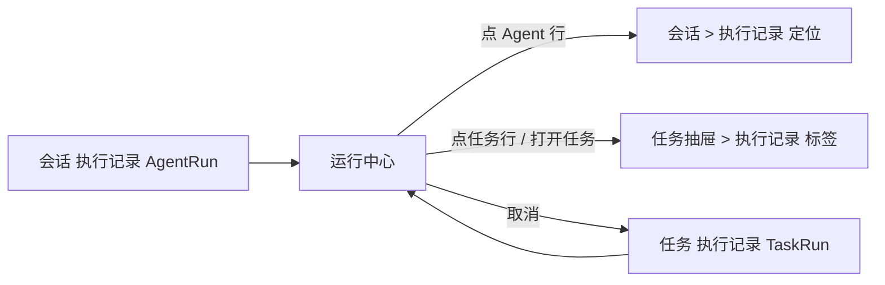

# 运行 规格（SPEC-runs）

| 项 | 内容 |
|---|---|
| 模块 key | `runs` |
| 原型入口 | 一级菜单「运行」（「沟通」组，「会话」下面），http://127.0.0.1:7778 |
| 源码 | `web-next/src/runs.tsx`（`RunsCenterPage`）、`web-next/src/runs.css` |
| 数据文件 | 没有自己的数据：Agent 行来自 `web-next/src/agentdata.ts` 的 `AgentRun`（会话模块的执行记录），任务行来自 `web-next/src/taskdata.ts` 的 `TaskRun`（`devloop.tsx` 的 `runs`） |
| 截图 | [`shots/runs/`](shots/runs/) |
| 负责任务 | 原型同步 2026-11-17（正式产品 P0-O1，826fe6d2；缓存命中率 8c098989） |
| 状态 | 已整理 |
| 最后对照 | 2026-11-17，原型同步（未提交），对照正式产品 `frontend/src/modules/runs/Page.tsx` |

## SPEC-runs-0 模块概述

Agent 执行记录和任务执行（交给 Claude Code、DeepSeek、工作台 Agent）一页看到：在跑的能停止、取消，失败的能重新发起，点进去回到各自的详情。正式产品是内核模块 `runs`（不能停用），默认菜单分组「沟通」：联系人、会话、运行；接 `GET /api/runs/all`。

### 页面清单

| 节 | 页面 | 入口 | 说明 |
|---|---|---|---|
| [SPEC-runs-1](#spec-runs-1-运行中心) | 运行中心 | 一级菜单「运行」 | 按状态、来源筛，行内停止、重新执行、取消、打开 |

### 共用数据结构

`RunCenterItem`（原型 `web-next/src/runs.tsx`，正式产品 `frontend/src/core/data/runCenter.ts`；原型从两种执行记录拼出来）

| 字段 | 类型 | 必填 | 说明 | 取值 / 示例 |
|---|---|---|---|---|
| `kind` | `RunCenterKind` | 是 | 来源 | `agent` Agent 执行 / `task` 任务执行 |
| `id` | `string` | 是 | 执行 id | `ar1`、`run_d1` |
| `status` | `RunCenterStatus` | 是 | 状态 | `running` 执行中 / `waiting` 等你确认 / `done` 已完成 / `failed` 失败 / `canceled` 已停止 / `rejected` 已拒绝（后两种「等你确认、已拒绝」只有 Agent 有）。任务执行的 `cancelled` 算 `canceled` |
| `title` | `string` | 是 | 标题 | Agent 行是 Agent 名；任务行是「编号 标题」 |
| `sub` | `string` | 是 | 副标题 | Agent 行是触发说明（「收到飞书消息 · 梁晚晴」）；任务行是执行器中文名（Claude Code / DeepSeek / 工作台 Agent） |
| `summary` | `string` | 否 | 说明 | Agent 最后一条回复或失败原因；任务行是这次执行的结论、失败原因或补充要求 |
| `started_at` / `finished_at` | `string` / `string \| null` | 是 | 开始、结束时间 | 没结束的耗时按现在算 |
| `pending` | `number` | 是 | 还在等确认的调用数 | Agent 行按 `calls` 里 `pending` 的个数 |
| `session_id` | `string \| null` | 是 | Agent 建的会话 | 原型的 Agent 执行记录没有会话，总是空（见 `settings.md` P-23） |
| `object_id` | `string` | 是 | 任务 id | 任务行用来打开任务 |
| `module_key` | `string` | 否 | 模块前缀复用的模块键 | `project:<对象 id>` 或 `workdir:<路径>`，只有任务行有 |
| `cache_hit_ratio` | `number` | 否 | 缓存命中率 0 到 1 | `cache_read / (cache_read + uncached_input)`；没有 token 数据时没有。原型演示表 `CACHE_DEMO` 给 `run_d4` 一条 0.82 |

### 联动总表

| 方向 | 对方模块 | 触发 | 结果 | 见 |
|---|---|---|---|---|
| 出去 | 会话 | 点 Agent 行标题 | 打开会话模块的「执行记录」，定位并展开这一条 | `SPEC-sessions-2` |
| 出去 | 任务 | 点任务行标题或「打开任务」 | 打开任务抽屉的「执行记录」标签，定位这次执行 | `SPEC-tasks-4.38`、`SPEC-tasks-5` |
| 改动 | 任务 | 任务行「取消」 | 这次执行变「已取消」，任务抽屉的执行记录同步 | `SPEC-tasks-5` |

## SPEC-runs-1 运行中心

一页列出全部执行，新的在前。

### 截图

暂缺：等 `shots.py` 跑一遍（一级菜单「运行」会被冒烟脚本点到）。

### 交互

| 编号 | 元素 | 操作 | 结果 |
|---|---|---|---|
| SPEC-runs-1.1 | 顶栏 | 看 | 「运行中心」，数量是当前筛选下的条数，说明「Agent 执行和任务执行一页看到；在跑的能停止、取消，失败的能重新发起」。实现状态：已实现（原型同步 2026-11-17） |
| SPEC-runs-1.2 | 状态分段 | 点击 | 全部 / 执行中 / 等你确认 / 失败 / 已完成 / 已停止，单选；换状态时「显示更多」重新从第一页算。正式产品在后端筛（`?status=`）。实现状态：已实现（原型同步 2026-11-17） |
| SPEC-runs-1.3 | 来源分段 | 点击 | 全部 / Agent / 任务，单选，再点一次已选的取消回到全部；正式产品 `?source=agent|task`。实现状态：已实现（原型同步 2026-11-17） |
| SPEC-runs-1.4 | 一行 | 看 | 第一行：状态标签、标题（加粗、一行截断，悬停「打开执行记录 · <标题>」或「打开任务 · <标题>」）、右侧任务行的「缓存 N%」（悬停「命中率（模块前缀复用） · <模块键>」，没有数据不显示）、相对时间（悬停原始时间）、耗时（「N 秒」「N 分 M 秒」「N 小时 M 分」，在跑的按现在算）。第二行：副标题，有等确认的调用时橙字「N 处等你确认」。第三行：说明（灰字一行截断）。实现状态：已实现（原型同步 2026-11-17） |
| SPEC-runs-1.5 | 点标题 | 点击 | Agent 行去会话的执行记录并定位这一条；任务行打开任务抽屉的执行记录标签并定位这次执行（见联动总表）。实现状态：已实现（原型同步 2026-11-17） |
| SPEC-runs-1.6 | Agent 行「停止」 | 点击 | 只在执行中时有（红色），悬停「停掉这次执行；已经执行的调用不会撤回」；停掉后变「已停止」。原型的 Agent 执行记录没有在跑的，只有「重新执行」发起的那条在跑时能停。实现状态：已实现（原型同步 2026-11-17） |
| SPEC-runs-1.7 | Agent 行「重新执行」 | 点击 | 失败、已停止时有，悬停「按这次执行的输入重新发起一次」；最上面多一条执行中的，原型 4 秒后变已完成（说明「重新执行完成（原型模拟）」）。正式产品复用执行记录原来的重试接口，新的一条由后端返回。实现状态：已实现（原型同步 2026-11-17） |
| SPEC-runs-1.8 | Agent 行「打开会话」 | 点击 | 有会话时出现，打开那个会话。原型的 Agent 执行记录没有会话，不出现（`settings.md` P-23）。实现状态：未实现 |
| SPEC-runs-1.9 | 任务行「取消」「打开任务」 | 点击 | 「取消」只在执行中时有（红色），悬停「取消这次任务执行」，取消后变「已停止」；「打开任务」同 1.5。正式产品取消走 `POST /api/runs/{id}/cancel`，不在跑的回 409。实现状态：已实现（原型同步 2026-11-17） |
| SPEC-runs-1.10 | 「显示更多（还有 N 条）」 | 点击 | 列表下面，条数超过当前页时出现，再露一页。正式产品一页 100 条，原型数据少，一页 6 条。实现状态：已实现（原型同步 2026-11-17） |
| SPEC-runs-1.11 | 自动刷新 | 自动 | 有在跑的执行时每 5 秒刷新一次耗时（正式产品每 5 秒重取一次列表）。实现状态：已实现（原型同步 2026-11-17） |

### 空状态和异常状态

| 编号 | 场景 | 显示 | 可做的操作 |
|---|---|---|---|
| SPEC-runs-1.12 | 一条执行都没有 | 「还没有运行记录」+「Agent 被触发、任务被执行后，每一次执行都会出现在这里」 | 无 |
| SPEC-runs-1.13 | 筛选后没有 | 「没有符合条件的运行记录」+「换个状态或来源看看」 | 换筛选 |
| SPEC-runs-1.14 | 加载失败 | 原型未做；正式产品「运行记录加载失败」+ 原因 +「重试」 | 重试 |
| SPEC-runs-1.15 | 停止、重新执行、取消失败 | 原型未做；正式产品列表上方红字「没操作成：<原因>」，然后重新取这一页 | 再试 |

### 数据

见 `SPEC-runs-0` 的 `RunCenterItem`。原型状态颜色 `RUN_STATUS`：执行中主色、等你确认 `#b0570b`、已完成 `#2f7d43`、已拒绝 `#a19d92`、失败 `#c0352b`、已停止灰，同正式产品 `AGENT_RUN_STATUS`。

### 联动

见 `SPEC-runs-0` 联动总表。

