# 会话 规格（SPEC-sessions）

| 项 | 内容 |
|---|---|
| 模块 key | `sessions` |
| 原型入口 | 一级菜单「会话」，http://127.0.0.1:7778；全局 ⌘J 或侧栏「新建会话」打开快速新建 |
| 源码 | `web-next/src/sessions.tsx`（二级菜单、会话、执行记录、产出结果）、`web-next/src/quicksession.tsx`（快速新建会话）、`web-next/src/agents.tsx`（共用的 `ChatPane`、`CallCard`、`RUN_STATUS`、`AgentAvatar`，以及本地模拟回复 `reply`）；接线在 `web-next/src/App.tsx`（`newSession`、`executeAgentCall`、`settleAgentRun`、`openOutputTarget`、`openOutputOrigin`） |
| 正式产品 | 会话页 `frontend/src/modules/conversations/`；对话面板（`ChatPane`、`CallCard`、`chatLive`、`chatModel`、`WhoAvatar`、样式 `chat.css`）在 `frontend/src/core/chat/`，会话页和项目里就地对话（`SPEC-projects-10.13`）共用 |
| 数据文件 | `web-next/src/agentdata.ts` |
| 截图 | [`shots/sessions/`](shots/sessions/) |
| 负责任务 | PROTO-04c |
| 对应开发任务 | AG-01a 实现会话页并接现有的 Agent 会话与对话接口：与 `SPEC-sessions-0` 到 `SPEC-sessions-4` 对照，接口差异见 `SPEC-sessions-0` 末尾 |
| 状态 | 已整理 |
| 最后对照 | 2026-10-28，原型提交 `932555b`，加 PROTO-09 的修改；2026-11-02 加会话旁边的终端和浏览器（1.34 到 1.41） |

## SPEC-sessions-0 模块概述

和 Agent 打交道的记录：人和 Agent 的对话（会话），Agent 被消息、定时、任务触发后的每一次执行（执行记录），以及 Agent 真正落到数据上的东西（产出结果）。写操作按权限停下来等人确认，确认就在这里做。Agent 本身怎么配置在「设置 > Agent」（`SPEC-settings`）。

### 页面清单

| 节 | 页面 | 入口 | 说明 |
|---|---|---|---|
| [SPEC-sessions-1](#spec-sessions-1-会话) | 会话 | 二级菜单「会话」（模块默认页） | 左边会话列表，右边对话；会话头部右上角「终端」「浏览器」在对话右边展开（1.34 到 1.38） |
| [SPEC-sessions-2](#spec-sessions-2-执行记录) | 执行记录 | 二级菜单「执行记录」 | 每次触发执行的工具调用，等确认的置顶 |
| [SPEC-sessions-3](#spec-sessions-3-产出结果) | 产出结果 | 二级菜单「产出结果」 | Agent 建的任务、写的文档、发的回复，能跳到目标和来源 |
| [SPEC-sessions-4](#spec-sessions-4-快速新建会话) | 快速新建会话 | 任意页面 ⌘J、侧栏「新建会话」、命令面板「新建会话」 | 弹窗：挑 Agent、可选挂项目、写第一句话就开聊 |

二级菜单（三页共用）：

| 编号 | 元素 | 操作 | 结果 |
|---|---|---|---|
| SPEC-sessions-0.1 | 「执行记录」「产出结果」 | 点击 | 会话模块没有二级菜单，进来就是会话页（左边会话清单、右边会话窗口，铺满）。会话清单最下面一行两个并排按钮「执行记录」「产出结果」（悬停「Agent 被消息、定时、任务触发后的每一次执行」「建的任务、写的文档、发的回复」），点了切到那一页；那两页标题上的「会话」可点，点了回会话页 |
| SPEC-sessions-0.2 | 「执行记录」红点 | 显示 | 清单底部「执行记录」按钮右上角，有等你确认的执行记录时显示 |
| SPEC-sessions-0.3 | 「新会话」 | 点击 | 标题行右边的「新会话」（原二级菜单底部的「新会话」去掉），打开选 Agent 面板（`SPEC-sessions-1.6`） |
| SPEC-sessions-0.4 | 一级菜单「会话」 | 显示 | 角标和红点是等你确认的执行记录数（会话里等确认的操作不计入角标） |
| SPEC-sessions-0.5 | 一级菜单进入 | 点击 | 回到上次停留的子页；项目筛选清空 |

### 共用数据结构

全部来自 `web-next/src/agentdata.ts`。

`Session`：一次会话。

| 字段 | 类型 | 必填 | 说明 | 取值 / 示例 |
|---|---|---|---|---|
| `id` | `string` | 是 | 编号 | `ss1`；新建为 `ss_<时间戳 36 进制>` |
| `agent_id` | `string` | 是 | 和哪个 Agent 聊；Agent 删了仍保留 | `ag_triage` |
| `project_id` | `string` | 否 | 挂在哪个项目下；项目删了置空 | `pj_perm` |
| `title` | `string` | 是 | 标题；新建为「新会话」，第一句话发出后取它的前 20 个字，之后不再自动改 | `今天谁找我了` |
| `created_at` | `string` | 是 | 创建时间，ISO 8601 | |
| `updated_at` | `string` | 是 | 每次消息变化时更新，列表按它排序 | |
| `messages` | `ChatMsg[]` | 是 | 消息，按时间正序 | |

`ChatMsg`：会话里的一条消息。

| 字段 | 类型 | 必填 | 说明 | 取值 / 示例 |
|---|---|---|---|---|
| `id` | `number` | 是 | 会话内自增 | `1` |
| `role` | `'user' \| 'agent'` | 是 | 谁说的 | `user` 人 / `agent` Agent |
| `text` | `string` | 是 | 文字，保留换行 | |
| `calls` | `ToolCall[]` | 否 | Agent 这一条里调用的工具 | |
| `at` | `string` | 否 | 时间，ISO 8601 | |

`ToolCall`：一次工具调用，会话和执行记录共用。

| 字段 | 类型 | 必填 | 说明 | 取值 / 示例 |
|---|---|---|---|---|
| `tool` | `string` | 是 | 工具 key，见下面 `ABILITIES` | `write_tasks` |
| `input` | `Record<string, unknown>` | 是 | 输入，按 JSON 显示 | `{ title: '…', priority: 'P1' }` |
| `output` | `unknown` | 否 | 输出，按 JSON 显示；执行后才有 | `{ ref: 'T-014' }` |
| `state` | `'done' \| 'pending' \| 'confirmed' \| 'rejected'` | 是 | 状态 | `done` 已执行（自动档）/ `pending` 等你确认 / `confirmed` 已确认执行 / `rejected` 已拒绝 |

`AgentRun`：一次被触发的执行。

| 字段 | 类型 | 必填 | 说明 | 取值 / 示例 |
|---|---|---|---|---|
| `id` | `string` | 是 | 编号 | `ar1` |
| `agent_id` | `string` | 是 | 哪个 Agent | `ag_triage` |
| `at` | `string` | 是 | 触发时间，ISO 8601 | |
| `trigger` | `string` | 是 | 触发说明，给人看的一句话 | `收到飞书消息 · 梁晚晴`、`定时 · 每周五 16:00` |
| `summary` | `string` | 是 | Agent 对这次执行的总结 | |
| `calls` | `ToolCall[]` | 是 | 调用的工具，按顺序 | |
| `status` | `'done' \| 'waiting' \| 'rejected' \| 'failed'` | 是 | 状态，见 `RUN_STATUS` | `done` 已完成 / `waiting` 等你确认 / `rejected` 已拒绝 / `failed` 失败 |

`RUN_STATUS`（`web-next/src/agents.tsx`）：`done` 已完成 `#2f7d43`、`waiting` 等你确认 `#b0570b`、`rejected` 已拒绝 `#a19d92`、`failed` 失败 `#c0352b`。

`AgentOutput`：Agent 真正落到数据上的东西。

| 字段 | 类型 | 必填 | 说明 | 取值 / 示例 |
|---|---|---|---|---|
| `id` | `string` | 是 | 编号 | `op1` |
| `agent_id` | `string` | 是 | 哪个 Agent 产出的 | `ag_weekly` |
| `kind` | `OutputKind` | 是 | 类型 | `task` 任务 / `doc` 文档 / `reply` IM 回复 / `sop` SOP 执行 / `other` 其他（显示名见 `OUTPUT_KIND`） |
| `title` | `string` | 是 | 标题 | `第 43 周周报`；回复为「回复 <对象>：<前 24 字>」；SOP 为「发起「<SOP 名>」」 |
| `target` | `string` | 否 | 能打开的目标：任务 id、文档 id、消息 id、SOP id | `tk_a1`、`dc_w43` |
| `at` | `string` | 是 | 时间，ISO 8601 | |
| `origin` | `{ type: 'session' \| 'run'; id: string }` | 是 | 从哪来：会话 id 或执行记录 id | `{ type: 'session', id: 'ss1' }` |

`Agent`：本模块只读，配置在 `SPEC-settings`（Agent 节）。本模块用到的字段加粗。

| 字段 | 类型 | 必填 | 说明 |
|---|---|---|---|
| **`id`** | `string` | 是 | 编号，如 `ag_triage` |
| **`name`** | `string` | 是 | 名字，空串显示「未命名」 |
| **`desc`** | `string` | 是 | 一句话说明（快速新建里显示） |
| **`color`** | `string` | 是 | 头像底色，取自 `AGENT_COLORS` |
| `model` | `string` | 是 | 模型 key |
| `instructions` | `string` | 是 | 指令 |
| **`abilities`** | `Record<string, AbilityMode>` | 是 | 工具权限：`off` 关闭 / `confirm` 需确认 / `auto` 自动；连接器工具 key 为 `conn:<连接器>:<工具>` |
| **`avatar`** | `AgentAvatarConf` | 是 | `{ kind: 'text' \| 'icon' \| 'image'; value: string }` |
| `skills` | `string[]` | 是 | 挂载的技能 id |
| `mcps` | `string[]` | 是 | 挂载的 MCP / 连接器 id |
| `kbs` | `string[]` | 是 | 挂载的知识库 id |
| `triggers` | `AgentTrigger[]` | 是 | `{ kind: TriggerKind; detail: string }`，`TriggerKind` 为 `manual` 手动对话 / `im` 收到 IM 消息 / `schedule` 定时 / `task` 任务分配给它 |
| **`enabled`** | `boolean` | 是 | 停用后不能新开会话、不能发消息，只能回看 |
| `created_at` | `string` | 是 | 创建时间 |

`ABILITIES`：工具 key 和显示名（调用卡片的标题），`write` 为真的是写操作（卡片圆点着色）。

| key | 显示名 | 写操作 | 执行后落到哪 |
|---|---|---|---|
| `read_messages` | 读 IM 消息 | 否 | |
| `reply_message` | 回复 IM 消息 | 是 | 找发给 `input.to` 的待处理消息，加一条回复；记一条 `reply` 产出 |
| `read_contacts` | 查联系人 | 否 | |
| `write_contacts` | 新建 / 修改联系人 | 是 | 原型未落数据 |
| `read_tasks` | 查任务 | 否 | |
| `write_tasks` | 新建 / 更新任务 | 是 | 新建一条任务（标题、优先级、负责人取自输入）；记一条 `task` 产出 |
| `read_content` | 读文档 | 否 | |
| `write_content` | 写文档 | 是 | 「笔记」分类新建一篇草稿；记一条 `doc` 产出（`SPEC-library-0`） |
| `run_sop` | 发起 SOP | 是 | 原型只回 `{ queued: true, sop_id }`；记一条 `sop` 产出，`target` 为按 `input.sop`（名字或 id）找到的 SOP id |

和现有后端接口的差异（给 AG-01a）：`docs/api-contract.md`「Agent 对话」里的会话是 `{ provider_id, model, workdir, object_id }`，没有 `agent_id`，归属对象一经创建不能改；原型的会话挂 `agent_id` 和 `project_id`。接口层要么在 AG-01 的 Agent 配置落地前用 `provider_id + model` 代替 Agent，要么等 AG-01 给会话加 `agent_id`。产出结果对应 `/api/artifacts`（`session_id` / `run_id` 过滤），删除会话时产物保留、`session_id` 置空，和原型「删除会话，产出不受影响」一致。

思考档位（0045）：会话每一轮按挂的 Agent 的 `thinking` 调模型（`SPEC-settings-9.44`），Agent 改了档位下一轮跟着变；不挂 Agent 的老会话按模型默认（不带思考参数）。Claude 开着思考调工具时，同一轮里的 thinking 块原样回传给模型，不存库、不显示；确认卡片之后接着跑时历史里没有这些块，被模型拒收就自动去掉思考参数重来。

### 联动总表

| 方向 | 对方模块 | 触发 | 结果 | 见 |
|---|---|---|---|---|
| 进来 | 今日 | 「Agent 待确认」里的执行记录条目点「去确认」 | 打开执行记录页 | `SPEC-today`、`SPEC-sessions-2` |
| 进来 | 今日 | 「会话「X」里有操作等你确认」点「去确认」 | 打开会话页并选中该会话 | `SPEC-today`、`SPEC-sessions-1` |
| 进来 | 今日 / SOP | 「Agent 待确认」分组的「更多」 | 打开执行记录页 | `SPEC-today`、`SPEC-sop` |
| 进来 | 项目 | 项目「Agent」标签或概览里点「对话」「和它对话」 | 新建一个挂在该项目下的会话并打开 | `SPEC-projects` |
| 进来 | 项目 | 项目里点某个会话；或「在会话里看全部」 | 打开该会话；或打开会话页并按该项目筛选 | `SPEC-projects`、`SPEC-sessions-1.5` |
| 进来 | 命令面板 | 「新建会话」；「和 Agent 开个新会话」；搜到「会话」组条目 | 打开快速新建；打开选 Agent 面板；打开该会话 | `SPEC-sessions-4`、`SPEC-sessions-1.6` |
| 出去 | 设置 / Agent | 会话头部点 Agent 名字 | 打开该 Agent 的配置页 | `SPEC-settings`（Agent 节） |
| 出去 | 终端 | 会话头部「终端」 | 在对话右边展开终端，定位到会话目录的标签，没有就新开；「整页打开」去一级菜单「终端」 | `SPEC-sessions-1.35`、`SPEC-terminal` |
| 出去 | 浏览器 | 会话头部「浏览器」 | 在对话右边展开浏览器，会话里出现过的链接能一点就开；「整页打开」去一级菜单「浏览器」 | `SPEC-sessions-1.36`、`SPEC-browser` |
| 出去 | 任务 | 产出结果里点任务标题 | 打开任务抽屉 | `SPEC-tasks`、`SPEC-sessions-3.4` |
| 出去 | 文档 | 产出结果里点文档标题 | 切到工作台文档并打开 | `SPEC-library-1`、`SPEC-sessions-3.4` |
| 出去 | IM 消息 | 产出结果里点回复标题 | 打开 IM 消息页和那条消息 | `SPEC-messages`、`SPEC-sessions-3.4` |
| 出去 | SOP | 产出结果里点 SOP 执行的标题 | 打开该 SOP 的详情页 | `SPEC-sop`、`SPEC-sessions-3.4` |
| 改动 | 任务 / 文档 / IM 消息 / SOP | 写操作被执行（自动档，或人点了「确认执行」） | 真的建任务、写文档、回消息、发起 SOP，并记一条产出 | `SPEC-sessions-1.17`、`SPEC-sessions-2.5` |
| 被改动 | 项目 | 删除项目 | 挂在它下面的会话 `project_id` 置空 | `SPEC-projects` |
| 被改动 | 设置 / Agent | 停用或删除 Agent | 停用：会话只能回看；删除：会话、执行记录、产出保留，显示为「已删除的 Agent」。有等确认操作的 Agent 不许删 | `SPEC-settings`（Agent 节） |

## SPEC-sessions-1 会话

左边会话列表（搜索、按 Agent 和项目筛选、按时间分段），右边当前会话的对话。

### 截图

| | 亮 | 暗 |
|---|---|---|
| 桌面 1440 | 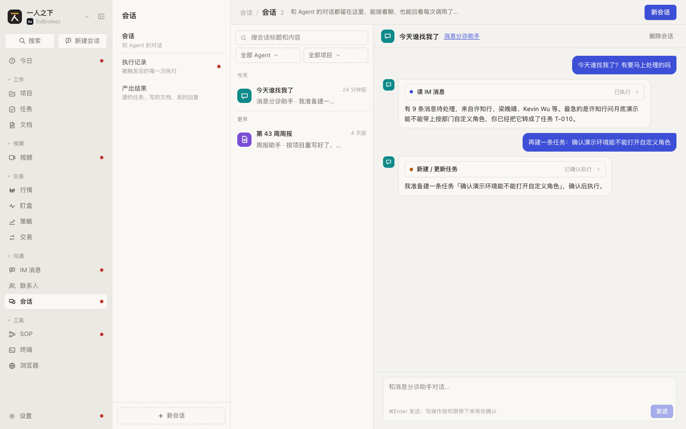 | 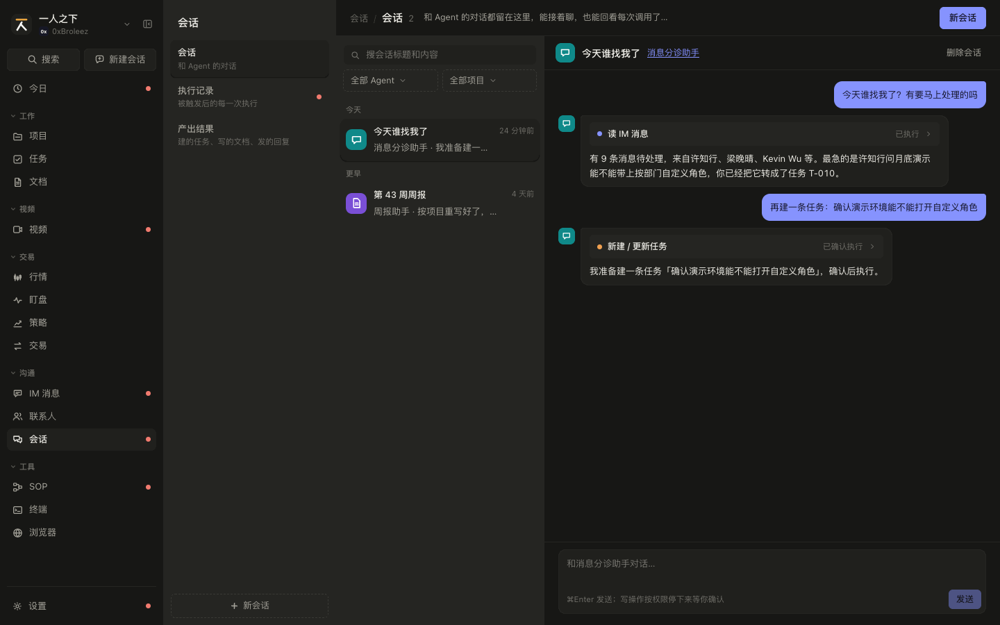 |
| 手机 375 | 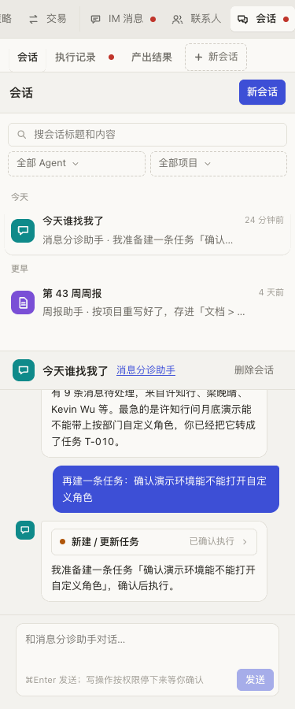 | 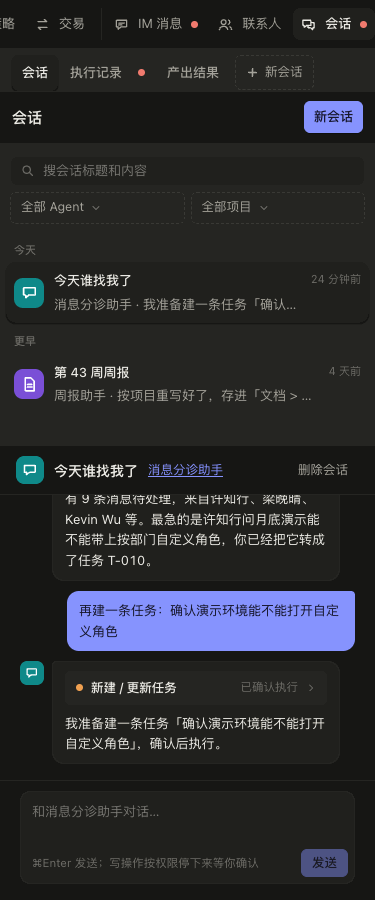 |

模块入口（`shots/sessions/入口-*.png`）就是这一页，图相同。

按 `shots.py` 的步骤截：在「设置 / Agent」停用「消息分诊助手」后打开「今天谁找我了」（停用只能回看）；启用「流程执行助手」开个会话说一句，再删掉这个 Agent，回来打开那个会话（已删除只能回看）；和「周报助手」开新会话问「梁晚晴找我了吗，帮我回复一下」（权限没开的提示）。

| | 亮 | 暗 |
|---|---|---|
| Agent 已停用 1440 |  |  |
| Agent 已删除 1440 | 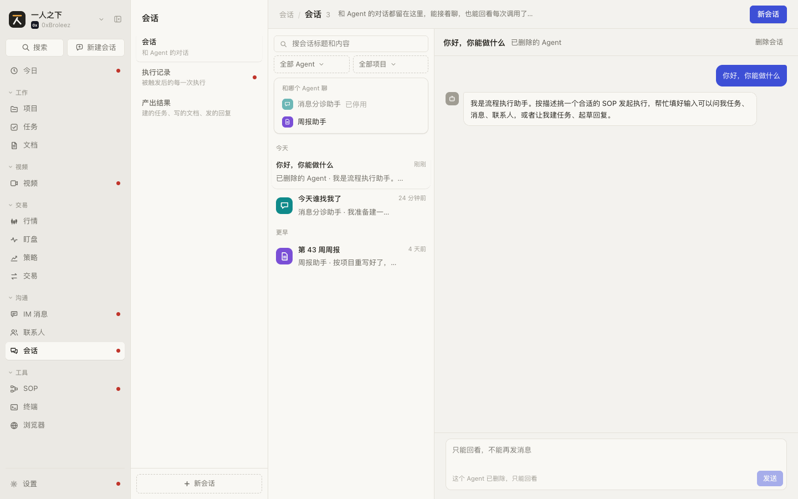 | 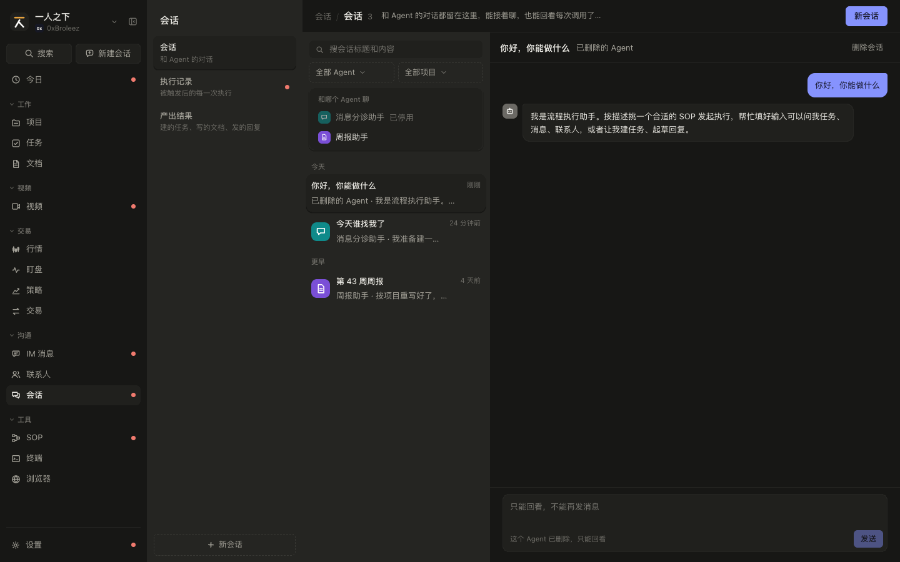 |
| 权限没开 1440 | 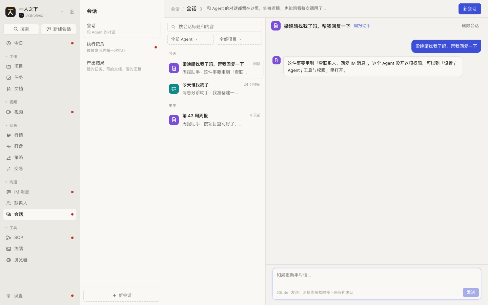 | 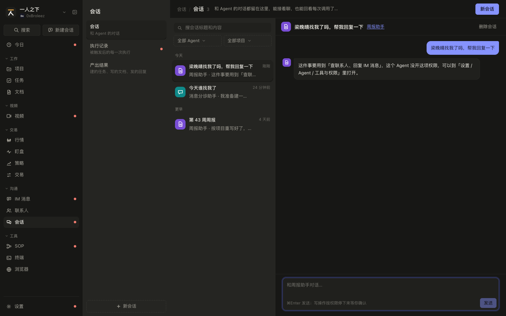 |

截图脚本截不到的状态：选 Agent 面板（点「新会话」）、改标题（点会话标题）、删除确认（点「删除会话」）、等确认的调用卡片（在会话里输入「建一条任务：周五前整理演示环境」）。

### 交互

| 编号 | 元素 | 操作 | 结果 |
|---|---|---|---|
| SPEC-sessions-1.1 | 页面标题 | 显示 | 「会话 / 会话」+ 筛选后的会话数 + 说明「和 Agent 的对话都留在这里，能接着聊，也能回看每次调用了什么工具」 |
| SPEC-sessions-1.2 | 右上「新会话」 | 点击 | 打开或收起选 Agent 面板（`SPEC-sessions-1.6`） |
| SPEC-sessions-1.3 | 搜索框「搜会话标题和内容」 | 输入 | 实时过滤，不区分大小写，匹配标题和任意一条消息的文字 |
| SPEC-sessions-1.4 | Agent 下拉 | 选择 | 「全部 Agent」或某个 Agent；选项按这个 Agent 的会话数倒序，右边提示「N 条」，没有会话又停用的提示「已停用」；可搜索 |
| SPEC-sessions-1.5 | 项目下拉 | 选择 | 「全部项目」/ 各项目 / 「不属于项目」；可搜索。从项目页「在会话里看全部」进来时预选该项目；从一级菜单进来时清空 |
| SPEC-sessions-1.6 | 选 Agent 面板 | 显示和点击 | 标题「和哪个 Agent 聊」，列出全部 Agent，最近聊过的在前；停用的置灰、标「已停用」、不可点。Agent 多于 6 个时上面多一个搜索框（「搜 Agent，最近聊过的在前」，自动聚焦），Enter 选中第一个可用的，Esc 关闭面板 |
| SPEC-sessions-1.7 | 面板里点一个 Agent | 点击 | 新建会话（标题「新会话」、不挂项目）放到最前并打开，面板关闭。一句话都没发就切到别的会话（或再新建一个）时，这条空会话删掉（B-09） |
| SPEC-sessions-1.8 | 会话列表 | 显示 | 按 `updated_at` 倒序，分「今天 / 本周 / 更早」三段（本周从周一算）。每项：Agent 头像、标题、有等确认操作时标题旁一个小圆点（提示「有操作等你确认」）、「Agent 名 · 最后一条消息」、相对时间。没有消息的会话只在正打开时列出（B-09） |
| SPEC-sessions-1.9 | 会话列表项 | 点击 | 右边打开该会话，列表项高亮；正在改的标题和删除确认一并取消 |
| SPEC-sessions-1.10 | 「显示更多（还有 N 条）」 | 点击 | 先显示 50 条，每点一次多 50 条；改搜索或筛选回到 50 条 |
| SPEC-sessions-1.11 | 会话头部标题 | 点击 | 变成输入框（自动聚焦），Enter 或失焦保存；清空后保存则保留原标题 |
| SPEC-sessions-1.12 | 会话头部 Agent 名 | 点击 | 跳到「设置 > Agent」该 Agent 的配置页 |
| SPEC-sessions-1.13 | 「删除会话」 | 点击 | 头部换成确认：「删除会话？产出的任务、文档不受影响」+「取消」「删除」。删除后右边改为打开列表里另一个会话（没有就显示空状态） |
| SPEC-sessions-1.14 | 消息区 | 显示 | 人的消息靠右，Agent 的靠左带头像；Agent 消息里工具调用卡片在文字上面；有新消息自动滚到底 |
| SPEC-sessions-1.15 | 输入框和「发送」 | 输入，⌘Enter / Ctrl+Enter 或点「发送」 | 发出一条人的消息，显示「正在输入」三个点，Agent 回复后消失（原型本地规则约 0.8 秒后回复；正式产品接 `/api/agent/chat` 流式输出）。占位「和 <Agent 名> 对话…」，下方提示「⌘Enter 发送；写操作按权限停下来等你确认」。内容为空、Agent 正在回复、Agent 已停用或已删除时「发送」置灰；停用、已删除时 ⌘Enter 和示例问题也发不出去（见 1.26、1.27） |
| SPEC-sessions-1.16 | 第一句话 | 发出 | 会话标题还是「新会话」时，改成这句话的前 20 个字；`updated_at` 更新，会话移到列表最前 |
| SPEC-sessions-1.17 | 工具调用卡片 | 点击头部 / 「确认执行」/「拒绝」 | 头部：圆点（写操作着色）、工具显示名、状态（已执行 / 等你确认 / 已确认执行 / 已拒绝）、展开箭头；等你确认的默认展开，其余收起。展开后显示输入和输出的 JSON。等你确认时有「确认执行」「拒绝」：确认后真正执行（见 SPEC-sessions-0 `ABILITIES`），状态变「已确认执行」并带上输出，同时记一条来源为本会话的产出；拒绝后变「已拒绝」，什么都不执行 |
| SPEC-sessions-1.18 | 权限档位 | Agent 回复时 | 工具权限为「自动」的写操作直接执行，卡片显示「已执行」并带真实输出，也记产出；「需确认」的生成等你确认的卡片；「关闭」的不调用，回复里说明「这件事要用到「X」，这个 Agent 没开这项权限」。会话页里这句话后面接「可以到「设置 / Agent / 工具与权限」里打开」；设置页调试对话里接「可以在左边「工具与权限」里打开」 |
| SPEC-sessions-1.19 | 「试着问它」示例 | 点击 | 空会话里显示四个示例问题，点一个直接发出；Agent 停用或已删除时示例置灰、点了不发 |
| SPEC-sessions-1.20 | 快速新建带来的第一句话 | 打开刚建的会话 | 自动发出，只发一次（`SPEC-sessions-4.7`） |
| SPEC-sessions-1.21 | 手机布局 | ≤ 760px | 列表在上、对话在下，上下排列 |

#### 会话旁边的终端和浏览器

和项目标题行的「终端」「浏览器」（`SPEC-projects-14`）同一种入口：图标 + 名字的按钮，展开着的高亮，再点收起。区别是位置：会话是一条竖着的对话流，输入框在最下面，底部展开会把阅读区和输入框一起挤掉一半，所以面板放在对话右边，边看 Agent 的回复边在终端里操作。

| 编号 | 元素 | 操作 | 结果 |
|---|---|---|---|
| SPEC-sessions-1.34 | 会话头部右上角「终端」「浏览器」 | 显示 | 在「删除会话」左边，图标 + 名字；展开着的那个高亮（`aria-pressed`）。终端模块、浏览器模块各自开着才有对应的按钮，都没开就没有（1.38）。悬停：终端「在对话旁边打开终端，目录：<会话目录>」（会话没设目录时「没设工作目录，用终端的默认目录」），浏览器「在对话旁边打开浏览器，会话里出现过 N 个链接」（没有链接时不带后半句）；展开着时「收起终端 / 收起浏览器」。删除确认显示时这两个按钮让位不显示。面板展开后对话变窄，按钮只留图标 |
| SPEC-sessions-1.35 | 「终端」 | 点击 | 在对话右边展开面板并显示终端。终端和一级菜单「终端」是同一套标签和会话（在这里开的标签，去一级菜单也看得到）。每次从这个按钮打开，都定位到会话的工作目录：当前标签的焦点格、当前标签别的格、别的标签，依次找停在这个目录的格子，找到就切过去并把光标给它；找不到就在这个目录新开一个标签。会话没设目录时用终端的默认目录（第一个有目录的项目，再没有是主目录）。终端还没打开过、一个标签都没有时，第一个标签直接开在会话目录，不先开「工作台」。展开着并且正显示终端时再点就收起。原型里会话的目录取它所属项目的目录（原型的会话没有目录字段）；正式版取会话的 `workdir` |
| SPEC-sessions-1.36 | 「浏览器」 | 点击 | 展开面板并显示浏览器，和一级菜单「浏览器」是同一套标签（标签存后端）。会话里出现过链接时，工具栏下面多一行「会话里的链接」：Agent 回复和工具结果里的 http/https 地址（人说的话不算），新的在前、同一地址只留一次，最多 8 个，横向排成小胶囊，显示去掉协议的地址，悬停看完整地址；点一个就在这里打开，已经有同一地址的标签就切过去，否则新开（规则同 `SPEC-browser-1.15`）；当前标签就是这个地址时胶囊高亮。不在白名单的网站按 `SPEC-browser-3.12` 显示「这个站点不能在这里打开」。展开着并且正显示浏览器时再点就收起。原型里会话旁边的浏览器是单独一份标签（见 S-8） |
| SPEC-sessions-1.37 | 面板头部 | 显示和点击 | 左边「终端」「浏览器」切换（只列开着的模块）：只换显示哪个，不收起；切到没打开过的那个算一次打开（规则同 1.35、1.36）。右边「整页打开」去一级菜单的终端或浏览器（标签是同一套，悬停「去一级菜单「终端」整页看，标签和这里是同一套」）、收起按钮（悬停「收起（终端和网页都留着）」） |
| SPEC-sessions-1.38 | 面板 | 收起、切会话、离开 | 打开过的面板一直挂着：收起、切到另一个工具只是藏起来，终端输出和已加载的网页都在；切到别的会话面板不收起、终端不自动换目录（再点一次头部「终端」才定位到新会话的目录）；离开会话页面板卸载，终端会话和浏览器标签在插件那边，回来再打开都还在。会话区（不算侧栏和二级菜单）宽于 1160 时是三列：会话列表 300、对话至少 360、面板至少 480；更窄时面板展开期间先藏起会话列表，对话和面板约 1 : 1.3，收起面板列表就回来；手机宽度（≤ 760）面板盖满对话区 |
| SPEC-sessions-1.43 | 历史消息「移除」 | 悬停和点击 | 对话区每个历史气泡（用户的、Agent 的）悬停时旁边出现「移除」（触屏常显），悬停「从会话里移除这条，之后不再作为上下文发给模型」；点了就地变成确认「移除这条？之后不再作为上下文发给模型，已经执行的操作不会撤回」+「移除」「取消」。确认后删掉这个气泡对应的消息：用户的就是那一条；Agent 的是回复加挂在上面的工具调用（等确认的连同确认后的结果）。删掉后不再进模型的上下文，会话的更新时间不变，工具调用已经做了的事（建的任务、改的标题）不撤回。这一轮在跑时按钮置灰，悬停「这一轮还在跑，跑完再移除」。没删成时确认下面红字「没移除成：<原因>」。会话页和项目里就地对话（`SPEC-projects-10.13`）同一套。正式产品 `POST /api/agent/sessions/{id}/messages/remove`，body `{ids}`，记审计 |
| SPEC-sessions-1.42 | 会话来源 | 显示 / 点击 | 从别的记录发起的会话（现在是 IM 消息的「发起会话」「拆分任务」，`SPEC-messages-5`）在头部下面多一行「来源 <说明>」，说明如「Slack 消息：林原「登录页改版…」等 3 条」；点了回到 IM 消息页打开那条消息（合并的一组打开最新一条）。来源建会话时定下，之后不改；会话里 Agent 新建的对象缺省记上这个来源、挂到来源所属的项目（`SPEC-messages-5.7`）。IM 插件停用时只显示说明、不能点。正式产品由插件按来源种类登记显示方式（前端扩展点 `sessionSources`） |

### 空状态和异常状态

| 编号 | 场景 | 显示 | 可做的操作 |
|---|---|---|---|
| SPEC-sessions-1.22 | 一个会话都没有 | 列表「还没有会话，点「新会话」和 Agent 聊聊」；右边「还没有会话」 | 「新会话」 |
| SPEC-sessions-1.23 | 搜索或筛选后没有结果 | 列表「没有匹配的会话」 | 改关键词或筛选 |
| SPEC-sessions-1.24 | 有会话但没选中 | 右边「从左边选一个会话」 | 点列表项 |
| SPEC-sessions-1.25 | 选 Agent 面板搜不到 | 「没有匹配的 Agent」 | 改关键词 |
| SPEC-sessions-1.26 | 会话的 Agent 已停用 | 输入框占位「只能回看，不能再发消息」，下方提示「这个 Agent 已停用，只能回看」；「发送」置灰，⌘Enter 和示例问题也发不出去 | 去「设置 > Agent」启用 |
| SPEC-sessions-1.27 | 会话的 Agent 已删除 | 列表项没有头像，副标题「已删除的 Agent · …」；Agent 筛选里显示「已删除的 Agent」。点开后能只读回看历史：头部没有头像，Agent 名处显示「已删除的 Agent」（不可点），Agent 消息用灰色机器人头像；下方提示「这个 Agent 已删除，只能回看」，发送拦法同 1.26；历史里的工具调用卡片照常展开 | 只读回看 |
| SPEC-sessions-1.28 | 项目筛选选中的项目已删除 | 下拉显示「已删除的项目」 | 改筛选 |
| SPEC-sessions-1.29 | 有等你确认的操作 | 列表项标题旁小圆点；今日页出现「会话「X」里有操作等你确认」 | 打开会话处理 |
| SPEC-sessions-1.30 | 全部 Agent 都停用 | 选 Agent 面板里全部置灰，没有额外提示 | 去「设置 > Agent」启用 |
| SPEC-sessions-1.31 | Agent 回复失败（模型不可用、网络断开、超时） | 原型未做。正式产品：在这条 Agent 消息的位置显示错误原因和「重试」，人的消息保留 | 重试 |
| SPEC-sessions-1.32 | 确认执行失败（如任务没建成） | 原型未做。正式产品：卡片保持「等你确认」，下方红字原因 | 再次确认或拒绝 |
| SPEC-sessions-1.33 | 会话列表加载失败 | 原型未做；正式产品在列表位置显示错误信息和「重试」 | 重试 |
| SPEC-sessions-1.39 | 终端、浏览器模块都没开（插件停用） | 会话头部没有这两个按钮；只停了一个就只剩另一个。面板开着时停用插件，按钮和面板一起消失 | 去「设置 > 插件」启用 |
| SPEC-sessions-1.40 | 会话目录打不开（目录被删、填错） | 终端退到主目录打开，终端标签栏右边提示「打不开目录 <目录>，已在主目录打开」（同 `SPEC-terminal` 的规则） | 改会话目录 |
| SPEC-sessions-1.41 | 终端开满 16 个 | 不新开，终端标签栏提示「最多同时开 16 个终端，先关掉几个」（`SPEC-terminal-1.16`） | 关掉别的终端 |

### 数据

见 SPEC-sessions-0 的 `Session`、`ChatMsg`、`ToolCall`、`AgentOutput`、`Agent`、`ABILITIES`。页面状态（原型在 `ChatsView` 里）：

| 字段 | 类型 | 说明 |
|---|---|---|
| `filter` | `string` | Agent 筛选，空串为全部 |
| `proj` | `string` | 项目筛选，空串为全部，`-` 为不属于项目 |
| `q` | `string` | 搜索词 |
| `limit` | `number` | 显示条数，步长 `PAGE = 50` |
| `picking` | `boolean` | 选 Agent 面板开着 |
| `pickQ` | `string` | 面板里的搜索词 |
| `editing` | `boolean` | 正在改标题 |
| `confirmDel` | `boolean` | 正在确认删除 |
| `current` | `string \| null` | 当前会话 id（放在 `App.tsx`，默认第一条种子会话） |
| `firstMessage` | `{ sessionId: string; text: string } \| null` | 快速新建带来的第一句话（放在 `App.tsx`） |

示例问题 `CHAT_EXAMPLES`（`agents.tsx`）：「我现在有哪些任务最急？」「梁晚晴找我了吗，帮我回复一下」「建一条任务：周五前整理演示环境」「这周的周报帮我汇总一下」。

### 联动

| 方向 | 对方模块 | 触发 | 结果 | 见 |
|---|---|---|---|---|
| 改动 | 任务、文档、IM 消息、SOP | 写操作执行 | 见 SPEC-sessions-0 `ABILITIES` 表 | |
| 改动 | 产出结果 | 写操作执行 | 多一条来源为本会话的产出 | `SPEC-sessions-3` |
| 改动 | 今日 | 产生或处理完等确认的操作 | 今日的「Agent 待确认」条目增减 | `SPEC-today` |
| 读取 | 任务、IM 消息、联系人、SOP | Agent 回复时 | 读当前数据回答（原型的 `Ctx`：`tasks`、`messages`、`contacts`、`sops`） | |

## SPEC-sessions-2 执行记录

Agent 被消息、定时、任务触发后的每一次执行，按卡片列出；写操作等你确认的置顶并默认展开。

### 截图

| | 亮 | 暗 |
|---|---|---|
| 桌面 1440 | 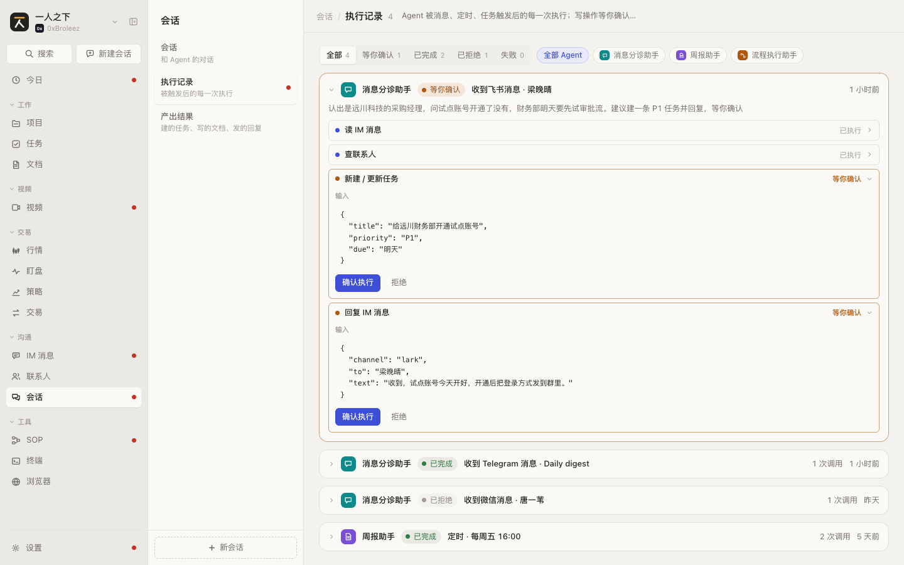 | 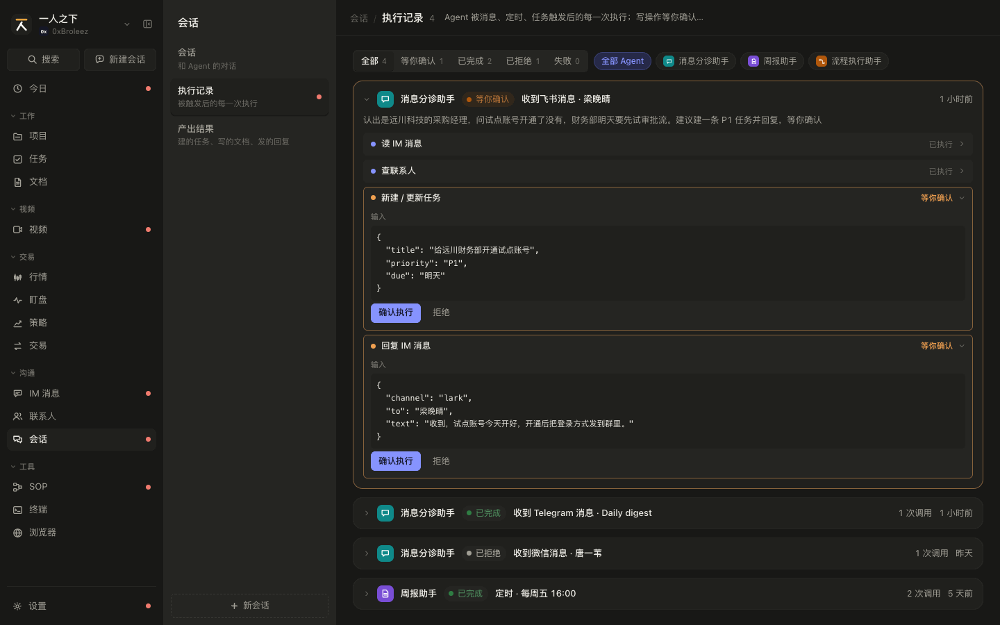 |
| 手机 375 | 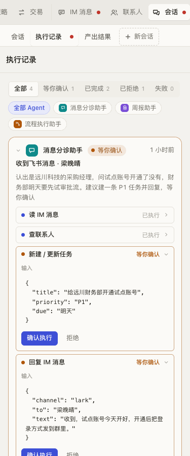 | 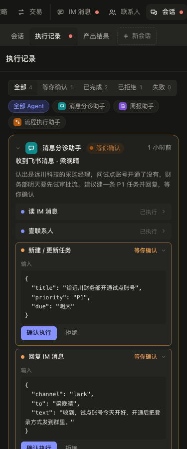 |

### 交互

| 编号 | 元素 | 操作 | 结果 |
|---|---|---|---|
| SPEC-sessions-2.1 | 页面标题 | 显示 | 「会话 / 执行记录」+ 筛选后的条数 + 说明「Agent 被消息、定时、任务触发后的每一次执行；写操作等你确认的在这里处理」 |
| SPEC-sessions-2.2 | 状态切换 | 点击 | 「全部 / 等你确认 / 已完成 / 已拒绝 / 失败」单选，每项带条数（全部执行记录里的条数，不受 Agent 筛选影响） |
| SPEC-sessions-2.3 | Agent 筛选 chip | 点击 | 「全部 Agent」+ 每个 Agent 一个 chip（头像 + 名字），单选，再点取消。Agent 多于 6 个时只放执行记录最多的 4 个，其余收进「更多 Agent（N）」可搜索下拉 |
| SPEC-sessions-2.4 | 执行卡片头部 | 点击 | 展开或收起。头部：展开箭头、Agent 头像和名字、状态标签、触发说明、收起时显示「N 次调用」、相对时间。没动过的卡片只有「等你确认」默认展开；手动展开收起过的按手动的来 |
| SPEC-sessions-2.5 | 调用卡片「确认执行」 | 点击 | 真正执行这一项（同 `SPEC-sessions-1.17`），状态变「已确认执行」并带输出，记一条来源为本执行记录的产出。然后重算整条执行的状态：还有等确认的仍为「等你确认」；都处理完了，至少确认了一项为「已完成」，全部拒绝为「已拒绝」 |
| SPEC-sessions-2.6 | 调用卡片「拒绝」 | 点击 | 这一项变「已拒绝」，不执行；整条状态按 2.5 的规则重算 |
| SPEC-sessions-2.7 | 展开后的内容 | 显示 | Agent 的总结一段，下面按顺序列出调用卡片（卡片交互同 `SPEC-sessions-1.17`） |
| SPEC-sessions-2.8 | 排序 | 显示 | 等你确认的置顶，其余按时间倒序 |
| SPEC-sessions-2.9 | 「显示更多（还有 N 条）」 | 点击 | 先显示 50 条，每次多 50 条；改状态或 Agent 筛选回到 50 条 |
| SPEC-sessions-2.15 | 从产出结果的来源进来 | 点「执行记录 · …」 | 清掉状态和 Agent 筛选、放开条数，展开那一条并滚到屏幕中间，边框高亮约 2 秒；那一条已删除时只停在本页 |

截图（按 `shots.py` 的步骤截：先删掉任务 T-014，在产出结果里点「第 43 周周报」的来源「执行记录 · 定时 · 每周五 16:00」）：

| | 亮 | 暗 |
|---|---|---|
| 定位到那一条 1440 | 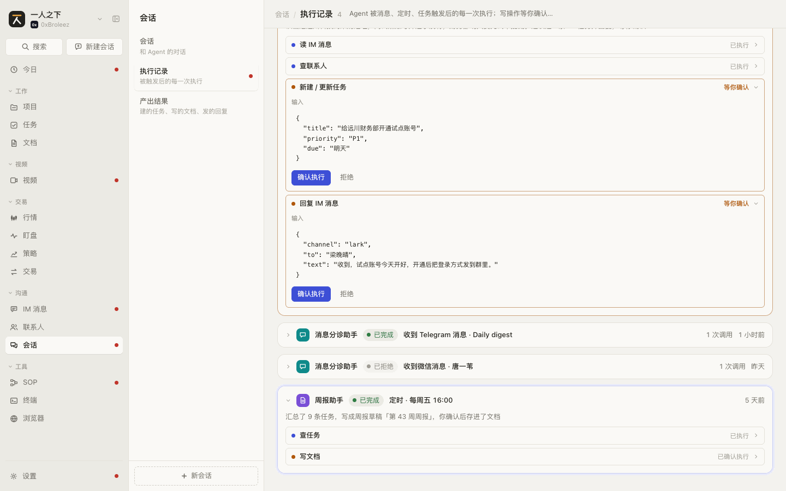 | 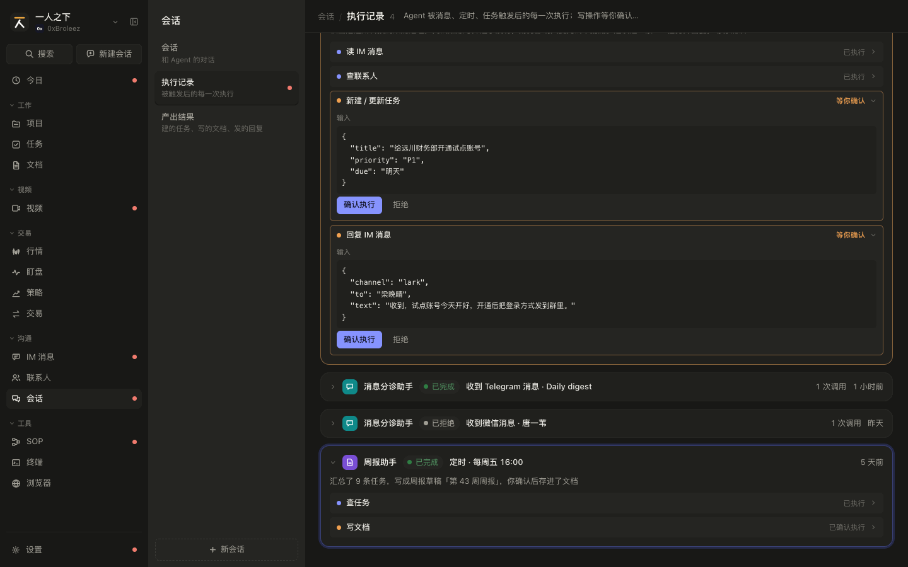 |

### 空状态和异常状态

| 编号 | 场景 | 显示 | 可做的操作 |
|---|---|---|---|
| SPEC-sessions-2.10 | 没有执行记录，或筛选后为空 | 一条都没有：「没有执行记录」+「Agent 被触发后，每次调用了什么工具、输入输出是什么都会留在这里」；筛选后为空：「没有符合条件的执行记录」+「换个状态或 Agent 看看」 | 改筛选 |
| SPEC-sessions-2.11 | 执行记录的 Agent 已删除 | 卡片没有头像，名字显示「已删除的 Agent」；等确认的操作仍可确认或拒绝 | |
| SPEC-sessions-2.12 | 执行失败（`failed`） | 红色「失败」标签，总结写失败原因（原型没有失败的种子数据） | 正式产品：卡片里给「重新执行」；原型未做 |
| SPEC-sessions-2.13 | 确认执行失败 | 原型未做；正式产品同 `SPEC-sessions-1.32` | |
| SPEC-sessions-2.14 | 加载失败 | 原型未做；正式产品显示错误信息和「重试」 | 重试 |

### 数据

见 SPEC-sessions-0 的 `AgentRun`、`ToolCall`、`RUN_STATUS`、`AgentOutput`。页面状态：`filter`（Agent 筛选）、`st`（`'' \| AgentRun['status']`）、`limit`（步长 50）、`toggled`（`Record<runId, boolean>`，手动展开收起过的）。

### 联动

| 方向 | 对方模块 | 触发 | 结果 | 见 |
|---|---|---|---|---|
| 进来 | 今日、SOP | 「去确认」/「更多」 | 打开本页；不定位到具体那条，等确认的本来就置顶展开 | `SPEC-today` |
| 进来 | 产出结果 | 点来源「执行记录 · …」 | 打开本页并定位到那一条（2.15） | `SPEC-sessions-3.5` |
| 改动 | 任务、文档、IM 消息、SOP | 确认执行 | 同 SPEC-sessions-0 `ABILITIES` | |
| 改动 | 产出结果 | 确认执行 | 多一条来源为本执行记录的产出 | `SPEC-sessions-3` |
| 改动 | 一级菜单、今日 | 等确认数变化 | 一级菜单角标、二级菜单红点、今日「Agent 待确认」同步 | `SPEC-sessions-0.2`、`SPEC-sessions-0.4` |

## SPEC-sessions-3 产出结果

Agent 真正落到数据上的东西：一张表，点标题打开目标，点来源回到当时的对话或执行。

### 截图

| | 亮 | 暗 |
|---|---|---|
| 桌面 1440 | 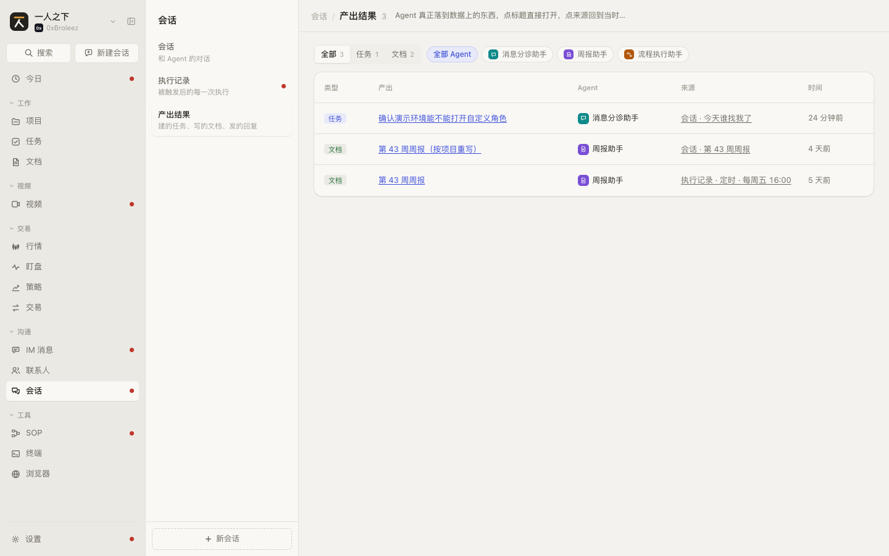 | 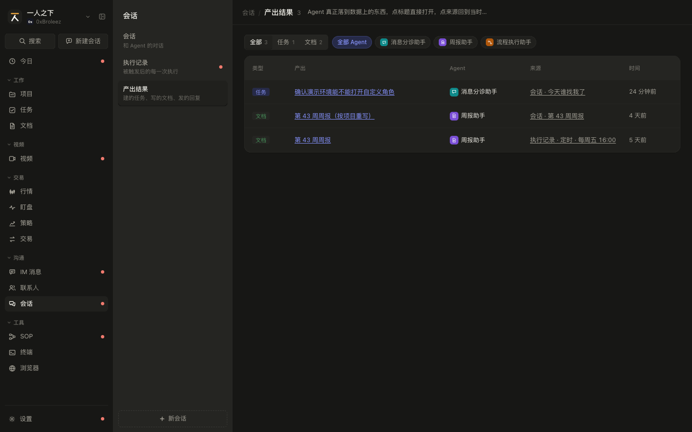 |
| 手机 375 |  |  |
| 目标已删除 1440 | 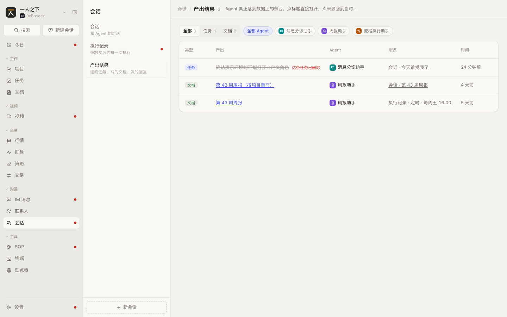 | 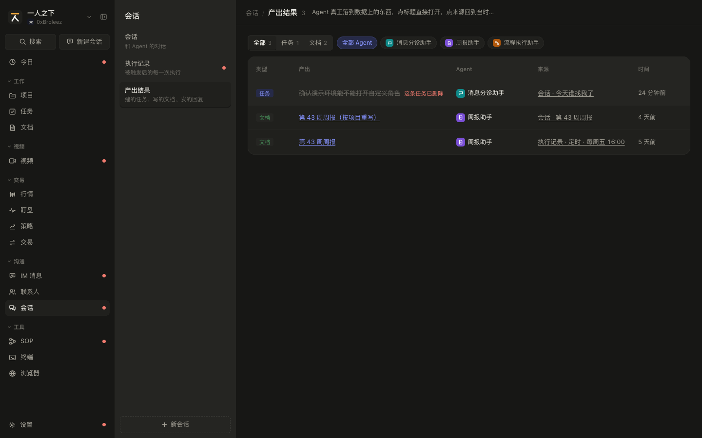 |

目标已删除：按 `shots.py` 的步骤先在任务里删掉 T-014，再点产出「确认演示环境能不能打开自定义角色」。

### 交互

| 编号 | 元素 | 操作 | 结果 |
|---|---|---|---|
| SPEC-sessions-3.1 | 页面标题 | 显示 | 「会话 / 产出结果」+ 筛选后的条数 + 说明「Agent 真正落到数据上的东西，点标题直接打开，点来源回到当时的对话或执行」 |
| SPEC-sessions-3.2 | 类型切换 | 点击 | 「全部」+ 实际出现过的类型（任务 / 文档 / IM 回复 / SOP 执行 / 其他，按这个顺序），单选，带条数 |
| SPEC-sessions-3.3 | Agent 筛选 chip | 点击 | 同 `SPEC-sessions-2.3`，按产出条数排 |
| SPEC-sessions-3.4 | 产出标题 | 点击 | 有目标或是文档时显示为链接。任务：打开任务抽屉；文档：切到「文档」的工作台文档并打开（按 `target` 找，找不到再按标题找）；IM 回复：打开 IM 消息页和那条消息；SOP 执行：打开该 SOP 的详情页。目标已删除时见 3.11。没有目标的（其他、没找到原消息的回复、没找到 SOP 的 SOP 执行）是纯文字 |
| SPEC-sessions-3.5 | 来源 | 点击 | 「会话 · <会话标题>」：切到会话页并打开该会话；「执行记录 · <触发说明>」：切到执行记录页并定位到那一条（`SPEC-sessions-2.15`） |
| SPEC-sessions-3.6 | 表格列 | 显示 | 类型标签（按类型着色）、产出、Agent（头像 + 名字）、来源、相对时间；按时间倒序。列表宽度不到 700 时只留类型、产出、时间三列，Agent 不显示，来源放到产出下面一行（仍可点），手机上也能回到来源 |
| SPEC-sessions-3.7 | 「显示更多（还有 N 条）」 | 点击 | 先显示 50 条，每次多 50 条 |
| SPEC-sessions-3.13 | 同一次提交的产出 | 显示和点击 | 正式产品（B-08）：MCP 回写时一次提交会给涉及的每个任务各记一条，按提交号合并成一行。产出显示短提交号和说明；来源只涉及一个任务时显示任务编号和标题（悬停看全称），多个时显示「N 个任务 · <第一个编号> 等」，点一下在这一行下面列出涉及的任务，再点收起。类型条数、页面条数都按合并后的行算 |

### 空状态和异常状态

| 编号 | 场景 | 显示 | 可做的操作 |
|---|---|---|---|
| SPEC-sessions-3.8 | 没有产出，或筛选后为空 | 一条都没有：「还没有产出」+「Agent 建了任务、写了文档、发了回复后会出现在这里」；筛选后为空：「没有符合条件的产出」+「换个类型或 Agent 看看」 | 改筛选 |
| SPEC-sessions-3.9 | 产出的 Agent 已删除 | Agent 列显示「已删除」，没有头像 | |
| SPEC-sessions-3.10 | 来源会话或执行记录已删除 | 来源显示「会话 · 已删除」或「执行记录 · 已删除」，仍可点（落到对应页） | 正式产品：已删除的来源不可点 |
| SPEC-sessions-3.11 | 目标已删除（任务、文档、消息、SOP 被删） | 点标题不跳页面，标题变灰加删除线，旁边红字「这条任务已删除」「这篇文档已删除」「这条消息已删除」「这个 SOP 已删除」；提示留在这一行，离开本页后复原。正式产品可以在列表加载时就把已删除的标出来 | |
| SPEC-sessions-3.12 | 加载失败 | 原型未做；正式产品显示错误信息和「重试」 | 重试 |

### 数据

见 SPEC-sessions-0 的 `AgentOutput`、`OutputKind`。`OUTPUT_KIND`：`task` 任务、`doc` 文档、`reply` IM 回复、`sop` SOP 执行、`other` 其他。页面状态：`filter`、`kind`（`'' \| OutputKind`）、`limit`（步长 50）。

### 联动

| 方向 | 对方模块 | 触发 | 结果 | 见 |
|---|---|---|---|---|
| 出去 | 任务、文档、IM 消息 | 点标题 | 见 3.4 | `SPEC-tasks`、`SPEC-library-1`、`SPEC-messages` |
| 出去 | 本模块 | 点来源 | 见 3.5 | `SPEC-sessions-1`、`SPEC-sessions-2` |

## SPEC-sessions-4 快速新建会话

在任何页面挑个 Agent、可选挂到项目、写下第一句话，回车就开聊。第一句话在会话里自动发出，Agent 照常回复。

### 截图

截图脚本截不到弹窗，图先空着。操作：任意页面按 ⌘J（Windows 为 Ctrl+J），或点侧栏顶部「新建会话」。

| | 亮 | 暗 |
|---|---|---|
| 桌面 1440 | 待截图脚本支持 | 待截图脚本支持 |
| 手机 375 | 待截图脚本支持 | 待截图脚本支持 |

### 交互

| 编号 | 元素 | 操作 | 结果 |
|---|---|---|---|
| SPEC-sessions-4.1 | 打开 | ⌘J / Ctrl+J、侧栏「新建会话」、命令面板「新建会话」 | 打开弹窗；⌘J 再按一次关闭；打开时命令面板关掉 |
| SPEC-sessions-4.2 | 弹窗头 | 显示 | 「新建会话」+ 当前选中 Agent 的说明 |
| SPEC-sessions-4.3 | Agent chip | 点击 | 只列启用的 Agent；默认选上次用的（最近更新的会话的 Agent，且仍启用），否则第一个。启用的多于 8 个时只露 7 个（当前选中的一定在里面，保持原顺序），其余收进「更多 Agent（N）」可搜索下拉（每项带说明）。点完焦点回到输入框 |
| SPEC-sessions-4.4 | 输入框 | 输入 | 打开即聚焦；占位「问 <Agent 名> 点什么；留空就只开一个空会话」。Enter 提交（输入法组字时不提交），Shift+Enter 换行，Option+上 / 下切换 Agent（循环） |
| SPEC-sessions-4.5 | 「关联项目」下拉 | 选择 | 默认「不关联」；当前停在某个项目详情页时默认选该项目；可搜索 |
| SPEC-sessions-4.6 | 提交按钮 | 点击 | 有文字时为「发送」，没有时为「开空会话」；没有选中 Agent 时置灰。底部提示「Enter 开始 / Shift Enter 换行 / Option ↑↓ 换 Agent」 |
| SPEC-sessions-4.7 | 提交 | Enter 或点按钮 | 关闭弹窗；新建会话（标题「新会话」，挂上所选项目），跳到「会话」页打开它；有文字时自动作为第一句话发出（只发一次），标题按 `SPEC-sessions-1.16` 改 |
| SPEC-sessions-4.8 | 关闭 | Esc，或点弹窗外的遮罩 | 关闭弹窗，不建会话；下拉开着时 Esc 先关下拉 |

### 空状态和异常状态

| 编号 | 场景 | 显示 | 可做的操作 |
|---|---|---|---|
| SPEC-sessions-4.9 | 所有 Agent 都停用 | 头部说明「没有可用的 Agent」；正文「所有 Agent 都停用了，先到「设置 / Agent」里启用一个」，没有输入框 | Esc 关闭 |
| SPEC-sessions-4.10 | 默认项目已删除 | 下拉显示「已删除的项目」 | 改选 |
| SPEC-sessions-4.11 | 建会话失败 | 原型未做；正式产品保留弹窗和已输入的文字，底部红字原因 | 重试 |

### 数据

用到 SPEC-sessions-0 的 `Agent`（`id`、`name`、`desc`、`enabled`、头像）和项目的 `{ id, name }`。提交的结果是 `onCreate(agentId, projectId | undefined, text)`，由 `App.tsx` 的 `newSession` 生成 `Session` 并设置 `firstMessage`。

### 联动

| 方向 | 对方模块 | 触发 | 结果 | 见 |
|---|---|---|---|---|
| 进来 | 任意页面 | ⌘J、侧栏按钮、命令面板 | 打开弹窗 | |
| 读取 | 项目 | 当前停在项目详情 | 默认关联该项目 | `SPEC-projects` |
| 出去 | 本模块 | 提交 | 打开新会话 | `SPEC-sessions-1` |

## 原型和规格对不上的地方

整理时发现的问题，PROTO-09 按下表处理，正文已同步。

| 编号 | 位置 | 问题 | 建议 | 处理 |
|---|---|---|---|---|
| S-1 | `SPEC-sessions-1.27` | Agent 删除后，点开它的会话右边显示「从左边选一个会话」，看不到历史 | 只读回看，头部显示「已删除的 Agent」 | 已修（PROTO-09）：换一个停用的占位 Agent 渲染对话，只读回看，见 `SPEC-sessions-1.27` |
| S-2 | `SPEC-sessions-1.26` | Agent 停用后「发送」置灰，但 ⌘Enter 和空会话里的示例问题仍能发出去 | 三种发送方式都拦住 | 已修（PROTO-09）：发送入口统一拦，示例问题置灰，见 `SPEC-sessions-1.26`、`SPEC-sessions-1.19` |
| S-3 | `SPEC-sessions-3.6` | 手机宽度下产出结果只留类型、产出、时间，来源看不到，回不到当时的会话或执行记录 | 来源放到产出下面一行 | 已修（PROTO-09）：窄宽度只藏 Agent 列，来源放产出下面一行，见 `SPEC-sessions-3.6` |
| S-4 | `SPEC-sessions-3.11`、`SPEC-sessions-3.5` | 产出指向的任务已删除时点标题没有任何反应，文档只切页面；从来源跳到执行记录页不定位到那一条 | 目标已删除时给提示；跳执行记录时展开并滚到那一条 | 已修（PROTO-09）：目标已删除时就地提示不跳页面，见 `SPEC-sessions-3.11`；跳执行记录定位并高亮，见 `SPEC-sessions-2.15` |
| S-5 | `SPEC-sessions-1.18` | 会话页里权限没开的回复说「可以在左边「工具与权限」里打开」，那是设置页调试对话的位置，会话页里没有 | 会话页指向「设置 / Agent / 工具与权限」 | 已修（PROTO-09）：`ChatPane` 加 `permHint`，会话页传设置的位置，见 `SPEC-sessions-1.18` |
| S-6 | `SPEC-sessions-3.4`、`SPEC-sessions-0` `ABILITIES` | SOP 执行的产出不记目标，标题是纯文字，点了也打不开 | 记下 SOP id，标题可以点开 | 已修（PROTO-09）：`run_sop` 记 `target` 为 SOP id，点标题打开 SOP 详情，见 `SPEC-sessions-3.4` |
| S-7 | `SPEC-sessions-2.10`、`SPEC-sessions-3.8` | 一条都没有和筛选后为空用同一句文案 | 筛选后为空改为「没有符合条件的…」 | 已修（PROTO-09）：两种情况分开说，见 `SPEC-sessions-2.10`、`SPEC-sessions-3.8` |
| S-8 | `SPEC-sessions-1.36` | 原型的浏览器标签放在 `BrowserPage` 组件里，一级菜单的浏览器是一直挂着的单个实例，挪不进会话旁边的面板；会话旁边的浏览器只能单独起一个实例，标签和一级菜单不是同一套。终端的标签在 `App.tsx`，两边是同一套 | 正式版浏览器标签存后端，两边天然同一套 | 保留差异：原型里会话旁边的浏览器是单独一份标签；正式版（`frontend/src/plugins/browser/SessionPanel.tsx`）和一级菜单同一套。其余行为（入口、链接一行、收起、整页打开）原型和正式版一致 |
