# 设置 规格（SPEC-settings）

| 项 | 内容 |
|---|---|
| 模块 key | `settings`（不是 `MODULES` 里的模块，总在一级菜单左下角） |
| 原型入口 | 一级菜单左下「设置」，http://127.0.0.1:7778 |
| 源码 | `web-next/src/settings.tsx`（`SECTIONS`、`SettingsNav`）、`web-next/src/workspaces.tsx`（`WorkspaceSwitcher`、`WorkspacesPage`）、`web-next/src/connectors.tsx`（`ConnectorsSettings`、`ConnectorDrawer`、`ConnBar`）、`web-next/src/apiconn.tsx`（`ApiConnectorDrawer`）、`web-next/src/models.tsx`（`ProvidersPage`、`ProviderDrawer`）、`web-next/src/agents.tsx`（`AgentsPage`、`AgentEditor`）、`web-next/src/kbskills.tsx`（`KnowledgePage`、`KbDrawer`、`SkillsPage`、`SkillDrawer`）、`web-next/src/enums.tsx`（`EnumsPage`）、`web-next/src/incidents.tsx`（`IncidentsPage`、`IncidentDrawer`）、`web-next/src/domains.tsx`（`DomainsPage`）、`web-next/src/appearance.tsx`（`AppearancePage`）；接线在 `web-next/src/App.tsx`（`section`、菜单红点、`connectConn`、`disconnectConn`、`connPlan`、`providerPlan`、`agentPlan`、`enumUsage`、`migrateEnum`、`modelChoices`、`mountableConns`、`report`） |
| 数据文件 | `web-next/src/workspacedata.ts`、`web-next/src/data.ts`（连接器部分：`Tool`、`ToolField`、`ToolCategory`、`AuthMode`、`ConnAuth`、`ToolDef`、`ConnTool`、`ToolMode`、`Connector`、`ConnStatus`）、`web-next/src/modeldata.ts`、`web-next/src/agentdata.ts`（`Agent`、`Skill`、`KnowledgeBase`）、`web-next/src/kbdata.ts`、`web-next/src/enumdata.ts`、`web-next/src/incidentdata.ts`、`web-next/src/domaindata.ts`；外观的 `ThemePref` 在 `appearance.tsx` |
| 截图 | [`shots/settings/`](shots/settings/) |
| 负责任务 | PROTO-04e（整理）、PROTO-11（修原型、补抽屉和子页截图） |
| 对应开发任务 | 见下表「引用本规格的开发任务」 |
| 状态 | 已整理 |
| 最后对照 | 2026-10-28，PROTO-11 修完 P-2 到 P-19 后的工作区（基于 `389c7d1`） |

### 引用本规格的开发任务

| 任务 | 内容 | 对照的节 |
|---|---|---|
| CONN-01d | 实现连接器设置页 | `SPEC-settings-3`（列表）、`SPEC-settings-4`（即时通讯连接器抽屉）、`SPEC-settings-5`（应用与 API 连接器抽屉）；数据见 `SPEC-settings-0` 的连接器结构 |
| MP-01b | 实现模型服务商设置页 | `SPEC-settings-6`（列表）、`SPEC-settings-7`（服务商抽屉） |
| CORE-10b | 实现工作台切换与模板缺插件提示 | `SPEC-settings-2`（工作台与模块页、左上角切换器）；缺插件提示原型里还没有，见 P-1 |
| FE-01a | 从原型抽出设计变量并实现亮暗主题 | `SPEC-settings-21`（外观）；亮暗两套截图是对照基准，`SPEC-settings-1.6` 说明主题怎么生效 |

Agent、知识库、技能、枚举值、运行异常、内网域名几节目前没有直接对应的开发任务，归 Agent、知识库、枚举、异常、域名相关任务时再引用。

## SPEC-settings-0 模块概述

工作台自身的配置集中在这里：菜单怎么排（工作台）、接哪些外部工具（连接器）、用哪些模型（模型服务商）、Agent 和它能挂的知识库与技能、各处下拉的选项（枚举值）、系统出的问题（运行异常）、本机服务的域名、外观。设置不算功能模块，不受工作台开关影响，总在一级菜单左下角。左边是二级菜单，十个分项，右边是分项内容；配置类的详情多数用右侧抽屉，Agent 和知识库用整页。

### 页面清单

| 节 | 页面 | 入口 | 说明 |
|---|---|---|---|
| [SPEC-settings-1](#spec-settings-1-设置框架与二级菜单) | 设置框架与二级菜单 | 一级菜单「设置」 | 十个分项、红点、进入时落在哪一项 |
| [SPEC-settings-2](#spec-settings-2-工作台与模块) | 工作台与模块 | 二级菜单「工作台与模块」；左上角工作台菜单「工作台与模块设置…」 | 新建、切换、删工作台，编排菜单分组和模块 |
| [SPEC-settings-3](#spec-settings-3-连接器列表) | 连接器列表 | 二级菜单「连接器」（第一次进设置默认这一项） | 按分类列工具，连接、断开、接入 |
| [SPEC-settings-4](#spec-settings-4-即时通讯连接器抽屉) | 即时通讯连接器抽屉 | 即时通讯分类里点连接器行或「接入」 | 凭证、测试、收发方向、拉取间隔 |
| [SPEC-settings-5](#spec-settings-5-应用与-api-连接器抽屉) | 应用与 API 连接器抽屉 | 其它分类里点连接器行或「接入」 | 认证方式、OAuth 授权、工具清单和权限上限 |
| [SPEC-settings-6](#spec-settings-6-模型服务商列表) | 模型服务商列表 | 二级菜单「模型服务商」 | 已接入的服务商和可添加的服务商 |
| [SPEC-settings-7](#spec-settings-7-模型服务商抽屉) | 模型服务商抽屉 | 点服务商卡片 | 凭证、测试、启用哪些模型 |
| [SPEC-settings-8](#spec-settings-8-agent-列表) | Agent 列表 | 二级菜单「Agent」 | 卡片网格，启停 |
| [SPEC-settings-9](#spec-settings-9-agent-配置页) | Agent 配置页 | 点 Agent 卡片；「新建 Agent」 | 七个标签加右侧调试对话 |
| [SPEC-settings-10](#spec-settings-10-知识库列表) | 知识库列表 | 二级菜单「知识库」 | 卡片网格，索引状态 |
| [SPEC-settings-11](#spec-settings-11-知识库详情文档) | 知识库详情：文档 | 点知识库卡片 | 文档列表、加文档、阅读视图 |
| [SPEC-settings-12](#spec-settings-12-知识库详情检索测试) | 知识库详情：检索测试 | 详情标签「检索测试」 | 输入问题看命中的段落 |
| [SPEC-settings-13](#spec-settings-13-知识库详情设置) | 知识库详情：设置 | 详情标签「设置」 | 来源、本地目录、切分、向量化模型、在用的 Agent |
| [SPEC-settings-14](#spec-settings-14-知识库抽屉) | 知识库抽屉 | 「新建知识库」；详情里「改名称和分类」 | 名称、说明、来源分类、删除 |
| [SPEC-settings-15](#spec-settings-15-技能列表) | 技能列表 | 二级菜单「技能」 | 表格，按来源筛 |
| [SPEC-settings-16](#spec-settings-16-技能抽屉) | 技能抽屉 | 点技能行；「新建技能」 | 内置只读、复制一份来改 |
| [SPEC-settings-17](#spec-settings-17-枚举值) | 枚举值 | 二级菜单「枚举值」 | 左边枚举列表，右边值的编辑表 |
| [SPEC-settings-18](#spec-settings-18-运行异常列表) | 运行异常列表 | 二级菜单「运行异常」 | 按状态、级别、模块筛，同类合并 |
| [SPEC-settings-19](#spec-settings-19-运行异常抽屉) | 运行异常抽屉 | 点异常行 | 转研发任务、忽略、标为已解决 |
| [SPEC-settings-20](#spec-settings-20-内网域名) | 内网域名 | 二级菜单「内网域名」 | 后缀、解析、代理、域名表、生成的配置 |
| [SPEC-settings-21](#spec-settings-21-外观) | 外观 | 二级菜单「外观」 | 配色方案、收起一级菜单 |

### 共用数据结构

设置里的数据原型都放在 `App.tsx` 的 state 里（刷新复原）；工作台、外观偏好存浏览器 localStorage；知识库的文档和设置放在 `kbdata.ts` 的模块级小 store 里。下面是多节都用到的结构，各页特有的写在页面节里。

#### 分项

`Section`（`web-next/src/settings.tsx`）：`'workspace' | 'connectors' | 'providers' | 'agents' | 'kbs' | 'skills' | 'enums' | 'incidents' | 'domains' | 'appearance'`。`SECTIONS` 按这个顺序给出 `{ key, label, desc }`：

| key | label | desc |
|---|---|---|
| `workspace` | 工作台与模块 | 切换工作台、选功能模块 |
| `connectors` | 连接器 | 对接外部工具 |
| `providers` | 模型服务商 | API Key 与接口地址 |
| `agents` | Agent | 工作助手 |
| `kbs` | 知识库 | Agent 检索用的资料 |
| `skills` | 技能 | 可复用的做事方法 |
| `enums` | 枚举值 | 状态、优先级、分类等选项 |
| `incidents` | 运行异常 | 系统出的问题，可转研发任务 |
| `domains` | 内网域名 | 给本机服务配好记的域名 |
| `appearance` | 外观 | 配色方案、菜单收起 |

#### 连接器（`web-next/src/data.ts`）

`Tool`：可以接入的工具（目录，写死在 `TOOLS` 里）。

| 字段 | 类型 | 必填 | 说明 | 取值 / 示例 |
|---|---|---|---|---|
| `key` | `string` | 是 | 工具 key；即时通讯类和 IM 渠道 key 相同，消息、联系人的渠道编号、连接器靠它对上 | `wechat`、`github`、`custom_mcp` |
| `category` | `string` | 是 | 分类 key，见 `TOOL_CATEGORIES` | `im` |
| `label` | `string` | 是 | 名称 | `企业微信` 用 IM 渠道的 `label`：`微信` |
| `color` | `string` | 是 | 标志底色 | `#07c160` |
| `desc` | `string` | 是 | 一句话说明 | `Slack App，监听指定频道与私信` |
| `canSend` | `boolean` | 是 | 平台能不能从外部发消息回去；不能的话只能「只收」；应用类都是 `false` | `true` |
| `fields` | `ToolField[]` | 是 | 配置项；应用类多数为空，Jira、富途 OpenD、自定义类有 | |
| `auth` | `AuthMode[]` | 否 | 应用与 API 类才有：支持的认证方式，第一个是默认 | `['oauth2', 'token']` |
| `oauth` | `{ auth_url: string; token_url: string; scopes: string; builtin: boolean }` | 否 | 内置的 OAuth 应用信息；`builtin` 为 `false` 时（自定义 MCP、OpenAPI）用户自己填 | |
| `catalog` | `ToolDef[]` | 否 | 获取工具清单时对方报回来的工具（原型写死） | |

`ToolField`：`{ key: string; label: string; kind: 'text' | 'secret' | 'select'; placeholder?: string; options?: string[]; required?: boolean }`。`select` 新建时默认选 `options[0]`；`secret` 显示成密码框，旁边有「显示 / 隐藏」。

`ToolCategory`：`{ key: string; label: string; desc: string }`，`TOOL_CATEGORIES` 依次为：

| key | label | desc | 工具 |
|---|---|---|---|
| `im` | 即时通讯 | 把各 IM 的消息收进工作台，并能直接从工作台回复 | 微信、飞书、Slack、Telegram、QQ |
| `dev` | 研发协作 | 代码仓库、需求和缺陷、线上告警 | GitHub、Jira、GitLab、Linear、Sentry |
| `docs` | 文档知识 | 团队的文档、知识库和云盘 | Notion、Confluence、飞书文档、语雀、Google Drive |
| `office` | 日程邮件 | 日历、邮箱 | Google 日历、Gmail、Outlook / Microsoft 365、企业邮箱（IMAP / SMTP） |
| `crm` | 客户与服务 | CRM、客服工单 | HubSpot、Salesforce、Zendesk |
| `data` | 数据与搜索 | 数据库、网页搜索、公开数据接口 | 和风天气（公开接口）、PostgreSQL、MySQL、网页搜索、网页读取 |
| `media` | 内容平台 | 视频平台的上传发布、数据和评论，配音用的语音合成 | B 站、YouTube、抖音、视频号、小红书、语音合成 |
| `market` | 行情数据 | 数币、A 股、港股、美股的行情来源；下单用的交易账户在「交易 / 交易账户」里管 | Binance 行情、OKX 行情、Deribit 期权行情、富途 OpenD、Tushare Pro、Polygon.io |
| `custom` | 自定义 | 自己的 MCP 服务或 OpenAPI 接口 | MCP 服务（`custom_mcp`）、OpenAPI 接口（`custom_openapi`） |

`AuthMode`：`'none'` 无授权 / `'oauth2'` OAuth 2.0 / `'token'` Token（`AUTH_LABEL`）。

`ToolDef`：`{ name: string; desc: string; write: boolean }`。`ToolMode`：`'off'` 关闭 / `'confirm'` 需确认 / `'auto'` 自动；只读工具没有「需确认」。`ConnTool` = `ToolDef` + `{ mode: ToolMode }`。新拉到的工具按 `defaultMode`：写操作需确认、只读自动。

`ConnAuth`：

| 字段 | 类型 | 必填 | 说明 |
|---|---|---|---|
| `mode` | `AuthMode` | 是 | 当前认证方式 |
| `oauth` | `{ client_id: string; client_secret: string; auth_url: string; token_url: string; scopes: string; account?: string; expires_at?: string }` | 否 | `account`、`expires_at` 是授权后拿回来的；断开时清掉 |
| `token` | `{ header: string; prefix: string; value: string }` | 否 | 默认 `{ header: 'Authorization', prefix: 'Bearer', value: '' }` |

`Connector`：已接入的实例。一个工具只接一个账号。

| 字段 | 类型 | 必填 | 说明 | 取值 / 示例 |
|---|---|---|---|---|
| `id` | `string` | 是 | 编号 | `cn_slack` |
| `tool` | `string` | 是 | `Tool.key` | `slack` |
| `name` | `string` | 是 | 连接器名称 | `公司 Slack` |
| `account` | `string` | 是 | 连上后对方报回来的账号；新建时为「待首次同步」，应用类按认证方式填（授权账号 / 「Token 认证」/「公开接口」） | `acme.slack.com` |
| `status` | `ConnStatus` | 是 | 状态 | `connected` 已连接 / `connecting` 连接中 / `error` 异常 / `paused` 已暂停 / `disconnected` 已断开 |
| `error` | `string` | 否 | 异常原因 | `应用 Secret 已失效（errcode 40001），请到企业微信后台重新获取` |
| `config` | `Record<string, string>` | 是 | `fields` 的取值，按 `ToolField.key` 存 | |
| `direction` | `'receive' \| 'both'` | 是 | 只收 / 收发；应用类固定 `receive` | `both` |
| `interval` | `number` | 是 | 拉取间隔，分钟；应用类为 0 | `5` |
| `last_sync_at` | `string \| null` | 是 | 上次同步时间 | |
| `created_at` | `string` | 是 | 接入时间 | |
| `icon` | `string` | 否 | 自定义类（MCP、OpenAPI）换的图标，data URL | |
| `auth` | `ConnAuth` | 否 | 应用与 API 类才有 | |
| `tools` | `ConnTool[]` | 否 | 获取到的工具清单和每个工具的权限上限 | |
| `tools_at` | `string` | 否 | 获取工具清单的时间 | |

状态含义：`disconnected` 是人主动断开，配置留着、OAuth 授权撤销；`paused` 是保存时关了「启用」；`connecting` 是正在连。

#### 模型（`web-next/src/modeldata.ts`）

`ProviderKind`：`anthropic`、`openai`、`azure`、`bedrock`、`gemini`、`mistral`、`xai`、`deepseek`、`qwen`、`zhipu`、`moonshot`、`doubao`、`qianfan`、`hunyuan`、`minimax`、`openrouter`、`siliconflow`、`ollama`、`lmstudio`、`vllm`、`custom`。

`ProviderGroup`（`PROVIDER_GROUPS`，按这个顺序展示）：`国际`、`国内`、`聚合网关`、`本地与自部署`、`自定义`。

`Cap`：`tools` 工具调用 / `vision` 看图 / `reasoning` 深度推理 / `fast` 快 / `local` 本地（`CAP_LABEL`）。

`ProviderKindDef`：服务商目录（`PROVIDER_KINDS`）。

| 字段 | 类型 | 说明 | 示例 |
|---|---|---|---|
| `kind` | `ProviderKind` | 服务商类型 | `anthropic` |
| `group` | `ProviderGroup` | 分组 | `国际` |
| `label` | `string` | 名称 | `Anthropic` |
| `short` | `string` | 标志里的字 | `A` |
| `color` | `string` | 标志底色 | `#c96442` |
| `desc` | `string` | 说明，可为空 | `Claude 系列模型` |
| `fields` | `ProviderField[]` | 配置项 | |
| `catalog` | `CatalogModel[]` | 内置模型目录；vLLM、自定义为空，模型 ID 手填 | |

`ProviderField`：`{ key: string; label: string; type: 'text' | 'secret'; placeholder?: string; required?: boolean; hint?: string }`。常用两个：`api_key`（API Key，secret，必填）、`base_url`（接口地址，选填时提示「留空用官方地址；走代理或网关时再填」；Azure、Ollama、LM Studio、vLLM、自定义必填）。另有 `org`、`deployment`、`api_version`、`access_key`、`secret_key`、`region`、`endpoint`、`model_ids`。

`CatalogModel`：`{ id: string; name: string; context: number; caps: Cap[]; price?: [number, number] }`，`context` 单位 K，`price` 是每百万 token 的输入、输出美元价。

`Provider`：已接入的服务商。同一类型可以接多个。

| 字段 | 类型 | 必填 | 说明 | 取值 / 示例 |
|---|---|---|---|---|
| `id` | `string` | 是 | 编号 | `pv_anthropic` |
| `kind` | `ProviderKind` | 是 | 类型 | `anthropic` |
| `name` | `string` | 是 | 名称，同一家接多个时区分 | `Anthropic` |
| `values` | `Record<string, string>` | 是 | `fields` 的取值 | `{ api_key: 'sk-ant-...', base_url: '' }` |
| `enabled` | `boolean` | 是 | 启用 | `true` |
| `status` | `'ok' \| 'error' \| 'untested'` | 是 | 连接状态 | `ok` 连接正常 / `error` 连接异常 / `untested` 未测试；`enabled` 为 `false` 时显示「已停用」 |
| `error` | `string` | 否 | 异常原因 | `401 Unauthorized：API Key 已失效或被撤销` |
| `checked_at` | `string` | 否 | 上次测试时间 | |

`ModelConf`：启用的模型。

| 字段 | 类型 | 必填 | 说明 | 取值 / 示例 |
|---|---|---|---|---|
| `id` | `string` | 是 | 服务商里的模型 ID；Agent 的 `model` 存它 | `claude-sonnet-5-5` |
| `provider_id` | `string` | 是 | 所属服务商 | `pv_anthropic` |
| `name` | `string` | 是 | 显示名 | `Claude Sonnet 5.5` |
| `context` | `number` | 是 | 上下文，K | `200` |
| `caps` | `Cap[]` | 是 | 能力 | `['tools', 'vision', 'reasoning']` |
| `price` | `[number, number]` | 否 | 输入、输出价格 | `[3, 15]` |
| `enabled` | `boolean` | 是 | 在服务商抽屉里勾选 | |
| `temperature` | `number` | 是 | 默认参数，从目录建时为 0.7；原型里没有界面改 | `0.7` |
| `max_output` | `number` | 是 | 默认参数，从目录建时为 4096；原型里没有界面改 | `4096` |

`usable(m, providers)`：模型能不能用。依次判断：服务商已删除 → 「服务商已删除」；服务商停用 → 「<名称> 已停用」；服务商 `status === 'error'` → 「<名称> 连接异常」；模型没启用 → 「模型未启用」。Agent 的模型下拉、知识库的向量化模型都按它判断。

`testProvider(kind, values)`（模拟测试）：必填没填 → 「还没填：…」；值里带 `expired`、`bad`、`invalid` → 「401 Unauthorized：API Key 已失效或被撤销」；`base_url` 不是 `http://` 或 `https://` 开头 → 「接口地址要以 http:// 或 https:// 开头」；否则成功。

#### Agent、技能、知识库（`web-next/src/agentdata.ts`）

`Agent`、`Skill`、`KnowledgeBase` 的字段表分别在 `SPEC-settings-9`、`SPEC-settings-16`、`SPEC-settings-14`。

### 联动总表

| 方向 | 对方模块 | 触发 | 结果 | 见 |
|---|---|---|---|---|
| 进来 | 今日 | 待办里「连接异常」「运行异常」的「去修复」「去看看」 | 进设置，落在连接器 / 模型服务商 / 运行异常，并打开对应抽屉 | `SPEC-today-1` |
| 进来 | IM 消息 | 「渠道配置」 | 连接器列表，分类筛到即时通讯 | `SPEC-messages-1` |
| 进来 | IM 消息 | 消息抽屉里连接异常的「去修复」 | 打开该连接器的抽屉 | `SPEC-messages-2` |
| 进来 | 视频 | 发布平台没接的提示 | 连接器列表，分类筛到内容平台 | `SPEC-videos` |
| 进来 | 任务 | 来源为异常的任务里点来源 | 打开运行异常抽屉 | `SPEC-tasks-4` |
| 进来 | 会话、项目、文档 | 点 Agent 名称 | 打开 Agent 配置页 | `SPEC-sessions-1`、`SPEC-projects-10` |
| 进来 | 命令面板 | 「设置 / <分项>」、搜 Agent 名称、「切换到深色 / 浅色」 | 跳到分项、打开 Agent、切主题 | |
| 进来 | 左上角工作台菜单 | 「工作台与模块设置…」 | 工作台与模块 | `SPEC-settings-2` |
| 出去 | 任务 | 运行异常「转为研发任务」「打开任务」 | 新建来源为「异常」的任务；打开任务抽屉 | `SPEC-tasks-4` |
| 出去 | 浏览器 | 内网域名里点域名 | 在内置浏览器打开 | `SPEC-browser` |
| 改动 | 全局 | 工作台、外观 | 一级菜单的模块、分组、顺序、默认页；配色、菜单收起 | `SPEC-settings-2`、`SPEC-settings-21` |
| 改动 | IM 消息、盯盘、Agent | 连接器断开、删除 | 消息不再同步；Agent 卸下连接器工具；盯盘提醒改为应用内 | `SPEC-settings-3.9`、`SPEC-settings-4.16` |
| 改动 | Agent、SOP、知识库 | 模型服务商停用、异常、删除 | 用到的模型显示不可用；删除时 Agent 换成别家可用模型 | `SPEC-settings-7.17` |
| 改动 | 任务、联系人、文档、IM 消息、SOP | 枚举值改名、改色、停用、合并删除 | 各处下拉、标签、筛选跟着变；合并时数据里的 key 改掉 | `SPEC-settings-17` |
| 改动 | 项目 | 内网域名 | 原型卡片上显示域名 | `SPEC-projects-12` |

## SPEC-settings-1 设置框架与二级菜单

设置的外框：一级菜单左下「设置」，进来后左边是二级菜单「设置」，十个分项。

### 截图

模块入口（第一次进设置，默认落在连接器）：

| | 亮 | 暗 |
|---|---|---|
| 桌面 1440 |  |  |
| 手机 375 |  |  |

### 交互

| 编号 | 元素 | 操作 | 结果 |
|---|---|---|---|
| SPEC-settings-1.1 | 一级菜单左下「设置」 | 点击 | 进设置；`section` 保留上次看的分项，第一次是「连接器」；从别处 `go('settings')` 进来时连接器的分类筛选清空 |
| SPEC-settings-1.2 | 二级菜单项 | 点击 | 切到这一项，关掉当前抽屉；点「Agent」总是回到 Agent 列表（不停在某个 Agent 的配置页） |
| SPEC-settings-1.3 | 二级菜单项的红点 | 看 | 连接器：`status === 'error'` 的连接器数；模型服务商：启用且 `status === 'error'` 的服务商数；运行异常：未处理且级别为错误的异常数（警告不提醒）。只显示红点，数量在悬停提示「N 项需要处理」里 |
| SPEC-settings-1.4 | 二级菜单项的说明 | 看 | 每项名称下一行是 `SECTIONS.desc`（手机宽度不显示） |
| SPEC-settings-1.5 | 页面顶栏 | 看 | 每个分项顶栏是「设置 / <分项名>」加数量、说明和右上操作（`PageTitle`）；Agent 配置页是「Agent / <名称>」，知识库详情是「知识库 / <名称>」，父级可点回列表 |
| SPEC-settings-1.6 | 主题 | 生效 | 外观里选的配色写到根元素，`system` 按系统明暗实时切换；设置内各页面没有单独的配色 |
| SPEC-settings-1.7 | 一级菜单「设置」的红点 | 看 | 1.3 的三个数加起来大于 0 时亮，悬停写「N 个连接器异常，N 个模型服务商连接异常，N 个运行错误未处理」（为 0 的不写） |

### 空状态和异常状态

| 编号 | 场景 | 显示 | 可做的操作 |
|---|---|---|---|
| SPEC-settings-1.8 | 手机宽度 | 一级菜单和二级菜单都变成顶部一行可横向滑动的标签条（见 375 截图），红点照常显示，分项说明不显示；点一项后下面的内容换成该项 | |
| SPEC-settings-1.9 | 分项加载失败 | 原型未做（数据都在内存）；正式产品在内容区显示错误信息和「重试」，二级菜单照常可用 | 重试 |

### 数据

见 SPEC-settings-0「分项」。红点数在 `App.tsx` 里算：`brokenConnectors`、`brokenProviders`、`openIncidents`。

### 联动

见 SPEC-settings-0 联动总表的「进来」各行。

## SPEC-settings-2 工作台与模块

一个工作台是一套菜单：开哪些功能模块、怎么分组、什么顺序、默认打开哪个。数据所有工作台共用，切工作台只换菜单。还包括一级菜单左上角的工作台切换菜单。

### 截图

| | 亮 | 暗 |
|---|---|---|
| 桌面 1440 | 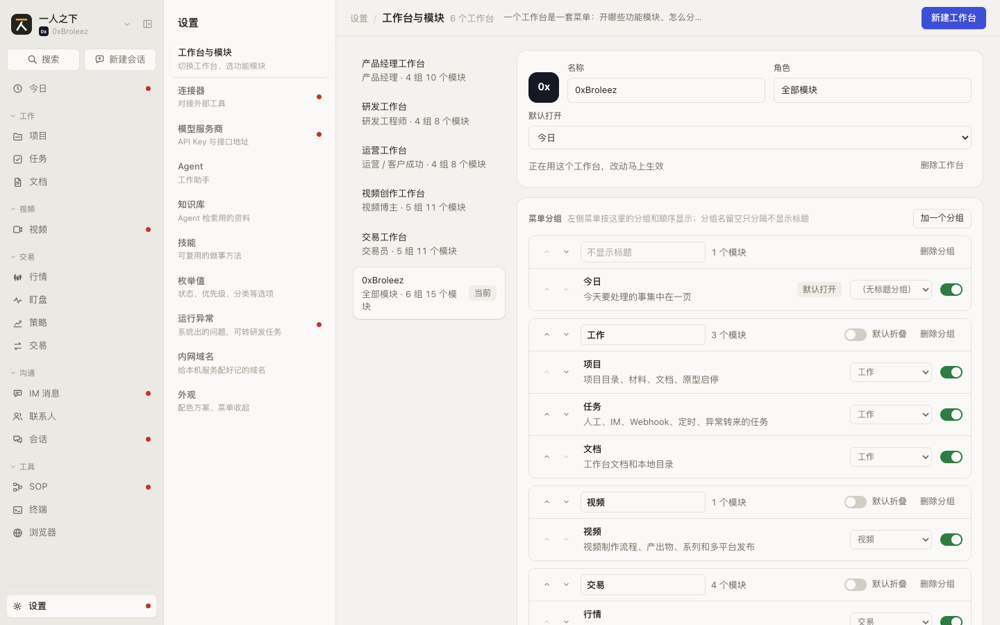 | 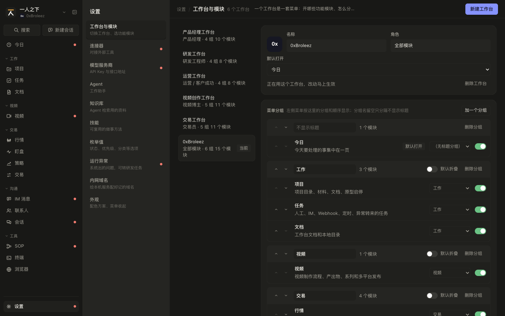 |
| 手机 375 | 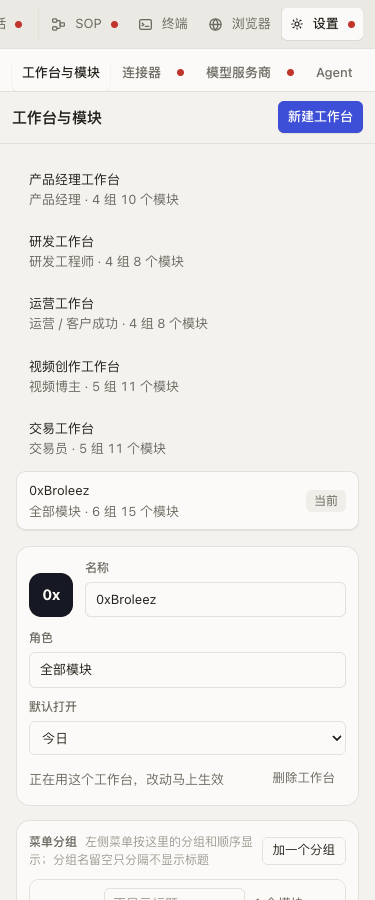 | 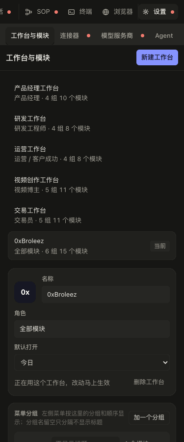 |

下面这些由 `shots.py` 按步骤截（`STEPS` 里的 `settings_workspace`，桌面 1440）。未启用区（在某个模块行关掉开关）还没截。

| 场景 | 步骤 | 亮 | 暗 |
|---|---|---|---|
| 模板卡片 | 右上「新建工作台」 | 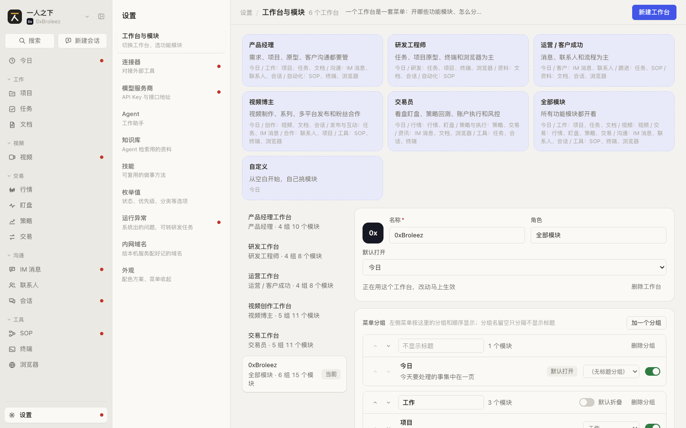 | 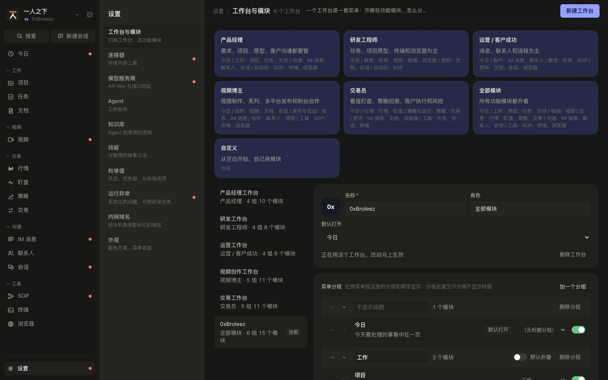 |
| 删除确认 | 「删除工作台」 | 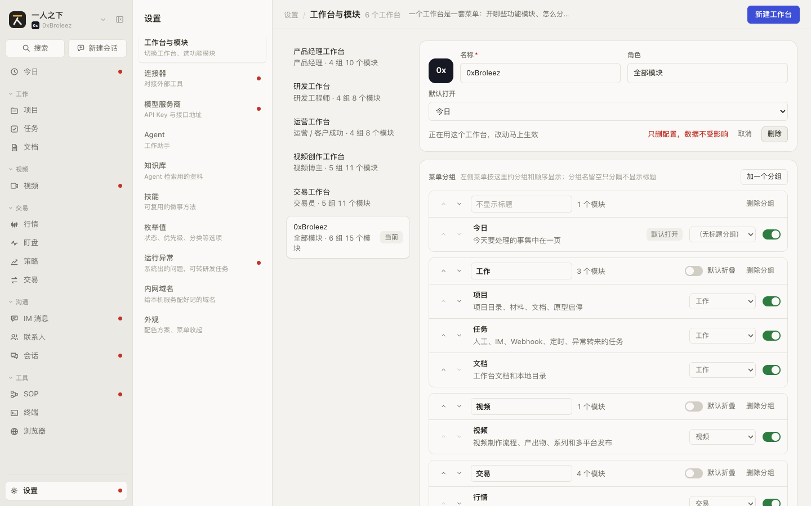 | 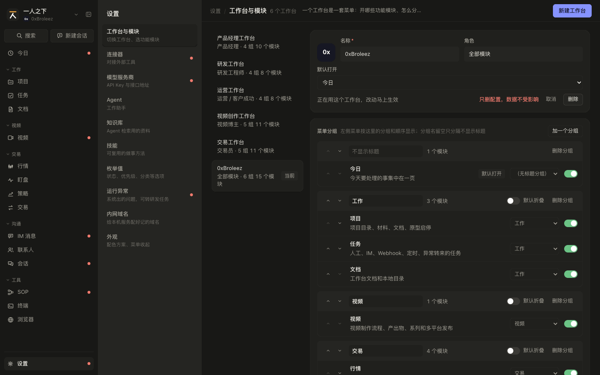 |
| 左上角切换菜单 | 点左上角产品标志 | 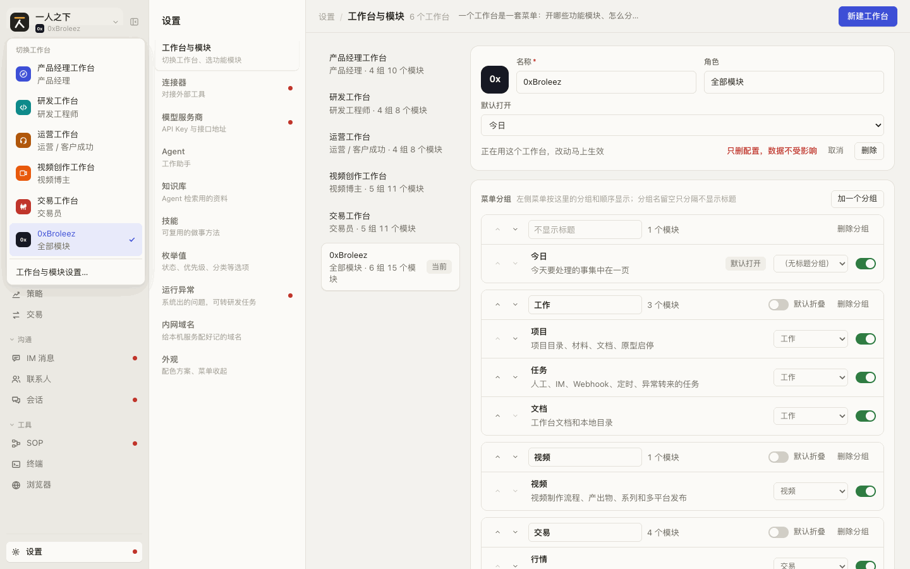 | 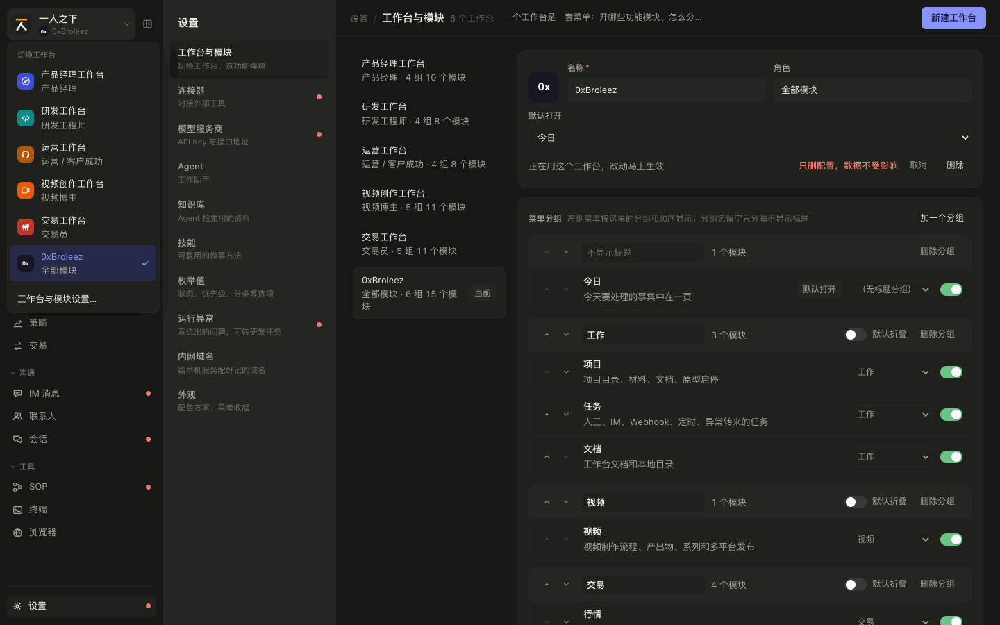 |

### 交互

| 编号 | 元素 | 操作 | 结果 |
|---|---|---|---|
| SPEC-settings-2.1 | 左上角产品标志 | 看 | 固定是产品 logo 和「一人之下」，下一行是当前工作台的小标志和名称；侧栏收起时悬停提示「一人之下 · <工作台名>」 |
| SPEC-settings-2.2 | 左上角产品标志 | 点击 | 打开「切换工作台」菜单（挂在 body 上、按按钮位置固定定位，侧栏收起时不被裁掉）：每行是标志、名称、角色，当前的打勾；列表多了只滚列表，底部「工作台与模块设置…」一直看得到 |
| SPEC-settings-2.3 | 切换菜单里的工作台 | 点击 | 切到这个工作台，菜单关闭；不在设置里时跳到它的默认模块，在设置里时留在设置 |
| SPEC-settings-2.4 | 切换菜单 | 点外面、按 Esc、窗口缩放 | 关闭 |
| SPEC-settings-2.5 | 切换菜单「工作台与模块设置…」 | 点击 | 进设置的工作台与模块 |
| SPEC-settings-2.6 | 右上「新建工作台」 | 点击 | 在顶栏下展开 / 收起模板卡片，每张写角色、说明和分组摘要（如「工作：项目、任务、文档 / 沟通：…」）；模板依次为产品经理、研发工程师、运营 / 客户成功、视频博主、交易员、全部模块、自定义 |
| SPEC-settings-2.7 | 模板卡片 | 点击 | 按模板建一个工作台（名称重名时加序号「产品经理工作台 2」），加到列表末尾并选中编辑，模板卡片收起；不自动切过去 |
| SPEC-settings-2.8 | 左栏工作台列表 | 点击一行 | 右边编辑这个工作台；每行写名称、「角色 · N 组 M 个模块」，当前在用的标「当前」；进页面时默认编辑当前工作台，切换工作台后跟着换 |
| SPEC-settings-2.9 | 标志 | 点击 | 打开标志编辑（`MarkEditor`）：内置图标、文字（选了图标时文字不显示）、底色、上传图片（PNG、JPG，1MB 以内，超了提示「图片不能超过 1MB」）；都没设时用产品 logo |
| SPEC-settings-2.10 | 名称、角色输入框 | 输入 | 实时保存，左栏、左上角跟着变 |
| SPEC-settings-2.11 | 「默认打开」下拉 | 选择 | 选项是这个工作台启用的模块；切到这个工作台时打开它 |
| SPEC-settings-2.12 | 「切换到这个工作台」 | 点击 | 编辑的不是当前工作台时出现；切过去。编辑的是当前工作台时这里写「正在用这个工作台，改动马上生效」 |
| SPEC-settings-2.13 | 「删除工作台」 | 点击 | 只剩一个工作台时不出现；点后变成确认「只删配置，数据不受影响」+「取消」「删除」；删掉的是当前工作台就切到剩下的第一个 |
| SPEC-settings-2.14 | 「加一个分组」 | 点击 | 末尾加一个名为「新分组」的空分组 |
| SPEC-settings-2.15 | 分组名输入框 | 输入 | 改名；留空时占位「不显示标题」，侧栏里这组只分隔、不显示标题 |
| SPEC-settings-2.16 | 分组上移 / 下移 | 点击 | 和相邻分组换位置；第一组不能上移、最后一组不能下移（按钮置灰） |
| SPEC-settings-2.17 | 「默认折叠」开关 | 切换 | 只在有标题的分组出现；开了侧栏里这组默认收起，侧栏点分组标题也能随时展开、收起 |
| SPEC-settings-2.18 | 「删除分组」 | 点击 | 只剩一组时不出现；直接删除（不确认），里面的模块并到上一组（第一组并到下一组），模块不会丢。删后分组标题下出现「已删除分组「<名称>」，里面的 N 个模块并到了「<相邻组>」」+「撤销」（相邻组没有标题时写「相邻的分组」），8 秒后或切到别的工作台时消失；「撤销」恢复删除前的分组 |
| SPEC-settings-2.19 | 模块行上移 / 下移 | 点击 | 在本组内换位置，首尾置灰 |
| SPEC-settings-2.20 | 模块行「移到别的分组」下拉 | 选择 | 有两组以上才出现；模块移到所选分组末尾；无标题分组显示「（无标题分组）」 |
| SPEC-settings-2.21 | 模块行开关 | 关掉 | 模块从菜单里拿掉，放到「未启用」；它是默认打开的模块时，默认打开换成第一个启用的模块（`withGroups`） |
| SPEC-settings-2.22 | 模块行「默认打开」标签 | 看 | 默认打开的模块行上标出 |
| SPEC-settings-2.23 | 未启用区的分组下拉 + 「启用」 | 选组后点击 | 模块启用到所选分组末尾；没选过就放最后一组 |

### 空状态和异常状态

| 编号 | 场景 | 显示 | 可做的操作 |
|---|---|---|---|
| SPEC-settings-2.24 | 分组里没有模块 | 「空分组：从别的分组移过来，或者在下面启用模块到这里」 | 移入、启用 |
| SPEC-settings-2.25 | 只剩一个启用的模块 | 模块开关置灰，悬停「至少留一个模块」 | |
| SPEC-settings-2.26 | 所有模块都启用了 | 「未启用」区整块不显示 | |
| SPEC-settings-2.27 | 只有一个工作台 | 没有「删除工作台」 | |
| SPEC-settings-2.28 | 浏览器存储不可用或内容坏了 | 用默认的六个预设工作台，当前为「0xBroleez」（全部模块）；改动只在本次会话生效，不报错 | |
| SPEC-settings-2.29 | 原型新加了预设或模块 | 每个预设工作台补一次新模块（按模板里的分组名放，组不存在就新建），用户删掉的预设、关掉的模块不再塞回去（`pmw-next-presets-offered` 记着给过什么） | |
| SPEC-settings-2.30 | 名称清空 | 名称必填（带星号）；清空时输入框红框，下面写「必填，留空会恢复原来的名称」；失焦时恢复成获得焦点那一刻的名称（那时也是空就用「我的工作台」），左上角和切换菜单不会一直显示空白 | 填名称 |
| SPEC-settings-2.31 | 切到的工作台缺插件 | 原型未做；按 CORE-10，模板是一组插件加菜单分组，切换或新建时提示缺哪些插件（如选「交易员」提示安装交易套件），见 P-1 | 去安装、仍然切换 |

### 数据

`Workbench`（`web-next/src/workspacedata.ts`）

| 字段 | 类型 | 必填 | 说明 | 取值 / 示例 |
|---|---|---|---|---|
| `id` | `string` | 是 | 编号；预设的用模板 id，新建的用 `newId('ws')` | `ws_pm` |
| `name` | `string` | 是 | 名称 | `产品经理工作台` |
| `role` | `string` | 是 | 角色 | `产品经理` |
| `groups` | `MenuGroup[]` | 是 | 菜单分组，唯一的来源 | |
| `modules` | `ModuleKey[]` | 是 | 按分组顺序摊平的启用列表，由 `groups` 算出（`withGroups`），不单独改 | |
| `home` | `ModuleKey` | 是 | 默认打开；不在 `modules` 里时自动换成第一个，都没有时为 `today` | `today` |
| `mark` | `{ text: string; color: string; image?: string; icon?: string }` | 否 | 标志；都没设时用产品 logo | `{ text: '', icon: 'compass', color: '#3d4fd6' }` |

`MenuGroup`：`{ id: string; name: string; modules: ModuleKey[]; collapsed?: boolean }`。`name` 留空只分隔不显示标题；`collapsed` 为侧栏里默认折叠，无标题的组不折叠。`id` 由 `groupId()` 生成。

`ModuleKey`：`today` 今日 / `projects` 项目 / `contacts` 联系人 / `messages` IM 消息 / `tasks` 任务 / `library` 文档 / `sop` SOP / `sessions` 会话 / `terminal` 终端 / `browser` 浏览器 / `videos` 视频 / `markets` 行情 / `monitor` 盯盘 / `strategy` 策略 / `trading` 交易。每个模块的说明见 `MODULES.desc`（模块行第二行显示）。

`TEMPLATES`：`{ id: string; role: string; name: string; desc: string; groups: [string, ModuleKey[]][]; home: ModuleKey; mark?: Workbench['mark'] }[]`，`id` 为空串的是「自定义」（只有一组「今日」）。

| id | 角色 | 名称 | 默认打开 | 标志 |
|---|---|---|---|---|
| `ws_pm` | 产品经理 | 产品经理工作台 | `today` | 图标 `compass`，`#3d4fd6` |
| `ws_dev` | 研发工程师 | 研发工作台 | `tasks` | 图标 `code`，`#0f8a8a` |
| `ws_ops` | 运营 / 客户成功 | 运营工作台 | `messages` | 图标 `headset`，`#b0570b` |
| `ws_video` | 视频博主 | 视频创作工作台 | `videos` | 图标 `video`，`#e8590c` |
| `ws_trader` | 交易员 | 交易工作台 | `markets` | 图标 `candles`，`#c0352b` |
| `ws_all` | 全部模块 | 0xBroleez | `today` | 文字「0x」，`#161823` |
| （空） | 自定义 | 我的工作台 | `today` | 无 |

存储（原型）：localStorage `pmw-next-workspaces`（列表）、`pmw-next-workspace`（当前 id）、`pmw-next-presets-offered`（每个预设给过的模块）。正式产品按 CORE-10a 存到后端。

### 联动

| 方向 | 对方模块 | 触发 | 结果 | 见 |
|---|---|---|---|---|
| 改动 | 一级菜单 | 改分组、顺序、开关、折叠 | 侧栏马上按新配置显示（只对当前工作台） | |
| 改动 | 今日 | 关掉模块 | 今日里这个模块的待办不再出现（`modOn`） | `SPEC-today-1` |
| 出去 | 全局 | 切换工作台 | 换菜单，跳到默认模块；数据不变 | |

## SPEC-settings-3 连接器列表

把外部工具接进工作台，按分类管理；每个工具接一个账号。

### 截图

| | 亮 | 暗 |
|---|---|---|
| 桌面 1440 | 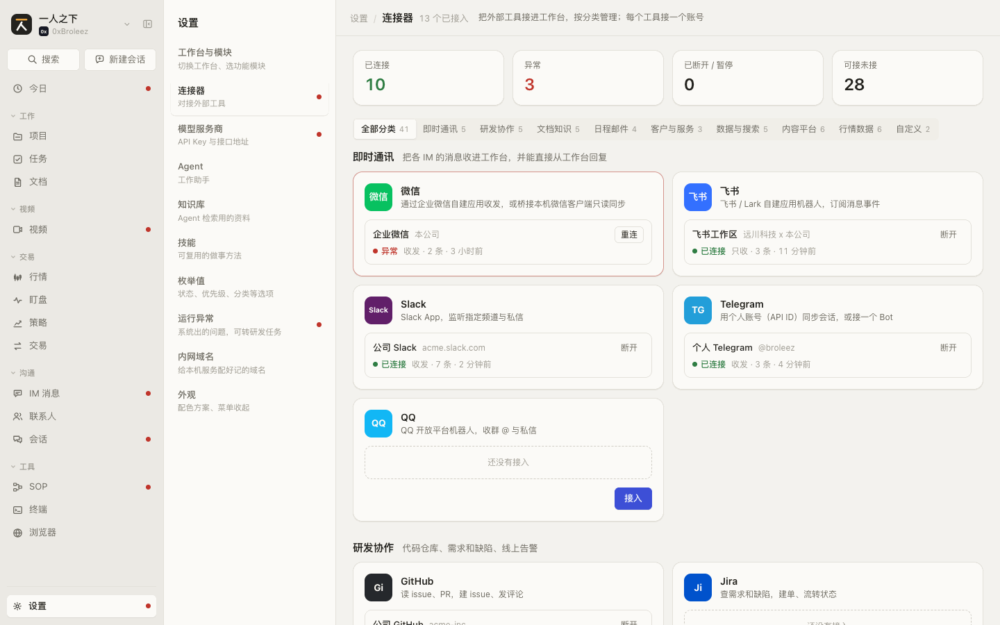 | 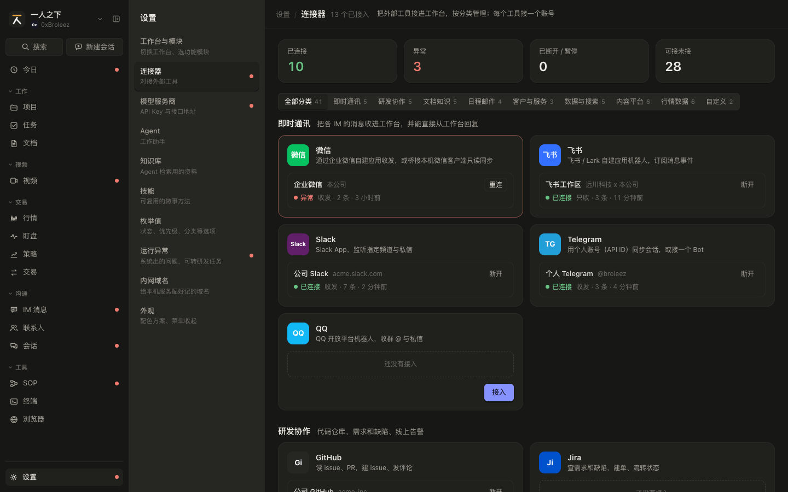 |
| 手机 375 | 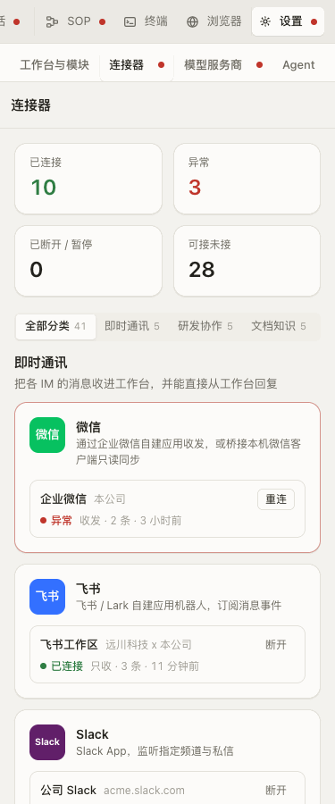 | 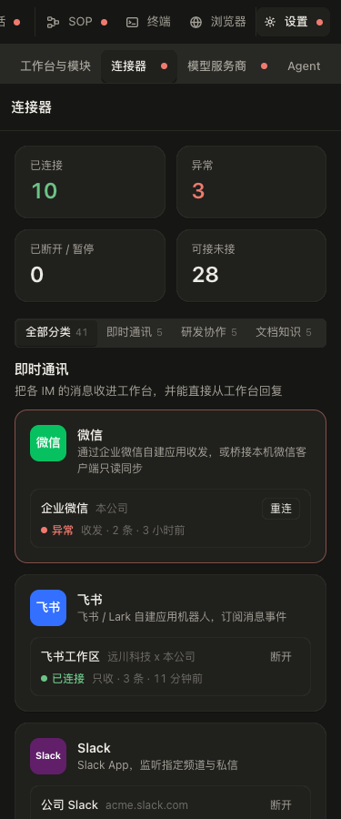 |

列表上断开先确认（`settings_im_drawer`）：

| 场景 | 步骤 | 亮 | 暗 |
|---|---|---|---|
| 行上「断开」确认 | 即时通讯里「公司 Slack」行点「断开」 | 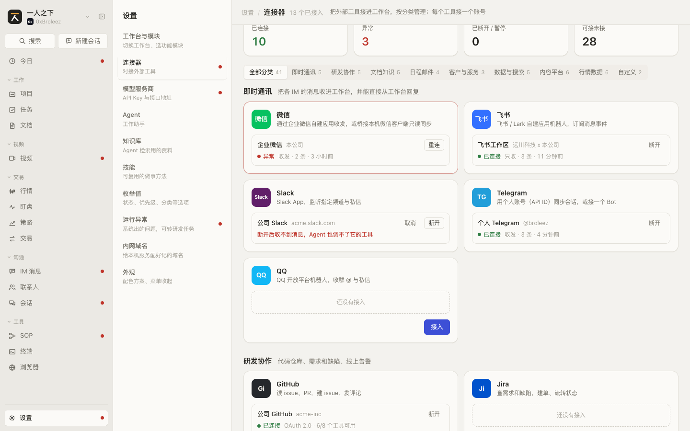 | 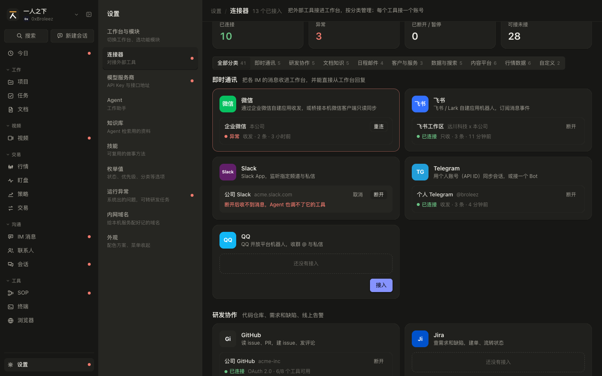 |

### 交互

| 编号 | 元素 | 操作 | 结果 |
|---|---|---|---|
| SPEC-settings-3.1 | 顶栏 | 看 | 「设置 / 连接器」，数量「N 个已接入」，说明「把外部工具接进工作台，按分类管理；每个工具接一个账号」 |
| SPEC-settings-3.2 | 统计卡片 | 看 | 已连接（绿色）、异常（大于 0 时红色）、已断开 / 暂停、可接未接（目录里还没有连接器的工具数） |
| SPEC-settings-3.3 | 分类分段按钮 | 点击 | 「全部分类」或某一分类，后面是该分类的工具数；只显示所选分类的区块。从 IM 消息「渠道配置」进来时选中即时通讯，从视频进来时选中内容平台 |
| SPEC-settings-3.4 | 分类区块 | 看 | 标题是分类名和分类说明，下面是工具卡片网格 |
| SPEC-settings-3.5 | 工具卡片 | 看 | 标志（IM 用渠道短名，其他取名称前两个字）、名称、说明；有连接器异常时卡片标红边 |
| SPEC-settings-3.6 | 卡片里的连接器行 | 看 | 自定义图标（有才显示）、连接器名称、账号、状态点；第二行：应用类是「<认证方式> · <开着的工具数>/<工具总数> 个工具可用」，IM 类是「收发 / 只收 · N 条 · <上次同步>」（没同步过写「未同步」） |
| SPEC-settings-3.7 | 连接器行 | 点击或回车 | 打开配置抽屉（IM 类见 `SPEC-settings-4`，其他见 `SPEC-settings-5`） |
| SPEC-settings-3.8 | 行上「连接」/「重连」 | 点击 | 已断开、已暂停时是「连接」，异常时是「重连」；不打开抽屉。状态变「连接中」，0.9 秒后：凭证（`config` 或 token）里带 `expired` / `invalid` 的变异常（「凭证已失效，改好配置后再连接」）并记一条运行异常 `conn:<id>:auth`；OAuth 断开过的视为重新授权成功；其余变已连接、更新同步时间 |
| SPEC-settings-3.9 | 行上「断开」 | 点击 | 只在已连接时出现，悬停「断开后配置保留，随时可以再连」；和抽屉里一样先确认：行内按钮换成「取消」「断开」，第二行换成红字「断开后收不到消息，Agent 也调不了它的工具」（和抽屉同一句）；都不打开抽屉。确认后状态变已断开，OAuth 的授权账号和到期时间清掉 |
| SPEC-settings-3.10 | 卡片底部「接入」 | 点击 | 只在这个工具还没有连接器时出现；打开新建抽屉。接过了就不再给「接入」，改配置点上面的连接器行 |

### 空状态和异常状态

| 编号 | 场景 | 显示 | 可做的操作 |
|---|---|---|---|
| SPEC-settings-3.11 | 工具还没接 | 卡片里「还没有接入」 | 「接入」 |
| SPEC-settings-3.12 | 连接器异常 | 卡片红边，行上状态「异常」，二级菜单「连接器」红点，今日出现「连接异常」待办 | 「重连」或打开抽屉改配置 |
| SPEC-settings-3.13 | 连接中 | 行上状态「连接中」，没有连接 / 断开按钮 | 等待 |
| SPEC-settings-3.14 | 一个连接器都没有 | 统计全为 0，每张卡片都是「还没有接入」；原型没有单独的空状态，正式产品沿用这样即可 | 「接入」 |
| SPEC-settings-3.15 | 加载失败 | 原型未做；正式产品在统计卡片上方显示错误信息和「重试」 | 重试 |

### 数据

见 SPEC-settings-0 的 `Tool`、`ToolCategory`、`Connector`、`ConnStatus`。消息条数来自 `App.tsx` 的 `messageCount`（按 `Message.connector_id` 数）。状态显示 `STATUS`：已连接（ok）、异常（danger）、已暂停（muted）、连接中（info）、已断开（muted）。

### 联动

| 方向 | 对方模块 | 触发 | 结果 | 见 |
|---|---|---|---|---|
| 进来 | IM 消息 | 「渠道配置」 | 分类筛到即时通讯 | `SPEC-messages-1` |
| 进来 | 今日 | 「连接异常」待办「去修复」 | 打开该连接器的抽屉 | `SPEC-today-1` |
| 改动 | 运行异常 | 连接失败 | 记一条错误级异常 `conn:<id>:auth`；同步失败记警告 `conn:<id>:sync` | `SPEC-settings-18` |
| 改动 | IM 消息、Agent | 断开、暂停 | IM 不再收发；Agent 可挂载的连接器里去掉它（`mountableConns` 只列没暂停、没断开的） | `SPEC-settings-9.17` |

## SPEC-settings-4 即时通讯连接器抽屉

微信、飞书、Slack、Telegram、QQ 的接入和配置。新建和编辑共用。

### 截图

由 `shots.py` 按步骤截（`settings_im_drawer`，桌面 1440）：

| 场景 | 步骤 | 亮 | 暗 |
|---|---|---|---|
| 已连接 | 即时通讯里点「公司 Slack」 | 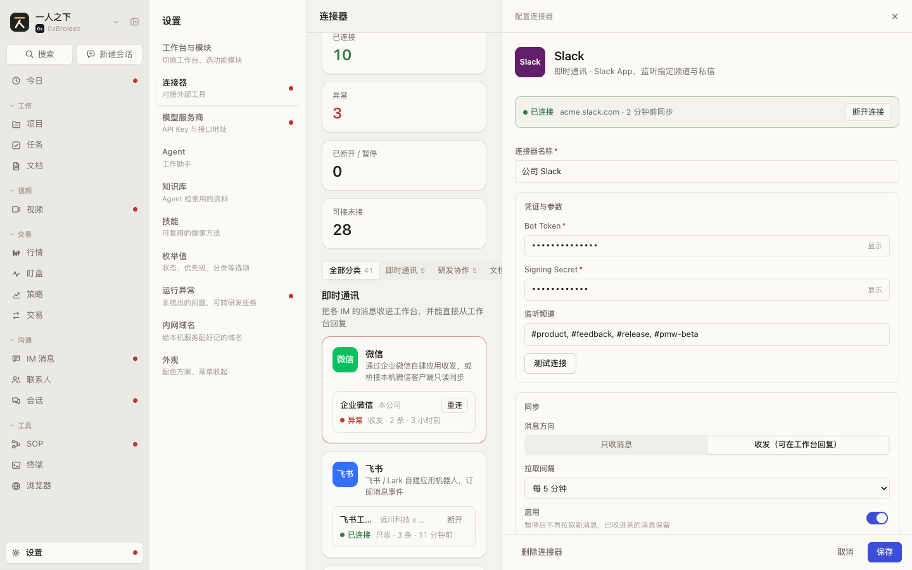 | 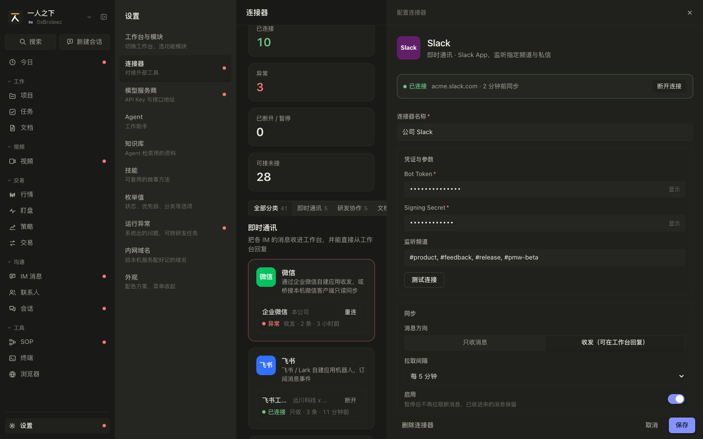 |
| 异常 | 点「企业微信」 | 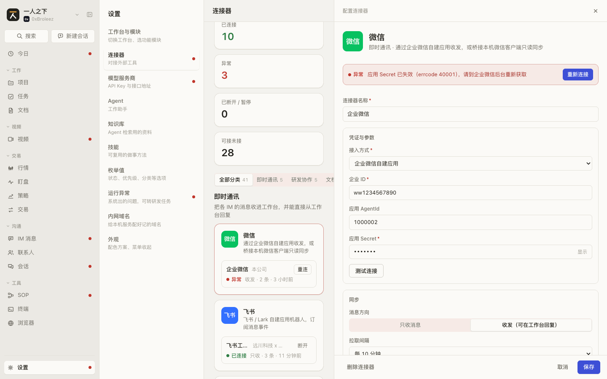 | 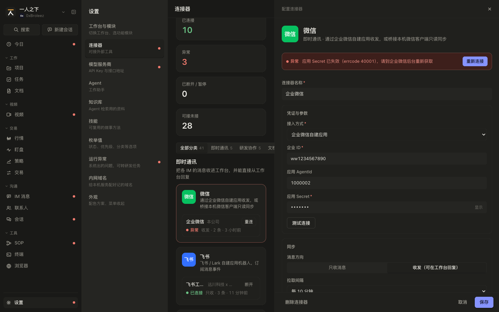 |
| 新建，必填没填就保存 | QQ 卡片「接入」，直接点「接入」 | 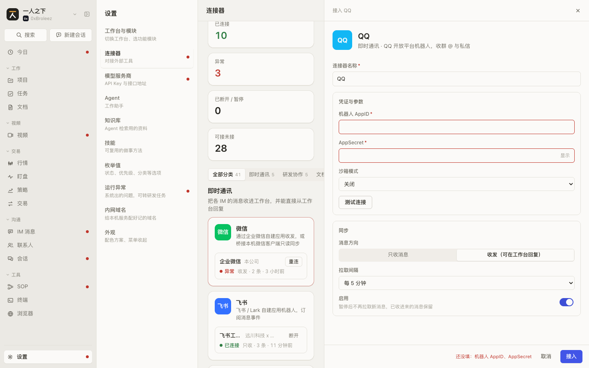 | 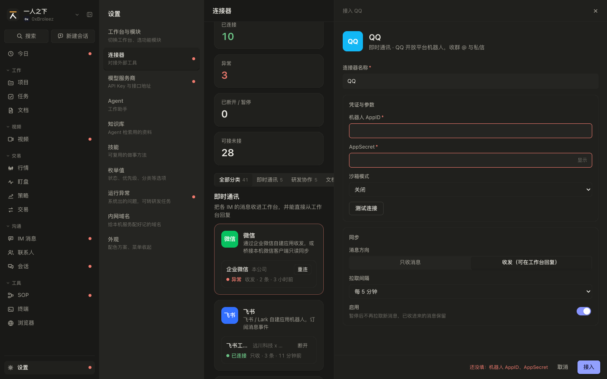 |

### 交互

| 编号 | 元素 | 操作 | 结果 |
|---|---|---|---|
| SPEC-settings-4.1 | 抽屉头 | 看 | 新建写「接入 <工具名>」，编辑写「配置连接器」；右上关闭（Esc） |
| SPEC-settings-4.2 | 工具信息 | 看 | 标志、名称、「<分类> · <说明>」 |
| SPEC-settings-4.3 | 连接状态条（`ConnBar`） | 看 | 只在编辑时有。已连接：账号 · <上次同步>同步；连接中：「正在连接…」；异常：错误原因；已暂停：「配置保留，不同步、不调用」；已断开：同上，OAuth 的再加「；授权已撤销，重新连接要再授权一次」 |
| SPEC-settings-4.4 | 状态条「断开连接」 | 点击 | 已连接时出现；变成确认「断开后收不到消息，Agent 也调不了它的工具」+「取消」「断开」 |
| SPEC-settings-4.5 | 状态条「连接」/「重新连接」 | 点击 | 断开、暂停时「连接」，异常时「重新连接」，同 `SPEC-settings-3.8`；连接中不显示按钮 |
| SPEC-settings-4.6 | 连接器名称 | 输入 | 必填；新建时默认是工具名，占位「例如 公司 Slack」 |
| SPEC-settings-4.7 | 凭证与参数 | 输入、选择 | 按工具的 `fields` 列出：文本框、密码框（旁边「显示 / 隐藏」）、下拉（新建默认第一项）；必填项带星号；改了任一项，测试结果清掉 |
| SPEC-settings-4.8 | 「测试连接」 | 点击 | 按钮变「测试中…」，0.7 秒后：有必填没填 →「缺少必填项：…」；值里有 `expired` →「对方平台返回凭证无效（40001），请重新获取后再试」；否则「连接成功，能读到 <工具名> 的会话列表」。成功绿字、失败红字 |
| SPEC-settings-4.9 | 消息方向 | 点击 | 「只收消息」/「收发（可在工作台回复）」；平台不能发消息（`canSend` 为 false）时收发置灰；新建默认能发就收发 |
| SPEC-settings-4.10 | 拉取间隔 | 选择 | 每 1、5、10、15、30、60 分钟；新建默认 5 |
| SPEC-settings-4.11 | 启用开关 | 切换 | 说明「暂停后不再拉取新消息，已收进来的消息保留」 |
| SPEC-settings-4.12 | 「接入」/「保存」 | 点击 | 名称和必填项都填了才保存，否则标红框；保存后状态：关了启用为已暂停，凭证带 `expired` 为异常（原因沿用原来的或「凭证无效」），否则已连接；编辑时已断开、连接中的状态不被保存改掉。新建的账号先写「待首次同步」。保存后抽屉关闭 |
| SPEC-settings-4.13 | 「取消」 | 点击 | 关抽屉，不保存 |
| SPEC-settings-4.14 | 「删除连接器」 | 点击 | 只在编辑时有；变成确认，文案「删除后不再同步：<影响>」，没有影响时「删除后不再同步，已收的消息保留」+「取消」「删除」 |
| SPEC-settings-4.15 | 确认「删除」 | 点击 | 删掉连接器，抽屉关闭；连带处理见 4.16 |
| SPEC-settings-4.16 | 删除影响（`connPlan`） | 看 | 逐条列出：「N 条 IM 消息会变成「渠道已删除」，只能查看」；用了它工具的 Agent「<名称>会失去 <工具> 工具」，只挂着没开工具的「<名称>会卸下这个连接器」；推送到它的盯盘提醒「N 条盯盘提醒（…）改为只在应用内提醒」。删除时 Agent 卸下它并清掉 `conn:<id>:*` 权限，盯盘提醒去掉 IM 推送 |

### 空状态和异常状态

| 编号 | 场景 | 显示 | 可做的操作 |
|---|---|---|---|
| SPEC-settings-4.17 | 必填项为空就保存 | 对应输入框红框，抽屉不关；底栏写「还没填：<连接器名称、必填项>」，和应用类抽屉一致 | 补全再保存 |
| SPEC-settings-4.18 | 连接器异常 | 状态条红色，写错误原因，按钮「重新连接」 | 改凭证、测试、保存或重新连接 |
| SPEC-settings-4.19 | 对一个已接过的工具发起接入 | 直接打开它现有的连接器（一个工具只接一个账号） | |
| SPEC-settings-4.20 | 保存或删除失败 | 原型未做；正式产品抽屉不关，底部红字写原因 | 重试 |

### 数据

见 SPEC-settings-0 的 `Tool`、`ToolField`、`Connector`。抽屉内部草稿：`Pick<Connector, 'name' | 'config' | 'direction' | 'interval'> & { enabled: boolean }`；`enabled` 由 `status !== 'paused'` 得出。删除影响的 `DelPlan` 是 `{ block?: string; impact: string[] }`（原型未单独导出类型，在 `App.tsx` 里定义）。

### 联动

| 方向 | 对方模块 | 触发 | 结果 | 见 |
|---|---|---|---|---|
| 进来 | IM 消息 | 消息抽屉里「去修复」 | 打开该连接器 | `SPEC-messages-2` |
| 改动 | IM 消息 | 删除 | 这个连接器的消息变「渠道已删除」，只读 | `SPEC-messages-2` |
| 改动 | Agent、盯盘 | 删除 | 见 4.16 | `SPEC-settings-9`、`SPEC-monitor` |

## SPEC-settings-5 应用与 API 连接器抽屉

即时通讯以外的工具（研发、文档、日程邮件、客户、数据、内容平台、行情、自定义 MCP / OpenAPI）用这个抽屉：认证方式 → 测试连接 → 获取工具清单 → 每个工具的权限。工具权限是这个连接器的上限，Agent、SOP 用它的工具时只能一样严或更严。

### 截图

由 `shots.py` 按步骤截（`settings_app_drawer`，桌面 1440）：

| 场景 | 步骤 | 亮 | 暗 |
|---|---|---|---|
| OAuth 已授权 | 研发协作里点「公司 GitHub」 | 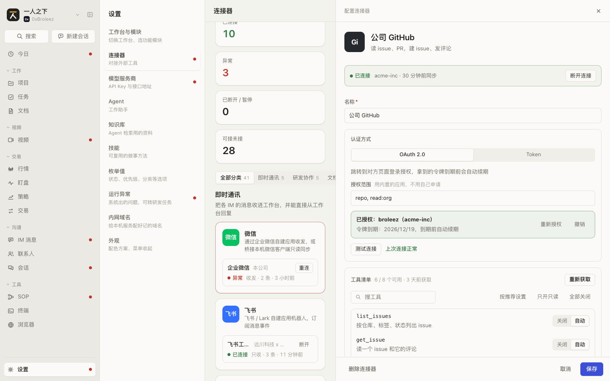 | 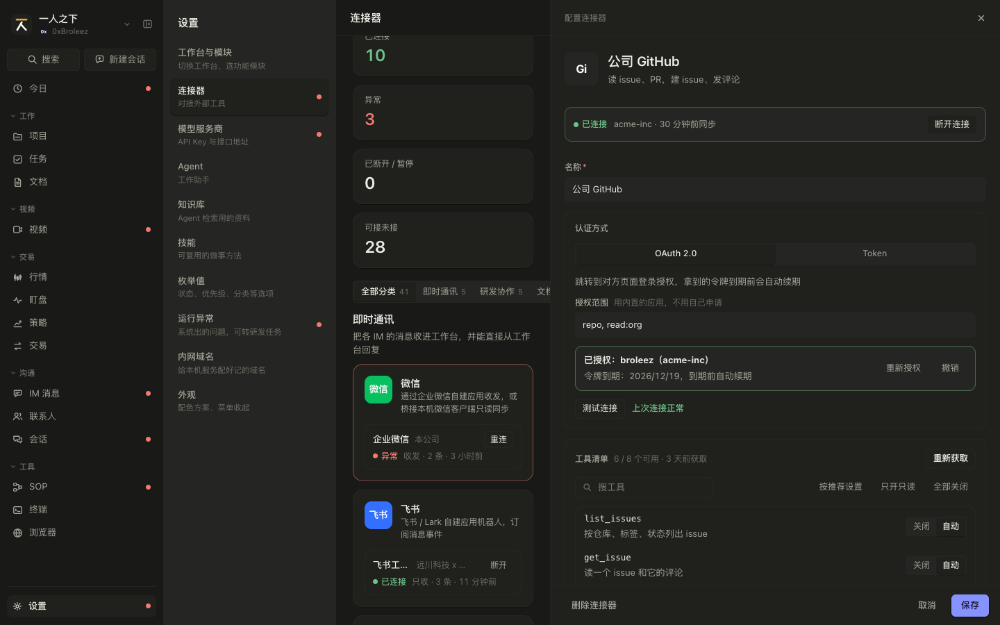 |
| 授权过期 | 文档知识里点「Notion 产品空间」 | 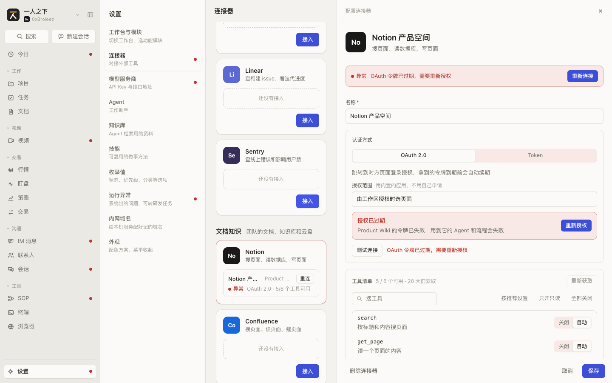 | 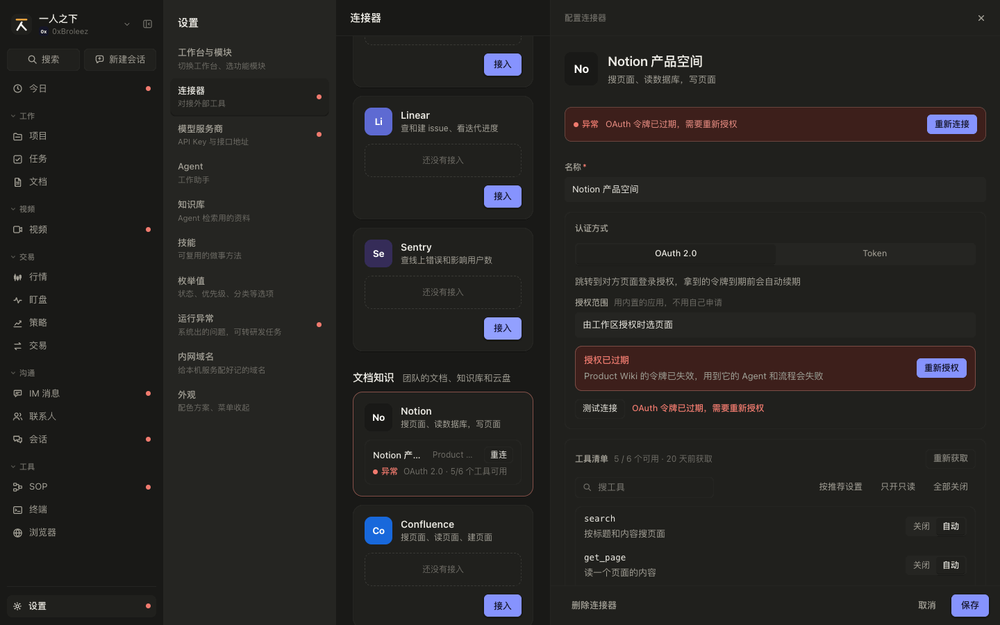 |
| Token 方式 | 内容平台里点「视频号数据」 | 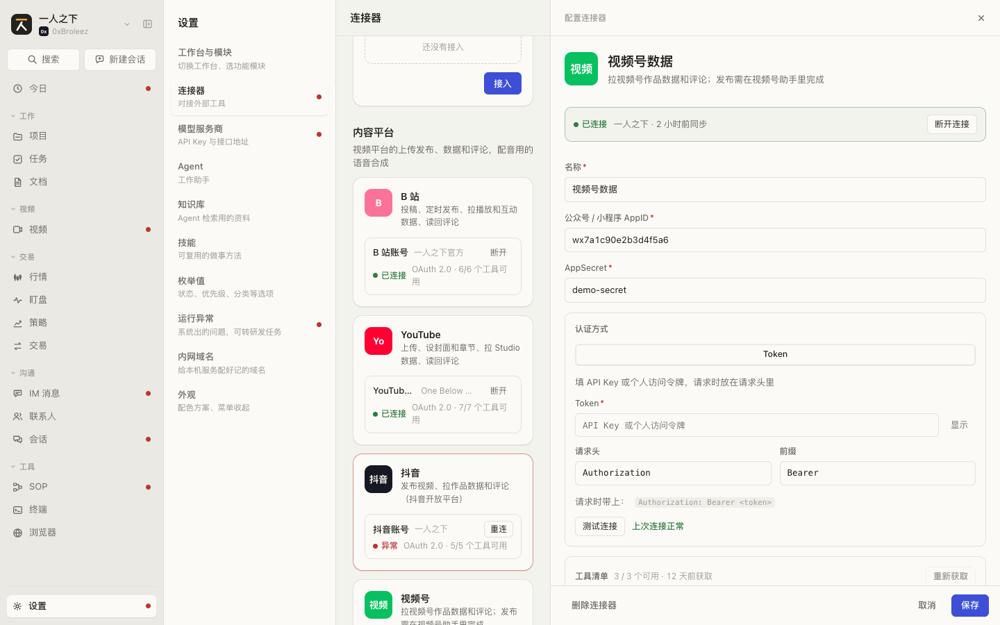 | 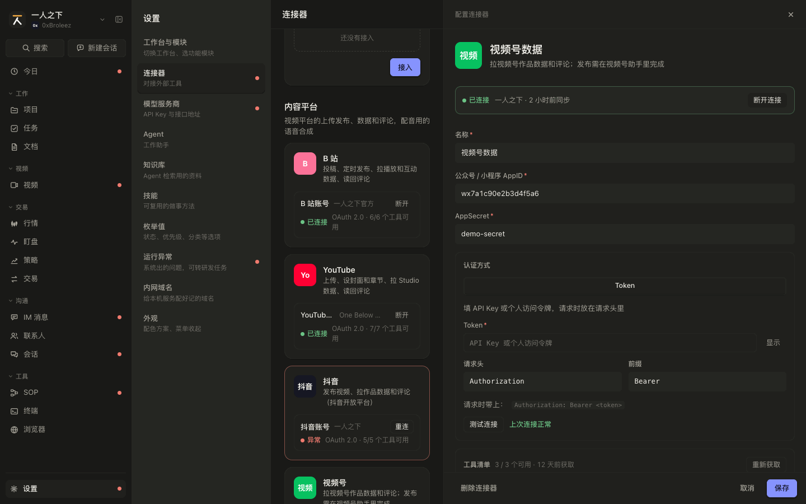 |
| 自定义 MCP | 自定义分类「MCP 服务」的「接入」 | 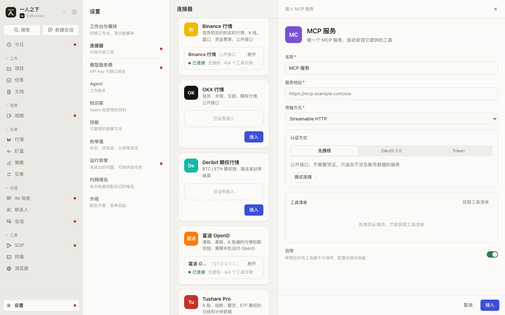 | 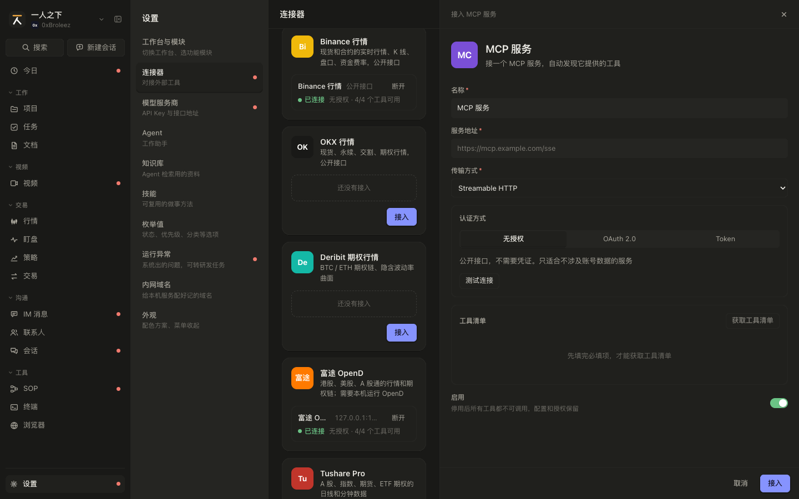 |

### 交互

| 编号 | 元素 | 操作 | 结果 |
|---|---|---|---|
| SPEC-settings-5.1 | 抽屉头、状态条 | 看 | 同 `SPEC-settings-4.1`、`4.3` 到 `4.5` |
| SPEC-settings-5.2 | 标志 | 点击 | 只有自定义分类（MCP、OpenAPI）能换图标（上传图片，没有图片时用默认图标）；内置应用用品牌标志，不能改 |
| SPEC-settings-5.3 | 名称 | 输入 | 必填，新建默认工具名；标题跟着变 |
| SPEC-settings-5.4 | 工具自带的字段 | 输入 | 例如 Jira「站点地址」、富途「OpenD 地址」、MCP「服务地址」「传输方式」、OpenAPI「OpenAPI 文档地址」「接口地址」；必填带星号 |
| SPEC-settings-5.5 | 认证方式分段按钮 | 点击 | 只列工具支持的方式（`Tool.auth`，第一个是默认）；下面一行说明：无授权「公开接口，不需要凭证。只适合不涉及账号数据的服务」，OAuth「跳转到对方页面登录授权，拿到的令牌到期前会自动续期」，Token「填 API Key 或个人访问令牌，请求时放在请求头里」；切换后测试结果清掉 |
| SPEC-settings-5.6 | OAuth 应用信息 | 输入 | 只在不是内置 OAuth 应用（自定义类）时出现：Client ID（必填）、Client Secret、授权地址（必填）、令牌地址（必填），下面写回调地址 `https://pmw.local/oauth/callback` |
| SPEC-settings-5.7 | 授权范围 | 输入 | 内置应用预填（如 GitHub `repo, read:org`），提示「用内置的应用，不用自己申请」；自定义提示「空格或逗号隔开」 |
| SPEC-settings-5.8 | 「去 <工具名> 授权」 | 点击 | 还没授权时出现；自定义类没填 Client ID 或授权地址时置灰。按钮变「等待授权…」，0.9 秒后视为授权成功，拿回账号和 60 天后的到期时间（原型不真的跳转） |
| SPEC-settings-5.9 | 授权框（已授权） | 看 | 「已授权：<账号>」，「令牌到期：<日期>，到期前自动续期」；「重新授权」「撤销」 |
| SPEC-settings-5.10 | 「撤销」 | 点击 | 清掉账号和到期时间，回到还没授权 |
| SPEC-settings-5.11 | Token | 输入 | 必填，密码框带「显示 / 隐藏」；占位 GitHub 是 `ghp_…`，其他「API Key 或个人访问令牌」；改了测试结果清掉 |
| SPEC-settings-5.12 | 请求头、前缀 | 输入 | 默认 `Authorization`、`Bearer`；前缀留空就只发 Token；下面预览「请求时带上：<请求头>: <前缀> ••••••」 |
| SPEC-settings-5.13 | 「测试连接」 | 点击 | 有必填字段没填、没填 Token、自定义 OAuth 没填应用信息、还没完成授权时，直接红字报出这条原因，不发请求；否则「测试中…」0.7 秒后：Token 或字段里有 `expired` / `invalid` / `bad` 为「401 Unauthorized：凭证无效或已过期」，否则「服务可以访问」（无授权）或「凭证有效，可以访问」。编辑已有连接器时初始显示「上次连接正常」，异常的显示错误原因 |
| SPEC-settings-5.14 | 「获取工具清单」/「重新获取」 | 点击 | 必填和认证都就绪才可点，置灰时悬停写差什么。「获取中…」0.8 秒后列出工具：第一次「发现 N 个工具：只读的默认自动，写操作默认需确认」；重新获取「新增 N 个，移除 M 个，其余保留原来的权限」。标题旁写「开着数 / 总数 个可用 · <时间>获取」 |
| SPEC-settings-5.15 | 工具搜索框 | 输入 | 按工具名和说明筛 |
| SPEC-settings-5.16 | 「按推荐设置」「只开只读」「全部关闭」 | 点击 | 批量改权限：推荐是写操作需确认、只读自动；只开只读是写操作关闭、只读自动；全部关闭 |
| SPEC-settings-5.17 | 工具行权限分段按钮 | 点击 | 只读工具「关闭 / 自动」，写工具（带「写」标签）「关闭 / 需确认 / 自动」；写工具选自动时按钮标成风险色；关闭的行变淡 |
| SPEC-settings-5.18 | 写工具设为自动的警告 | 看 | 「<工具名>、… 是写操作，设为自动后 Agent 和流程调用时不再等你确认」 |
| SPEC-settings-5.19 | 上限说明 | 看 | 「这里是上限：Agent 里只能把这些工具设得一样严或更严，关闭的工具 Agent 和 SOP 都用不了。」 |
| SPEC-settings-5.20 | 启用开关 | 切换 | 说明「停用后所有工具都不可调用，配置和授权保留」 |
| SPEC-settings-5.21 | 「接入」/「保存」 | 点击 | 名称、必填字段都填了才保存（认证没就绪也能存）；状态：关了启用为已暂停，认证有问题或最近一次测试失败为异常（原因用测试结果或认证问题），否则已连接；账号按认证方式写授权账号 /「未授权」/「Token 认证」/「公开接口」；测试成功时更新同步时间；方向固定只收、间隔 0 |
| SPEC-settings-5.22 | 底部未填提示 | 看 | 保存过一次且有必填字段没填时，底部红字「还没填：…」 |
| SPEC-settings-5.23 | 「删除连接器」 | 点击 | 确认文案「删除后授权一并撤销：<影响>」，没有影响时「删除后授权一并撤销，用到它的 Agent 工具会失效」；影响同 `SPEC-settings-4.16` |

### 空状态和异常状态

| 编号 | 场景 | 显示 | 可做的操作 |
|---|---|---|---|
| SPEC-settings-5.24 | 还没获取工具清单 | 就绪时「点「获取工具清单」，看看这个连接器能提供哪些工具」；没就绪时「<差什么>，才能获取工具清单」 | 补全后获取 |
| SPEC-settings-5.25 | 工具搜索没有结果 | 「没有匹配的工具」 | 清空搜索 |
| SPEC-settings-5.26 | OAuth 授权已过期 | 授权框红色：「授权已过期」，「<账号> 的令牌已失效，用到它的 Agent 和流程会失败」，「重新授权」 | 重新授权 |
| SPEC-settings-5.27 | 必填为空就保存 | 输入框红框，底部「还没填：…」 | 补全 |
| SPEC-settings-5.28 | 真实授权失败（用户在对方页面拒绝、回调出错） | 原型未做；正式产品授权框红字写对方返回的原因，按钮回到「去 <工具名> 授权」 | 重试 |

### 数据

见 SPEC-settings-0 的 `Tool`（`auth`、`oauth`、`catalog`）、`ConnAuth`、`ConnTool`、`ToolMode`、`Connector`（`auth`、`tools`、`tools_at`、`icon`）。工具清单在原型里由 `discoverTools(tool, config)` 模拟：内置工具返回 `catalog`，自定义的按地址第一段编 `<host>_list`、`_get`、`_search`（只读）和 `_create`、`_update`、`_delete`（写）。抽屉内部状态 `Phase = 'idle' | 'running' | 'ok' | 'error'`，原型未导出。

### 联动

| 方向 | 对方模块 | 触发 | 结果 | 见 |
|---|---|---|---|---|
| 改动 | Agent | 工具权限、启用、删除 | Agent 挂载列表和工具权限的上限跟着变；关闭的工具不出现在 Agent 里 | `SPEC-settings-9.17` 到 `9.20` |
| 改动 | 技能 | 工具清单 | 技能「用到的工具」里可加的连接器工具（开着的） | `SPEC-settings-16.7` |
| 改动 | SOP、视频、行情 | 连接器状态 | 用它的节点、发布平台、行情源可用与否 | `SPEC-sop`、`SPEC-videos`、`SPEC-markets` |

## SPEC-settings-6 模型服务商列表

配好 API Key 和地址、测通之后，勾选要启用的模型，Agent 和 SOP 就能选用。

### 截图

| | 亮 | 暗 |
|---|---|---|
| 桌面 1440 | 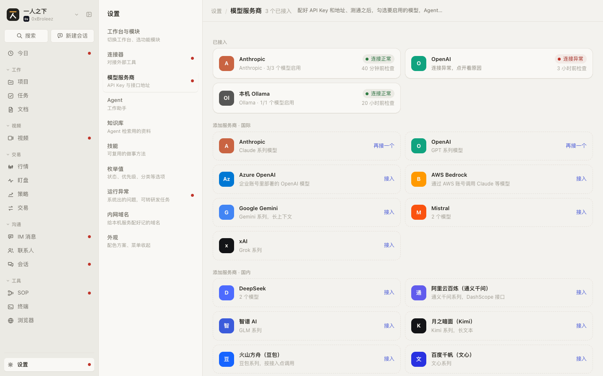 | 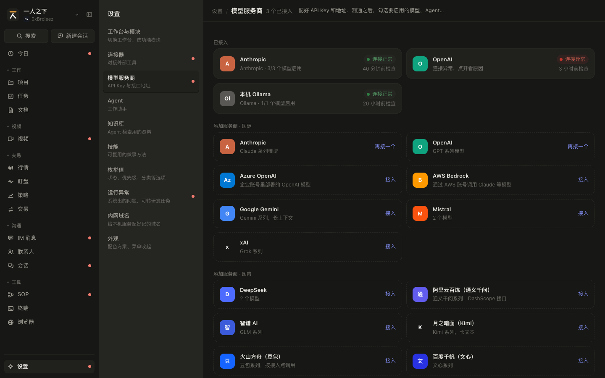 |
| 手机 375 | 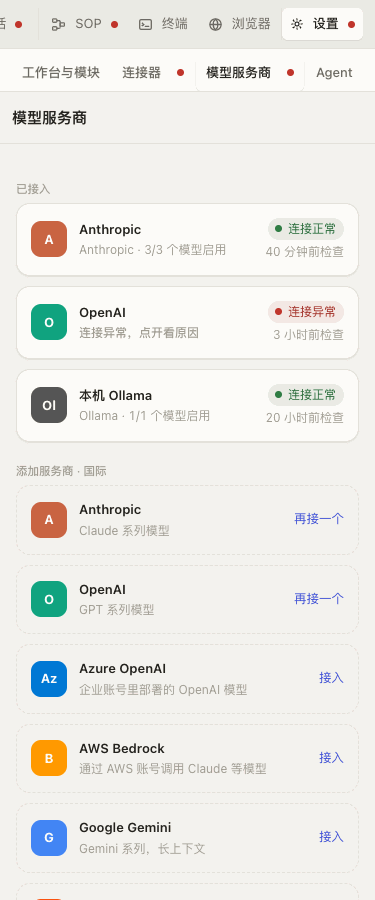 | 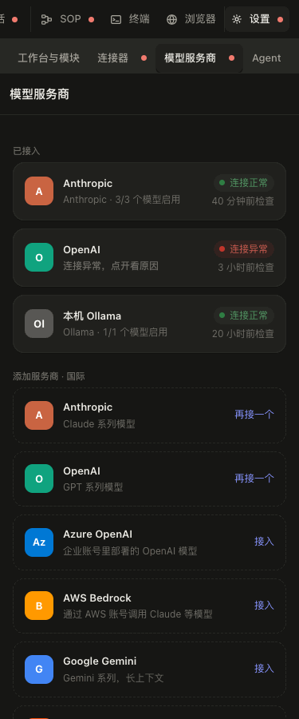 |

### 交互

| 编号 | 元素 | 操作 | 结果 |
|---|---|---|---|
| SPEC-settings-6.1 | 顶栏 | 看 | 「设置 / 模型服务商」，「N 个已接入」，说明「配好 API Key 和地址、测通之后，勾选要启用的模型，Agent 和 SOP 就能选用」 |
| SPEC-settings-6.2 | 「已接入」卡片 | 看 | 标志、名称（悬停全名）、第二行「<类型名> · 启用数/总数 个模型启用」，右边状态（连接正常 / 连接异常 / 未测试 / 已停用）和「<时间>检查」；当前打开的卡片高亮 |
| SPEC-settings-6.3 | 「已接入」卡片 | 点击 | 打开服务商抽屉（`SPEC-settings-7`） |
| SPEC-settings-6.4 | 「添加服务商 · <分组>」 | 看 | 按 国际、国内、聚合网关、本地与自部署、自定义 分组列目录里的全部服务商：标志、名称、说明（没有说明时写「N 个模型」或「模型 ID 自己填」），右边「接入」，已经接过同类型的写「再接一个」 |
| SPEC-settings-6.5 | 添加卡片 | 点击 | 打开新建抽屉；同一类型可以接多个（与连接器不同） |

### 空状态和异常状态

| 编号 | 场景 | 显示 | 可做的操作 |
|---|---|---|---|
| SPEC-settings-6.6 | 服务商连接异常（启用中） | 卡片第二行红字「连接异常，点开看原因」，状态「连接异常」；二级菜单红点；今日出现「连接异常」待办 | 打开抽屉修 |
| SPEC-settings-6.7 | 服务商已停用 | 状态「已停用」，不算异常 | 打开抽屉启用 |
| SPEC-settings-6.8 | 一个都没接 | 「已接入」标题下写「还没接模型服务商，从下面挑一家接入」 | 下面的「接入」 |
| SPEC-settings-6.9 | 加载失败 | 原型未做；正式产品显示错误信息和「重试」 | 重试 |

### 数据

见 SPEC-settings-0 的 `ProviderKindDef`、`Provider`、`ModelConf`、`PROVIDER_GROUPS`。卡片状态 `STATUS`：`ok` 连接正常 `#2f7d43`、`error` 连接异常 `#c0352b`、`untested` 未测试、`off` 已停用（灰）。

### 联动

| 方向 | 对方模块 | 触发 | 结果 | 见 |
|---|---|---|---|---|
| 进来 | 今日 | 「模型服务商「…」异常」的「去修复」 | 打开服务商抽屉 | `SPEC-today-1` |

## SPEC-settings-7 模型服务商抽屉

一个服务商的凭证、测试和启用哪些模型。新建和编辑共用。

### 截图

由 `shots.py` 按步骤截（`settings_provider_drawer`，桌面 1440）：

| 场景 | 步骤 | 亮 | 暗 |
|---|---|---|---|
| 正常 | 点「Anthropic」 | 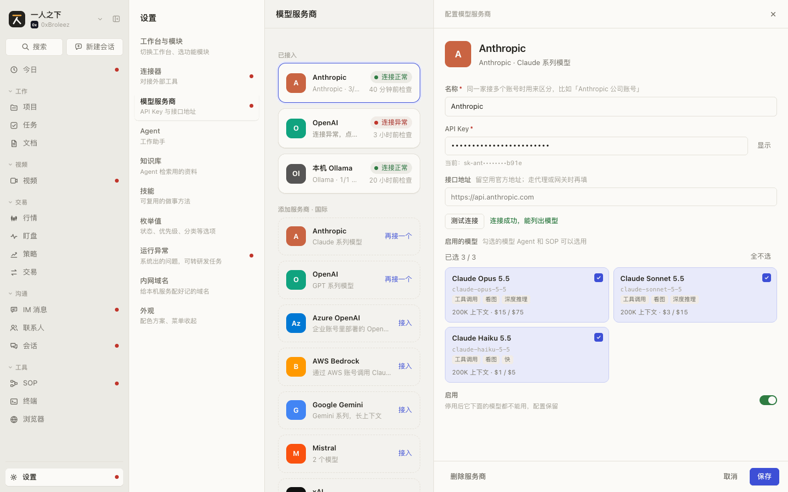 | 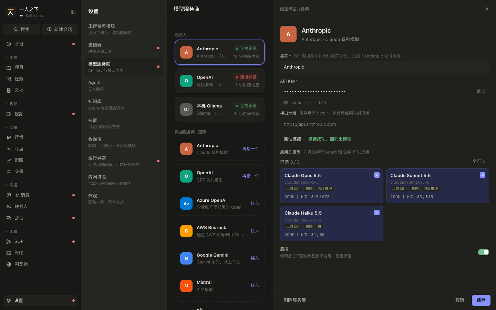 |
| 异常 | 点「OpenAI」 | 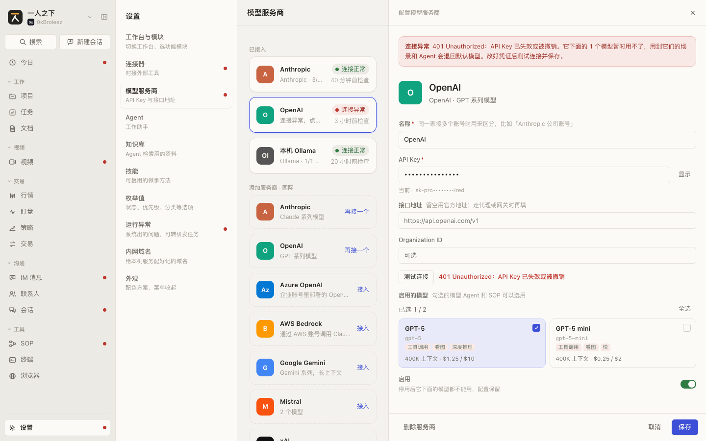 | 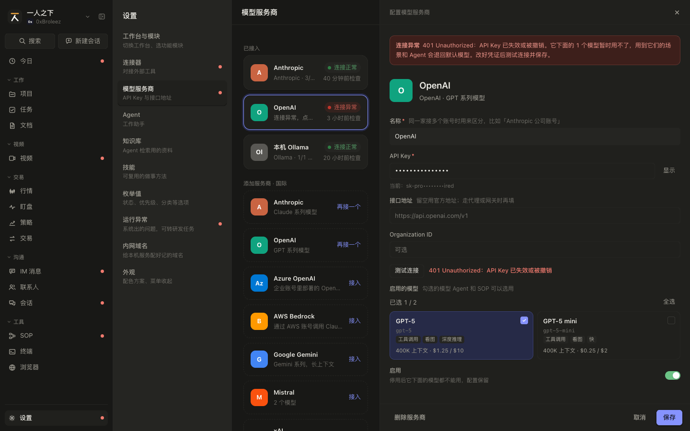 |
| 本地 | 点「本机 Ollama」 | 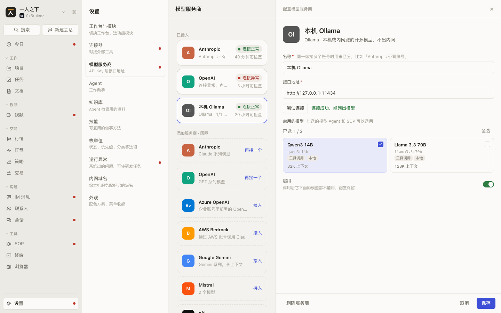 | 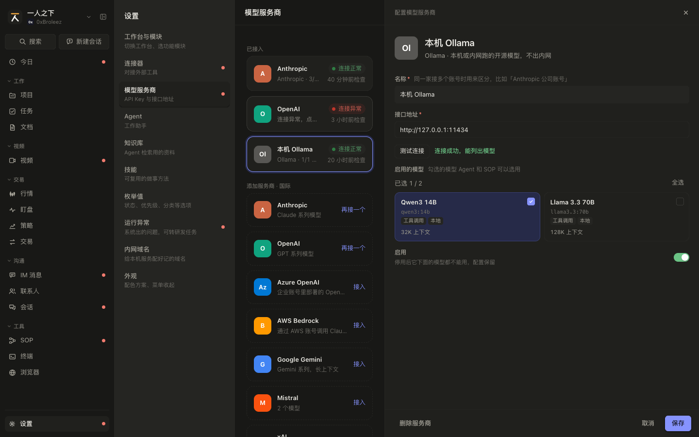 |
| 手填模型 ID，名称清空后保存 | 「添加服务商 · 自定义」的「接入」，清空名称点「接入」 | 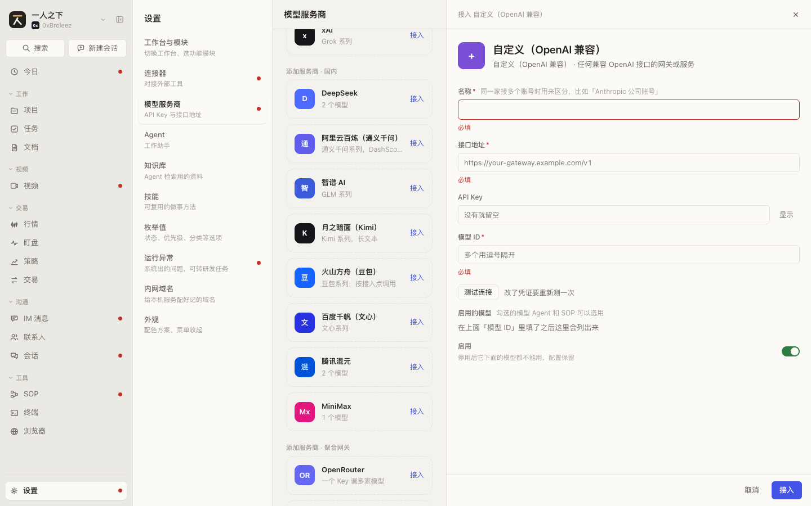 | 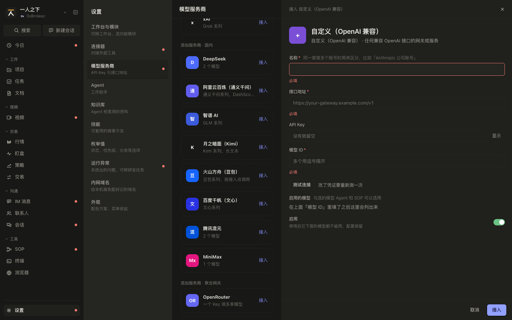 |

### 交互

| 编号 | 元素 | 操作 | 结果 |
|---|---|---|---|
| SPEC-settings-7.1 | 抽屉头 | 看 | 新建「接入 <类型名>」，编辑「配置模型服务商」；关闭（Esc） |
| SPEC-settings-7.2 | 异常提示 | 看 | 启用且异常时顶部：「连接异常<原因>。它下面的 N 个模型暂时用不了，用到它们的场景和 Agent 会退回默认模型。改好凭证后测试连接并保存。」 |
| SPEC-settings-7.3 | 服务商信息 | 看 | 标志、名称（跟着输入变）、「<类型名> · <说明>」 |
| SPEC-settings-7.4 | 名称 | 输入 | 必填，带星号；新建默认类型名；提示「同一家接多个账号时用来区分，比如「Anthropic 公司账号」」；为空时保存不了，红框，下面写「必填」 |
| SPEC-settings-7.5 | 配置项 | 输入 | 按 `fields` 列出，必填带星号，带 `hint` 的写在标签旁；secret 默认密码框，「显示 / 隐藏」；编辑时 secret 下面写「当前：<前 6 位>••••••••<后 4 位>」（8 位以内全打码）；改了任一项，测试状态回到未测 |
| SPEC-settings-7.6 | 必填未填的红字 | 看 | 保存过一次后，必填为空的项红框，下面「必填」 |
| SPEC-settings-7.7 | 「测试连接」 | 点击 | 「测试中…」0.7 秒后按 `testProvider`：成功「连接成功，能列出模型」，失败红字写原因；没测时写「改了凭证要重新测一次」 |
| SPEC-settings-7.8 | 启用的模型 | 看 | 「已选 N / 总数」，「全选」/「全不选」；每行：勾选框、显示名、模型 ID、能力标签、「<上下文>K 上下文 · $输入 / $输出」 |
| SPEC-settings-7.9 | 模型勾选 | 点击 | 勾上的保存后启用，Agent 和 SOP 可以选；新建默认勾目录前两个；编辑时按已启用的勾 |
| SPEC-settings-7.10 | 手填模型 ID | 输入 | vLLM、自定义没有目录，「模型 ID」里用逗号（中英文）或空格隔开，下面实时列出成可勾选的模型（上下文按 128K、没有能力标签） |
| SPEC-settings-7.11 | 启用开关 | 切换 | 说明「停用后它下面的模型都不能用，配置保留」 |
| SPEC-settings-7.12 | 「接入」/「保存」 | 点击 | 名称、必填都填了才保存；状态：这次测过就用测试结果（并更新检查时间），没测过就按 `testProvider` 预判为未测试或异常；目录里每个模型按勾选同步成启用 / 不启用（已有的模型保留它的参数）。抽屉关闭 |
| SPEC-settings-7.13 | 「取消」 | 点击 | 关抽屉不保存 |
| SPEC-settings-7.14 | 「删除服务商」 | 点击 | 只在编辑时有；变成确认 |
| SPEC-settings-7.15 | 删除确认（可删） | 看 | 「删除后它下面的 N 个模型一起移除；<影响>」+「取消」「删除」 |
| SPEC-settings-7.16 | 删除确认（被拦） | 看 | 「不能删除：<原因>」+「知道了」，没有删除按钮 |
| SPEC-settings-7.17 | 删除影响（`providerPlan`） | 看 | 没有 Agent 用它的模型：无影响。有 Agent 在用：找别家第一个可用模型，影响「<Agent 名>在用它的模型，删除后改用 <模型名>」，删除时这些 Agent 换过去；找不到就拦截「<Agent 名>在用它的模型，又没有别的可用模型可换；先接入别的服务商或给它们换模型」 |

### 空状态和异常状态

| 编号 | 场景 | 显示 | 可做的操作 |
|---|---|---|---|
| SPEC-settings-7.18 | 手填模型 ID 还没填 | 「在上面「模型 ID」里填了之后这里会列出来」 | 填模型 ID |
| SPEC-settings-7.19 | 测试失败 | 红字原因，如「401 Unauthorized：API Key 已失效或被撤销」「还没填：API Key」「接口地址要以 http:// 或 https:// 开头」 | 改后重测 |
| SPEC-settings-7.20 | 必填为空就保存 | 红框和「必填」，抽屉不关 | 补全 |
| SPEC-settings-7.21 | 测试或保存时对方返回错误 | 记一条错误级运行异常 `provider:<id>:<错误码>`（如 `401`，没有错误码的如接口地址写错记 `config`），标题「<名称> 鉴权失败」（401）或「<名称> 连接失败」，同一指纹合并次数（和种子里的 `provider:pv_openai:401` 是同一条）；已保存的服务商点「测试连接」失败就记，还没保存的新服务商保存时才记；没填必填项不算。原型没有真实的模型调用，调用失败归正式产品按同样的指纹记 | 去运行异常看 |

### 数据

见 SPEC-settings-0 的 `ProviderKindDef`、`ProviderField`、`CatalogModel`、`Provider`、`ModelConf`、`usable`、`testProvider`。抽屉保存给 `onSave(p: Provider, models: ModelConf[])`，`models` 是这个服务商的全部目录模型（含不启用的）；App 用它整体替换该服务商的模型。

### 联动

| 方向 | 对方模块 | 触发 | 结果 | 见 |
|---|---|---|---|---|
| 改动 | Agent | 停用、异常、取消勾选模型 | Agent 卡片模型名后标「不可用」，配置页模型标签红点 | `SPEC-settings-8.5`、`SPEC-settings-9.11` |
| 改动 | Agent | 删除 | 见 7.17 | `SPEC-settings-9` |
| 改动 | 知识库 | 停用、异常、删除 | 向量化模型选项里标「连接异常」「未测试」，或提示服务商已停用或删除；重新索引失败 | `SPEC-settings-13.13` |
| 改动 | 运行异常 | 测试或保存时对方返回错误 | 记一条错误级异常 `provider:<id>:<错误码>`，同一指纹合并 | `SPEC-settings-7.21`、`SPEC-settings-18` |

## SPEC-settings-8 Agent 列表

工作助手：各有指令、模型和工具，写操作默认要你确认才执行。

### 截图

| | 亮 | 暗 |
|---|---|---|
| 桌面 1440 | 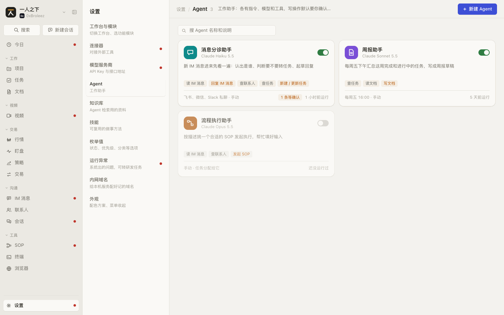 | 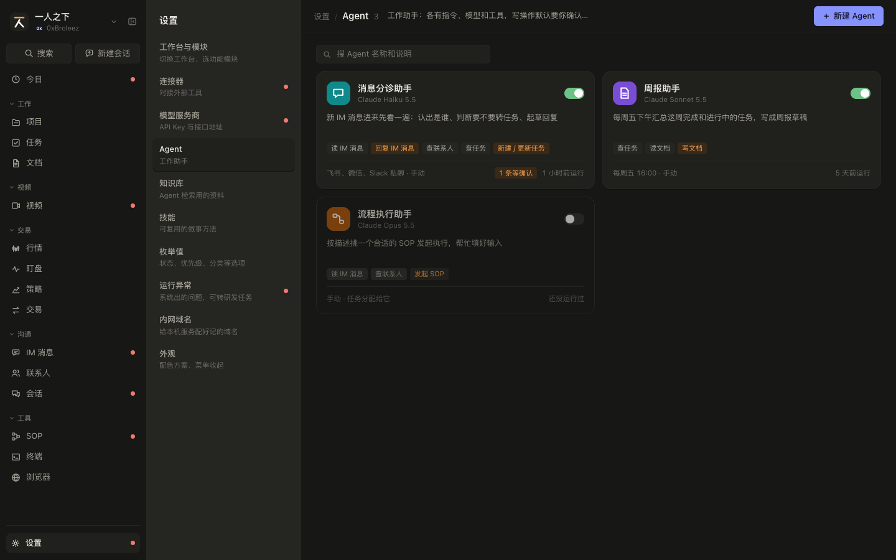 |
| 手机 375 | 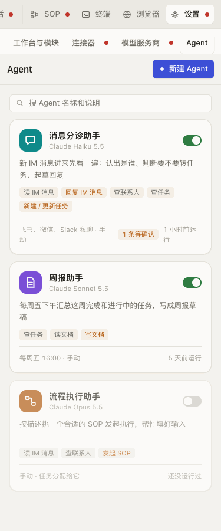 | 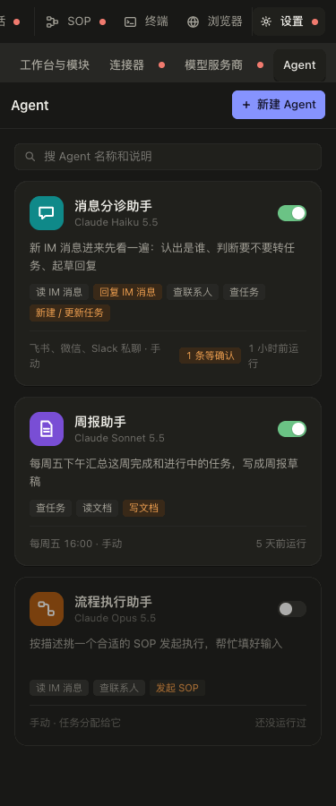 |

### 交互

| 编号 | 元素 | 操作 | 结果 |
|---|---|---|---|
| SPEC-settings-8.1 | 顶栏 | 看 | 「设置 / Agent」，数量，说明「工作助手：各有指令、模型和工具，写操作默认要你确认才执行」 |
| SPEC-settings-8.2 | 右上「新建 Agent」 | 点击 | 进新建的配置页（`SPEC-settings-9`），模型默认第一个可用的 |
| SPEC-settings-8.3 | 搜索框 | 输入 | 按名称和说明筛，空格隔开的词都要命中；有关键词时旁边写「命中 N 个」 |
| SPEC-settings-8.4 | Agent 卡片 | 点击或回车 | 进这个 Agent 的配置页；卡片能用 Tab 聚焦 |
| SPEC-settings-8.5 | 卡片头 | 看 | 头像、名称（空写「未命名」）、模型名；模型不可用时红字「<模型名> · 不可用」 |
| SPEC-settings-8.6 | 卡片启用开关 | 切换 | 直接启停，不进配置页；悬停「停用后不再被触发」/「启用」；停用的卡片变淡 |
| SPEC-settings-8.7 | 卡片说明 | 看 | 说明，空写「还没有说明」 |
| SPEC-settings-8.8 | 能力标签 | 看 | 开着的内置工具，最多 5 个，其余「+N」；需确认的标签样式不同 |
| SPEC-settings-8.9 | 卡片底部 | 看 | 触发方式（手动写「手动」，其余写条件，没条件写类型名，用 · 隔开）；有等确认的执行记录时「N 条等确认」；最近一次运行「<时间>运行」或「还没运行过」 |

### 空状态和异常状态

| 编号 | 场景 | 显示 | 可做的操作 |
|---|---|---|---|
| SPEC-settings-8.10 | 搜索没有结果 | 「没有匹配的 Agent」「换个关键词试试」 | 改关键词 |
| SPEC-settings-8.11 | 一个 Agent 都没有 | 「还没有 Agent」「点右上角「新建 Agent」」；有 Agent 但搜不到时才写「没有匹配的 Agent」「换个关键词试试」 | 新建 |
| SPEC-settings-8.12 | 模型不可用 | 卡片模型红字 | 进配置页换模型 |

### 数据

见 `SPEC-settings-9` 的 `Agent`。等确认数、最近运行来自 `AgentRun`（`agent_id`、`at`、`status`，见 `SPEC-sessions`）。模型名和可用性来自 `modelChoices`（`ModelChoice`：`{ key: string; label: string; note: string; ok: boolean; group?: string }`，由 `ModelConf` 和 `usable` 算出，`ok` 为 false 时 `note` 是不可用原因）。

### 联动

| 方向 | 对方模块 | 触发 | 结果 | 见 |
|---|---|---|---|---|
| 进来 | 会话、项目、文档、命令面板 | 点 Agent 名 | 直接进配置页 | `SPEC-sessions-1`、`SPEC-projects-10` |
| 改动 | 会话、SOP、定时任务 | 启停 | 停用的不再被触发，会话里不能发送 | `SPEC-sessions-1` |

## SPEC-settings-9 Agent 配置页

配置页只管 Agent 本身：头像、模型、指令、技能、工具、MCP、知识库、触发方式。右边的调试对话用当前（没保存的）配置试一试，不留记录；正式的会话、执行记录、产出在「会话」里。

### 截图

由 `shots.py` 按步骤截（`settings_agent_editor`、`settings_agent_model_off`，桌面 1440）：

| 场景 | 步骤 | 亮 | 暗 |
|---|---|---|---|
| 基本信息 | 点「消息分诊助手」 | 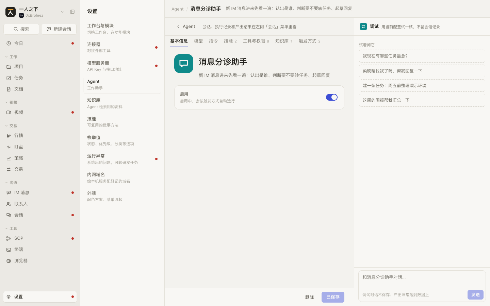 | 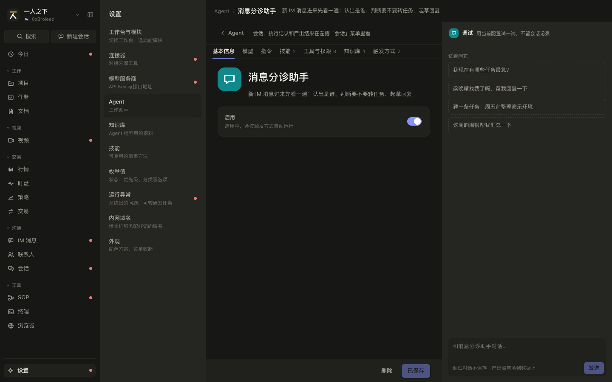 |
| 工具与权限 | 切到「工具与权限」（挂了 GitHub 连接器） | 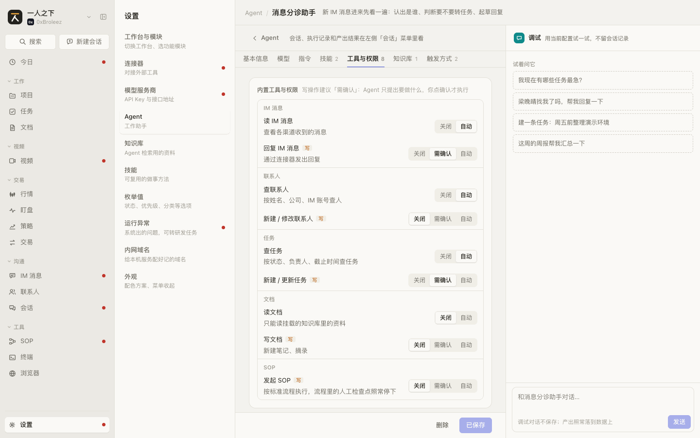 | 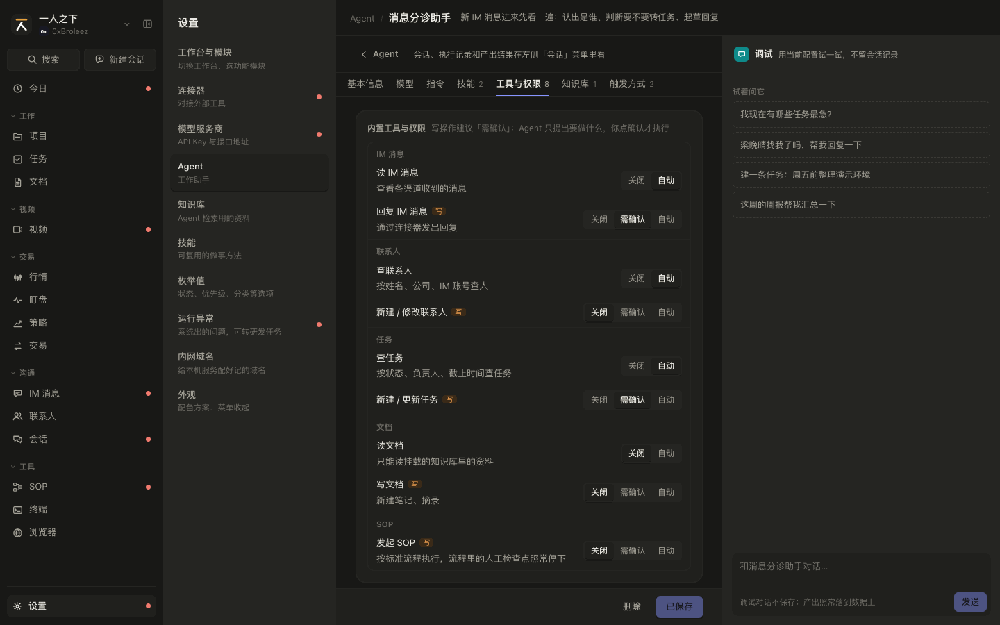 |
| 知识库 | 切到「知识库」 |  |  |
| 未保存确认 | 改说明后点「Agent」返回 |  |  |
| 新建 | 「新建 Agent」 |  |  |
| 模型不可用 | 先在模型服务商里停用 Anthropic，再打开它切到「模型」 |  |  |

### 交互

| 编号 | 元素 | 操作 | 结果 |
|---|---|---|---|
| SPEC-settings-9.1 | 顶栏 | 看 | 「Agent / <名称>」，新建时「新建 Agent」，说明是 Agent 的说明 |
| SPEC-settings-9.2 | 「Agent」返回按钮 | 点击 | 回 Agent 列表；有未保存的改动时底栏换成「有未保存的修改，离开后会丢掉」+「继续编辑」「放弃修改」，切二级菜单同样先确认（新建时什么都没填不算改动）。旁边提示「会话、执行记录和产出结果在左侧「会话」菜单里看」 |
| SPEC-settings-9.3 | 标签条 | 点击 | 基本信息、模型、指令、技能、工具与权限、知识库、触发方式；技能、工具与权限、知识库、触发方式后面带数量；有问题的标签带红点，悬停写问题。新建停在基本信息，已有的回到上次看的标签（只在内存里记） |
| SPEC-settings-9.4 | 基本信息：头像 | 点击 | 打开头像设置：文字（一到两个字，留空用名字第一个字）、图标（robot、chat、doc、chart、flow、search、mail、calendar、shield、spark）、底色（8 个）、上传图片（只能用图片，1MB 以内，「移除图片」）；超了或不是图片红字提示 |
| SPEC-settings-9.5 | 基本信息：名称、说明 | 输入 | 名称必填，占位「Agent 名称，比如：消息分诊助手」；说明占位「一句话说明它负责什么」 |
| SPEC-settings-9.6 | 基本信息：启用 | 切换 | 说明随状态变：「启用中，会按触发方式自动运行」/「停用后不再被触发，已有会话和执行记录保留」 |
| SPEC-settings-9.7 | 模型：可用模型 6 个以内 | 看、选 | 直接列单选：模型名、备注（「<服务商> · <上下文>K 上下文」）；不可用的置灰、红字原因（只列可用的加当前选中的） |
| SPEC-settings-9.8 | 模型：超过 6 个 | 看 | 只露当前选中的一行和「换模型 N 个可用」 |
| SPEC-settings-9.9 | 「换模型」 | 点击 | 展开选择器：搜索框（搜模型或服务商）、按服务商分组的单选列表、「收起」；选中后收起 |
| SPEC-settings-9.10 | 模型搜索没结果 | 看 | 「没有匹配的模型」 |
| SPEC-settings-9.11 | 模型不可用 | 看 | 标签红点；顶部红条「<问题>，Agent 调用会失败，换一个可用的模型。」（没选时「还没选模型」，不可用时「<模型名> 当前不可用」） |
| SPEC-settings-9.12 | 指令 | 输入 | 多行文本，提示「告诉它是谁、负责什么、按什么规矩做事」，带示例占位 |
| SPEC-settings-9.13 | 技能：「挂载技能」 | 点击 | 下拉列出还没挂的技能，按来源（内置 / 自定义）分组；超过 8 个时顶部有搜索（回车挑第一个，Esc 关闭）；点一个挂上，下拉关闭 |
| SPEC-settings-9.14 | 技能卡片 | 看、卸下 | 名称、来源标签、怎么做、「用到：…」；右边叉号「卸下」 |
| SPEC-settings-9.15 | 工具与权限：内置工具 | 点击 | 按组（IM 消息、联系人、任务、文档、SOP）列 `ABILITIES`；只读「关闭 / 自动」，写「关闭 / 需确认 / 自动」；写的选自动为风险色。「读文档」的说明是「只能读挂载的知识库里的资料」 |
| SPEC-settings-9.16 | 写工具设为自动的警告 | 看 | 「「<工具>」…设为自动：Agent 会直接执行，不再等你确认。」 |
| SPEC-settings-9.17 | MCP / 连接器工具：「挂载」 | 点击 | 下拉列可挂的连接器（获取过工具清单、没暂停、没断开的），按工具名分组，每行「<连接器名>」「<工具名> · N 个可用工具」，异常的加「 · 连接异常」；挂上后默认只读工具自动、写工具关闭，并展开它的工具权限 |
| SPEC-settings-9.18 | 连接器卡片 | 点击名称或「工具权限」 | 展开 / 收起它的工具；卡片写「开了 N / 总数 个工具」，异常时红字「连接异常，调用会失败」 |
| SPEC-settings-9.19 | 连接器工具权限 | 点击 | 选项受连接器上限约束（`RANK`：关闭 < 需确认 < 自动，只给不超过上限的档）；连接器要求确认的写工具写「 · 连接器要求确认」；工具超过 10 个时有搜索框 |
| SPEC-settings-9.20 | 连接器卡片叉号 | 点击 | 卸下，同时清掉它的 `conn:<id>:*` 权限，免得以后挂回来带着旧权限 |
| SPEC-settings-9.21 | 知识库：「挂载知识库」 | 点击 | 下拉列还没挂的知识库：名称、「<来源> · <篇数> 篇」。来源是文档分类名，挂了本地目录的加「本地目录 N 个」，都没有写「没选来源」；篇数按 `kbdata` 里这个知识库的文档数算，和知识库列表一致 |
| SPEC-settings-9.22 | 知识库：「新建知识库」 | 点击 | 展开 / 收起内联表单：名称、文档分类（多选）、本地目录（可选，绝对路径；不以 / 开头时红字「填绝对路径，以 / 开头」），「建好并挂上」（名称有、分类和目录至少一样时可点）、「取消」，提示「选文档分类或填本地目录，至少一样；以后在知识库详情的「设置」里还能加目录」。填的目录写进这个知识库的 `KbSettings.dirs`，和知识库详情「设置」里挂的是同一份（`SPEC-settings-13.8`） |
| SPEC-settings-9.23 | 知识库卡片 | 看、卸下 | 名称、「<来源> · N 篇 · <时间>更新」（来源和篇数口径同 9.21）、叉号卸下 |
| SPEC-settings-9.24 | 触发方式 | 选择、输入 | 每行一个：类型下拉（手动对话、收到 IM 消息、定时、任务分配给它），非手动的有条件输入框（占位：「哪些渠道、群还是私聊」「比如：每周五 16:00」「比如：标签含「Agent」的任务」）；手动写「在「会话」里直接找它」；「删除」只剩一行时置灰 |
| SPEC-settings-9.25 | 「加一个触发方式」 | 点击 | 加一行定时，条件为空 |
| SPEC-settings-9.26 | 底栏提示 | 看 | 有问题时红字列出所有标签的问题，用「；」隔开；编辑已有 Agent 且有改动时「有未保存的修改，切换标签不会丢」 |
| SPEC-settings-9.27 | 「创建」/「保存」 | 点击 | 没有改动时置灰并写「已保存」；名称为空时跳到基本信息并标红，不保存；保存后按钮显示「已保存」1.5 秒。新建保存后停在这个 Agent 的配置页。模型、连接器、触发条件的问题不拦保存 |
| SPEC-settings-9.28 | 「删除」 | 点击 | 只在编辑时有；变成确认 |
| SPEC-settings-9.29 | 删除确认（可删） | 看 | 「删除后<影响>」（`agentPlan`：「会从项目 <名称> 里摘掉」「会话、执行记录和产出保留，显示为已删除的 Agent」）+「取消」「删除」；删后回列表 |
| SPEC-settings-9.30 | 删除确认（被拦） | 看 | 「不能删除：<原因>」+「知道了」：「还有 N 处操作等你确认（执行记录或会话里），先处理完」「定时任务 <名称> 交给它执行，先改掉或删掉这些定时任务」 |
| SPEC-settings-9.31 | 调试对话 | 输入、发送 | 右侧面板「调试 · 用当前配置试一试，不留会话记录」；没有消息时给四个示例问题，点了直接发；⌘Enter 或「发送」；回复按当前配置的工具权限模拟：自动的直接执行，需确认的出现「确认执行 / 拒绝」卡片，没开权限的说明要开哪项；「清空」清掉对话。提示「调试对话不保存；产出照常落到数据上」 |
| SPEC-settings-9.32 | 调试面板（窄屏） | 点击 | 1100px 以下面板叠在编辑区下面，默认收成一条，「展开调试」/「收起」 |

### 空状态和异常状态

| 编号 | 场景 | 显示 | 可做的操作 |
|---|---|---|---|
| SPEC-settings-9.33 | 没挂技能 | 「还没挂技能」 | 挂载 |
| SPEC-settings-9.34 | 技能都挂上了 | 挂载下拉里「技能都挂上了」 | |
| SPEC-settings-9.35 | 没挂连接器 | 「还没挂 MCP 或连接器。去接入」，「去接入」跳到连接器列表 | 去接入 |
| SPEC-settings-9.36 | 没有可挂的连接器 | 挂载下拉里「没有更多可挂的。去「设置 / 连接器」接入并获取工具清单」 | |
| SPEC-settings-9.37 | 挂载下拉搜索没结果 | 「没有匹配的」 | |
| SPEC-settings-9.38 | 没挂知识库 | 「还没挂知识库」（内联新建表单打开时不显示） | 挂载、新建 |
| SPEC-settings-9.39 | 名称为空 | 基本信息红点、底栏红字「名称还没填」，保存时跳到基本信息 | 填名称 |
| SPEC-settings-9.40 | 挂的连接器异常 | 工具与权限标签红点「<名称> 连接异常」，卡片红字 | 去连接器修 |
| SPEC-settings-9.41 | 非手动触发没填条件 | 触发方式红点「有触发方式没填条件」 | 填条件 |
| SPEC-settings-9.42 | Agent 已停用时调试 | 调试面板照常能发（按启用处理）；会话里停用的 Agent 不能发送 | |
| SPEC-settings-9.43 | 打开的 Agent 已被删除（链接失效） | 原型按新建处理；正式产品显示「这个 Agent 不存在或已删除」+「回到 Agent 列表」 | 返回 |

### 数据

`Agent`（`web-next/src/agentdata.ts`）

| 字段 | 类型 | 必填 | 说明 | 取值 / 示例 |
|---|---|---|---|---|
| `id` | `string` | 是 | 编号 | `ag_triage` |
| `name` | `string` | 是 | 名称，新建为空串 | `消息分诊助手` |
| `desc` | `string` | 是 | 说明 | |
| `color` | `string` | 是 | 头像底色，`AGENT_COLORS` 之一，新建随机 | `#0f8a8a` |
| `model` | `string` | 是 | 模型 ID（`ModelConf.id`） | `claude-haiku-5-5` |
| `instructions` | `string` | 是 | 指令 | |
| `abilities` | `Record<string, AbilityMode>` | 是 | 工具权限：内置工具按 `Ability.key`，连接器工具按 `conn:<连接器 id>:<工具名>`；没有的按关闭 | `{ read_tasks: 'auto', 'conn:cn_github:create_issue': 'confirm' }` |
| `avatar` | `AgentAvatarConf` | 是 | `{ kind: 'text' \| 'icon' \| 'image'; value: string }`；`icon` 取 `AVATAR_ICONS`，`image` 是 data URL | `{ kind: 'icon', value: 'chat' }` |
| `skills` | `string[]` | 是 | 挂载的技能 id | `['sk_triage']` |
| `mcps` | `string[]` | 是 | 挂载的 MCP / 连接器 id | `['cn_github']` |
| `kbs` | `string[]` | 是 | 挂载的知识库 id | `['kb_feedback']` |
| `triggers` | `AgentTrigger[]` | 是 | `{ kind: TriggerKind; detail: string }`，至少一条 | |
| `enabled` | `boolean` | 是 | 启用 | |
| `created_at` | `string` | 是 | 创建时间 | |

`AbilityMode`：`off` 关闭 / `confirm` 需确认 / `auto` 自动；读操作只有关闭和自动。

`TriggerKind`：`manual` 手动对话 / `im` 收到 IM 消息 / `schedule` 定时 / `task` 任务分配给它（`TRIGGER_KIND`）。

`Ability`：`{ key: string; label: string; group: string; write: boolean; desc: string }`，`ABILITIES` 依次为：

| key | label | 组 | 写 |
|---|---|---|---|
| `read_messages` | 读 IM 消息 | IM 消息 | 否 |
| `reply_message` | 回复 IM 消息 | IM 消息 | 是 |
| `read_contacts` | 查联系人 | 联系人 | 否 |
| `write_contacts` | 新建 / 修改联系人 | 联系人 | 是 |
| `read_tasks` | 查任务 | 任务 | 否 |
| `write_tasks` | 新建 / 更新任务 | 任务 | 是 |
| `read_content` | 读文档 | 文档 | 否 |
| `write_content` | 写文档 | 文档 | 是 |
| `run_sop` | 发起 SOP | SOP | 是 |

新建默认（`newAgent`）：全部关闭，只开 `read_tasks`、`read_contacts` 自动；模型取第一个可用的（没有就 `claude-sonnet-5-5`）；头像文字留空；触发方式一条手动。

页面拿到的可挂载连接器 `MountableConn`：`{ id: string; name: string; kind: string; ok: boolean; tools: ConnToolChoice[] }`；`ConnToolChoice`：`{ key: string; connId: string; conn: string; connOk: boolean; name: string; desc: string; write: boolean; connMode: AbilityMode }`，`connMode` 是连接器那边的上限，只列连接器里没关掉的工具。调试对话的消息 `ChatMsg`、工具调用 `ToolCall` 见 `SPEC-sessions`。

### 联动

| 方向 | 对方模块 | 触发 | 结果 | 见 |
|---|---|---|---|---|
| 进来 | 知识库详情 | 「挂了这个知识库的 Agent」里点一个 | 打开它的配置页 | `SPEC-settings-13.15` |
| 出去 | 连接器 | 「去接入」 | 连接器列表 | `SPEC-settings-3` |
| 改动 | 知识库 | 内联「建好并挂上」 | 知识库列表多一个 | `SPEC-settings-10` |
| 改动 | 任务、文档、IM 消息、SOP | 调试对话里执行写操作 | 真的建任务、写文档、发回复、发起 SOP，产出记到会话的产出里 | `SPEC-sessions` |
| 改动 | 项目 | 删除 | 从项目的 Agent 里摘掉 | `SPEC-projects-10` |

## SPEC-settings-10 知识库列表

一组可检索的资料：工作台文档、本地目录文件、上传的文件、网页和笔记；挂到 Agent 上，回答和写作时先在这里找依据。

### 截图

| | 亮 | 暗 |
|---|---|---|
| 桌面 1440 |  |  |
| 手机 375 |  |  |

### 交互

| 编号 | 元素 | 操作 | 结果 |
|---|---|---|---|
| SPEC-settings-10.1 | 顶栏 | 看 | 「设置 / 知识库」，数量，说明同本节开头；右上「新建知识库」 |
| SPEC-settings-10.2 | 「新建知识库」 | 点击 | 打开知识库抽屉（`SPEC-settings-14`） |
| SPEC-settings-10.3 | 搜索框 | 输入 | 按名称、说明筛，也按里面的文档标题筛；靠文档命中的卡片写「命中文档：…」；有关键词时「命中 N 个」 |
| SPEC-settings-10.4 | 知识库卡片 | 看 | 书本图标、名称、整体状态（有失败「N 篇失败」红，否则有待索引「N 篇待索引」橙，否则「已索引」绿）、说明（空写「没有说明」）、来源分类标签、「N 篇 · N 待索引 · N 失败」（待索引、失败大于 0 时上色）、「<最近一篇的更新时间>更新」、在用的 Agent 头像（最多 5 个，其余「+N」，全名在悬停里） |
| SPEC-settings-10.5 | 知识库卡片 | 点击 | 进知识库详情（`SPEC-settings-11`）；抽屉打开的那张卡片高亮 |

### 空状态和异常状态

| 编号 | 场景 | 显示 | 可做的操作 |
|---|---|---|---|
| SPEC-settings-10.6 | 一个知识库都没有 | 「还没有知识库」「点右上角「新建知识库」，选文档分类或本地目录当来源」 | 新建 |
| SPEC-settings-10.7 | 搜索没有结果 | 「没有匹配的知识库」「换个关键词试试」 | 改关键词 |
| SPEC-settings-10.8 | 没有 Agent 在用 | 卡片右下「没有 Agent 在用」 | 到 Agent 里挂 |
| SPEC-settings-10.9 | 有失败的文档 | 卡片状态红「N 篇失败」 | 进详情处理 |

### 数据

见 `SPEC-settings-14` 的 `KnowledgeBase`；篇数、待索引、失败、更新时间由 `kbdata` 的文档列表（`KbDoc`，见 `SPEC-settings-11`）算，不用 `KnowledgeBase.docs`、`status`。

### 联动

| 方向 | 对方模块 | 触发 | 结果 | 见 |
|---|---|---|---|---|
| 进来 | Agent | 内联新建 | 列表多一个 | `SPEC-settings-9.22` |

## SPEC-settings-11 知识库详情：文档

知识库详情页的框架和「文档」标签：这个库里的每一篇资料、加文档、阅读视图。

### 截图

由 `shots.py` 按步骤截（`settings_kb`，桌面 1440）：

| 场景 | 步骤 | 亮 | 暗 |
|---|---|---|---|
| 文档列表 | 点「产品文档库」（有待索引和失败的文档） |  |  |
| 阅读视图 | 点第一篇标题 |  |  |
| 加文档 | 右上「加文档」 |  |  |

### 交互

| 编号 | 元素 | 操作 | 结果 |
|---|---|---|---|
| SPEC-settings-11.1 | 顶栏 | 看 | 「知识库 / <名称>」（「知识库」可点回列表），篇数，说明；文档标签且不在阅读视图时右上「全部重新索引」（没有文档置灰）、「加文档」；设置标签时「改名称和分类」 |
| SPEC-settings-11.2 | 手机返回 | 点击 | 手机宽度下多一个「返回知识库列表」 |
| SPEC-settings-11.3 | 标签条 | 点击 | 文档、检索测试、设置；文档标签有失败时带红点，否则有待索引时写「N 待索引」；点文档标签退出阅读视图 |
| SPEC-settings-11.4 | 「全部重新索引」 | 点击 | 全部文档标成待索引并逐篇模拟索引（`kbStore.reindex`）：向量化服务商停用或删除 →「向量化用的服务商已停用或删除，到「设置」里换一个模型」；服务商异常 →「向量化失败：<名称> <原因>」；没有正文 → 失败（PDF「PDF 里没有可提取的文字」，其他格式「这种格式还提取不了文字，转成 .md 或 .txt 再传」）；其余变已索引，段数按当前切分重算。正在跑的显示「索引中」 |
| SPEC-settings-11.5 | 未收进来的提示 | 看、点击 | 自动同步开着、来源分类里有还没收进来的文档时：「来源分类里有 N 篇还没收进来 <前三篇标题> 等」+「收进来」，点了加进库并开始索引 |
| SPEC-settings-11.6 | 状态筛选 | 点击 | 全部、待索引、失败、已排除，各带数量 |
| SPEC-settings-11.7 | 搜索框 | 输入 | 按标题、路径、正文筛 |
| SPEC-settings-11.8 | 参与检索统计 | 看 | 「参与检索 N 篇 · M 段」（已索引且没排除的） |
| SPEC-settings-11.9 | 文档表 | 看 | 列：文档（标题；第二行失败时红字原因，否则工作台文档写「分类：<分类>」，其他写路径或网址，笔记写「N 字」）、来源（工作台文档 / 本地目录文件 / 上传的文件 / 网页链接 / 手写笔记）、段数（失败写 -）、状态（已索引 / 待索引 / 索引中 / 失败，排除的加「已排除」）、更新时间、操作；排除的行变淡 |
| SPEC-settings-11.10 | 行操作「开始索引」/「重新索引」 | 点击 | 待索引时写「开始索引」，正在索引时「索引中」置灰；只索引这一篇 |
| SPEC-settings-11.11 | 行操作「排除」/「恢复」 | 点击 | 排除：资料留着，暂时不参与检索；恢复：重新参与检索 |
| SPEC-settings-11.12 | 行操作「移除」 | 点击 | 变成「确认移除」「取消」；确认后从库里删掉这篇（原文档不受影响） |
| SPEC-settings-11.13 | 文档标题 | 点击 | 进阅读视图 |
| SPEC-settings-11.14 | 「加文档」 | 点击 | 表格上方展开加文档表单，分段：从「文档」挑、上传文件、网页链接、写笔记；切换时清掉标题和正文 |
| SPEC-settings-11.15 | 加文档：从「文档」挑 | 选择 | 可搜索的多选（按分类分组，搜标题和标签），已在库里的置灰写「已在库里」 |
| SPEC-settings-11.16 | 加文档：上传文件 | 选择 | 「选文件」，接受 .md、.markdown、.txt、.csv、.pdf、.docx，可多选；文本类直接读正文，其他先收进来、索引时报原因；提示「支持 .md、.txt、.csv，.pdf 和 .docx 要带可提取的文字」 |
| SPEC-settings-11.17 | 加文档：网页链接 | 输入 | 网址（必填，http 或 https）、标题（留空用网址）、正文摘录（可选，「要登录才能看的页面抓不到正文，把关键段落贴在这里」） |
| SPEC-settings-11.18 | 加文档：写笔记 | 输入 | 标题、正文都必填 |
| SPEC-settings-11.19 | 「加进知识库」 | 点击 | 校验通过就加进库（新加的在最前，状态待索引）并开始索引，表单关闭；「取消」关表单 |
| SPEC-settings-11.20 | 阅读视图工具条 | 点击 | 「返回文档列表」；笔记有「编辑笔记」/「改完了」；「开始索引」/「重新索引」；「排除」/「恢复参与检索」；「移除」→「确认移除」 |
| SPEC-settings-11.21 | 阅读视图头 | 看 | 标题、来源标签、路径或网址、状态、已排除、更新时间；失败时红框「索引失败<原因>」；排除时提示「这篇暂时不参与检索，资料还留着；点「恢复参与检索」放回去」；有正文时「按每段 N 字、重叠 M 字切成 K 段」，上次索引段数不同时加「 · 上次索引是 X 段，重新索引后按新的切分」 |
| SPEC-settings-11.22 | 阅读视图正文 | 看 | 按段显示，每段前标「第 N 段 · X 字」，开头和上一段重叠的写「 · 开头 N 字和上一段重叠」，和下一段重叠的字单独标出（悬停「这几个字同时属于下一段」）；从检索测试跳来时滚到那一段并闪一下 |
| SPEC-settings-11.23 | 编辑笔记 | 输入 | 标题、正文直接改，状态变待索引；停笔约 0.9 秒自动重新索引；底部写「停笔一会儿就会重新索引」/「已按最新内容索引」；「改完了」时还在待索引就立即索引 |

### 空状态和异常状态

| 编号 | 场景 | 显示 | 可做的操作 |
|---|---|---|---|
| SPEC-settings-11.24 | 库里没有文档 | 「知识库里还没有文档」「从「文档」里挑、上传文件、填网址，或者直接写一篇笔记」+「加文档」 | 加文档 |
| SPEC-settings-11.25 | 筛选、搜索没有结果 | 「没有匹配的文档」「换个筛选或关键词试试」 | 改筛选 |
| SPEC-settings-11.26 | 加文档校验不过 | 从「文档」挑没选「至少选一篇」；上传没选「先选文件」；网址不对「填一个 http 或 https 开头的网址」；笔记缺项「标题和正文都要填」，对应框红框 | 补全 |
| SPEC-settings-11.27 | 索引失败 | 行内红字原因；种子里有扫描版 PDF、要登录的链接、Ollama 超时三种 | 重新索引、移除 |
| SPEC-settings-11.28 | 阅读视图没有正文 | 「没有可显示的正文」，网页加「：网页没抓到内容」，上传加「：文件里没提取到文字」 | |
| SPEC-settings-11.29 | 「文档」里没有文档 | 从「文档」挑的下拉里「「文档」里还没有文档」 | |

### 数据

`KbDoc`（`web-next/src/kbdata.ts`）

| 字段 | 类型 | 必填 | 说明 | 取值 / 示例 |
|---|---|---|---|---|
| `id` | `string` | 是 | 编号 | `kd_product_dc_001` |
| `kb_id` | `string` | 是 | 所属知识库 | `kb_product` |
| `title` | `string` | 是 | 标题 | `api-contract.md` |
| `source` | `{ type: KbDocSource; ref?: string }` | 是 | 来源；`ref` 是文档 id、目录里的文件路径、上传的文件名、网址，笔记没有 | `{ type: 'dir', ref: '/Volumes/.../api-contract.md' }` |
| `text` | `string` | 是 | 正文 | |
| `chunks` | `number` | 是 | 上次索引切出的段数；切分设置改了要重新索引才变 | `4` |
| `status` | `KbDocStatus` | 是 | 索引状态 | `indexed` 已索引 / `pending` 待索引 / `failed` 失败 |
| `excluded` | `boolean` | 是 | 暂时不参与检索 | `false` |
| `error` | `string` | 否 | 失败原因 | `PDF 是扫描出来的图片，没有可提取的文字；导出成带文字的 PDF 再传` |
| `updated_at` | `string` | 是 | 更新时间 | |

`KbDocSource`：`library` 工作台文档 / `dir` 本地目录文件 / `upload` 上传的文件 / `link` 网页链接 / `note` 手写笔记（`KB_DOC_SOURCE`）。`KB_DOC_STATUS` 颜色：已索引 `#2f7d43`、待索引 `#b0570b`、失败 `#c0352b`；「索引中」是待索引且在 `busy` 里，`#3d4fd6`。

切分 `splitChunks(text, size, overlap)`：返回 `Chunk[]`（`{ start: number; end: number }`），按段长切，尽量在段长 60% 之后的换行、句号、分号处断开，相邻两段重叠 `overlap` 字（不超过段长一半）。

store（原型）：`{ docs: KbDoc[]; settings: KbSettings[]; busy: string[] }`，`busy` 是正在索引的文档 id；操作 `addDocs`、`patchDoc`、`removeDoc`、`reindex`、`setSettings`、`setEmbed`、`removeDir`。

### 联动

| 方向 | 对方模块 | 触发 | 结果 | 见 |
|---|---|---|---|---|
| 进来 | 文档 | 来源分类里新加文档 | 自动同步开着时出现「还没收进来」提示 | `SPEC-library` |
| 进来 | 检索测试 | 点命中的段 | 切到文档标签，打开那篇并定位到那一段 | `SPEC-settings-12.5` |
| 进来 | 模型服务商 | 向量化服务商状态 | 索引成败 | `SPEC-settings-7` |

## SPEC-settings-12 知识库详情：检索测试

输入一个问题，看会命中哪些段落，用来调切分和资料。

### 截图

由 `shots.py` 按步骤截（`settings_kb`，桌面 1440）：

| 场景 | 步骤 | 亮 | 暗 |
|---|---|---|---|
| 检索结果 | 「产品文档库」切到「检索测试」，点示例「权限变更多久生效」 |  |  |

### 交互

| 编号 | 元素 | 操作 | 结果 |
|---|---|---|---|
| SPEC-settings-12.1 | 问题输入框 | 输入、回车 | 自动聚焦，占位「输入一个问题，比如：权限模型月底演示要做到哪一步」；回车或「检索」（空时置灰）发起检索 |
| SPEC-settings-12.2 | 范围说明 | 看 | 「在 N 篇已索引的文档里找，待索引、失败、已排除的 M 篇不参与；按问题和每段的词重合度打分，列前 5 段」（没有不参与的就不写中间那句） |
| SPEC-settings-12.3 | 示例问题 | 点击 | 还没检索时显示「试试：」和这个库的示例（种子里三个库各三条），点了填进输入框并检索 |
| SPEC-settings-12.4 | 命中列表 | 看 | 排名、「<标题> · 第 N 段」、相关度条和百分比（悬停「命中 N 个检索词」）、去掉 Markdown 记号的段落正文（检索词高亮）、来源标签和路径 |
| SPEC-settings-12.5 | 命中的标题 | 点击 | 切到文档标签，打开那篇并定位到那一段（悬停「打开这篇，定位到这一段」） |

### 空状态和异常状态

| 编号 | 场景 | 显示 | 可做的操作 |
|---|---|---|---|
| SPEC-settings-12.6 | 没有命中 | 「没有命中。换个说法，或者看看相关文档是不是还没索引、被排除了」 | 换问题 |
| SPEC-settings-12.7 | 库里没有可检索的文档 | 范围说明写「在 0 篇已索引的文档里找」，检索结果为没有命中 | 回文档标签加文档 |
| SPEC-settings-12.8 | 真实检索失败（向量服务不可用） | 原型未做（原型是关键词模拟）；正式产品写失败原因和「重试」 | 重试 |

### 数据

`searchKb(docs, settings, q, top = 5)` 返回 `KbHit[]`：`{ doc: KbDoc; index: number; chunk: Chunk; score: number; terms: string[] }`。原型的模拟打分：问题拆词（英文按词、中文两字一组，去掉停用词），每段命中词占比，标题也命中加 0.08，低于 0.15 不算；只算已索引、没排除的。正式产品换成向量检索，界面字段不变。示例问题 `SAMPLE_Q` 写死在 `kbskills.tsx`。

### 联动

见 `SPEC-settings-12.5`。

## SPEC-settings-13 知识库详情：设置

来源、本地目录、切分方式、向量化模型、挂了这个库的 Agent。

### 截图

由 `shots.py` 按步骤截（`settings_kb`，桌面 1440）：

| 场景 | 步骤 | 亮 | 暗 |
|---|---|---|---|
| 设置 | 「产品文档库」切到「设置」 |  |  |

### 交互

| 编号 | 元素 | 操作 | 结果 |
|---|---|---|---|
| SPEC-settings-13.1 | 来源：文档分类 | 看 | 选了的分类标签（分类名读「文档分类」枚举），没选写「没选分类」 |
| SPEC-settings-13.2 | 来源「修改」 | 点击 | 打开知识库抽屉改分类；抽屉开着时按钮高亮 |
| SPEC-settings-13.3 | 「分类里新加的文档自动收进来」 | 切换 | 说明「关掉后只收手动加的；「文档」页顶上会提示还没收进来的篇目」 |
| SPEC-settings-13.4 | 本地目录列表 | 看 | 标题旁「只收 .md、.txt 文件」；每行路径、「N 个文件 · <时间>同步」 |
| SPEC-settings-13.5 | 目录「自动同步」开关 | 切换 | 目录里的文件有变动时自动重新索引 |
| SPEC-settings-13.6 | 目录「立即同步」 | 点击 | 更新同步时间，目录下的文件重新索引 |
| SPEC-settings-13.7 | 目录「移除」 | 点击 | 变成确认「目录里的 N 篇会一起移出」（没有文件时「移除这个目录」）+「移除」「取消」；确认后目录和从它收进来的文件一起移出 |
| SPEC-settings-13.8 | 挂目录输入框 + 「挂上目录」 | 输入、回车或点击 | 去掉末尾斜杠后加进来，自动同步默认开；空时按钮置灰。Agent 配置页内联新建知识库时填的目录也在这里（`SPEC-settings-9.22`），本地目录只有这一种挂法 |
| SPEC-settings-13.9 | 每段多少字 | 选择 | 200、300、500、800、1200 字；改小时重叠自动压到不超过一半 |
| SPEC-settings-13.10 | 段间重叠 | 选择 | 不重叠、30、50、100 字，只给不超过段长一半的 |
| SPEC-settings-13.11 | 切分说明 | 看 | 「按这个设置，现有文档共切成 N 段；尽量在换行和句号处断开」；有段数会变的文档时提示「有 N 篇段数变了 重新索引后检索才按新的切分」+「重新索引这 N 篇」 |
| SPEC-settings-13.12 | 向量化模型 | 选择 | 可搜索下拉，按服务商分组，选项是启用的、有向量化模型的服务商（`EMBED_MODELS`），异常的写「连接异常」、未测试的写「未测试」；换模型后已有向量作废，已索引的全部变待索引 |
| SPEC-settings-13.13 | 向量化服务商的提示 | 看 | 服务商异常：「<名称> 连接异常<原因>；重新索引会失败，换一个模型或先修好服务商」；服务商停用或删除：「当前用的服务商已停用或删除，换一个模型」；有待索引：「N 篇待索引 用 <模型> 重新算向量」+「开始索引」 |
| SPEC-settings-13.14 | 挂了这个知识库的 Agent | 看 | 提示「在 Agent 配置里挂、卸」；每个 Agent 头像、名称、说明，停用的标「已停用」 |
| SPEC-settings-13.15 | Agent 行 | 点击 | 打开它的配置页（悬停「打开 Agent 配置」） |

### 空状态和异常状态

| 编号 | 场景 | 显示 | 可做的操作 |
|---|---|---|---|
| SPEC-settings-13.16 | 没挂本地目录 | 「还没挂本地目录」 | 挂目录 |
| SPEC-settings-13.17 | 目录不是绝对路径 | 红框，「填绝对路径，以 / 开头」 | 改路径 |
| SPEC-settings-13.18 | 目录已经挂过 | 红框，「这个目录已经挂上了」 | |
| SPEC-settings-13.19 | 目录不存在或读不了 | 原型不检查；正式产品挂上时提示「找不到这个目录」或「没有读权限」，不加进来 | 改路径 |
| SPEC-settings-13.20 | 没有能做向量化的服务商 | 下拉里「还没有能做向量化的服务商，到「设置 / 模型服务商」接一个」 | 去接服务商 |
| SPEC-settings-13.21 | 当前向量化服务商已删除 | 下拉显示「<模型>（服务商已删除）」，加红框提示 | 换模型 |
| SPEC-settings-13.22 | 没有 Agent 挂 | 「还没有 Agent 挂这个知识库，到「设置 / Agent」里挂」 | |

### 数据

`KbSettings`（`web-next/src/kbdata.ts`）

| 字段 | 类型 | 必填 | 说明 | 取值 / 示例 |
|---|---|---|---|---|
| `kb_id` | `string` | 是 | 知识库 | `kb_product` |
| `auto_sync` | `boolean` | 是 | 来源分类里有新文档时自动收进来 | `true` |
| `dirs` | `KbDir[]` | 是 | 本地目录 | |
| `chunk_size` | `number` | 是 | 每段多少字，`CHUNK_SIZES` 之一 | `300` |
| `overlap` | `number` | 是 | 相邻两段重叠多少字，`OVERLAPS` 之一 | `50` |
| `embed` | `{ provider_id: string; model: string }` | 是 | 向量化模型 | `{ provider_id: 'pv_ollama', model: 'bge-m3' }` |

`KbDir`：`{ path: string; auto_sync: boolean; synced_at?: string }`。默认设置（`defaultSettings`）：自动同步开、没有目录、300 字、重叠 50、`pv_ollama` 的 `bge-m3`。

`EMBED_MODELS: Partial<Record<ProviderKind, string[]>>`：openai、azure `text-embedding-3-small`、`text-embedding-3-large`；gemini `text-embedding-004`；mistral `mistral-embed`；qwen `text-embedding-v3`；zhipu `embedding-3`；doubao `doubao-embedding`；qianfan `embedding-v1`；hunyuan `hunyuan-embedding`；minimax `embo-01`；siliconflow `BAAI/bge-m3`、`BAAI/bge-large-zh-v1.5`；ollama `bge-m3`、`nomic-embed-text`；lmstudio `nomic-embed-text-v1.5`；vllm `bge-m3`；custom `text-embedding`。Anthropic、Bedrock、DeepSeek、xAI、Moonshot、OpenRouter 没有向量化模型，不出现在选项里。

### 联动

| 方向 | 对方模块 | 触发 | 结果 | 见 |
|---|---|---|---|---|
| 出去 | Agent | 点 Agent 行 | 打开配置页 | `SPEC-settings-9` |
| 进来 | Agent | 配置页内联新建知识库时填了本地目录 | 本地目录列表里多这一个 | `SPEC-settings-9.22` |
| 进来 | 模型服务商 | 服务商状态、删除 | 向量化提示和选项跟着变 | `SPEC-settings-7` |

## SPEC-settings-14 知识库抽屉

新建知识库，或改已有知识库的名称、说明、来源分类，以及删除。

### 截图

由 `shots.py` 按步骤截（`settings_kb`，桌面 1440）：

| 场景 | 步骤 | 亮 | 暗 |
|---|---|---|---|
| 新建 | 右上「新建知识库」 |  |  |
| 编辑 | 「产品文档库」设置标签点「改名称和分类」 |  |  |

### 交互

| 编号 | 元素 | 操作 | 结果 |
|---|---|---|---|
| SPEC-settings-14.1 | 抽屉头 | 看 | 「新建知识库」/「知识库」；关闭（Esc） |
| SPEC-settings-14.2 | 名称 | 输入 | 必填，新建时自动聚焦，占位「比如：竞品资料」 |
| SPEC-settings-14.3 | 说明 | 输入 | 占位「放了什么、给谁用」 |
| SPEC-settings-14.4 | 文档分类 | 多选 | 「文档分类」枚举里启用的值，加上已经选了但停用的（方便取消）；本地目录不在这里选，在知识库详情「设置」里挂（`SPEC-settings-13.8`）；提示「选了的分类里的文档会收进来，可以多选，也可以不选只手动加」「本地目录、上传的文件、网页和笔记，在知识库详情里加」 |
| SPEC-settings-14.5 | 在用的 Agent | 看 | 名字标签，超过 8 个时「还有 N 个」/「收起」 |
| SPEC-settings-14.6 | 「创建」/「保存」 | 点击 | 名称为空红框不保存；保存后抽屉切成这个知识库的编辑状态（不关） |
| SPEC-settings-14.7 | 「删除」 | 点击 | 只在编辑时有；确认文案：有 Agent 挂着「<Agent 名，最多列三个，多了写「等 N 个 Agent」> 挂着它，删除后会自动卸下」，否则「删除后不能恢复，原文档不受影响」+「取消」「删除」；删后 Agent 卸下它 |

### 空状态和异常状态

| 编号 | 场景 | 显示 | 可做的操作 |
|---|---|---|---|
| SPEC-settings-14.8 | 没有 Agent 挂 | 「还没有 Agent 挂这个知识库，到「设置 / Agent」里挂」 | |
| SPEC-settings-14.9 | 名称为空就保存 | 红框，抽屉不关，没有文字提示 | 填名称 |

### 数据

`KnowledgeBase`（`web-next/src/agentdata.ts`）

| 字段 | 类型 | 必填 | 说明 | 取值 / 示例 |
|---|---|---|---|---|
| `id` | `string` | 是 | 编号 | `kb_product` |
| `name` | `string` | 是 | 名称 | `产品文档库` |
| `desc` | `string` | 是 | 说明 | `PRD、方案对比、会议纪要` |
| `sources` | `string[]` | 是 | 来源：文档分类 key（`content_category` 枚举）；本地目录不放这里，在 `KbSettings.dirs` | `['doc', 'meeting']` |
| `docs` | `number` | 否 | 旧字段，只留着兼容；篇数由 `KbDoc` 算 | |
| `updated_at` | `string` | 是 | 更新时间 | |
| `status` | `'ready' \| 'indexing' \| 'stale'` | 否 | 旧字段，只留着兼容；状态由 `KbDoc` 算 | |

### 联动

| 方向 | 对方模块 | 触发 | 结果 | 见 |
|---|---|---|---|---|
| 改动 | Agent | 删除 | 挂着它的 Agent 卸下 | `SPEC-settings-9` |
| 进来 | 枚举值 | 文档分类改名、停用 | 选项和标签跟着变 | `SPEC-settings-17` |

## SPEC-settings-15 技能列表

可复用的做事方法：说明怎么做、什么时候用、用到哪些工具；挂到 Agent 上就会按它做。

### 截图

| | 亮 | 暗 |
|---|---|---|
| 桌面 1440 |  |  |
| 手机 375 |  |  |

### 交互

| 编号 | 元素 | 操作 | 结果 |
|---|---|---|---|
| SPEC-settings-15.1 | 顶栏 | 看 | 「设置 / 技能」，数量，说明同本节开头；右上「新建技能」 |
| SPEC-settings-15.2 | 「新建技能」 | 点击 | 打开技能抽屉，新建状态 |
| SPEC-settings-15.3 | 来源筛选 | 点击 | 全部、内置、自定义，各带数量 |
| SPEC-settings-15.4 | 搜索框 | 输入 | 按名称、说明、用到的工具筛 |
| SPEC-settings-15.5 | 技能表 | 看 | 列：技能（名称、说明）、来源（自定义的标签样式不同）、用到（最多 3 个，其余「+N」）、在用的 Agent（头像，最多 5 个） |
| SPEC-settings-15.6 | 技能行 | 点击或回车 | 打开技能抽屉；打开的那行高亮；行能用 Tab 聚焦 |

### 空状态和异常状态

| 编号 | 场景 | 显示 | 可做的操作 |
|---|---|---|---|
| SPEC-settings-15.7 | 筛选、搜索没有结果 | 「没有匹配的技能」「换个关键词或来源试试」 | 改筛选 |
| SPEC-settings-15.8 | 一个技能都没有 | 「还没有技能」「点右上角「新建技能」」；有技能但筛不到时才写「没有匹配的技能」「换个关键词或来源试试」 | 新建 |
| SPEC-settings-15.9 | 没有 Agent 在用 | 行上「没有 Agent 在用」 | |

### 数据

见 `SPEC-settings-16` 的 `Skill`。

### 联动

| 方向 | 对方模块 | 触发 | 结果 | 见 |
|---|---|---|---|---|
| 出去 | Agent | 被挂载 | Agent 配置的技能标签 | `SPEC-settings-9.13` |

## SPEC-settings-16 技能抽屉

看、建、改一个技能。内置技能只读，要改先复制一份。

### 截图

由 `shots.py` 按步骤截（`settings_skill`，桌面 1440）：

| 场景 | 步骤 | 亮 | 暗 |
|---|---|---|---|
| 内置，只读 | 点「写周报」 |  |  |
| 复制一份来改 | 在「写周报」里点「复制一份来改」 |  |  |
| 自定义 | 点「业务数据查询」 |  |  |

### 交互

| 编号 | 元素 | 操作 | 结果 |
|---|---|---|---|
| SPEC-settings-16.1 | 抽屉头 | 看 | 「新建技能」/「内置技能」/「技能」；关闭（Esc） |
| SPEC-settings-16.2 | 内置提示 | 看 | 内置技能顶部「内置技能不能直接改；要按自己的习惯调，点下面「复制一份来改」」，所有输入框禁用 |
| SPEC-settings-16.3 | 名称 | 输入 | 必填，新建时自动聚焦，占位「比如：竞品分析」 |
| SPEC-settings-16.4 | 一句话说明 | 输入 | |
| SPEC-settings-16.5 | 什么时候用 | 输入 | 提示「Agent 靠这句话判断该不该用这个技能」，带示例占位 |
| SPEC-settings-16.6 | 怎么做 | 输入 | 必填，多行，提示「步骤、格式、注意事项」 |
| SPEC-settings-16.7 | 用到的工具 | 勾选、添加 | 提示「只是说明；Agent 有没有这些工具的权限，在 Agent 配置里定」；内置工具常显成可勾选标签；连接器工具只显示选了的，「加连接器工具」/「加工具」是可搜索多选，按连接器分组（选项是连接器里开着的工具，格式「<连接器> · <工具名>」） |
| SPEC-settings-16.8 | 在用的 Agent | 看 | 名字标签，超过 8 个可展开 |
| SPEC-settings-16.9 | 内置技能「复制一份来改」 | 点击 | 打开新建抽屉，内容复制过来，名称加「（我的）」，来源改为自定义；「关闭」关抽屉 |
| SPEC-settings-16.10 | 「创建」/「保存」 | 点击 | 名称和怎么做都填了才保存，否则红框；保存后抽屉切成这个技能的编辑状态 |
| SPEC-settings-16.11 | 「删除」 | 点击 | 只在编辑自定义技能时有；确认文案：有 Agent 挂着「<Agent 名> 挂着它，删除后会自动卸下」，否则「删除后不能恢复」；删后 Agent 卸下它 |

### 空状态和异常状态

| 编号 | 场景 | 显示 | 可做的操作 |
|---|---|---|---|
| SPEC-settings-16.12 | 没有带工具的连接器 | 加工具下拉里「还没有接入带工具的连接器」 | 去接连接器 |
| SPEC-settings-16.13 | 内置技能没用连接器工具 | 「没有用到连接器工具」 | |
| SPEC-settings-16.14 | 没有 Agent 挂 | 「还没有 Agent 挂这个技能」 | |
| SPEC-settings-16.15 | 必填为空就保存 | 红框，没有文字提示 | 补全 |
| SPEC-settings-16.16 | 用到的连接器工具已被关掉或连接器已删除 | 选了的标签照常显示原文（`missingLabel` 原样返回） | 取消勾选 |

### 数据

`Skill`（`web-next/src/agentdata.ts`）

| 字段 | 类型 | 必填 | 说明 | 取值 / 示例 |
|---|---|---|---|---|
| `id` | `string` | 是 | 编号 | `sk_weekly` |
| `name` | `string` | 是 | 名称 | `写周报` |
| `desc` | `string` | 是 | 一句话说明 | `按项目归类本周完成、进行中、下周计划` |
| `source` | `'内置' \| '自定义'` | 是 | 来源；内置只读 | `内置` |
| `uses` | `string[]` | 是 | 用到的工具：内置工具的 `Ability.label`，连接器工具写成「<连接器名> · <工具名>」；种子里也有直接写工具或连接器名的（如「B 站」「PostgreSQL」） | `['查任务', '写文档']` |
| `instructions` | `string` | 是 | 怎么做 | |
| `when` | `string` | 否 | 什么时候用 | |

种子 `SKILLS` 11 条，10 条内置、1 条自定义（业务数据查询）。

### 联动

| 方向 | 对方模块 | 触发 | 结果 | 见 |
|---|---|---|---|---|
| 改动 | Agent | 删除 | 挂着它的 Agent 卸下 | `SPEC-settings-9` |
| 进来 | 连接器 | 工具清单 | 可加的连接器工具 | `SPEC-settings-5` |

## SPEC-settings-17 枚举值

系统里各处下拉、筛选、状态标签用到的选项集中在这里管。左边是按模块分组的枚举列表，右边是选中枚举的值；改动先攒在草稿里，保存才生效。

规则：key 一经创建不改，数据里存的是 key，显示名、颜色、说明、顺序随时可改；系统值（locked）是程序逻辑依赖的，能改显示名、颜色、说明，不能停用、不能删；停用的值新建和编辑时不再出现，已经用了它的数据照常显示；没被用过的值直接删，被用过的要先选一个值合并过去，数据跟着改。

### 截图

| | 亮 | 暗 |
|---|---|---|
| 桌面 1440 |  |  |
| 手机 375 |  |  |

由 `shots.py` 按步骤截（`settings_misc`，桌面 1440）。合并删除（任务优先级里删「P3 低」）、值多于 12 个时的搜索和停用收起（种子里没有这么多值的枚举）还没截。

| 场景 | 步骤 | 亮 | 暗 |
|---|---|---|---|
| 新建枚举 | 左栏「新建枚举」 |  |  |

### 交互

| 编号 | 元素 | 操作 | 结果 |
|---|---|---|---|
| SPEC-settings-17.1 | 左栏头 | 看 | 「设置 / 枚举值」，枚举数，「按模块分组」，「新建枚举」 |
| SPEC-settings-17.2 | 左栏搜索 | 输入 | 按枚举名、key、说明、值的显示名筛 |
| SPEC-settings-17.3 | 枚举列表 | 看 | 按模块分组（任务、联系人、文档、IM 消息、SOP、自定义），每行名称、前 5 个启用值的颜色点、值的个数 |
| SPEC-settings-17.4 | 枚举行 | 点击 | 右边编辑这个枚举；默认选第一个；有未保存的改动时点别的枚举或「新建枚举」，底栏先换成「有未保存的修改，切走后会丢掉」+「继续编辑」「放弃修改」 |
| SPEC-settings-17.5 | 编辑区头 | 看 | 内置枚举名称只读，自定义的名称可改；后面是 key 和「内置」标签；下面是说明 |
| SPEC-settings-17.6 | 值表 | 看 | 列：顺序、颜色、显示名、Key、说明、使用中（接了数据的枚举才显示「N 条」）、默认、启用、操作；停用的行变淡 |
| SPEC-settings-17.7 | 上移 / 下移 | 点击 | 在同一段里换位置（启用段和收起的停用段分开）；搜索时不能调顺序（置灰，悬停「搜索时不能调顺序」） |
| SPEC-settings-17.8 | 颜色点 | 点击 | 弹出 8 个颜色（`ENUM_COLORS`），点一个换上；鼠标移出关闭 |
| SPEC-settings-17.9 | 显示名、说明 | 输入 | 直接改 |
| SPEC-settings-17.10 | Key | 输入 | 只有这次新加的值可以改 key；已有的 key 只读，悬停「key 创建后不能改」 |
| SPEC-settings-17.11 | 默认单选 | 点击 | 新建时默认选这个；停用的值不能选为默认 |
| SPEC-settings-17.12 | 启用开关 | 切换 | 系统值和默认值不能停用（置灰）；悬停：系统值「系统值，程序逻辑依赖它，不能停用」，启用的「停用后新建和编辑时不再出现，已有数据照常显示」 |
| SPEC-settings-17.13 | 操作 | 看、点击 | 系统值写「系统值」（悬停「系统值：可以改显示名、颜色和说明，不能停用或删除」）；其余「删除」：没被用过或是这次新加的直接从草稿里删（是默认值时默认清空）；被用过的出合并条 |
| SPEC-settings-17.14 | 合并条 | 选择、点击 | 「「<值>」有 N 条数据在用，删除前要把它们合并到：<启用值下拉>」+「合并并删除」「取消」；确认后值从草稿里删掉，记一条待合并（是默认值时默认换成合并目标） |
| SPEC-settings-17.15 | 待合并提示 | 看 | 「保存后会改动数据：N 条「<原值>」改为「<目标>」；…」 |
| SPEC-settings-17.16 | 「加一个值」 | 点击 | 末尾加一个启用的空值，key 为 `v<序号>`（避开已有的），颜色按位置轮流取；清空值搜索 |
| SPEC-settings-17.17 | 值多于 12 个时 | 看、输入 | 表格上方出搜索框（搜显示名、Key、说明），旁边「N 个值，M 个停用」或「命中 N / 总数 个」；保存过的停用值沉底并默认收起，「已停用 N 个，点开查看」，展开后中间有「收起已停用的 N 个」；这次刚关掉的留在原位 |
| SPEC-settings-17.18 | 「保存」 | 点击 | 没有改动时置灰写「没有修改」；校验不过时列出错误不保存；通过后先执行待合并（改数据里的 key），再保存枚举，按钮显示「已保存」1.6 秒 |
| SPEC-settings-17.19 | 「放弃修改」 | 点击 | 有改动时出现；回到保存过的状态，清掉待合并和错误 |
| SPEC-settings-17.20 | 「删除枚举」 | 点击 | 只有自定义枚举有；确认「删除整个枚举「<名称>」？」+「取消」「删除」；删后选中剩下的第一个 |
| SPEC-settings-17.21 | 新建枚举 | 输入、点击 | 右边换成新建表单：名称（必填，占位「比如：客户行业」）、Key（必填，「数据里存的标识，创建后不能改」，占位 `customer_industry`）、说明；「创建」后放进「自定义」模块，带一个值「选项 1」（key `v1`），并选中它；「取消」回原来的枚举 |

### 空状态和异常状态

| 编号 | 场景 | 显示 | 可做的操作 |
|---|---|---|---|
| SPEC-settings-17.22 | 左栏搜索没有结果 | 「没有匹配的枚举」 | 改关键词 |
| SPEC-settings-17.23 | 没有选中的枚举 | 右边「选一个枚举」 | 点左栏 |
| SPEC-settings-17.24 | 值搜索没有结果 | 「没有匹配的值」 | 清空搜索 |
| SPEC-settings-17.25 | 保存校验不过 | 表格下方列出：「第 N 个值没有显示名」「「<值>」的 key 只能用字母、数字、中文、下划线和中划线，32 字以内」「key「<key>」重复了」「至少保留一个启用的值」「默认值必须是一个启用的值」；空显示名的输入框红框 | 改完再保存 |
| SPEC-settings-17.26 | 新建枚举的 Key 不合法 | 「必填」「只能用字母、数字、中文、下划线和中划线，32 字以内」「已经有这个 key 了」（和 `KEY_RE` 一致，联系人分组的 key 就是中文） | 改 key |
| SPEC-settings-17.27 | 没接数据的枚举（SOP 触发方式、自定义枚举） | 「使用中」列为空；删除值不用合并 | |
| SPEC-settings-17.28 | 内置枚举 | 名称只读，没有「删除枚举」 | |

### 正式版补充（PR-13）

| 编号 | 元素 | 操作 | 结果 |
|---|---|---|---|
| SPEC-settings-17.29 | 枚举从哪来 | 看 | 优先级、关联关系、产物平台、产物种类、联系人分组、IM 消息状态是后端字典；任务状态是任务类型的状态集，文档分类是文档树的一级分类，不另建字典，改了直接写回原处。产物平台、产物种类归「产出物」模块，排在 SOP 后面 |
| SPEC-settings-17.30 | 枚举列表 | 看 | 当前工作台没开的模块整组不显示（任务、联系人、文档、IM 消息、SOP、产出物分别对应菜单的 tasks、contacts、library、messages、sop、videos）；其他、自定义一直显示 |
| SPEC-settings-17.31 | 任务状态、IM 消息状态 | 看 | 全是系统值，不能加值；默认单选置灰，悬停说明默认怎么定（任务「新建任务用排在第一个的状态」，消息「新收到的消息都是待处理」）。使用中：任务按状态计，消息按处理状态计（没装 IM 插件时为 0） |
| SPEC-settings-17.32 | 联系人分组 | 看、删除 | key 就是名字；「其他」是系统值（没填分组的联系人算在这里）；一个人在几个组里各算一次。导入时带进来、字典里没有的分组不在这里列 |
| SPEC-settings-17.33 | 文档分类 | 看、删除 | 只列一级分类，Key 是 slug，子分类在文档页管；分类没有停用（开关置灰，悬停「分类不能停用；不用了可以删除」）。使用中含子分类里的文档；有文档或有子分类时点删除只提示「「<分类>」有 N 条数据在用，不能删除；先在文档页把它们挪到别的分类」（或「下面还有 N 个子分类」）+「知道了」，不合并 |

### 数据

`EnumGroup`（`web-next/src/enumdata.ts`）

| 字段 | 类型 | 必填 | 说明 | 取值 / 示例 |
|---|---|---|---|---|
| `key` | `string` | 是 | 标识，创建后不改 | `task_priority` |
| `name` | `string` | 是 | 名称 | `任务优先级` |
| `module` | `string` | 是 | 所属模块，`MODULES` 之一：`任务`、`联系人`、`文档`、`IM 消息`、`SOP`、`自定义`；新建的都是 `自定义` | `任务` |
| `desc` | `string` | 是 | 说明 | |
| `builtin` | `boolean` | 是 | 内置的不能整组删除、名称不能改 | `true` |
| `default_key` | `string` | 否 | 新建时默认选中哪个 | `P2` |
| `items` | `EnumItem[]` | 是 | 值，按显示顺序 | |

`EnumItem`

| 字段 | 类型 | 必填 | 说明 | 取值 / 示例 |
|---|---|---|---|---|
| `key` | `string` | 是 | 数据里存的值，创建后不改；格式 `KEY_RE = /^[A-Za-z0-9_一-龥-]{1,32}$/` | `P0` |
| `label` | `string` | 是 | 显示名 | `P0 紧急` |
| `color` | `string` | 是 | 颜色，`ENUM_COLORS` 之一 | `#c0352b` |
| `desc` | `string` | 是 | 说明，可空 | `当天处理` |
| `enabled` | `boolean` | 是 | 启用 | `true` |
| `locked` | `boolean` | 否 | 系统值 | `true` |

`ENUM_COLORS = ['#3d4fd6', '#0c8599', '#2f7d43', '#b0570b', '#c0352b', '#7048e8', '#e8590c', '#a19d92']`。

种子 `seedEnums`：

| key | 名称 | 模块 | 默认 | 值 | 系统值 | 使用数 |
|---|---|---|---|---|---|---|
| `task_status` | 任务状态 | 任务 | `todo` | `todo` 待办、`doing` 进行中、`review` 待验收、`done` 已完成、`cancelled` 已取消 | 全部 | 任务的 `status` |
| `task_priority` | 任务优先级 | 任务 | `P2` | `P0`、`P1`、`P2`、`P3` | 无 | 任务的 `priority` |
| `contact_group` | 联系人分组 | 联系人 | `其他` | `客户`、`合作伙伴`、`同事`、`供应商`、`其他` | 无 | 联系人的 `group` |
| `content_category` | 文档分类 | 文档 | `note` | `CONTENT_CATEGORIES` 的 key | 无 | 文档的 `category` |
| `msg_status` | IM 消息状态 | IM 消息 | `pending` | `pending` 待处理、`done` 已处理、`ignored` 已忽略 | 全部 | 消息的 `status` |
| `sop_trigger` | SOP 触发方式 | SOP | `manual` | `manual` 手动、`im` IM 消息、`daily` 每天 09:00、`weekly` 每周一 18:00 | `manual` | 没接数据 |
| `customer_level` | 客户等级 | 自定义 | `B` | `A`、`B`、`C` | 无 | 没接数据 |

页面读枚举用 `enumView(groups, key)` / `useEnumView(key)`，返回 `EnumView`：`items`（全部值，按设置顺序）、`options`（启用的，新建用）、`optionsWith(cur)`（编辑用：启用的加当前值，哪怕已停用或已删除；停用的放回原位，已删除的补在最后、灰色）、`item(k)`、`label(k)`（找不到原样显示 key）、`color(k)`（找不到 `#a19d92`）、`defaultKey`（设置的默认值，没设或已停用时取第一个启用的）。使用数 `UsageFn = (group: string, key: string) => number | undefined`，没接数据的返回 `undefined`；合并只改了任务优先级、联系人分组、文档分类（系统值不会被删，任务状态、消息状态不需要）。

### 联动

| 方向 | 对方模块 | 触发 | 结果 | 见 |
|---|---|---|---|---|
| 改动 | 任务 | 任务状态、优先级 | 状态标签、筛选、优先级选项；合并时任务的 `priority` 改掉 | `SPEC-tasks-2`、`SPEC-tasks-4` |
| 改动 | 联系人 | 联系人分组 | 分组标签、筛选；合并时联系人的 `group` 改掉 | `SPEC-contacts-1` |
| 改动 | 文档、知识库 | 文档分类 | 文档树一级文件夹、顶栏筛选、知识库来源；合并时文档的 `category` 改掉 | `SPEC-library-1`、`SPEC-settings-14` |
| 改动 | IM 消息 | IM 消息状态 | 状态标签 | `SPEC-messages-1` |
| 改动 | SOP | SOP 触发方式 | 开始节点的触发方式选项 | `SPEC-sop` |
| 改动 | 运行异常 | 任务优先级 | 转研发任务时的优先级选项 | `SPEC-settings-19.7` |

## SPEC-settings-18 运行异常列表

系统运行中出的问题，同一个问题按指纹合并只累加次数；能转成研发任务去优化。

### 截图

| | 亮 | 暗 |
|---|---|---|
| 桌面 1440 |  |  |
| 手机 375 |  |  |

### 交互

| 编号 | 元素 | 操作 | 结果 |
|---|---|---|---|
| SPEC-settings-18.1 | 顶栏 | 看 | 「设置 / 运行异常」，「N 个未处理」，未处理里有警告时写「N 个未处理，M 个是错误」（二级菜单红点只算错误，两处数字对得上），说明「系统运行中出的问题，同一个问题合并记次数；能转成研发任务去优化」 |
| SPEC-settings-18.2 | 状态筛选 | 点击 | 未处理（默认）、已转任务、已解决、已忽略、全部，各带数量 |
| SPEC-settings-18.3 | 级别筛选 | 点击 | 全部级别、错误、警告 |
| SPEC-settings-18.4 | 模块下拉 | 选择 | 全部模块，或出现过异常的模块（按 `INCIDENT_MODULES` 顺序） |
| SPEC-settings-18.5 | 搜索框 | 输入 | 按标题和描述筛；搜索时不合并，直接列出命中的 |
| SPEC-settings-18.6 | 异常表 | 看 | 按最近一次倒序；列：级别点（错误、警告，悬停写级别）、异常（标题、描述）、模块、次数（5 次以上标热）、最近一次、状态（已转任务的后面写任务编号，任务已完成再加「已完成」）；不是未处理的行变淡 |
| SPEC-settings-18.7 | 合并组 | 看、点击 | 同模块、同指纹前缀（如 `conn`）的异常到 5 条合并成一行：「<模块> · N 条」「最近：<标题>」、次数合计、「N 条未处理」；点击展开 / 收起，展开后组里每条缩进列出；选中的那条在组里时组自动展开 |
| SPEC-settings-18.8 | 异常行 | 点击 | 打开异常抽屉（`SPEC-settings-19`），这一行高亮 |
| SPEC-settings-18.9 | 「显示更多」 | 点击 | 一次先露 50 行，「显示更多（还有 N 条）」再露 50 行；改筛选后回到 50 行 |

### 空状态和异常状态

| 编号 | 场景 | 显示 | 可做的操作 |
|---|---|---|---|
| SPEC-settings-18.10 | 未处理为空 | 「没有未处理的异常」「连接器、模型服务商、Webhook、SOP、原型和页面本身出的问题都会记在这里」 | 切到其他状态 |
| SPEC-settings-18.11 | 其他筛选为空 | 「没有匹配的异常」，同样的说明 | 改筛选 |
| SPEC-settings-18.12 | 有未处理的错误 | 二级菜单「运行异常」红点（警告不算）；今日出现「运行异常」待办 | |
| SPEC-settings-18.13 | 后端还没做（原型没有这种情况） | 正式产品（PR-20）：顶栏照 `SPEC-settings-18.1` 的说明，正文「还没有运行异常记录」，同样的说明；不写「待开发」。菜单项保留，今日和任务来源还会跳到这里 | |

### 数据

`Incident`（`web-next/src/incidentdata.ts`）

| 字段 | 类型 | 必填 | 说明 | 取值 / 示例 |
|---|---|---|---|---|
| `id` | `string` | 是 | 编号 | `inc1` |
| `fingerprint` | `string` | 是 | 指纹：模块前缀 + 对象 + 错误类型，用来合并；第一段用来分组 | `conn:cn_wechat:auth` |
| `level` | `IncidentLevel` | 是 | 级别 | `error` 错误 / `warn` 警告 |
| `module` | `IncidentModule` | 是 | 模块 | `连接器`、`模型服务商`、`Webhook`、`SOP`、`项目原型`、`Agent`、`IM 消息`、`交易`、`前端` |
| `title` | `string` | 是 | 标题 | `企业微信连接器凭证失效` |
| `message` | `string` | 是 | 描述 | |
| `stack` | `string` | 否 | 堆栈或原始报错 | |
| `context` | `Record<string, unknown>` | 是 | 出事时的上下文，值可以是对象 | `{ 连接器: '企业微信' }` |
| `count` | `number` | 是 | 次数 | `12` |
| `first_at` | `string` | 是 | 首次 | |
| `last_at` | `string` | 是 | 最近 | |
| `occurrences` | `string[]` | 是 | 最近几次的时间，最多 20 个，新的在前 | |
| `status` | `IncidentStatus` | 是 | 状态 | `open` 未处理 `#c0352b` / `tasked` 已转任务 `#3d4fd6` / `ignored` 已忽略 `#a19d92` / `resolved` 已解决 `#2f7d43` |
| `task_id` | `string` | 否 | 转成的任务 | |
| `note` | `string` | 否 | 状态说明，如「标为已解决后又出现了」「关联的任务已删除」 | |

`IncidentReport = Pick<Incident, 'fingerprint' | 'level' | 'module' | 'title' | 'message' | 'stack' | 'context'>`。`mergeIncident(list, r)`：指纹相同就合并（次数加 1、更新最近时间、时间线加一条），已解决、已忽略的再次出现重新打开并写 `note`；指纹没见过就新建一条未处理。

原型里会记异常的地方（`App.tsx` 的 `report`）：连接器连接失败 `conn:<id>:auth`（错误）、同步失败 `conn:<id>:sync`（警告）；模型服务商测试或保存失败 `provider:<id>:<错误码>`（错误）；SOP 步骤失败 `sop:<sop>:<步骤>`（错误）；页面报错 `front:<message>`、未处理的 Promise `front:rejection:<原因>`（错误）；附件获取失败 `att:<连接器>`（警告）；原型启动端口冲突 `proto:<id>:port`（警告）；回测失败 `bt:<策略>`（错误）；交易异常 `trade:<标题>`（警告）；Webhook 推送没建成任务 `webhook:<id>:<原因>`（警告）。

### 联动

| 方向 | 对方模块 | 触发 | 结果 | 见 |
|---|---|---|---|---|
| 进来 | 连接器、模型服务商、SOP、IM 消息、项目、交易、任务（Webhook）、前端 | 出问题 | 记一条或合并 | 上面的列表 |
| 进来 | 今日 | 「运行异常」待办「去看看」 | 打开异常抽屉 | `SPEC-today-1` |

## SPEC-settings-19 运行异常抽屉

一条异常的详情：现象、上下文、时间线，以及转研发任务、忽略、标为已解决。

### 截图

由 `shots.py` 按步骤截（`settings_incident`，桌面 1440）：

| 场景 | 步骤 | 亮 | 暗 |
|---|---|---|---|
| 未处理 | 点「企业微信连接器凭证失效」 |  |  |
| 转任务 | 底部「转为研发任务」 |  |  |
| 已解决 | 演示数据里没有已解决的：先把「交易账户异常」标为已解决，再切到「已解决」点它 |  |  |

### 交互

| 编号 | 元素 | 操作 | 结果 |
|---|---|---|---|
| SPEC-settings-19.1 | 抽屉头 | 看 | 「运行异常」，关闭（Esc） |
| SPEC-settings-19.2 | 异常头 | 看 | 级别点、标题、「<模块> · <级别> · 共 N 次 · 首次 <时间>，最近 <时间>」、状态 |
| SPEC-settings-19.3 | 状态说明 | 看 | 有 `note` 时显示，如「标为已解决后又出现了」 |
| SPEC-settings-19.4 | 描述 | 看 | `message` 原文 |
| SPEC-settings-19.5 | 「转为研发任务」 | 点击 | 只在未处理或已转任务、还没有关联任务时出现；展开表单 |
| SPEC-settings-19.6 | 转任务表单 | 输入 | 提示「描述里已经带上现象、频率、上下文和报错，研发拿到就能查」；标题预填「[异常] <模块>：<标题>」；描述预填（`taskDesc`：现象、频率、上下文、报错、期望「系统能自己处理这种情况，或者给出明确的修复指引。」）；负责人默认「我」，可选同事 |
| SPEC-settings-19.7 | 优先级 | 点击 | 「任务优先级」枚举的选项（加当前值）；按级别和次数预填：错误 5 次以上 P0、错误 P1、警告 P2 |
| SPEC-settings-19.8 | 「建任务」 | 点击 | 标题为空置灰；新建任务（来源为「异常」，带异常 id 和标题），异常变已转任务并关联任务；「取消」收起表单 |
| SPEC-settings-19.9 | 已转任务卡片 | 看、点击 | 「已转为研发任务 <编号> <标题>」+「打开任务」（打开任务抽屉）；任务已完成而异常没解决时「任务已经完成了，确认问题不再出现就可以标为已解决」+「标为已解决」 |
| SPEC-settings-19.10 | 上下文与报错 | 看、点击 | 有上下文或堆栈时显示，默认展开，「收起 / 展开」；上下文逐项列，对象值格式化成 JSON；堆栈用等宽块 |
| SPEC-settings-19.11 | 最近发生 | 看 | 「最多显示 20 次」，每次一个时间标签，悬停完整时间 |
| SPEC-settings-19.12 | 底栏「忽略」 | 点击 | 只在未处理时有；变已忽略 |
| SPEC-settings-19.13 | 底栏「标为已解决」 | 点击 | 未处理、已转任务时有；变已解决 |
| SPEC-settings-19.14 | 底栏「重新打开」 | 点击 | 已忽略、已解决时有，旁边写「已忽略：再次出现时会重新打开」/「已解决：再次出现时会重新打开」；有关联任务回到已转任务，否则未处理 |

### 空状态和异常状态

| 编号 | 场景 | 显示 | 可做的操作 |
|---|---|---|---|
| SPEC-settings-19.15 | 没有上下文也没有堆栈 | 「上下文与报错」整块不显示 | |
| SPEC-settings-19.16 | 关联的任务被删了 | 异常退回未处理，`note`「关联的任务已删除」 | 重新转任务 |
| SPEC-settings-19.17 | 打开的异常不存在 | 抽屉不打开 | |
| SPEC-settings-19.18 | 建任务失败 | 原型未做；正式产品表单不收起，红字写原因 | 重试 |

### 数据

见 `SPEC-settings-18` 的 `Incident`、`IncidentStatus`。转任务给出 `{ title: string; desc: string; priority: Priority; assignee: string }`，任务来源 `{ kind: 'incident', incident_id, title }`（见 `SPEC-tasks-0`）。

### 联动

| 方向 | 对方模块 | 触发 | 结果 | 见 |
|---|---|---|---|---|
| 出去 | 任务 | 「建任务」「打开任务」 | 新建任务、打开任务抽屉 | `SPEC-tasks-4` |
| 进来 | 任务 | 删除关联任务 | 异常退回未处理 | `SPEC-tasks-4` |

## SPEC-settings-20 内网域名

给本机跑的服务配好记的域名（`app.pmw.lan`），自己和局域网里的同事不用记端口。设置后缀、解析方式、反向代理、HTTPS、局域网访问，加一张「域名 -> 服务」表和生成的配置。原型里只生成配置、模拟解析测试，不真的改系统。

### 截图

| | 亮 | 暗 |
|---|---|---|
| 桌面 1440 |  |  |
| 手机 375 |  |  |

由 `shots.py` 按步骤截（`settings_misc`，桌面 1440）。局域网地址（打开「允许局域网访问」）还没截。

| 场景 | 步骤 | 亮 | 暗 |
|---|---|---|---|
| 加域名表单和 HTTPS 证书提示 | 「加一个」，再打开 HTTPS 开关 |  |  |

### 交互

| 编号 | 元素 | 操作 | 结果 |
|---|---|---|---|
| SPEC-settings-20.1 | 顶栏 | 看 | 「设置 / 内网域名」，说明「给本机跑的服务配好记的域名，自己和局域网里的同事不用记端口」；右上总开关「已启用 / 未启用」 |
| SPEC-settings-20.2 | 总开关 | 切换 | 关掉后下面各块变淡（仍可改），域名不能点开 |
| SPEC-settings-20.3 | 域名后缀 | 输入 | 自动去空格、转小写；合法时提示「比如 app.<后缀>；推荐 .lan、.internal 或自己公司的内网域名」 |
| SPEC-settings-20.4 | 解析方式 | 单选 | hosts 文件（只对这台电脑生效；写进 /etc/hosts 要管理员权限）、本机 DNS（本机跑 dnsmasq，泛解析整个后缀；局域网设备把 DNS 指到这台电脑也能用）、路由器 DNS（在路由器或内网 DNS 上加一条泛解析，局域网所有设备都能用） |
| SPEC-settings-20.5 | 反向代理 | 点击 | 内置代理（工作台自己监听 80 / 443 转发，不用另装软件）、Caddy（生成 Caddyfile，自动签本地证书）、Nginx（生成 server 配置片段），下面写说明 |
| SPEC-settings-20.6 | HTTPS 开关 | 切换 | 说明「用本地根证书给每个域名签证书；OAuth 回调、摄像头这类接口要求 HTTPS」；打开后出证书状态：已装「本地根证书已装进系统钥匙串」+「移除证书」，没装「本地根证书还没装，浏览器会提示连接不安全」+「安装证书」（原型里只切换状态） |
| SPEC-settings-20.7 | 允许局域网访问 | 切换 | 说明「代理监听 0.0.0.0，域名解析到本机的局域网地址；同事的设备也要能解析这个后缀」；打开后可改「本机局域网地址」；解析方式是 hosts 时提示「hosts 文件只对这台电脑生效，局域网访问建议改用本机 DNS 或路由器 DNS」 |
| SPEC-settings-20.8 | 域名区头 | 看 | 「域名 N 个启用」、搜索框（搜域名、目标地址或端口）、「项目原型自动分配」开关、「加一个」 |
| SPEC-settings-20.9 | 「加一个」 | 点击 | 展开 / 收起加域名表单：子域名（自动转小写，后面接「.<后缀>」）、目标分段（地址 / 项目原型 / 这个工作台）、地址输入（默认 `http://127.0.0.1:`）或原型可搜索下拉（按项目分组，写端口）、备注；「添加」「取消」 |
| SPEC-settings-20.10 | 「添加」 | 点击 | 子域名为空、不合法、重名或选了原型没选时置灰；加到手动配置，默认启用，表单收起并清空 |
| SPEC-settings-20.11 | 「项目原型自动分配」 | 切换 | 打开时项目里每个没手动配过的原型按名字自动得一个域名（名字转成小写字母数字和连字符，不够两个字符用 `proto-<端口>`，重名加 `-<端口>`），不存、跟着原型走 |
| SPEC-settings-20.12 | 手动配置区 | 看 | 「手动配置 N」，搜索时加「搜索「…」」 |
| SPEC-settings-20.13 | 自动分配区 | 看、点击 | 「项目原型自动分配 N」，提示「跟着原型走，不用手动维护；改了某一条就转成手动配置」；按项目分组，组行写「N 个域名，M 个启用」和「没有问题」或红字「N 个冲突或测试失败」，「展开 / 收起」；总数 12 个以内默认全展开，否则有问题的组、搜索命中的组展开 |
| SPEC-settings-20.14 | 域名行 | 看 | 启用开关、完整域名（可点）、第二行（自动的标「自动」、备注、同名冲突红字「和另一条同名」、原型没在跑「原型没在运行」）、目标（这个工作台写「一人之下（:7778）」，原型写「<项目> / <原型>（:端口）」，地址写原文）、最近测试（「正常 / 有问题 · <时间>」，悬停写详情）、操作 |
| SPEC-settings-20.15 | 域名 | 点击 | 总开关和这一条都启用时，在内置浏览器打开 `http(s)://<域名>` |
| SPEC-settings-20.16 | 启用开关 | 切换 | 启停这一条；自动分配的改了就转成一条手动配置 |
| SPEC-settings-20.17 | 「测试」 | 点击 | 「测试中…」0.6 秒后记结果：后缀不合法、同名冲突、目标原型不存在、原型没在运行、HTTPS 开着但证书没装各报对应问题，否则「<域名> 解析到 <IP>，转发到 <上游>」；失败时行下方写原因。测试结果按域名单独记，不写回域名表：测一次不算修改，自动分配的测完仍是自动分配；切出页面再回来结果还在（刷新复原） |
| SPEC-settings-20.18 | 「复制」 | 点击 | 复制完整地址到剪贴板，按钮显示「已复制」1.2 秒 |
| SPEC-settings-20.19 | 删除叉号 | 点击 | 只有手动配的、目标不是这个工作台的才有；点后行内变成确认「删除这个域名？」+「取消」「删除」 |
| SPEC-settings-20.20 | 生成的配置 | 看、点击 | 提示「内置代理会自动应用；用 Caddy、Nginx 或改 hosts 时复制过去」；分段切换解析配置（按解析方式：hosts 行 / dnsmasq 和 resolver / 路由器泛解析）和代理配置（按代理：内置写「域名 -> 上游」，Caddy、Nginx 生成片段），「复制」，复制后按钮显示「已复制」1.2 秒 |

### 空状态和异常状态

| 编号 | 场景 | 显示 | 可做的操作 |
|---|---|---|---|
| SPEC-settings-20.21 | 后缀不合法 | 后缀框红框，「后缀不合法；也别用 .local，它被系统的 mDNS 占用了」 | 改后缀 |
| SPEC-settings-20.22 | 子域名不合法、重名 | 「只能用小写字母、数字和连字符」/「已经有这个域名了」，「添加」置灰 | 改子域名 |
| SPEC-settings-20.23 | 两条启用的同名 | 两行都红，写「和另一条同名」；所在的自动组展开并标问题 | 改名或停用一条 |
| SPEC-settings-20.24 | 没有手动域名 | 「还没有手动配置的域名」，搜索时「没有匹配的手动域名」 | 加一个 |
| SPEC-settings-20.25 | 没有原型 | 「项目里还没有原型」，搜索时「没有匹配的原型域名」 | |
| SPEC-settings-20.26 | 没有启用的域名 | 生成的配置写「没有启用的域名」 | |
| SPEC-settings-20.27 | 原型被删 | 目标写「已删除的原型」，测试报「目标原型不存在」 | 删除或改目标 |
| SPEC-settings-20.28 | 真实写 hosts、装证书失败（没权限） | 原型未做；正式产品提示要管理员权限，给出手动执行的命令 | 复制命令 |

### 数据

`DomainSettings`（`web-next/src/domaindata.ts`）

| 字段 | 类型 | 必填 | 说明 | 取值 / 示例 |
|---|---|---|---|---|
| `enabled` | `boolean` | 是 | 总开关 | `true` |
| `suffix` | `string` | 是 | 域名后缀；`validSuffix`：小写字母数字连字符、点分隔，不能以 `local` 结尾 | `pmw.lan` |
| `resolve` | `ResolveMode` | 是 | 解析方式 | `hosts` hosts 文件 / `local_dns` 本机 DNS / `router_dns` 路由器 DNS |
| `proxy` | `ProxyKind` | 是 | 反向代理 | `builtin` 内置代理 / `caddy` Caddy / `nginx` Nginx |
| `https` | `boolean` | 是 | HTTPS | `false` |
| `ca_installed` | `boolean` | 是 | 本地根证书装进系统钥匙串了没有 | `false` |
| `lan` | `boolean` | 是 | 允许局域网访问 | `false` |
| `lan_ip` | `string` | 是 | 本机局域网 IP | `192.168.1.23` |
| `auto_proto` | `boolean` | 是 | 项目原型自动按名字分配域名 | `true` |

`DomainRoute`

| 字段 | 类型 | 必填 | 说明 | 取值 / 示例 |
|---|---|---|---|---|
| `id` | `string` | 是 | 编号；自动分配的是 `auto_<原型 id>` | `dm_app` |
| `host` | `string` | 是 | 子域名，完整域名 = `host.suffix`；`validHost`：小写字母数字连字符，不以连字符开头结尾，63 字以内 | `app` |
| `target` | `RouteTarget` | 是 | 目标 | `{ kind: 'app' }` 这个工作台 / `{ kind: 'proto'; proto_id: string }` 项目原型 / `{ kind: 'url'; url: string }` 地址 |
| `enabled` | `boolean` | 是 | 启用 | |
| `auto` | `boolean` | 否 | 自动分配的（跟着原型走，原型删了它也删） | |
| `note` | `string` | 否 | 备注 | `这个工作台` |
| `check` | `{ ok: boolean; at: string; message: string }` | 否 | 种子里带的最近一次解析测试；页面上测出的结果按域名另存（`domains.tsx` 的 `savedChecks`），优先显示另存的 | |

`ProtoRef`：`{ id: string; name: string; project: string; port: number; status: string }`，由项目的原型算出。`allRoutes` 返回手动配的加自动分配的；`conflicts` 返回启用的里重名的 host；`renderConfig` 返回 `{ resolve, proxy }` 两段文本；`protoDomain` 给项目原型卡片用。这个工作台的端口在原型里写死为 7778（`APP_PORT`）。

### 联动

| 方向 | 对方模块 | 触发 | 结果 | 见 |
|---|---|---|---|---|
| 出去 | 浏览器 | 点域名 | 内置浏览器打开 | `SPEC-browser` |
| 改动 | 项目 | 启用、自动分配 | 原型卡片显示域名 | `SPEC-projects-12` |
| 进来 | 项目 | 删除项目 | 指向它原型的手动域名一起删 | `SPEC-projects-13.11` |

### 正式版补充（DOM-01a 到 DOM-02b）

PROTO-04f2 复核时补的：原型里没有、但 DOM-01a 到 DOM-02b 要做的部分。复核结论见 `SPEC-browser` 文末「联动：内网域名（SPEC-settings-20 复核）」。原型不跟着加，截图暂缺。总原则：插件不写任何系统文件、不执行 sudo，只读检测和生成命令，要改系统的步骤由用户自己执行。

| 编号 | 元素 / 场景 | 操作 | 结果 |
|---|---|---|---|
| SPEC-settings-20.29 | 真实状态区（DOM-01b） | 看、点击 | 放在「域名后缀」上面，标题「本机状态」+「重新检测」；数据来自 `GET /api/domains/status`。每项一行：名称、状态（正常 / 有问题 / 没检测到）、一句说明；有问题的行下面写怎么修，带可复制的命令（多半要 sudo）。进分节时检测一次，「重新检测」再测，检测中按钮写「检测中…」 |
| SPEC-settings-20.30 | 状态项：hosts | 看 | 每个启用的域名一行（工作台自己的域名也算）：`/etc/hosts` 里有没有指到本机（开了局域网访问时指到 `lan_ip`）。没有或指错写「hosts 里没有 <域名>」/「<域名> 指到了 <IP>」，修法给要追加的行和 `sudo` 命令；解析方式不是 hosts 时这几行不出，改成检测「<后缀> 能不能解析到本机」 |
| SPEC-settings-20.31 | 状态项：端口转发和可达 | 看 | 三行。pf anchor：`/etc/pf.anchors/broleez-local` 在不在、80 和 443 的 `rdr` 规则是不是转到工作台的明文口和 TLS 口（规则见 `docs/local-domain.md`）；开机自启：`/Library/LaunchDaemons/vip.broleez.pf.plist` 在不在（没有重启后域名会失效）；可达：带 Host 头请求 `127.0.0.1:80`、`127.0.0.1:443` 能不能回到本服务。修法给 `sudo ./scripts/setup-local-domain.sh`（带当前端口的 `PORT`、`TLS_PORT`） |
| SPEC-settings-20.32 | 状态项：证书 | 看 | HTTPS 打开时才出。根证书：`mkcert -CAROOT` 下的根证书在不在、在不在系统钥匙串里受信任（没装修法给 `mkcert -install`）；站点证书：`certs/` 下证书的 SAN 覆盖了哪些启用的域名、哪天到期，没覆盖的域名列出来，30 天内到期标有问题，修法给带 `HOSTS` 的 `./scripts/setup-tls.sh` |
| SPEC-settings-20.33 | 生成的配置 | 看、点击 | 在 `20.20` 基础上分段改成解析（hosts / dnsmasq 和 resolver / 路由器泛解析，按解析方式）、pf、代理（内置 / Caddy / Nginx，按代理）三段；pf 段是 anchor 文件内容。每段下面一块「要你自己执行的命令」（写文件、`pfctl` 重新加载、装证书），整块可复制。数据来自 `GET /api/domains/config?proxy=`。后缀是 `bro.vip` 时，hosts 行和 pf 规则要和 `docs/local-domain.md` 逐行一致 |
| SPEC-settings-20.34 | 「安装证书」「移除证书」 | 点击 | 正式版插件不能真装，`20.6` 的按钮改成「怎么安装」：展开 `mkcert -install` 和签站点证书的命令；证书状态以 `20.32` 的检测为准，不由按钮切换 |
| SPEC-settings-20.35 | 写 hosts、装证书要管理员权限 | 看 | `20.28` 的正式版口径：不尝试写，直接给命令；用户执行完点「重新检测」看结果 |
| SPEC-settings-20.36 | 工作台自己的域名 | 看 | 现有方案是不带子域名的 `bro.vip`、`broleez.vip`，原型的完整域名只能是「<子域名>.<后缀>」。DOM-01a 开工时定：建议「这个工作台」这一条允许子域名为空（完整域名就是后缀本身），额外的别名在状态区和 hosts 片段里一起出；内置代理永远不把工作台自己的域名和 `--public-url` 交给插件 |
| SPEC-settings-20.37 | 自动分配的原型域名（DOM-02a） | 原型启动、停止、删除 | 原型里自动分配的不存、算出来（`allRoutes`）；正式版收到项目插件的原型事件后建、删路由行（`auto` 为真），规则同 `20.11`，`auto_proto` 关掉时删掉全部自动行。内置代理按 Host 把请求转到 `127.0.0.1:<端口>`，WebSocket 升级照转；目标原型没在运行时回 502 中文说明页「<域名> 对应的原型「<名字>」没在运行，到项目里启动它」 |
| SPEC-settings-20.38 | 在内置浏览器打开域名 | 点域名 | 同 `20.15`；正式版内网域名后缀下的主机都在浏览器白名单内，直接 iframe 加载（后缀由前端带给浏览器插件，插件之间不互读），见 `SPEC-browser-3.12` |
| SPEC-settings-20.39 | 「测试」的正式版检查项 | 点击 | `POST /api/domains/routes/{id}/check`：在 `20.17` 的检查之外，真的解析一次域名看是不是本机（或 `lan_ip`），再带 Host 头请求一次看上游回不回；HTTPS 开着时检查站点证书是否覆盖这个域名。结果仍按域名另存，不改路由 |

`GET /api/domains/status` 的返回（原型未定义类型，DOM-01a 定字段名）：每项 `key`（`hosts:<域名>`、`pf_anchor`、`pf_daemon`、`reach_80`、`reach_443`、`ca_root`、`cert:<域名>`）、`ok`、`message`、`fix`（修法说明和命令，可空）、`checked_at`；证书项多 `expires_at`、`hosts`（SAN 列表）。

## SPEC-settings-21 外观

配色方案和一级菜单收起。偏好只存在这台电脑的浏览器里。

### 截图

| | 亮 | 暗 |
|---|---|---|
| 桌面 1440 |  |  |
| 手机 375 |  |  |

整个规格包每页的亮暗两套截图就是 FE-01a 抽设计变量、实现亮暗主题的对照基准。

### 交互

| 编号 | 元素 | 操作 | 结果 |
|---|---|---|---|
| SPEC-settings-21.1 | 顶栏 | 看 | 「设置 / 外观」，说明「只对这台电脑上的浏览器生效」 |
| SPEC-settings-21.2 | 配色方案卡片 | 点击 | 浅色（暖灰底色）、深色（夜间或暗光环境）、跟随系统（跟着操作系统的明暗设置走）；每张有缩略预览，选中的高亮（`aria-pressed`）；马上生效 |
| SPEC-settings-21.3 | 跟随系统 | 生效 | 监听系统 `prefers-color-scheme`，系统切换时页面跟着切 |
| SPEC-settings-21.4 | 「收起一级菜单」开关 | 切换 | 说明「只显示图标，内容区更宽；左上角的按钮也能随时切换」；和侧栏的收起按钮是同一个状态 |
| SPEC-settings-21.5 | 命令面板「切换到深色 / 浅色」 | 运行 | 在浅色和深色之间切（不会切到跟随系统） |

### 空状态和异常状态

| 编号 | 场景 | 显示 | 可做的操作 |
|---|---|---|---|
| SPEC-settings-21.6 | 浏览器存储不可用（无痕模式） | 默认浅色、菜单展开；改了只在本次会话生效，不报错 | |
| SPEC-settings-21.7 | 首次打开 | 默认浅色（不是跟随系统） | |

### 数据

`ThemePref`（`web-next/src/appearance.tsx`）：`'light'` 浅色 / `'dark'` 深色 / `'system'` 跟随系统。

存储（原型）：localStorage `pmw-next-theme`（`ThemePref`）、`pmw-next-side`（`collapsed` / `open`）。正式前端按 FE-01a 的决策用 `pmw-theme`，不和旧前端的 `pmw.theme` 混用（见 `docs/dev-decisions.md`）。

### 联动

| 方向 | 对方模块 | 触发 | 结果 | 见 |
|---|---|---|---|---|
| 改动 | 全局 | 配色、收起 | 全部页面换配色；一级菜单只显示图标 | |

## 原型和规格对不上的地方

PROTO-04e 整理时发现的问题，PROTO-11 逐条处理；「处理」列写怎么修的或不修的理由。P-1 是开发计划和原型的口径不一致，要等插件管理的原型定下后再补。

| 编号 | 位置 | 问题 | 建议 | 处理 |
|---|---|---|---|---|
| P-1 | `SPEC-settings-2.31`、CORE-10b | 开发计划 CORE-10 要求工作台模板是「一组插件加菜单分组」的预设，切换时提示缺哪些插件；原型里模板只是模块列表，没有插件概念，也没有缺插件提示 | 等 CORE-09（插件管理）的原型定下后补：模板卡片和切换菜单里标出缺的插件，切换或新建时提示「这个工作台要用到 <插件>，还没安装」+「去安装」「仍然切换」 | 不修：缺插件提示要先有插件的概念，CORE-09（插件管理）的原型还没定，补了也是空壳；等 CORE-09 原型定下后另开任务补，`SPEC-settings-2.31` 维持「原型未做」 |
| P-2 | `SPEC-settings-2.30` | 工作台名称可以清空，左上角和切换菜单里显示空白 | 名称必填，失焦时为空就恢复原名 | 已修（PROTO-11）：名称带星号，清空时红框和「必填，留空会恢复原来的名称」，失焦恢复原名，见 `SPEC-settings-2.30` |
| P-3 | `SPEC-settings-3.9` | 连接器列表上的「断开」直接断开，抽屉里的「断开连接」要二次确认，同一操作两种做法 | 列表上也先确认（行内变「确认断开 / 取消」），文案同抽屉 | 已修（PROTO-11）：列表上先确认，行内「取消 / 断开」，文案和抽屉同一句，见 `SPEC-settings-3.9` |
| P-4 | `SPEC-settings-4.17` | 即时通讯连接器抽屉必填为空时只有红框没有文字；应用类抽屉底部有「还没填：…」 | 即时通讯抽屉也在底部写「还没填：…」 | 已修（PROTO-11）：即时通讯抽屉底栏写「还没填：…」（含连接器名称），见 `SPEC-settings-4.17` |
| P-5 | `SPEC-settings-6.8` | 模型服务商一个都没接时，「已接入」标题下是空白 | 加空状态「还没接模型服务商，从下面挑一家接入」 | 已修（PROTO-11）：加空状态，见 `SPEC-settings-6.8` |
| P-6 | `SPEC-settings-7.4` | 服务商名称为空时保存不了，但名称没标必填星号，也没有文字提示 | 名称标星号，为空时下面写「必填」 | 已修（PROTO-11）：名称标星号，为空时写「必填」，见 `SPEC-settings-7.4` |
| P-7 | `SPEC-settings-7.21` | 服务商测试失败、调用失败都不记运行异常（种子里有一条 `provider:pv_openai:401`），和连接器不一致 | 测试失败或调用失败按 `provider:<id>:<错误码>` 记一条 | 已修（PROTO-11）：测试失败、保存时校验失败按 `provider:<id>:<错误码>` 记；原型没有真实的模型调用，调用失败归正式产品，见 `SPEC-settings-7.21` |
| P-8 | `SPEC-settings-8.11`、`SPEC-settings-15.8` | Agent、技能一个都没有时，也写「没有匹配的…」「换个关键词试试」 | 区分没有数据和搜索无结果，像知识库列表那样 | 已修（PROTO-11）：一个都没有写「还没有 Agent / 技能」「点右上角「新建…」」，搜不到才写「换个关键词试试」，见 `SPEC-settings-8.11`、`15.8` |
| P-9 | `SPEC-settings-9.2` | Agent 配置页有未保存的改动时点「Agent」返回、切二级菜单，改动直接丢掉，没有提示 | 有改动时先确认「放弃未保存的修改？」 | 已修（PROTO-11）：返回和切二级菜单都先在底栏确认，写法同任务抽屉的未保存确认，见 `SPEC-settings-9.2` |
| P-10 | `SPEC-settings-9.21`、`9.23` | Agent 配置页的知识库挂载列表和卡片用 `KnowledgeBase.docs` 显示篇数，种子知识库没有这个字段，显示成「· 篇」；内联新建的知识库写 `docs: 0` | 篇数改从 `kbdata` 的文档列表算，和知识库列表一致 | 已修（PROTO-11）：篇数从 `kbdata` 的文档数算，来源加本地目录个数；内联新建不再写 `docs`，见 `SPEC-settings-9.21`、`9.23` |
| P-11 | `SPEC-settings-17.4` | 枚举值有未保存的改动时点左栏别的枚举，草稿直接丢掉 | 有改动时先确认，或切走时保留草稿 | 已修（PROTO-11）：切走先确认（「新建枚举」同样），见 `SPEC-settings-17.4` |
| P-12 | `SPEC-settings-17.25`、`17.26` | `KEY_RE` 允许中文（联系人分组的 key 就是中文），但错误提示写「只能用字母、数字、下划线和中划线」 | 提示改成「只能用字母、数字、中文、下划线和中划线，32 字以内」 | 已修（PROTO-11）：提示改成「只能用字母、数字、中文、下划线和中划线，32 字以内」，见 `SPEC-settings-17.25`、`17.26` |
| P-13 | `SPEC-settings-20.17` | 对自动分配的域名点「测试」，因为测试结果写回路由，会把它转成一条手动配置；测试不是修改 | 测试结果单独存（按 host 记），不触发转手动 | 已修（PROTO-11）：测试结果按域名另存，不写回域名表，自动分配的不再转手动，见 `SPEC-settings-20.17` |
| P-14 | `SPEC-settings-20.18`、`20.20` | 「复制」没有任何反馈 | 复制后按钮短暂显示「已复制」 | 已修（PROTO-11）：复制后按钮显示「已复制」1.2 秒，见 `SPEC-settings-20.18`、`20.20` |
| P-15 | `SPEC-settings-20.19`、`SPEC-settings-2.18` | 删除域名、删除菜单分组都不确认，删了没法撤销 | 删除域名行内确认；删分组因为模块会并到相邻组，可以不确认，但应给撤销提示 | 已修（PROTO-11）：删域名行内确认；删分组不确认，给「撤销」提示 8 秒，见 `SPEC-settings-20.19`、`2.18` |
| P-16 | `SPEC-settings-9.15` | 内置工具「读文档」的说明写「只能读下面「可读文档」里勾选的范围」，配置页已经没有「可读文档」这一块（改成了知识库） | 说明改成「只能读挂载的知识库里的资料」，或补回可读范围的设置 | 已修（PROTO-11）：说明改成「只能读挂载的知识库里的资料」，见 `SPEC-settings-9.15` |
| P-17 | `SPEC-settings-9.22`、`SPEC-settings-14.4`、`SPEC-settings-13.8` | 本地目录有两种挂法：知识库来源里的 `dir:<名称>`（抽屉和 Agent 内联新建）和知识库设置里的本地目录（`KbSettings.dirs`），两处数据不通 | 统一到知识库设置的本地目录，来源里只留文档分类 | 已修（PROTO-11）：来源只留文档分类，`dir:` 去掉；Agent 内联新建填的目录写进 `KbSettings.dirs`，和知识库设置同一份，见 `SPEC-settings-9.22`、`13.8`、`14.4` |
| P-18 | `SPEC-settings-8.4`、`SPEC-settings-15.6` | Agent 卡片、技能行是可点击的 `div`，键盘不能聚焦和打开（连接器行有 `role="button"` 和回车） | 改成按钮，或补 `role`、`tabIndex` 和回车 | 已修（PROTO-11）：Agent 卡片、技能行加 `role="button"`、`tabIndex` 和回车，见 `SPEC-settings-8.4`、`15.6` |
| P-19 | `SPEC-settings-18.1`、`SPEC-settings-1.3` | 顶栏「N 个未处理」含警告，二级菜单红点只算错误，数字对不上时容易误会 | 顶栏写「N 个未处理，M 个是错误」，或红点悬停写清只算错误 | 已修（PROTO-11）：顶栏有警告时写「N 个未处理，M 个是错误」；一级菜单红点悬停改成「N 个运行错误未处理」，见 `SPEC-settings-18.1`、`1.7` |

## 插件（正式前端先做，原型待补）

CORE-09 在正式前端 `frontend/src/modules/settings/plugins/` 先做了，原型里还没有这一节，规格待原型补上后按编号写。接口见 `docs/api-contract.md`「插件管理」，生命周期见 `docs/plugin-api.md` 第 4 节。

- 位置：设置二级菜单「工作台与模块」下面一项「插件」，路径 `/settings/plugins`。和插件自己注册的分节（「插件」分组）分开。
- 列表：「已安装」「可安装」两组卡片，卡片照连接器卡片：首字头像、名称加版本、说明；已安装的带状态（已启用、已停用、已启用但没在运行），底部是当下能做的一个操作（安装、启用、停用）。点卡片上半部分开详情抽屉。
- 详情抽屉：状态与版本（id、版本、安装时间、可升级）、依赖（依赖、可选依赖、被依赖，各自的状态）、权限（每条一句人话加风险级别，确认时间）、提供的扩展点（按清单 `provides` 分组）。底栏按状态给操作，卸载只在抽屉里、只在已停用时出现。
- 安装：弹窗列出全部权限；高风险权限逐条勾选「我了解风险，授予这项权限」，没勾完「确认并安装」不可点；没有权限也弹窗，写「这个插件不需要额外权限」。确认后后端装完接着启用，界面上是一个动作。依赖没启用时「安装」不可点，旁边写「要先启用「X」」。
- 启用：菜单里出现插件的模块。启动时没有这个模块的路由（本次打开页面后才装的）就整页重新加载，提示在重新加载后照样显示。
- 停用：确认弹窗写「菜单里的功能会去掉，后台任务暂停，数据都保留」。被已启用的插件强依赖时，卡片上写「被「X」依赖」，弹窗列出依赖方、写明不能单独停用，按钮是「一起停用」（先停依赖方）；可选依赖它的插件列在连带影响里。后端仍以 409 拒绝时把后端的原话（含依赖方）显示在页面顶部提示里。
- 卸载：选「保留数据」（默认）或「删除数据」。删除数据要第二步确认：列出要删的表（清单 `table_prefix` 开头的表）和迁移记录，写明删除前自动备份；输入插件名才能点「删除数据并卸载」。完成后顶部提示删了哪些表和快照路径。还有已安装的插件依赖它时「卸载」不可点，写「先卸载「X」」。
- 原型补规格时要定的：升级入口（后端还没有升级接口）、删数据前的表行数预览（后端还没有预览接口）、缺依赖时「一起安装」、`trade:live` 安装时不授予的展示。
