# 策略 规格（SPEC-strategy）

| 项 | 内容 |
|---|---|
| 模块 key | `strategy` |
| 原型入口 | 一级菜单「策略」，http://127.0.0.1:7778 |
| 源码 | `web-next/src/strategy.tsx`（二级菜单 `StrategyNav`、策略库 `StrategyListPage`、编辑页 `StrategyEditor` 及 `BasicInfo`、`SymbolPicker`、`GroupEditor`、`OperandEditor`、`CodeEditor`、`ParamsTable`、`QuickPanel`、`LastPanel`、回测记录 `BacktestsPage` 和 `CompareView`、回测报告 `BacktestReport` 及 `Underwater`、`Heatmap`、`SweepPanel`、`TradesTable`、`Snapshot`）；`web-next/src/strategyruns.tsx`（编辑页侧栏 `StrategyRunsPanel`、运行记录页 `StrategyRunsPage`）；接线在 `web-next/src/App.tsx`（`strategies`、`backtests`、`strategyView`、`startBacktest`、`newStrategy`、`strategyPlan`、`deleteStrategy`、`deployStrategy`） |
| 数据文件 | `web-next/src/tradedata.ts`（`Strategy`、规则、`BacktestConfig`、`Backtest`、`BacktestResult`；运行记录用的 `StrategyRun` 见 `SPEC-trading-0`）；回测引擎 `web-next/src/backtest.ts`（`runBacktest`、`sweep`、`sweepableParams`、`series`、`applyParams`、`codeKindOf`） |
| 截图 | [`shots/strategy/`](shots/strategy/) |
| 负责任务 | PROTO-04f4 |
| 对应开发任务 | 见下表「引用本规格的开发任务」 |
| 状态 | 已整理 |
| 最后对照 | 2026-10-29，原型提交 `444aee8`（交易相关源码最后改动在 `5e24117`）；2026-11-05 TRD-04b、TRD-04c 接后端时按正式前端补了 0.1、3.26、4.2、7.5、7.22，并在各条写明正式版的做法 |

### 引用本规格的开发任务

| 任务 | 内容 | 对照的节 |
|---|---|---|
| TRD-04a | 回测引擎移植到 Go，和原型对拍 | `SPEC-strategy-0`「共用数据结构」「回测引擎的约定」 |
| TRD-04b | 回测任务落库、用真实历史数据跑 | `SPEC-strategy-0` `Backtest`、`BacktestStatus`、「原型里模拟、正式版要真做的」 |
| TRD-04c | 前端策略、回测页接接口 | `SPEC-strategy-1` 到 `SPEC-strategy-7` |
| TRD-05b | 策略部署到模拟盘账户 | `SPEC-strategy-8`（运行记录页）；部署本身见 `SPEC-trading-7` |
| TRD-05c | 前端交易页接模拟盘 | `SPEC-strategy-5` 侧栏「运行记录」、`SPEC-strategy-8` |
| TRD-08c、TRD-08d | 实盘部署闸门 | 本文件里带实盘标记的条目 |

策略与回测是交易套件的子插件之一，依赖行情（`SPEC-markets`）。部署到账户上跑的部分归交易执行（`SPEC-trading`）：本模块只发起部署和查看运行记录，启停在交易里做。

### 实盘标记

交互清单里凡是会动到真实资金的操作，在「结果」列末尾标 **【实盘，要过 TRD-08 评审，默认只开模拟盘】**。本模块里是三个「部署」入口：它们打开的部署抽屉（`SPEC-trading-7`）在正式产品 TRD-08 评审通过、用户本人打开实盘开关之前只能选模拟盘账户。回测不动资金，不带标记。

## SPEC-strategy-0 模块概述

用条件规则或代码写交易策略，用模拟（正式版是真实历史）行情回测、扫参、对比，满意后部署到模拟盘或实盘账户上跑，跑过的每一次都留运行记录。

### 截图

模块入口（策略库）：

| | 亮 | 暗 |
|---|---|---|
| 桌面 1440 | 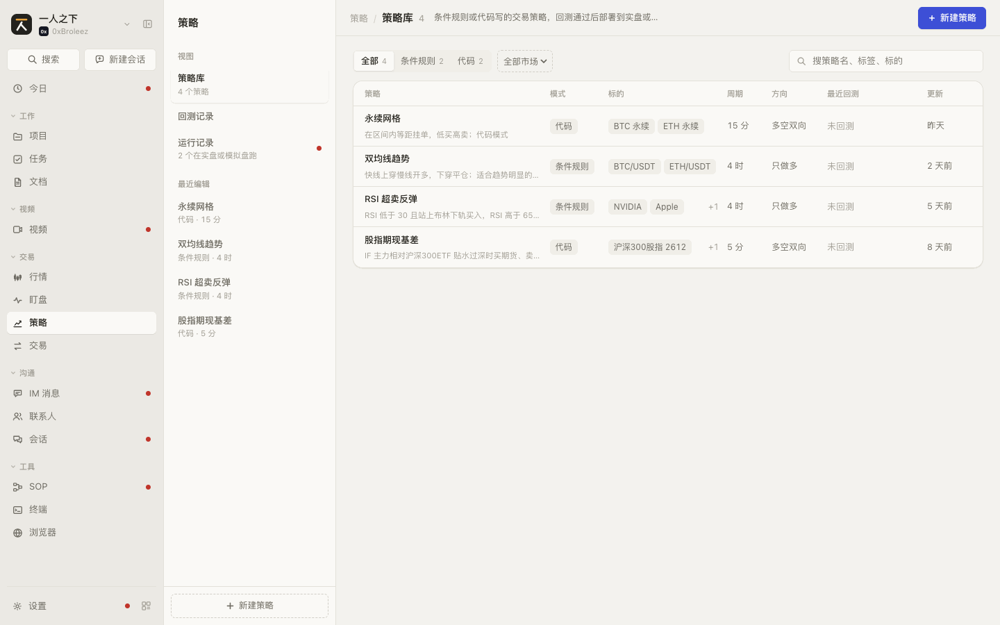 |  |
| 手机 375 |  |  |

### 页面清单

| 节 | 页面 | 入口 | 说明 |
|---|---|---|---|
| [SPEC-strategy-1](#spec-strategy-1-二级菜单) | 二级菜单 | 一级菜单「策略」 | 策略库、回测记录、运行记录、最近编辑的 5 个策略、新建策略 |
| [SPEC-strategy-2](#spec-strategy-2-策略库) | 策略库 | 二级菜单「策略库」（模块默认页） | 全部策略的表，按模式、市场筛，搜索 |
| [SPEC-strategy-3](#spec-strategy-3-编辑页基本信息条件规则风控和参数) | 编辑页：基本信息、条件规则、风控和参数 | 策略库点一行；二级菜单「最近编辑」；「新建策略」；回测报告「打开策略」；交易里点策略名 | 名称、说明、标签、标的、周期、方向；入场出场条件；止损止盈仓位；可调参数；删除 |
| [SPEC-strategy-4](#spec-strategy-4-编辑页代码模式) | 编辑页：代码模式 | 编辑页「策略逻辑」切到「代码」 | 代码编辑器、内置近似说明、从代码补全参数 |
| [SPEC-strategy-5](#spec-strategy-5-编辑页侧栏快速回测最近一次回测运行记录) | 编辑页侧栏：快速回测、最近一次回测、运行记录 | 编辑页右侧（手机在下方） | 回测区间和成本、参数覆盖、发起回测；最近一次回测的摘要；这个策略的部署记录 |
| [SPEC-strategy-6](#spec-strategy-6-回测记录和对比) | 回测记录 | 二级菜单「回测记录」 | 全部回测，按状态、策略筛，勾 2 到 4 条对比 |
| [SPEC-strategy-7](#spec-strategy-7-回测报告) | 回测报告 | 回测记录点一行；编辑页「查看报告」；扫参「回测」、「重新回测」后自动打开 | 统计、资金曲线、回撤、分段收益、参数扫描、逐笔成交、策略快照 |
| [SPEC-strategy-8](#spec-strategy-8-运行记录) | 运行记录 | 二级菜单「运行记录」；编辑页侧栏「全部 N 次」 | 每次部署算一次运行，停了也留着；看日志，跳到交易里管理 |

### 共用数据结构

字段名和类型照抄 `web-next/src/tradedata.ts`、`web-next/src/backtest.ts`。

`StrategyMode`：`rules` 条件规则 / `code` 代码。

`Indicator` 指标；`INDICATORS: Record<Indicator, { label: string; params: string[] }>`：

| key | 显示 | 参数 | 编辑器里的默认参数 | 规则文字里的短名 |
|---|---|---|---|---|
| `price` | 收盘价 | 无 | 无 | 收盘价 |
| `ma` | 均线 MA | 周期 | 20 | MA |
| `ema` | 指数均线 EMA | 周期 | 20 | EMA |
| `rsi` | RSI | 周期 | 14 | RSI |
| `macd` | MACD 柱 | 快、慢、信号 | 12、26、9 | MACD 柱 |
| `boll_up` | 布林上轨 | 周期、倍数 | 20、2 | 布林上轨 |
| `boll_low` | 布林下轨 | 周期、倍数 | 20、2 | 布林下轨 |
| `volume` | 成交量 | 无 | 无 | 成交量 |
| `atr` | ATR | 周期 | 14 | ATR |

`Operand` 规则的一边：`{ kind: 'ind'; ind: Indicator; params: number[] }` 指标，或 `{ kind: 'num'; value: number }` 数值。

`Compare` 比较：`cross_up` 上穿 / `cross_down` 下穿 / `gt` 大于 / `lt` 小于（显示名 `COMPARE`）。

`Rule` 一条条件

| 字段 | 类型 | 必填 | 说明 | 取值 / 示例 |
|---|---|---|---|---|
| `id` | `string` | 是 | 编号，新建用 `newId('rl')` | `r1` |
| `left` | `Operand` | 是 | 左边，编辑器里只能选指标 | EMA(12) |
| `op` | `Compare` | 是 | 比较 | `cross_up` |
| `right` | `Operand` | 是 | 右边，指标或数值 | EMA(48)、`30` |

`RuleGroup` 一组条件

| 字段 | 类型 | 必填 | 说明 | 取值 |
|---|---|---|---|---|
| `logic` | `'all' \| 'any'` | 是 | 全部满足 / 任一满足 | `all` |
| `rules` | `Rule[]` | 是 | 条件，可以为空 | |

`Strategy` 策略

| 字段 | 类型 | 必填 | 说明 | 取值 / 示例 |
|---|---|---|---|---|
| `id` | `string` | 是 | 编号；原型新建用 `st_<时间 36 进制>` | `st_macross` |
| `name` | `string` | 是 | 名称；空时到处显示「未命名策略」 | `双均线趋势` |
| `desc` | `string` | 是 | 说明，可以为空串 | |
| `mode` | `StrategyMode` | 是 | 模式；切换模式不清另一种模式的内容 | `rules` |
| `symbols` | `string[]` | 是 | 适用标的 symbol，回测时资金平均分配 | `['BINANCE:BTCUSDT', 'BINANCE:ETHUSDT']` |
| `interval` | `BarInterval` | 是 | K 线周期（`SPEC-markets-0`） | `4h` |
| `direction` | `'long' \| 'short' \| 'both'` | 是 | 只做多 / 只做空 / 多空双向 | `long` |
| `entry` | `RuleGroup` | 是 | 入场条件；代码模式下不用 | |
| `exit` | `RuleGroup` | 是 | 出场条件；代码模式下不用 | |
| `stop_loss` | `number` | 是 | 止损 %，0 表示不设 | `6` |
| `take_profit` | `number` | 是 | 止盈 %，0 表示不设 | `0` |
| `position_pct` | `number` | 是 | 每次开仓占账户资金 %，0 到 100 | `30` |
| `code` | `string` | 是 | 代码模式的源码（Python 风格），原型不执行 | |
| `params` | `Record<string, number>` | 是 | 可调参数：名字到值；回测时可以覆盖、扫参 | `{ fast: 12, slow: 48 }` |
| `tags` | `string[]` | 是 | 标签，不重复 | `['趋势', '数币']` |
| `updated_at` | `string` | 是 | 最后修改时间，每次改动都更新 | |
| `created_at` | `string` | 是 | 创建时间 | |

演示策略 `seedStrategies` 4 个：`st_macross` 双均线趋势（条件规则，BTC/USDT、ETH/USDT，4 时，只做多，EMA(12) 上穿 EMA(48) 开多、下穿平仓，止损 6%，仓位 30%）；`st_rsi` RSI 超卖反弹（条件规则，NVIDIA、Apple、腾讯控股，4 时，只做多，RSI(14) 小于 30 并且收盘价上穿布林下轨开多，RSI(14) 大于 65 平仓，止损 8%、止盈 15%，仓位 20%）；`st_grid` 永续网格（代码，BTC 永续、ETH 永续，15 分，多空双向，参数 lower、upper、grids、qty）；`st_ifbasis` 股指期现基差（代码，沪深300股指 2612、沪深300ETF，5 分，多空双向，参数 open_bp、close_bp）。

`BacktestConfig` 回测配置

| 字段 | 类型 | 必填 | 说明 | 取值 / 示例 |
|---|---|---|---|---|
| `strategy_id` | `string` | 是 | 策略 | `st_macross` |
| `symbols` | `string[]` | 是 | 标的，发起时取策略的 | |
| `interval` | `BarInterval` | 是 | 周期，发起时取策略的 | `4h` |
| `bars` | `number` | 是 | 回测区间：最近多少根 K 线，50 到 5000 | `1000` |
| `capital` | `number` | 是 | 初始资金，大于 0 | `100000` |
| `fee_bp` | `number` | 是 | 手续费，万分之几 | 数币默认 `5`，其余 `3` |
| `slippage_ticks` | `number` | 是 | 滑点，跳 | `1` |
| `params` | `Record<string, number>` | 是 | 参数，策略参数加本次覆盖；也可以带三个保留键 `stop_loss`、`take_profit`、`position_pct`（`RESERVED_PARAMS`）覆盖策略同名字段 | `{ fast: 12, slow: 48 }` |

`BacktestTrade` 一笔成交

| 字段 | 类型 | 必填 | 说明 | 取值 / 示例 |
|---|---|---|---|---|
| `t` | `number` | 是 | 时间（毫秒，K 线开盘时刻） | |
| `symbol` | `string` | 是 | 标的 | |
| `side` | `'buy' \| 'sell'` | 是 | 买 / 卖 | |
| `price` | `number` | 是 | 成交价（已加滑点），保留标的精度加两位 | |
| `qty` | `number` | 是 | 数量，正数 | |
| `pnl` | `number` | 否 | 平仓（减仓）这笔的已实现盈亏，含开平手续费；开仓的没有 | `-476.22` |
| `reason` | `string` | 是 | 原因 | `入场信号`、`出场信号`、`止损 6.0%`、`止盈 15.0%`、`反手平空`、`网格第 7 格`、`基差 -45bp 开仓买期货`、`回测结束平仓` |

`BacktestResult` 回测结果

| 字段 | 类型 | 必填 | 说明 |
|---|---|---|---|
| `equity` | `{ t: number; v: number; bench: number }[]` | 是 | 资金曲线，和 K 线对齐；`bench` 是等权买入持有的基准 |
| `trades` | `BacktestTrade[]` | 是 | 全部成交，按时间排 |
| `stats` | 见下 | 是 | 统计 |

`stats` 统计（都是 `number`，必填）

| 字段 | 说明 | 显示 |
|---|---|---|
| `total_return` | 总收益，小数 | 百分比，涨红跌绿 |
| `annual` | 年化：按自然时间，一年等于 365 天除以 K 线周期；上限 100（即 10000%），亏完是 -1 | 百分比 |
| `max_dd` | 最大回撤，小数，正数 | 百分比 |
| `sharpe` | 夏普：每根收益的均值除以标准差，乘以一年根数的平方根，无风险利率 0；标准差为 0 时是 0 | 两位小数 |
| `win_rate` | 胜率：平仓笔里盈利的占比 | 百分比 |
| `trades` | 平仓笔数 | 整数 |
| `profit_factor` | 盈亏比：总盈利除以总亏损；没有亏损有盈利时为 99，都没有为 0 | 两位小数，99 写「无亏损」 |
| `bench_return` | 基准（等权买入持有）收益 | 百分比 |

`runBacktest` 返回的结果还可以带 `note`（说明，几条用「；」连起来），存在 `Backtest.result` 里一起显示。

`BacktestStatus`：`queued` 排队中 / `running` 运行中 / `done` 已完成 / `failed` 失败（显示名和颜色 `BT_STATUS`，在 `strategy.tsx`）。

`Backtest` 一次回测

| 字段 | 类型 | 必填 | 说明 | 取值 / 示例 |
|---|---|---|---|---|
| `id` | `string` | 是 | 编号；原型用 `bt_<时间 36 进制>` | |
| `name` | `string` | 是 | 「<策略名> #N」，N 是这个策略的第几次回测 | `双均线趋势 #1` |
| `config` | `BacktestConfig` | 是 | 配置 | |
| `status` | `BacktestStatus` | 是 | 状态 | `running` |
| `progress` | `number` | 是 | 进度，0 到 1（大于 1 时按百分数理解） | `0.4` |
| `strategy_snapshot` | `Strategy` | 是 | 发起那一刻的策略副本；之后改策略不影响这次结果 | |
| `result` | `BacktestResult` | 否 | 完成后才有 | |
| `error` | `string` | 否 | 失败原因 | |
| `created_at` | `string` | 是 | 发起时间 | |
| `finished_at` | `string` | 否 | 完成或失败的时间 | |
| `started_at` | `string` | 否 | 正式版：开始跑的时间（排队中没有） | |
| `data_from`、`data_to` | `string` | 否 | 正式版：实际回测区间第一根、最后一根 K 线的开盘时间，完成才有；参数扫描按这一段数据重算 | |
| `sweep` | `{ param, points, at }` | 否 | 正式版：最近一次参数扫描的结果（`points` 每项 `{ value, total_return, max_dd, sharpe }`），存在这条回测上，刷新不丢；扫描不新增回测记录 | |

`StrategyView` 本模块的视图：`list` 策略库 / `st:<策略 id>` 编辑页 / `backtests` 回测记录 / `bt:<回测 id>` 回测报告 / `runs` 运行记录。

`StrategyRun`、`RunStatus`、`TradeAccount` 见 `SPEC-trading-0`。

### 回测引擎的约定

`web-next/src/backtest.ts` 是纯函数，行情一律用 `bars()` 取（`SPEC-markets-0`）。TRD-04a 移植到 Go 时逐条照这里做，三条示例策略在固定 K 线上的统计和扫参结果要和原型一致。

1. 信号在 K 线收盘时评估，按收盘价加减滑点（`slippage_ticks` 乘以一跳）成交；止损止盈在下一根 K 线里按最高最低价触发，成交价取止损（止盈）价和开盘价里对自己不利的那个。
2. 参数覆盖：规则里某个指标的第一个参数（周期）或某个数值，等于 `strategy.params` 里某个键的值时，回测用 `config.params` 的同名值替换（`applyParams`）。多个键值相同时取先出现的。例：双均线 `{ fast: 12, slow: 48 }`，EMA(12) 跟着 fast、EMA(48) 跟着 slow；RSI 策略的 30、65 跟着 low、high。
3. `config.params` 里的 `stop_loss`、`take_profit`、`position_pct` 覆盖策略同名字段。
4. 模拟行情没有交易时段，年化按自然时间算。
5. 指标（`series`）：MA 是简单均线；EMA 用前 N 个值的均值做种子；RSI、ATR 用 Wilder 平滑；MACD 柱是 DIF 减信号线；布林带是 N 期均线加减倍数乘标准差；不够周期的位置是 NaN，条件判断遇到 NaN 算不满足；上穿是「上一根左边小于等于右边，这一根大于」，下穿反过来。指标需要的预热根数（EMA、RSI、ATR 取周期的 3 倍，MACD 取（慢加信号）的 3 倍，MA、布林取周期，最多 600 根）在区间前面多取。
6. 条件规则的开平仓：只做多时没仓且入场条件满足开多、有多仓且出场条件满足平仓；只做空对称；多空双向时入场条件做多（有空单先平，记「反手平空」）、出场条件做空（有多单先平）。入场组没有条件时不会开仓（`note` 写「入场规则为空，不会开仓」）。
7. 开仓数量：当前权益乘以仓位比例，除以（价格乘乘数），按最小下单量向下取整；不够一手时按可分割数量模拟，并记「<名称> 资金不足一手，按可分割数量模拟」。
8. 账本按均价记持仓，减仓时结算盈亏，开仓手续费按比例并进平仓那笔的盈亏。最后一根 K 线强制平仓（「回测结束平仓」）。
9. 多个标的：资金平均分给每个标的各跑一份，按 K 线下标对齐相加（长度不一时按最短的对齐到末尾）；基准是每份资金买入持有。
10. 代码策略不执行源码，按名字和参数认成三种内置近似（`codeKindOf` 返回 `CodeKind`：`grid`、`basis`、`ma`，显示名 `CODE_KIND_LABEL`）：参数里有 `grids` 或名字、代码里有「网格 / grid」是 `grid` 网格；有 `open_bp` 或「基差 / 期现 / basis」是 `basis` 期现基差；都不是是 `ma`，显示「未识别，按双均线」。`note` 里写「代码策略用内置近似模拟（<近似>），不执行源码」。
    - 网格：区间 `[lower, upper]` 等分 `grids` 格，目标仓位等于（格数除以 2 减当前格）乘每格数量；每格数量取 `qty`，但不让满仓超过分配资金乘仓位比例；首根价格不在区间内时按首根价格上下 8% 重设区间并记说明；只做多、只做空时截掉反方向；权益跌破分配资金乘以（1 减止损）时平仓并停止网格。
    - 期现基差：模拟行情里期货和现货同源，真基差几乎不动，用「期货折算价相对现货 60 根均值的偏离」（bp）代替基差；低于负 `open_bp` 时按仓位比例的一半买期货、一半卖现货，回到负 `close_bp` 以上平仓；找不到期货和对应现货时退回双均线并记说明。
    - 双均线：参数取 `fast`、`slow`，没有就 12、48，EMA 上穿开多、下穿平仓；退回时只保留三个保留键的覆盖。
11. 区间里一笔成交都没有时，`note` 写「区间内没有触发入场条件，可以放宽阈值、换周期或拉长区间」；没有可回测的标的、区间少于 2 根或资金不大于 0 时返回空结果，`note` 写「没有可回测的标的或区间」。
12. 参数扫描 `sweep(config, strategy, param, values)`：同一份配置只改一个参数各跑一次，K 线只取一次；返回每个值的 `{ value, total_return, max_dd, sharpe }`。能扫的参数 `sweepableParams`：策略参数加三个保留键（显示「止损 %」「止盈 %」「仓位 %」）。

### 原型里模拟、正式版要真做的

| 部分 | 原型 | 正式版 |
|---|---|---|
| 回测执行 | `App.tsx` 的 `startBacktest`：先插一条 `running`，每 300ms 把进度推到 0.2、0.4、0.6、0.8，1.5 秒时在前端同步调 `runBacktest` 算完；同时发起几个就同时跑，从不出现 `queued` | 后端引擎（TRD-04a），回测任务落库、排队执行（TRD-04b，已做）：最多同时跑 2 个，其余显示「排队中」；进度按取到的 K 线推，前端在有排队、运行中的回测时每秒轮询 |
| 行情 | 模拟行情 | 真实历史 K 线（TRD-04b，已做）：走行情缓存（`trade_klines`），缺的先找交易所补；现在只有 Binance、OKX 的数币有历史数据，A 股、港股、美股的标的回测直接失败并写明「行情源还没接」 |
| 持久化 | 回测记录存在 `App.tsx` 的 `backtests`，初始为空，刷新就没了；策略存在 `strategies`，刷新回到演示数据 | 落库，刷新不丢；后端重启后已完成的结果还在，运行中的标为失败（「回测被中断：……可以重新回测」）、可以重跑（TRD-04b，已做） |
| 失败 | `runBacktest` 抛错时标 `failed`，并记一条运行异常（级别 error，模块「交易」，标题「「<策略名>」回测失败」） | 同样记运行异常（按策略和原因分类合并）；失败原因以「数据缺失：」「参数不合法：」「引擎错误：」开头，数据缺失写明缺哪一段（如「BINANCE:BTCUSDT 1d 要最近 5000 根……只取到 3367 根；缺 2013-02-26 到 2017-08-16 这一段」）；后端重启、停用打断的写「回测被中断：」，不记运行异常（TRD-04b，已做） |
| 代码策略 | 不执行源码，按内置近似（约定 10） | 待定：沙箱里执行策略代码，或只支持条件规则加几种内置模板；定之前正式版也按内置近似，并在界面上写明 |
| 参数扫描 | 报告页里同步算，结果只在这一页 | 后端按同一段数据跑，结果存在这条回测上（`sweep`），刷新不丢；不新增回测记录，除非点「回测」（TRD-04b，已做） |

### 联动总表

| 方向 | 对方模块 | 触发 | 结果 | 见 |
|---|---|---|---|---|
| 出去 | 交易 | 编辑页、回测报告「部署」，侧栏「部署」 | 切到交易「策略运行」，打开新建策略运行抽屉，策略选好 | `SPEC-trading-7` |
| 出去 | 交易 | 运行记录「到交易里管理」 | 切到交易「策略运行」 | `SPEC-trading-6` |
| 进来 | 交易 | 总览、策略运行卡片上点策略名 | 打开这个策略的编辑页 | `SPEC-trading-2.6`、`SPEC-trading-6.2` |
| 改动 | 交易 | 删除策略 | 这个策略没停的部署（运行中、暂停、异常挂起）全部停止，停止原因「策略已删除」，日志加一条；这些部署的挂单撤销；回测记录保留 | `SPEC-strategy-3.20` |
| 读 | 行情 | 回测取 K 线、标的 | `bars()`、`instOf()` | `SPEC-markets-0` |
| 改动 | 设置 / 运行异常 | 回测失败 | 记一条 error 级运行异常 | `SPEC-settings-18` |
| 今日 | 今日 | 回测失败 | 原型里经运行异常出现在今日「需要你处理」（error 级运行异常都会出）；其余不上今日。正式版的口径见 `SPEC-trading-0` 联动总表「今日」 | `SPEC-today`、`SPEC-trading-0` |

### 原型和规格对不上的地方

写规格时发现的，没改原型，等另开原型修错任务：

| 编号 | 问题 | 规格的口径 |
|---|---|---|
| SPEC-strategy-0.1 | 编辑页「标签」的提示写「第一个标签决定左侧菜单里的分组」，但二级菜单不按标签分组，只有「视图」和「最近编辑」两组 | 删掉这句提示，标签只用于策略库搜索；二级菜单维持「最近编辑」。2026-11-05 已改：提示换成「用于在策略库里搜」 |
| SPEC-strategy-0.2 | 看盘页 K 线上的指标（`markets.tsx`）和回测引擎（`backtest.ts`）是两份实现，算法不一样：看盘的 EMA 用第一个值做种子、回测用前 N 个均值；RSI 的平滑起点也不同。同一个标的同一根 K 线，看盘显示的 RSI、EMA 和回测里判断用的会有出入 | 以回测引擎为准（约定 5），看盘改用同一份指标函数 |
| SPEC-strategy-0.3 | `BacktestStatus` 有 `queued`，筛选、状态标签、报告页都给「排队中」留了样子，但原型从不排队 | 保留排队中的界面；正式版后端排队时用（见上表） |

## SPEC-strategy-1 二级菜单

策略模块的二级菜单。桌面在左侧竖排；手机变成页面顶部横向滚动的一排标签。

### 截图

二级菜单出现在本模块每张截图里：

| | 亮 | 暗 |
|---|---|---|
| 桌面 1440 |  |  |
| 手机 375 |  |  |

### 交互

| 编号 | 元素 | 操作 | 结果 |
|---|---|---|---|
| SPEC-strategy-1.1 | 「视图」组：策略库 | 看、点击 | 说明「N 个策略」；点击到策略库（`SPEC-strategy-2`） |
| SPEC-strategy-1.2 | 「视图」组：回测记录 | 看、点击 | 有运行中的回测时显示红点和说明「N 个运行中」；点击到回测记录（`SPEC-strategy-6`）；看回测报告时这一项高亮 |
| SPEC-strategy-1.3 | 「视图」组：运行记录 | 看、点击 | 有异常的运行时显示红点（悬停「N 个运行异常」）；有运行中的时说明「N 个在实盘或模拟盘跑」；点击到运行记录（`SPEC-strategy-8`）。正式前端：部署（TRD-05）上线之前不放这一项 |
| SPEC-strategy-1.4 | 「最近编辑」组 | 看、点击 | 按 `updated_at` 最近的 5 个策略，名称和「模式 · 周期」；点击打开编辑页。打开的策略不在这 5 个里时，高亮落在「策略库」 |
| SPEC-strategy-1.5 | 菜单底部「新建策略」 | 点击 | 新建一个策略并打开编辑页（默认值见 `SPEC-strategy-3.21`） |

### 空状态和异常状态

| 编号 | 场景 | 显示 | 可做的操作 |
|---|---|---|---|
| SPEC-strategy-1.6 | 一个策略都没有 | 「最近编辑」组不出现，策略库说明「0 个策略」 | 「新建策略」 |
| SPEC-strategy-1.7 | 计数加载失败 | 原型未做。正式产品：不显示红点和计数，不当成 0 | 无 |

### 数据

`Strategy`、`Backtest`（数 `running`）、`StrategyRun`（数 `running`、`error`），见 `SPEC-strategy-0`、`SPEC-trading-0`。

### 联动

| 方向 | 对方模块 | 触发 | 结果 | 见 |
|---|---|---|---|---|
| 读 | 交易 | 运行记录的红点和说明 | 读部署的状态 | `SPEC-trading-6` |

## SPEC-strategy-2 策略库

### 截图

| | 亮 | 暗 |
|---|---|---|
| 桌面 1440 |  | 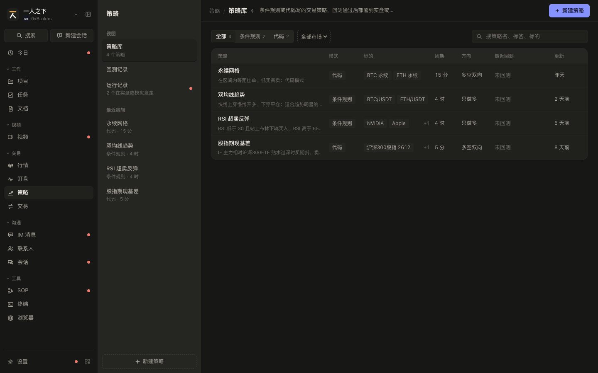 |
| 手机 375 |  |  |

### 交互

| 编号 | 元素 | 操作 | 结果 |
|---|---|---|---|
| SPEC-strategy-2.1 | 标题栏 | 看、点击 | 「策略库」和策略数，说明「条件规则或代码写的交易策略，回测通过后部署到实盘或模拟盘」，右侧「新建策略」（同 `SPEC-strategy-1.5`） |
| SPEC-strategy-2.2 | 模式「全部 / 条件规则 / 代码」 | 点击 | 各带个数，按模式筛 |
| SPEC-strategy-2.3 | 「全部市场」下拉 | 选择 | 数币、A 股、港股、美股；策略的标的里有一个属于这个市场就留下 |
| SPEC-strategy-2.4 | 搜索「搜策略名、标签、标的」 | 输入 | 按名称、说明、标签、标的名称匹配 |
| SPEC-strategy-2.5 | 表 | 看 | 按 `updated_at` 新的在前；列：策略（名称，下一行说明，没有写「没有说明」）、模式标签（代码模式另一种颜色）、标的（一行放得下几个放几个，其余「+N」，悬停看全部；没有写「未选标的」）、周期、方向、最近回测、更新（相对时间） |
| SPEC-strategy-2.6 | 「最近回测」列 | 看 | 这个策略最新一次回测在运行中时显示进度条、排队中显示「排队中」；否则取最近一次已完成的：总收益（涨红跌绿），下一行「回撤 N% · 夏普 N」；都没有写「未回测」 |
| SPEC-strategy-2.7 | 一行 | 点击 | 打开编辑页（`SPEC-strategy-3`） |

### 空状态和异常状态

| 编号 | 场景 | 显示 | 可做的操作 |
|---|---|---|---|
| SPEC-strategy-2.8 | 一个策略都没有 | 「还没有策略」「用条件规则拼出入场出场条件，或者直接写代码」和「新建策略」 | 新建策略 |
| SPEC-strategy-2.9 | 筛选或搜索后没有 | 「没有匹配的策略」和同一句说明，不出「新建策略」 | 换筛选 |
| SPEC-strategy-2.10 | 加载失败 | 表格区显示原因和「重试」（正式前端已做；原型不会加载失败） | 重试 |

### 数据

`Strategy`、`Backtest`（见 `SPEC-strategy-0`）。

### 联动

| 方向 | 对方模块 | 触发 | 结果 | 见 |
|---|---|---|---|---|
| 读 | 行情 | 标的名称、市场 | `instOf()` | `SPEC-markets-0` |

## SPEC-strategy-3 编辑页：基本信息、条件规则、风控和参数

左栏是策略本身，右栏是快速回测和记录（`SPEC-strategy-5`），手机上右栏排在下面。改动自动保存。

### 截图

双均线趋势（一组一条条件）：

| | 亮 | 暗 |
|---|---|---|
| 桌面 1440 | 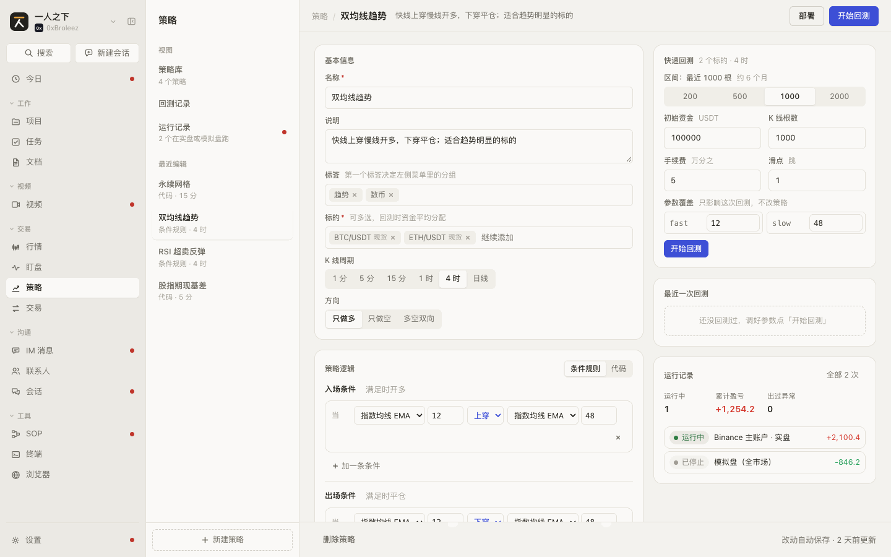 | 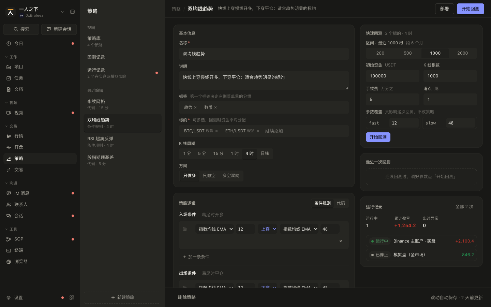 |
| 手机 375 |  | 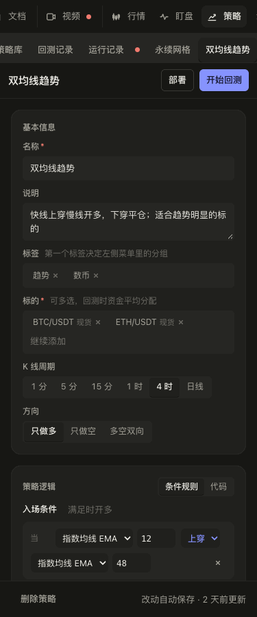 |

RSI 超卖反弹（入场两条条件、全部满足）：

| | 亮 | 暗 |
|---|---|---|
| 桌面 1440 | 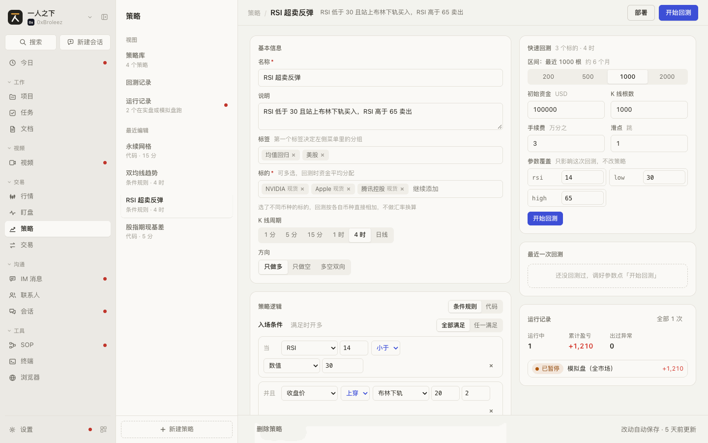 | 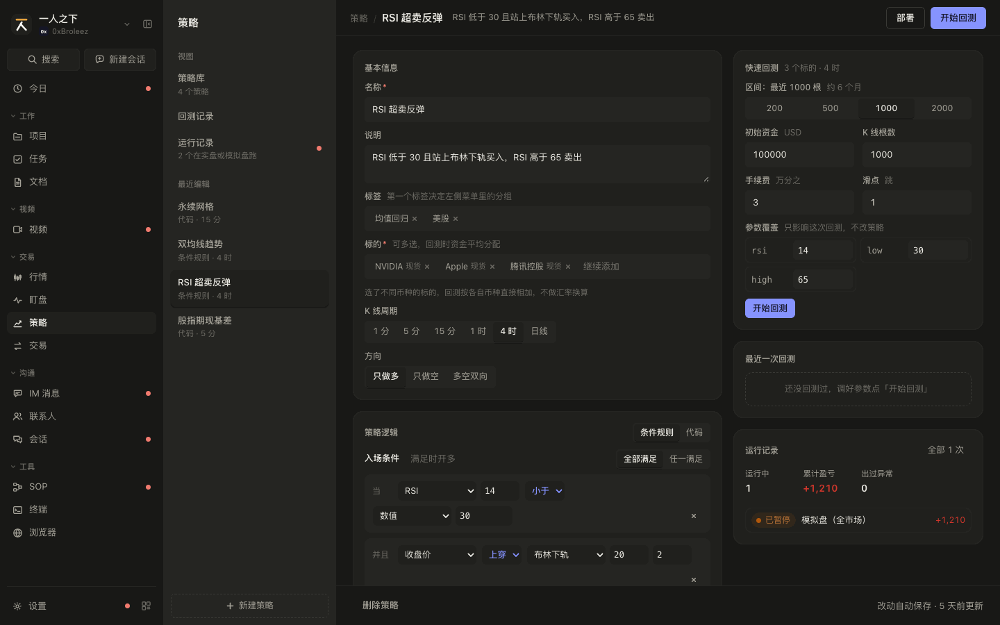 |
| 手机 375 |  | 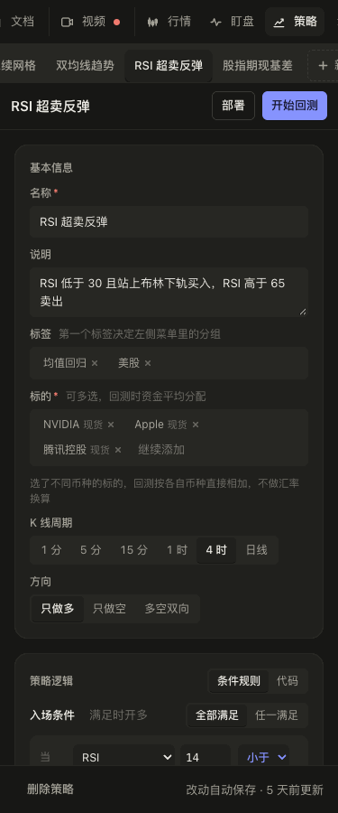 |

搜标的加入：

| | 亮 | 暗 |
|---|---|---|
| 桌面 1440 | 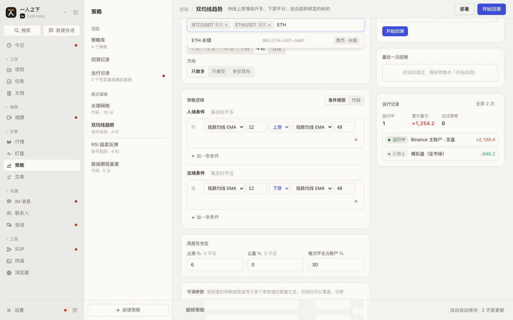 | 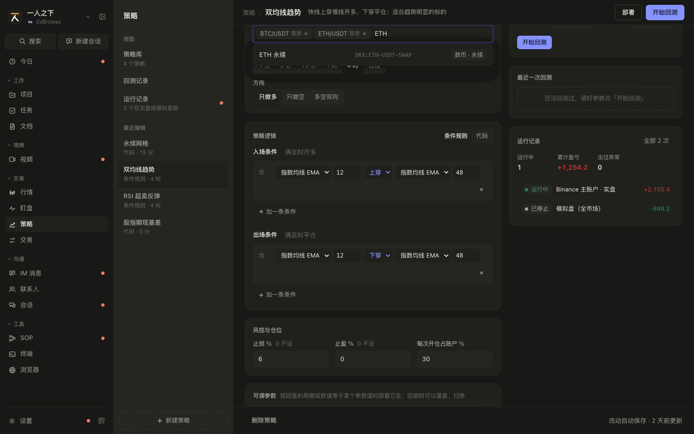 |
| 手机 375 |  | 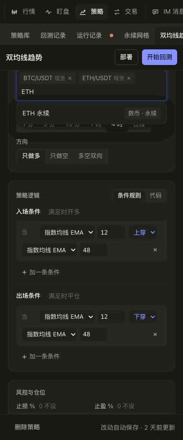 |

点「删除策略」后的确认（列出连带影响）：

| | 亮 | 暗 |
|---|---|---|
| 桌面 1440 | 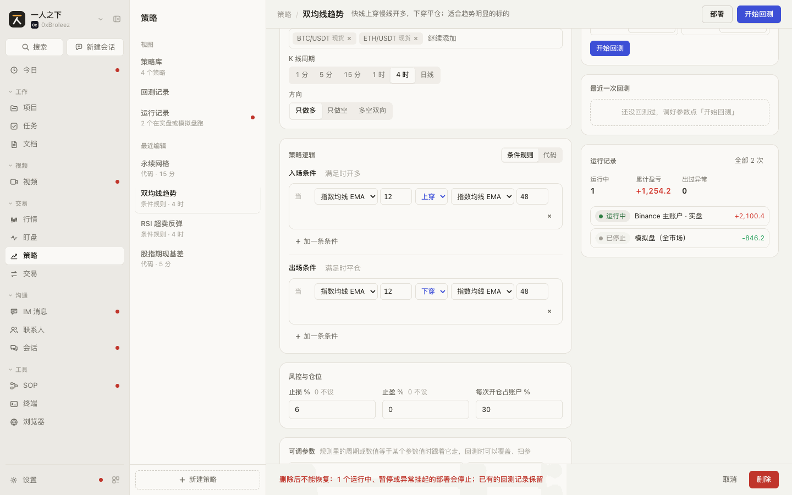 | 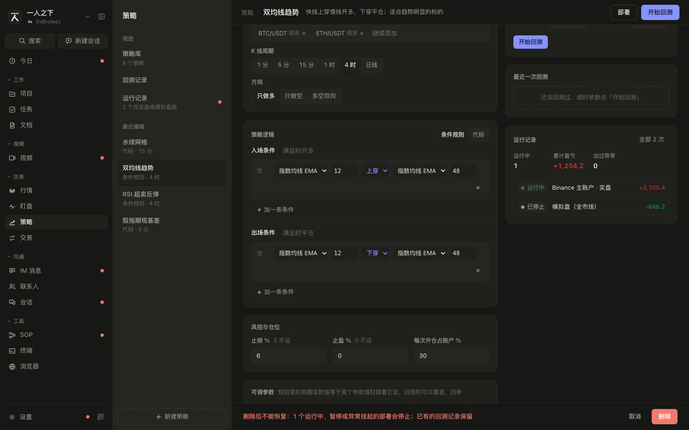 |
| 手机 375 | 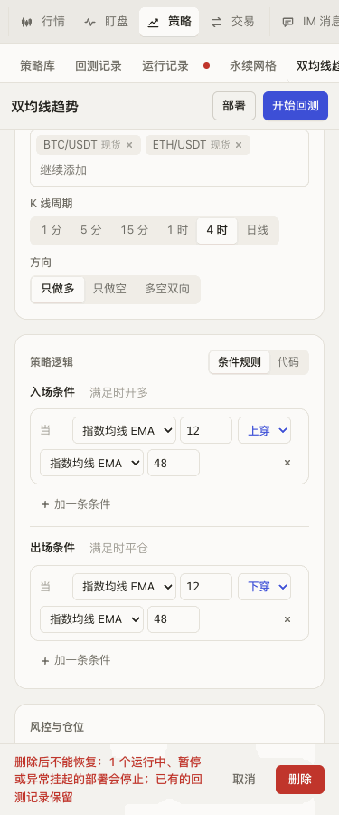 | 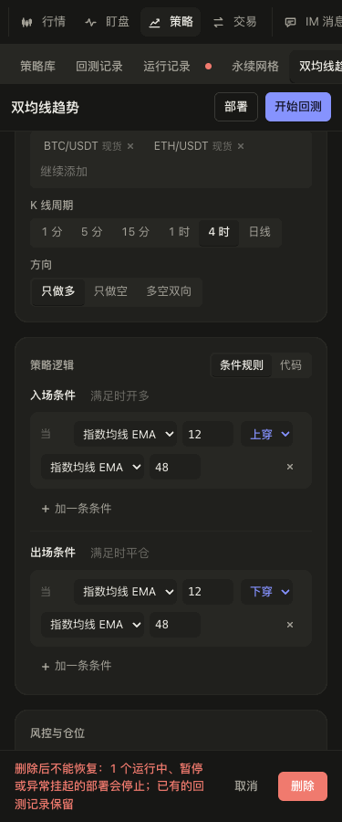 |

新建的空策略（没有标的、没有入场条件，「开始回测」不可点）：

| | 亮 | 暗 |
|---|---|---|
| 桌面 1440 | 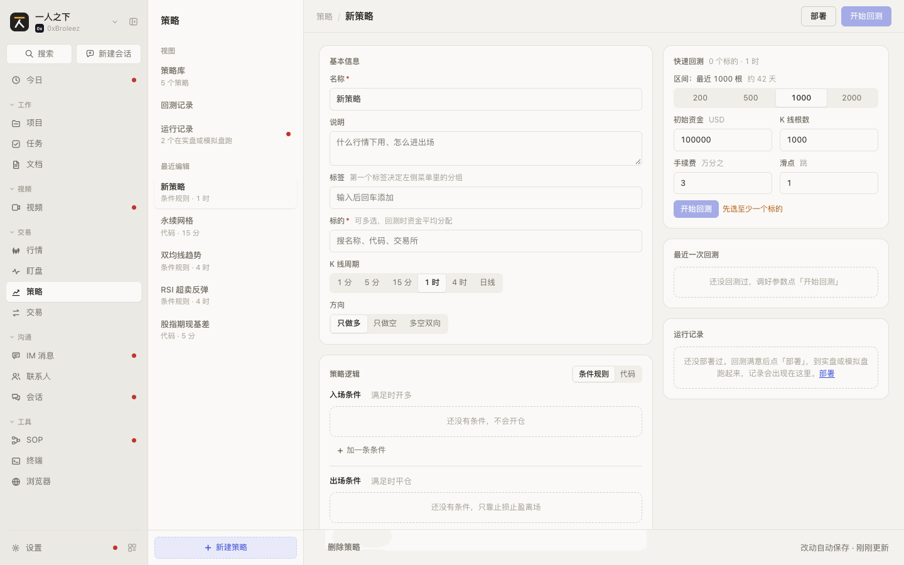 | 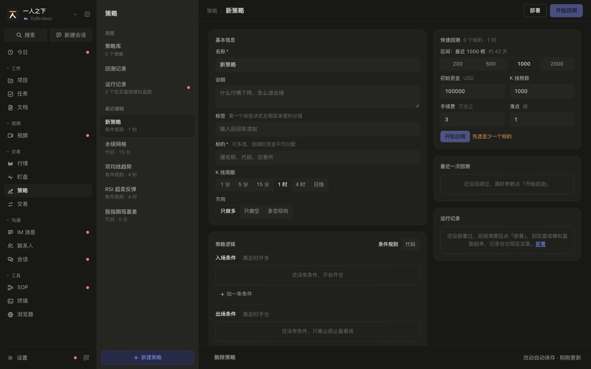 |
| 手机 375 |  | 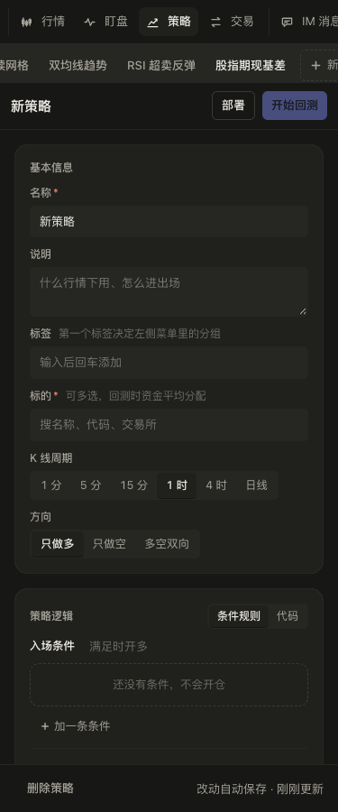 |

### 交互

| 编号 | 元素 | 操作 | 结果 |
|---|---|---|---|
| SPEC-strategy-3.1 | 标题栏 | 看 | 标题是策略名（空时「未命名策略」），上级「策略」，说明是策略说明 |
| SPEC-strategy-3.2 | 标题栏「部署」 | 点击 | 切到交易「策略运行」，打开新建策略运行抽屉，策略选好（`SPEC-trading-7`）。没有前置条件，缺标的等问题在抽屉里拦。**【实盘，要过 TRD-08 评审，默认只开模拟盘】** 部署（TRD-05）上线之前，正式前端里这个按钮不可点，悬停「部署到模拟盘还在开发（TRD-05），现在只能回测」；回测报告、侧栏的「部署」同样处理 |
| SPEC-strategy-3.3 | 标题栏「开始回测」 | 点击 | 用侧栏的快速回测配置发起一次回测（同 `SPEC-strategy-5.7`）；有拦截原因时不可点，悬停看原因 |
| SPEC-strategy-3.4 | 名称（必填）、说明 | 输入 | 直接保存；名称占位「比如：双均线趋势」，说明占位「什么行情下用、怎么进出场」 |
| SPEC-strategy-3.5 | 标签 | 输入 | 回车或失焦添加（去空格，重复的不加），标签上的叉移除，输入框为空时退格删最后一个 |
| SPEC-strategy-3.6 | 标的（必填） | 输入、选择 | 提示「可多选，回测时资金平均分配」；聚焦就展开候选，按代码、名称、交易所、市场名、品种短名匹配，最多 8 个，已选的不再列；候选显示名称、symbol、「市场 · 品种」；点击或回车加第一个；输入框为空时退格删最后一个；Esc 收起；已选的标签显示名称和品种短名，叉移除。正式版：候选来自后端的标的表（行情源每天同步）按名称、代码搜；输入为空时不列候选，提示「输入名称或代码搜索；现在只有 Binance、OKX 的数币能回测」；已选的标签按代码推出名称和品种短名 |
| SPEC-strategy-3.7 | 标的币种不同 | 看 | 选了不同币种的标的时提示「选了不同币种的标的，回测按各自币种直接相加，不做汇率换算」 |
| SPEC-strategy-3.8 | K 线周期 | 点击 | 1 分到日线 |
| SPEC-strategy-3.9 | 方向 | 点击 | 只做多、只做空、多空双向；入场出场条件的提示跟着变（只做多：入场「满足时开多」、出场「满足时平仓」；只做空：入场「满足时开空」；多空双向：入场「满足时做多，有空单先平」、出场「满足时做空，有多单先平」） |
| SPEC-strategy-3.10 | 「策略逻辑」的「条件规则 / 代码」 | 点击 | 切换模式；代码模式见 `SPEC-strategy-4`；切回来规则还在 |
| SPEC-strategy-3.11 | 条件组 | 看 | 「入场条件」「出场条件」两组；两条以上时右侧出现「全部满足 / 任一满足」 |
| SPEC-strategy-3.12 | 一条条件 | 编辑 | 一行：连接词（第一条「当」，之后「并且」或「或者」）、左边（指标下拉加参数输入）、比较（上穿、下穿、大于、小于）、右边（「数值」或指标）、删除叉。换指标时参数换成这个指标的默认值（`SPEC-strategy-0` `Indicator` 表）；参数输入悬停看参数名 |
| SPEC-strategy-3.13 | 「加一条条件」 | 点击 | 末尾加一条「收盘价 上穿 MA(20)」 |
| SPEC-strategy-3.14 | 数字输入（参数、数值、止损等） | 输入 | 允许中途输入空串和负号，合法数字才保存；失焦时不合法就恢复成原值 |
| SPEC-strategy-3.15 | 风控与仓位 | 输入 | 止损 %、止盈 %（提示「0 不设」，不能为负）；每次开仓占账户 %（0 到 100） |
| SPEC-strategy-3.16 | 可调参数 | 看 | 每行参数名、值、删除叉；提示：条件规则模式「规则里的周期或数值等于某个参数值时跟着它走，回测时可以覆盖、扫参」，代码模式「回测时可以覆盖、扫参」 |
| SPEC-strategy-3.17 | 参数名 | 失焦、回车 | 改名；新名字为空、没变或和别的参数重名时恢复原名 |
| SPEC-strategy-3.18 | 参数值 | 输入 | 改值；条件规则模式下，规则里等于旧值的周期（指标的第一个参数）和数值一起改成新值，保证参数和规则对得上；有别的参数和它旧值相同时不连带改（分不清是谁的） |
| SPEC-strategy-3.19 | 「添加参数」 | 点击 | 加一个 `p<N>`（N 从参数个数加 1 起，撞名往后加），值 0 |
| SPEC-strategy-3.20 | 底部「删除策略」 | 点击 | 底部变成确认条：「删除后不能恢复：<影响>」，影响逐条列出「N 个运行中、暂停或异常挂起的部署会停止」「N 笔挂单会撤销」「已有的回测记录保留」；「取消」「删除」。确认后：这些部署停止（停止原因「策略已删除」，日志加「策略「<名称>」已删除，运行停止，未成交的挂单已撤销」），挂单撤销，策略删除，回到策略库。正式前端：部署（TRD-05）上线之前没有部署和挂单，确认条只写「删除后不能恢复，已有的回测记录保留」 |
| SPEC-strategy-3.21 | 新建 | 进来 | 「新策略」，条件规则，没有标的，1 时，只做多，入场出场都空，止损止盈 0，仓位 20%，没有参数和标签；放到最前面并打开 |
| SPEC-strategy-3.22 | 底部右侧 | 看 | 「改动自动保存 · <相对时间>更新」；每次改动都更新 `updated_at` |

### 空状态和异常状态

| 编号 | 场景 | 显示 | 可做的操作 |
|---|---|---|---|
| SPEC-strategy-3.23 | 没选标的 | 「开始回测」不可点，侧栏写「先选至少一个标的」 | 选标的 |
| SPEC-strategy-3.24 | 条件规则模式下入场条件是空的 | 「开始回测」不可点，侧栏写「入场规则还是空的」；入场组写「还没有条件，不会开仓」 | 加条件 |
| SPEC-strategy-3.25 | 出场条件是空的 | 「还没有条件，只靠止损止盈离场」；可以回测 | 加条件 |
| SPEC-strategy-3.26 | 名称为空 | 名称必填：失焦时为空就在输入框下红字「名称不能为空，其余改动照常保存」；名称留空期间不保存名称，其余改动照常保存；标题、菜单仍显示「未命名策略」 | 填名称 |
| SPEC-strategy-3.27 | 搜标的没有匹配 | 候选里「没有匹配的标的」 | 改关键词 |
| SPEC-strategy-3.28 | 没有参数 | 「没有参数」 | 「添加参数」 |
| SPEC-strategy-3.29 | 打开的策略已经删除 | 「这个策略已经删除」 | 回策略库 |
| SPEC-strategy-3.30 | 自动保存失败 | 底部右侧换成红字「保存失败，<原因>」和「重试」，改动留在界面上（正式前端已做；原型不会保存失败）。正式版的自动保存：停手 500ms 后把整份策略存一次，同一时间只有一个保存在路上 | 重试 |

### 数据

`Strategy`、`Rule`、`RuleGroup`、`Operand`、`INDICATORS`、`COMPARE`（见 `SPEC-strategy-0`）。删除影响由 `App.tsx` 的 `strategyPlan` 算，数的是这个策略的 `StrategyRun` 里没停的，和这些运行的挂单（`pending`、`open`、`partial`）。

### 联动

| 方向 | 对方模块 | 触发 | 结果 | 见 |
|---|---|---|---|---|
| 出去 | 交易 | 「部署」 | 新建策略运行抽屉 | `SPEC-trading-7` |
| 改动 | 交易 | 删除策略 | 停部署、撤挂单 | `SPEC-strategy-0` 联动总表 |
| 进来 | 交易 | 点策略名 | 打开编辑页 | `SPEC-trading-2.6`、`SPEC-trading-6.2` |

## SPEC-strategy-4 编辑页：代码模式

编辑页「策略逻辑」切到「代码」后，入场出场条件换成代码编辑器，其余各块不变。

### 截图

永续网格（识别为网格）：

| | 亮 | 暗 |
|---|---|---|
| 桌面 1440 | 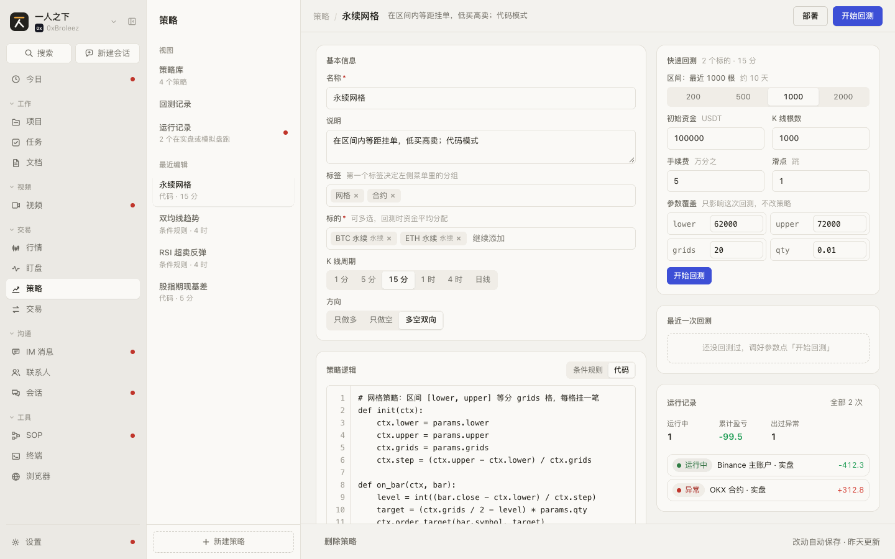 | 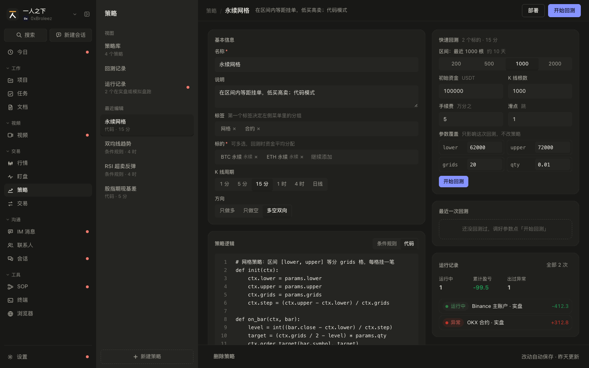 |
| 手机 375 | 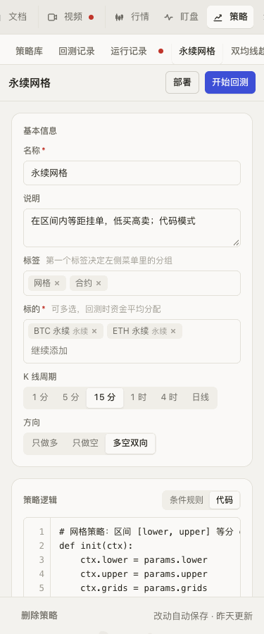 | 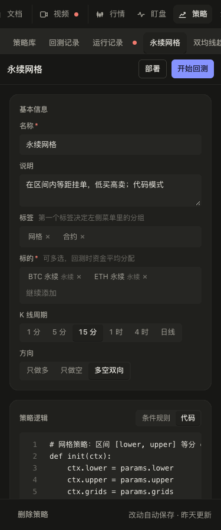 |

股指期现基差（识别为期现基差）：

| | 亮 | 暗 |
|---|---|---|
| 桌面 1440 | 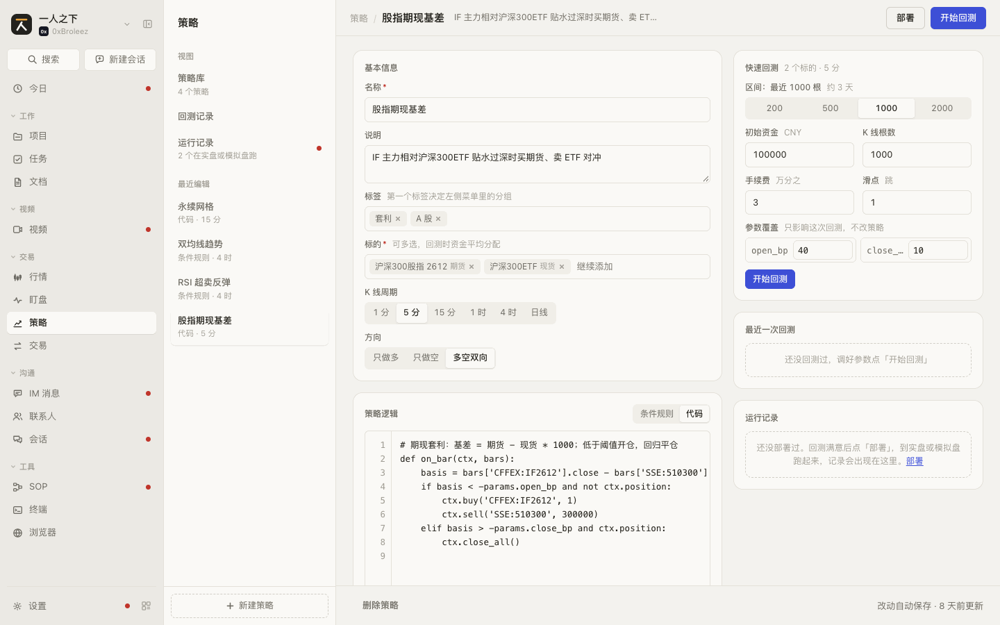 | 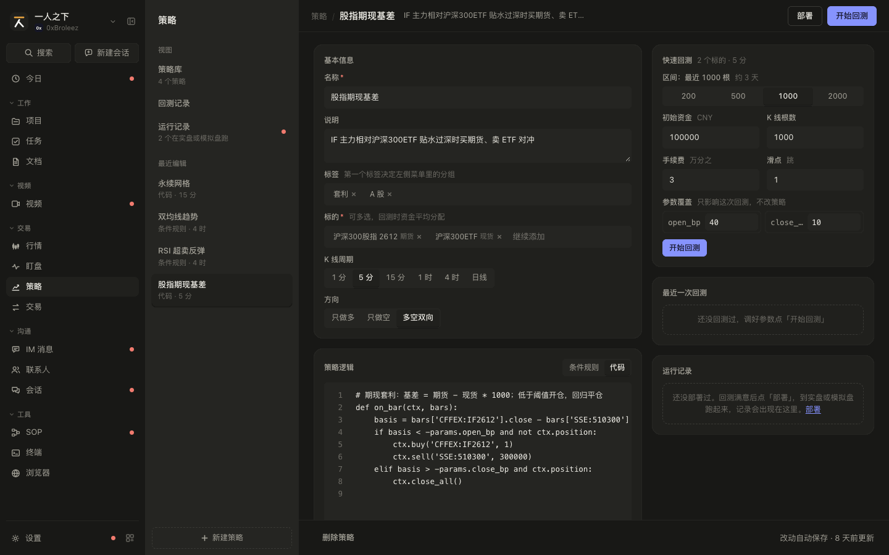 |
| 手机 375 | 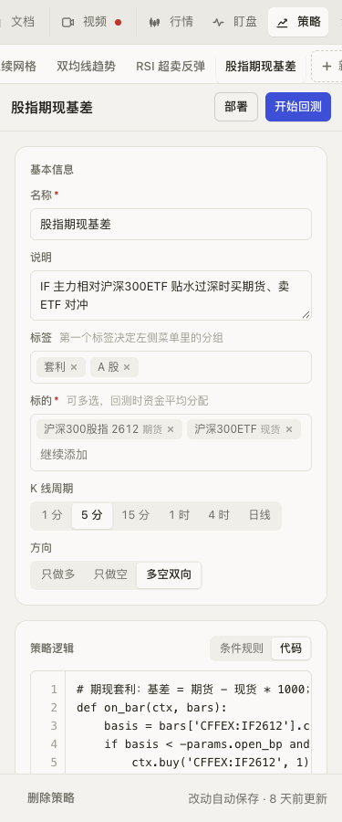 | 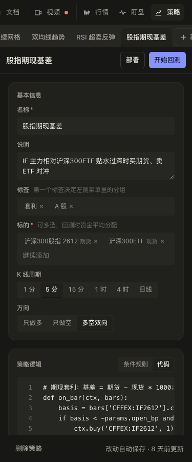 |

### 交互

| 编号 | 元素 | 操作 | 结果 |
|---|---|---|---|
| SPEC-strategy-4.1 | 代码编辑器 | 输入 | 左侧行号随滚动对齐；不自动换行；Tab 插入 4 个空格；占位 `# def on_bar(ctx, bar): ...`；改动自动保存 |
| SPEC-strategy-4.2 | 编辑器下方说明 | 看 | 「不执行源码，回测按「<近似>」内置近似模拟。代码里用 params.名字 引用右侧参数」；近似按 `codeKindOf`（`SPEC-strategy-0` 约定 10）实时变 |
| SPEC-strategy-4.3 | 「从代码补全参数 N 个」 | 点击 | 只在代码里有 `params.<名字>` 而参数表里没有时出现；把缺的参数加进参数表，值为 0 |

### 空状态和异常状态

| 编号 | 场景 | 显示 | 可做的操作 |
|---|---|---|---|
| SPEC-strategy-4.4 | 代码是空的 | 占位文字；仍可回测（按双均线近似） | 写代码 |
| SPEC-strategy-4.5 | 认不出是哪种近似 | 说明写「未识别，按双均线」 | 改名字或参数 |
| SPEC-strategy-4.6 | 代码有语法错误 | 原型不检查。正式产品：执行代码之前（如果做，见 `SPEC-strategy-0`「代码策略」）在编辑器下方显示行号和错误，不能回测 | 改代码 |

### 数据

`Strategy.code`、`Strategy.params`；`codeKindOf`、`CODE_KIND_LABEL`（见 `SPEC-strategy-0`）。

### 联动

无。

## SPEC-strategy-5 编辑页侧栏：快速回测、最近一次回测、运行记录

### 截图

参数覆盖（改了 rsi，高亮并出现「恢复默认」）：

| | 亮 | 暗 |
|---|---|---|
| 桌面 1440 | 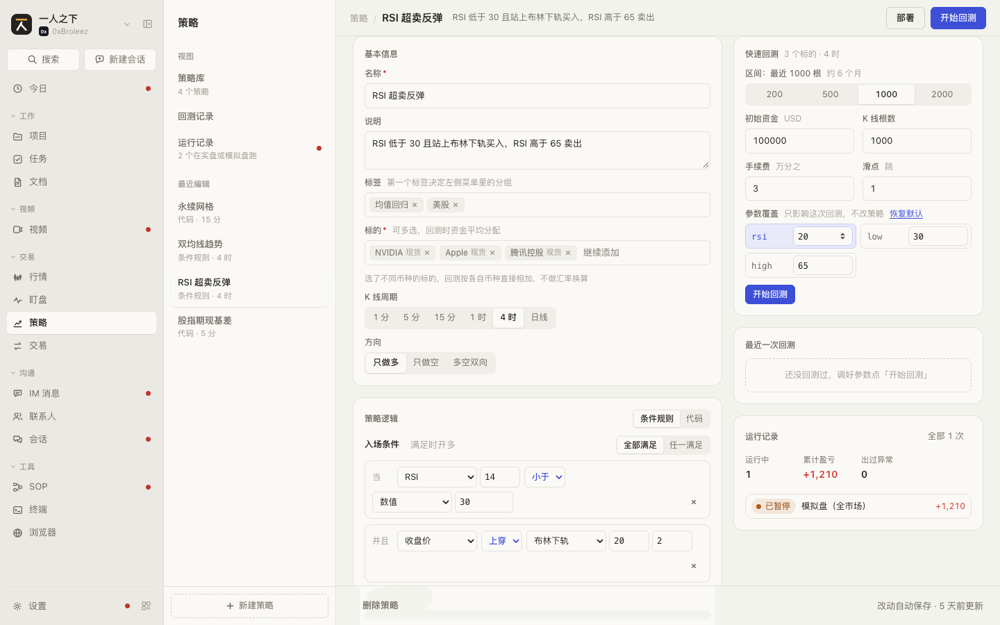 | 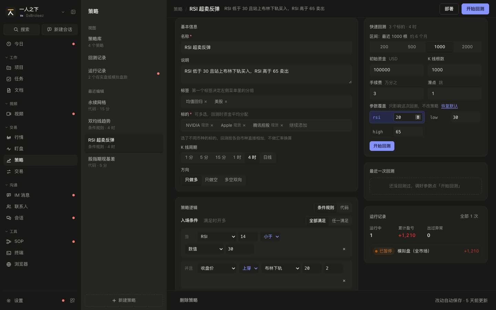 |
| 手机 375 | 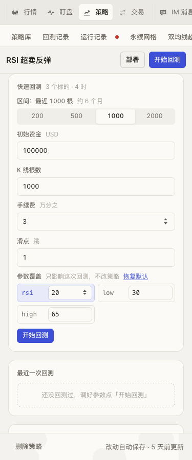 | 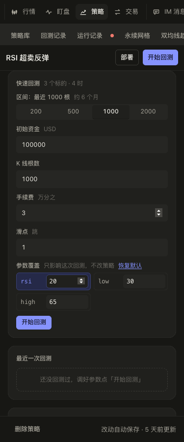 |

回测完成后，「最近一次回测」显示摘要：

| | 亮 | 暗 |
|---|---|---|
| 桌面 1440 | 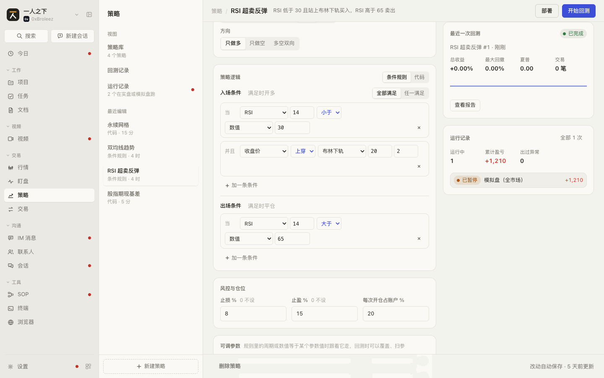 | 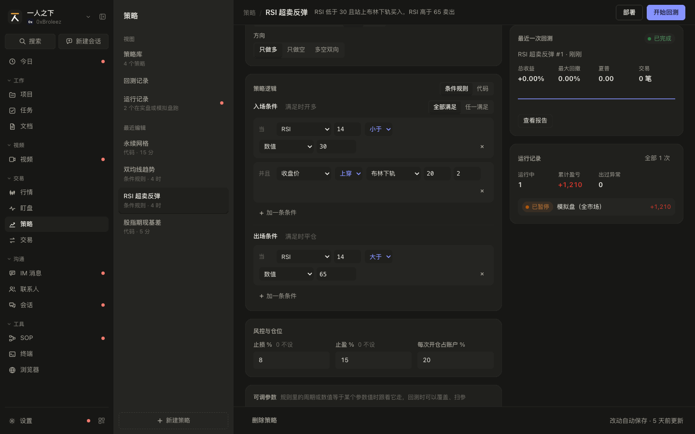 |
| 手机 375 | 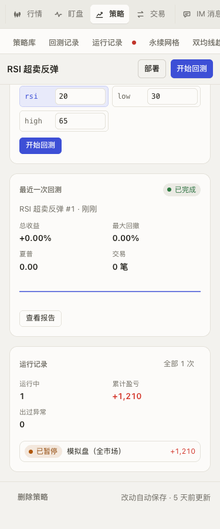 | 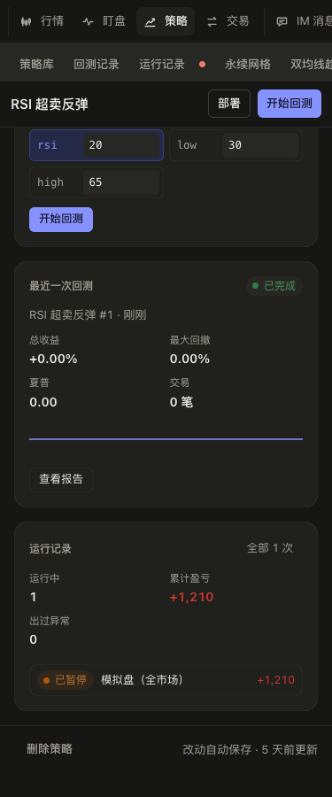 |

### 交互

| 编号 | 元素 | 操作 | 结果 |
|---|---|---|---|
| SPEC-strategy-5.1 | 「快速回测」标题 | 看 | 提示「N 个标的 · <周期>」 |
| SPEC-strategy-5.2 | 区间「200 / 500 / 1000 / 2000」 | 点击 | 回测最近多少根，默认 1000；标签上写换算的时长（「约 N 个月 / 天 / 小时」） |
| SPEC-strategy-5.3 | 初始资金、K 线根数 | 输入 | 初始资金（币种是第一个标的的市场币种，默认 100000，至少 1）；K 线根数（50 到 5000，取整），和上面的区间按钮是同一个值 |
| SPEC-strategy-5.4 | 手续费（万分之）、滑点（跳） | 输入 | 默认手续费数币 5、其余 3，滑点 1；不能为负 |
| SPEC-strategy-5.5 | 参数覆盖 | 输入 | 只在策略有参数时出现，提示「只影响这次回测，不改策略」；每个参数一格，和策略值不同时高亮；「恢复默认」清掉全部覆盖 |
| SPEC-strategy-5.6 | 换策略 | 进来 | 换了策略，快速回测的设置回到默认 |
| SPEC-strategy-5.7 | 「开始回测」 | 点击 | 发起回测：回测记录最前面多一条「<策略名> #N」，状态运行中，用发起那一刻的策略快照和这里的配置；不跳页，二级菜单「回测记录」亮红点；完成后「最近一次回测」更新。有拦截原因时不可点，旁边写原因（`SPEC-strategy-3.23`、`3.24`）。正式版：发起前先把没存的改动存掉（存不上就不发起）；发起后状态先是「排队中」，后端开始跑后变运行中；发起失败时面板下方红框「没发起成功：<原因>」 |
| SPEC-strategy-5.8 | 「最近一次回测」 | 看 | 这个策略最新的一次：状态（运行中是进度条）、「<回测名> · <相对时间>」；完成的显示总收益、最大回撤、夏普、交易笔数和资金曲线小图；失败的显示原因；策略在这次回测之后改过时提示「策略在这次回测之后改过，结果可能对不上」（比较除时间戳外的全部字段） |
| SPEC-strategy-5.9 | 「查看报告」 | 点击 | 打开回测报告（`SPEC-strategy-7`） |
| SPEC-strategy-5.10 | 「运行记录」 | 看 | 这个策略部署过几次：运行中（含暂停）个数、累计盈亏、出过异常的个数；最近 4 次：状态、账户名（实盘的后面加「 · 实盘」）、盈亏。正式前端：部署（TRD-05）上线之前不显示这一块（5.10、5.11、5.15） |
| SPEC-strategy-5.11 | 运行记录一行、「全部 N 次」 | 点击 | 到运行记录页（`SPEC-strategy-8`）；原型不按策略筛 |

### 空状态和异常状态

| 编号 | 场景 | 显示 | 可做的操作 |
|---|---|---|---|
| SPEC-strategy-5.12 | 还没回测过 | 「最近一次回测」写「还没回测过，调好参数点「开始回测」」 | 开始回测 |
| SPEC-strategy-5.13 | 最近一次在排队 | 「排队中，前面的回测跑完就轮到它」 | 等 |
| SPEC-strategy-5.14 | 最近一次失败 | 红框显示失败原因，「查看报告」 | 看报告、重新回测 |
| SPEC-strategy-5.15 | 还没部署过 | 「还没部署过。回测满意后点「部署」，到实盘或模拟盘跑起来，记录会出现在这里。」后面一个「部署」链接（同 `SPEC-strategy-3.2`）。**【实盘，要过 TRD-08 评审，默认只开模拟盘】** | 部署 |
| SPEC-strategy-5.16 | 运行用的账户删了 | 账户名写「已删除的账户」 | 无 |

### 数据

`BacktestConfig`、`Backtest`（见 `SPEC-strategy-0`）、`StrategyRun`、`TradeAccount`（见 `SPEC-trading-0`）。快速回测的本地设置 `QuickCfg`：`bars`、`capital`、`fee_bp`、`slippage_ticks`、`over`（参数覆盖，只认策略里有的参数名，三个保留键在这里不能覆盖，只能在参数扫描里扫）。

### 联动

| 方向 | 对方模块 | 触发 | 结果 | 见 |
|---|---|---|---|---|
| 读 | 交易 | 运行记录 | 这个策略的部署 | `SPEC-trading-6` |
| 出去 | 交易 | 「部署」链接 | 新建策略运行抽屉 | `SPEC-trading-7` |

## SPEC-strategy-6 回测记录和对比

### 截图

还没有回测（原型初始状态）：

| | 亮 | 暗 |
|---|---|---|
| 桌面 1440 |  |  |
| 手机 375 |  |  |

回测过两个策略：

| | 亮 | 暗 |
|---|---|---|
| 桌面 1440 | 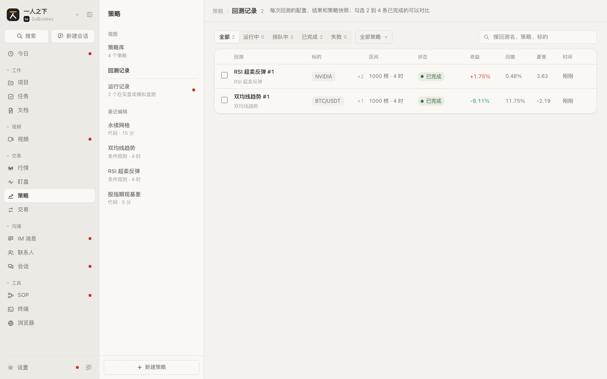 | 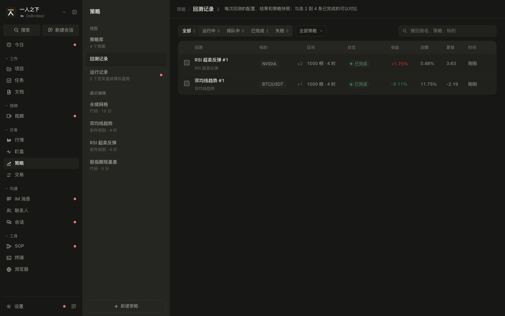 |
| 手机 375 |  |  |

勾两条已完成的，点「对比 2 条」：

| | 亮 | 暗 |
|---|---|---|
| 桌面 1440 | 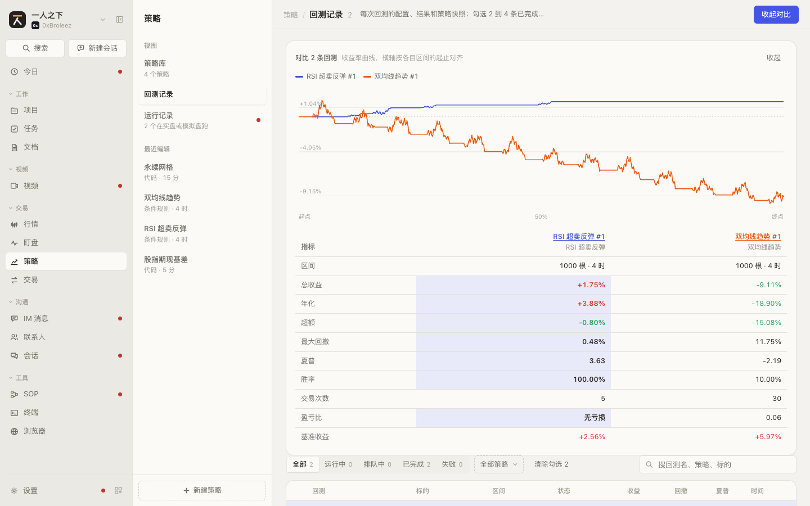 | 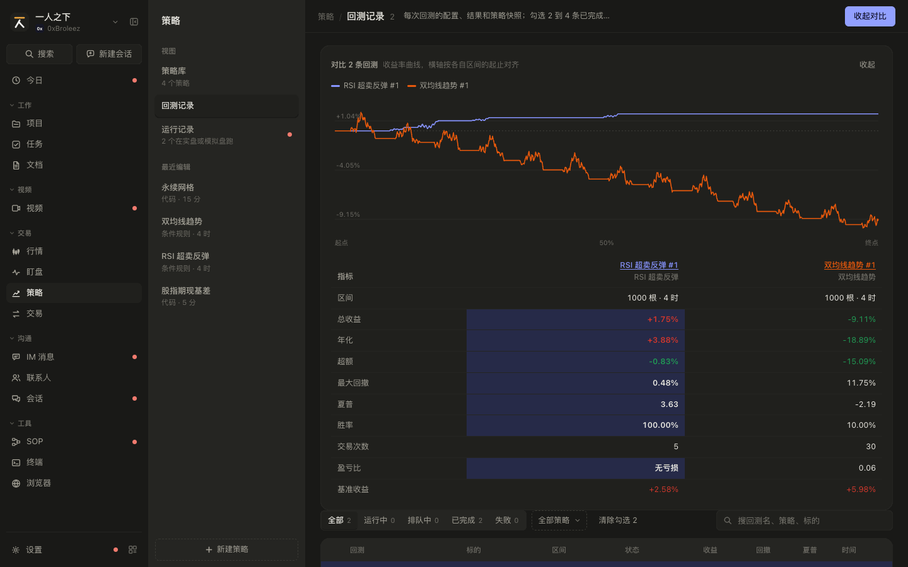 |
| 手机 375 | 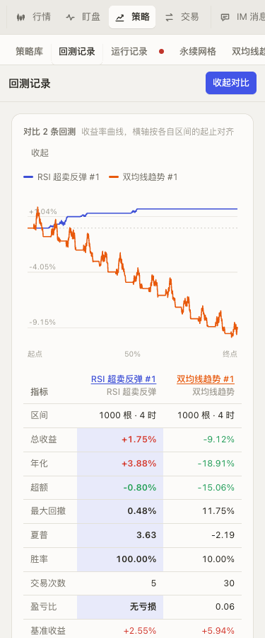 | 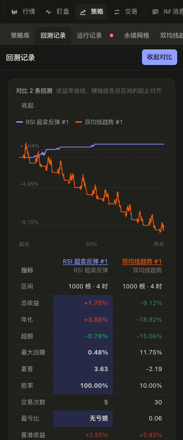 |

### 交互

| 编号 | 元素 | 操作 | 结果 |
|---|---|---|---|
| SPEC-strategy-6.1 | 标题栏 | 看、点击 | 「回测记录」和条数，说明「每次回测的配置、结果和策略快照；勾选 2 到 4 条已完成的可以对比」；勾了一条时右侧写「再勾一条就能对比」，两条以上时「对比 N 条」，打开对比后变「收起对比」 |
| SPEC-strategy-6.2 | 状态「全部 / 运行中 / 排队中 / 已完成 / 失败」 | 点击 | 各带条数，按状态筛 |
| SPEC-strategy-6.3 | 「全部策略」下拉 | 选择 | 可搜策略名，每项带「N 次」；策略删了的用快照里的名字 |
| SPEC-strategy-6.4 | 「清除勾选 N」 | 点击 | 有勾选时出现；清掉勾选并收起对比 |
| SPEC-strategy-6.5 | 搜索「搜回测名、策略、标的」 | 输入 | 按回测名、策略名、标的名称匹配 |
| SPEC-strategy-6.6 | 表 | 看 | 新的在前；列：勾选框、回测（名称，下一行策略名）、标的、区间（「N 根 · <周期>」）、状态（运行中是进度条）、收益、回撤、夏普、时间；没结果的数字列写「-」 |
| SPEC-strategy-6.7 | 勾选框 | 勾选 | 只有已完成的能勾（悬停「完成后才能对比」）；最多 4 条，满了其余不可勾（悬停「最多对比 4 条」）；点勾选框不打开报告 |
| SPEC-strategy-6.8 | 一行 | 点击 | 打开回测报告（`SPEC-strategy-7`） |
| SPEC-strategy-6.9 | 「再显示 N 条（还有 M 条更早的）」 | 点击 | 先露 50 条，每次多 50 条；换筛选、改搜索回到 50 条 |
| SPEC-strategy-6.10 | 对比区 | 看 | 在表格上方：「对比 N 条回测」（提示「收益率曲线，横轴按各自区间的起止对齐」）、「收起」、图例、收益率曲线（每条一种颜色，0 线）；下面是指标表：区间、总收益、年化、超额、最大回撤、夏普、胜率、交易次数、盈亏比、基准收益，每行最好的一格高亮（交易次数和基准收益不比）；列头是回测名（点击打开报告）和策略名 |
| SPEC-strategy-6.11 | 图表 | 鼠标移动 | 竖线和每条线上的点，浮层显示位置和每条线的值 |

### 空状态和异常状态

| 编号 | 场景 | 显示 | 可做的操作 |
|---|---|---|---|
| SPEC-strategy-6.12 | 还没有回测 | 「还没有回测」「在策略编辑页右侧的「快速回测」里发起」 | 去策略库 |
| SPEC-strategy-6.13 | 筛选或搜索后没有 | 「没有匹配的回测」和同一句说明 | 换筛选 |
| SPEC-strategy-6.14 | 勾了的回测被重跑或删掉 | 对比只算还在、已完成的；不够两条时「对比」按钮消失 | 再勾 |

### 数据

`Backtest`、`BacktestResult.stats`（见 `SPEC-strategy-0`）；对比的「超额」是总收益减基准收益。

### 联动

无。

## SPEC-strategy-7 回测报告

### 截图

双均线趋势 #1（完成）：

| | 亮 | 暗 |
|---|---|---|
| 桌面 1440 | 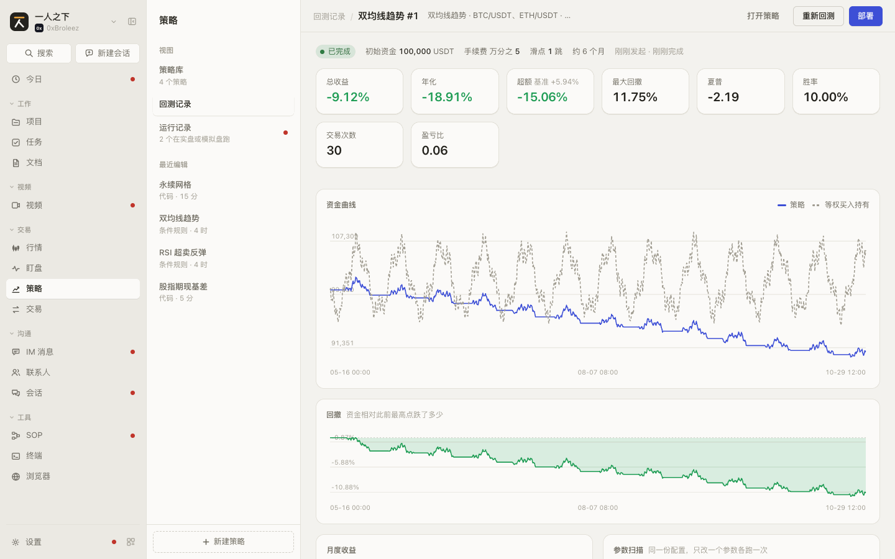 | 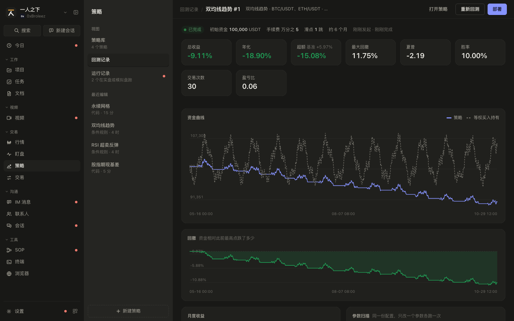 |
| 手机 375 | 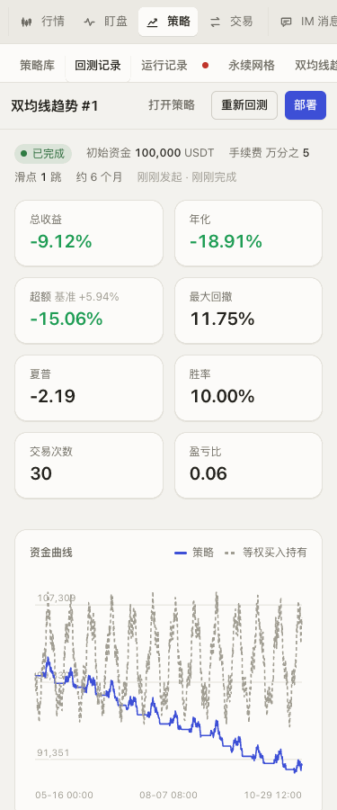 | 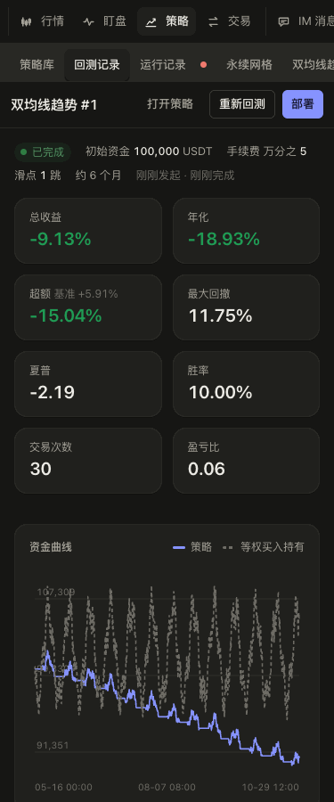 |

参数扫描（fast 取 6 个值）：

| | 亮 | 暗 |
|---|---|---|
| 桌面 1440 | 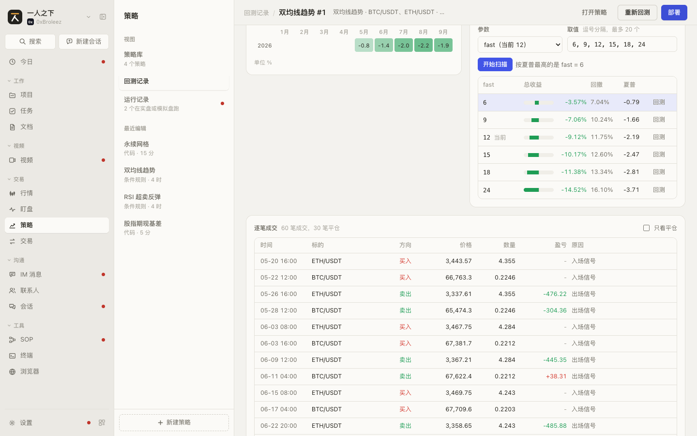 | 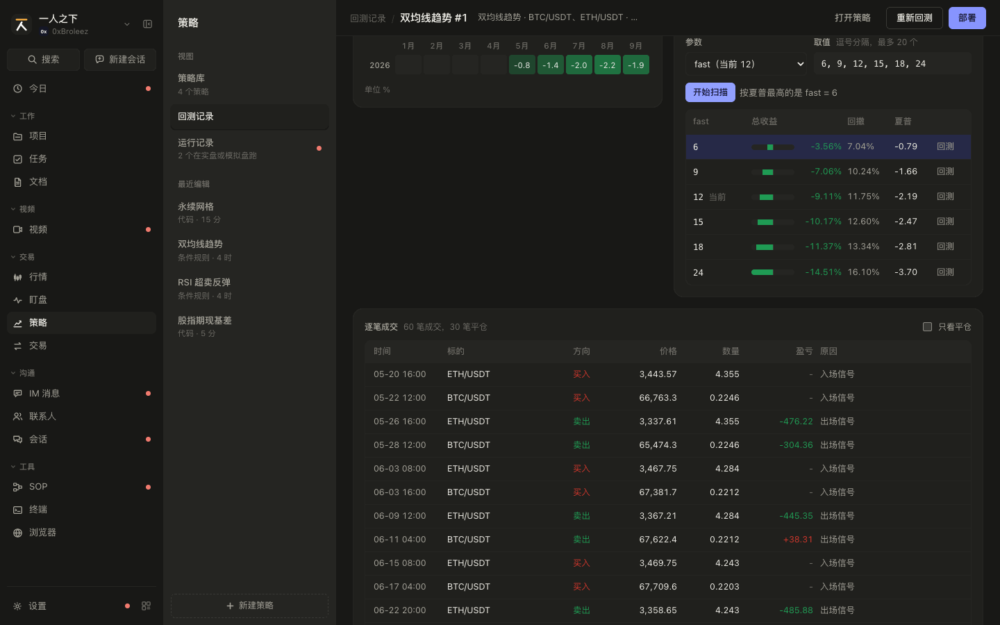 |
| 手机 375 | 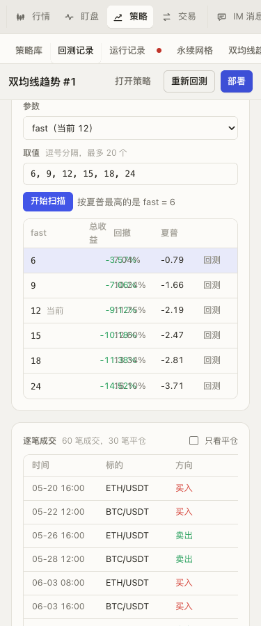 | 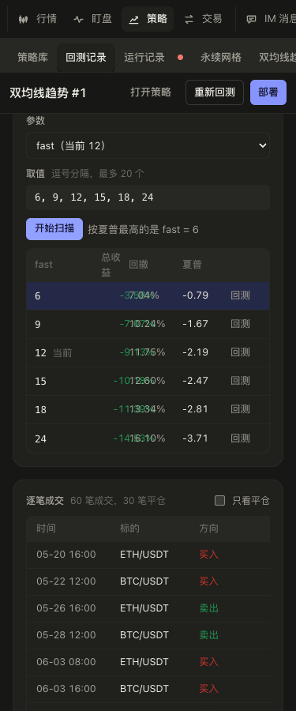 |

代码策略（永续网格）带近似说明：

| | 亮 | 暗 |
|---|---|---|
| 桌面 1440 | 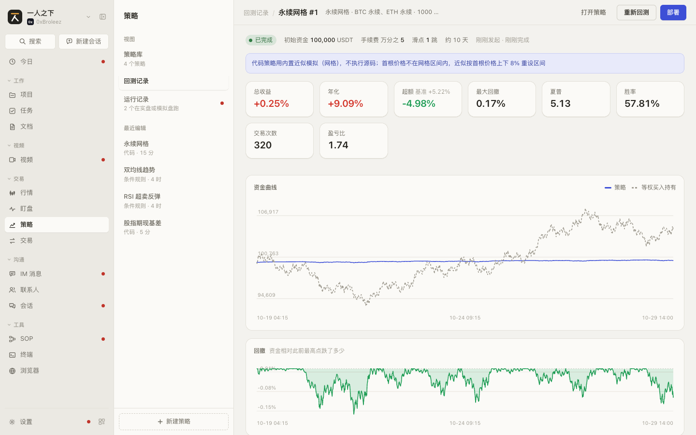 | 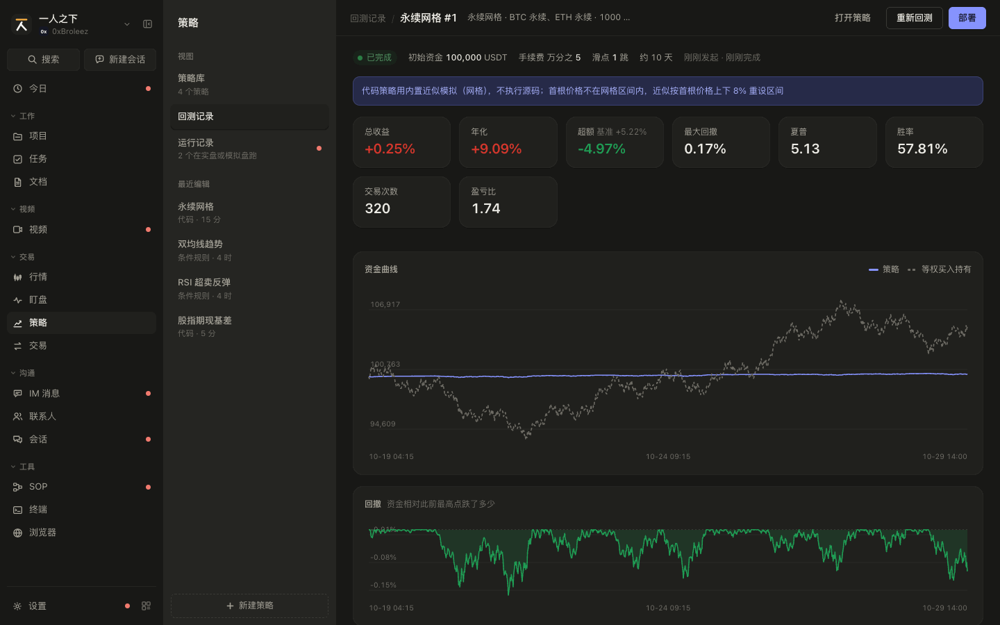 |
| 手机 375 |  |  |

点「重新回测」后打开的新回测，进行中：

| | 亮 | 暗 |
|---|---|---|
| 桌面 1440 |  |  |
| 手机 375 |  |  |

### 交互

| 编号 | 元素 | 操作 | 结果 |
|---|---|---|---|
| SPEC-strategy-7.1 | 标题栏 | 看 | 标题是回测名，上级「回测记录」，说明「<策略名> · <标的> · N 根 <周期>」 |
| SPEC-strategy-7.2 | 「打开策略」 | 点击 | 打开这个策略的编辑页（策略已删除时进「这个策略已经删除」） |
| SPEC-strategy-7.3 | 「重新回测」 | 点击 | 用同样的配置发起一次新回测并打开它；运行中、排队中时不可点。策略还在时用当前的策略，删了用快照 |
| SPEC-strategy-7.4 | 「部署」 | 点击 | 同 `SPEC-strategy-3.2`。**【实盘，要过 TRD-08 评审，默认只开模拟盘】** |
| SPEC-strategy-7.5 | 配置行 | 看 | 状态、初始资金和币种、手续费万分之、滑点跳、区间时长、「数据 <第一根> 到 <最后一根>」（实际回测区间，完成才有；悬停说明是 K 线开盘时间）、「<相对时间>发起 · <相对时间>完成」 |
| SPEC-strategy-7.6 | 说明条 | 看 | 回测结果带 `note` 时显示（代码近似、资金不足一手、网格重设区间、没触发入场等，`SPEC-strategy-0` 约定） |
| SPEC-strategy-7.7 | 统计 | 看 | 总收益、年化、超额（旁边写「基准 N%」）、最大回撤、夏普、胜率、交易次数、盈亏比（99 写「无亏损」）；收益类涨红跌绿 |
| SPEC-strategy-7.8 | 资金曲线 | 看、鼠标移动 | 策略（实线）和等权买入持有（虚线），横轴起点、中点、终点的时间（日线写日期，其余「MM-DD HH:mm」）；鼠标移动看每个点的值 |
| SPEC-strategy-7.9 | 回撤 | 看 | 资金相对此前最高点跌了多少的水下曲线，0 线以下填充 |
| SPEC-strategy-7.10 | 分段收益 | 看 | 区间够 60 天按月（年乘 12 个月的表加全年，单位 %）；够 3 天按天；再短按 4 小时；按天和 4 小时只显示最近 120 段；格子底色按涨跌和幅度深浅，悬停看具体值 |
| SPEC-strategy-7.11 | 参数扫描：参数下拉 | 选择 | 策略参数加止损 %、止盈 %、仓位 %，每项带「（当前 N）」；换参数时取值换成默认的一组：当前值的 0.5、0.75、1、1.25、1.5、2 倍（整数参数取整、至少 1，去重）；当前值是 0 时，止损止盈用 0、3、6、10、15，其余用 0、1、2、5、10 |
| SPEC-strategy-7.12 | 参数扫描：取值 | 输入 | 逗号、中文逗号或空格分隔，非数字的忽略，去重，最多 20 个 |
| SPEC-strategy-7.13 | 「开始扫描」 | 点击 | 没有合法取值时不可点；算完显示每个值一行：值（当前值标「当前」）、总收益条形和数字、回撤、夏普、「回测」；夏普最高的一行高亮，旁边写「按夏普最高的是 <参数> = <值>」。正式版：后端按这条回测同一段数据跑，跑的时候按钮写「扫描中…」，结果存在这条回测上，刷新、换页回来还在（换参数下拉时仍显示上一次扫描的结果）；失败时红框「扫描失败：<原因>」 |
| SPEC-strategy-7.14 | 扫描结果「回测」 | 点击 | 按这个值发起一次正式回测并打开它（悬停「按这个值发起一次正式回测」） |
| SPEC-strategy-7.15 | 逐笔成交 | 看、点击 | 「N 笔成交，M 笔平仓」；列：时间、标的、方向（买入红、卖出绿）、价格、数量、盈亏（开仓的写「-」）、原因；先露 20 笔，「再显示 N 笔（共 M）」每次多 100；勾「只看平仓」只列有盈亏的 |
| SPEC-strategy-7.16 | 策略快照 | 看 | 提示「发起回测那一刻的策略，之后改策略不影响这份报告」；名称、模式（代码模式写「按「<近似>」近似」）、标的、周期 / 方向、止损 / 止盈（0 写「不设」）、仓位、参数、本次覆盖（和策略参数不同的，另一种颜色）；条件规则列出入场、出场的每条条件文字（如「EMA(12) 上穿 EMA(48)」），代码模式显示只读代码 |
| SPEC-strategy-7.22 | 页面底部「删除这条回测记录」 | 点击 | 变成确认：「只删这一条回测记录和它的扫描结果，策略不动」（运行中、排队中的加「；还没跑完的会先停下」），「取消」「删除」；删除后回到回测记录（编号接在本节末尾，不挪动已有编号） |

### 空状态和异常状态

| 编号 | 场景 | 显示 | 可做的操作 |
|---|---|---|---|
| SPEC-strategy-7.17 | 排队中、运行中 | 「排队中」或「回测进行中」和进度条，「前面的回测跑完就开始」或「跑完会自动出报告，可以先去做别的」；统计、图表、扫描、成交都不显示，策略快照照常显示 | 等，或先离开 |
| SPEC-strategy-7.18 | 失败 | 红框「回测失败 <原因>」（没有原因写「没有错误信息」）和「重新回测」；正式版的原因以「数据缺失：」「参数不合法：」「引擎错误：」「回测被中断：」开头（`SPEC-strategy-0`「原型里模拟、正式版要真做的」） | 重新回测 |
| SPEC-strategy-7.19 | 没有成交 | 逐笔成交写「没有成交」，说明条写「区间内没有触发入场条件，……」 | 改参数重跑 |
| SPEC-strategy-7.20 | 资金曲线不到两个点 | 分段收益写「数据不够」 | 拉长区间 |
| SPEC-strategy-7.21 | 回测记录不在了 | 「这条回测记录不在了」 | 回回测记录 |

### 数据

`Backtest`、`BacktestResult`、`BacktestTrade`、`sweep`、`sweepableParams`（见 `SPEC-strategy-0`）。

### 联动

| 方向 | 对方模块 | 触发 | 结果 | 见 |
|---|---|---|---|---|
| 出去 | 交易 | 「部署」 | 新建策略运行抽屉 | `SPEC-trading-7` |

## SPEC-strategy-8 运行记录

每次部署到实盘或模拟盘算一次运行，停了的也留着，方便回看这个策略真实跑出来怎么样。这里只看，启停到交易「策略运行」（`SPEC-trading-6`）里做。

### 截图

默认（异常、运行中、暂停的在上，已停止的折起来）：

| | 亮 | 暗 |
|---|---|---|
| 桌面 1440 |  |  |
| 手机 375 |  |  |

展开异常的那一条：

| | 亮 | 暗 |
|---|---|---|
| 桌面 1440 |  |  |
| 手机 375 |  |  |

展开已停止的：

| | 亮 | 暗 |
|---|---|---|
| 桌面 1440 |  |  |
| 手机 375 |  |  |

### 交互

| 编号 | 元素 | 操作 | 结果 |
|---|---|---|---|
| SPEC-strategy-8.1 | 标题栏 | 看 | 「运行记录」和条数，说明「每次部署到实盘或模拟盘算一次运行，停了的也留着；启停到「交易 / 策略运行」里操作」 |
| SPEC-strategy-8.2 | 统计 | 看 | 运行中（只数 `running`）、异常（有异常时红色）、筛选结果累计盈亏（涨红跌绿）、实盘 / 模拟（按账户的 `paper`） |
| SPEC-strategy-8.3 | 筛选 | 选择、点击 | 「全部策略」（可搜，策略删了的写「已删除的策略」）、「全部状态」（运行中、已暂停、已停止、异常）、「全部 / 实盘 / 模拟盘」 |
| SPEC-strategy-8.4 | 列表 | 看 | 异常、运行中、已暂停、已停止依次排，同状态按启动时间新的在前；每行：状态、策略名（删了写「已删除的策略」）、账户名和「实盘 / 模拟盘」标签、标的；资金、盈亏和收益率、「已运行」（停了的写「跑了」）时长、启动的相对时间；异常的整行红框 |
| SPEC-strategy-8.5 | 一行 | 点击 | 展开或收起（同时只展开一行）：异常原因、停止原因（「停止原因：<原因>」）、参数（「参数：k = v，……」，没有写「无」）、日志（新的在前，时间和文字，warn 黄、error 红）、「打开策略」、「到交易里管理」（已停止的没有） |
| SPEC-strategy-8.6 | 「打开策略」 | 点击 | 打开编辑页 |
| SPEC-strategy-8.7 | 「到交易里管理」 | 点击 | 切到交易「策略运行」（`SPEC-trading-6`）；原型不定位到那一张卡片 |
| SPEC-strategy-8.8 | 「已停止 N 个」 | 点击 | 展开已停止的，再点「收起已停止的」；状态筛选选了「已停止」时直接全部列出，不出这个按钮 |

### 空状态和异常状态

| 编号 | 场景 | 显示 | 可做的操作 |
|---|---|---|---|
| SPEC-strategy-8.9 | 没有运行记录（或筛选后没有） | 「没有运行记录」「在策略里点「部署」，跑起来之后这里会有记录」 | 去策略库部署 |
| SPEC-strategy-8.10 | 账户删了 | 账户名写「已删除的账户」，不显示实盘 / 模拟盘标签 | 无 |

### 数据

`StrategyRun`、`RunStatus`、`RUN_STATUS`、`TradeAccount`（见 `SPEC-trading-0`）。时长：一天以上「N 天」，否则「N 小时」（至少 1）；已停止的按 `stopped_at`（没有就取最后一条日志的时间）算。

### 联动

| 方向 | 对方模块 | 触发 | 结果 | 见 |
|---|---|---|---|---|
| 出去 | 交易 | 「到交易里管理」 | 策略运行视图 | `SPEC-trading-6` |
| 读 | 交易 | 运行和账户 | 运行状态、盈亏、日志 | `SPEC-trading-0` |
