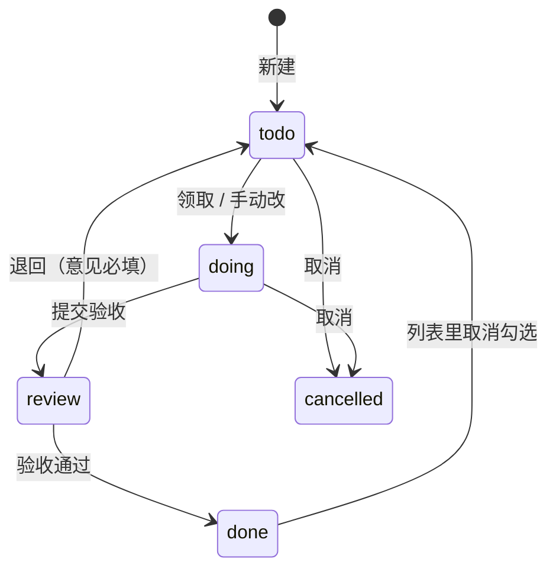

# 任务 规格（SPEC-tasks）

| 项 | 内容 |
|---|---|
| 模块 key | `tasks` |
| 原型入口 | 一级菜单「任务」，http://127.0.0.1:7778 |
| 源码 | `web-next/src/tasks.tsx`（二级菜单、列表、任务抽屉、Webhook 列表和配置页）、`web-next/src/schedule.tsx`（定时任务列表和抽屉）；接线在 `web-next/src/App.tsx`（`patchTask`、`deleteTask`、`taskPlan`、`runScheduleNow`、`ingest` 调用） |
| 数据文件 | `web-next/src/taskdata.ts`（任务、Webhook、投递）、`web-next/src/scheduledata.ts`（定时任务）；状态、优先级的显示名和颜色在 `web-next/src/enumdata.ts`（`task_status`、`task_priority`） |
| 截图 | [`shots/tasks/`](shots/tasks/) |
| 负责任务 | PROTO-04b |
| 状态 | 已整理 |
| 最后对照 | 2026-10-28，原型提交 `932555b` |

## SPEC-tasks-0 模块概述

人工创建、IM 消息转来、Webhook 推来、定时任务建的、运行异常转的任务都在这里；还管两种自动建任务的规则：定时任务和 Webhook 接入。开发任务（交给 Claude Code 做、做完提交验收）也是任务的一种，用 `review` 待验收状态承接。

### 页面清单

| 节 | 页面 | 入口 | 说明 |
|---|---|---|---|
| [SPEC-tasks-1](#spec-tasks-1-二级菜单) | 二级菜单 | 进入任务模块 | 视图、来源、自动化、最近推送四组 |
| [SPEC-tasks-2](#spec-tasks-2-全部任务和逾期) | 全部任务、逾期 | 二级菜单「全部任务」「逾期」（模块入口是全部任务） | 任务列表，按截止日分段 |
| [SPEC-tasks-3](#spec-tasks-3-来源视图) | 来源视图 | 二级菜单「人工创建」「IM 消息」「Webhook」「定时」「运行异常」 | 同一个列表，只看某种来源 |
| [SPEC-tasks-4](#spec-tasks-4-任务抽屉) | 任务抽屉 | 列表点一行、「新建任务」、IM 消息「转任务」、今日点任务 | 新建、查看、编辑、删除 |
| [SPEC-tasks-5](#spec-tasks-5-任务抽屉的开发闭环区块原型未做) | 任务抽屉的开发闭环区块 | 任务抽屉里 | 进展、产出物、执行记录、改动痕迹、验收和退回。原型未做 |
| [SPEC-tasks-6](#spec-tasks-6-交给-claude-code原型未做) | 交给 Claude Code | 任务抽屉里的按钮 | 选工作目录和权限，调用执行。原型未做 |
| [SPEC-tasks-7](#spec-tasks-7-定时任务列表) | 定时任务列表 | 二级菜单「定时任务」 | 规则列表，启停 |
| [SPEC-tasks-8](#spec-tasks-8-定时任务抽屉) | 定时任务抽屉 | 定时任务列表点一行、「新建定时任务」、今日点定时任务 | 配规则和动作、立即执行、执行记录 |
| [SPEC-tasks-9](#spec-tasks-9-webhook-接入) | Webhook 接入 | 二级菜单「Webhook 接入」 | Webhook 列表 |
| [SPEC-tasks-10](#spec-tasks-10-webhook-配置页) | Webhook 配置页 | Webhook 列表点一行、二级菜单「最近推送」下的某个 Webhook、「新建 Webhook」 | 地址、映射、过滤去重、测试推送、推送记录 |

### 引用本文件的开发任务

| 任务 | 对照的节 |
|---|---|
| DEV-07a 任务列表页接真实接口 | `SPEC-tasks-1.1 到 1.4`、`SPEC-tasks-2`（全节）；待验收见 `SPEC-tasks-2.6`、`SPEC-tasks-0` 状态流转 |
| DEV-07b 任务抽屉：新建、编辑、改状态 | `SPEC-tasks-4`（全节） |
| DEV-08a 进展时间线 | `SPEC-tasks-5.1 到 5.6` |
| DEV-08b 产出物 | `SPEC-tasks-5.7 到 5.11` |
| DEV-08c 执行记录和流式输出 | `SPEC-tasks-5.12 到 5.17` |
| DEV-08d 改动痕迹、验收和退回 | `SPEC-tasks-5.18 到 5.25` |
| DEV-09 交给 Claude Code | `SPEC-tasks-6`（全节） |
| TODAY-02 今日页 | 点任务打开的抽屉是 `SPEC-tasks-4`；主体见 `today.md` `SPEC-today-1` |
| TASK-04a 定时任务页 | `SPEC-tasks-7`、`SPEC-tasks-8` |
| TASK-04b Webhook 页和来源视图 | `SPEC-tasks-1.5 到 1.8`、`SPEC-tasks-3`、`SPEC-tasks-9`、`SPEC-tasks-10`；来源标签见 `SPEC-tasks-0` `TaskSource` |

### 共用数据结构

`Task`（`web-next/src/taskdata.ts`）

| 字段 | 类型 | 必填 | 说明 | 取值 / 示例 |
|---|---|---|---|---|
| `id` | `string` | 是 | 编号 | `tk_s1` |
| `ref` | `string` | 是 | 给人看的编号，原型按现有最大号加一（正式产品由后端发号，见 CORE-11） | `T-012` |
| `title` | `string` | 是 | 标题，去首尾空白后不能为空 | `Export job timeout after 300s` |
| `desc` | `string` | 是 | 描述，可以是空串 | |
| `status` | `TaskStatus` | 是 | 状态 | 见下 |
| `priority` | `Priority` | 是 | 优先级 | 见下 |
| `assignee` | `string` | 是 | 负责人名字，空串表示未分配 | `我`、`周屿` |
| `due` | `string \| null` | 是 | 截止日期 `yyyy-mm-dd`，没有截止为 `null` | `2026-10-31` |
| `source` | `TaskSource` | 是 | 从哪来的 | 见下 |
| `project_id` | `string` | 否 | 所属项目；不属于任何项目时没有这个字段 | `pj_perm` |
| `project_removed` | `string` | 否 | 原属项目被删时记下的项目名，任务上提示「原属项目已删除」；重新选了项目后清掉 | `远川科技权限改造` |
| `created_at` | `string` | 是 | ISO 时间 | |
| `updated_at` | `string` | 是 | ISO 时间，每次改动刷新 | |

`TaskStatus`（`taskdata.ts`）：`'todo' | 'doing' | 'review' | 'done' | 'cancelled'`。显示名、颜色、说明读设置里的枚举 `task_status`（`enumdata.ts`），数据里只存 key；种子默认值如下，新建任务的默认状态取枚举的 `default_key`（`todo`）。

| key | 显示名 | 颜色 | 说明 | 是否算未结束（`isOpenTask`） |
|---|---|---|---|---|
| `todo` | 待办 | `#a19d92` | | 是 |
| `doing` | 进行中 | `#3d4fd6` | | 是 |
| `review` | 待验收 | `#7048e8` | 做完了等人验收，验收通过再改成已完成。开发任务由 Claude Code 提交验收后停在这里（迁移 0013，非终态） | 是 |
| `done` | 已完成 | `#2f7d43` | 算作完成，不再提示逾期 | 否 |
| `cancelled` | 已取消 | `#a19d92` | 不算完成也不算逾期 | 否 |

状态可以在「设置 / 枚举值」里加；页面上的状态筛选、抽屉里的状态按钮都按枚举顺序排，不写死。

状态流转（原型里任意状态之间都能在抽屉里直接切换；下图是开发任务闭环约定的主路径，验收和退回的按钮见 `SPEC-tasks-5.21 到 5.23`）：

`Priority`（`taskdata.ts`）：`'P0' | 'P1' | 'P2' | 'P3' | (string & {})`，可以在设置的枚举 `task_priority` 里新增。种子：`P0` P0 紧急 `#c0352b` 当天处理 / `P1` P1 高 `#b0570b` 本周内 / `P2` P2 中 `#3d4fd6`（默认） / `P3` P3 低 `#a19d92` 有空再做。

`TaskSource`（`taskdata.ts`），按 `kind` 区分：

| `kind` | 其余字段 | 列表上的来源标签（`SourceTag`） | 抽屉里的来源卡 |
|---|---|---|---|
| `manual` | 无 | 「人工」 | 无 |
| `im` | `message_id: string`、`channel: string`、`sender: string`、`text: string` | 「渠道名 · 发送人」，悬停显示原文 | 「来自 IM 消息」，引用原文，「查看原消息」 |
| `webhook` | `hook_id: string`、`delivery_id: string` | 「Webhook · Webhook 名」，Webhook 已删时「已删除」 | 「来自 Webhook」，「查看配置」「看推送内容」 |
| `schedule` | `schedule_id: string`、`name: string` | 「定时 · 定时任务名」 | 「来自定时任务」，「查看规则」 |
| `incident` | `incident_id: string`、`title: string` | 「异常 · 异常标题」，悬停显示标题 | 「来自运行异常」，「查看异常」 |

`Webhook`（`taskdata.ts`）

| 字段 | 类型 | 必填 | 说明 | 取值 / 示例 |
|---|---|---|---|---|
| `id` | `string` | 是 | 编号 | `wh_sentry` |
| `name` | `string` | 是 | 名称，保存时必填 | `Sentry 线上告警` |
| `token` | `string` | 是 | 接收地址最后一段，新建时随机生成 | `k7Qm2sentry9x` |
| `secret` | `string` | 是 | 签名用的密钥，新建时随机生成 | `whsec_3f9a71c2e84b` |
| `enabled` | `boolean` | 是 | 停用后推送只记录不建任务 | `true` |
| `mapping` | `{ title: string; desc: string; priority: string; assignee: string; due: string }` | 是 | 任务字段取推送 JSON 里的哪个路径，形如 `event.title`、`items[0].name`；`title` 必填，其余留空用默认值或不取 | `{ title: 'event.title', desc: 'event.culprit', priority: 'event.level', assignee: '', due: '' }` |
| `filter` | `string` | 是 | 只有满足才建任务，只支持 `路径 == 值` / `路径 != 值`，留空不过滤 | `action == created` |
| `dedupe` | `string` | 是 | 去重字段路径，同一个值第二次推来不再建（只认任务还在的投递） | `event.id` |
| `defaults` | `{ priority: Priority; assignee: string }` | 是 | 映射取不到时的默认值 | `{ priority: 'P1', assignee: '周屿' }` |
| `sample` | `string` | 是 | 测试推送用的示例 JSON 文本 | |
| `created_at` | `string` | 是 | ISO 时间 | |

`Delivery`（`taskdata.ts`）：一次推送的记录

| 字段 | 类型 | 必填 | 说明 | 取值 / 示例 |
|---|---|---|---|---|
| `id` | `string` | 是 | 编号 | `dl_s1` |
| `hook_id` | `string` | 是 | 哪个 Webhook | `wh_sentry` |
| `at` | `string` | 是 | 推送时间 | |
| `payload` | `Json`（`Record<string, unknown>`） | 是 | 原始推送内容 | |
| `result` | `'created' \| 'skipped' \| 'failed'` | 是 | 结果 | `created` 已建任务（绿） / `skipped` 已忽略（灰） / `failed` 失败（红） |
| `task_id` | `string` | 否 | 建出的任务；按重复忽略时指向之前建的那条 | `tk_s1` |
| `reason` | `string` | 否 | 没建或失败的原因 | `标题路径 answers.need 取不到值` |
| `mapped` | `Partial<Record<'title' \| 'desc' \| 'priority' \| 'assignee' \| 'due', string>>` | 否 | 映射出来的字段，失败时也留着 | |

`Ingest`（`taskdata.ts`）：`{ delivery: Delivery; task?: Task }`，一次推送处理的结果。处理顺序（`ingest`）：Webhook 停用 -> `skipped`「Webhook 已停用，只记录不建任务」；不满足过滤 -> `skipped`「不满足过滤条件 …（实际是「…」）」；过滤条件写法不对 -> `skipped`「过滤条件写法不对：…」；去重值已建过且那条任务还在 -> `skipped`「… 已经建过任务，按重复推送忽略」；标题取不到 -> `failed`「标题路径 … 取不到值」或「没有配置标题映射」；否则建任务，标题截前 120 字，截止只取 `yyyy-mm-dd` 开头，优先级按 `SPEC-tasks-10.9` 的规则换算。

`Schedule`（`web-next/src/scheduledata.ts`）

| 字段 | 类型 | 必填 | 说明 | 取值 / 示例 |
|---|---|---|---|---|
| `id` | `string` | 是 | 编号 | `sc_weekly_agenda` |
| `name` | `string` | 是 | 名称，保存时必填 | `周会前整理议程` |
| `enabled` | `boolean` | 是 | 停用后不自动执行，可以手动执行 | `true` |
| `rule` | `ScheduleRule` | 是 | 什么时候 | 见下 |
| `action` | `ScheduleAction` | 是 | 做什么 | 见下 |
| `history` | `ScheduleRun[]` | 是 | 执行记录，新的在前 | |
| `created_at` | `string` | 是 | ISO 时间 | |

`ScheduleRule`（`scheduledata.ts`）

| 字段 | 类型 | 必填 | 说明 | 取值 / 示例 |
|---|---|---|---|---|
| `freq` | `Freq` | 是 | 频率 | `once` 只执行一次 / `daily` 每天 / `weekdays` 工作日 / `weekly` 每周 / `monthly` 每月 / `cron` Cron 表达式 |
| `time` | `string` | 是 | `HH:mm`，`cron` 时不用 | `09:00` |
| `weekdays` | `number[]` | 是 | 每周的周几，0 是周日 | `[1]` |
| `day` | `number` | 是 | 每月几号，31 在小月按月底 | `25` |
| `date` | `string` | 是 | 只执行一次的日期 `yyyy-mm-dd` | |
| `cron` | `string` | 是 | 5 段：分 时 日 月 周 | `0 18 * * 1` |

新建时的默认规则（`emptyRule`）：每周一 09:00，`date` 是明天，`cron` 是 `0 9 * * 1`。规则校验（`ruleError`）：时间不是 `HH:mm`「时间要写成 09:00 这种格式」；每周没选周几「每周执行要至少选一天」；只执行一次没选日期「选一个执行日期」、时间已过「这个时间已经过去了」；Cron 不是 5 段「Cron 要 5 段：分 时 日 月 周，比如 0 9 * * 1」。原型的 Cron 只认「分 时 * * 周」，其余按每天这个点算（正式产品要完整支持）。

`ScheduleAction`（`scheduledata.ts`），按 `kind` 区分，显示名 `ACTION_LABEL`：

| `kind` | 显示名 | 其余字段 | 列表里「做什么」的文字（`actionText`） |
|---|---|---|---|
| `task` | 建一条任务 | `title: string`（可写 `{{date}}`，执行时换成当天日期）、`desc: string`、`priority: Priority`、`assignee: string`、`due_days: number`（截止是执行日加几天，可选 0 / 1 / 2 / 3 / 5 / 7） | 建任务「标题」，没填时「未填标题」 |
| `sop` | 执行 SOP | `sop_id: string` | 执行「SOP 名」，SOP 已删时「已删除的 SOP」 |
| `agent` | 让 Agent 去做 | `agent_id: string`、`prompt: string` | 「Agent 名：要求」，Agent 已删时「已删除的 Agent」，没填要求时「未填要求」 |

`ScheduleRun`（`scheduledata.ts`）：`{ at: string; ok: boolean; text: string; ref?: string; manual?: boolean }`。`text` 是给人看的结果（「建了任务 T-005」「没执行：已停用」）；`ref` 是建出的任务编号；`manual` 为 `true` 表示「立即执行一次」手动触发。

`TaskView`（`tasks.tsx`）：二级菜单的 key。`'all' | 'due' | 'manual' | 'im' | 'webhook' | 'schedule' | 'incident' | 'schedules' | 'hooks' | 'hook:<Webhook id>'`，其中 `hook:new` 是新建 Webhook。

### 联动总表

| 方向 | 对方模块 | 触发 | 结果 | 见 |
|---|---|---|---|---|
| 进来 | 今日 | 点任务行 / 完成圆圈 / 「全部任务」 | 打开任务抽屉 / 改为已完成 / 任务列表 | `SPEC-today-1.8 到 1.11` |
| 进来 | 今日 | 点「今天还会自动执行」的一行 | 定时任务列表并打开抽屉 | `SPEC-today-1.12` |
| 进来 | IM 消息 | 点「转任务」 | 已经转过：打开那条任务；没转过：打开「IM 消息转任务」抽屉 | `SPEC-tasks-4.3`、`SPEC-messages` |
| 进来 | 设置 / 运行异常 | 异常抽屉里「转为研发任务」再点「建任务」 | 建一条 `source.kind = incident` 的任务，异常状态改为已转任务 | `SPEC-settings` |
| 进来 | 外部系统 | 往 Webhook 接收地址推 JSON | 记一条投递，按规则建任务 | `SPEC-tasks-10` |
| 进来 | 命令面板 | 「新建定时任务」 | 定时任务列表并打开新建抽屉 | `SPEC-tasks-8` |
| 出去 | IM 消息 | 抽屉「查看原消息」 | 跳到原消息 | `SPEC-messages` |
| 出去 | 设置 / 运行异常 | 抽屉「查看异常」 | 设置的运行异常并打开异常抽屉 | `SPEC-settings` |
| 出去 | 会话 | 定时任务执行「让 Agent 去做」 | 会话 / 执行记录多一条 | `SPEC-sessions` |
| 出去 | SOP | 定时任务执行「执行 SOP」 | SOP 多一次执行 | `SPEC-sop` |
| 改动 | IM 消息 | 转任务时勾选「建好后把这条消息标为已处理」 | 消息状态改为已处理、取消稍后提醒、标为已读 | `SPEC-tasks-4.14` |
| 改动 | 设置 / 运行异常 | 删除由异常转来的任务 | 异常退回未处理，备注「关联的任务已删除」 | `SPEC-tasks-4.19` |
| 改动 | 设置 / 运行异常 | Webhook 测试推送结果为失败 | 上报一条 warn 级运行异常「Webhook 名：推送没建成任务」 | `SPEC-tasks-10.15` |
| 改动 | 项目 | 任务选了所属项目 | 项目的任务标签里多一条 | `SPEC-projects` |
| 改动 | 项目 | 项目被删 | 任务移出项目，留 `project_removed` 提示 | `SPEC-tasks-2.9` |

## SPEC-tasks-1 二级菜单

任务模块的二级菜单。桌面在左侧竖排；手机变成页面顶部横向滚动的一排标签。

### 截图

二级菜单出现在本模块每张截图里，见 `SPEC-tasks-2` 的截图（桌面左侧一栏、手机顶部第二行）。

### 交互

| 编号 | 元素 | 操作 | 结果 |
|---|---|---|---|
| SPEC-tasks-1.1 | 「视图」组：全部任务 | 点击 | 切到全部任务列表（`SPEC-tasks-2`），关掉已打开的抽屉 |
| SPEC-tasks-1.2 | 「视图」组：逾期 | 展示、点击 | 有逾期时显示红点，说明「N 条过了截止日还没完成」；没有时说明「没有逾期的任务」。点击切到逾期列表 |
| SPEC-tasks-1.3 | 分组标题 | 展示 | 视图、来源、自动化、最近推送四组，组标题不可点。本模块的二级菜单不带搜索框（外壳二级菜单的搜索要显式开启，任务模块没开） |
| SPEC-tasks-1.4 | 任意菜单项 | 点击 | 切换视图都会关闭当前抽屉 |
| SPEC-tasks-1.5 | 「来源」组：人工创建、IM 消息、Webhook、定时、运行异常 | 点击 | 切到对应的来源视图（`SPEC-tasks-3`） |
| SPEC-tasks-1.6 | 「自动化」组：定时任务 | 点击 | 说明「到点自动建任务、跑 SOP、叫 Agent」，切到定时任务列表（`SPEC-tasks-7`） |
| SPEC-tasks-1.7 | 「自动化」组：Webhook 接入 | 展示、点击 | 说明「N 个」，有最近一次推送失败的 Webhook 时加「，M 个最近推送失败」并显示红点。点击切到 Webhook 列表（`SPEC-tasks-9`） |
| SPEC-tasks-1.8 | 「最近推送」组 | 展示、点击 | 最近推送过的 Webhook，按最近推送时间排，最多 5 个；说明「N 分钟前推送」，停用的加「· 已停用」；最近一次失败的显示红点。点击打开它的配置页（`SPEC-tasks-10`）。打开的 Webhook 不在这 5 个里时，高亮落在「Webhook 接入」 |
| SPEC-tasks-1.9 | 菜单底部「新建 Webhook」 | 点击 | 打开新建 Webhook 页（`SPEC-tasks-10`，`hook:new`） |

### 空状态和异常状态

| 编号 | 场景 | 显示 | 可做的操作 |
|---|---|---|---|
| SPEC-tasks-1.10 | 还没有任何推送 | 「最近推送」组不出现 | 「新建 Webhook」 |
| SPEC-tasks-1.11 | 逾期条数、失败条数加载失败 | 原型未做。正式产品：不显示红点和数字，不显示成「没有逾期的任务」 | 无 |

### 数据

逾期条数用 `isOverdue`：有 `due`、早于今天、状态未结束。「最近推送」用每个 Webhook 最近一条 `Delivery`（`lastDeliveries`）。正式产品里逾期条数取 `/api/counts` 的 `overdue`，必须和逾期列表口径一致（DEV-07a）。

### 联动

| 方向 | 对方模块 | 触发 | 结果 | 见 |
|---|---|---|---|---|
| 进来 | 今日 | 「还有 N 条，去任务」 | 有逾期时停在「逾期」 | `SPEC-today-1.11` |

## SPEC-tasks-2 全部任务和逾期

任务列表。两个视图共用一个页面，差别只在过滤条件、标题和说明。

### 截图

全部任务（模块入口截图 `入口-*` 与此相同）：

| | 亮 | 暗 |
|---|---|---|
| 桌面 1440 |  |  |
| 手机 375 |  |  |

逾期：

| | 亮 | 暗 |
|---|---|---|
| 桌面 1440 |  |  |
| 手机 375 |  |  |

### 交互

| 编号 | 元素 | 操作 | 结果 |
|---|---|---|---|
| SPEC-tasks-2.1 | 页面标题 | 展示 | 面包屑「任务 /」加标题，标题旁是当前筛选后的条数。全部任务：「全部任务」，说明「人工创建、IM 消息转来、Webhook 推来的任务都在这里，按截止日分段」；逾期：「逾期任务」，说明「过了截止日还没完成的任务，最早到期的在前」 |
| SPEC-tasks-2.2 | 右上「新建任务」 | 点击 | 打开新建任务抽屉（`SPEC-tasks-4`），焦点在标题 |
| SPEC-tasks-2.3 | 状态筛选（分段按钮） | 点击 | 依次是「未完成」（默认，未结束的状态都算，含待验收）、枚举里除 `cancelled` 以外的前 5 个状态、「全部」；每个按钮带该视图下的条数。已取消的只在「全部」里看得到 |
| SPEC-tasks-2.4 | 「更多状态」下拉 | 选择 | 枚举里的状态超过 5 个（不算已取消）时出现，可搜索，选项旁带条数；选中后按该状态过滤，清空回到「未完成」 |
| SPEC-tasks-2.5 | 「全部优先级」下拉 | 选择 | 按优先级过滤，选项来自枚举 `task_priority` |
| SPEC-tasks-2.6 | 待验收 | 展示 | 状态筛选里有「待验收」按钮（`review`）；待验收的任务在「未完成」里照常按截止日分段，状态列显示紫色「待验收」标签；不算逾期豁免，过了截止日照样进「逾期」 |
| SPEC-tasks-2.7 | 「全部项目」下拉 | 选择 | 可搜索；选项是所有项目和「不属于项目」。选中的项目已删除时显示「已删除的项目」 |
| SPEC-tasks-2.8 | 搜索框 | 输入 | 按标题、描述、编号、负责人模糊匹配（不区分大小写），实时过滤，清空后恢复 |
| SPEC-tasks-2.9 | 列表行 | 展示 | 列：完成圆圈、任务（编号、标题；下一行是来源标签、项目标签、「N 分钟前创建」）、优先级、负责人（空时「未分配」）、截止（今天显示「今天」，其余 `mm-dd`，没有显示「-」，逾期的红字加「逾期」）、状态。项目已删除时项目标签显示「已删除的项目」；任务的原属项目被删时显示「原属项目已删除」，悬停显示原项目名。已完成的行变淡 |
| SPEC-tasks-2.10 | 列表行 | 点击 | 打开该任务的抽屉（`SPEC-tasks-4`），当前行高亮 |
| SPEC-tasks-2.11 | 行首完成圆圈 | 点击 | 不打开抽屉。未完成（含待验收）的标为 `done`，圆圈打勾；已完成的改回 `todo`。悬停提示「标为已完成」/「标为待办」 |
| SPEC-tasks-2.12 | 截止分段 | 展示 | 列表按截止日分段：逾期（红字）、今天、本周（到本周日）、以后、无截止、已结束（`done`、`cancelled`），没有条目的段不出现。段内先按优先级 key 排，再按截止日，没有截止的在后 |
| SPEC-tasks-2.13 | 分段标题 | 点击 | 折叠或展开这一段，标题带条数 |
| SPEC-tasks-2.14 | 段尾「这一段还有 N 条」 | 点击 | 每段先露 30 条，超出时出现；点一次多露 100 条。换视图、状态、优先级、项目或搜索词后各段重新只露 30 条 |
| SPEC-tasks-2.15 | 手机宽度 | 展示 | 正文宽度不到 640px 时隐藏负责人、截止两列，只留圆圈、任务、优先级、状态 |

### 空状态和异常状态

| 编号 | 场景 | 显示 | 可做的操作 |
|---|---|---|---|
| SPEC-tasks-2.16 | 全部任务视图没有任务 | 「这里还没有任务」，下面「点右上角新建一个」 | 「新建任务」 |
| SPEC-tasks-2.17 | 逾期视图没有任务 | 「没有逾期的任务」，下面「截止日都还没到，或者已经做完了」 | 无 |
| SPEC-tasks-2.18 | 有搜索词、优先级或项目筛选但没有结果 | 「没有匹配的任务」 | 清掉筛选条件 |
| SPEC-tasks-2.19 | 只是状态筛选没有结果（如「待验收」为 0） | 原型显示的是视图的空状态文案（如「这里还没有任务」），容易误读，见文末「和原型对不上的地方」第 4 条。正式产品：显示「没有处于该状态的任务」 | 切回「未完成」 |
| SPEC-tasks-2.20 | 加载失败 | 原型未做。正式产品：列表区显示错误信息和「重试」，状态按钮上的条数不显示 | 重试 |
| SPEC-tasks-2.21 | 改状态失败（点完成圆圈） | 原型未做。正式产品：圆圈恢复原状，提示失败原因 | 再点一次 |
| SPEC-tasks-2.22 | 状态被别处改了（MCP、其它客户端） | 原型未做。正式产品：刷新或重新进入页面后显示新状态，和其它客户端看到同一份数据（DEV-07a） | 刷新 |

### 数据

见 `SPEC-tasks-0` `Task`、`TaskStatus`、`Priority`、`TaskSource`。页面内部类型（`tasks.tsx`）：

| 名称 | 类型 | 说明 |
|---|---|---|
| `StatusFilter` | `'open' \| TaskStatus \| 'all'` | 状态筛选；`open` 即未结束 |
| `DueSeg` | `'overdue' \| 'today' \| 'week' \| 'later' \| 'none' \| 'closed'` | 截止分段：逾期 / 今天 / 本周 / 以后 / 无截止 / 已结束 |
| `PAGE` | `30` | 每段先露几条 |

逾期视图的条件：`isOverdue`（有 `due`、早于今天、未结束）。正式产品用 `GET /api/objects?type=task&overdue=true`，条数和 `/api/counts` 的 `overdue` 一致；搜索走 `q=`；本周、今天的口径见 `docs/api-contract.md` 工作对象一节。

### 联动

| 方向 | 对方模块 | 触发 | 结果 | 见 |
|---|---|---|---|---|
| 出去 | 任务抽屉 | 点一行 / 新建任务 | 打开抽屉 | `SPEC-tasks-4` |
| 改动 | 今日 | 点完成圆圈 | 今日的「今天的任务」同步 | `SPEC-today-1.7` |

## SPEC-tasks-3 来源视图

同 `SPEC-tasks-2` 的列表，只看 `source.kind` 等于某个来源的任务；筛选、分段、行、抽屉的交互完全一样，只列差别。

### 截图

| 视图 | 桌面 1440 亮 | 桌面 1440 暗 | 手机 375 亮 | 手机 375 暗 |
|---|---|---|---|---|
| 人工创建 |  |  |  |  |
| IM 消息 |  |  |  |  |
| Webhook |  |  |  |  |
| 定时 |  |  |  |  |
| 运行异常 |  |  |  |  |

### 交互

| 编号 | 元素 | 操作 | 结果 |
|---|---|---|---|
| SPEC-tasks-3.1 | 页面标题和说明 | 展示 | 人工创建：「人工创建的任务」/「自己手动建的任务」；IM 消息：「IM 消息转的任务」/「在 IM 消息里点「转任务」建的，能回看原消息」；Webhook：「Webhook 转的任务」/「外部系统推到接收地址后按映射规则自动建的，能回看原始推送」；定时：「定时任务建的任务」/「定时任务到点自动建的，规则在「定时任务」里改」；运行异常：「运行异常转的研发任务」/「从「设置 / 运行异常」转过来的，带着异常详情；做完回去把异常标为已解决」 |
| SPEC-tasks-3.2 | 状态按钮上的条数 | 展示 | 只数这个来源的任务 |
| SPEC-tasks-3.3 | 来源标签 | 展示 | 每行的来源标签见 `SPEC-tasks-0` `TaskSource`；条数与按 `source` 筛选的结果一致（TASK-04b） |
| SPEC-tasks-3.4 | 「新建任务」 | 点击 | 在任何来源视图里新建的都是人工任务（`source.kind = manual`），建完不一定出现在当前视图 |

### 空状态和异常状态

| 编号 | 场景 | 显示 | 可做的操作 |
|---|---|---|---|
| SPEC-tasks-3.5 | IM 消息视图没有任务 | 「这里还没有任务」，下面「在 IM 消息里点「转任务」」 | 无 |
| SPEC-tasks-3.6 | Webhook 视图没有任务 | 「这里还没有任务」，下面「在「Webhook 接入」里建一个 Webhook，把地址填到外部系统里」 | 二级菜单「Webhook 接入」 |
| SPEC-tasks-3.7 | 人工创建、定时、运行异常视图没有任务 | 「这里还没有任务」，下面「点右上角新建一个」（定时、运行异常这两个视图的文案不合适，见文末第 5 条） | 「新建任务」 |
| SPEC-tasks-3.8 | 来源对象已删除 | Webhook 已删：来源标签「Webhook · 已删除」；定时任务、异常已删：标签照旧显示建任务时记下的名字 | 无 |

### 数据

过滤条件 `t.source.kind === view`，`view` 是 `manual`、`im`、`webhook`、`schedule`、`incident` 之一。正式产品的来源字段由 TASK-01 补到后端。

### 联动

| 方向 | 对方模块 | 触发 | 结果 | 见 |
|---|---|---|---|---|
| 进来 | IM 消息 / Webhook / 定时任务 / 运行异常 | 各自建任务 | 对应来源视图多一条 | `SPEC-tasks-0` 联动总表 |

## SPEC-tasks-4 任务抽屉

从右侧滑出的抽屉，新建和查看共用。三种开法：新建（kicker「新建任务」）、IM 消息转任务（kicker「IM 消息转任务」）、查看已有任务（kicker 是任务编号）。

### 截图

截图脚本只截一级、二级菜单和标签，抽屉没有截图。看到它的步骤：

- 新建：任务模块右上「新建任务」。
- 查看 IM 来源的任务：全部任务里点 `T-010`。
- 查看 Webhook 来源的任务：点 `T-012`，再点来源卡的「看推送内容」。
- 查看定时来源：「全部」状态下点 `T-005`；运行异常来源：点 `T-013`。
- IM 消息转任务：IM 消息模块里选一条待处理的消息，点「转任务」。
- 删除确认：打开任意任务，点左下「删除任务」。

### 交互

| 编号 | 元素 | 操作 | 结果 |
|---|---|---|---|
| SPEC-tasks-4.1 | 右上关闭按钮 / Esc | 点击 / 按键 | 关闭抽屉，不保存。原型没有未保存提示（见文末第 6 条） |
| SPEC-tasks-4.2 | 新建 | 打开 | 标题空、获得焦点；状态取枚举 `task_status` 的默认值（`todo`），优先级取 `task_priority` 的默认值（`P2`），负责人「我」，没有截止，不属于项目 |
| SPEC-tasks-4.3 | IM 消息转任务 | 打开 | 顶部来源卡「来自 IM 消息」：渠道 · 发送人、原文引用、「查看原消息」；标题预填消息正文前 40 字（空白合并）。这条消息已经转过任务时，不开新建，直接打开那条任务 |
| SPEC-tasks-4.4 | 来源卡「查看原消息」 | 点击 | 切到 IM 消息模块并打开原消息 |
| SPEC-tasks-4.5 | 来源卡（Webhook）「查看配置」 | 点击 | 关闭抽屉，切到这个 Webhook 的配置页（`SPEC-tasks-10`）；Webhook 已删时不显示按钮，名称显示「已删除的 Webhook」 |
| SPEC-tasks-4.6 | 来源卡（Webhook）「看推送内容」/「收起推送内容」 | 点击 | 展开或收起这次投递的原始 JSON；说明文字带「N 分钟前推送」。找不到投递时不显示 |
| SPEC-tasks-4.7 | 来源卡（定时）「查看规则」 | 点击 | 切到定时任务列表并打开该定时任务的抽屉（`SPEC-tasks-8`） |
| SPEC-tasks-4.8 | 来源卡（运行异常）「查看异常」 | 点击 | 切到「设置 / 运行异常」并打开异常抽屉 |
| SPEC-tasks-4.9 | 标题（必填） | 输入 | 占位「要做的事」 |
| SPEC-tasks-4.10 | 描述 | 输入 | 多行文本 |
| SPEC-tasks-4.11 | 状态、优先级（分段按钮） | 点击 | 选项按枚举顺序，悬停显示枚举里的说明；当前值已被停用或删除时仍保留在选项里（`optionsWith`）。状态里有「待验收」 |
| SPEC-tasks-4.12 | 负责人 | 输入或选择 | 可手填；候选是「我」加联系人里「同事」组的人 |
| SPEC-tasks-4.13 | 截止日期、所属项目 | 选择 | 日期可清空；所属项目可搜索，选「不属于项目」清空。任务原属项目被删时，项目为空并在下面显示「原属项目「名称」已删除」，重新选项目后这条提示消失 |
| SPEC-tasks-4.14 | 「建好后把这条消息标为已处理」 | 勾选 | 只在 IM 消息转任务、且消息还是待处理时出现，默认勾上；建好后把消息改为已处理、取消稍后提醒、标为已读 |
| SPEC-tasks-4.15 | 创建 / 更新时间 | 展示 | 查看已有任务时在表单末尾显示「N 天前创建 · N 分钟前更新」 |
| SPEC-tasks-4.16 | 「创建任务」 | 点击 | 标题去首尾空白后保存；建好后抽屉切到这条新任务的查看状态。来源：IM 转来的记 `im`，其余 `manual` |
| SPEC-tasks-4.17 | 「保存」 | 点击 | 保存全部字段并关闭抽屉，`updated_at` 刷新；重新选了项目时清掉 `project_removed` |
| SPEC-tasks-4.18 | 「取消」 | 点击 | 同关闭 |
| SPEC-tasks-4.19 | 左下「删除任务」 | 点击 | 底栏换成红字确认：「删除后不能恢复」，有连带影响时接着列出，如「运行异常「…」会退回未处理」「Webhook 再推送同样的内容会重新建任务」；「取消」回到原底栏，「删除」删掉并关闭抽屉。由异常转来的任务删掉后，异常退回未处理、备注「关联的任务已删除」；Webhook 投递记录保留，去重只认还在的任务 |

### 空状态和异常状态

| 编号 | 场景 | 显示 | 可做的操作 |
|---|---|---|---|
| SPEC-tasks-4.20 | 标题为空就点创建或保存 | 标题框标红，下面「必填」，不关闭抽屉 | 补全后再提交 |
| SPEC-tasks-4.21 | 打开的任务已被删除 | 原型不渲染抽屉。正式产品：抽屉显示「这条任务已删除」和关闭按钮 | 关闭 |
| SPEC-tasks-4.22 | 保存失败 | 原型未做。正式产品：底栏显示失败原因，抽屉保持打开、输入不丢 | 重试 |
| SPEC-tasks-4.23 | 有未保存改动时关闭 | 原型未做，直接关闭。正式产品（DEV-07b）：先确认「放弃修改」 | 继续编辑 / 放弃 |
| SPEC-tasks-4.24 | 来源对象已删除 | Webhook 已删：「已删除的 Webhook」，不显示「查看配置」；投递找不到：不显示「看推送内容」 | 无 |

### 数据

`TaskDraft`（`tasks.tsx`）：抽屉的表单值，保存时整体交给上层

| 字段 | 类型 | 必填 | 说明 |
|---|---|---|---|
| `title` | `string` | 是 | 保存时去首尾空白 |
| `desc` | `string` | 是 | |
| `status` | `TaskStatus` | 是 | |
| `priority` | `Priority` | 是 | |
| `assignee` | `string` | 是 | |
| `due` | `string \| null` | 是 | |
| `project_id` | `string` | 否 | |

正式产品（DEV-07b）在原型字段之外加：正文用 Markdown、负责人和参与人从干系人名册选（`owner_id`、`participant_ids`）、工作目录（`workdir` 列，可选目录并即时校验，任务没设时显示「继承自项目：…」）、关联仓库（`props.repo`）、验收标准（`props.acceptance`，Markdown 清单）。编辑只传改动的字段，`props` 先读回再合并。删除走软删。抽屉下部留出 `SPEC-tasks-5` 的四块。

### 联动

| 方向 | 对方模块 | 触发 | 结果 | 见 |
|---|---|---|---|---|
| 进来 | 今日 | 点任务行 | 在今日页上打开抽屉 | `SPEC-today-1.9` |
| 进来 | IM 消息 | 「转任务」 | 打开 IM 消息转任务抽屉 | `SPEC-messages` |
| 出去 | IM 消息、设置、Webhook、定时任务 | 来源卡按钮 | 见 `SPEC-tasks-4.4 到 4.8` | |
| 改动 | IM 消息、设置 / 运行异常 | 转任务勾选、删除任务 | 见 `SPEC-tasks-4.14`、`SPEC-tasks-4.19` | |

## SPEC-tasks-5 任务抽屉的开发闭环区块（原型未做）

开发任务（交给 Claude Code 做的任务）在抽屉里多四块：进展、产出物、执行记录、改动。**原型的任务抽屉里没有这些交互**，本节按 `web-next/docs/dev-plan.md` 4.0 的时序图、`docs/api-contract.md`（进展与领取、输出产物、任务执行 runs、约定）和 `docs/dev-tasks.json` 里 DEV-08a 到 DEV-08d 的要求整理；样式借原型：时间线参照 `videos.tsx` 的阶段时间线和 `monitor.tsx` 的 `mo-timeline`，产出列表参照 `sessions.tsx` 的 `OutputsView`，工具调用卡片参照 `agents.tsx` 的 `CallCard`。原型补上这些区块后再按原型修订本节（见文末第 7 条）。

### 截图

原型未做，没有截图。

### 交互

进展（DEV-08a）：

| 编号 | 元素 | 操作 | 结果 |
|---|---|---|---|
| SPEC-tasks-5.1 | 「进展」时间线 | 展示 | 读 `GET /api/objects/{id}/progress`，按时间顺序排；每条显示类型标识（`claim` 领取 / `note` 进展 / `review` 提交验收）、操作者 `actor_name`、会话 id 短码、时间、Markdown 正文、`commits` 和 `files` 小标签 |
| SPEC-tasks-5.2 | 提交验收那条（`kind = review`） | 展示 | 醒目显示，作为验收时的阅读入口 |
| SPEC-tasks-5.3 | 自动刷新 | 抽屉打开期间 | 任务处于进行中时每 10 秒刷新一次；有事件推送（CORE-07c）后改为推送 |
| SPEC-tasks-5.4 | 「追加进展」输入框和按钮 | 输入、提交 | `POST /progress`，`kind = note`；正文去首尾空白后不能为空；提交后出现在时间线末尾，刷新后仍在 |
| SPEC-tasks-5.5 | 修订记录里的进展行 | 展示 | `/revisions` 里 `field = progress` 的行不按「从 old 改成 new」显示（`old_value` 是元数据 JSON），只显示正文；任何位置都不把它显示成 JSON |
| SPEC-tasks-5.6 | 没有进展 | 展示 | 「还没有进展」 |

产出物（DEV-08b）：

| 编号 | 元素 | 操作 | 结果 |
|---|---|---|---|
| SPEC-tasks-5.7 | 「产出物」面板 | 展示 | 读 `GET /api/artifacts?object_id=…`，分四组：提交、分支、PR、文件。种类从 `note` 前缀 `[commit]` / `[branch]` / `[pr]` 识别，没有前缀的算文件；sha、branch、repo 从同一段 `key=value` 取；commit 显示 7 位 sha 和分支 |
| SPEC-tasks-5.8 | 有 `url` 的条目 | 点击 | 新窗口打开 |
| SPEC-tasks-5.9 | 只有 `path` 的条目 | 展示、复制 | 显示 `rel_path`，可复制绝对路径 |
| SPEC-tasks-5.10 | 来源标签 | 展示 | `manual` / `agent` / `run` / `mcp` |
| SPEC-tasks-5.11 | 「登记产出物」 | 提交 | `POST /api/artifacts`，来源由后端定为 `manual`；没有产出物时显示「还没有产出物」 |

执行记录（DEV-08c）：

| 编号 | 元素 | 操作 | 结果 |
|---|---|---|---|
| SPEC-tasks-5.12 | 「执行记录」列表 | 展示 | 读 `GET /api/objects/{id}/runs`，最近的在前；状态按 `TaskRun.Status` 显示，不按 `exit_code` 判断（`exit_code` 为 0 但 `Status` 为 `failed` 的显示失败） |
| SPEC-tasks-5.13 | 一条执行记录 | 点击 | 展开 `GET /api/runs/{id}` 的完整输出 |
| SPEC-tasks-5.14 | 流式输出 | 运行中 | 正文增量（`delta`）连续追加；工具调用（`tool`）和结果（`tool_result`）按 `id` 配对成一张卡片，显示成功或失败，失败的标红 |
| SPEC-tasks-5.15 | 「取消」 | 点击（运行中） | `POST /api/runs/{id}/cancel`，状态变为后端返回的取消状态，不再有输出 |
| SPEC-tasks-5.16 | 保留意见 | 展示 | `Status = done` 但 `Error` 里有一句保留意见时，在记录上显示出来 |
| SPEC-tasks-5.17 | 没有执行记录 | 展示 | 「还没有执行过」 |

改动痕迹、验收和退回（DEV-08d）：

| 编号 | 元素 | 操作 | 结果 |
|---|---|---|---|
| SPEC-tasks-5.18 | 「改动」区 | 展示 | 读 `GET /api/objects/{id}/revisions`，按 `session_id` 分组；每组显示 `actor_name`、会话 id、时间范围、字段变更列表。不自己拆 `actor` 字符串 |
| SPEC-tasks-5.19 | 会话 id | 点击复制 | 复制会话 id，提示可以 `claude --resume <id>` |
| SPEC-tasks-5.20 | 没有会话的改动（界面、接口） | 展示 | 归到一组「界面或接口改动」，不显示会话 id |
| SPEC-tasks-5.21 | 「验收通过」 | 点击（只在 `review` 时出现） | 可选填意见；`POST /progress`，`kind = note`，正文「验收通过」加意见，`status = done`，进展和状态同一事务；`completed_at` 有值 |
| SPEC-tasks-5.22 | 「退回」 | 点击（只在 `review` 时出现） | 意见必填，不填不能提交；`POST /progress`，`kind = note`，`status = todo`。退回到 `todo` 而不是 `doing`：领取规则里「状态仍是那次领取切到的状态、负责人仍是领取者」算占用，退回到 `doing` 会让别的会话领不到 |
| SPEC-tasks-5.23 | 退回后 | 展示 | 状态回到待办，进展里多一条带意见的记录；另一个会话 `pmw_claim_task` 能领到（不返回 409） |
| SPEC-tasks-5.24 | 「接手」 | 不提供 | 不做 takeover 按钮 |
| SPEC-tasks-5.25 | 加载失败 | 展示 | 四块各自显示错误和「重试」，互不影响；任务表单照常可用 |

### 空状态和异常状态

空状态见 `SPEC-tasks-5.6`、`5.11`、`5.17`，加载失败见 `5.25`。退回意见为空：「退回」按钮不可用，输入框下方提示「写一下退回原因」（文案待原型补上后以原型为准）。

### 数据

原型未定义类型，字段以 `docs/api-contract.md` 为准：`Progress`（`id`、`object_id`、`kind`、`text`、`commits`、`files`、`status`、`actor`、`actor_name`、`session_id`、`source`、`created_at`）、`ProgressInput`（`kind`、`text`、`commits`、`files`、`status`）、产出物 `Artifact`（`path`、`url`、`rel_path`、`source`、`note`）、`TaskRun`（`Status`、`exit_code`、`Error`）和 SSE 事件 `start` / `delta` / `tool` / `tool_result` / `done` / `error`、`Revision`（含 `session_id`、`actor_name`）。

### 联动

| 方向 | 对方模块 | 触发 | 结果 | 见 |
|---|---|---|---|---|
| 进来 | Claude Code（MCP） | `pmw_claim_task`、`pmw_append_progress`、`pmw_record_artifact`、`pmw_submit_review` | 进展、产出物、改动多出对应记录；提交验收后任务停在 `review` | `docs/mcp.md` |
| 改动 | 任务列表、今日 | 验收通过 / 退回 | 状态变为 `done` / `todo` | `SPEC-tasks-2`、`SPEC-today-1.7` |

## SPEC-tasks-6 交给 Claude Code（原型未做）

任务抽屉里的按钮和弹窗：把这条任务交给本机 Claude Code 执行。**原型未做**，本节按 dev-plan 4.0「两种入口」、`docs/api-contract.md` 的 `POST /api/objects/{id}/run` 和 DEV-09 的要求整理；弹窗样式参照 `web-next/src/quicksession.tsx`。

### 截图

原型未做，没有截图。

### 交互

| 编号 | 元素 | 操作 | 结果 |
|---|---|---|---|
| SPEC-tasks-6.1 | 抽屉里「交给 Claude Code」 | 点击 | 打开弹窗。同一任务已有运行中的执行时，按钮改为「查看运行中」，点击定位到 `SPEC-tasks-5.14` 的流式输出 |
| SPEC-tasks-6.2 | 工作目录 | 输入或选择 | 默认取任务的 `workdir`，没有时继承所属项目的；可改，改动后用 `POST /api/agent/workdir/check` 即时校验，不可用时输入框下方提示原因 |
| SPEC-tasks-6.3 | 「允许写入」 | 勾选 | 默认不勾（只读：只跑一遍看它打算做什么）；勾选时弹二次确认，说明会以 `acceptEdits` 权限模式运行。任何情况下都不会跳过权限确认 |
| SPEC-tasks-6.4 | 附加说明 | 输入 | 可选，作为 `extra_prompt` |
| SPEC-tasks-6.5 | 「开始执行」 | 点击 | 请求体只有 `workdir`、`extra_prompt`、`allow_writes` 三个字段；返回 SSE，用 `SPEC-tasks-5.14` 的流式组件实时显示；结束后执行记录列表刷新 |
| SPEC-tasks-6.6 | 「取消」/ Esc | 点击 | 关闭弹窗，不执行 |

### 空状态和异常状态

| 编号 | 场景 | 显示 | 可做的操作 |
|---|---|---|---|
| SPEC-tasks-6.7 | 工作目录不存在或不可用 | 提示原因，「开始执行」不可用 | 改目录 |
| SPEC-tasks-6.8 | 执行接口报错（`error` 事件或请求失败） | 流式区显示错误信息，执行记录照常刷新 | 重新执行 |

### 数据

原型未定义类型。请求体 `{ workdir?: string, extra_prompt?: string, allow_writes?: boolean }`；`workdir` 省略时后端按任务、所属项目逐级继承；`allow_writes` 默认 `false`。

### 联动

| 方向 | 对方模块 | 触发 | 结果 | 见 |
|---|---|---|---|---|
| 改动 | 任务抽屉 | 执行结束 | 执行记录多一条；Claude Code 回写的进展、产出物出现在对应区块 | `SPEC-tasks-5` |

## SPEC-tasks-7 定时任务列表

按规则到点自动做一件事：建一条任务、执行一个 SOP、或者让一个 Agent 去做。原型没有真的后台计时，「下次执行」按规则算出来展示。

### 截图

| | 亮 | 暗 |
|---|---|---|
| 桌面 1440 |  |  |
| 手机 375 |  |  |

### 交互

| 编号 | 元素 | 操作 | 结果 |
|---|---|---|---|
| SPEC-tasks-7.1 | 页面标题 | 展示 | 面包屑「任务 /」「定时任务」，带总数；说明「到点自动建任务、执行 SOP，或者让 Agent 去做；它建的任务来源标为「定时」」 |
| SPEC-tasks-7.2 | 右上「新建定时任务」 | 点击 | 打开新建抽屉（`SPEC-tasks-8`） |
| SPEC-tasks-7.3 | 动作类型筛选（分段按钮） | 点击 | 全部 / 建一条任务 / 执行 SOP / 让 Agent 去做，各带条数 |
| SPEC-tasks-7.4 | 搜索框 | 输入 | 按名称、规则文字、「做什么」文字匹配 |
| SPEC-tasks-7.5 | 列表行 | 展示 | 列：名称、什么时候（`describeRule`，如「每周一 09:00」「Cron：0 18 * * 1」）、做什么（动作类型标签加 `actionText`）、下次执行（`whenText`：「今天 09:00」「明天 09:00」「周三 18:00」「11-15 09:00」，算不出时「不再执行」；停用的显示「已停用」）、上次（「N 天前」，失败的红字加「失败」，悬停显示结果；没执行过「还没执行过」）、启用开关。启用的按下次执行时间排，近的在前 |
| SPEC-tasks-7.6 | 列表行 | 点击 | 打开该定时任务的抽屉，当前行高亮 |
| SPEC-tasks-7.7 | 行尾启用开关 | 切换 | 立刻启用或停用，不打开抽屉；停用的移到底部「已停用」段 |
| SPEC-tasks-7.8 | 「已停用」分段 | 点击 | 停用的沉到底部，默认收起，标题带条数；有搜索词时自动展开，免得命中的藏在收起的段里 |
| SPEC-tasks-7.9 | 手机宽度 | 展示 | 正文宽度不到 760px 时隐藏什么时候、做什么、上次三列，只留名称、下次执行、启用 |

### 空状态和异常状态

| 编号 | 场景 | 显示 | 可做的操作 |
|---|---|---|---|
| SPEC-tasks-7.10 | 还没有定时任务 | 不显示筛选栏；「还没有定时任务」，下面「比如每周一 9 点建一条「整理周会议程」，或者每周五让周报助手写周报」 | 「新建定时任务」 |
| SPEC-tasks-7.11 | 筛选后没有结果 | 「没有匹配的定时任务」，下面「换个筛选条件试试」 | 改筛选 |
| SPEC-tasks-7.12 | 动作指向的 SOP、Agent 已删除 | 「做什么」显示「执行「已删除的 SOP」」「已删除的 Agent：…」 | 打开抽屉改 |
| SPEC-tasks-7.13 | 上次执行失败 | 「上次」列红字「N 天前 失败」 | 打开抽屉看执行记录 |
| SPEC-tasks-7.14 | 加载失败、启停失败 | 原型未做。正式产品：列表显示错误和「重试」；启停失败时开关弹回原状并提示 | 重试 |

### 数据

见 `SPEC-tasks-0` `Schedule`、`ScheduleRule`、`ScheduleAction`、`ScheduleRun`。

### 联动

| 方向 | 对方模块 | 触发 | 结果 | 见 |
|---|---|---|---|---|
| 改动 | 今日 | 启停、改规则 | 「今天还会自动执行」同步 | `SPEC-today-1.12` |

## SPEC-tasks-8 定时任务抽屉

配「什么时候」和「做什么」，下面是执行记录。

### 截图

截图脚本不截抽屉。看到它：定时任务列表点「周会前整理议程」（建任务类）、「周五写周报」（Agent 类）、「周会纪要」（SOP 类、Cron 规则）；新建：右上「新建定时任务」。

### 交互

| 编号 | 元素 | 操作 | 结果 |
|---|---|---|---|
| SPEC-tasks-8.1 | kicker / 关闭 / Esc | 展示、点击 | 新建时「新建定时任务」，否则「定时任务」；关闭不保存 |
| SPEC-tasks-8.2 | 名称（必填） | 输入 | 新建时获得焦点，占位「比如：周会前整理议程」 |
| SPEC-tasks-8.3 | 「什么时候」频率 | 点击 | 一次 / 每天 / 工作日 / 每周 / 每月 / Cron 表达式；新建默认每周一 09:00 |
| SPEC-tasks-8.4 | 每周：周几 | 点击 | 一到日 7 个按钮，可多选 |
| SPEC-tasks-8.5 | 日期 / 几号 / 时间 / Cron | 输入 | 一次：日期；每月：几号（1 到 31，「31（小月按月底）」）；Cron：表达式（提示「分 时 日 月 周」）；其余：时间 |
| SPEC-tasks-8.6 | 规则预览 | 展示 | 规则有效时显示「规则描述，接下来：」加接下来三次执行（`whenText`）；不会再执行时「不会再执行」 |
| SPEC-tasks-8.7 | 「做什么」动作类型 | 点击 | 建一条任务 / 执行 SOP / 让 Agent 去做；切换时清空该动作的字段，SOP 默认选第一个，Agent 默认选第一个启用的 |
| SPEC-tasks-8.8 | 建一条任务 | 输入 | 任务标题（必填，提示可以写 `{{date}}`）、描述、优先级（默认取枚举默认值）、负责人（候选同任务抽屉）、截止（当天 / N 天后） |
| SPEC-tasks-8.9 | 执行 SOP | 选择 | 可搜索选 SOP；提示「用 SOP 输入字段的默认值执行；流程里的人工检查点照常停下等你」 |
| SPEC-tasks-8.10 | 让 Agent 去做 | 选择、输入 | 可搜索选 Agent，停用的显示「已停用」且不能选；「要它做什么」必填；提示「执行结果在「会话 / 执行记录」里，写操作按 Agent 的权限等你确认」 |
| SPEC-tasks-8.11 | 启用开关 | 切换 | 启用时说明「下次：…」，停用时「停用后不会自动执行，可以手动执行」 |
| SPEC-tasks-8.12 | 执行记录 | 展示 | 只在查看已有定时任务时出现，标题带次数；每条：成功绿点 / 失败红点、结果文字、手动执行的带「手动」标签、相对时间。新的在前 |
| SPEC-tasks-8.13 | 「立即执行一次」 | 点击 | 按抽屉里当前的配置（未保存的也算）马上跑一次，不影响下次执行时间：建任务类建出一条来源为「定时」的任务（标题里的 `{{date}}` 换成当天日期），记「建了任务 T-xxx」；SOP 类发起一次执行，记「发起了「SOP 名」」；Agent 类在会话执行记录里加一条，记「交给了 Agent 名，结果在「会话 / 执行记录」」。结果写进执行记录并标「手动」。配置有错时按钮不可用 |
| SPEC-tasks-8.14 | 「创建」/「保存」 | 点击 | 校验通过后保存，抽屉切到这条定时任务的查看状态 |
| SPEC-tasks-8.15 | 「删除」 | 点击 | 底栏换成确认「删除后不再执行，已经建出来的任务保留」，「取消」/「删除」 |

### 空状态和异常状态

| 编号 | 场景 | 显示 | 可做的操作 |
|---|---|---|---|
| SPEC-tasks-8.16 | 规则有误 | 预览位置显示红字错误（见 `SPEC-tasks-0` `ruleError` 的五种文案） | 改规则 |
| SPEC-tasks-8.17 | 名称、动作必填项为空就保存 | 底栏显示第一条错误：「名称必填」、规则错误、「任务标题必填」/「选一个 SOP」/「选一个 Agent」/「写一下要它做什么」；对应输入框标红；不关闭抽屉 | 补全 |
| SPEC-tasks-8.18 | 还没执行过 | 执行记录区「还没执行过」 | 「立即执行一次」 |
| SPEC-tasks-8.19 | 立即执行时 SOP 已删 / Agent 停用或已删 | 记一条失败：「没执行：SOP 已删除」「没执行：Agent 名 已停用」「没执行：Agent 已删除」 | 改动作 |
| SPEC-tasks-8.20 | 定时任务已停用时到点 | 记一条失败「没执行：已停用」。原型没有后台计时，只有演示数据「机柜合同续签提醒」里有这条记录；正式产品由调度（TASK-03）写 | 启用 |
| SPEC-tasks-8.21 | 保存或执行请求失败 | 原型未做。正式产品：底栏显示失败原因，抽屉保持打开 | 重试 |

### 数据

见 `SPEC-tasks-0` `Schedule` 等。新建时 `id` 由 `newId('sc')` 生成（正式产品由后端生成，CORE-11）。执行记录正式产品用独立的定时任务执行记录表（`docs/dev-decisions.md` TASK-03 决策），不复用 runs。

### 联动

| 方向 | 对方模块 | 触发 | 结果 | 见 |
|---|---|---|---|---|
| 改动 | 任务 | 建任务类执行 | 任务列表、「定时」来源视图多一条 | `SPEC-tasks-3` |
| 改动 | SOP | SOP 类执行 | SOP 多一次执行 | `SPEC-sop` |
| 改动 | 会话 | Agent 类执行 | 会话 / 执行记录多一条 | `SPEC-sessions` |
| 进来 | 任务抽屉 | 定时来源的「查看规则」 | 打开本抽屉 | `SPEC-tasks-4.7` |

## SPEC-tasks-9 Webhook 接入

Webhook 列表。外部系统往接收地址 POST 一段 JSON，按映射规则自动建任务。

### 截图

| | 亮 | 暗 |
|---|---|---|
| 桌面 1440 |  |  |
| 手机 375 |  |  |

### 交互

| 编号 | 元素 | 操作 | 结果 |
|---|---|---|---|
| SPEC-tasks-9.1 | 页面标题 | 展示 | 「任务 /」「Webhook 接入」，带总数；说明「外部系统往接收地址 POST 一段 JSON，按映射规则自动建任务；最近推送失败的排在前面」 |
| SPEC-tasks-9.2 | 右上「新建 Webhook」 | 点击 | 打开新建 Webhook 页（`SPEC-tasks-10`） |
| SPEC-tasks-9.3 | 筛选（分段按钮） | 点击 | 全部 / 最近失败 / 已停用，各带条数；拿不到推送记录时不显示「最近失败」 |
| SPEC-tasks-9.4 | 搜索框 | 输入 | 按名称、地址（token）匹配 |
| SPEC-tasks-9.5 | 列表行 | 展示 | 列：名称（空时「未命名」）、接收地址（「…/token」，悬停显示完整地址）、最近推送（结果标签加说明：已建任务显示「编号 标题」，其余显示原因；没有推送「还没收到推送」）、推送时间（失败的红字）、建了任务（「N 条 / M 次」，悬停「推送 M 次，建了 N 条任务」）、启用（「启用」/「停用」文字）。排序：最近失败的在前，其次启用的，再按最近推送时间，最后按名称 |
| SPEC-tasks-9.6 | 列表行 | 点击 | 打开该 Webhook 的配置页 |
| SPEC-tasks-9.7 | 手机宽度 | 展示 | 正文宽度不到 760px 时隐藏接收地址、最近推送、建了任务三列 |

### 空状态和异常状态

| 编号 | 场景 | 显示 | 可做的操作 |
|---|---|---|---|
| SPEC-tasks-9.8 | 还没有 Webhook | 「还没有 Webhook」，下面「建一个 Webhook，把接收地址填到 Sentry、表单、工单系统里，推过来的事件自动变成任务」 | 「新建 Webhook」 |
| SPEC-tasks-9.9 | 筛选后没有结果 | 「没有匹配的 Webhook」，下面「换个筛选条件试试」 | 改筛选 |
| SPEC-tasks-9.10 | 拿不到推送记录 | 推送相关的列显示「-」，不当成「没收到推送」；「建了任务」只显示条数 | 无 |
| SPEC-tasks-9.11 | 加载失败 | 原型未做。正式产品：列表显示错误和「重试」 | 重试 |

### 数据

见 `SPEC-tasks-0` `Webhook`、`Delivery`。页面内部类型 `HookFilter = '' | 'failed' | 'off'`；「最近失败」= 最近一条投递 `result = failed`。结果标签 `RESULT`：`created` 已建任务 `#2f7d43` / `skipped` 已忽略 `#a19d92` / `failed` 失败 `#c0352b`。

### 联动

| 方向 | 对方模块 | 触发 | 结果 | 见 |
|---|---|---|---|---|
| 改动 | 二级菜单 | 最近一次推送失败 | 「Webhook 接入」和「最近推送」里亮红点 | `SPEC-tasks-1.7`、`1.8` |

## SPEC-tasks-10 Webhook 配置页

一个 Webhook 的配置和推送记录；新建也用这一页（`hook:new`）。宽屏左右两栏：左接收地址、字段映射、过滤与去重，右测试推送、推送记录；底部固定一栏放删除和保存。

### 截图

Sentry 线上告警（最近有忽略和建任务的推送）：

| | 亮 | 暗 |
|---|---|---|
| 桌面 1440 |  |  |
| 手机 375 |  |  |

官网需求表单（最近一次推送失败）：

| | 亮 | 暗 |
|---|---|---|
| 桌面 1440 |  |  |
| 手机 375 |  |  |

新建 Webhook 页截图脚本不截：二级菜单底部或 Webhook 列表右上点「新建 Webhook」。

### 交互

| 编号 | 元素 | 操作 | 结果 |
|---|---|---|---|
| SPEC-tasks-10.1 | 页面标题 | 展示 | 面包屑「Webhook /」加名称（空时「未命名」，新建时「新建 Webhook」）；说明「外部系统往接收地址 POST 一段 JSON，按映射规则自动建任务」 |
| SPEC-tasks-10.2 | 右上启用开关 | 切换 | 只在已有 Webhook 上出现，显示「已启用」/「已停用」；改完要点保存才生效 |
| SPEC-tasks-10.3 | 名称（必填） | 输入 | 占位「比如：Sentry 线上告警」 |
| SPEC-tasks-10.4 | 接收地址「复制」 | 点击 | 复制完整地址（`https://pmw.local/hooks/<token>`），按钮变「已复制」1.5 秒 |
| SPEC-tasks-10.5 | Secret「显示」/「隐藏」、「复制」 | 点击 | 默认只露前 6 位加圆点；复制同上。说明「请求头 X-PMW-Signature 带上用 Secret 算的签名，签名不对的推送直接拒收，不进推送记录。」 |
| SPEC-tasks-10.6 | 「curl 示例」 | 展开 | 一段带地址、签名头和当前测试推送内容的 curl 命令 |
| SPEC-tasks-10.7 | 字段映射（标题、描述、优先级、负责人、截止日期） | 输入 | 每行填推送 JSON 的路径；右侧用测试推送的 JSON 实时算出取到的值，取不到显示「取不到值」，没填显示「-」。占位：标题「必填」，优先级「留空用默认 <默认优先级>」，负责人「留空用默认 <默认负责人>」（没有默认负责人时「未分配」），其余「留空不取」 |
| SPEC-tasks-10.8 | 默认优先级、默认负责人 | 选择、输入 | 映射取不到时用 |
| SPEC-tasks-10.9 | 优先级换算说明 | 展示 | 「优先级取到 fatal / critical / 紧急 记为 P0，error / high / 高 记为 P1，warning / 中 记为 P2，info / low / 低 记为 P3。」`p0` 到 `p3` 直接对上，其余用默认 |
| SPEC-tasks-10.10 | 过滤条件 | 输入 | 占位「action == created」；填了且测试推送是合法 JSON 时，下面实时显示「示例推送：满足，会建任务」或不满足的原因（橙字） |
| SPEC-tasks-10.11 | 去重字段 | 输入 | 占位「event.id」；填了时下面显示「示例推送取到：…」 |
| SPEC-tasks-10.12 | 测试推送 JSON | 输入 | 默认是 Webhook 的示例；JSON 不合法时框标红、下面显示「JSON 格式不对：…」或「推送内容要是一个 JSON 对象」 |
| SPEC-tasks-10.13 | 「发送测试推送」 | 点击 | 用页面上当前的配置（未保存的也算）处理一次推送，会真的建任务并记进推送记录；旁边显示结果标签，建了任务时是可点的「编号 标题」（打开任务抽屉），否则是原因。新建时不可用，提示「先保存再测试」；JSON 不合法时不可用 |
| SPEC-tasks-10.14 | 推送记录 | 展示、点击 | 标题带次数，新的在前，先露 20 条；每条：结果标签、说明（已建任务「编号 标题」，否则原因）、相对时间。点一条展开：原因、映射出来的各字段（空的显示「空」）、原始 JSON、「打开任务 T-xxx」（有任务时）、「拿来当测试推送」（把这条的 JSON 填进测试框）。末尾「更早的 N 条」展开全部 |
| SPEC-tasks-10.15 | 测试推送失败 | 结果 | 除了在推送记录里记失败，还会上报一条 warn 级运行异常「Webhook 名：推送没建成任务」，带推送内容，进「设置 / 运行异常」 |
| SPEC-tasks-10.16 | 底栏「保存修改」/「创建 Webhook」 | 点击 | 没有改动时按钮显示「已保存」且不可用；新建后切到这个 Webhook 的配置页 |
| SPEC-tasks-10.17 | 底栏「取消」 | 点击 | 只在新建时出现，回到 Webhook 列表 |
| SPEC-tasks-10.18 | 底栏「删除 Webhook」 | 点击 | 底栏换成确认「删除后这个地址不再接收推送，已建的任务保留」，「取消」/「删除」；删完回到 Webhook 列表 |

### 空状态和异常状态

| 编号 | 场景 | 显示 | 可做的操作 |
|---|---|---|---|
| SPEC-tasks-10.19 | 还没收到推送 | 推送记录区「还没有收到推送」 | 「发送测试推送」 |
| SPEC-tasks-10.20 | 名称或标题映射为空就保存 | 底栏红字「还没有名称」或「标题映射必填」，对应输入框标红 | 补全 |
| SPEC-tasks-10.21 | 标题映射取不到值 | 映射预览显示「取不到值」；真推送时记 `failed`「标题路径 … 取不到值」 | 改映射 |
| SPEC-tasks-10.22 | 签名不对的推送 | 直接拒收，不进推送记录（原型只有说明，没有模拟） | 无 |
| SPEC-tasks-10.23 | 打开的 Webhook 已被删除 | 原型会当成新建页显示。正式产品：显示「这个 Webhook 已删除」，回到列表 | 回到列表 |
| SPEC-tasks-10.24 | 保存或测试请求失败 | 原型未做。正式产品：底栏或结果位置显示失败原因，输入不丢 | 重试 |

### 数据

见 `SPEC-tasks-0` `Webhook`、`Delivery`、`Ingest`。新建 Webhook 的默认值（`newHook`）：随机 `token`、`secret`（`whsec_` 开头），启用，映射 `title` / `description` / `priority`，默认优先级 P2、负责人「我」，示例 JSON「示例：客户要求导出支持 Excel」。接收地址前缀 `HOOK_BASE = https://pmw.local/hooks/`；字段名显示 `FIELD_LABEL`：标题、描述、优先级、负责人、截止日期。

### 联动

| 方向 | 对方模块 | 触发 | 结果 | 见 |
|---|---|---|---|---|
| 改动 | 任务 | 测试推送或真实推送建了任务 | 任务列表、「Webhook」来源视图多一条，来源标签「Webhook · 名称」 | `SPEC-tasks-3` |
| 改动 | 设置 / 运行异常 | 测试推送失败 | 多一条或累加一条运行异常 | `SPEC-settings` |
| 出去 | 任务抽屉 | 点结果里的任务、「打开任务」 | 打开任务抽屉 | `SPEC-tasks-4` |
| 进来 | 任务抽屉 | Webhook 来源的「查看配置」 | 打开本页 | `SPEC-tasks-4.5` |

## 和原型对不上的地方

整理时发现、还没改的，另开原型修错任务（或先确认规格），不在本规格里顺手改原型。

1. **列表分段口径和 DEV-07a 不一致**：原型按截止日分段（逾期 / 今天 / 本周 / 以后 / 无截止 / 已结束），状态只是上方的筛选按钮；DEV-07a 的要求写的是「按状态分段」「review 状态的任务在「待验收」分段里」「某个状态超过 30 条时出现「这一段还有 N 条」」。原型是规格，本节按原型写（`SPEC-tasks-2.3`、`2.6`、`2.12`）；需要主会话决定是改 DEV-07a 的验收（改成「状态筛选里有待验收、按截止分段」），还是改原型改成按状态分段。
2. **演示数据里没有待验收的任务**：`seedTasks` 没有 `status = review` 的条目，「待验收」按钮永远是 0，看不出待验收在列表、今日里的样子。建议原型加一条由 Claude Code 提交验收的开发任务。
3. **列表的完成圆圈能跳过验收**：待验收的任务点圆圈直接变 `done`，绕过了 `SPEC-tasks-5.21` 的「验收通过」（不留验收进展）。建议待验收的任务点圆圈时打开抽屉定位到验收按钮，需要先确认是否改规格。
4. **状态筛选没有结果时文案不对**：只切到「待验收」等状态筛选、结果为空时，显示的是「这里还没有任务 / 点右上角新建一个」，看起来像模块里一条任务都没有（`SPEC-tasks-2.19`）。
5. **定时、运行异常来源视图的空状态文案**：显示「点右上角新建一个」，但在这里新建的是人工任务，不会出现在当前视图（`SPEC-tasks-3.7`）。应改成「定时任务到点会建在这里」「在「设置 / 运行异常」里转任务」。
6. **任务抽屉关闭时不提示未保存的改动**：Esc、关闭按钮、取消都直接丢弃（`SPEC-tasks-4.23`）；DEV-07b 要求有未保存改动时先确认。
7. **开发闭环区块和「交给 Claude Code」原型没有**：`SPEC-tasks-5`、`SPEC-tasks-6` 只能按接口文档和开发任务写；DEV-08a 到 DEV-09 开工前最好在原型里补上，再按原型修订这两节。
8. **「今天」按 UTC 取**：`tasks.tsx` 的 `today()` 和 `today.tsx` 一样用 `toISOString().slice(0, 10)`，东八区 0 点到 8 点之间逾期、今天、本周分段会错一天。正式产品按本地日期。
9. **定时任务执行记录的 `ref` 没用上**：`ScheduleRun.ref` 记了建出的任务编号，但抽屉里的执行记录只是文字，不能点开那条任务。建议做成链接。
10. **截图压缩的残影（不是原型问题）**：`Sentry_线上告警-1440-*.png` 底部「删除 Webhook」后面有一块白色不规则残影。用原色截图核对过，原型的底栏是半透明叠在内容上，残影是压成 256 色造成的，原型不用改；以后截图脚本可以考虑对这类半透明区域保留原色。
