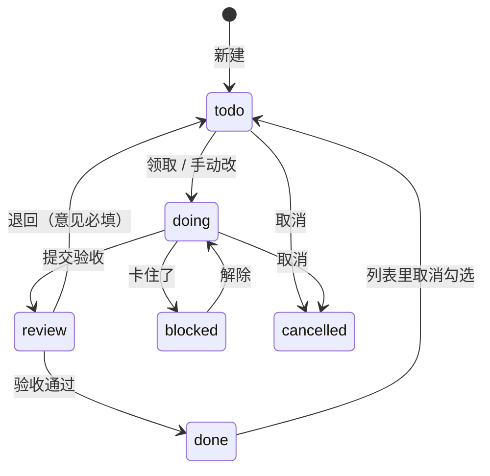

# 任务 规格（SPEC-tasks）

| 项 | 内容 |
|---|---|
| 模块 key | `tasks` |
| 原型入口 | 一级菜单「任务」，http://127.0.0.1:7778 |
| 源码 | `web-next/src/tasks.tsx`（二级菜单、列表、任务抽屉、Webhook 列表和配置页）、`web-next/src/devloop.tsx`（开发闭环：等你验收栏、进展、产出物、执行记录、交给 Claude Code 弹窗、完成圆圈确认，`useDevLoop`）、`web-next/src/schedule.tsx`（定时任务列表和抽屉）、`web-next/src/taskstage.tsx`（阶段看板，AUTO-05）；接线在 `web-next/src/App.tsx`（`patchTask`、`useDevLoop`、`deleteTask`、`taskPlan`、`runScheduleNow`、`ingest` 调用） |
| 数据文件 | `web-next/src/taskdata.ts`（任务、Webhook、投递；末尾是开发闭环的进展、产出物、执行记录和演示数据）、`web-next/src/scheduledata.ts`（定时任务）；状态、优先级的显示名和颜色在 `web-next/src/enumdata.ts`（`task_status`、`task_priority`） |
| 截图 | [`shots/tasks/`](shots/tasks/) |
| 负责任务 | PROTO-04b、PROTO-07（开发闭环） |
| 状态 | 已整理 |
| 最后对照 | 2026-10-28，原型提交 `932555b`；`SPEC-tasks-5`、`SPEC-tasks-6` 和待验收相关的条目按 PROTO-07 的原型改动（未提交）修订 |

## SPEC-tasks-0 模块概述

人工创建、IM 消息转来、Webhook 推来、定时任务建的、运行异常转的任务都在这里；还管两种自动建任务的规则：定时任务和 Webhook 接入。开发任务（交给 Claude Code 做、做完提交验收）也是任务的一种，用 `review` 待验收状态承接。

### 页面清单

| 节 | 页面 | 入口 | 说明 |
|---|---|---|---|
| [SPEC-tasks-1](#spec-tasks-1-二级菜单) | 二级菜单 | 进入任务模块 | 视图、来源、自动化、最近推送四组 |
| [SPEC-tasks-2](#spec-tasks-2-全部任务和逾期) | 全部任务、逾期 | 二级菜单「全部任务」「逾期」（模块入口是全部任务） | 任务列表，按截止日分段 |
| [SPEC-tasks-3](#spec-tasks-3-来源视图) | 来源视图 | 二级菜单「人工创建」「IM 消息」「Webhook」「定时」「运行异常」 | 同一个列表，只看某种来源 |
| [SPEC-tasks-4](#spec-tasks-4-任务抽屉) | 任务抽屉 | 列表点一行、「新建任务」、IM 消息「转任务」、今日点任务 | 新建、查看、编辑、删除 |
| [SPEC-tasks-5](#spec-tasks-5-任务抽屉的开发闭环区块) | 任务抽屉的开发闭环区块 | 开发任务的抽屉里 | 等你验收栏（验收通过、退回）、进展时间线（按会话分组）、产出物、执行记录；列表完成圆圈的验收确认。改动区原型未做 |
| [SPEC-tasks-6](#spec-tasks-6-交给-claude-code) | 交给 Claude Code | 任务抽屉「开发」组的按钮 | 选执行方式（流式执行 / 切换到终端）、工作目录、只读或允许写入、附加说明，预览提示词；流式显示执行过程，或在终端里开交互会话 |
| [SPEC-tasks-7](#spec-tasks-7-定时任务列表) | 定时任务列表 | 二级菜单「定时任务」 | 规则列表，启停 |
| [SPEC-tasks-8](#spec-tasks-8-定时任务抽屉) | 定时任务抽屉 | 定时任务列表点一行、「新建定时任务」、今日点定时任务 | 配规则和动作、立即执行、执行记录 |
| [SPEC-tasks-9](#spec-tasks-9-webhook-接入) | Webhook 接入 | 二级菜单「Webhook 接入」 | Webhook 列表 |
| [SPEC-tasks-10](#spec-tasks-10-webhook-配置页) | Webhook 配置页 | Webhook 列表点一行、二级菜单「最近推送」下的某个 Webhook、「新建 Webhook」 | 地址、映射、过滤去重、测试推送、推送记录 |
| [SPEC-tasks-11](#spec-tasks-11-阶段看板) | 阶段看板 | 二级菜单「阶段看板」 | 任务按阶段分列、按提出人筛选，卡片上改阶段 |
| [SPEC-tasks-12](#spec-tasks-12-产出物) | 产出物 | 二级菜单「产出物」 | 按任务汇总的产出物清单，展开看每一件，跳到任务抽屉的产出物 |

### 引用本文件的开发任务

| 任务 | 对照的节 |
|---|---|
| DEV-07a 任务列表页接真实接口 | `SPEC-tasks-1.1 到 1.4`、`SPEC-tasks-2`（全节）；待验收见 `SPEC-tasks-2.6`、`SPEC-tasks-0` 状态流转 |
| DEV-07b 任务抽屉：新建、编辑、改状态 | `SPEC-tasks-4`（全节，开发字段见 `SPEC-tasks-4.25 到 4.28`） |
| DEV-08a 进展时间线 | `SPEC-tasks-5.1 到 5.6`、`5.19`（会话 id 复制） |
| DEV-08b 产出物 | `SPEC-tasks-5.7 到 5.11` |
| DEV-08c 执行记录和流式输出 | `SPEC-tasks-5.12 到 5.17`、`5.26` |
| DEV-08d 改动痕迹、验收和退回 | `SPEC-tasks-5.18`、`5.20 到 5.25`、`5.27`（完成圆圈确认）、`5.28` |
| DEV-09 交给 Claude Code | `SPEC-tasks-6`（全节） |
| 交给 Claude Code 选方式（流式 / 终端）、带项目上下文、终端执行回写 | `SPEC-tasks-5.29 到 5.32`、`SPEC-tasks-6.10 到 6.16`、`SPEC-terminal-1.17`、`SPEC-settings-22` |
| 交给 Claude Code 改进行中、预置提示词（AUTO-03 升级为角色）、软链接目录（用户 2026-11-04 提） | `SPEC-tasks-6.17 到 6.19`、`SPEC-settings-24` |
| IM 转任务执行完成后回复原消息（用户 2026-11-04 提） | `SPEC-tasks-4.42`、`SPEC-messages-2.50` |
| TSK-0460 任务交给工作台 Agent 执行（新执行器 agent，用户 2026-11-05 提） | `SPEC-tasks-6.20 到 6.31`、`SPEC-tasks-5.33 到 5.37`、`SPEC-sessions-1.44`、`SPEC-settings-8.16` |
| AUTO-05 任务阶段、提出人与按提出人看板 | `SPEC-tasks-11`（全节）、`SPEC-tasks-1.12`、`SPEC-tasks-0` `Task` 的 `stage`、`requester` |
| AUTO-12 流水线视图与治理 | `SPEC-tasks-4.82`、`SPEC-tasks-11.15`、`SPEC-tasks-11` 阶段变化历史、`SPEC-tasks-0` `Task` 的 `stage_log`；流水线本身见 `sop.md` `SPEC-sop-16` |
| AUTO-07 需求级 git worktree（工作区） | `SPEC-tasks-4.50 到 4.62`（任务抽屉「工作区」、SOP 节点「准备工作区」、自动清理）、`SPEC-settings-25`（端口范围） |
| AUTO-08 测试环境与测试报告 | `SPEC-tasks-4.63 到 4.72`（工作区下「最近一次测试」、SOP 节点「跑测试」、报告与产出）、`SPEC-projects-15.7a`（档案「就绪检查」） |
| AUTO-09 研发 pipeline、测试环境保留给人工验收 | `SPEC-tasks-4.73 到 4.76`（保留的测试环境、回收）、`SPEC-settings-25.7`（保留时长）；流程本身见 `sop.md` `SPEC-sop-12.43 到 12.46` |
| AUTO-10 发布 pipeline | `SPEC-tasks-4.77 到 4.81`（工作区下「最近一次发布」、作废与停止、SOP 节点「准备发布」「上线」）、`SPEC-projects-15.16`（档案命令分两组）；流程本身是 IM 插件写进 SOP 的内置流程「发布 pipeline」（`sop_im_release_pipeline`），研发 pipeline 验收通过后以子流程接上 |
| TODAY-02 今日页 | 点任务打开的抽屉是 `SPEC-tasks-4`；主体见 `today.md` `SPEC-today-1` |
| TASK-04a 定时任务页 | `SPEC-tasks-7`、`SPEC-tasks-8` |
| TASK-04b Webhook 页和来源视图 | `SPEC-tasks-1.5 到 1.8`、`SPEC-tasks-3`、`SPEC-tasks-9`、`SPEC-tasks-10`；来源标签见 `SPEC-tasks-0` `TaskSource` |
| TSK-0497 任务产出物一览（用户 2026-11-06 提） | `SPEC-tasks-12`（全节）、`SPEC-tasks-1.13`、`SPEC-tasks-2.25 到 2.26`、`SPEC-tasks-11.16`；项目任务标签的产出数见 `SPEC-projects-7`；接口见 `docs/api-contract.md`「按对象汇总」「显示种类 display_kind」 |

### 共用数据结构

`Task`（`web-next/src/taskdata.ts`）

| 字段 | 类型 | 必填 | 说明 | 取值 / 示例 |
|---|---|---|---|---|
| `id` | `string` | 是 | 编号 | `tk_s1` |
| `ref` | `string` | 是 | 给人看的编号，原型按现有最大号加一（正式产品由后端发号，见 CORE-11） | `T-012` |
| `title` | `string` | 是 | 标题，去首尾空白后不能为空 | `Export job timeout after 300s` |
| `desc` | `string` | 是 | 描述，可以是空串 | |
| `status` | `TaskStatus` | 是 | 状态 | 见下 |
| `priority` | `Priority` | 是 | 优先级 | 见下 |
| `assignee` | `string` | 是 | 负责人名字，空串表示未分配 | `我`、`周屿` |
| `due` | `string \| null` | 是 | 截止日期 `yyyy-mm-dd`，没有截止为 `null` | `2026-10-31` |
| `source` | `TaskSource` | 是 | 从哪来的 | 见下 |
| `project_id` | `string` | 否 | 所属项目；不属于任何项目时没有这个字段 | `pj_perm` |
| `project_removed` | `string` | 否 | 原属项目被删时记下的项目名，任务上提示「原属项目已删除」；重新选了项目后清掉 | `远川科技权限改造` |
| `acceptance` | `string` | 否 | 开发任务的验收标准，Markdown 清单 `- [ ] …`（正式产品存 `props.acceptance`） | `- [ ] 12 万行的导出 60 秒内完成` |
| `workdir` | `string` | 否 | 开发任务的工作目录，本机绝对路径；没设时继承所属项目的根目录（正式产品是 `workdir` 列） | `/Volumes/project/clients/yuanchuan-permission/server` |
| `repo` | `string` | 否 | 关联仓库，远端地址或本机绝对路径，只放一个（正式产品存 `props.repo`） | `/Volumes/project/example/pm-workspace` |
| `stage` | `string` | 否 | 阶段（AUTO-05），提出人在看板上看到的流程进度，和状态是两套、不联动；取值见 `SPEC-tasks-11` 阶段表，没设时没有这个字段（正式产品存 `props.stage`，改阶段走 `PUT /api/objects/{id}/stage`） | `designing` |
| `stage_log` | `{at, from, to}[]` | 否 | 阶段变化历史（AUTO-12），早的在前，`from`、`to` 没设阶段为空串；流水线时间线（`SPEC-sop-16`）按它算每个阶段停留多久。正式产品不存在任务上，取审计 `kind=stage` | `[{at: "2026-11-04T09:00:00Z", from: "", to: "received"}]` |
| `requester` | `TaskRequester` | 否 | 提出人（AUTO-05）：认到联系人时 `{ contact_id, name, channel?, sender_id? }`，认不上时存 IM 发送者快照 `{ name, channel, sender_id, sender_name }`；IM 转来的自动填（正式产品存 `props.requester`） | `{ contact_id: 'ct_005', name: '许知行', channel: 'lark', sender_id: 'ou_7f3a9c21' }` |
| `created_at` | `string` | 是 | ISO 时间 | |
| `updated_at` | `string` | 是 | ISO 时间，每次改动刷新 | |

`TaskStatus`（`taskdata.ts`）：`'todo' | 'doing' | 'review' | 'blocked' | 'done' | 'cancelled'`（原型的种子没有 `blocked`，正式产品的任务状态集里有，见迁移 0002、0013）。显示名、颜色、说明读设置里的枚举 `task_status`（`enumdata.ts`），数据里只存 key；种子默认值如下，新建任务的默认状态取枚举的 `default_key`（`todo`）。

| key | 显示名 | 颜色 | 说明 | 是否算未结束（`isOpenTask`） |
|---|---|---|---|---|
| `todo` | 待办 | `#a19d92` | | 是 |
| `doing` | 进行中 | `#3d4fd6` | | 是 |
| `review` | 待验收 | `#7048e8` | 做完了等人验收，验收通过再改成已完成。开发任务由 Claude Code 提交验收后停在这里（迁移 0013，非终态） | 是 |
| `blocked` | 受阻 | `#c92a2a` | 卡住了，不算结束，算未完成（非终态；有截止日照常算逾期） | 是 |
| `done` | 已完成 | `#2f7d43` | 算作完成，不再提示逾期 | 否 |
| `cancelled` | 已取消 | `#a19d92` | 不算完成也不算逾期 | 否 |

状态可以在「设置 / 枚举值」里加；页面上的状态筛选、抽屉里的状态按钮都按枚举顺序排，不写死。

状态流转（原型里任意状态之间都能在抽屉里直接切换；下图是开发任务闭环约定的主路径，验收和退回的按钮见 `SPEC-tasks-5.21 到 5.23`）：

`Priority`（`taskdata.ts`）：`'P0' | 'P1' | 'P2' | 'P3' | (string & {})`，可以在设置的枚举 `task_priority` 里新增。种子：`P0` P0 紧急 `#c0352b` 当天处理 / `P1` P1 高 `#b0570b` 本周内 / `P2` P2 中 `#3d4fd6`（默认） / `P3` P3 低 `#a19d92` 有空再做。

`TaskSource`（`taskdata.ts`），按 `kind` 区分：

| `kind` | 其余字段 | 列表上的来源标签（`SourceTag`） | 抽屉里的来源卡 |
|---|---|---|---|
| `manual` | 无 | 「人工」 | 无 |
| `import`（正式产品才有） | 无 | 「人工」，悬停显示「导入：导入脚本建的任务」；导入脚本建的任务算进「人工创建」视图，行上和二级菜单叫法一致 | 无 |
| `im` | `message_id: string`、`channel: string`、`sender: string`、`text: string` | 「渠道名 · 发送人」，悬停显示原文 | 「来自 IM 消息」，引用原文，「查看原消息」 |
| `webhook` | `hook_id: string`、`delivery_id: string` | 「Webhook · Webhook 名」，Webhook 已删时「已删除」 | 「来自 Webhook」，「查看配置」「看推送内容」 |
| `schedule` | `schedule_id: string`、`name: string` | 「定时 · 定时任务名」 | 「来自定时任务」，「查看规则」 |
| `incident` | `incident_id: string`、`title: string` | 「异常 · 异常标题」，悬停显示标题 | 「来自运行异常」，「查看异常」 |

`Webhook`（`taskdata.ts`）

| 字段 | 类型 | 必填 | 说明 | 取值 / 示例 |
|---|---|---|---|---|
| `id` | `string` | 是 | 编号 | `wh_sentry` |
| `name` | `string` | 是 | 名称，保存时必填 | `Sentry 线上告警` |
| `token` | `string` | 是 | 接收地址最后一段，新建时随机生成 | `k7Qm2sentry9x` |
| `secret` | `string` | 是 | 签名用的密钥，新建时随机生成 | `whsec_3f9a71c2e84b` |
| `enabled` | `boolean` | 是 | 停用后推送只记录不建任务 | `true` |
| `mapping` | `{ title: string; desc: string; priority: string; assignee: string; due: string }` | 是 | 任务字段取推送 JSON 里的哪个路径，形如 `event.title`、`items[0].name`；`title` 必填，其余留空用默认值或不取 | `{ title: 'event.title', desc: 'event.culprit', priority: 'event.level', assignee: '', due: '' }` |
| `filter` | `string` | 是 | 只有满足才建任务，只支持 `路径 == 值` / `路径 != 值`，留空不过滤 | `action == created` |
| `dedupe` | `string` | 是 | 去重字段路径，同一个值第二次推来不再建（只认任务还在的投递） | `event.id` |
| `defaults` | `{ priority: Priority; assignee: string }` | 是 | 映射取不到时的默认值 | `{ priority: 'P1', assignee: '周屿' }` |
| `sample` | `string` | 是 | 测试推送用的示例 JSON 文本 | |
| `created_at` | `string` | 是 | ISO 时间 | |

`Delivery`（`taskdata.ts`）：一次推送的记录

| 字段 | 类型 | 必填 | 说明 | 取值 / 示例 |
|---|---|---|---|---|
| `id` | `string` | 是 | 编号 | `dl_s1` |
| `hook_id` | `string` | 是 | 哪个 Webhook | `wh_sentry` |
| `at` | `string` | 是 | 推送时间 | |
| `payload` | `Json`（`Record<string, unknown>`） | 是 | 原始推送内容 | |
| `result` | `'created' \| 'skipped' \| 'failed'` | 是 | 结果 | `created` 已建任务（绿） / `skipped` 已忽略（灰） / `failed` 失败（红） |
| `task_id` | `string` | 否 | 建出的任务；按重复忽略时指向之前建的那条 | `tk_s1` |
| `reason` | `string` | 否 | 没建或失败的原因 | `标题路径 answers.need 取不到值` |
| `mapped` | `Partial<Record<'title' \| 'desc' \| 'priority' \| 'assignee' \| 'due', string>>` | 否 | 映射出来的字段，失败时也留着 | |

`Ingest`（`taskdata.ts`）：`{ delivery: Delivery; task?: Task }`，一次推送处理的结果。处理顺序（`ingest`）：Webhook 停用 -> `skipped`「Webhook 已停用，只记录不建任务」；不满足过滤 -> `skipped`「不满足过滤条件 …（实际是「…」）」；过滤条件写法不对 -> `skipped`「过滤条件写法不对：…」；去重值已建过且那条任务还在 -> `skipped`「… 已经建过任务，按重复推送忽略」；标题取不到 -> `failed`「标题路径 … 取不到值」或「没有配置标题映射」；否则建任务，标题截前 120 字，截止只取 `yyyy-mm-dd` 开头，优先级按 `SPEC-tasks-10.9` 的规则换算。

`Schedule`（`web-next/src/scheduledata.ts`）

| 字段 | 类型 | 必填 | 说明 | 取值 / 示例 |
|---|---|---|---|---|
| `id` | `string` | 是 | 编号 | `sc_weekly_agenda` |
| `name` | `string` | 是 | 名称，保存时必填 | `周会前整理议程` |
| `enabled` | `boolean` | 是 | 停用后不自动执行，可以手动执行 | `true` |
| `rule` | `ScheduleRule` | 是 | 什么时候 | 见下 |
| `action` | `ScheduleAction` | 是 | 做什么 | 见下 |
| `history` | `ScheduleRun[]` | 是 | 执行记录，新的在前 | |
| `created_at` | `string` | 是 | ISO 时间 | |

`ScheduleRule`（`scheduledata.ts`）

| 字段 | 类型 | 必填 | 说明 | 取值 / 示例 |
|---|---|---|---|---|
| `freq` | `Freq` | 是 | 频率 | `once` 只执行一次 / `daily` 每天 / `weekdays` 工作日 / `weekly` 每周 / `monthly` 每月 / `cron` Cron 表达式 |
| `time` | `string` | 是 | `HH:mm`，`cron` 时不用 | `09:00` |
| `weekdays` | `number[]` | 是 | 每周的周几，0 是周日 | `[1]` |
| `day` | `number` | 是 | 每月几号，31 在小月按月底 | `25` |
| `date` | `string` | 是 | 只执行一次的日期 `yyyy-mm-dd` | |
| `cron` | `string` | 是 | 5 段：分 时 日 月 周 | `0 18 * * 1` |

新建时的默认规则（`emptyRule`）：每周一 09:00，`date` 是明天，`cron` 是 `0 9 * * 1`。规则校验（`ruleError`）：时间不是 `HH:mm`「时间要写成 09:00 这种格式」；每周没选周几「每周执行要至少选一天」；只执行一次没选日期「选一个执行日期」、时间已过「这个时间已经过去了」；Cron 不是 5 段「Cron 要 5 段：分 时 日 月 周，比如 0 9 * * 1」。原型的 Cron 只认「分 时 * * 周」，其余按每天这个点算（正式产品要完整支持）。

`ScheduleAction`（`scheduledata.ts`），按 `kind` 区分，显示名 `ACTION_LABEL`：

| `kind` | 显示名 | 其余字段 | 列表里「做什么」的文字（`actionText`） |
|---|---|---|---|
| `task` | 建一条任务 | `title: string`（可写 `{{date}}`，执行时换成当天日期）、`desc: string`、`priority: Priority`、`assignee: string`、`due_days: number`（截止是执行日加几天，可选 0 / 1 / 2 / 3 / 5 / 7） | 建任务「标题」，没填时「未填标题」 |
| `remind` | 提醒 | `title: string`（必填，最多 100 字）、`body: string`（内容，可空，最多 2000 字）、`task_id: string`（关联的任务，空串为不关联；正式产品字段名 `object_id`）、`popup: 'toast' \| 'modal'`（弹窗方式，默认 `toast`，`SPEC-tasks-8.26`） | 提醒「标题」，关联了任务时加「，关联任务」。到点只在工作台里弹一条通知（右下角或屏幕中间，看 `popup`；进通知列表，不外发 IM），关联了任务的点了打开它；只提醒一次（`once`）的到点后自动停用，列表「下次执行」写「已提醒」（错过的写「已错过」）；重复规则照常每次提醒。任务抽屉里「设个提醒」建的就是这种（`taskReminder`，见 `SPEC-tasks-4.30`） |
| `sop` | 执行 SOP | `sop_id: string` | 执行「SOP 名」，SOP 已删时「已删除的 SOP」 |
| `agent` | 让 Agent 去做 | `agent_id: string`、`prompt: string` | 「Agent 名：要求」，Agent 已删时「已删除的 Agent」，没填要求时「未填要求」 |
| `claude` | 交给 Claude Code | `workdir: string`（本机绝对路径，必填）、`prompt: string`（必填，可写 `{{date}}`）、`preset_id: string`（「设置 / 角色」里的角色，空串为不用）、`allow_writes: boolean`（默认 `false`；只读角色恒为 `false`）、`out_dir: string`（产出目录，`workdir` 下的相对路径，空为 `workdir` 本身，不许绝对路径和 `..`） | 要求原文，没填时「未填要求」。到点在 `workdir` 无人值守跑一次 Claude Code，不建任务、不开终端，结论和写出的文件记进这条定时任务的执行记录（TSK-0429，`SPEC-tasks-8.27` 到 `8.31`）。演示「整理 FDE 反馈需求清单」（每天 10:00） |
| `incident_sweep` | 运行异常巡检 | `min_level: IncidentLevel`（`error` 只看错误 / `warn` 错误和警告）、`min_count: number`（最少次数，可选 1 / 2 / 3 / 5 / 10） | 「巡检运行异常：只看错误，建任务交给 Claude Code」，次数大于 1 时加「，至少 N 次」（INC-01）。运行异常页「开启自动巡检」建的默认是每天 09:00、只看错误、1 次（`sweepSchedule`），见 `SPEC-settings-18.14` |
| `publish` | 发布视频 | `publish_id: string`（视频的发布记录） | 发布「<平台> · <标题>」，发布记录已删时「已删除的发布记录」。这种定时任务不能手建，跟着发布记录自动生成和改（`publishSchedule`、`syncPublishSchedules`，id `sc_pub_<发布 id>`），见 `SPEC-videos-15.12`（VID-06p） |

`ScheduleRun`（`scheduledata.ts`）：`{ at: string; ok: boolean; text: string; ref?: string; manual?: boolean; files?: string[] }`。`text` 是给人看的结果（「建了任务 T-005」「没执行：已停用」）；`ref` 是建出的任务编号；`manual` 为 `true` 表示「立即执行一次」手动触发；`files` 是「交给 Claude Code」这次写出的文件（绝对路径），执行记录里列文件名、悬停看全路径。

`TaskView`（`tasks.tsx`）：二级菜单的 key。`'all' | 'due' | 'manual' | 'im' | 'webhook' | 'schedule' | 'incident' | 'schedules' | 'hooks' | 'hook:<Webhook id>'`，其中 `hook:new` 是新建 Webhook。

### 联动总表

| 方向 | 对方模块 | 触发 | 结果 | 见 |
|---|---|---|---|---|
| 进来 | 今日 | 点任务行 / 完成圆圈 / 「全部任务」 | 打开任务抽屉 / 改为已完成 / 任务列表 | `SPEC-today-1.8 到 1.11` |
| 进来 | 今日 | 点「今天还会自动执行」的一行 | 定时任务列表并打开抽屉 | `SPEC-today-1.12` |
| 进来 | IM 消息 | 点「转任务」 | 已经转过：打开那条任务；没转过：打开「IM 消息转任务」抽屉 | `SPEC-tasks-4.3`、`SPEC-messages` |
| 进来 | IM 消息 | 转任务建好 | 任务记提出人（发送者认到的联系人，认不上存发送者快照），阶段从「已接收」开始 | `SPEC-tasks-11.6` |
| 进来 | 设置 / 运行异常 | 异常抽屉里「转为研发任务」再点「建任务」 | 建一条 `source.kind = incident` 的任务，异常状态改为已转任务 | `SPEC-settings` |
| 进来 | 外部系统 | 往 Webhook 接收地址推 JSON | 记一条投递，按规则建任务 | `SPEC-tasks-10` |
| 进来 | 命令面板 | 「新建定时任务」 | 定时任务列表并打开新建抽屉 | `SPEC-tasks-8` |
| 进来 | 命令面板 | 搜到「任务」组的条目（按编号、标题、正文）并回车 | 任务列表并打开该任务抽屉 | 全局 |
| 出去 | IM 消息 | 抽屉「查看原消息」 | 跳到原消息 | `SPEC-messages` |
| 出去 | 设置 / 运行异常 | 抽屉「查看异常」 | 设置的运行异常并打开异常抽屉 | `SPEC-settings` |
| 出去 | 会话 | 定时任务执行「让 Agent 去做」 | 会话 / 执行记录多一条 | `SPEC-sessions` |
| 出去 | SOP | 定时任务执行「执行 SOP」 | SOP 多一次执行 | `SPEC-sop` |
| 改动 | IM 消息 | 转任务时勾选「建好后把这条消息标为已处理」 | 消息状态改为已处理、取消稍后提醒、标为已读 | `SPEC-tasks-4.14` |
| 改动 | 设置 / 运行异常 | 删除由异常转来的任务 | 异常退回未处理，备注「关联的任务已删除」 | `SPEC-tasks-4.19` |
| 改动 | 设置 / 运行异常 | Webhook 测试推送结果为失败 | 上报一条 warn 级运行异常「Webhook 名：推送没建成任务」 | `SPEC-tasks-10.15` |
| 改动 | 项目 | 任务选了所属项目 | 项目的任务标签里多一条 | `SPEC-projects` |
| 改动 | 项目 | 项目被删 | 任务移出项目，留 `project_removed` 提示 | `SPEC-tasks-2.9` |

## SPEC-tasks-1 二级菜单

任务模块的二级菜单。桌面在左侧竖排；手机变成页面顶部横向滚动的一排标签。

### 截图

二级菜单出现在本模块每张截图里，见 `SPEC-tasks-2` 的截图（桌面左侧一栏、手机顶部第二行）。

### 交互

| 编号 | 元素 | 操作 | 结果 |
|---|---|---|---|
| SPEC-tasks-1.1 | 「视图」组：全部任务 | 点击 | 切到全部任务列表（`SPEC-tasks-2`），关掉已打开的抽屉 |
| SPEC-tasks-1.2 | 「视图」组：逾期 | 展示、点击 | 有逾期时显示红点，说明「N 条过了截止日还没完成」；没有时说明「没有逾期的任务」。点击切到逾期列表 |
| SPEC-tasks-1.12 | 「视图」组：阶段看板 | 展示、点击 | 说明「按阶段分列，按提出人看进度」，点击切到阶段看板（`SPEC-tasks-11`），路由 `/tasks/board` |
| SPEC-tasks-1.13 | 「视图」组：产出物 | 展示、点击 | 说明「N 条任务有产出」（汇总没取到时说明「按任务看提交、文档、原型等产出」，不显示 0），点击切到产出物（`SPEC-tasks-12`），路由 `/tasks/outputs`。和全部任务、阶段看板同一种切换，不另起菜单（TSK-0497） |
| SPEC-tasks-1.3 | 分组标题 | 展示 | 视图、来源、自动化、最近推送四组，组标题不可点。本模块的二级菜单不带搜索框（外壳二级菜单的搜索要显式开启，任务模块没开） |
| SPEC-tasks-1.4 | 任意菜单项 | 点击 | 切换视图都会关闭当前抽屉 |
| SPEC-tasks-1.5 | 「来源」组：人工创建、IM 消息、Webhook、定时、运行异常 | 点击 | 切到对应的来源视图（`SPEC-tasks-3`） |
| SPEC-tasks-1.6 | 「自动化」组：定时任务 | 点击 | 说明「到点自动建任务、跑 SOP、叫 Agent」，切到定时任务列表（`SPEC-tasks-7`） |
| SPEC-tasks-1.7 | 「自动化」组：Webhook 接入 | 展示、点击 | 说明「N 个」，有最近一次推送失败的 Webhook 时加「，M 个最近推送失败」并显示红点。点击切到 Webhook 列表（`SPEC-tasks-9`） |
| SPEC-tasks-1.8 | 「最近推送」组 | 展示、点击 | 最近推送过的 Webhook，按最近推送时间排，最多 5 个；说明「N 分钟前推送」，停用的加「· 已停用」；最近一次失败的显示红点。点击打开它的配置页（`SPEC-tasks-10`）。打开的 Webhook 不在这 5 个里时，高亮落在「Webhook 接入」 |
| SPEC-tasks-1.9 | 菜单底部「新建 Webhook」 | 点击 | 打开新建 Webhook 页（`SPEC-tasks-10`，`hook:new`） |

### 空状态和异常状态

| 编号 | 场景 | 显示 | 可做的操作 |
|---|---|---|---|
| SPEC-tasks-1.10 | 还没有任何推送 | 「最近推送」组不出现 | 「新建 Webhook」 |
| SPEC-tasks-1.11 | 逾期条数、失败条数加载失败 | 原型未做。正式产品：不显示红点和数字，不显示成「没有逾期的任务」 | 无 |

### 数据

逾期条数用 `isOverdue`：有 `due`、早于今天、状态未结束。「最近推送」用每个 Webhook 最近一条 `Delivery`（`lastDeliveries`）。正式产品里逾期条数取 `/api/counts` 的 `overdue`，必须和逾期列表口径一致（DEV-07a）。

### 联动

| 方向 | 对方模块 | 触发 | 结果 | 见 |
|---|---|---|---|---|
| 进来 | 今日 | 「还有 N 条，去任务」 | 有逾期时停在「逾期」 | `SPEC-today-1.11` |

## SPEC-tasks-2 全部任务和逾期

任务列表。两个视图共用一个页面，差别只在过滤条件、标题和说明。

### 截图

全部任务（模块入口截图 `入口-*` 与此相同）：

| | 亮 | 暗 |
|---|---|---|
| 桌面 1440 |  |  |
| 手机 375 |  |  |

逾期：

| | 亮 | 暗 |
|---|---|---|
| 桌面 1440 |  |  |
| 手机 375 |  |  |

### 交互

| 编号 | 元素 | 操作 | 结果 |
|---|---|---|---|
| SPEC-tasks-2.1 | 页面标题 | 展示 | 面包屑「任务 /」加标题，标题旁是当前筛选后的条数。全部任务：「全部任务」，说明「人工创建、IM 消息转来、Webhook 推来的任务都在这里，按截止日分段」；逾期：「逾期任务」，说明「过了截止日还没完成的任务，最早到期的在前」 |
| SPEC-tasks-2.2 | 右上「新建任务」 | 点击 | 打开新建任务抽屉（`SPEC-tasks-4`），焦点在标题 |
| SPEC-tasks-2.3 | 状态筛选（分段按钮） | 点击 | 依次是「未完成」（默认，未结束的状态都算，含待验收）、枚举里除 `cancelled` 以外的前 5 个状态、「全部」；每个按钮带该视图下的条数。已取消的只在「全部」里看得到 |
| SPEC-tasks-2.4 | 「更多状态」下拉 | 选择 | 枚举里的状态超过 5 个（不算已取消）时出现，可搜索，选项旁带条数；选中后按该状态过滤，清空回到「未完成」 |
| SPEC-tasks-2.5 | 「全部优先级」下拉 | 选择 | 按优先级过滤，选项来自枚举 `task_priority` |
| SPEC-tasks-2.6 | 待验收 | 展示 | 状态筛选里有「待验收」按钮（`review`）；待验收的任务在「未完成」里照常按截止日分段，状态列显示紫色「待验收」标签；不算逾期豁免，过了截止日照样进「逾期」。演示数据里 `T-015`、`T-017` 待验收，`T-016` 进行中，都由 Claude Code 做（`SPEC-tasks-5`） |
| SPEC-tasks-2.7 | 「全部项目」下拉 | 选择 | 可搜索；选项是所有项目和「不属于项目」。选中的项目已删除时显示「已删除的项目」 |
| SPEC-tasks-2.23 | 「全部负责人」下拉 | 选择 | 可搜索；选项依次是「我」、「未分配」、列表里出现过的负责人（旁边带条数，多的在前）。「未分配」是没有负责人的任务。选「我」时右边多一个「我是」下拉，从干系人名册里选自己是哪位，只记在这台浏览器上；没选过时列表显示「还没选你是哪位干系人」。选过之后「我」显示成「我（名字）」。原型未做（B-07） |
| SPEC-tasks-2.24 | 排序下拉 | 选择 | 「默认排序」（`SPEC-tasks-2.12`）、「按优先级」、「最近更新」、「创建时间」；选了后各段都按它排，时间都是新的在前。原型未做（B-06） |
| SPEC-tasks-2.8 | 搜索框 | 输入 | 按标题、描述、编号、负责人模糊匹配（不区分大小写），实时过滤，清空后恢复 |
| SPEC-tasks-2.9 | 列表行 | 展示 | 列：完成圆圈、任务（编号、标题；下一行是来源标签、项目标签、「N 分钟前创建」）、优先级、负责人（空时「未分配」）、截止（今天显示「今天」，其余 `mm-dd`，没有显示「-」，逾期的红字加「逾期」）、状态。项目已删除时项目标签显示「已删除的项目」；任务的原属项目被删时显示「原属项目已删除」，悬停显示原项目名。已完成的行变淡 |
| SPEC-tasks-2.10 | 列表行 | 点击 | 打开该任务的抽屉（`SPEC-tasks-4`），当前行高亮。宽屏（抽屉停靠在右侧，宽于 1100px）时二级菜单自动收起，把宽度让给列表，关掉抽屉后恢复；抽屉浮在上面时（1100px 及以下）二级菜单不动。原型未做（C-01） |
| SPEC-tasks-2.11 | 行首完成圆圈 | 点击 | 不打开抽屉。未完成的标为 `done`，圆圈打勾；已完成的改回 `todo`。悬停提示「标为已完成」/「标为待办」。待验收的任务例外：先弹确认，确认后等于验收通过，悬停提示「验收通过」（`SPEC-tasks-5.27`） |
| SPEC-tasks-2.12 | 截止分段 | 展示 | 列表按截止日分段：逾期（红字）、今天、本周（到本周日）、以后、无截止、已结束（`done`、`cancelled`），没有条目的段不出现。段内默认：逾期、今天、本周、以后先按优先级 key 排，再按截止日，没有截止的在后；无截止按最近更新倒序；已结束按完成时间倒序（没记完成时间的看最近更新），刚做完的在最上面。原型是全部按优先级，已结束按编号正序（B-06） |
| SPEC-tasks-2.13 | 分段标题 | 点击 | 折叠或展开这一段，标题带条数 |
| SPEC-tasks-2.14 | 段尾「这一段还有 N 条」 | 点击 | 每段先露 30 条，超出时出现；点一次多露 100 条。换视图、状态、优先级、项目、负责人、排序或搜索词后各段重新只露 30 条 |
| SPEC-tasks-2.25 | 列表行的产出标记 | 展示、点击 | TSK-0497。有产出物的任务在来源、项目标签后面多一个绿色标记「产出 3 · 提交 2 文档 1」：总件数加各种类件数，种类按字典 `artifact_kind` 的顺序和名字，只有一种时写「2 · 提交」；悬停逐行列出各种类件数。没有产出的不显示。点它不切换行选中、直接打开任务抽屉并停在「开发任务」标签、滚到产出物面板（正式前端地址带 `?tab=dev&focus=artifacts`）。种类按显示种类算：登记时没填种类的（Claude Code 执行后扫目录登记的那批）按备注、链接、扩展名推断成代码、文档、数据等，不显示「未分类」 |
| SPEC-tasks-2.26 | 「全部产出」下拉 | 选择 | TSK-0497。「全部产出」「有产出」「无产出」，和状态、项目、负责人等其余筛选同时生效，状态按钮上的条数跟着变；例如状态选「已完成」、这里选「无产出」，就是做完了却没留下任何产出的任务。产出汇总还没取到时下拉不可用、不筛（不把「还不知道」当成「无产出」）。筛空时是「没有匹配的任务」 |
| SPEC-tasks-2.15 | 手机宽度、窄列 | 展示 | 正文宽度不到 640px 时隐藏负责人、截止两列，只留圆圈、任务、优先级、状态。列表不到 480px（手机）时每行两层：第一行圆圈、编号和标题，标题占满整行；第二行优先级、状态、来源和项目标签、创建时间，表头不显示（B-11，原型未做，原型里标题只剩几个字）。抽屉开着且列表不到 640px 时是窄列：任务列只留编号和标题，标题最多两行、超出省略，不显示来源标签、项目标签、创建时间那一行，逐条看时靠标题认任务。原型未做，原型里抽屉打开后标题列整列被挤掉（C-01） |

### 空状态和异常状态

| 编号 | 场景 | 显示 | 可做的操作 |
|---|---|---|---|
| SPEC-tasks-2.16 | 全部任务视图没有任务 | 「这里还没有任务」，下面「点右上角新建一个」 | 「新建任务」 |
| SPEC-tasks-2.17 | 逾期视图没有任务 | 「没有逾期的任务」，下面「截止日都还没到，或者已经做完了」 | 无 |
| SPEC-tasks-2.18 | 有搜索词、优先级、项目或负责人筛选但没有结果 | 「没有匹配的任务」 | 清掉筛选条件 |
| SPEC-tasks-2.19 | 只是状态筛选没有结果（视图里有任务，如「定时」视图里全是已完成） | 「没有符合条件的任务」，下面说明：选的是具体状态时「没有处于「状态名」的任务」，「未完成」时「这里的 N 条都已结束」。搜索、优先级、项目筛空时是「没有匹配的任务 / 换个筛选条件试试」；视图里一条都没有才是视图的空状态（`SPEC-tasks-3.7`） | 「切回「未完成」」/「看全部」 |
| SPEC-tasks-2.20 | 加载失败 | 原型未做。正式产品：列表区显示错误信息和「重试」，状态按钮上的条数不显示 | 重试 |
| SPEC-tasks-2.21 | 改状态失败（点完成圆圈） | 原型未做。正式产品：圆圈恢复原状，提示失败原因 | 再点一次 |
| SPEC-tasks-2.22 | 状态被别处改了（MCP、其它客户端） | 原型未做。正式产品：刷新或重新进入页面后显示新状态，和其它客户端看到同一份数据（DEV-07a） | 刷新 |

### 数据

见 `SPEC-tasks-0` `Task`、`TaskStatus`、`Priority`、`TaskSource`。页面内部类型（`tasks.tsx`）：

| 名称 | 类型 | 说明 |
|---|---|---|
| `StatusFilter` | `'open' \| TaskStatus \| 'all'` | 状态筛选；`open` 即未结束 |
| `DueSeg` | `'overdue' \| 'today' \| 'week' \| 'later' \| 'none' \| 'closed'` | 截止分段：逾期 / 今天 / 本周 / 以后 / 无截止 / 已结束 |
| `PAGE` | `30` | 每段先露几条 |

逾期视图的条件：`isOverdue`（有 `due`、早于今天、未结束）。正式产品用 `GET /api/objects?type=task&overdue=true`，条数和 `/api/counts` 的 `overdue` 一致；搜索走 `q=`；本周、今天的口径见 `docs/api-contract.md` 工作对象一节。

### 联动

| 方向 | 对方模块 | 触发 | 结果 | 见 |
|---|---|---|---|---|
| 出去 | 任务抽屉 | 点一行 / 新建任务 | 打开抽屉 | `SPEC-tasks-4` |
| 改动 | 今日 | 点完成圆圈 | 今日的「今天的任务」同步 | `SPEC-today-1.7` |

## SPEC-tasks-3 来源视图

同 `SPEC-tasks-2` 的列表，只看 `source.kind` 等于某个来源的任务；筛选、分段、行、抽屉的交互完全一样，只列差别。

### 截图

| 视图 | 桌面 1440 亮 | 桌面 1440 暗 | 手机 375 亮 | 手机 375 暗 |
|---|---|---|---|---|
| 人工创建 |  |  |  |  |
| IM 消息 |  |  |  |  |
| Webhook |  |  |  |  |
| 定时 |  |  |  |  |
| 运行异常 |  |  |  |  |

### 交互

| 编号 | 元素 | 操作 | 结果 |
|---|---|---|---|
| SPEC-tasks-3.1 | 页面标题和说明 | 展示 | 人工创建：「人工创建的任务」/「自己手动建的任务」；IM 消息：「IM 消息转的任务」/「在 IM 消息里点「转任务」建的，能回看原消息」；Webhook：「Webhook 转的任务」/「外部系统推到接收地址后按映射规则自动建的，能回看原始推送」；定时：「定时任务建的任务」/「定时任务到点自动建的，规则在「定时任务」里改」；运行异常：「运行异常转的研发任务」/「从「设置 / 运行异常」转过来的，带着异常详情；做完回去把异常标为已解决」 |
| SPEC-tasks-3.2 | 状态按钮上的条数 | 展示 | 只数这个来源的任务 |
| SPEC-tasks-3.3 | 来源标签 | 展示 | 每行的来源标签见 `SPEC-tasks-0` `TaskSource`；条数与按 `source` 筛选的结果一致（TASK-04b） |
| SPEC-tasks-3.4 | 「新建任务」 | 点击 | 在任何来源视图里新建的都是人工任务（`source.kind = manual`），建完不一定出现在当前视图 |

### 空状态和异常状态

| 编号 | 场景 | 显示 | 可做的操作 |
|---|---|---|---|
| SPEC-tasks-3.5 | IM 消息视图没有任务 | 「这里还没有任务」，下面「在 IM 消息里点「转任务」」 | 无 |
| SPEC-tasks-3.6 | Webhook 视图没有任务 | 「这里还没有任务」，下面「在「Webhook 接入」里建一个 Webhook，把地址填到外部系统里」 | 二级菜单「Webhook 接入」 |
| SPEC-tasks-3.7 | 人工创建、定时、运行异常视图没有任务 | 「这里还没有任务」，下面：人工创建「点右上角新建一个」，定时「定时任务到点会建在这里」，运行异常「在「设置 / 运行异常」里转任务」 | 人工创建：「新建任务」 |
| SPEC-tasks-3.8 | 来源对象已删除 | Webhook 已删：来源标签「Webhook · 已删除」；定时任务、异常已删：标签照旧显示建任务时记下的名字 | 无 |

### 数据

过滤条件 `t.source.kind === view`，`view` 是 `manual`、`im`、`webhook`、`schedule`、`incident` 之一。正式产品的来源字段由 TASK-01 补到后端。

### 联动

| 方向 | 对方模块 | 触发 | 结果 | 见 |
|---|---|---|---|---|
| 进来 | IM 消息 / Webhook / 定时任务 / 运行异常 | 各自建任务 | 对应来源视图多一条 | `SPEC-tasks-0` 联动总表 |

## SPEC-tasks-4 任务抽屉

从右侧滑出的抽屉，新建和查看共用。三种开法：新建（kicker「新建任务」）、IM 消息转任务（kicker「IM 消息转任务」）、查看已有任务（kicker 是任务编号）。

### 截图

开发闭环和未保存确认的抽屉截图见 `SPEC-tasks-5` 和 `SPEC-tasks-4.23`，其余没有截图。看到它的步骤：

- 新建：任务模块右上「新建任务」。
- 查看 IM 来源的任务：全部任务里点 `T-010`。
- 查看 Webhook 来源的任务：点 `T-012`，再点来源卡的「看推送内容」。
- 查看定时来源：「全部」状态下点 `T-005`；运行异常来源：点 `T-013`。
- IM 消息转任务：IM 消息模块里选一条待处理的消息，点「转任务」。
- 删除确认：打开任意任务，点左下「删除任务」。
- 开发任务（标签：基础信息、开发任务、SOP、执行记录；开发任务里是等你验收栏、开发组、进展、产出物）：点 `T-015`、`T-017`（待验收，默认停在开发任务）或 `T-016`（进行中，默认停在基础信息），截图见 `SPEC-tasks-5`。

### 交互

| 编号 | 元素 | 操作 | 结果 |
|---|---|---|---|
| SPEC-tasks-4.1 | 右上关闭按钮 / Esc | 点击 / 按键 | 关闭抽屉，不保存。原型没有未保存提示（见文末第 6 条） |
| SPEC-tasks-4.2 | 新建 | 打开 | 标题空、获得焦点；状态取枚举 `task_status` 的默认值（`todo`），优先级取 `task_priority` 的默认值（`P2`），负责人「我」，没有截止，不属于项目 |
| SPEC-tasks-4.3 | IM 消息转任务 | 打开 | 顶部来源卡「来自 IM 消息」：渠道 · 发送人、原文引用、「查看原消息」；标题预填消息正文前 40 字（空白合并）。这条消息已经转过任务时，不开新建，直接打开那条任务。消息在消息列里时可以勾「附上消息列」，把整段消息列写进任务正文（`SPEC-messages-2.15`） |
| SPEC-tasks-4.4 | 来源卡「查看原消息」 | 点击 | 切到 IM 消息模块并打开原消息 |
| SPEC-tasks-4.5 | 来源卡（Webhook）「查看配置」 | 点击 | 关闭抽屉，切到这个 Webhook 的配置页（`SPEC-tasks-10`）；Webhook 已删时不显示按钮，名称显示「已删除的 Webhook」 |
| SPEC-tasks-4.6 | 来源卡（Webhook）「看推送内容」/「收起推送内容」 | 点击 | 展开或收起这次投递的原始 JSON；说明文字带「N 分钟前推送」。找不到投递时不显示 |
| SPEC-tasks-4.7 | 来源卡（定时）「查看规则」 | 点击 | 切到定时任务列表并打开该定时任务的抽屉（`SPEC-tasks-8`） |
| SPEC-tasks-4.8 | 来源卡（运行异常）「查看异常」 | 点击 | 切到「设置 / 运行异常」并打开异常抽屉 |
| SPEC-tasks-4.9 | 标题（必填） | 输入 | 占位「要做的事」 |
| SPEC-tasks-4.10 | 描述 | 输入 | 多行文本，高度随内容自动撑开：最小 6 行高，打字、粘贴长文都跟着变高，不出内部滚动条、不给手动拉；量高度时抽屉的滚动位置不跳。正式产品：正文（Markdown）的编辑框同样撑开，「预览」也完整显示、不截高度；验收标准同样处理 |
| SPEC-tasks-4.11 | 状态、优先级（分段按钮） | 点击 | 选项按枚举顺序，悬停显示枚举里的说明；当前值已被停用或删除时仍保留在选项里（`optionsWith`）。状态里有「待验收」 |
| SPEC-tasks-4.12 | 负责人 | 输入或选择 | 可手填；候选是「我」加联系人里「同事」组的人 |
| SPEC-tasks-4.13 | 截止日期、所属项目 | 选择 | 日期可清空；所属项目可搜索，选「不属于项目」清空。任务原属项目被删时，项目为空并在下面显示「原属项目「名称」已删除」，重新选项目后这条提示消失 |
| SPEC-tasks-4.14 | 「建好后把这条消息标为已处理」 | 勾选 | 只在 IM 消息转任务、且消息还是待处理时出现，默认勾上；建好后把消息改为已处理、取消稍后提醒、标为已读 |
| SPEC-tasks-4.42 | 「执行完成后在原消息里回复」 | 勾选 | 只在 IM 消息转任务时出现，默认勾上，下面灰字「任务交给 Claude Code 执行成功、或标为已完成后，自动在原消息里回复对方，带上执行结论（SOP「IM 任务回执」）」。勾着建任务时任务来源记 `reply_on_done`，正式产品同时发起内置 SOP「IM 任务回执」并关联到这条任务（`SPEC-messages-2.50`）；回执没发起时（SOP 插件没在运行、流程被删）任务照建，列表顶栏提示「任务建好了，但<原因>」。原型只记勾选，不模拟回复 |
| SPEC-tasks-4.15 | 创建 / 更新时间 | 展示 | 查看已有任务时在表单末尾显示「N 天前创建 · N 分钟前更新」 |
| SPEC-tasks-4.16 | 「创建任务」 | 点击 | 标题去首尾空白后保存；建好后抽屉切到这条新任务的查看状态。来源：IM 转来的记 `im`，其余 `manual` |
| SPEC-tasks-4.17 | 「保存」 | 点击 | 保存全部字段并关闭抽屉，`updated_at` 刷新；重新选了项目时清掉 `project_removed` |
| SPEC-tasks-4.18 | 「取消」 | 点击 | 同关闭 |
| SPEC-tasks-4.25 | 「+ 开发信息：验收标准、工作目录，交给 Claude Code 做」 | 点击 | 新建任务时出现在所属项目下面，展开后是「开发」组。已存在的任务上「开发」组在「开发任务」标签里（`SPEC-tasks-4.36`），不是开发任务时基础信息末尾是「+ 设为开发任务」 |
| SPEC-tasks-4.26 | 「开发」组：验收标准 | 输入 | 等宽多行文本，占位「- [ ] 一条一行，写成能检查的样子」；清空等于不设。保存时随表单一起保存 |
| SPEC-tasks-4.27 | 「开发」组：工作目录、关联仓库 | 输入 | 一行两格，等宽字体。工作目录没填时占位「继承自项目：项目根目录」，下面提示「没设时用所属项目的目录」；不属于项目时占位「本机绝对路径」。关联仓库占位「远端地址或本机路径，只放一个」 |
| SPEC-tasks-4.28 | 「开发」组右上「交给 Claude Code」 | 点击 | 只在已存在的任务上出现，见 `SPEC-tasks-6` |
| SPEC-tasks-4.29 | 「SOP」标签里的「SOP 执行」 | 展示、点击 | 已存在的任务上列出关联的 SOP 执行（在任务上发起的、Agent 处理这条任务时发起的），点一行去运行页、返回回到任务；右上「执行 SOP」选流程后按任务字段预填发起，执行关联到这条任务。见 `SPEC-sop-13` |
| SPEC-tasks-4.30 | 基础信息标签里的「提醒」 | 展示 | 已存在的任务上出现，标题带条数；列出关联这条任务的提醒（定时任务动作 `remind`、关联它），启用的在前：提醒标题，下面一行时间（只提醒一次的写「明天 09:00」这类，到过点的「已提醒」/「已错过」；重复的「规则描述，下次 …」）；行尾「取消」（已停用、已提醒过的写「删除」）。没有时「还没有提醒。设一个，到点在工作台右下角弹出，点了打开这条任务」 |
| SPEC-tasks-4.31 | 「设个提醒」 | 点击 | 在列表下面展开表单：提醒标题（必填，默认任务标题，截到 100 字）、日期（默认明天）、时间（默认 09:00）、内容（可空，提示「可以不填，不填就显示任务标题」）；说明「只提醒一次，到点后自动停用；要重复提醒去定时任务页建」；「算了」收起，「设好了」建一条定时任务：名称「提醒：标题」，规则只执行一次，动作 `remind` 关联这条任务（`taskReminder`），列表里多一条，定时任务页也看得到 |
| SPEC-tasks-4.32 | 「设好了」时标题为空、时间已过 | 点击 | 表单下面红字「提醒标题必填」/「这个时间已经过去了」，不保存 |
| SPEC-tasks-4.33 | 「取消」/「删除」 | 点击 | 直接删掉这条定时任务，到点不再弹；已经弹出、还没点掉的提醒卡不受影响 |
| SPEC-tasks-4.34 | 到点的提醒 | 点击 | 右下角提醒卡的「打开任务」打开这条任务的抽屉，见 `SPEC-tasks-8.24`、`SPEC-tasks-8.25`。正式产品：取不到提醒、设或取消失败时在区块里显示原因 |
| SPEC-tasks-4.35 | 已有任务的标签 | 展示 | 查看已有任务时，kicker 下面一行是任务标题（跟着标题框改），再下面是标签条（样式同项目详情的标签条，抽屉滚动时贴在顶上）：「基础信息」「开发任务」「SOP」「执行记录」。新建不分标签。打开时停在：地址指定的标签（`SPEC-tasks-4.38`）；没指定时待验收的任务停在「开发任务」，其余「基础信息」。验收通过、退回后状态变了也不跳走。底栏「保存」「取消」「删除任务」对所有标签生效；保存时标题为空，切回「基础信息」标红 |
| SPEC-tasks-4.82 | 「流水线」标签 | 展示 | AUTO-12：SOP 插件在跑时，标签条在「开发任务」和「SOP」之间多一个「流水线」，内容见 `SPEC-sop-16`；有卡点（等人、失败、超时、超出上限暂停）时标签名后面是卡点数和红点，只是还有执行没结束时绿点（正式前端）。看板点卡片、今日「待我处理」点阶段那一条都停在这个标签 |
| SPEC-tasks-4.36 | 各标签放什么 | 展示 | 基础信息：标题、正文、状态、优先级、负责人、截止日期、参与人、所属项目、标签（任务有标签时只读列出）、提醒（`SPEC-tasks-4.30`）、没登记标签的插件区块、「N 天前创建 · N 分钟前更新」。开发任务：不是待验收时先「开发」组（验收标准、工作目录、关联仓库、交给 Claude Code），再进展、产出物、改动；待验收时等你验收栏、改动、产出物、进展，「开发」组在最后（`SPEC-tasks-5.21`）。SOP：「SOP 执行」区块（`SPEC-tasks-4.29`）。执行记录：Claude Code 的执行记录（流式、终端，`SPEC-tasks-5.12` 起） |
| SPEC-tasks-4.37 | 标签显示条件和标签上的标记 | 展示 | 开发任务、执行记录只在开发任务上出现（`isDevTask`：填了验收标准、工作目录、关联仓库之一，或已有进展、产出物、执行记录，或待验收），执行记录都是从开发任务交给 Claude Code 来的。不是开发任务时基础信息末尾有「+ 设为开发任务：验收标准、工作目录，交给 Claude Code 做」，点了出现这两个标签并切到开发任务，什么都没填就关掉的下次照旧不显示。SOP 只在 SOP 插件在跑时出现（原型：开着 SOP 模块），插件停了标签跟着消失，正停在上面时回基础信息。标记同项目详情：开发任务待验收时红点（悬停「等你验收」）；SOP 后面是执行次数，有等你处理的（待确认、失败）红点，只是在跑绿点；执行记录后面是执行次数，有在跑的绿点 |
| SPEC-tasks-4.38 | 当前标签记在地址上 | 切换、刷新、分享链接 | 原型没有地址栏，标签记在抽屉状态里。正式产品：`?tab=info / dev / sop / runs`，切标签替换当前历史记录（不多一条返回）；关抽屉、从列表换一条任务、新建时去掉。`?t=<任务 id>&tab=runs` 这样的链接打开那条任务并停在执行记录。地址要的是开发任务或执行记录、这条任务又不算开发任务时照样显示这个标签（同项目详情「正停在这个标签上时照样显示」）；要的是没在跑的插件标签回默认 |
| SPEC-tasks-4.39 | 跳到某次执行、某次 SOP 执行 | 打开 | 正式产品：`?run=<执行 id>` 切到执行记录，那一条展开、高亮（蓝边）并滚到可见处；`?sop_run=<SOP 执行 id>` 切到 SOP，那一行高亮并滚到可见处（子流程的执行定位到它的父执行那一行）。切到别的标签后定位参数去掉，不再高亮。原型：从 SOP 运行页「返回」回到这条任务的 SOP 标签并高亮刚才那次；「开发」组的「查看运行中」切到执行记录并定位在跑的那条 |
| SPEC-tasks-4.40 | 从 SOP 运行页返回 | 点击「返回」 | 回到任务页、重新打开这条任务，停在 SOP 标签并定位刚才那次执行（正式产品返回地址带 `?t=…&tab=sop&sop_run=…`） |
| SPEC-tasks-4.41 | 交给 Claude Code 之后 | 发起流式执行 | 抽屉切到执行记录，新的一条在最上面流式输出；「切换到终端」照旧去终端页 |
| SPEC-tasks-4.19 | 左下「删除任务」 | 点击 | 底栏换成红字确认：「删除后不能恢复」（原型是硬删；正式产品走软删，文案写「会移到回收站」，新前端还没有回收站页面，见 `docs/dev-decisions.md` DEV-07b），有连带影响时接着列出，如「运行异常「…」会退回未处理」「Webhook 再推送同样的内容会重新建任务」；「取消」回到原底栏，「删除」删掉并关闭抽屉。由异常转来的任务删掉后，异常退回未处理、备注「关联的任务已删除」；Webhook 投递记录保留，去重只认还在的任务 |

### 空状态和异常状态

| 编号 | 场景 | 显示 | 可做的操作 |
|---|---|---|---|
| SPEC-tasks-4.20 | 标题为空就点创建或保存 | 标题框标红，下面「必填」，不关闭抽屉 | 补全后再提交 |
| SPEC-tasks-4.21 | 打开的任务已被删除 | 原型不渲染抽屉。正式产品：抽屉显示「这条任务已删除」和关闭按钮 | 关闭 |
| SPEC-tasks-4.22 | 保存失败 | 原型未做。正式产品：底栏显示失败原因，抽屉保持打开、输入不丢 | 重试 |
| SPEC-tasks-4.23 | 有未保存改动时关闭 | Esc、右上关闭、底栏「取消」都先在底栏确认「有未保存的修改，关闭后会丢掉」；确认时再按 Esc 等于继续编辑。已有任务跟它当前的值比，验收、交给 Claude Code 直接改的状态和负责人不算改动；新建跟打开时比。截图 `shots/tasks/抽屉_未保存确认-1440-*.png` | 「继续编辑」/「放弃修改」 |
| SPEC-tasks-4.24 | 来源对象已删除 | Webhook 已删：「已删除的 Webhook」，不显示「查看配置」；投递找不到：不显示「看推送内容」 | 无 |

### 数据

`TaskDraft`（`tasks.tsx`）：抽屉的表单值，保存时整体交给上层

| 字段 | 类型 | 必填 | 说明 |
|---|---|---|---|
| `title` | `string` | 是 | 保存时去首尾空白 |
| `desc` | `string` | 是 | |
| `status` | `TaskStatus` | 是 | |
| `priority` | `Priority` | 是 | |
| `assignee` | `string` | 是 | |
| `due` | `string \| null` | 是 | |
| `project_id` | `string` | 否 | |
| `acceptance`、`workdir`、`repo` | `string` | 否 | 开发字段，清空时为 `undefined` |

正式产品（DEV-07b）在原型字段之外加：正文用 Markdown、负责人和参与人从干系人名册选（`owner_id`、`participant_ids`）、工作目录（`workdir` 列，可选目录并即时校验，任务没设时显示「继承自项目：…」）、关联仓库（`props.repo`）、验收标准（`props.acceptance`，Markdown 清单）。编辑只传改动的字段，`props` 先读回再合并。删除走软删。开发任务的「开发任务」标签里是 `SPEC-tasks-5` 的进展、产出物，待验收时顶上是等你验收栏，正式产品再加一块改动区（`SPEC-tasks-5.18`）；执行记录单独一个标签。标签记在地址上（`?tab=`、`?run=`、`?sop_run=`，`SPEC-tasks-4.38`、`4.39`），SOP 标签由 SOP 插件经对象区块扩展点登记（`ObjectSectionDef.tab`：标签 key、名称、标签上的计数、定位参数），插件停用标签跟着消失。正文、验收标准的编辑框是 `Textarea autoGrow`（core/ui），原型是 `GrowArea`（ui.tsx）。

### 联动

| 方向 | 对方模块 | 触发 | 结果 | 见 |
|---|---|---|---|---|
| 进来 | 今日 | 点任务行 | 在今日页上打开抽屉 | `SPEC-today-1.9` |
| 进来 | IM 消息 | 「转任务」 | 打开 IM 消息转任务抽屉 | `SPEC-messages` |
| 出去 | IM 消息、设置、Webhook、定时任务 | 来源卡按钮 | 见 `SPEC-tasks-4.4 到 4.8` | |
| 改动 | IM 消息、设置 / 运行异常 | 转任务勾选、删除任务 | 见 `SPEC-tasks-4.14`、`SPEC-tasks-4.19` | |
| 出去 | SOP | 「SOP 执行」的执行行、「执行 SOP」 | 打开运行页 / 发起执行抽屉，执行关联到这条任务 | `SPEC-sop-13` |
| 进来 | SOP | 运行页「返回」 | 重新打开这条任务，停在 SOP 标签并高亮刚才那次执行 | `SPEC-tasks-4.40` |
| 进来 | 任意 | 带 `?t=<任务 id>&tab=…` / `&run=…` / `&sop_run=…` 的链接（正式产品） | 打开这条任务并停在对应标签、定位那次执行 | `SPEC-tasks-4.38`、`4.39` |
| 改动 | 定时任务 | 「设个提醒」、取消提醒 | 定时任务列表多一条 / 少一条动作为「提醒」的定时任务 | `SPEC-tasks-4.30 到 4.33` |
| 进来 | 外壳 | 提醒到点后点「打开任务」 | 打开这条任务的抽屉 | `SPEC-tasks-8.25` |
| 改动 | SOP、项目 | 「准备工作区」节点、阶段改成开发中；任务改成已完成 / 已取消、阶段改成已上线 | 工作区建出来 / 自动清理，「工作区」一块跟着变 | `SPEC-tasks-4.50 到 4.62` |
| 改动 | SOP、项目 | 「跑测试」节点、「运行测试」 | 「最近一次测试」跟着变，报告和截图进任务的产出物 | `SPEC-tasks-4.63 到 4.72` |
| 改动 | SOP、项目 | 研发 pipeline 测试通过（保留环境）；阶段离开待验收、任务完成、工作区清理、到点 | 「最近一次测试」出现 / 去掉「测试环境保留到 X，可访问」 | `SPEC-tasks-4.73 到 4.76` |
| 改动 | SOP、项目 | 发布 pipeline 的「准备发布」「上线」节点 | 「最近一次发布」出现、跟着变，发布报告进任务的产出物 | `SPEC-tasks-4.77 到 4.81` |

### 工作区（AUTO-07）

每个进研发的任务在所属项目的代码库里建一个独立的 git worktree 和分支 `auto/<任务编号>`，Claude Code 在 worktree 里改代码，不碰代码库主目录；worktree 放在工作台数据目录下的 `worktrees/<项目 id>/<任务编号>`，不放进代码库。每个在用的工作区分一段端口（默认 7900 到 8899，每段 10 个），给测试环境用（AUTO-08）。任务完成、取消，或阶段变成「已上线」后自动清理：删 worktree、归还端口，分支已合并才删，否则保留。

原型 `web-next/src/worktree.tsx` 的 `TaskWorktreeBlock`，摆在基础信息标签「提醒」后面，工作区存在内存里（种子：`T-016` 在用、`T-015` 在用但上次清理没成功），刷新回到种子。正式产品是项目插件经对象区块扩展点登记的 `frontend/src/plugins/projects/WorktreeSection.tsx`，后端 `internal/plugins/projects/worktrees.go`；项目插件停用后这块跟着消失。看到它：点 `T-016`（在用）、`T-015`（清理失败，按钮是「强制清理」）、`T-008`（同项目、还没准备，有「准备工作区」）。

| 编号 | 元素 | 操作 | 结果 |
|---|---|---|---|
| SPEC-tasks-4.50 | 「工作区」一块 | 看 | 标题「工作区」，灰字「这条任务专用的 git worktree 和分支，Claude Code 在里面改代码」。任务有过工作区，或者挂了项目时才显示；都没有时整块不显示 |
| SPEC-tasks-4.51 | 工作区卡片 | 看 | 四行：「目录」执行用的目录（等宽字，长了换行；代码库目录是仓库里的子目录时指到 worktree 里对应的子目录）和「复制」（点了变「已复制」1.5 秒）；「分支」`auto/<编号>`，后面灰字「（从 <提交前 7 位> 拉出）」；「端口」`起–止`，灰字「（N 个，测试环境用）」；「状态」见 4.52 |
| SPEC-tasks-4.52 | 状态 | 看 | 在用：绿字「在用」；上次清理没成功：红字「清理没成功：<原因>」；目录被删了：红字「目录不在了，再点「准备工作区」会按原分支重建」；已清理：灰字「<任务完成后自动清理 / 任务取消后自动清理 / 上线后自动清理 / 手动清理>，分支<已合并、一起删了 / 保留>」，端口行变「已归还」，卡片底色变浅，不再有复制和清理 |
| SPEC-tasks-4.53 | 「清理工作区」 | 点击 | 在用且上次没失败时有。先确认：「清理这个工作区？」，影响三条（删掉目录 <worktree 目录>；分支已合并就一起删，没合并保留；归还端口 起–止），说明「有没提交的改动时不会删，会提示你。」确认后清理，成功卡片变成已清理；被拒时红字「清理没成功：<原因>」，按钮换成「强制清理」。旁边灰字「任务完成、取消或上线后会自动清理」 |
| SPEC-tasks-4.54 | 「强制清理」 | 点击 | 上次清理没成功时代替「清理工作区」，红色。确认框标红：「强制清理这个工作区？」，影响第一条换成「目录 <worktree 目录> 里没提交的改动会丢掉」，说明「已经提交到分支上的内容不受影响。」确认后连同没提交的改动一起删 |
| SPEC-tasks-4.55 | 「准备工作区」 | 点击 | 没有在用的工作区、任务挂了项目、项目设了代码库目录（没设时用项目目录）时有，前面灰字「还没准备：在代码库 <目录> 拉分支建 worktree」（清理过的写「要接着改就再准备一个」）。点了建出来，卡片出现；同一任务重复准备复用已有的。失败时红字「没准备好：<原因>」（见 4.58）。项目两个目录都没设时灰字「项目还没设代码库目录，到项目的档案里填」，没有按钮 |
| SPEC-tasks-4.56 | 自动准备、自动清理 | 任务改状态、改阶段 | 阶段改成「开发中」时后端自动准备工作区（准备不了的，比如没挂项目、项目没设代码库，只记日志，卡片照旧给「准备工作区」）。任务改成已完成、已取消，或阶段改成「已上线」时自动清理（不强制）；有没提交的改动时不删，原因记下，卡片显示「清理没成功」和「强制清理」。别的状态、阶段不动 |
| SPEC-tasks-4.57 | 分支去留 | 清理 | 分支已经合并进代码库主目录当前的提交（包括还没提交过任何东西）才删，否则保留，之后再准备会接着用这个分支 |
| SPEC-tasks-4.58 | 准备失败 | 看 | 原因原样显示：任务没挂项目；项目没设代码库目录；代码库目录找不到或「不是 git 仓库」；「代码库 <目录> 有没解决的冲突（文件…）：先解决冲突再准备工作区」；「分支 auto/<编号> 已经被 <目录> 的 worktree 检出着：先在那里切到别的分支或删掉那个 worktree」（主目录检出着也算）；「目录 <目录> 已经有东西了，又不是这个任务的 worktree：先移走它再准备」；端口段分完了「端口范围 起–止 里没有空闲的端口段了：清理不用的工作区，或到设置里放宽范围」；项目插件没确认「起子进程」权限 |
| SPEC-tasks-4.59 | SOP 节点「准备工作区」 | 编排 | 项目插件登记的 SOP 节点（分组「项目」，kind `projects_prepare_worktree`）。配置「任务」：任务 id 或编号，支持 `{{字段}}`，留空取输入里的 `task_id`（再没有取 `task.id`）。输出是输入加 `worktree`：`id`、`path`（执行目录）、`root`、`branch`、`base_commit`、`port_start`、`port_end`、`port_count`、`reused`、`task_id`、`task_ref`。下游「Claude Code 执行」的工作目录填 `{{worktree.path}}`。失败时这一步失败，原因同 4.58，前面加「准备工作区失败：」。原型的节点表里没有插件节点，原型不做 |
| SPEC-tasks-4.60 | 写只限工作区 | Claude Code 在工作区里跑 | 工作目录在 worktree 里时，不把代码库主目录加进 Claude Code 能访问的目录：工作目录里指向主仓库的软链接不 `--add-dir`（别处的软链照旧，`SPEC-tasks-6.19`） |
| SPEC-tasks-4.61 | 目录被删了 | 再准备 | 手动删了 worktree 目录后再「准备工作区」：按原分支、原端口重建，还是同一条工作区 |
| SPEC-tasks-4.62 | 工作区变化 | 看 | 准备、清理、清理失败时后端发 `projects.worktree_changed`，打开着的抽屉跟着刷新；事件流断开时每 30 秒取一次 |

数据：`Worktree` `{ id, task_id, task_ref, project_id, repo_dir, sub_dir, root, path, branch, base_commit, port_start, port_end, port_count, status: active | removed, last_error, removed_reason: task_done | task_cancelled | released | manual, branch_deleted, exists, reused?, created_at, updated_at, removed_at }`。正式产品存项目插件表 `projects_worktrees`（插件迁移 `0006_worktrees.sql`），同一任务只有一条 `active`；接口 `GET /api/projects/worktrees?task_id=&project_id=&status=`、`POST /api/projects/worktrees {task_id}`（新建 201、复用 200 带 `reused: true`）、`POST /api/projects/worktrees/{id}/cleanup {force}`，见 `docs/api-contract.md`「项目插件 / 工作区」。

### 测试环境与测试报告（AUTO-08）

在任务在用的工作区上按项目档案的命令依次构建、起临时测试环境、等就绪、跑测试、跑冒烟，收每步结果和约定报告目录里的 junit xml、截图，写一份 Markdown 测试报告登记为任务的产出物，最后回收测试环境（杀掉进程组）。测试环境不带工作台自己的凭证：子进程的环境变量只透传 PATH、HOME、LANG 这类白名单，工作目录限定在 worktree 里，端口用工作区分到的端口段。

原型 `web-next/src/worktree.tsx` 的 `TaskTestBlock`，摆在「工作区」卡片下面，用定时器模拟每步 1.2 秒推进（种子：`T-015` 上一次测试没通过，SOP 发起；`T-016` 还没跑过，有「运行测试」，档案「产品工作台新版」填了构建、测试、起测试环境、冒烟）。正式产品是 `frontend/src/plugins/projects/TestRunBlock.tsx`，后端 `internal/plugins/projects/testenv.go`、`testreport.go`。看到它：点 `T-015`（没通过、截图、没通过的用例）、`T-016`（点「运行测试」看各步推进，跑着时点「停止」）。

| 编号 | 元素 | 交互 | 说明 |
|---|---|---|---|
| SPEC-tasks-4.63 | 「最近一次测试」 | 看 | 「工作区」卡片下面一块，标题「最近一次测试」，后面是状态标签（在跑 蓝 / 通过 绿 / 没通过 红 / 已停止 灰 / 没跑完 灰）、开始时间（SOP 发起的加「，SOP 发起」）。任务有过测试，或者工作区在用时才显示 |
| SPEC-tasks-4.64 | 一句话 | 看 | 状态标签下一行：在跑「正在<当前步骤>」；通过「全部通过」；没通过是原因，例「测试：退出码 1」；有 junit 时后面加「，N 个用例」（有没通过的再加「、M 个没通过」）；停止、没跑完是原因（「手动停止」「工作台重启过，这次测试没跑完；测试环境已回收」） |
| SPEC-tasks-4.65 | 各步 | 看 | 只列档案里设了的命令，按构建、起测试环境、测试、冒烟的顺序，每行：步骤名、状态（等着 / 在跑 / 通过 / 没通过 / 跳过 / 已停止）、「退出码 N，用时」（超时再加「超时」）、等宽灰字的命令（换过 `{{PORT}}` 这类占位，长了截断，悬停看全）。没过、停止的下面一行写原因；起测试环境在跑时写「等就绪：<端口 N 能连上 / GET 地址 回 2xx、3xx>」；有输出时可展开「输出尾部」（最多 60 行） |
| SPEC-tasks-4.66 | 「运行测试」/「再跑一次」 | 点击 | 工作区在用、没在跑、档案里有构建 / 测试 / 起测试环境 / 冒烟命令之一时有（跑过的叫「再跑一次」）。点了立刻开始，状态变「在跑」，各步依次推进。档案一条都没有时不给按钮，灰字「项目档案里还没填构建、测试、起测试环境或冒烟命令，到项目的档案里填」；没跑过时灰字「还没跑过：按项目档案的命令构建、起测试环境、跑测试和冒烟，跑完写报告、回收环境」。起不来时红字「测试没起来：<原因>」（见 4.70） |
| SPEC-tasks-4.67 | 「停止」 | 点击 | 在跑时代替「运行测试」，红色，不二次确认。杀掉当前步骤和测试环境，当前步骤记「已停止」，后面的「跳过」，状态「已停止」 |
| SPEC-tasks-4.68 | 「看报告」、截图、测试环境地址 | 点击 | 跑完有报告时有「看报告」，新标签页打开报告原文（Markdown 纯文本）。有截图时一行「截图 N 张：」跟着每张的名字，点了新标签页打开图片。档案有起测试环境时一行「测试环境 http://127.0.0.1:<端口>」：在跑时是链接、后面「（跑完自动回收）」，跑完是灰字「（已回收）」，保留过又回收的写原因「（已回收：验收通过）」；保留中见 4.73。junit 有没通过的用例时列出用例名（最多 20 个） |
| SPEC-tasks-4.69 | 执行顺序和判定 | 后端 | 构建、测试、冒烟前台跑到结束，退出码 0 算过；超时（档案的超时，留空时构建 10 分钟、测试 30 分钟、冒烟 5 分钟）杀掉算没过。起测试环境后台起：端口事先被别的程序占着算没过；之后等就绪（档案「就绪检查」，`SPEC-projects-15.7a`），超时（留空 2 分钟）或就绪前进程退出算没过；就绪后一直跑到最后回收。某步没过后面的跳过。命令都过了、junit 里却有失败的，也算没通过 |
| SPEC-tasks-4.70 | 起不来 | 看 | 原因原样显示：「任务 <编号> 还没有在用的工作区：先准备工作区再跑测试」；「工作区目录 <目录> 不在了：先再准备一次工作区」；「项目档案里没有构建、测试、起测试环境、冒烟命令：先到项目的档案里填」；命令目录在工作区里不存在或跑出了工作区；「任务 <编号> 的测试正在跑（tr_…）：等它跑完或先停掉」；项目插件没确认「起子进程」权限 |
| SPEC-tasks-4.71 | 报告与产出 | 后端 | 报告写在工作台数据目录 `test-reports/<项目>/<任务编号>/<测试编号>/report.md`：结果、原因、工作区和分支、端口、开始时间和用时、步骤表、每步输出尾部、junit 汇总、截图。约定报告目录是同一目录下的 `out/`，经环境变量 `TEST_REPORT_DIR` 交给命令：测试把 junit xml、截图（png、jpg、jpeg、webp、gif）写到这里就会被收进报告。报告和每张截图登记为这条任务的产出物（来源「执行」，产出者「projects」），在「开发任务」标签的产出物里看得到 |
| SPEC-tasks-4.72 | SOP 节点「跑测试」 | 编排 | 项目插件登记的 SOP 节点（分组「项目」，kind `projects_run_test`）。配置「任务」：任务 id 或编号，支持 `{{字段}}`，留空取输入里的 `task_id`（再没有取 `task.id`、`worktree.task_id`，接在「准备工作区」后面不用填）。起测试后这一步等着，跑完接着走；输出是输入加 `test`：`ok`、`status`、`report_path`、`url`（有测试环境时）、`port`、`steps`（每步 key、名称、状态、退出码、用时、超时、原因、输出尾部）、`failed_step`（没通过时）、`junit`、`artifact_ids`、`shots`。配置「保留测试环境」（AUTO-09）：留空不保留，「是」按设置的时长，也可以写「24 小时」「2 天」，全部通过时保留（见 4.73）。输出另有 `report_url`、`env_kept`、`env_keep_until`、`env_text`，给通知用。下游条件分支或条件回退写 `test.ok 等于 false` 退回修复。没通过、被停止不算这一步失败；起不来时这一步失败「测试没起来：<原因>」。原型的节点表里没有插件节点，原型不做 |
| SPEC-tasks-4.73 | 保留的测试环境 | 看、点击 | AUTO-09。研发 pipeline 的「跑测试」配了保留（`keep_env`），全部通过时测试环境不回收，留给人工验收。「最近一次测试」里测试环境那一行换成绿色左边线的一块：「测试环境保留到 <月/日 时:分>，可访问：<地址链接>」，点地址新标签页打开；灰字「验收结束或到点自动回收」；按钮「回收」。保留时长按设置（`SPEC-settings-25.7`，默认 24 小时），SOP 节点也可以写死时长。没通过、停止、没跑完不保留 |
| SPEC-tasks-4.74 | 「回收」 | 点击 | 不二次确认，杀掉测试环境；这一块变回灰字「测试环境 <地址>（已回收：手动回收）」。失败红字「没回收：<原因>」 |
| SPEC-tasks-4.75 | 自动回收 | 后端 | 到点；阶段离开「待验收」（进待发布、已上线写「验收通过」，退回开发中、设计中写「验收结束」）；任务完成或取消；工作区清理（删之前先回收，删没删成都回收）；同一任务又跑一次测试（端口要让出来，写「又跑了一次测试」）；测试环境自己退出；项目插件停用或工作台关闭；工作台异常退出后重启（按记下的进程组杀）。回收后发 `projects.test_changed`，打开着的抽屉跟着变 |
| SPEC-tasks-4.76 | 通知里的地址 | 看 | 研发 pipeline 通知提出人和验收人员时，「测试环境：」后面是 `test.env_text`：保留中「<地址>（保留到 <本机时间>，到点自动回收）」；「测试报告：」是 `test.report_url`（`<--public-url>/api/projects/tests/runs/<id>/report`）。见 `sop.md` `SPEC-sop-12.43` |
| SPEC-tasks-4.77 | 「最近一次发布」 | 看 | AUTO-10。「最近一次测试」下面一块，标题「最近一次发布」，后面是状态标签（进行中 蓝 / 等上线审批 黄 / 已上线 绿 / 没成功、已回滚、回滚失败 红 / 已停止、没跑完、已作废 灰）、版本号（等宽，没有不显示）、开始时间（SOP 发起的加「，SOP 发起」）。任务一次发布都没有时整块不显示（不给「发起发布」按钮：发布由 SOP「发布 pipeline」发起） |
| SPEC-tasks-4.78 | 一句话与各步 | 看 | 状态标签下一行：在跑「正在<当前步骤>」；等审批「版本 <v> 已打包。等上线审批：审批前不跑发布前检查、发布、线上冒烟」；已上线「版本 <v> 已上线，线上冒烟通过」；发布前检查没过「<原因>；还没动生产」；线上冒烟或发布没过「<原因>；已自动回滚」/「；自动回滚也没成功，请马上人工处理」/「；档案里没有回滚命令，没有回滚，请人工处理」。审批过的再一行灰字「上线审批：<时间>（SOP 人工审批）」。各步分「审批前」（版本号与更新日志、打包）和「审批后」（发布前检查、发布、线上冒烟、回滚）两组，每行同 4.65（步骤名、状态、退出码和用时、等宽命令、原因、可展开「输出尾部」）；等审批时审批后的几步都是「等着」，不需要回滚时回滚记「跳过」。有更新日志时可展开「更新日志」 |
| SPEC-tasks-4.79 | 「停止」/「作废」、「看报告」 | 点击 | 在跑时有红色「停止」：杀掉当前步骤，记「已停止」，上线段停下不自动回滚（报告写明生产可能停在半路）。等上线审批时有「作废」：这次发布作废，不再能上线（SOP 里的审批之后选「批准上线」会失败）。都不二次确认，失败红字「没停下：/ 没作废：<原因>」。不在跑且有报告时有「看报告」，新标签页打开发布报告原文。不放「批准上线」：审批走发布 pipeline 的人工节点 |
| SPEC-tasks-4.80 | 两段与判定 | 后端 | 准备段（审批前）只在任务工作区里跑版本号与更新日志、打包，跑完停在「等上线审批」，同时把审批后要跑的命令一起定下来写进报告；同一任务再准备一次时，之前等审批的作废。上线段只认「等上线审批」的发布，同一项目同时只能有一次在上线：发布前检查（备份、核对密钥）→ 发布 → 线上冒烟；发布或线上冒烟没过自动跑回滚命令；发布前检查没过不发布、不回滚。子进程口径同测试（白名单环境、各自进程组、超时、输出尾部），注入 `WORKTREE`、`TASK_REF`、`RELEASE_ID`、`RELEASE_DIR`、`RELEASE_VERSION`、`CI=1`；版本号来自 `$RELEASE_DIR/version.txt`（没有取版本号那步输出的最后一行），更新日志来自 `$RELEASE_DIR/changelog.md`。报告写在数据目录 `releases/<项目>/<任务编号>/<发布编号>/report.md`，结束（非等审批）时登记为任务产出物「发布报告 <编号> <版本>（<结果>）」。工作台重启时在跑的记「没跑完」，上线段的写明「生产可能停在半路，请人工核对」 |
| SPEC-tasks-4.81 | SOP 节点「准备发布」「上线」 | 编排 | 项目插件登记（分组「项目」）。「准备发布」`projects_prepare_release`：配置「任务」同「跑测试」；跑完输出 `release`：`ok`（准备好了为真）、`id`、`version`、`changelog`、`report_url`、`text`（给通知的一句话）等。「上线」`projects_release`：配置「发布」留空取 `release.id`，要放在人工审批的「批准」分支后面；跑完输出 `release.ok`（已上线为真）、`rolled_back`、`rollback`、`text`。两个节点都是起了就等、跑完接着走，没过不算这一步失败；起不来（档案没有发布命令、发布不是等审批、项目里另有在上线的）时这一步失败「发布准备没起来：/ 上线没起来：<原因>」。原型的节点表里没有插件节点，原型不做 |

原型种子：`T-017`（待验收）上一次测试是研发 pipeline 发起、全部通过，测试环境保留中；点「回收」看变化。T-017 的阶段改成别的（离开待验收）时原型也自动回收。

原型演示发布（AUTO-10）：原型的 SOP 没有插件节点，把 `T-016`（pmw 项目，档案里有发布那组命令，工作区在用）的阶段改成「待发布」，就模拟发布 pipeline 起准备段：版本号、打包依次推进到「等上线审批」，可以「作废」。上线段原型不演示，以 4.78、4.80 为准；原型没有发布种子数据。

注入的环境变量：`PORT`（端口段起点）、`PORT_START`、`PORT_END`、`WORKTREE`（执行目录）、`TASK_REF`、`TEST_REPORT_DIR`、`CI=1`；命令里也可以写 `{{PORT}}` 这类占位。测试开始、每步开始和结束、结束时后端发 `projects.test_changed`，打开着的抽屉跟着刷新；在跑时每 2 秒再取一次兜底。工作台重启时没跑完的记「没跑完」，留下的进程组按记下的组号杀掉。

数据：`TestRun` `{ id, task_id, task_ref, project_id, worktree_id, workdir, port, port_start, port_end, url, status: running | passed | failed | stopped | interrupted, steps, failed_step, error, run_dir, report_path, artifact_ids, shots, junit, source: api | sop, sop_run_id, started_at, finished_at, updated_at, env_state: '' | kept | released, env_keep_until, env_released_at, env_release_reason }`，`TestStep` `{ key: build | test_env | test | smoke, label, command, dir, status, exit_code, duration_ms, timed_out, output, error, ready?, started_at, finished_at }`。正式产品存项目插件表 `projects_test_runs`（插件迁移 `0007_test_runs.sql`，项目插件 0.14.0）；接口 `GET /api/projects/tests?task_id=`、`POST /api/projects/tests {task_id}`（202）、`GET /api/projects/tests/runs/{id}`、`POST /api/projects/tests/runs/{id}/stop`、`POST /api/projects/tests/runs/{id}/release`（手动回收保留的测试环境，AUTO-09，迁移 `0008_test_env_keep.sql`，项目插件 0.15.0）、`GET /api/projects/tests/runs/{id}/report`、`GET /api/projects/tests/runs/{id}/shots/{name}`，见 `docs/api-contract.md`「项目插件 / 测试环境」。

## SPEC-tasks-5 任务抽屉的开发闭环区块

开发任务（交给 Claude Code 做的任务）在抽屉里多出「开发任务」「执行记录」两个标签（`SPEC-tasks-4.35 到 4.41`）：开发任务标签里是「等你验收」栏（只在待验收时）、「开发」组（`SPEC-tasks-4.25 到 4.28`）、进展、产出物（正式产品再加改动）；执行记录单独一个标签。原型在 `web-next/src/devloop.tsx`（组件和 `useDevLoop`），数据在 `taskdata.ts` 末尾；字段和 `docs/api-contract.md` 进展与领取、输出产物、任务执行 runs 对齐。时序见 `web-next/docs/dev-plan.md` 4.0。

什么算开发任务（`isDevTask`）：填了验收标准、工作目录、关联仓库之一，或者已经有进展、产出物、执行记录，或者待验收。不是开发任务的抽屉没有这两个标签，基础信息末尾给「+ 设为开发任务」。

演示故事线（都在「产品工作台新版」「远川科技权限改造」两个项目里，负责人 Claude Code）：

| 任务 | 状态 | 故事 |
|---|---|---|
| `T-015` 导出改成分批写文件，修掉 300 秒超时 | 待验收 | 对应 `T-012` 的 Sentry 告警。会话 `7c41e2a9` 领取、改服务端、提交验收；你以「界面还是 300 秒报超时」退回；会话 `b18f5d03` 重新领取、改前端、再次提交验收。两条执行记录：一次只读（被权限挡下一次，有保留意见）、一次允许写入 |
| `T-016` 旧版设置页的错误横幅改成行内提示 | 进行中 | 对应项目资料「旧版用起来的问题清单」。会话 `e5a90c17` 做到一半；一条失败的执行记录 |
| `T-017` 权限变更缓存改成按部门失效 | 待验收 | 对应 `T-009`。会话 `42d7b8e6` 一次做完提交验收，带 p99 截图 |

### 截图

下面这些抽屉截图由 `shots.py` 按步骤截（`STEPS` 里的 `tasks_devloop`，桌面 1440，打开 `T-015`），`--only tasks` 重跑时一起重新生成；要手机宽度加 `--step-widths 1440,375`。

| 场景 | 步骤 | 亮 | 暗 |
|---|---|---|---|
| 等你验收 | 全部任务点 `T-015` |  |  |
| 退回 | 等你验收栏点「退回」 |  |  |
| 进展时间线 | 「开发任务」标签往下滚到「进展」 |  |  |
| 产出物 | 「开发任务」标签滚到「产出物」 |  |  |
| 执行记录 | 点「执行记录」标签，展开只读那条 |  |  |
| 基础信息 | 点「基础信息」标签 |  |  |
| 执行中（流式） | 「交给 Claude Code」只读执行，抽屉切到执行记录，开始后 2 秒 |  |  |
| 列表完成圆圈确认 | 全部任务点 `T-017` 行首圆圈 |  |  |

### 交互

进展（DEV-08a）：

| 编号 | 元素 | 操作 | 结果 |
|---|---|---|---|
| SPEC-tasks-5.1 | 「进展」时间线 | 展示 | 标题旁说明「按会话分组，标出是 Claude Code 哪次会话写的」。按时间顺序排；相邻、同一会话（`session_id` 和 `actor_name` 都相同）的进展归成一组。组头：操作者（`claude-code` 显示为紫色「Claude Code」，界面操作显示「我」）、会话 id 前 8 位（界面操作的组显示「界面操作」、底色更灰）、时间范围「5 小时前 到 4 小时前」。组里每条：圆点（领取蓝、进展灰、提交验收紫）、类型（领取 / 进展 / 提交验收）、「状态改为…」（这条进展同时切了状态时）、相对时间、正文（保留换行）、提交和文件小标签（提交只显示前 7 位） |
| SPEC-tasks-5.2 | 提交验收那条（`kind = review`） | 展示 | 正文区域加紫色浅底，类型字样紫色，作为验收时的阅读入口；最近一条还会出现在顶部「等你验收」栏（`SPEC-tasks-5.21`） |
| SPEC-tasks-5.3 | 自动刷新 | 抽屉打开期间 | 原型的进展都在本地，不刷新。正式产品：任务处于进行中时每 10 秒刷新一次；有事件推送（CORE-07c）后改为推送 |
| SPEC-tasks-5.4 | 「追加一条进展」输入框和「追加进展」 | 输入、提交 | 正文去首尾空白后为空时按钮不可用；Cmd/Ctrl + Enter 也能提交。提交后以「我 / 界面操作」出现在时间线末尾，输入框清空。正式产品：`POST /progress`，`kind = note` |
| SPEC-tasks-5.5 | 修订记录里的进展行 | 展示 | 原型没有修订记录。正式产品：`/revisions` 里 `field = progress` 的行不按「从 old 改成 new」显示（`old_value` 是元数据 JSON），只显示正文；任何位置都不把它显示成 JSON |
| SPEC-tasks-5.6 | 没有进展 | 展示 | 「还没有进展」 |
| SPEC-tasks-5.19 | 组头的会话 id | 点击 | 复制完整会话 id，按钮文字变成「已复制，claude --resume 7c41e2a9…」；悬停提示「复制会话 id，可以 claude --resume <id> 接着做」 |

产出物（DEV-08b）：

| 编号 | 元素 | 操作 | 结果 |
|---|---|---|---|
| SPEC-tasks-5.7 | 「产出物」面板 | 展示 | 标题旁说明「提交、分支、PR、文件」。分四组，组名带条数，没有条目的组不出现。种类从 `note` 前缀 `[commit]` / `[branch]` / `[pr]` 识别（`parseArtifact`），没有前缀的算文件；sha、branch、repo 从紧跟前缀的 `key=value` 取，余下的是备注。提交：7 位 sha（蓝色等宽）、分支标签、备注；分支：分支标签；PR：分支标签、备注（链接）；文件：相对路径、备注 |
| SPEC-tasks-5.8 | 有 `url` 的条目 | 点击 | 用「打开地址」打开（工作台开了浏览器模块就在内置浏览器里开，否则新窗口） |
| SPEC-tasks-5.9 | 只有 `path` 的条目 | 展示、复制 | 文件显示 `rel_path`（没有时显示绝对路径）；右侧「复制路径」复制绝对路径，按钮变「已复制」，悬停显示绝对路径 |
| SPEC-tasks-5.10 | 来源标签 | 展示 | `manual` 手动登记 / `agent` Agent / `run` 执行扫描 / `mcp` MCP 回写；每行最右是相对时间（手机上不显示） |
| SPEC-tasks-5.11 | 右上「登记产出物」 | 点击、提交 | 展开一个小表单：「链接或本机绝对路径」（必填）和备注（占位提示提交写成 `[commit] sha=… branch=…`）。以 `http` 开头记为 `url`，以 `/` 开头记为 `path`，其余提示「链接以 http 开头，路径要写绝对路径」且「登记」不可用。登记后来源是 `manual`。没有产出物时显示「还没有产出物」。正式产品：`POST /api/artifacts`，来源由后端定 |

执行记录（DEV-08c）：

| 编号 | 元素 | 操作 | 结果 |
|---|---|---|---|
| SPEC-tasks-5.12 | 「执行记录」列表 | 展示 | 标题旁说明「从这里交给 Claude Code 的每一次执行，最近的在前」。每条一行：状态（运行中蓝 / 完成绿 / 失败红 / 已取消灰，按 `TaskRun.status`，不看 `exit_code`）、权限（「只读」灰 / 「允许写入」橙）、附加说明（没有时「没有附加说明」，手机上隐藏）、「N 分钟前 · 用时」 |
| SPEC-tasks-5.13 | 一条执行记录 | 点击 | 展开或收起完整输出：首行等宽显示工作目录、会话 id 前 8 位、`exit N`，下面是输出。运行中的一直展开 |
| SPEC-tasks-5.14 | 流式输出 | 运行中 | 正文增量（`delta`）连续拼成段落；工具调用（`tool`）和结果（`tool_result`）按 `id` 配成一张卡片：工具名、参数摘要、右侧「执行中 / 成功 / 失败」；失败的卡片红边并在下面显示原因。写入类工具（Edit、Write、Bash）圆点是橙色。运行中末尾有闪烁的光标。原型每 450ms 吐一个事件模拟 SSE |
| SPEC-tasks-5.15 | 「取消执行」 | 点击（运行中） | 状态变「已取消」，原因「已取消」，不再有输出。正式产品：`POST /api/runs/{id}/cancel`，状态以后端返回为准 |
| SPEC-tasks-5.16 | 保留意见 | 展示 | 状态是完成但 `error` 有值时，行下面灰字「保留意见：…」，如「有 1 次工具调用被权限挡下（只读运行），没有改文件」；失败的红字显示原因 |
| SPEC-tasks-5.17 | 没有执行记录 | 展示 | 「还没有执行过」 |
| SPEC-tasks-5.26 | 执行结束后 | 展示 | 原型模拟：一个工具调用都没成功记「失败」，原因「没有一次工具调用成功」；有失败的记「完成」加保留意见；允许写入且完成时，Claude Code 会话回写一条进展「执行完成：改了文件，测试通过。」，改过的文件登记为来源「执行扫描」的产出物 |
| SPEC-tasks-5.29 | 方式标签 | 展示 | 状态后面一个标签：「流式」灰（`mode` 为 `stream` 或没有）/「终端」蓝（`terminal`）；流式的后面照旧是「只读 / 允许写入」，终端的不显示权限（权限由设置里的启动命令决定） |
| SPEC-tasks-5.30 | 终端执行 | 展示、展开 | 从「切换到终端」发起时记一条：开始时间 = 发起时，状态「进行中」（不是「运行中」），没有流式输出，一直展开，写「在终端里交互执行，过程看终端标签。结束和结论由终端里的 Claude Code 经工作台 MCP（pmw_finish_run）回写；它没回写时用「标记结束」收尾。」。回写后状态变成完成 / 失败 / 已取消，行下面写「结论：…」（`summary`），用时算到回写时。产出物经 `pmw_record_artifact`（带 `run_id`）出现在产出物区块，进展经 `pmw_append_progress` 出现在进展区块。演示数据：`T-016` 有一条完成的终端执行，带结论 |
| SPEC-tasks-5.31 | 「标记结束」 | 点击（进行中的终端执行） | 兜底收尾，替代流式执行的「取消执行」。弹小窗「标记结束」，说明「终端里的 Claude Code 没有回写结果时，手动给这次执行收尾」：结果三选一「完成 / 失败 / 取消」（默认完成），结论摘要（可空，占位「可选：做了什么、产出在哪、还剩什么没做」），底部提示「只改执行记录，终端标签不会被关掉」，「取消」「确认」；Esc、点遮罩关掉。确认后这条收尾，摘要写进「结论」。已经被 MCP 回写结束的不再改。正式产品：`POST /api/runs/{id}/finish` `{status, summary?}`，只认终端执行，流式执行回 409 |
| SPEC-tasks-5.32 | 工作台重启后 | 展示 | 终端执行不归工作台进程管：工作台重启后不会像流式执行那样被收尾成失败（「工作台重启，这次执行被中断」），照旧停在进行中，等 MCP 回写或手动标记结束。原型没有重启，不演示 |
| SPEC-tasks-5.33 | 执行器标签 | 展示 | 状态后面第一个标签写执行器：「Claude Code」（`harness` 为 `claude` 或没有）/「工作台 Agent」（`agent`，绿）。工作台 Agent 的不显示「流式 / 终端」和「只读 / 允许写入」；展开后第一行写「<Agent 名> · <模型> · 产物目录 <目录>（填了才写）· 会话 <会话 id 前 8 位>」，Agent 删了写「已删除的 Agent」。块标题旁的说明改为「从这里交给 Claude Code 或工作台 Agent 的每一次执行，最近的在前」 |
| SPEC-tasks-5.34 | 等待确认 | 展示、确认、拒绝 | 工作台 Agent 要做一次需要人确认的写操作（按 Agent 的工具授权，「需确认」档位）时执行停下：状态变「等待确认」（橙），输出里出现一张橙边卡片「等你确认 <操作说明>」，下面「确认」「拒绝」两个按钮和一行「<时:分> 前没人决定按拒绝处理；在会话里点也一样」。确认后卡片右边写「已确认」，接着执行这次操作、Agent 继续；拒绝后写「已拒绝」，不执行，Agent 换办法或收尾。等到时间（默认 10 分钟，`confirm_wait_minutes`）没人决定写「等待超时，按拒绝处理」。等确认的时间不算进时长上限。等待时「取消执行」照样能点，取消后这次待确认的操作一并拒掉。抽屉「执行记录」标签上的运行灯、「查看运行中」按钮在等待确认时照亮。正式产品：记录 `status` 为 `waiting`，流里 `confirm` / `decision` 事件；确认、拒绝走 `POST /api/agent/tool-calls/{id}/confirm`、`reject`（和会话里的确认卡片同一个接口），执行在后端接着跑 |
| SPEC-tasks-5.35 | 工作台 Agent 执行结束 | 展示 | 结束时给任务记一条进展（操作者 agent）：完成写「工作台 Agent「<名称>」执行完成（执行记录 <id 后 8 位>）：」加 Agent 最后写的结论；失败写「工作台 Agent「<名称>」执行失败（执行记录 <id 后 8 位>）：<原因>」；取消不记。执行过程中 Agent 自己用工具记的进展、改的状态、建的子任务照常出现在对应区块。执行记录照常落库：输出是过程记录（同流式，工具一行「[工具] 名 · 参数」，确认、决定各一行） |
| SPEC-tasks-5.36 | 「打开会话继续」 | 点击（结束了的工作台 Agent 执行） | 展开后输出下面一个按钮「打开会话继续」，旁边写「在会话里接着追问；要它再动手，从「交给…」勾「接着上次的会话」续跑」。点了去「会话」打开这次执行绑定的会话（`SPEC-sessions-1.44`）。正式产品：会话 id 是执行记录的 `harness_session` |
| SPEC-tasks-5.37 | 工作台 Agent 执行的工具卡片 | 展示 | 工具名是 Agent 的工具（`get_object`、`append_progress`、`create_object`、`update_object`、`write_file` 等），参数压成一行当说明；结果下面多一行灰字摘要（如「已给 T-016 记了一条进展」），失败的照旧红字写原因 |

改动痕迹、验收和退回（DEV-08d）：

| 编号 | 元素 | 操作 | 结果 |
|---|---|---|---|
| SPEC-tasks-5.18 | 「改动」区 | 展示 | 原型没有单独的改动区：字段改动没有修订记录，按会话分组只做在进展时间线上（`SPEC-tasks-5.1`）。正式产品：读 `GET /api/objects/{id}/revisions`，按 `session_id` 分组，组头样式同进展时间线；每组显示 `actor_name`、会话 id、时间范围、字段变更列表。不自己拆 `actor` 字符串 |
| SPEC-tasks-5.20 | 没有会话的改动（界面、接口） | 展示 | 归到「界面操作」组，不显示会话 id（进展时间线已经这样做） |
| SPEC-tasks-5.21 | 顶部「等你验收」栏 | 展示（只在 `review` 时） | 紫色边框的卡片，在来源卡之后、标题之前。头部「等你验收」加「Claude Code · 会话 b18f5d03 · 1 小时前提交」（取最近一条提交验收的进展）；正文是那条进展的全文；有验收标准时列出清单「对照验收标准（勾选只为自己核对，不保存）」，可勾选；底部「验收通过」「退回」。正式产品（PR-07，`docs/product-review.md` A-04、C-02）：正文按 Markdown 显示（`pmw_submit_review` 拼的改动文件、测试结果两节一起显示），提交号单独列成标签；验收标准没有 `[ ]` 写法时取所有列表项。待验收时默认停在「开发任务」标签，顺序是等你验收栏、改动、产出物、进展、「开发」组；任务字段在「基础信息」标签（正文默认预览），执行记录在自己的标签（`SPEC-tasks-4.35 到 4.37`）。原先收起的「编辑任务」不要了 |
| SPEC-tasks-5.22 | 「验收通过」 | 点击 | 展开意见框（占位「意见（可选）」）和「确认验收通过」「取消」，说明「状态改为已完成，记一条「验收通过」的进展」。确认后记一条「我 / 界面操作」的进展「验收通过」（有意见时「验收通过：意见」），状态改为已完成，等你验收栏消失，抽屉里的状态按钮同步。正式产品：`POST /progress`，`kind = note`，`status = done`，进展和状态同一事务，`completed_at` 有值 |
| SPEC-tasks-5.23 | 「退回」 | 点击 | 展开意见框（占位「哪里没过、要怎么改，Claude Code 下次领取时会读到」）和「确认退回」「取消」，说明「状态回到待办，别的会话可以重新领取」。意见去首尾空白后为空时「确认退回」不可用，点过一次后框标红并提示「写一下退回原因」。确认后记一条进展「退回：意见」，状态改为待办。退回到待办而不是进行中：领取规则里「状态仍是那次领取切到的状态、负责人仍是领取者」算占用，退回到进行中会让别的会话领不到（`docs/api-contract.md` 进展与领取） |
| SPEC-tasks-5.24 | 「接手」 | 不提供 | 不做 takeover 按钮 |
| SPEC-tasks-5.27 | 列表、今日的完成圆圈（待验收的任务） | 点击 | 不直接改状态，先弹确认：标题「验收通过 T-017？」，说明「「标题」会改为已完成，并记一条「验收通过」的进展。要写意见或退回，打开任务处理。」；按钮「取消」「打开任务」「验收通过」（默认焦点）。Esc、点遮罩同取消。确认后等于 `SPEC-tasks-5.22` 不填意见；「打开任务」打开抽屉。圆圈悬停提示「验收通过」 |

### 空状态和异常状态

| 编号 | 场景 | 显示 | 可做的操作 |
|---|---|---|---|
| SPEC-tasks-5.6 / 5.11 / 5.17 | 没有进展 / 产出物 / 执行记录 | 「还没有进展」/「还没有产出物」/「还没有执行过」 | 追加进展 / 登记产出物 / 交给 Claude Code |
| SPEC-tasks-5.23 | 退回不写意见 | 「确认退回」不可用，提示「写一下退回原因」 | 写意见 |
| SPEC-tasks-5.25 | 加载失败 | 原型未做。正式产品：三块和改动区各自显示错误和「重试」，互不影响；任务表单照常可用 | 重试 |
| SPEC-tasks-5.28 | 验收、退回提交失败 | 原型未做。正式产品：意见框保留输入，显示失败原因，状态不变 | 重试 |

### 数据

`TaskProgress`（`taskdata.ts`，对应接口的 `Progress`）

| 字段 | 类型 | 必填 | 说明 | 取值 / 示例 |
|---|---|---|---|---|
| `id` | `string` | 是 | 编号 | `pg_tk_dev1_300` |
| `task_id` | `string` | 是 | 哪条任务（接口里是 `object_id`） | `tk_dev1` |
| `kind` | `ProgressKind` | 是 | `claim` 领取 / `note` 进展 / `review` 提交验收；显示名 `PROGRESS_LABEL` | `review` |
| `text` | `string` | 是 | 正文，Markdown，原型按纯文本保留换行显示 | |
| `commits` | `string[]` | 是 | 相关提交 | `['e3b91c4']` |
| `files` | `string[]` | 是 | 相关文件，相对工作目录 | `['internal/export/runner.go']` |
| `status` | `TaskStatus` | 否 | 和这条进展同时切到的状态 | `review` |
| `actor_name` | `string` | 是 | `claude-code` 或界面上的「我」 | `claude-code` |
| `session_id` | `string` | 否 | Claude Code 的会话 id；界面操作没有 | `b18f5d03-92c4-4a7e-8d61-0f3a9e27c5b4` |
| `source` | `'agent' \| 'ui'` | 是 | 谁写的 | `agent` |
| `at` | `string` | 是 | ISO 时间（接口里是 `created_at`） | |

`TaskArtifact`（`taskdata.ts`，对应接口的 `Artifact`）：`id`、`task_id`（接口里是 `object_id`）、`note: string`（种类标记加备注）、`url?: string`、`path?: string`（绝对路径；本地的 commit / branch 填仓库目录）、`rel_path?: string`、`source: 'manual' | 'agent' | 'run' | 'mcp'`、`at`。`ArtifactKind`：`'commit' | 'branch' | 'pr' | 'file'`，分组和显示名 `ARTIFACT_GROUPS`；`parseArtifact(note)` 返回 `{ kind, sha?, branch?, repo?, text }`。

`TaskRun`（`taskdata.ts`，对应接口的 `TaskRun`）

| 字段 | 类型 | 必填 | 说明 |
|---|---|---|---|
| `id` | `string` | 是 | 编号，如 `run_d1` |
| `task_id` | `string` | 是 | 哪条任务 |
| `status` | `'running' \| 'done' \| 'failed' \| 'cancelled'` | 是 | 流式执行按「有没有工具调用成功过」判定，不看 `exit_code`；终端执行由 MCP 回写或手动标记 |
| `mode` | `'stream' \| 'terminal'` | 否 | 执行方式，没有按 `stream`。正式产品是 `task_runs.mode`（内核迁移 0048），老记录都是 `stream` |
| `summary` | `string` | 否 | 终端执行的结论摘要（`pmw_finish_run` 或「标记结束」填的），正式产品落在 `output` |
| `workdir` | `string` | 是 | 这次执行用的目录 |
| `allow_writes` | `boolean` | 是 | 是否允许写入 |
| `extra_prompt` | `string` | 是 | 附加说明，可以是空串 |
| `exit_code` | `number` | 否 | 结束后才有 |
| `error` | `string` | 否 | 失败原因；`done` 时是保留意见 |
| `session_id` | `string` | 是 | 这次执行的 Claude Code 会话 |
| `started_at` / `ended_at` | `string` | 是 / 否 | ISO 时间 |
| `events` | `RunEvent[]` | 是 | 已输出的事件 |
| `pending` | `RunEvent[]` | 是 | 原型模拟流式用：还没吐出来的事件，正式产品没有 |

`RunEvent`：`{ type: 'delta'; text }` / `{ type: 'tool'; id; name; detail }` / `{ type: 'tool_result'; id; ok; error? }`，对应 SSE 的 `delta` / `tool` / `tool_result`；`start`、`done`、`error` 事件在原型里体现为 `TaskRun` 的字段。`stepRun` 每次吐一个事件并在吐完时定状态（终端执行不推进）；`runScript` 生成模拟的执行过程；`useDevLoop().finish(id, status, summary)` 是终端执行的收尾（模拟 MCP 回写和「标记结束」）。

### 联动

| 方向 | 对方模块 | 触发 | 结果 | 见 |
|---|---|---|---|---|
| 进来 | Claude Code（MCP，终端执行） | `pmw_update_object`、`pmw_append_progress`、`pmw_record_artifact`（带 `run_id`）、`pmw_finish_run` | 状态、进展、产出物照常出现；`pmw_finish_run` 给那条终端执行收尾并写结论（`SPEC-tasks-5.30`） | `docs/mcp.md` |
| 进来 | Claude Code（MCP） | `pmw_claim_task`、`pmw_append_progress`、`pmw_record_artifact`、`pmw_submit_review` | 进展、产出物多出对应记录；`/task` 做完且测试通过时带 `status=done` 直接完成，否则提交验收后停在 `review`。原型用演示数据和 `SPEC-tasks-5.26` 模拟 | `docs/mcp.md` |
| 改动 | 任务列表、今日 | 验收通过 / 退回 | 状态变为 `done` / `todo`；今日「任务待验收」组少一条 | `SPEC-tasks-2`、`SPEC-today-1.4` |
| 进来 | 今日 | 「任务待验收」一条的「去验收」 | 在今日页上打开任务抽屉，顶部是等你验收栏 | `SPEC-today-1.25` |

## SPEC-tasks-6 交给 Claude Code

任务抽屉「开发」组右上的按钮和弹窗：把这条任务交给本机 Claude Code 执行，两种方式：**流式执行**在工作台里直接跑、实时输出进执行记录；**切换到终端**在终端里开一个交互式 claude 会话，它经工作台 MCP 回写。原型是 `devloop.tsx` 的 `RunDialog`，提示词和启动命令的拼法在 `handoff.ts`，样式同快速新建会话（`quicksession.tsx`）。

### 截图

| 场景 | 步骤 | 亮 | 暗 |
|---|---|---|---|
| 弹窗（默认只读） | 打开 `T-015`，点「交给 Claude Code」 |  |  |
| 允许写入的二次确认 | 勾选「允许写入」 |  |  |

执行起来的样子见 `SPEC-tasks-5` 截图「执行中（流式）」。

### 交互

| 编号 | 元素 | 操作 | 结果 |
|---|---|---|---|
| SPEC-tasks-6.1 | 抽屉「开发」组右上「交给 Claude Code」 | 点击 | 只在已存在的任务上出现（新建时没有）。打开弹窗，标题「交给 Claude Code」，旁边是任务编号和标题。同一任务已有运行中的执行时，按钮变成带绿灯的「查看运行中」，点击滚到那条执行记录 |
| SPEC-tasks-6.2 | 工作目录 | 输入 | 默认取抽屉里当前填的工作目录，没有时用所属项目的根目录；下面提示来源「任务上设的」/「继承自所属项目」/「这次执行用的目录」。为空提示「选一个工作目录，任务和所属项目都没设」，不是绝对路径提示「要写本机绝对路径」，「开始执行」不可用。原型只校验写法；正式产品用 `POST /api/agent/workdir/check` 即时校验 |
| SPEC-tasks-6.3 | 「允许写入」 | 勾选 | 默认不勾，下面说明「默认只读：只跑一遍看它打算怎么做，不改文件」。点勾选时先不勾上，弹出橙色确认：「允许写入后，Claude Code 可以不经确认直接改「目录」里的文件。其他需要权限的操作仍会被挡下，任何情况下都不会跳过权限确认。」，按钮「确认允许写入」「算了，只读」；确认后才勾上，说明变成「会以 acceptEdits 权限模式运行：可以直接改工作目录里的文件」。确认没答时「开始执行」不可用。取消勾选不用确认。选了角色时跟着角色走（6.18）：只读角色锁成不勾、不可点，说明「角色「<场景>」只读：只跑一遍给结论，不改文件」；允许改文件的角色默认勾上（不用确认，说明末尾加「（按角色「<场景>」）」），可以取消；换角色时回到该角色的默认 |
| SPEC-tasks-6.4 | 附加说明 | 输入 | 可选，占位「可选：这次要特别注意的事，会接在任务内容后面发给 Claude Code」，作为 `extra_prompt`；执行输出第一句是「按附加说明：…」 |
| SPEC-tasks-6.5 | 「开始执行（只读）」/「开始执行（允许写入）」 | 点击 | 按钮文字随权限变。关闭弹窗，执行记录最上面多一条运行中的记录并展开，流式显示过程（`SPEC-tasks-5.14`）。允许写入时 Claude Code 先领取：进展多一条该会话的「领取」，状态改为进行中，负责人改为 Claude Code。只读时不领取，写文件那一步被挡下（「只读运行，没有写入权限」），最后输出打算的改法。不管只读还是允许写入，发起时状态都改为进行中（6.17） |
| SPEC-tasks-6.6 | 「取消」/ 右上关闭 / Esc / 点遮罩 | 点击 | 关闭弹窗，不执行 |
| SPEC-tasks-6.10 | 「执行方式」 | 二选一 | 在工作目录上面，「流式执行」（默认）/「切换到终端」。下面一行说明：流式「在工作台里直接跑，实时输出显示在任务的执行记录里」；终端「在终端里新开一个标签，按设置里的「Claude Code 启动命令」开一个交互式会话；它经工作台 MCP 回写进展和结论」。选终端时不显示「允许写入」（权限由启动命令决定），工作目录提示后面加「，终端标签开在这里」，底部提示「会跳到终端页，执行记录里记一条进行中的终端执行」，按钮「在终端中打开」 |
| SPEC-tasks-6.11 | 「切换到终端」置灰 | 展示 | 终端插件没在跑时（原型：当前工作台没开「终端」模块）按钮置灰不能选，悬停和说明行都写「终端插件没启用，到 设置 > 插件 里启用后可用」 |
| SPEC-tasks-6.12 | 「提示词预览」 | 点击 | 附加说明下面一个链接，默认收起，旁边写「带上所属项目「X」的文档和原型位置」或「任务没挂在项目下，不带项目信息」；展开是等宽显示的完整提示词（最高 260px，可滚动），随方式、工作目录、附加说明实时变；链接变「收起提示词预览」。正式产品：`GET /api/objects/{id}/run/prompt`，和真正发出去的是同一份（后端 `runner.BuildPrompt`） |
| SPEC-tasks-6.13 | 提示词的「所属项目」一节 | 展示 | 任务挂在项目下才有：名称（有编号时括号写编号）、项目工作目录（有才写）、「文档在哪里操作」= 项目关联目录的第一个（括号写目录名），没有时写「这个项目没有关联文档目录，可在项目设置里补；需要写文档时先问用户放哪里。」；「原型在哪里操作」= 项目登记的每个原型「名称：绝对目录」，没有时写「这个项目没有登记原型目录，可在项目设置里补；需要改原型时先问用户在哪里改。」。约束改为「所有产出只写在当前目录、以及上面「所属项目」里写明的文档目录和原型目录里」。演示：`T-016`（产品工作台新版：关联目录「旧版前端」当文档目录，两个原型目录）、`T-004`（欧盟数据驻留方案：有关联目录「方案文档」，没有原型，原型一项写「没有登记原型目录」）；不挂项目的任务没有这一节 |
| SPEC-tasks-6.14 | 提示词的「回写到工作台」一节 | 展示（只在终端方式） | 写明执行记录 id（预览时是「<发起时生成的执行 id>」）和要用的 MCP 工具：开始时 `pmw_update_object` 把状态改成进行中、`pmw_append_progress` 记打算；每件产出 `pmw_record_artifact` 带 `object_id`、`run_id`；关键步骤 `pmw_append_progress`；结束时 `pmw_finish_run`（`run_id`、`status` done / failed、`summary` 结论摘要） |
| SPEC-tasks-6.15 | 「在终端中打开」 | 点击 | 关闭弹窗，执行记录记一条进行中的终端执行（`SPEC-tasks-5.30`），跳到一级菜单「终端」，新开一个标签（名字是任务编号）停在工作目录，执行渲染好的启动命令（`SPEC-terminal-1.17`、`SPEC-settings-22`）。不领取、不改状态，这些由终端里的 claude 经 MCP 做。正式产品：`POST /api/objects/{id}/run/terminal` 建执行记录（`mode: terminal`）、把提示词和 MCP 配置写进工作台数据目录下的临时子目录，再由终端插件开会话执行命令；命令只在点了这个按钮后执行。发起时状态改为进行中（6.17），领取、进展由终端里的 claude 经 MCP 做 |
| SPEC-tasks-6.17 | 发起后任务的状态 | 「开始执行」/「在终端中打开」 | 交出去就算开工：任务状态不是进行中、已完成、已取消的改为进行中（未开工、待验收、受阻都改），列表、抽屉、计数马上跟着变。已完成、已取消的不动。正式产品由后端在建执行记录后改（`POST /api/objects/{id}/run`、`/run/terminal`），照常记修订；改不成不挡执行 |
| SPEC-tasks-6.18 | 「角色」 | 选择 | 工作目录下面、「允许写入」上面一个下拉（AUTO-03 前叫「预置提示词」）：「不用」加上设置里录的各个角色（标题是角色场景，只读的后面写「（只读）」，默认的后面写「（默认）」）。打开时选上标了默认的那个，没有默认选「不用」。下面一行灰字是所选的执行要求（最多三行高，可滚），有输出要求时再一行「输出要求：…」；选「不用」写「不带角色的执行要求，只按任务内容和附加说明执行」。终端方式选了只读角色时再一行「终端方式的权限由启动命令决定：只读角色只在提示词里写明不改文件」。右上「管理角色」关掉弹窗去「设置 / 角色」（`SPEC-settings-24`）。选了的拼进提示词「执行要求（<角色场景>）」一节（在「所属项目」之后、「本次执行的补充要求」之前）：执行要求，只读角色加一段「这个角色只读：不要创建、修改或删除任何文件，结论写在回复里。」，有输出要求时加「输出要求：」和原文；提示词预览跟着变。流式执行的「允许写入」跟着角色走（6.3）。正式产品请求和预览多带 `preset_id`，选的那个刚被删掉时后端回 400；只读角色后端把 `allow_writes` 压成 `false`，不加 `--permission-mode acceptEdits` |
| SPEC-tasks-6.19 | 工作目录里的软链接目录 | 执行 | 工作目录本层和下一层里软链接指向、实际路径在工作目录外的目录（比如 `example/acme-project/云端功能需求` 指向 `PRDs/Acme/云端功能需求`），流式执行时逐个追加 `--add-dir <实际路径>`（最多 20 个），否则 Claude Code 按实际路径判断、读这些目录会被挡下。界面上没有变化。终端方式的权限和目录由启动命令决定，不加 |
| SPEC-tasks-6.20 | 「交给谁」 | 二选一 | 弹窗最上面「Claude Code / 工作台 Agent」，默认 Claude Code，下面一行说明。选工作台 Agent 时：标题改「交给工作台 Agent」；不显示「执行方式」和「允许写入」；工作目录改叫「产物目录（可选）」，可以空（空着提示「不填 Agent 就不能写文件，其他工具照常用」，填了要是绝对路径，提示「Agent 写文件（write_file）写在这里」）；角色、附加说明、提示词预览照旧。说明里写「改代码的任务仍建议交给 Claude Code」。发起后状态改进行中（同 6.17），不领取、不改负责人，切到「执行记录」标签看过程。按钮仍叫「交给 Claude Code」，同一任务有执行在跑或等待确认时变「查看运行中」 |
| SPEC-tasks-6.21 | 「Agent」 | 选择 | 只列启用的 Agent，打开时选上「Agent / 场景默认 Agent」里「执行任务」选的（`SPEC-settings-8.16`），没选或那个停了、删了选第一个启用的，后面写「（默认）」。下面一行是 Agent 的说明，加「工具授权按这个 Agent 的「工具与权限」，要确认的照旧要确认」。一个启用的都没有时红字「没有可用的 Agent：先到「Agent」里建一个并启用」，「开始执行」不可用 |
| SPEC-tasks-6.22 | 「服务商和模型」 | 选择 | 两个下拉，默认取所选 Agent 设置的服务商和模型，下面写「默认取 Agent 设置的；只改这一次，不改 Agent」；换了写「只改这一次，不改 Agent」。换 Agent 时回到新 Agent 的设置。服务商下没有启用的模型时红字「这个服务商还没有启用的模型」，不可发起 |
| SPEC-tasks-6.23 | 「接着上次的会话」 | 勾选 | 附加说明下面。这条任务交给工作台 Agent 执行过才能勾，勾了续用上次那次执行的会话（带上之前的上下文，Agent 用上次那个），按钮变「接着上次执行」；没有时置灰，说明「这条任务还没交给工作台 Agent 执行过，没有可续的会话」。正式产品 `resume_session: true`，没有可续的会话（没跑过、或者上次的会话删了）后端回 400 |
| SPEC-tasks-6.24 | 交给工作台 Agent 的提示词 | 展示（预览） | 第一条消息由任务拼：开头一句说明手里的工具（续跑时改为「接着上次的执行继续处理这条任务……」），「任务」一节（编号、类型、标题、状态、优先级、到期、关联仓库、关联对象），「任务描述」「验收标准」「所属项目」（名称、文档目录），「执行要求（角色）」（只读角色写「这次只给你开了读的工具」），「本次执行的补充要求」，「怎么做」（先读任务、记进展、拆子任务带 `parent_ref`、做完才改完成、不能向用户提问、要确认的写操作会停下等、产物目录），「结束时」（最后一段写结论，会原样记成任务进展）。正式产品：`runner.BuildAgentPrompt`，预览 `GET /api/objects/{id}/run/prompt?harness=agent` |
| SPEC-tasks-6.25 | 只读角色交给工作台 Agent | 发起 | 选了只读角色（`permission=read_only`）时说明多一行「只读角色：这次只给 Agent 开读的工具，不改任何东西」；正式产品给模型的工具只剩读的（写任务、写文档、会改对方数据的连接器工具都关掉），不看 Agent 授权里怎么开的 |
| SPEC-tasks-6.26 | 预算 | 发起 | 底部说明「过程流式显示在执行记录里，同时建一个 Agent 会话；默认最多 30 步、10 分钟，等确认 10 分钟没人决定按拒绝」。调一次模型算一步，续跑也重新算；时长不含等确认的时间。弹窗不给改，接口能改：`max_steps`（1 到 100）、`max_minutes`（1 到 60）、`confirm_wait_minutes`（1 到 60），超出范围 400 |

### 空状态和异常状态

| 编号 | 场景 | 显示 | 可做的操作 |
|---|---|---|---|
| SPEC-tasks-6.7 | 工作目录为空或不是绝对路径 | 输入框下红字提示原因，「开始执行」不可用 | 改目录 |
| SPEC-tasks-6.8 | 执行接口报错（`error` 事件或请求失败） | 原型未做。正式产品：流式区显示错误信息，执行记录照常刷新 | 重新执行 |
| SPEC-tasks-6.9 | 执行失败 | 执行记录显示「失败」和原因（演示数据 `T-016` 的那条：「npm run build 失败：Providers.tsx 类型错误」） | 重新执行 |
| SPEC-tasks-6.16 | 终端没打开（终端插件刚停用、会话数到上限、目录打不开） | 原型未做。正式产品：执行记录里那条收尾成失败，结论写「终端没打开：原因」，弹窗处给出原因 | 换流式执行或处理后重试 |
| SPEC-tasks-6.27 | 工作台 Agent 超过步数或时长上限 | 原型未做。正式产品：执行停下、记录「失败」，原因「超过步数上限（30 步）还没做完，已停下。已经执行的操作不会撤回；可以调大步数上限后续跑，或者把任务拆小」或「超过时长上限（10 分钟）……」，任务进展记一条「执行失败」，会话里也留一句 | 勾「接着上次的会话」续跑，或拆小任务 |
| SPEC-tasks-6.28 | 服务商不可用 | 原型未做。正式产品：模型调用按服务商的熔断和重试走（瞬时失败重试两次），设了「失败时改用」的改用备用服务商再试；还是不行就失败，原因「服务商不可用，执行失败：服务商「<名称>」……」（熔断中写下次探测时间），不无限重试 | 到「设置 / 模型服务商」检查，或换服务商重新执行 |
| SPEC-tasks-6.29 | 等确认超时 | 确认卡片写「等待超时，按拒绝处理」，这次操作不执行，Agent 接着收尾（`SPEC-tasks-5.34`）；正式产品这次调用的结果记「等待确认超时，按拒绝处理：……」 | 续跑后让它再提一次 |
| SPEC-tasks-6.30 | 没有可续的会话 | 「接着上次的会话」置灰（6.23）；正式产品接口回 400「这个任务还没有可续的工作台 Agent 会话（没跑过，或者上次的会话已经删了），先跑一次再续」 | 不勾续跑，重新执行 |
| SPEC-tasks-6.31 | Agent 停用、删除，或会话里还有一轮在跑 | 原型未做。正式产品：指定的 Agent 停用或删了回 409「Agent 已停用 / 已删除」；续跑时上次会话里还有一轮在跑回 409「上次的会话里还有一轮在跑，等它跑完或先停下再续跑」 | 换 Agent 或等会话跑完 |

### 数据

交给工作台 Agent（6.20 起）请求体同一个接口 `POST /api/objects/{id}/run`：`{ harness: 'agent', agent_id?: string, provider_id?: string, model?: string, preset_id?: string, extra_prompt?: string, workdir?: string, resume_session?: boolean, max_steps?: number, max_minutes?: number, confirm_wait_minutes?: number }`，`agent_id` 空用场景「执行任务」的，`provider_id`、`model` 空用 Agent 设置的，`workdir` 可空（产物目录），没有 `allow_writes`。流里多两种事件 `confirm {id, name, args, summary, deadline}`、`decision {id, approved, reason: 'user' | 'timeout'}`，`start` 多 `session_id`，`tool_result` 多 `summary`；执行记录 `harness: 'agent'`、`harness_session` 是会话 id，`status` 多一个 `waiting`。原型：`TaskRun` 多 `harness`、`agent_id`、`agent_name`、`model`、`agent_session`、`confirm_wait`，事件脚本 `agentRunScript` / `agentAfterDecision`（`taskdata.ts`），发起参数 `RunStart`（`devloop.tsx`）。

流式执行请求体 `{ workdir?: string, extra_prompt?: string, allow_writes?: boolean, preset_id?: string }`（原型 `start(task, { workdir, allow_writes, extra_prompt, mode })`，`mode` 为 `stream` 或 `terminal`，返回执行 id）；终端方式只用 `workdir`、`extra_prompt`、`preset_id`，`allow_writes` 恒为 `false`。角色原型在 `runpresets.ts`（`useRunPresets`），`buildPrompt` 多一个 `preset`（`{ scene, content, permission?, output? }`）。任务来自 IM 消息时正式产品的提示词另有「来源消息」一节（渠道、会话、发送人、原文；勾了回复时说明结论会回复到这条消息，`SPEC-messages-2.50`），原型没做。提示词原型由 `handoff.ts` 的 `buildPrompt({ task, workdir, extra, mode, project, runId })` 拼，项目上下文 `ProjectContext`：`{ name, ref?, workdir?, docsDir?, docsLabel?, prototypes: { name, dir }[] }`（`projectContext(project)` 从 `Project` 算：`docsDir` 取 `related` 第一个，原型相对目录接在项目根目录后面）。`workdir` 省略时后端按任务、所属项目逐级继承；`allow_writes` 默认 `false`，为 `true` 时后端加 `--permission-mode acceptEdits`（选了只读角色时后端按 `false` 处理），任何情况下都不传 `--dangerously-skip-permissions`。

### 联动

| 方向 | 对方模块 | 触发 | 结果 | 见 |
|---|---|---|---|---|
| 改动 | 任务抽屉 | 开始执行 / 执行结束 | 执行记录多一条；状态改进行中（6.17），允许写入时进展多「领取」；结束后 Claude Code 回写的进展、产出物出现在对应区块 | `SPEC-tasks-5` |
| 改动 | 任务列表、今日 | 开始执行、在终端中打开 | 状态改进行中，待验收的任务从今日「任务待验收」组里消失 | `SPEC-tasks-2`、`SPEC-today-1.4` |
| 进来 | 设置 | 「角色」分节 | 弹窗里「角色」的选项、默认和「允许写入」的默认 | `SPEC-settings-24` |
| 出去 | IM 消息 | IM 转来、勾了回复的任务执行成功结束 | SOP「IM 任务回执」在原消息里回复执行结论 | `SPEC-messages-2.50` |
| 出去 | 终端 | 「在终端中打开」 | 跳到终端页，新开一个标签执行启动命令 | `SPEC-terminal-1.17` |
| 进来 | 设置 | 「终端」分节的 Claude Code 启动命令 | 终端方式执行的命令 | `SPEC-settings-22` |
| 进来 | 项目 | 所属项目的关联目录、原型 | 提示词「所属项目」一节 | `SPEC-projects` |

## SPEC-tasks-7 定时任务列表

按规则到点自动做一件事：建一条任务、执行一个 SOP、或者让一个 Agent 去做。原型没有真的后台计时，「下次执行」按规则算出来展示。

### 截图

| | 亮 | 暗 |
|---|---|---|
| 桌面 1440 |  |  |
| 手机 375 |  |  |

### 交互

| 编号 | 元素 | 操作 | 结果 |
|---|---|---|---|
| SPEC-tasks-7.1 | 页面标题 | 展示 | 面包屑「任务 /」「定时任务」，带总数；说明「到点自动建任务、提醒你、执行 SOP、让 Agent 去做，或者发布视频；它建的任务来源标为「定时」」 |
| SPEC-tasks-7.2 | 右上「新建定时任务」 | 点击 | 打开新建抽屉（`SPEC-tasks-8`） |
| SPEC-tasks-7.3 | 动作类型筛选（分段按钮） | 点击 | 全部 / 建一条任务 / 提醒 / 执行 SOP / 让 Agent 去做 / 交给 Claude Code / 发布视频 / 运行异常巡检，各带条数 |
| SPEC-tasks-7.4 | 搜索框 | 输入 | 按名称、规则文字、「做什么」文字匹配 |
| SPEC-tasks-7.5 | 列表行 | 展示 | 列：名称、什么时候（`describeRule`，如「每周一 09:00」「Cron：0 18 * * 1」）、做什么（动作类型标签加 `actionText`）、下次执行（`whenText`：「今天 09:00」「明天 09:00」「周三 18:00」「11-15 09:00」，算不出时「不再执行」；停用的显示「已停用」；只提醒一次的提醒到点后自动停用，显示「已提醒」，错过的「已错过」（`nextText`））、上次（「N 天前」，失败的红字加「失败」，悬停显示结果；没执行过「还没执行过」）、启用开关。启用的按下次执行时间排，近的在前 |
| SPEC-tasks-7.6 | 列表行 | 点击 | 打开该定时任务的抽屉，当前行高亮 |
| SPEC-tasks-7.7 | 行尾启用开关 | 切换 | 立刻启用或停用，不打开抽屉；停用的移到底部「已停用」段 |
| SPEC-tasks-7.8 | 「已停用」分段 | 点击 | 停用的沉到底部，默认收起，标题带条数；有搜索词时自动展开，免得命中的藏在收起的段里 |
| SPEC-tasks-7.9 | 手机宽度 | 展示 | 正文宽度不到 760px 时隐藏什么时候、做什么、上次三列，只留名称、下次执行、启用 |
| SPEC-tasks-7.16 | 随 SOP 流程管理的定时任务 | 展示 | 「做什么」写「执行「流程名」，随流程管理」；名称跟流程名（TSK-0463）。和手建的「执行 SOP」一样能启停、点开抽屉改规则（`SPEC-tasks-8.32`） |

### 空状态和异常状态

| 编号 | 场景 | 显示 | 可做的操作 |
|---|---|---|---|
| SPEC-tasks-7.10 | 还没有定时任务 | 不显示筛选栏；「还没有定时任务」，下面「比如每周一 9 点建一条「整理周会议程」，或者每周五让周报助手写周报」 | 「新建定时任务」 |
| SPEC-tasks-7.11 | 筛选后没有结果 | 「没有匹配的定时任务」，下面「换个筛选条件试试」 | 改筛选 |
| SPEC-tasks-7.12 | 动作指向的 SOP、Agent 已删除 | 「做什么」显示「执行「已删除的 SOP」」「已删除的 Agent：…」 | 打开抽屉改 |
| SPEC-tasks-7.13 | 上次执行失败 | 「上次」列红字「N 天前 失败」 | 打开抽屉看执行记录 |
| SPEC-tasks-7.15 | 只提醒一次的提醒已经到过点 | 停用，沉到「已停用」段；「下次执行」写「已提醒」（上次是错过时「已错过」，到点前就停用了的「已停用」） | 打开抽屉改时间后重新启用，或删掉 |
| SPEC-tasks-7.14 | 加载失败、启停失败 | 原型未做。正式产品：列表显示错误和「重试」；启停失败时开关弹回原状并提示 | 重试 |

### 数据

见 `SPEC-tasks-0` `Schedule`、`ScheduleRule`、`ScheduleAction`、`ScheduleRun`。

### 联动

| 方向 | 对方模块 | 触发 | 结果 | 见 |
|---|---|---|---|---|
| 改动 | 今日 | 启停、改规则 | 「今天还会自动执行」同步 | `SPEC-today-1.12` |

## SPEC-tasks-8 定时任务抽屉

配「什么时候」和「做什么」，下面是执行记录。

### 截图

| 亮 | 暗 |
|---|---|
|  |  |

上面是「周会前整理议程」（建任务类）滚到执行记录，由 `shots.py` 按步骤截。其余几种：「周五写周报」（Agent 类）、「周会纪要」（SOP 类、Cron 规则）；新建：右上「新建定时任务」。

### 交互

| 编号 | 元素 | 操作 | 结果 |
|---|---|---|---|
| SPEC-tasks-8.1 | kicker / 关闭 / Esc | 展示、点击 | 新建时「新建定时任务」，否则「定时任务」；关闭不保存 |
| SPEC-tasks-8.2 | 名称（必填） | 输入 | 新建时获得焦点，占位「比如：周会前整理议程」 |
| SPEC-tasks-8.3 | 「什么时候」频率 | 点击 | 一次 / 每天 / 工作日 / 每周 / 每月 / 每隔几小时 / Cron；新建默认每周一 09:00。「每隔几小时」（TSK-0463）：选间隔（1、2、3、4、6、8、12 小时）和在第几分（整点、5 分 … 55 分），从 0 点起算，存成 Cron「分 */N * * *」，规则结构不变；Cron 写成这个样子的也按「每隔」显示，规则一句话写「每隔 2 小时（整点）」。这一块和 SOP 开始节点的定时规则是同一个组件（`SPEC-sop-9.23`） |
| SPEC-tasks-8.4 | 每周：周几 | 点击 | 一到日 7 个按钮，可多选 |
| SPEC-tasks-8.5 | 日期 / 几号 / 时间 / Cron | 输入 | 一次：日期；每月：几号（1 到 31，「31（小月按月底）」）；Cron：表达式（提示「分 时 日 月 周」）；其余：时间 |
| SPEC-tasks-8.6 | 规则预览 | 展示 | 规则有效时显示「规则描述，接下来：」加接下来三次执行（`whenText`）；不会再执行时「不会再执行」 |
| SPEC-tasks-8.7 | 「做什么」动作类型 | 点击 | 建一条任务 / 提醒 / 执行 SOP / 让 Agent 去做 / 交给 Claude Code / 运行异常巡检；切换时清空该动作的字段，SOP 默认选第一个，Agent 默认选第一个启用的。「发布视频」不在这里选：打开的是定时发布时，名称只读，「什么时候」「做什么」换成「发布哪条」，见 `SPEC-videos-15.13`，立即执行见 `SPEC-videos-15.14` |
| SPEC-tasks-8.8 | 建一条任务 | 输入 | 任务标题（必填，提示可以写 `{{date}}`）、描述、优先级（默认取枚举默认值）、负责人（候选同任务抽屉）、截止（当天 / N 天后） |
| SPEC-tasks-8.9 | 执行 SOP | 选择 | 可搜索选 SOP；提示「用 SOP 输入字段的默认值执行；流程里的人工检查点照常停下等你」 |
| SPEC-tasks-8.10 | 让 Agent 去做 | 选择、输入 | 可搜索选 Agent，停用的显示「已停用」且不能选；「要它做什么」必填；提示「执行结果在「会话 / 执行记录」里，写操作按 Agent 的权限等你确认」 |
| SPEC-tasks-8.22 | 运行异常巡检 | 点击、选择 | 最低级别（只看错误 / 错误和警告，默认只看错误）、最少次数（出现过就算 / 至少 2、3、5、10 次，默认 1）；提示「到点把满足条件、未处理、还没有任务的运行异常各建一条任务，带 claude-code 标签交给 Claude Code 修；同一条异常不会重复建。结果记在下面的执行记录里」。到点或「立即执行一次」：每条建一条任务（标题「[异常] <模块>：<标题>」，描述是 `taskDesc` 再加「怎么复现」「改完怎么验收」两段（`sweepTaskDesc`），优先级按 `SPEC-settings-19.7`，来源为「异常」，标签 `claude-code`），异常变已转任务；记「建了 N 条修复任务 T-xxx、…」，没有可建的记「没有要处理的运行异常」；有未处理、没任务但级别或次数不够的再加「，跳过 M 条（级别或次数不够）」。够格但留给你自己处理、不自动建的两类：修复任务被删过的（删任务就是先不修；这个异常再出现后才重新算）、Claude Code 执行失败的（指纹 `claude:` 开头，免得修复任务失败后一层套一层），有的话加「，K 条留给你处理（修复任务被删过，或是 Claude Code 执行失败）」（INC-01，用户 2026-10-30 定） |
| SPEC-tasks-8.23 | 提醒 | 输入 | 提醒标题（必填，占位「比如：给客户回电话」，最多 100 字）、内容（可空，提示「可以不填；关联了任务时不填就显示任务标题」）；关联了任务（任务抽屉里建的）时下面一行「关联任务：编号 标题」，任务已删「已删除的任务」，右边「解除关联」；下面「弹窗方式」（`SPEC-tasks-8.26`）；提示「到点在工作台里弹出提醒，不发到 IM；关联了任务的，点提醒打开这条任务。只提醒一次的到点后自动停用」 |
| SPEC-tasks-8.24 | 提醒到点 / 「立即执行一次」 | 展示 | 右下角弹出提醒卡：「提醒 · HH:mm」、标题、内容（空时用关联任务的标题），「打开任务 T-xxx」（关联了还在的任务时）、「知道了」、右上关闭；几条叠起来，最多显示 3 条，其余折成「还有 N 条提醒」+「全部知道了」。卡片一直留着，直到点「知道了」或「打开任务」（正式产品同时标已读）。执行记录「提醒了「标题」，关联 T-xxx」，任务编号可点；关联的任务已删时「提醒了「标题」（关联的任务已删除，通知不带跳转）」。原型没有后台调度，只模拟「只提醒一次」的到点：每 15 秒看一次，到点弹出、记一条、自动停用，晚了 2 分钟以上的记错过不补发；重复的提醒用「立即执行一次」看效果。正式产品由调度器到点发，错过不补发（同其它动作的 missed 口径），一次性的到点后（提醒了或错过了）自动停用；手动执行不停用 |
| SPEC-tasks-8.25 | 提醒的通知 | 点击 | 「打开任务」：切到任务模块打开那条任务的抽屉（正式产品跳 `/tasks?t=<id>`）；「知道了」：只收起（正式产品标已读）。服务没在跑时到点的提醒不补发；页面关着时到点的，下次打开工作台时未读的提醒照样弹出 |
| SPEC-tasks-8.26 | 提醒的弹窗方式 | 选择 | 提醒标题、内容下面「弹窗方式」两个单选：「右下角提示」（默认，说明「不挡操作，几条叠在右下角」）、「中间弹窗」（说明「屏幕中间大号弹出，点「知道了」才关，适合点餐、开会这类不能错过的」）。选中间弹窗的提醒到点时在屏幕中间模态弹出，背后加遮罩：「提醒 · HH:mm」、大号标题、内容，「打开任务 T-xxx」（关联了还在的任务时）、「知道了」（焦点默认在这）；Esc 和点遮罩不关，只能点按钮关（正式产品同时标已读）。同时有几条中间弹窗时一次一条、先弹最早到的，左下写「还有 N 条」；右下角的照旧叠着，两种可以同时出现，右下角的「全部知道了」不动中间弹窗。任务抽屉里「设个提醒」建的按右下角。旧提醒没有这个字段按右下角 |
| SPEC-tasks-8.27 | 交给 Claude Code：工作目录、角色、要求 | 输入、选择 | TSK-0429。「工作目录」必填（等宽输入框，占位「本机绝对路径，比如 /Users/me/pm/fde-feedback」）；保存时为空或不是 `/` 开头，框下红字「选一个工作目录」/「要写本机绝对路径」。「角色」下拉：「不用」加「设置 / 角色」里的各个角色（只读的后面写「（只读）」），选中的角色已删时显示「已删除的角色」；新建默认「不用」（定时跑的不跟弹窗的默认角色走，免得默认角色一改，所有定时任务跟着变）。「要它做什么」必填，提示可以写 `{{date}}`，执行时换成计划时刻那天 |
| SPEC-tasks-8.28 | 交给 Claude Code：结果存到 | 输入 | 可空，工作目录下的相对路径；写了 `/` 开头或含 `..` 时框下红字「要写工作目录下的相对路径，比如 lists」，不能保存；工作目录有效时下面灰字「产出写到 <工作目录>/<结果目录>，执行记录里列出每次写了哪些文件」。正式产品把这个完整路径拼进提示词（「产出只写在这个目录里」），权限范围仍是工作目录，不额外放宽；执行后按这个目录前后对比列出写了哪些文件 |
| SPEC-tasks-8.29 | 交给 Claude Code：允许写入 | 勾选 | 同 `SPEC-tasks-6.3` 的样子和口径：默认不勾，灰字「默认只读：只跑一遍给结论，不写文件；要存结果得允许写入」；点勾选先弹橙色确认「允许写入后，每次到点 Claude Code 可以不经确认直接改「目录」里的文件，没人在旁边看着。其他需要权限的操作仍会被挡下，任何情况下都不会跳过权限确认。」，「确认允许写入」/「算了，只读」。选角色时跟着角色：只读角色锁成不勾、灰字「角色「场景」只读：只跑一遍给结论，不写文件」；允许改文件的角色直接勾上，不用确认 |
| SPEC-tasks-8.30 | 交给 Claude Code：到点执行 | 到点、「立即执行一次」 | 在工作目录里无人值守跑一次 Claude Code（同流式执行：`claude -p`，只读时不加权限参数，允许写入时加 `--permission-mode acceptEdits`，任何情况下不加 `--dangerously-skip-permissions`），不建任务、不开终端、不改任何任务状态；最长 30 分钟，超时杀掉记失败。成功记「<Claude Code 的一句话结论>」，`files` 是这次在结果目录里新写或改过的文件；只读跑完记「只读跑完：结论记在这里，没写文件」。原型不真的跑：允许写入时按结果目录记 `<日期>.md`、`<日期>.json` 两个文件，只读时记上面那句 |
| SPEC-tasks-8.31 | 交给 Claude Code：执行记录 | 展示 | 每条在结果文字后面列文件名（等宽小字，悬停看完整路径）。失败的红字：「失败：<原因>」（演示：前天那次「读不到表格（403，没有访问权限）」）、「没执行：角色已删除」「没执行：工作目录不存在」「失败：跑了 30 分钟没结束，已停止」（原型只做角色已删这一种）。正式产品失败的同时记一条运行异常（来源「定时任务」），连续失败不重复记，按指纹合并次数 |
| SPEC-tasks-8.32 | 随 SOP 流程管理的那一条 | 展示 | SOP 流程触发方式选「定时」时自动建的那条（动作「执行 SOP」，`action.managed`，TSK-0463）：名称只读，提示「名称跟着 SOP 流程名，改流程名时一起改」；「做什么」换成「执行 SOP「流程名」」和说明「这条定时跟着 SOP 流程走：规则、启停在这里改和在流程编辑里改是同一条；要换动作或不再定时，到流程编辑里改触发方式。删掉它，流程的触发方式变成「定时，未配置」」，正式产品另有「打开流程」。「什么时候」、启用、执行记录、立即执行照常 |
| SPEC-tasks-8.33 | 随 SOP 流程管理的那一条：删除 | 点击 | 确认文字换成「删除后不再执行，流程「X」的触发方式变成「定时，未配置」」；删了流程页显示「定时，未配置」（`SPEC-sop-2.13`、`SPEC-sop-9.25`）（TSK-0463） |
| SPEC-tasks-8.34 | 随 SOP 流程管理的那一条：改动作 | 保存 | 原型里改不了。正式产品 `PATCH /api/schedules/{id}` 把它的动作改成别的类型或指向别的流程回 400；动作原样提交照常（TSK-0463） |
| SPEC-tasks-8.11 | 启用开关 | 切换 | 启用时说明「下次：…」，停用时「停用后不会自动执行，可以手动执行」 |
| SPEC-tasks-8.12 | 执行记录 | 展示、点击 | 只在查看已有定时任务时出现，标题带次数；每条：成功绿点 / 失败红点、结果文字、手动执行的带「手动」标签、相对时间。新的在前。建了任务的那条，任务编号（`ref`）是链接，点开那条任务的抽屉；任务已删时只显示文字 |
| SPEC-tasks-8.13 | 「立即执行一次」 | 点击 | 按抽屉里当前的配置（未保存的也算）马上跑一次，不影响下次执行时间：建任务类建出一条来源为「定时」的任务（标题里的 `{{date}}` 换成当天日期），记「建了任务 T-xxx」；SOP 类发起一次执行，记「发起了「SOP 名」」；Agent 类在会话执行记录里加一条，记「交给了 Agent 名，结果在「会话 / 执行记录」」。结果写进执行记录并标「手动」。配置有错时按钮不可用 |
| SPEC-tasks-8.14 | 「创建」/「保存」 | 点击 | 校验通过后保存，抽屉切到这条定时任务的查看状态 |
| SPEC-tasks-8.15 | 「删除」 | 点击 | 底栏换成确认「删除后不再执行，已经建出来的任务保留」，「取消」/「删除」 |

### 空状态和异常状态

| 编号 | 场景 | 显示 | 可做的操作 |
|---|---|---|---|
| SPEC-tasks-8.16 | 规则有误 | 预览位置显示红字错误（见 `SPEC-tasks-0` `ruleError` 的五种文案） | 改规则 |
| SPEC-tasks-8.17 | 名称、动作必填项为空就保存 | 底栏显示第一条错误：「名称必填」、规则错误、「任务标题必填」/「提醒标题必填」/「选一个 SOP」/「选一个 Agent」/「写一下要它做什么」，交给 Claude Code 的「选一个工作目录」/「工作目录要写本机绝对路径」/「写一下要它做什么」/「结果目录要写工作目录下的相对路径」（`claudeActionError`）；对应输入框标红；不关闭抽屉 | 补全 |
| SPEC-tasks-8.18 | 还没执行过 | 执行记录区「还没执行过」 | 「立即执行一次」 |
| SPEC-tasks-8.19 | 立即执行时 SOP 已删 / Agent 停用或已删 | 记一条失败：「没执行：SOP 已删除」「没执行：Agent 名 已停用」「没执行：Agent 已删除」 | 改动作 |
| SPEC-tasks-8.20 | 定时任务已停用时到点 | 记一条失败「没执行：已停用」。原型没有后台计时，只有演示数据「机柜合同续签提醒」里有这条记录；正式产品由调度（TASK-03）写 | 启用 |
| SPEC-tasks-8.21 | 保存或执行请求失败 | 原型未做。正式产品：底栏显示失败原因，抽屉保持打开 | 重试 |

### 数据

见 `SPEC-tasks-0` `Schedule` 等。新建时 `id` 由 `newId('sc')` 生成（正式产品由后端生成，CORE-11）。执行记录正式产品用独立的定时任务执行记录表（`docs/dev-decisions.md` TASK-03 决策），不复用 runs。

### 联动

| 方向 | 对方模块 | 触发 | 结果 | 见 |
|---|---|---|---|---|
| 改动 | 任务 | 建任务类执行 | 任务列表、「定时」来源视图多一条 | `SPEC-tasks-3` |
| 改动 | SOP | SOP 类执行 | SOP 多一次执行 | `SPEC-sop` |
| 改动 | 会话 | Agent 类执行 | 会话 / 执行记录多一条 | `SPEC-sessions` |
| 出去 | 外壳 | 提醒类到点或执行 | 右下角弹出提醒卡，点了打开关联的任务 | `SPEC-tasks-8.24` |
| 进来 | 任务抽屉 | 定时来源的「查看规则」 | 打开本抽屉 | `SPEC-tasks-4.7` |

## SPEC-tasks-9 Webhook 接入

Webhook 列表。外部系统往接收地址 POST 一段 JSON，按映射规则自动建任务。

### 截图

| | 亮 | 暗 |
|---|---|---|
| 桌面 1440 |  |  |
| 手机 375 |  |  |

### 交互

| 编号 | 元素 | 操作 | 结果 |
|---|---|---|---|
| SPEC-tasks-9.1 | 页面标题 | 展示 | 「任务 /」「Webhook 接入」，带总数；说明「外部系统往接收地址 POST 一段 JSON，按映射规则自动建任务；最近推送失败的排在前面」 |
| SPEC-tasks-9.2 | 右上「新建 Webhook」 | 点击 | 打开新建 Webhook 页（`SPEC-tasks-10`） |
| SPEC-tasks-9.3 | 筛选（分段按钮） | 点击 | 全部 / 最近失败 / 已停用，各带条数；拿不到推送记录时不显示「最近失败」 |
| SPEC-tasks-9.4 | 搜索框 | 输入 | 按名称、地址（token）匹配 |
| SPEC-tasks-9.5 | 列表行 | 展示 | 列：名称（空时「未命名」）、接收地址（「…/token」，悬停显示完整地址）、最近推送（结果标签加说明：已建任务显示「编号 标题」，其余显示原因；没有推送「还没收到推送」）、推送时间（失败的红字）、建了任务（「N 条 / M 次」，悬停「推送 M 次，建了 N 条任务」）、启用（「启用」/「停用」文字）。排序：最近失败的在前，其次启用的，再按最近推送时间，最后按名称 |
| SPEC-tasks-9.6 | 列表行 | 点击 | 打开该 Webhook 的配置页 |
| SPEC-tasks-9.7 | 手机宽度 | 展示 | 正文宽度不到 760px 时隐藏接收地址、最近推送、建了任务三列 |

### 空状态和异常状态

| 编号 | 场景 | 显示 | 可做的操作 |
|---|---|---|---|
| SPEC-tasks-9.8 | 还没有 Webhook | 「还没有 Webhook」，下面「建一个 Webhook，把接收地址填到 Sentry、表单、工单系统里，推过来的事件自动变成任务」 | 「新建 Webhook」 |
| SPEC-tasks-9.9 | 筛选后没有结果 | 「没有匹配的 Webhook」，下面「换个筛选条件试试」 | 改筛选 |
| SPEC-tasks-9.10 | 拿不到推送记录 | 推送相关的列显示「-」，不当成「没收到推送」；「建了任务」只显示条数 | 无 |
| SPEC-tasks-9.11 | 加载失败 | 原型未做。正式产品：列表显示错误和「重试」 | 重试 |

### 数据

见 `SPEC-tasks-0` `Webhook`、`Delivery`。页面内部类型 `HookFilter = '' | 'failed' | 'off'`；「最近失败」= 最近一条投递 `result = failed`。结果标签 `RESULT`：`created` 已建任务 `#2f7d43` / `skipped` 已忽略 `#a19d92` / `failed` 失败 `#c0352b`。

### 联动

| 方向 | 对方模块 | 触发 | 结果 | 见 |
|---|---|---|---|---|
| 改动 | 二级菜单 | 最近一次推送失败 | 「Webhook 接入」和「最近推送」里亮红点 | `SPEC-tasks-1.7`、`1.8` |

## SPEC-tasks-10 Webhook 配置页

一个 Webhook 的配置和推送记录；新建也用这一页（`hook:new`）。宽屏左右两栏：左接收地址、字段映射、过滤与去重，右测试推送、推送记录；底部固定一栏放删除和保存。

### 截图

Sentry 线上告警（最近有忽略和建任务的推送）：

| | 亮 | 暗 |
|---|---|---|
| 桌面 1440 |  |  |
| 手机 375 |  |  |

官网需求表单（最近一次推送失败）：

| | 亮 | 暗 |
|---|---|---|
| 桌面 1440 |  |  |
| 手机 375 |  |  |

新建 Webhook 页截图脚本不截：二级菜单底部或 Webhook 列表右上点「新建 Webhook」。

### 交互

| 编号 | 元素 | 操作 | 结果 |
|---|---|---|---|
| SPEC-tasks-10.1 | 页面标题 | 展示 | 面包屑「Webhook /」加名称（空时「未命名」，新建时「新建 Webhook」）；说明「外部系统往接收地址 POST 一段 JSON，按映射规则自动建任务」 |
| SPEC-tasks-10.2 | 右上启用开关 | 切换 | 只在已有 Webhook 上出现，显示「已启用」/「已停用」；改完要点保存才生效 |
| SPEC-tasks-10.3 | 名称（必填） | 输入 | 占位「比如：Sentry 线上告警」 |
| SPEC-tasks-10.4 | 接收地址「复制」 | 点击 | 复制完整地址（`https://pmw.local/hooks/<token>`），按钮变「已复制」1.5 秒 |
| SPEC-tasks-10.5 | Secret「显示」/「隐藏」、「复制」 | 点击 | 默认只露前 6 位加圆点；复制同上。说明「请求头 X-PMW-Signature 带上用 Secret 算的签名，签名不对的推送直接拒收，不进推送记录。」 |
| SPEC-tasks-10.6 | 「curl 示例」 | 展开 | 一段带地址、签名头和当前测试推送内容的 curl 命令 |
| SPEC-tasks-10.7 | 字段映射（标题、描述、优先级、负责人、截止日期） | 输入 | 每行填推送 JSON 的路径；右侧用测试推送的 JSON 实时算出取到的值，取不到显示「取不到值」，没填显示「-」。占位：标题「必填」，优先级「留空用默认 <默认优先级>」，负责人「留空用默认 <默认负责人>」（没有默认负责人时「未分配」），其余「留空不取」 |
| SPEC-tasks-10.8 | 默认优先级、默认负责人 | 选择、输入 | 映射取不到时用 |
| SPEC-tasks-10.9 | 优先级换算说明 | 展示 | 「优先级取到 fatal / critical / 紧急 记为 P0，error / high / 高 记为 P1，warning / 中 记为 P2，info / low / 低 记为 P3。」`p0` 到 `p3` 直接对上，其余用默认 |
| SPEC-tasks-10.10 | 过滤条件 | 输入 | 占位「action == created」；填了且测试推送是合法 JSON 时，下面实时显示「示例推送：满足，会建任务」或不满足的原因（橙字） |
| SPEC-tasks-10.11 | 去重字段 | 输入 | 占位「event.id」；填了时下面显示「示例推送取到：…」 |
| SPEC-tasks-10.12 | 测试推送 JSON | 输入 | 默认是 Webhook 的示例；JSON 不合法时框标红、下面显示「JSON 格式不对：…」或「推送内容要是一个 JSON 对象」 |
| SPEC-tasks-10.13 | 「发送测试推送」 | 点击 | 用页面上当前的配置（未保存的也算）处理一次推送，会真的建任务并记进推送记录；旁边显示结果标签，建了任务时是可点的「编号 标题」（打开任务抽屉），否则是原因。新建时不可用，提示「先保存再测试」；JSON 不合法时不可用 |
| SPEC-tasks-10.14 | 推送记录 | 展示、点击 | 标题带次数，新的在前，先露 20 条；每条：结果标签、说明（已建任务「编号 标题」，否则原因）、相对时间。点一条展开：原因、映射出来的各字段（空的显示「空」）、原始 JSON、「打开任务 T-xxx」（有任务时）、「拿来当测试推送」（把这条的 JSON 填进测试框）。末尾「更早的 N 条」展开全部 |
| SPEC-tasks-10.15 | 测试推送失败 | 结果 | 除了在推送记录里记失败，还会上报一条 warn 级运行异常「Webhook 名：推送没建成任务」，带推送内容，进「设置 / 运行异常」 |
| SPEC-tasks-10.16 | 底栏「保存修改」/「创建 Webhook」 | 点击 | 没有改动时按钮显示「已保存」且不可用；新建后切到这个 Webhook 的配置页 |
| SPEC-tasks-10.17 | 底栏「取消」 | 点击 | 只在新建时出现，回到 Webhook 列表 |
| SPEC-tasks-10.18 | 底栏「删除 Webhook」 | 点击 | 底栏换成确认「删除后这个地址不再接收推送，已建的任务保留」，「取消」/「删除」；删完回到 Webhook 列表 |

### 空状态和异常状态

| 编号 | 场景 | 显示 | 可做的操作 |
|---|---|---|---|
| SPEC-tasks-10.19 | 还没收到推送 | 推送记录区「还没有收到推送」 | 「发送测试推送」 |
| SPEC-tasks-10.20 | 名称或标题映射为空就保存 | 底栏红字「还没有名称」或「标题映射必填」，对应输入框标红 | 补全 |
| SPEC-tasks-10.21 | 标题映射取不到值 | 映射预览显示「取不到值」；真推送时记 `failed`「标题路径 … 取不到值」 | 改映射 |
| SPEC-tasks-10.22 | 签名不对的推送 | 直接拒收，不进推送记录（原型只有说明，没有模拟） | 无 |
| SPEC-tasks-10.23 | 打开的 Webhook 已被删除 | 原型会当成新建页显示。正式产品：显示「这个 Webhook 已删除」，回到列表 | 回到列表 |
| SPEC-tasks-10.24 | 保存或测试请求失败 | 原型未做。正式产品：底栏或结果位置显示失败原因，输入不丢 | 重试 |

### 数据

见 `SPEC-tasks-0` `Webhook`、`Delivery`、`Ingest`。新建 Webhook 的默认值（`newHook`）：随机 `token`、`secret`（`whsec_` 开头），启用，映射 `title` / `description` / `priority`，默认优先级 P2、负责人「我」，示例 JSON「示例：客户要求导出支持 Excel」。接收地址前缀 `HOOK_BASE = https://pmw.local/hooks/`；字段名显示 `FIELD_LABEL`：标题、描述、优先级、负责人、截止日期。

### 联动

| 方向 | 对方模块 | 触发 | 结果 | 见 |
|---|---|---|---|---|
| 改动 | 任务 | 测试推送或真实推送建了任务 | 任务列表、「Webhook」来源视图多一条，来源标签「Webhook · 名称」 | `SPEC-tasks-3` |
| 改动 | 设置 / 运行异常 | 测试推送失败 | 多一条或累加一条运行异常 | `SPEC-settings` |
| 出去 | 任务抽屉 | 点结果里的任务、「打开任务」 | 打开任务抽屉 | `SPEC-tasks-4` |
| 进来 | 任务抽屉 | Webhook 来源的「查看配置」 | 打开本页 | `SPEC-tasks-4.5` |

## SPEC-tasks-11 阶段看板

提出人视角的看板（AUTO-05，`docs/auto-delivery-flow.md` 第 3 节「看板状态」）：任务按阶段分列，按提出人筛选，看「我提的事走到哪一步了」。阶段由自动交付流程推进，本页也能手动改。阶段和状态是两套：状态（待办、进行中、待验收……）是负责人的工作状态，阶段是流程进度，改阶段不动状态、改状态也不动阶段。

源码：原型 `web-next/src/taskstage.tsx`（`StageBoard`，样式 `taskstage.css`）；正式前端 `frontend/src/modules/tasks/StageBoard.tsx`、`stageModel.ts`。

### 截图

原型 http://127.0.0.1:7778 进「任务 / 阶段看板」。截图待 `shots.py` 补（`SPEC-tasks-11` 新加，`shots/tasks/` 里还没有）。

### 交互

| 编号 | 元素 | 操作 | 结果 |
|---|---|---|---|
| SPEC-tasks-11.1 | 页面标题 | 展示 | 面包屑「任务 /」加「阶段看板」，旁边是看板上显示的卡片数；说明「按阶段分列，看每个人提的事走到了哪一步；阶段由自动交付流程推进，也可以在卡片上手动改」 |
| SPEC-tasks-11.2 | 列 | 展示 | 11 列从左到右按阶段表的顺序（见「数据」），列头是阶段名和条数，没有卡片的列显示「没有」。要人处理的四个阶段（待确认项目、待澄清、需人工、待验收）列头用警示色，卡片左边一道警示色竖条。放不下时横向滚动；每列内容超高时列内纵向滚动 |
| SPEC-tasks-11.3 | 卡片 | 展示 | 编号、标题（最多两行）、提出人（头像加名字；认不上联系人的悬停显示「名字（渠道，还没认到联系人）」；没有提出人显示「没有提出人」）、状态标签、改阶段下拉 |
| SPEC-tasks-11.4 | 卡片 | 点击 | 打开任务抽屉（`SPEC-tasks-4`），卡片高亮；抽屉停在哪个标签见 `SPEC-tasks-11.15` |
| SPEC-tasks-11.5 | 卡片上的阶段下拉 | 选择 | 不打开抽屉。选项是「未设阶段」加 11 个阶段，选了立刻保存，卡片移到对应列；选「未设阶段」是清掉阶段。正式产品走 `PUT /api/objects/{id}/stage`，只换阶段不动别的字段；阶段变化发 `object.stage_changed` 事件、记一条审计（`kind=stage`） |
| SPEC-tasks-11.6 | 提出人 | 自动填 | IM 消息转任务时记提出人：发送者经 IM 身份认到联系人的记联系人（`contact_id`、联系人名），认不上的记发送者快照（渠道、发送者编号、显示名）；两种都带渠道和发送者编号，联系人后来才绑上也能按发送者查。IM 转来的任务阶段从「已接收」开始。人工新建的任务没有提出人、没有阶段 |
| SPEC-tasks-11.7 | 「全部提出人」下拉 | 选择 | 可搜索；选项是出现过的提出人（旁边带条数，多的在前；认不上联系人的名字后面带渠道，如「访客（slack）」）和「没有提出人」。认到联系人的按联系人归并，认不上的按渠道加发送者编号归并 |
| SPEC-tasks-11.8 | 「显示未设阶段（N）」勾选 | 勾选 | 默认不勾。勾上后最左边多一列「未设阶段」，放没有阶段（或阶段值不认识）的任务；N 是这样的任务条数。没设阶段又已结束（已完成、已取消）的老任务不进看板，勾上也不出现 |
| SPEC-tasks-11.9 | 搜索框 | 输入 | 同 `SPEC-tasks-2.8`，按标题、描述、编号、负责人过滤卡片 |
| SPEC-tasks-11.16 | 卡片上的产出标记、「全部产出」下拉 | 展示、点击、选择 | TSK-0497。卡片在提出人下面显示产出标记，规则同 `SPEC-tasks-2.25`，点它打开抽屉的产出物（不是流水线标签）；工具条多一个「全部产出 / 有产出 / 无产出」下拉，同 `SPEC-tasks-2.26` |
| SPEC-tasks-11.15 | 卡片 | 点击 | AUTO-12：抽屉直接停在「流水线」标签（`SPEC-sop-16`），看这条需求走到哪、每个阶段花了多久、卡在哪；SOP 插件没在跑时没有这个标签，停在默认标签（同 `SPEC-tasks-4.35`）。正式前端地址带 `?t=<任务 id>&tab=pipeline` |

### 空状态和异常状态

| 编号 | 场景 | 显示 | 可做的操作 |
|---|---|---|---|
| SPEC-tasks-11.10 | 一条任务都没有 | 「这里还没有任务」，下面「IM 消息转来的任务会从「已接收」开始往右走」 | 无 |
| SPEC-tasks-11.11 | 有任务，但都没设阶段（看板 11 列全空） | 「还没有任务进入流程」，下面「这 N 条任务都没设阶段」 | 「显示未设阶段的任务」 |
| SPEC-tasks-11.12 | 提出人或搜索筛空了 | 「没有匹配的任务」 | 「清掉筛选条件」 |
| SPEC-tasks-11.13 | 加载失败 | 原型未做。正式产品：错误信息和「重试」 | 重试 |
| SPEC-tasks-11.14 | 改阶段失败 | 原型未做。正式产品：卡片下方红字「改阶段失败：原因」，下拉回到原阶段 | 再选一次 |

阶段变化历史（AUTO-12）：每次改阶段（看板下拉、流程推进）都留一条「从哪个阶段到哪个阶段、什么时候」，流水线时间线按它算每个阶段停留多久。原型记在 `Task.stage_log`（看板改阶段时追加，演示数据 T-016、T-012 带了几条）；正式产品不另存，取审计 `GET /api/audits?target_type=object&target_id=<任务 id>&kind=stage`（`action=stage_change`，`detail` 带 `from`、`to`）。

### 数据

阶段表（key 落库，显示名给界面和 IM 回复用；顺序即列序；正式产品 `GET /api/task-stages`，后端 `internal/domain/stage.go`）：

| key | 显示名 | 要人处理 |
|---|---|---|
| `received` | 已接收 | |
| `confirm_project` | 待确认项目 | 是 |
| `designing` | 设计中 | |
| `clarifying` | 待澄清 | 是 |
| `reviewing` | 评审中 | |
| `need_human` | 需人工 | 是 |
| `developing` | 开发中 | |
| `testing` | 测试中 | |
| `accepting` | 待验收 | 是 |
| `releasing` | 待发布 | |
| `released` | 已上线 | |

数据和全部任务同一份（`GET /api/objects?type=task`），分列、提出人筛选、搜索都在本地算。`Task.stage`、`Task.requester` 见 `SPEC-tasks-0`。

给 IM 插件「问进度」用的查询（本期只做接口，界面不用）：`GET /api/tasks/stages?message_id=` 按来源消息、`?requester_id=` 按联系人、`?channel=&sender_id=` 按 IM 发送者，回编号、标题、状态、阶段和显示名、提出人、来源消息；插件内用 `ObjectReader.TaskStages`。列表接口也能按 `stage`（`none` 是没设阶段）、`requester_id`、`requester_channel` + `requester_sender_id`、`source_message_id` 筛。

### 联动

| 方向 | 对方模块 | 触发 | 结果 | 见 |
|---|---|---|---|---|
| 进来 | IM 消息 | 转任务 | 任务带提出人、阶段「已接收」，出现在看板第一列 | `SPEC-tasks-11.6` |
| 出去 | 任务抽屉 | 点卡片 | 打开任务抽屉 | `SPEC-tasks-4` |
| 出去 | 插件 | 阶段变化 | 发 `object.stage_changed { id, type_id, from, to }`，订阅了的插件收到 | `docs/plugin-api.md` 2.10 |

## SPEC-tasks-12 产出物

TSK-0497。用户 2026-11-06：「任务执行完成有产出物的，需要有产出物列表，我需要能够知道有哪些有产出。」以前只能一条条点开任务抽屉看产出物面板，会话模块的「产出结果」只列 Agent 产出、手工登记的不算，而且前端只取一页 500 条。这一页按任务汇总全部产出（手工登记的也算），每条有产出的任务一行。

入口是二级菜单「视图」组的「产出物」（`SPEC-tasks-1.13`），和全部任务、阶段看板同一种切换，没有新增菜单。

### 交互

| 编号 | 元素 | 操作 | 结果 |
|---|---|---|---|
| SPEC-tasks-12.1 | 页面标题 | 展示 | 面包屑「任务 /」加「产出物」，旁边是当前筛选下的任务条数；说明「N 条任务留下了 M 件产出物；点一行展开看每一件，手工登记的也算」 |
| SPEC-tasks-12.2 | 类型分段按钮 | 点击 | 「全部」加出现过的种类（提交、分支、合并请求、文档、原型、代码、数据、其他，按字典 `artifact_kind` 顺序；插件加的种类排后面），按钮上是产出物件数。按钮上的数不受类型条件影响、受其余条件影响。选一种只留有这种产出的任务，行上的件数也只算这一种 |
| SPEC-tasks-12.3 | 「全部来源」下拉 | 选择 | 内置 Agent、任务执行、手工登记、MCP 回写（契约「登记来源」），选项旁带件数（不受来源条件影响） |
| SPEC-tasks-12.4 | 「全部项目」下拉 | 选择 | 同 `SPEC-tasks-2.7`：所有项目和「不属于项目」 |
| SPEC-tasks-12.5 | 「全部时间」下拉 | 选择 | 最近 7 天、30 天、90 天，按产出物的登记时间（含今天） |
| SPEC-tasks-12.6 | 搜索框 | 输入 | 编号、任务标题、项目名，以及产出物的标题、路径、链接、备注，命中任一条就留下这条任务 |
| SPEC-tasks-12.7 | 列表行 | 展示 | 列：展开箭头、任务（编号、标题；下一行项目标签，不属于项目写「不属于项目」）、状态、产出（「3 · 提交 2 文档 1」，规则同 `SPEC-tasks-2.25`）、完成（「mm-dd 完成」，往年带年份，没完成写「未完成」）、最近产出（相对时间，悬停显示完整时间）。最近有产出的在前；先露 50 条，「还有 N 条任务」再多露 50 条。正文不到 640px 隐藏完成、最近产出两列；手机（不到 480px）两层：第一行箭头、编号和标题，第二行状态和产出，表头不显示 |
| SPEC-tasks-12.8 | 列表行 | 点击 | 展开或收起这条任务的每件产出物（可同时展开多条），按当前的类型、来源、时间筛。每件一行：种类标签、提交的 7 位提交号和分支、标题或说明（有链接的是链接，新窗口打开；只有本机路径的显示相对路径，旁边「复制路径」）、来源、相对时间；样式同任务抽屉的产出物面板（`SPEC-tasks-5.7`） |
| SPEC-tasks-12.9 | 展开后的「在任务里看」 | 点击 | 打开任务抽屉，停在「开发任务」标签、滚到产出物面板（同 `SPEC-tasks-2.25`），在那里可以补登记 |

### 空状态和异常状态

| 编号 | 场景 | 显示 | 可做的操作 |
|---|---|---|---|
| SPEC-tasks-12.10 | 还没有任务留下产出物 | 「还没有任务留下产出物」，下面「交给 Claude Code 执行、Agent 回写提交和文档、在任务抽屉里手工登记的，都会出现在这里」 | 无 |
| SPEC-tasks-12.11 | 筛选、搜索筛空了 | 「没有符合条件的产出」 | 「清掉筛选条件」 |
| SPEC-tasks-12.12 | 加载失败 | 错误信息和「重试」；展开的那条单独加载失败时只在那一条下面显示错误 | 重试 |
| SPEC-tasks-12.13 | 一条任务的产出物超过 500 件 | 展开后只列最近 500 件，下面写「只列了最近 500 件，全部请在任务里看」 | 「在任务里看」 |

### 数据

正式产品取 `GET /api/artifacts/by-object?object_type=task`（契约「按对象汇总」）：一次拿全部有产出的任务，每条带 `total`、`by_kind`、`by_source`、`last_at`、状态、项目、完成时间，不受列表接口一页 500 条的限制；类型、来源、项目、时间作为参数交给后端（`kind`、`source`、`project_id`、`since`），类型按 `display_kind` 比。任务列表、看板的产出标记用同一个接口（不带筛选），按任务 id 对上，不逐行请求。展开一条时取 `GET /api/artifacts?object_id=<任务 id>&limit=500`，类型在本地按 `display_kind` 筛。状态、标题以任务列表里的为准（在抽屉里改了状态这里跟着变）。

种类：字典 `artifact_kind` 的 key。产出物的 `kind` 为空时（2026-11-06 线上 116 条，全部是 Claude Code 执行后扫工作目录登记的），后端按备注前缀、链接、扩展名推出 `display_kind`，库里不改；之后新登记的在登记时就补上 `kind`。规则见 `docs/api-contract.md`「显示种类 display_kind」。原型的产出物没有种类列，`taskoutputs.tsx` 的 `outputKind` 按同一套规则推。原型的任务没有完成时间，已结束的用最后修改时间代替。

### 联动

| 方向 | 对方模块 | 触发 | 结果 | 见 |
|---|---|---|---|---|
| 出去 | 任务抽屉 | 「在任务里看」、点产出标记 | 打开抽屉的开发任务标签、滚到产出物 | `SPEC-tasks-5.7` |
| 进来 | 任务抽屉、执行、MCP 回写 | 登记产出物、执行结束 | 列表跟着刷新 | `SPEC-tasks-5.7` |

## 和原型对不上的地方

整理时发现、还没改的，另开原型修错任务（或先确认规格），不在本规格里顺手改原型。

1. ~~**列表分段口径和 DEV-07a 不一致**~~（已定：按截止日分段、状态作筛选，DEV-07a 验收已改，见 docs/dev-decisions.md 第三批；DEV-07a 已按此实现）
2. ~~演示数据里没有待验收的任务~~：PROTO-07 已补 `T-015`、`T-017`（待验收）和 `T-016`（进行中）。
3. ~~列表的完成圆圈能跳过验收~~：PROTO-07 已改，列表和今日先弹确认、确认后等于验收通过（`SPEC-tasks-5.27`，决策见 `docs/dev-decisions.md`）；项目的任务标签里点圆圈改为打开任务抽屉（那个组件在 `projecttabs.tsx`，没加确认弹窗）。
4. ~~状态筛选没有结果时文案不对~~：PROTO-08 已修（`SPEC-tasks-2.19`）。原文：只切到「待验收」等状态筛选、结果为空时，显示的是「这里还没有任务 / 点右上角新建一个」，看起来像模块里一条任务都没有（`SPEC-tasks-2.19`）。
5. ~~定时、运行异常来源视图的空状态文案~~：PROTO-08 已修（`SPEC-tasks-3.7`）。原文：显示「点右上角新建一个」，但在这里新建的是人工任务，不会出现在当前视图（`SPEC-tasks-3.7`）。应改成「定时任务到点会建在这里」「在「设置 / 运行异常」里转任务」。
6. ~~任务抽屉关闭时不提示未保存的改动~~：PROTO-08 已修（`SPEC-tasks-4.23`）。原文：Esc、关闭按钮、取消都直接丢弃（`SPEC-tasks-4.23`）；DEV-07b 要求有未保存改动时先确认。
7. ~~开发闭环区块和「交给 Claude Code」原型没有~~：PROTO-07 已补，两节已按原型修订。原型仍没有的：单独的改动区（`SPEC-tasks-5.18`）、进行中自动刷新（`5.3`）、工作目录的真实校验（`6.2`）。
8. ~~「今天」按 UTC 取~~：PROTO-08 已修，统一用 `taskdata.ts` 的 `localDay()`。原文：`tasks.tsx` 的 `today()` 和 `today.tsx` 一样用 `toISOString().slice(0, 10)`，东八区 0 点到 8 点之间逾期、今天、本周分段会错一天。正式产品按本地日期。
9. ~~定时任务执行记录的 `ref` 没用上~~：PROTO-08 已修（`SPEC-tasks-8.12`）。原文：`ScheduleRun.ref` 记了建出的任务编号，但抽屉里的执行记录只是文字，不能点开那条任务。建议做成链接。
10. **截图压缩的残影（不是原型问题）**：`Sentry_线上告警-1440-*.png` 底部「删除 Webhook」后面有一块白色不规则残影。用原色截图核对过，原型的底栏是半透明叠在内容上，残影是压成 256 色造成的，原型不用改；以后截图脚本可以考虑对这类半透明区域保留原色。
11. **退回到哪个状态，PROTO-07 的任务说明和 DEV-08d 不一致**：PROTO-07 写「退回后状态回到进行中」，DEV-08d、状态流转图和接口契约的领取规则都是回到待办。原型按 DEV-08d 做（`SPEC-tasks-5.23`），PROTO-07 的说明是笔误。
12. ~~手机宽度下抽屉比屏幕宽~~：PROTO-08 已修，手机断点的规则带上 `.shell > .drawer`。原文：`styles.css` 里 `.shell > .drawer { width: var(--drawer-w) }` 的优先级高于手机断点里的 `.drawer { width: min(var(--drawer-w), 100%) }`，375 宽时抽屉仍是 520px，左边一截在屏幕外。所有抽屉都这样，不是开发闭环新加的；`SPEC-tasks-5` 因此没截手机图。建议并进 PROTO-08。
13. ~~截图脚本不截抽屉~~：PROTO-08 已修，`shots.py` 的 `STEPS` 按步骤截抽屉和弹窗。原文：`SPEC-tasks-5`、`SPEC-tasks-6` 的截图是另外截的，`shots.py --only tasks` 重跑会把它们删掉。建议 `shots.py` 支持按步骤截抽屉，或者对 `抽屉_` 前缀的文件不删。
