# 终端 规格（SPEC-terminal）

| 项 | 内容 |
|---|---|
| 模块 key | `terminal` |
| 原型入口 | 一级菜单「终端」，http://127.0.0.1:7778 |
| 源码 | `web-next/src/terminal.tsx`（`TerminalPage`、`TermPane`、`newTab`、`newPane`，模拟文件系统 `buildFs`）；接线在 `web-next/src/App.tsx`（`termTabs`、`termActive`、`startProto`、`stopProto`） |
| 数据文件 | 类型写在 `web-next/src/terminal.tsx`（`TermTab`、`Pane`、`TermLine`）；原型数据来自 `web-next/src/projectdata.ts` 的 `Project`、`Prototype` |
| 截图 | [`shots/terminal/`](shots/terminal/) |
| 负责任务 | PROTO-04f2 |
| 对应开发任务 | 见下表「引用本规格的开发任务」 |
| 状态 | 已整理 |
| 最后对照 | 2026-10-29，原型提交 `1e85740` |

### 引用本规格的开发任务

| 任务 | 内容 | 对照的节 |
|---|---|---|
| TERM-01a | 终端插件后端：pty 和 WebSocket | `SPEC-terminal-0`「原型里模拟、正式版要真做的」、`SPEC-terminal-2` |
| TERM-01b | 终端页：多标签和 2x2 分屏 | `SPEC-terminal-1`、`SPEC-terminal-2`（模拟命令那几条除外，见各条说明） |

项目详情里的终端展开区域是 `SPEC-projects-14`，和这里是同一个组件（`embedded` 模式），差别写在 `SPEC-projects-14.6`、`SPEC-projects-14.11`、`SPEC-projects-14.12`。

## SPEC-terminal-0 模块概述

本机终端：顶部一排标签页，每个标签最多拆成 2x2 四格，每格一个 shell。在项目原型目录里 `npm run dev` 会启动「项目」里登记的那个原型，Ctrl+C 停止。原型里是模拟终端，只认几个常用命令；正式版每格是后端的一个 pty 会话。

### 页面清单

| 节 | 页面 | 入口 | 说明 |
|---|---|---|---|
| [SPEC-terminal-1](#spec-terminal-1-标签和分屏) | 标签和分屏 | 一级菜单「终端」 | 多标签、改名、拆分成 2x2、焦点格、关闭格和标签 |
| [SPEC-terminal-2](#spec-terminal-2-命令和运行中的原型) | 命令和运行中的原型 | 每一格里输入 | 输入行、命令历史、补全、在原型目录启动原型、Ctrl+C 停止 |

### 共用数据结构

类型都在 `web-next/src/terminal.tsx`，没有单独的 data 文件。一级菜单的终端状态在 `App.tsx` 的 `termTabs`、`termActive`；初始一个标签，名字「工作台」，目录是第一个项目的目录。

`TermTab` 标签页

| 字段 | 类型 | 必填 | 说明 | 取值 / 示例 |
|---|---|---|---|---|
| `id` | `string` | 是 | 编号，`newId('tb')` | `tb_…` |
| `name` | `string` | 是 | 手动改的名字；空串表示没改过，显示焦点格目录的最后一段 | `工作台`、`` |
| `dir` | `'row' \| 'col'` | 是 | 拆成两格时的方向；第一次拆分时定下，之后不变 | `row` 左右 / `col` 上下 |
| `panes` | `Pane[]` | 是 | 格子，1 到 4 个 | |
| `focus` | `string` | 是 | 焦点格的 `Pane.id` | |

`Pane` 格子（一个 shell）

| 字段 | 类型 | 必填 | 说明 | 取值 / 示例 |
|---|---|---|---|---|
| `id` | `string` | 是 | 编号，`newId('pn')` | `pn_…` |
| `cwd` | `string` | 是 | 当前目录，绝对路径 | `/Volumes/project/0xBroleez/pm-workspace` |
| `lines` | `TermLine[]` | 是 | 输出，新格子带一行 `sys` 说明 | |
| `history` | `string[]` | 是 | 命令历史，去重（重复的挪到最后），最多 100 条 | `['cd docs', 'npm run dev']` |
| `running` | `string` | 否 | 这一格里跑着的原型 `Prototype.id`；有值时输入行不收命令 | `pt2` |

`TermLine` 一行输出

| 字段 | 类型 | 必填 | 说明 | 取值 / 示例 |
|---|---|---|---|---|
| `kind` | `'in' \| 'out' \| 'err' \| 'sys'` | 是 | 种类 | `in` 输入的命令（前面画提示符）/ `out` 正常输出 / `err` 报错（红字）/ `sys` 说明（灰字） |
| `text` | `string` | 是 | 文字 | `npm ERR! Missing script: "dev"` |
| `cwd` | `string` | 否 | 只有 `in` 带：输入时的目录，提示符按它画 | |

`TerminalPage` 的入参（原型未定义成单独类型）：`tabs`、`active`、`onTabs`、`onActive`、`projects`、`onStartProto`、`onStopProto`，可选 `cwd`（新标签的目录，不传用第一个有目录的项目，都没有用 `~`）、`embedded`（项目里用）。

### 原型里模拟、正式版要真做的

| 部分 | 原型 | 正式版（TERM-01a、TERM-01b） |
|---|---|---|
| shell | `TermPane.run` 按命令名分支，只认 `SPEC-terminal-2.3` 列的命令，别的报 `zsh: command not found` | 每格一个后端会话：`POST /api/terminal/sessions`（`cwd`、`cols`、`rows`），用用户的 `$SHELL` 在 pty 里跑，所有命令照常执行；前端用 xterm 渲染 |
| 文件系统 | `buildFs` 用项目目录、原型目录、关联目录、材料和文档拼出来的假目录树 | 真实文件系统；`cwd` 必须是存在的目录，默认项目根目录 |
| 输入输出 | 整行输入，回车后一次性打印结果 | WebSocket 二进制收发，按键直接进 pty；窗口和格子大小变了发一条调整大小的 JSON 控制消息 |
| 补全、历史、Ctrl+C、Ctrl+L | 前端自己做（`SPEC-terminal-2.4` 到 `2.8`） | 交给 shell（zsh 自己的补全和历史），前端只转发按键 |
| 启动原型 | 在原型目录里 `npm run dev` 时调「项目」的 `startProto`，原型日志接进这一格 | 命令真的在 pty 里跑；原型状态由项目插件管，终端不 import 项目插件。项目原型卡片上的启停走项目插件的接口（TERM-01b 经数据访问层调用） |
| 关闭进程 | 关格、关标签时调 `stopProto` 停掉这一格的原型 | 关格就 `DELETE /api/terminal/sessions/{id}`，后端按进程组结束；停用插件、服务退出时同样按进程组结束 |
| 重连 | 没有：标签和输出只在内存，切菜单还在，刷新就没了 | 后端给每个会话留一段输出环形缓冲；刷新后按 `GET /api/terminal/sessions` 重连原来的会话，能看到断开前的输出 |
| 数量和安全 | 每个标签最多 4 格，标签数不限 | 最多 16 个会话；会话 id 不可猜；WebSocket 只接受本机和 `--public-url` 同源的 Origin |

### 联动总表

| 方向 | 对方模块 | 触发 | 结果 | 见 |
|---|---|---|---|---|
| 改动 | 项目 | 在原型目录里 `npm run dev`；Ctrl+C；关掉跑着原型的格或标签 | 启停那个原型，原型卡片、概览、今日的「正在运行」跟着变 | `SPEC-projects-12` |
| 读取 | 项目 | 打开、输入 | 用项目的目录、原型目录和命令拼模拟文件系统；跑着的原型日志接进格子 | `SPEC-projects-12` |
| 读取 | 项目 | 在别处停掉原型 | 这一格的运行状态结束，输入行恢复 | `SPEC-terminal-2.10` |
| 相关 | 项目里的终端 | 项目详情「终端」 | 同一个组件，但标签互不相干 | `SPEC-projects-14` |

## SPEC-terminal-1 标签和分屏

一级菜单「终端」整页都是终端：没有顶栏（拆分、新标签的操作在标签栏和格子头上），上面一排标签，下面是当前标签的格子。终端始终是深色底，不跟着亮暗主题变。

### 截图

| | 亮 | 暗 |
|---|---|---|
| 桌面 1440 | 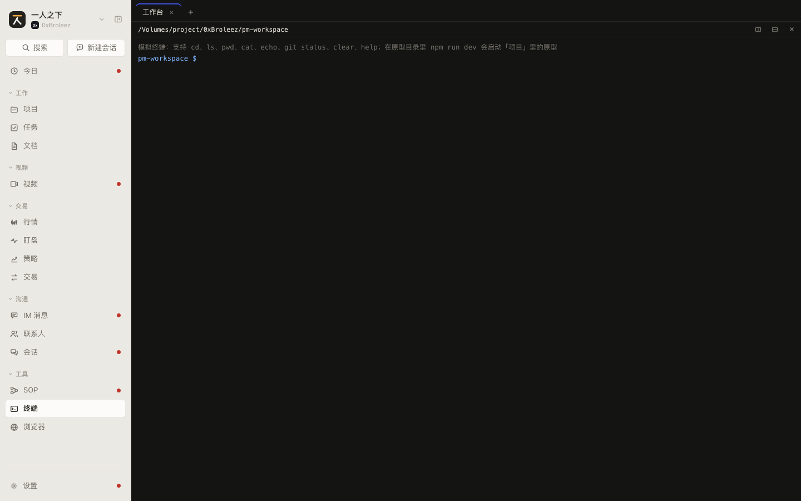 | 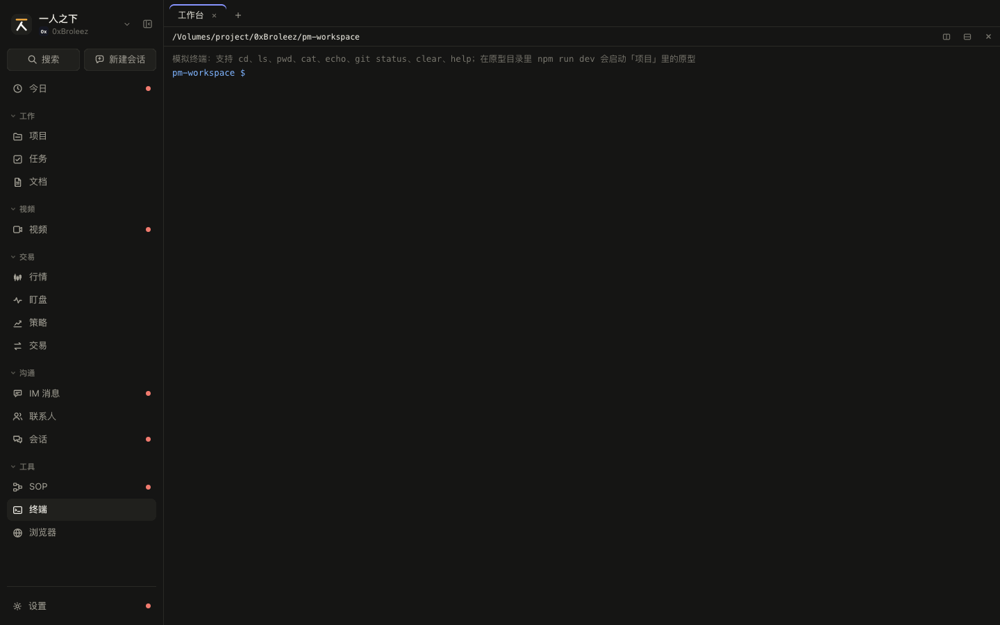 |
| 手机 375 | 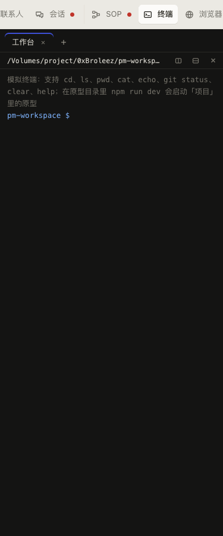 | 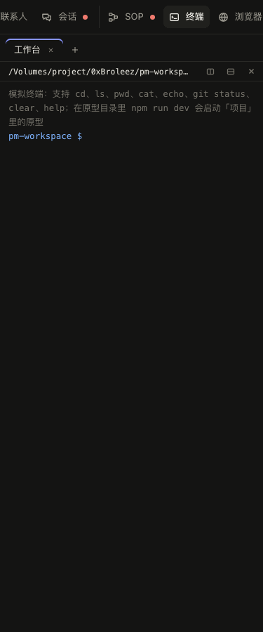 |

由 `shots.py` 按步骤截（`terminal_split`）：

| 场景 | 步骤 | 桌面 1440 亮 | 桌面 1440 暗 | 手机 375 亮 | 手机 375 暗 |
|---|---|---|---|---|---|
| 拆成 2x2，各格跑了命令，右下是焦点格（手机宽度排成一列） | 依次 `ls`、向右拆分 `git status`、向下拆分 `npm run dev`、向右拆分 `help` | 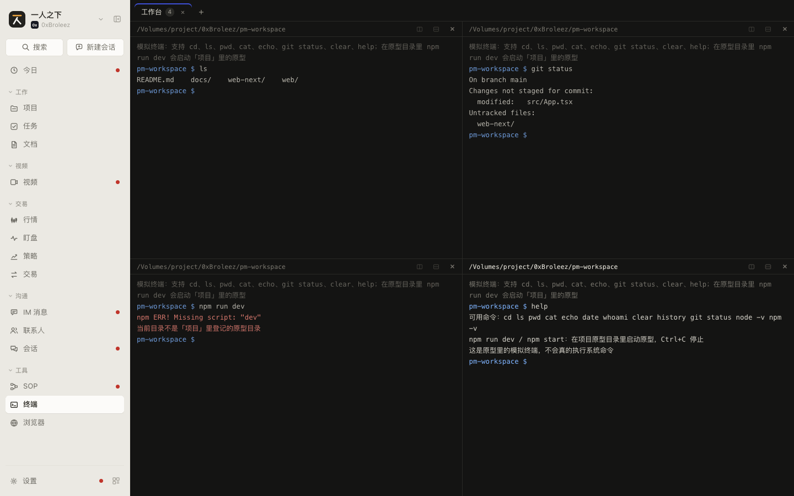 | 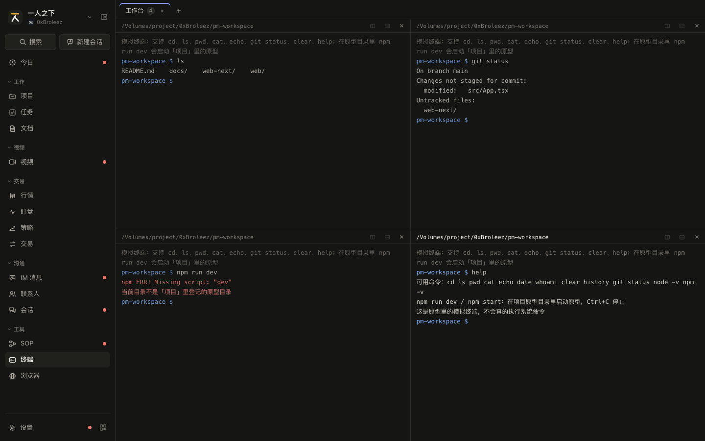 | 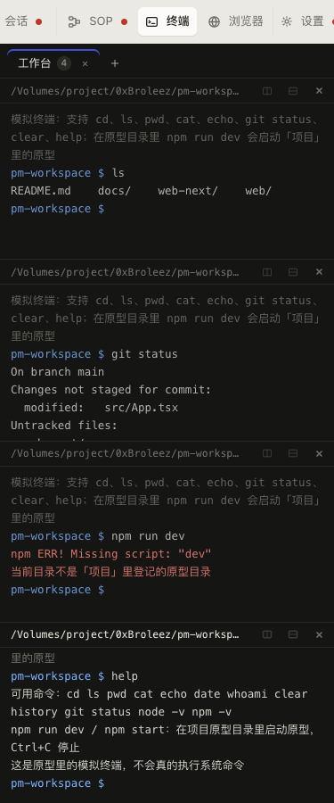 | 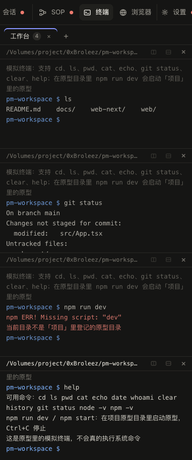 |
| 多标签、双击改名 | 点「+」开第二个标签，双击第一个标签输入新名字 | 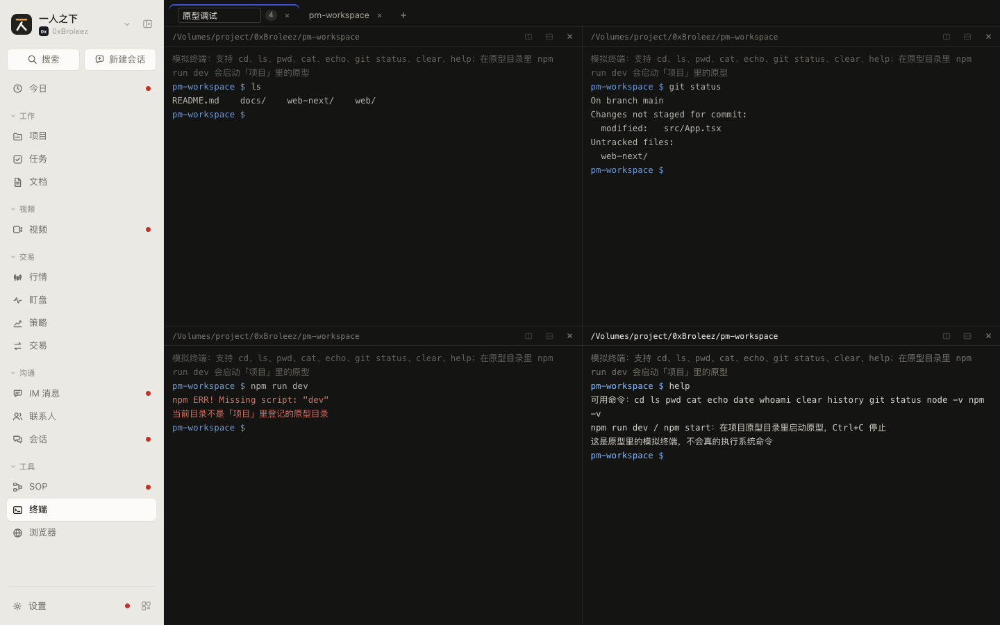 | 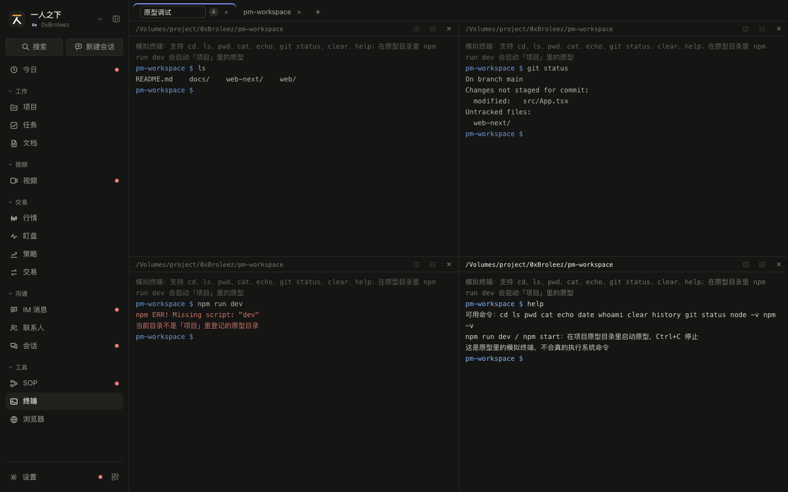 | 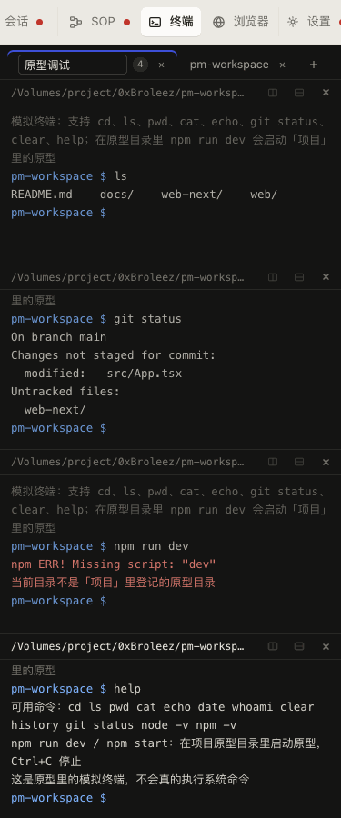 | 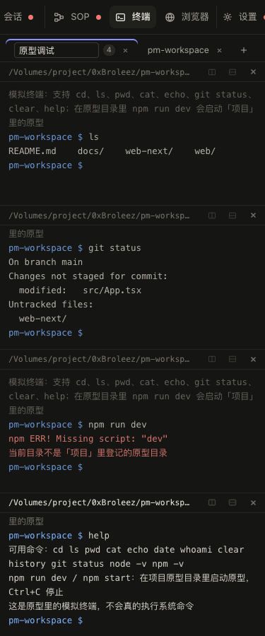 |

### 交互

| 编号 | 元素 | 操作 | 结果 |
|---|---|---|---|
| SPEC-terminal-1.1 | 标签 | 看 | 名字：改过名用改的，没改过用焦点格目录的最后一段；有格子跑着原型时名字前一个绿点；多于一格时名字后写格数；右边关闭叉号。当前标签高亮 |
| SPEC-terminal-1.2 | 标签 | 点击 | 切到这个标签；各标签的格子、输出、焦点都保留 |
| SPEC-terminal-1.3 | 标签 | 双击 | 名字变成输入框（悬停提示「双击改名」）；回车或失焦保存（去首尾空格，清空就恢复按目录显示），Esc 放弃 |
| SPEC-terminal-1.4 | 标签上的叉号 | 点击 | 关掉这个标签，里面跑着的原型都停掉，不弹确认；关的是当前标签时切到它左边那个（最左的就切到新的最左）。一级菜单里关掉最后一个标签会马上开一个新的，所以总有一个标签 |
| SPEC-terminal-1.5 | 标签栏「+」 | 点击 | 新开一个标签并切过去，一个格子，目录是第一个有目录的项目的目录 |
| SPEC-terminal-1.6 | 格子头 | 看 | 左边当前目录（家目录下写成 `~/…`，太长截断，悬停看全路径）；跑着原型时写绿点、原型名和端口；右边「向右拆分」「向下拆分」「关闭窗格」三个图标按钮 |
| SPEC-terminal-1.7 | 「向右拆分」「向下拆分」 | 点击，或在焦点格里按 ⌘D / ⇧⌘D | 在当前标签加一格并把焦点给它，新格沿用焦点格的目录；第一次拆分决定两格是左右还是上下；三格时左边一格占满高度、右边上下两格；四格排成 2x2。满 4 格后两个按钮都置灰 |
| SPEC-terminal-1.8 | 格子 | 点击 | 成为焦点格：边框和格子头高亮，光标进它的输入行；标签名跟着焦点格的目录变（没改过名时） |
| SPEC-terminal-1.9 | 「关闭窗格」 | 点击 | 关掉这一格，跑着的原型停掉；关的是焦点格时焦点给第一格；只剩这一格时等于关掉整个标签（`SPEC-terminal-1.4`） |
| SPEC-terminal-1.10 | 切菜单、切工作台 | 离开再回来 | 标签、格子、输出、跑着的原型都还在（原型只存内存，刷新就没了；正式版刷新后重连，见 `SPEC-terminal-0`） |
| SPEC-terminal-1.11 | 窗口变窄、变宽 | 调整 | 格子按比例跟着变；宽度 760 以下左右排的格子改成从上到下排成一列（两格上下拆分的不变），每格等高，长行折行 |

### 空状态和异常状态

| 编号 | 场景 | 显示 | 可做的操作 |
|---|---|---|---|
| SPEC-terminal-1.12 | 没有标签 | 一级菜单不会出现：关掉最后一个就自动补一个新的（`SPEC-terminal-1.4`）。项目里的终端会出现，见 `SPEC-projects-14.12` | |
| SPEC-terminal-1.13 | 没有项目或项目都没填目录 | 新标签在 `~`（原型是 `/Users/me`），模拟文件系统里只有 `Downloads`、`Desktop` | 去项目设置填目录 |
| SPEC-terminal-1.14 | 已满 4 格 | 两个拆分按钮置灰，⌘D 不响应 | 关一格或开新标签 |
| SPEC-terminal-1.15 | 后端会话断开（服务重启、网络断） | 原型未做；正式版在格子里写「连接已断开，正在重连」，重连上接着显示缓冲里的输出；会话已经没了时写「会话已结束」+「重新打开」（在同一目录新开一个会话） | 重新打开 |
| SPEC-terminal-1.16 | 会话数到上限（16 个） | 原型未做；正式版拆分、新标签时提示「最多同时开 16 个终端，先关掉几个」，不新开 | 关掉别的格子 |

### 数据

见 `SPEC-terminal-0` 的 `TermTab`、`Pane`。布局按格数和 `dir` 算：1 格 `l1`；2 格 `l2r`（左右）或 `l2c`（上下）；3 格 `l3`（第一格占左边整列）；4 格 `l4`（2x2）。窄于 760 时 `l2r`、`l3`、`l4` 都排成一列。

### 联动

| 方向 | 对方模块 | 触发 | 结果 | 见 |
|---|---|---|---|---|
| 改动 | 项目 | 关掉跑着原型的格或标签 | 停掉那个原型 | `SPEC-projects-12` |

## SPEC-terminal-2 命令和运行中的原型

每格最后一行是输入行：提示符是当前目录的最后一段加 `$`。原型认一小组命令；在「项目」登记的原型目录里 `npm run dev` 会真的去启动那个原型，日志接进这一格。

### 截图

由 `shots.py` 按步骤截（`terminal_proto`）：

| | 亮 | 暗 |
|---|---|---|
| 桌面 1440 | 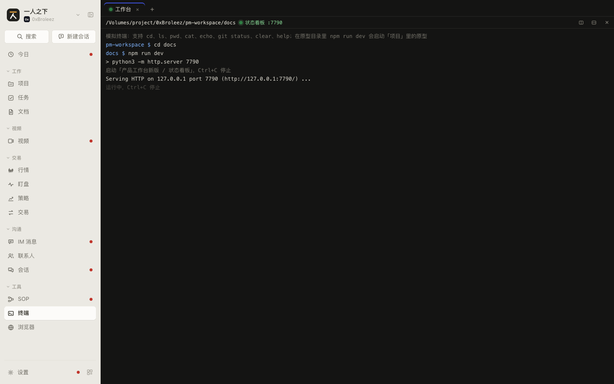 | 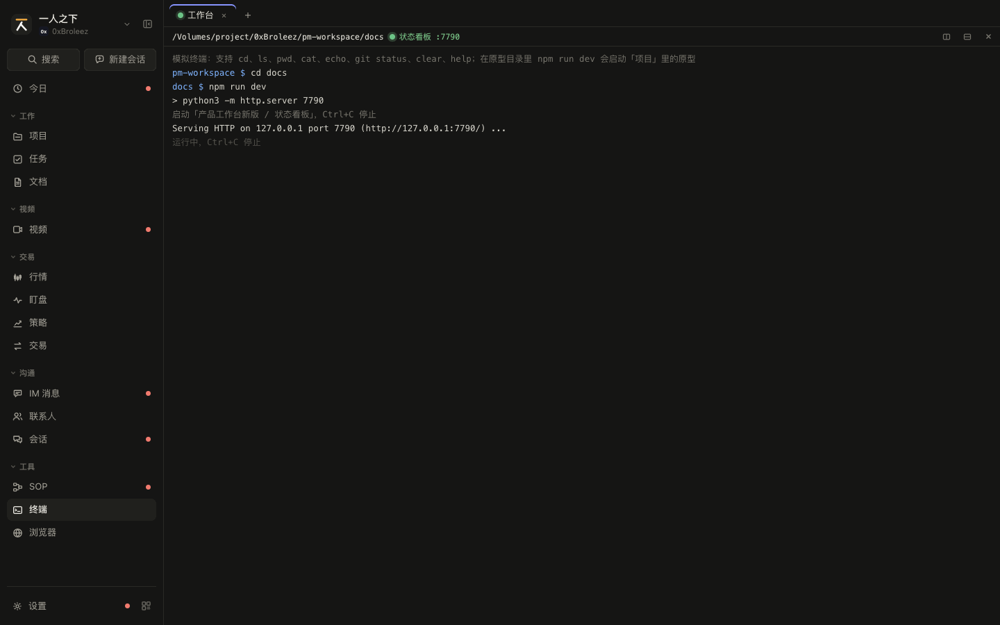 |
| 手机 375 | 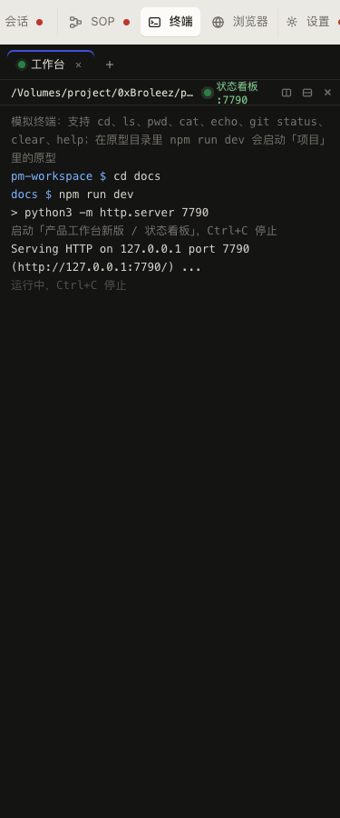 | 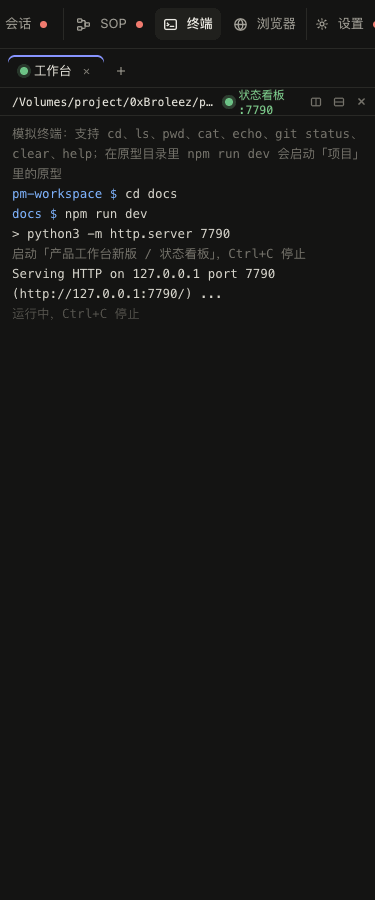 |

上面是「`cd docs` 后 `npm run dev`，启动了项目的状态看板」。

| 场景 | 步骤 | 桌面 1440 亮 | 桌面 1440 暗 | 手机 375 亮 | 手机 375 暗 |
|---|---|---|---|---|---|
| Ctrl+C 停掉原型，再看命令历史 | 接上一步按 Ctrl+C，输入 `history` | 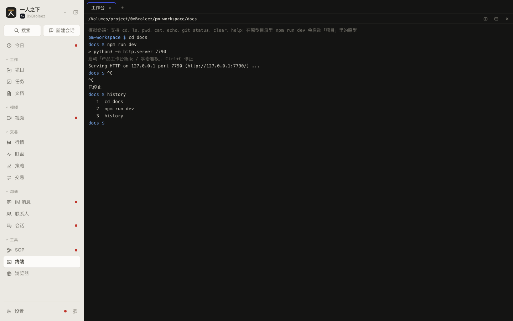 | 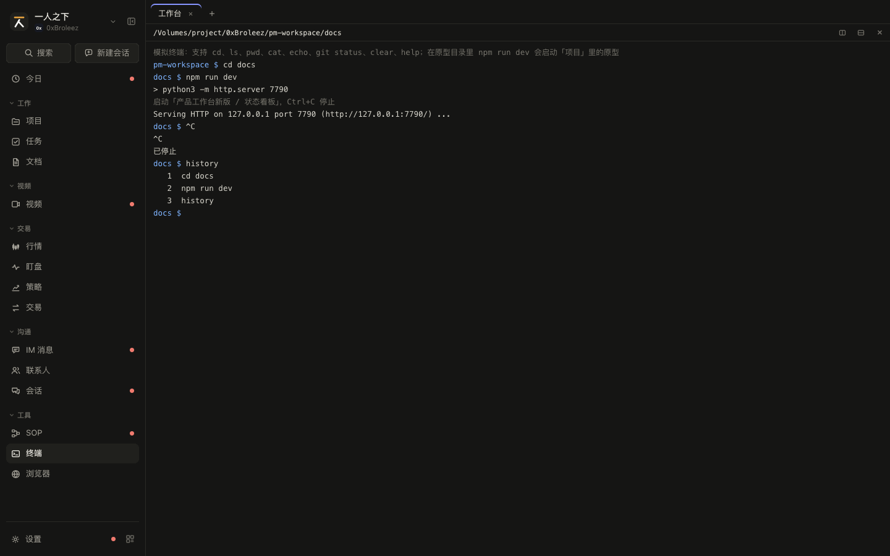 | 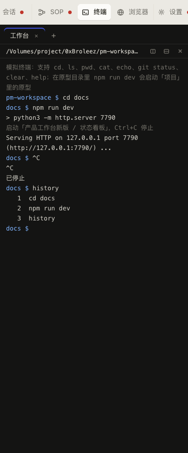 | 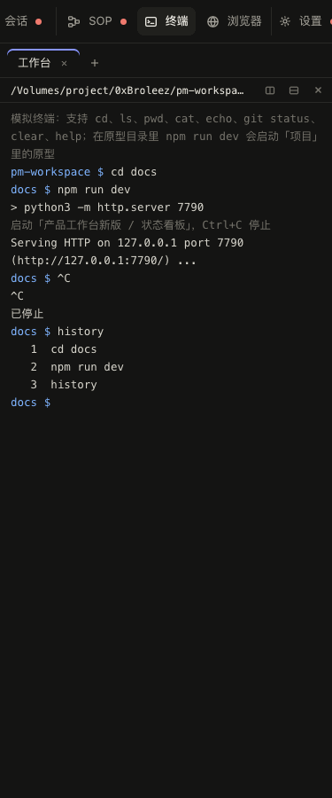 |

命令报错（`npm run dev` 不在原型目录）见 `SPEC-terminal-1` 的 2x2 截图左下格。

### 交互

| 编号 | 元素 | 操作 | 结果 |
|---|---|---|---|
| SPEC-terminal-2.1 | 新格子 | 打开 | 第一行灰字说明「模拟终端：支持 cd、ls、pwd、cat、echo、git status、clear、help；在原型目录里 npm run dev 会启动「项目」里的原型」（正式版没有这行，是 shell 自己的欢迎信息） |
| SPEC-terminal-2.2 | 输入行 | 输入后回车 | 先回显一行「<目录名> $ <命令>」，再打印结果；空回车只回显提示符；输出自动滚到底；非空命令记进历史 |
| SPEC-terminal-2.3 | 模拟命令 | 回车 | `help` 列可用命令；`pwd`；`whoami` 回 `me`；`date`；`echo`（去掉首尾引号）；`history` 带序号列出；`cd`（支持 `~`、`..`、相对和绝对路径，目录不存在报 `cd: no such file or directory`）；`ls [目录]`（目录名带 `/`）；`cat <文件>`（没给文件、是目录、不存在各报错）；`node -v` 回 `v22.11.0`；`npm -v` 回 `10.9.0`；`git status` 回一段固定内容，别的 git 子命令报只支持 status；其它命令 `zsh: command not found: <命令>`。正式版不做这些，命令都交给真 shell |
| SPEC-terminal-2.4 | 上下方向键 | 按 | 在这一格的历史里往前、往后翻；翻过最新一条清空输入行 |
| SPEC-terminal-2.5 | Tab | 按 | 补全最后一段路径：唯一匹配直接补上，多个匹配把候选打印一行，没有匹配不动 |
| SPEC-terminal-2.6 | Ctrl+L、`clear` | 按、输入 | 清空这一格的输出（`clear` 同时记进历史） |
| SPEC-terminal-2.7 | `npm run dev` / `npm start`（`pnpm`、`yarn` 同样） | 在原型目录里回车 | 目录是某个项目的 `<项目目录>/<原型目录>` 时：打印「> <原型命令>」和灰字「启动「<项目> / <原型>」，Ctrl+C 停止」，调项目的启动；这一格进入运行状态：格子头和标签上出绿点和「<原型名> :<端口>」，输入行不显示提示符、占位「运行中，Ctrl+C 停止」，回车不收命令；原型的启动日志陆续接进来（含 `Error`、「失败」的行显示成红字） |
| SPEC-terminal-2.8 | Ctrl+C | 按 | 运行中：回显「^C」并停掉原型，停完写「已停止」，输入行恢复。没在运行：回显当前输入加「^C」，清空输入行 |
| SPEC-terminal-2.9 | 原型启动失败（端口被占） | 等 | 失败原因红字接在后面，运行状态结束，输入行恢复 |
| SPEC-terminal-2.10 | 在别处停掉原型（项目原型卡片、今日、另一格） | 停 | 这一格的运行状态结束，输入行恢复 |

### 空状态和异常状态

| 编号 | 场景 | 显示 | 可做的操作 |
|---|---|---|---|
| SPEC-terminal-2.11 | 不在原型目录里 `npm run dev` | 红字「npm ERR! Missing script: "dev"」「当前目录不是「项目」里登记的原型目录」 | `cd` 到原型目录再跑 |
| SPEC-terminal-2.12 | 原型已经在跑 | 红字「「<原型>」已经在 <端口> 端口运行，先在别处停掉或在这里 Ctrl+C」，不重复启动 | 先停掉 |
| SPEC-terminal-2.13 | `npm` 别的子命令 | 红字「<命令>：原型终端只支持 npm run dev / npm start」 | 正式版没有这个限制 |
| SPEC-terminal-2.14 | 后端会话里的进程退出（shell 被 `exit`） | 原型未做；正式版在格子里写「进程已退出（退出码 N）」，输入行不可用，「重新打开」在同一目录新开会话 | 重新打开、关闭窗格 |

### 数据

见 `SPEC-terminal-0` 的 `Pane`（`history`、`running`）、`TermLine`。原型启停用的 `Prototype`（`id`、`name`、`dir`、`command`、`port`、`status`、`logs`、`error`）见 `SPEC-projects-12`；这一格认原型靠 `<项目 root>/<原型 dir>`（去掉末尾斜杠）等于当前目录。

### 联动

| 方向 | 对方模块 | 触发 | 结果 | 见 |
|---|---|---|---|---|
| 改动 | 项目 | `npm run dev`、Ctrl+C | 启停原型，原型状态和日志在项目那边一样变 | `SPEC-projects-12` |
| 读取 | 项目 | 原型在别处启停、出错 | 这一格的运行状态和日志跟着变 | `SPEC-projects-12` |
| 改动 | 设置 / 运行异常 | 原型启动失败（端口被占） | 记一条运行异常（这是项目 `startProto` 做的，终端只是触发） | `SPEC-settings-19` |

## 原型和规格对不上的地方

整理时发现的问题，PROTO-12 已按下表修好原型，正文和原型一致。

| 编号 | 位置 | 问题 | 建议 | 处理 |
|---|---|---|---|---|
| T-1 | `SPEC-terminal-1.7` | ⇧⌘D 向下拆分不生效：`onKey` 判断 `e.key === 'd'`，按住 Shift 时 `e.key` 是大写 `D`，走不到分支 | 改成按 `e.key.toLowerCase()` 或 `e.code === 'KeyD'` 判断 | 已修（PROTO-12）：按 `e.key.toLowerCase()` 判断 |
| T-2 | `SPEC-terminal-2.8` | 运行中按 Ctrl+C 会出两行「^C」：格子自己回显一行，原型停止时项目那边的日志又追加一行 `^C` 接进来 | 接日志时跳过 `^C`，或格子里不再自己回显 | 已修（PROTO-12）：接日志时跳过 `^C`，只剩格子自己回显的一行 |
| T-3 | `SPEC-terminal-1` | `TerminalPage` 非 `embedded` 时往顶栏放的标题、说明和「向右拆分」「向下拆分」「新标签页」按钮不显示（终端页隐藏了顶栏，见 `styles.css`「终端和浏览器不要顶部标题栏」），是用不到的代码 | 删掉这段 `PageTitle`，或恢复顶栏；规格按现状（没有顶栏）写 | 已修（PROTO-12）：删掉 `PageTitle` 那段 |
