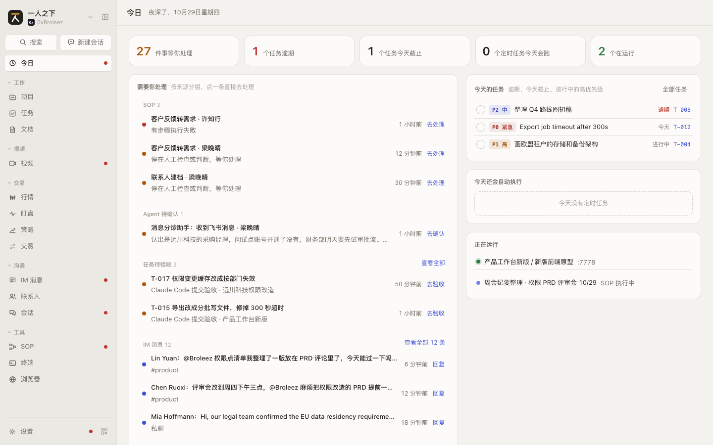
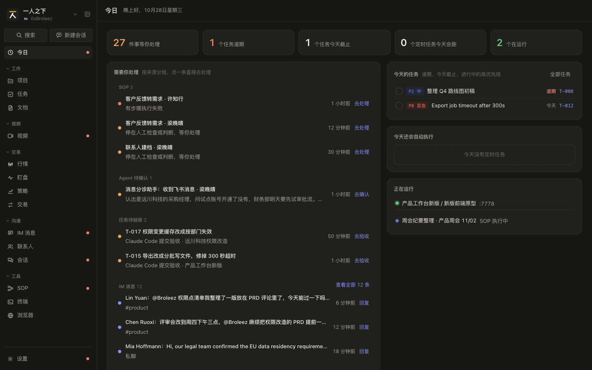
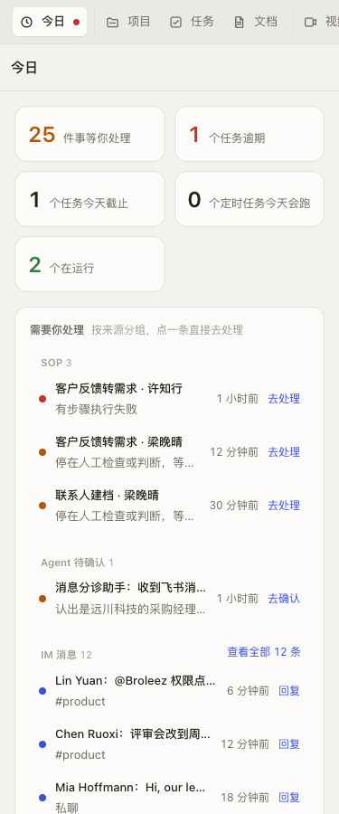
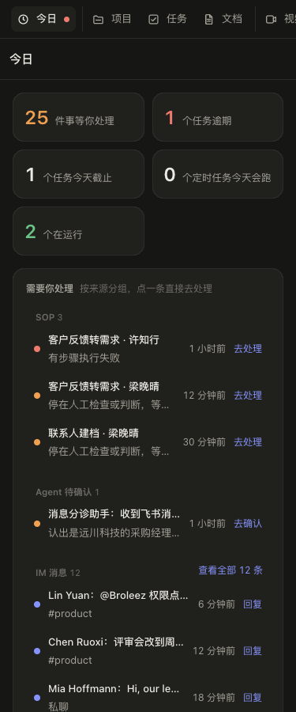

# 今日 规格（SPEC-today）

| 项 | 内容 |
|---|---|
| 模块 key | `today` |
| 原型入口 | 一级菜单「今日」，http://127.0.0.1:7778 |
| 源码 | `web-next/src/today.tsx`（页面；待验收任务的完成圆圈确认用 `devloop.tsx` 的 `ApproveConfirm`）；数据在 `web-next/src/App.tsx` 里从各模块收集（`todayNeeds`、`todaySchedules`、`todayRunning`） |
| 数据文件 | 没有独立的 `todaydata.ts`：页面类型 `TodayItem`、`TodayLine` 定义在 `today.tsx`；任务字段见 [`tasks.md`](tasks.md) `SPEC-tasks-0` |
| 截图 | [`shots/today/`](shots/today/) |
| 负责任务 | PROTO-04b、PROTO-07（任务待验收） |
| 状态 | 已整理 |
| 最后对照 | 2026-10-28，原型提交 `932555b`；「任务待验收」相关条目按 PROTO-07 的原型改动（未提交）修订 |

## SPEC-today-0 模块概述

今天要处理的事集中在一页：各模块里等你处理的事、今天要赶的任务、今天还会自动执行的定时任务、正在运行的原型和流程。页面只读汇总，点一条就跳到能处理它的地方，只有「标为已完成」在本页直接改数据。

### 页面清单

| 节 | 页面 | 入口 | 说明 |
|---|---|---|---|
| [SPEC-today-1](#spec-today-1-今日) | 今日 | 一级菜单「今日」（工作台默认首页） | 汇总数字、需要你处理、今天的任务、今天还会自动执行、正在运行 |

模块没有二级菜单。

### 共用数据结构

`TodayItem`（`web-next/src/today.tsx`）：「需要你处理」里的一条

| 字段 | 类型 | 必填 | 说明 | 取值 / 示例 |
|---|---|---|---|---|
| `id` | `string` | 是 | 条目编号，来源前缀加原对象 id | `sop-<run id>`、`ar-<agent run id>`、`ss-<会话 id>`、`im-<消息 id>`、`inc-<异常 id>`、`cn-<连接器 id>`、`pv-<服务商 id>`、`rv-<任务 id>` |
| `kind` | `string` | 是 | 分组名，同名的归一组 | `SOP` / `Agent 待确认` / `IM 消息` / `运行异常` / `连接异常` / `任务待验收` |
| `tone` | `'danger' \| 'warn' \| 'info'` | 是 | 紧急程度，决定圆点颜色和组内排序 | `danger` 红（失败、异常） / `warn` 橙（等确认、等验收） / `info` 蓝（待回复） |
| `title` | `string` | 是 | 第一行 | `客户反馈转需求 · 许知行` |
| `sub` | `string` | 是 | 第二行说明 | `有步骤执行失败` |
| `at` | `string` | 否 | ISO 时间，显示成「N 分钟前」；没有时不显示时间、组内排最后 | `2026-10-28T12:30:00.000Z` |
| `action` | `string` | 是 | 右侧动作文案 | `去处理` / `去确认` / `回复` / `去看看` / `去修复` / `去验收` |
| `onClick` | `() => void` | 是 | 点整行的跳转，见 `SPEC-today-1` 联动 | |

`TodayLine`（`web-next/src/today.tsx`）：「今天还会自动执行」「正在运行」里的一行

| 字段 | 类型 | 必填 | 说明 | 取值 / 示例 |
|---|---|---|---|---|
| `id` | `string` | 是 | 原对象 id | `sc_weekly_agenda` |
| `title` | `string` | 是 | 名称 | `周会前整理议程`、`产品工作台新版 / 新版前端原型` |
| `sub` | `string` | 是 | 定时任务是执行时刻；运行中的原型是端口，SOP 是「SOP 执行中」 | `09:00`、`:7778`、`SOP 执行中` |
| `href` | `string` | 否 | 有就渲染成新窗口打开的链接（运行中的原型） | `http://127.0.0.1:7778` |
| `onClick` | `() => void` | 否 | 没有 `href` 时点击的跳转 | |

页面常量（`today.tsx`）：

| 常量 | 值 | 含义 |
|---|---|---|
| `NEED_SHOW` | 3 | 「需要你处理」每组露几条 |
| `TASK_SHOW` | 8 | 「今天的任务」露几条 |
| `LINE_SHOW` | 5 | 「今天还会自动执行」「正在运行」各露几条 |
| `TONE_RANK` | `danger` 0 / `warn` 1 / `info` 2 | 组内排序：先按紧急程度，同级按 `at` 新的在前，没有 `at` 的最后 |

### 联动总表

| 方向 | 对方模块 | 触发 | 结果 | 见 |
|---|---|---|---|---|
| 进来 | SOP | 执行记录停在人工检查（waiting）或失败（failed） | 「SOP」组多一条 | `SPEC-today-1.4` |
| 进来 | 会话 | Agent 执行记录等确认，或会话里有待确认的工具调用 | 「Agent 待确认」组多一条 | `SPEC-today-1.4` |
| 进来 | IM 消息 | 消息待处理且没有在稍后提醒中 | 「IM 消息」组多一条 | `SPEC-today-1.4` |
| 进来 | 设置 | 运行异常未处理且级别是 error；连接器、启用的模型服务商连接异常 | 「运行异常」「连接异常」组多一条 | `SPEC-today-1.4` |
| 进来 | 任务 | 任务状态是待验收（`review`，多是 Claude Code 提交验收） | 「任务待验收」组多一条 | `SPEC-today-1.25` |
| 进来 | 任务 | 未结束的任务逾期、今天截止，或是进行中的高优先级 | 「今天的任务」多一行 | `SPEC-today-1.7`；任务字段见 `SPEC-tasks-0` |
| 进来 | 任务 / 定时任务 | 启用的定时任务今天还有一次执行 | 「今天还会自动执行」多一行 | `SPEC-today-1.12`；定时任务见 `SPEC-tasks-7` |
| 进来 | 项目、SOP | 项目原型在运行、SOP 执行中 | 「正在运行」多一行 | `SPEC-today-1.14` |
| 出去 | 任务 | 点任务行 / 「全部任务」 / 「还有 N 条」 | 打开任务抽屉 / 任务页 | `SPEC-tasks-4`、`SPEC-tasks-2` |
| 改动 | 任务 | 点任务行左侧圆圈 | 任务状态改为 `done`，从「今天的任务」消失；待验收的任务先确认，等于验收通过 | `SPEC-today-1.8` |
| 改动 | 任务 | 在今日页打开的抽屉里验收通过 / 退回 | 任务状态改为 `done` / `todo`，从「任务待验收」组消失 | `SPEC-tasks-5.22`、`5.23` |
| 改动 | 外壳 | `needs` 条数变化 | 一级菜单「今日」的角标是 `needs.length`；有 `danger` 或 `warn` 时亮红点 | `SPEC-today-1.3` |

## SPEC-today-1 今日

今天要处理的事集中在一页。宽屏左右两栏：左「需要你处理」，右「今天的任务」「今天还会自动执行」「正在运行」；窗口宽度不到 1100px 时合成一栏，左栏在上。

### 截图

| | 亮 | 暗 |
|---|---|---|
| 桌面 1440 |  |  |
| 手机 375 |  |  |

截图里的数字随演示数据和截图时刻变化（问候语按当前小时，「今天截止」「今天会跑」按当天日期）。

### 交互

| 编号 | 元素 | 操作 | 结果 |
|---|---|---|---|
| SPEC-today-1.1 | 页面标题 | 展示 | 「今日」，说明文字是问候语加日期，如「晚上好，10月28日星期三」。问候按小时：6 点前「夜深了」、11 点前「早上好」、13 点前「中午好」、18 点前「下午好」、其余「晚上好」 |
| SPEC-today-1.2 | 汇总数字（5 格） | 展示，不可点 | 依次是「件事等你处理」（`needs.length`，大于 0 时橙色）、「个任务逾期」（大于 0 时红色）、「个任务今天截止」、「个定时任务今天会跑」、「个在运行」（绿色）。格子自动换行，手机上两列 |
| SPEC-today-1.3 | 一级菜单「今日」的角标 | 展示 | 角标数字等于「件事等你处理」；有 `danger` 或 `warn` 的条目时显示红点，只有 `info` 时不亮 |
| SPEC-today-1.4 | 「需要你处理」分组 | 展示 | 按 `kind` 分组，组的顺序是来源顺序：SOP、Agent 待确认、任务待验收、IM 消息、运行异常、连接异常（没有条目的组不出现）。组标题带条数；组内按 `TONE_RANK` 排序，只露前 3 条 |
| SPEC-today-1.5 | 「需要你处理」的一条 | 点击整行 | 跳到能处理它的地方，见本节联动表；每行显示圆点（颜色随 `tone`）、标题、说明、相对时间（有 `at` 时）、动作文案 |
| SPEC-today-1.6 | 组标题右侧「查看全部 N 条」 | 点击 | 只在组内超过 3 条、且该组有批量处理的地方时出现：SOP 去「SOP / 待处理」，Agent 待确认去「会话 / 执行记录」，IM 消息去「IM 消息」，运行异常去「设置 / 运行异常」，连接异常去「设置 / 连接器」。SOP、会话、IM 消息模块不在当前工作台时不显示入口 |
| SPEC-today-1.7 | 「今天的任务」列表 | 展示 | 只看未结束的任务（状态不是 `done`、`cancelled`；`review` 待验收算未结束）。顺序：逾期（截止早的在前，右侧红色「逾期」）、今天截止（「今天」）、其余的高优先级（P0 任意状态，或 P1 且进行中；进行中的显示状态名）。合起来只露前 8 条；每行显示完成圆圈、优先级标签、标题、标记、编号 |
| SPEC-today-1.8 | 任务行左侧圆圈 | 点击 | 任务状态直接改为 `done`，该行从列表消失，不打开抽屉，不需要刷新。鼠标悬停提示「标为已完成」（文案取任务状态枚举的显示名）。待验收的任务例外：先弹「验收通过 T-xxx？」确认，确认后等于验收通过（记一条「验收通过」的进展），「打开任务」打开抽屉，悬停提示「验收通过」（同 `SPEC-tasks-5.27`） |
| SPEC-today-1.9 | 任务行 | 点击圆圈以外的地方 | 在今日页上打开任务抽屉（`SPEC-tasks-4`），不切换页面 |
| SPEC-today-1.10 | 「全部任务」按钮 | 点击 | 切到任务模块「全部任务」（`SPEC-tasks-2`） |
| SPEC-today-1.11 | 「还有 N 条，去任务」 | 点击 | 超过 8 条时出现在列表末尾。有逾期任务时去任务模块「逾期」视图，否则去「全部任务」 |
| SPEC-today-1.12 | 「今天还会自动执行」 | 展示、点击 | 启用的定时任务里，下次执行在今天的列出来，左边执行时刻、右边名称，只露前 5 个。点一行去「任务 / 定时任务」并打开该定时任务的抽屉（`SPEC-tasks-8`） |
| SPEC-today-1.13 | 「今天还会自动执行」右上「全部 N 个」 | 点击 | 超过 5 个才出现，去「任务 / 定时任务」 |
| SPEC-today-1.14 | 「正在运行」 | 展示、点击 | 先列运行中的项目原型（绿灯，标题「项目 / 原型」，右侧端口），点击在新窗口打开 `http://127.0.0.1:<端口>`；再列执行中的 SOP（蓝灯，「SOP 执行中」），点击去 SOP 模块并打开这次执行。只露前 5 个 |
| SPEC-today-1.25 | 「任务待验收」组 | 展示、点击 | 每条：橙色圆点（`warn`）、标题「编号 标题」、说明「Claude Code 提交验收 · 项目名」（取最近一条提交验收的进展的操作者；没有这种进展时「等你验收」；不属于项目时不带项目名）、相对时间（最近一次提交验收的时间，没有时用任务更新时间）、动作「去验收」。点整行在今日页上打开任务抽屉，顶部是等你验收栏（`SPEC-tasks-5.21`）。演示数据有 `T-015`、`T-017` 两条。超过 3 条时没有「查看全部」入口（原型的任务页不能带状态筛选打开，见文末第 4 条） |
| SPEC-today-1.15 | 「正在运行」右上「全部 N 个」 | 点击 | 超过 5 个才出现。有原型在跑且工作台有浏览器模块时，在浏览器模块打开首页；否则有 SOP 模块去「SOP / 执行记录」；都没有去项目 |

### 空状态和异常状态

| 编号 | 场景 | 显示 | 可做的操作 |
|---|---|---|---|
| SPEC-today-1.16 | 没有需要处理的事 | 「需要你处理」区显示「都处理完了」；汇总数字 0、不着色；菜单角标消失 | 无 |
| SPEC-today-1.17 | 没有今天要赶的任务 | 「今天的任务」区显示「今天没有要赶的任务」 | 「全部任务」 |
| SPEC-today-1.18 | 今天没有定时任务要跑 | 虚线框「今天没有定时任务」 | 无 |
| SPEC-today-1.19 | 没有运行中的原型或流程 | 虚线框「没有在运行的原型或流程」 | 无 |
| SPEC-today-1.20 | 条目没有时间（如连接异常） | 不显示相对时间，组内排在同级的最后 | 点击照常跳转 |
| SPEC-today-1.21 | 加载失败 | 原型未做（数据都在本地）。正式产品：聚合接口失败时整页显示错误信息和「重试」，不显示成「都处理完了」，避免把失败误读成没事 | 重试 |
| SPEC-today-1.22 | 某个来源取不到（单个插件出错） | 原型未做。正式产品：其余分组照常显示，出错的组显示一行「这部分没取到」加「重试」 | 重试 |
| SPEC-today-1.23 | 模块不在当前工作台 / 插件停用 | 对应的组整组不出现，汇总数字和菜单角标同步减少：SOP 模块管「SOP」，会话模块管「Agent 待确认」，任务模块管「任务待验收」，IM 消息模块管「IM 消息」；运行异常、连接异常在设置里，一直有。正式产品（TODAY-02）：插件停用后它贡献的分组和卡片整组消失 | 无 |
| SPEC-today-1.24 | 「标为已完成」失败 | 原型未做（本地改状态不会失败）。正式产品：该行恢复显示，提示失败原因 | 再点一次 |

### 数据

用到的任务字段见 `SPEC-tasks-0` `Task`（`status`、`priority`、`due`、`title`、`ref`）。下面是「需要你处理」各来源的取数口径（原型在 `App.tsx` 的 `todayNeeds` 里拼，原型未定义独立类型）：

| `kind` | 来源条件 | `tone` | `title` | `sub` | `at` | `action` | 点击去向 |
|---|---|---|---|---|---|---|---|
| `SOP` | SOP 执行记录状态 `waiting` 或 `failed` | `failed` 为 `danger`，否则 `warn` | 执行记录标题 | 「有步骤执行失败」/「停在人工检查或判断，等你处理」 | 开始时间 | 去处理 | SOP 模块，打开这次执行 |
| `Agent 待确认` | Agent 执行记录状态 `waiting` | `warn` | 「Agent 名：触发方式」 | 执行摘要 | 执行时间 | 去确认 | 会话 / 执行记录 |
| `Agent 待确认` | 会话里有 `state = pending` 的工具调用 | `warn` | 「会话「标题」里有操作等你确认」 | Agent 名 | 会话更新时间 | 去确认 | 会话 / 对话，打开这个会话 |
| `IM 消息` | 消息 `status = pending`，且 `snooze_until` 为空或已过 | `info` | 「发送人：正文」 | 会话名，没有时「私聊」 | 消息时间 | 回复 | IM 消息，打开这条消息 |
| `运行异常` | 异常 `status = open` 且 `level = error` | `danger` | 异常标题 | 「模块 · 共 N 次」 | 最近一次时间 | 去看看 | 设置 / 运行异常，打开异常抽屉 |
| `连接异常` | 连接器 `status = error` | `danger` | 「连接器「名称」异常」 | 错误信息 | 无 | 去修复 | 设置 / 连接器，打开连接器抽屉 |
| `连接异常` | 启用的模型服务商 `status = error` | `danger` | 「模型服务商「名称」异常」 | 错误信息 | 无 | 去修复 | 设置 / 模型服务商，打开服务商抽屉 |
| `任务待验收` | 任务 `status = review` | `warn` | 「编号 标题」 | 「提交人 提交验收 · 项目名」 | 最近一条 `kind = review` 进展的时间，没有时 `updated_at` | 去验收 | 在今日页打开任务抽屉 |

「今天的任务」的口径（`today.tsx`）：

| 分类 | 条件 | 右侧标记 | 排序 |
|---|---|---|---|
| 逾期 | 未结束，`due` 早于今天 | 「逾期」（红） | `due` 升序 |
| 今天截止 | 未结束，`due` 等于今天 | 「今天」 | 原顺序 |
| 高优先级 | 未结束，不在上两类，`priority = P0`，或 `priority = P1` 且 `status = doing` | 进行中的显示状态名，否则不显示 | 原顺序 |

「今天还会自动执行」：启用的定时任务，按规则算出的下次执行（`nextRun`，见 `SPEC-tasks-0` 定时任务结构）落在今天；`sub` 是去掉「今天」的执行时刻。「正在运行」：项目原型 `status = running`，SOP 执行记录状态 `running`。

### 联动

| 方向 | 对方模块 | 触发 | 结果 | 见 |
|---|---|---|---|---|
| 出去 | 任务 | 点任务行 | 打开任务抽屉（不离开今日页） | `SPEC-tasks-4` |
| 出去 | 任务 | 「全部任务」 / 「还有 N 条，去任务」 | 任务页「全部任务」或「逾期」 | `SPEC-tasks-2` |
| 改动 | 任务 | 点完成圆圈 | 任务 `status` 改为 `done`，任务页、项目的任务标签同步 | `SPEC-tasks-0` |
| 出去 | 任务 / 定时任务 | 点「今天还会自动执行」一行 / 「全部 N 个」 | 定时任务页并打开抽屉 / 定时任务页 | `SPEC-tasks-8`、`SPEC-tasks-7` |
| 出去 | SOP | 点 SOP 条目 / 运行中的 SOP / 「查看全部」 | SOP 执行详情 / 待处理列表 | `SPEC-sop` |
| 出去 | 会话 | 点 Agent 待确认条目 / 「查看全部」 | 会话的对话或执行记录 | `SPEC-sessions` |
| 出去 | IM 消息 | 点 IM 条目 / 「查看全部」 | 打开这条消息 / 消息列表 | `SPEC-messages` |
| 出去 | 设置 | 点运行异常、连接异常条目 / 「查看全部」 | 设置对应分节并打开抽屉 | `SPEC-settings` |
| 出去 | 浏览器 / 项目 | 点运行中的原型 / 「全部 N 个」 | 新窗口打开原型地址 / 浏览器首页或项目 | `SPEC-browser`、`SPEC-projects` |

## 引用本文件的开发任务

| 任务 | 对照的节 |
|---|---|
| TODAY-02 实现今日页并接聚合接口 | `SPEC-today-1`（全节）；插件停用后卡片消失对 `SPEC-today-1.23`；点完成后该行消失对 `SPEC-today-1.8`；任务待验收对 `SPEC-today-1.25` |

## 和原型对不上的地方

整理时发现、还没改的，另开原型修错任务，不在本规格里顺手改原型。

1. ~~模块停用后条目仍出现~~：PROTO-08 已修，`todayNeeds` 按当前工作台的模块过滤（`SPEC-today-1.23`）。
2. ~~待验收的任务不在今日出现~~：PROTO-07 已加「任务待验收」组（`SPEC-today-1.25`，决策见 `docs/dev-decisions.md` 第三批验收）。
3. ~~「今天」按 UTC 取~~：PROTO-08 已修，今日、任务页、演示数据和定时任务建任务的截止日统一用 `taskdata.ts` 的 `localDay()` 按本地日期算，和「今天还会自动执行」口径一致。正式产品同样按本地日期。
4. 「任务待验收」组没有「查看全部」：原型的任务页状态筛选是页内状态，跳过去不能预选「待验收」。正式产品建议「查看全部」去任务列表并带上 `status=review` 筛选。
