# 交易 规格（SPEC-trading）

| 项 | 内容 |
|---|---|
| 模块 key | `trading` |
| 原型入口 | 一级菜单「交易」，http://127.0.0.1:7778 |
| 源码 | `web-next/src/trading.tsx`（二级菜单和一键全停 `TradingNav`、页面 `TradingPage`（模拟撮合、策略心跳、自动熔断都在这里）、熔断条 `HaltBar`、总览 `Overview`、持仓 `PositionsView`、委托 `OrdersView`、下单抽屉 `OrderDrawer`、策略运行 `RunsView`、新建策略运行抽屉 `RunDrawer`、交易账户 `AccountsView`、新增账户抽屉 `AccountDrawer`、风控 `RiskView`、交易设置 `SettingsView`、对账抽屉 `ReconDrawer`；纯函数 `killAll`、`riskBlocks`、`exchangeReject`、`acctBlock`、`isOpening`、`applyFills`、`cashDeltas`、`liveChecks`、`pluginOffBlock`；实盘评审、对账、插件开关存在模块内存 `gate`，二级菜单和页面用 `useGate` 订阅）；标的选择 `web-next/src/symbolpick.tsx`；接线在 `web-next/src/App.tsx`（`accounts`、`positions`、`orders`、`tradeRuns`、`risk`、`tradingView`、`orderReq`、`deployReq`、`tradeFor`、`deployStrategy`、`tradeReport`、`accountBlock`、`deleteAccount`、二级菜单的一键全停） |
| 数据文件 | `web-next/src/tradedata.ts`（`TradeAccount`、`Position`、`Order`、`OrderType`、`OrderStatus`、`StrategyRun`、`RunStatus`、`RiskRules`、`LiveCheckKey`、`LIVE_CHECKS`、`LiveReview`、`ReconItem`、`Reconciliation`、演示数据、`positionPnl`）；运行异常的演示数据在 `web-next/src/incidentdata.ts` |
| 截图 | [`shots/trading/`](shots/trading/) |
| 负责任务 | PROTO-04f4；实盘闸门和对账 TRD-08p |
| 对应开发任务 | 见下表「引用本规格的开发任务」 |
| 状态 | 已整理 |
| 最后对照 | 2026-10-29，TRD-08p 补实盘闸门和对账后重新对照、重截（基于 `af03800`）；2026-11-05 TRD-05c、TRD-06b 接后端，补「正式前端（TRD-05c、TRD-06b 已接后端）」表，同步改了原型的熔断条、风控页、下单抽屉 |

### 引用本规格的开发任务

| 任务 | 内容 | 对照的节 |
|---|---|---|
| TRD-05a | 模拟盘账户、委托和撮合 | `SPEC-trading-0`「共用数据结构」「撮合和资金」；`SPEC-trading-4`、`SPEC-trading-5` |
| TRD-05b | 策略部署到模拟盘账户（「部署」和 SOP「执行」分开建模） | `SPEC-trading-0` `StrategyRun`；`SPEC-trading-6`、`SPEC-trading-7` |
| TRD-05c | 前端交易页接模拟盘 | `SPEC-trading-1` 到 `SPEC-trading-7` |
| TRD-05d | 模拟盘连续跑两周 | `SPEC-trading-0`「撮合和资金」的账本口径 |
| TRD-06a | 风控在后端强制：仓位上限、日亏损熔断、单笔上限、一键全停 | `SPEC-trading-10`（风控一节）、`SPEC-trading-0` `RiskRules` |
| TRD-06b | 前端风控页和一键全停 | `SPEC-trading-1`、`SPEC-trading-10`；下单抽屉的风控提示 `SPEC-trading-5.15` |
| TRD-07a、TRD-07b、TRD-07c | 交易账户接入、前端交易账户页、真实只读 Key | `SPEC-trading-0` `TradeAccount`；`SPEC-trading-8`、`SPEC-trading-9` |
| TRD-08p | 原型补实盘评审闸门和对账视图 | `SPEC-trading-0`「原型和规格对不上的地方」0.1 到 0.4；全部带实盘标记的条目 |
| TRD-08a | 交易审计和停用前强制全停 | `SPEC-trading-0`「插件停用」、`SPEC-trading-10` |
| TRD-08b | 对账和异常处理 | `SPEC-trading-0`「原型里模拟、正式版要真做的」对账 |
| TRD-08c、TRD-08d | 实盘开关闸门、实盘下单适配和实盘评审 | 全部带实盘标记的条目 |

交易执行是交易套件的子插件之一，依赖行情（`SPEC-markets`）；策略与回测（`SPEC-strategy`）的「部署」落到这里。

### 实盘标记

交互清单里凡是会动到真实资金的操作（下单、撤单改单、平仓、挂止损、实盘部署和启动、交易账户开交易权限），在「结果」列末尾标 **【实盘，要过 TRD-08 评审，默认只开模拟盘】**。正式产品的口径：

- 交易插件装好后只有模拟盘（`docs/plugin-api.md` 的 `trade:live` 安装时不授予）。实盘要在交易插件的设置里单独申请，过二次确认（输入插件名），并且要过 TRD-08 评审；评审记录只能由用户本人在界面上确认（TRD-08c）。
- 评审通过、用户打开实盘开关之前：实盘账户只读同步余额和持仓；带标记的操作对实盘账户不可用（按钮不可点并写原因，接口返回 403），只对模拟盘账户可用。
- 永不申请提币权限（TRD-07）。

原型由 TRD-08p 补上了这道闸门：评审清单、`trade:live` 申请、实盘开关见 `SPEC-trading-11`。实盘开关没开时，带标记的操作对实盘账户不可点，悬停写「实盘未开启：到「交易设置」过评审、打开实盘开关前，实盘账户只读同步」；下单、部署抽屉里实盘账户归到不可用，原因「实盘未开启」。原型只在前端拦，正式版接口对实盘账户返回 403（TRD-08c）。

## SPEC-trading-0 模块概述

把策略和手动交易落到账户上：总览资产和盈亏，管持仓、委托，下单，启停策略运行（部署），接交易所和券商账户，设风控规则、熔断和一键全停。原型里所有账户（包括标成「实盘」的）都是本地模拟：委托在前端撮合，策略运行只写心跳日志。

### 截图

模块入口（总览）：

| | 亮 | 暗 |
|---|---|---|
| 桌面 1440 | 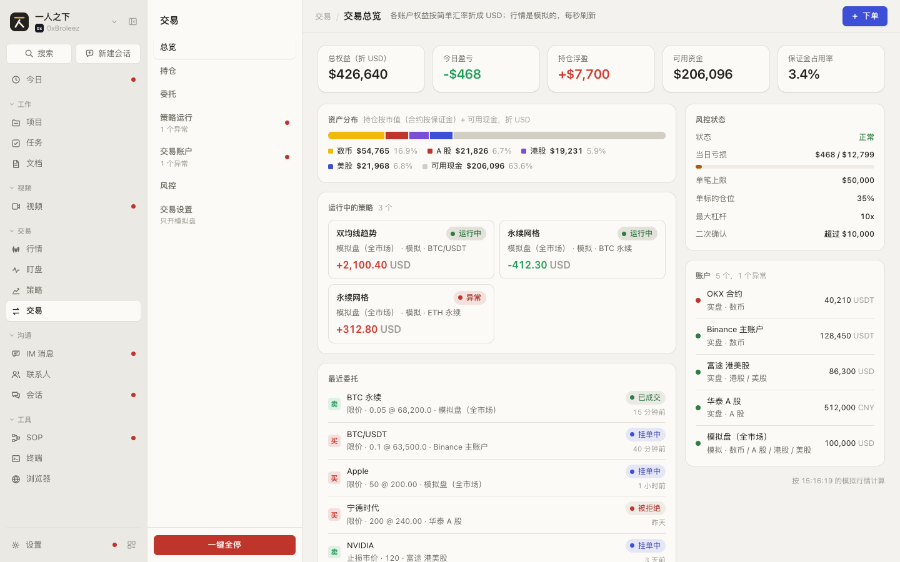 | 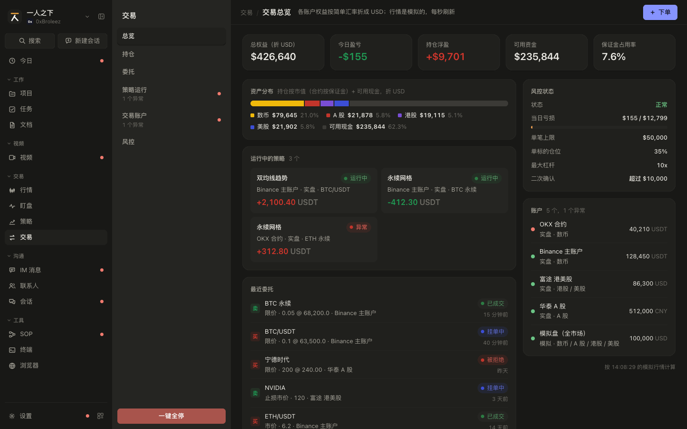 |
| 手机 375 | 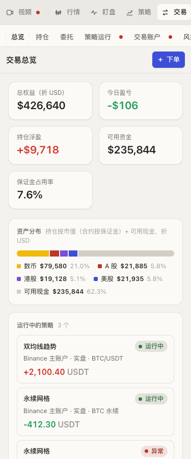 | 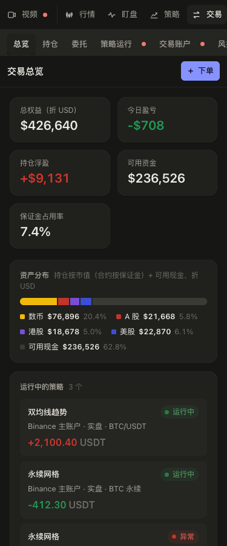 |

### 页面清单

| 节 | 页面 | 入口 | 说明 |
|---|---|---|---|
| [SPEC-trading-1](#spec-trading-1-二级菜单一键全停和熔断条) | 二级菜单、一键全停和熔断条 | 一级菜单「交易」 | 七个视图、异常红点、一键全停；熔断时每个视图顶上的熔断条 |
| [SPEC-trading-2](#spec-trading-2-总览) | 总览 | 二级菜单「总览」（模块默认页） | 权益、盈亏、资产分布、运行中的策略、最近委托、风控状态、账户 |
| [SPEC-trading-3](#spec-trading-3-持仓) | 持仓 | 二级菜单「持仓」 | 按账户分段的持仓，平仓、看图、加止损 |
| [SPEC-trading-4](#spec-trading-4-委托) | 委托 | 二级菜单「委托」；行情「买入」「卖出」进来 | 当前委托、历史委托，改价、撤单 |
| [SPEC-trading-5](#spec-trading-5-下单抽屉) | 下单抽屉 | 标题栏「下单」；行情、期权详情「买入」「卖出」 | 标的、账户、方向、类型、价格、数量、合约设置、风控检查、二次确认 |
| [SPEC-trading-6](#spec-trading-6-策略运行) | 策略运行 | 二级菜单「策略运行」；策略「运行记录」的「到交易里管理」 | 每个部署一张卡：盈亏、日志、暂停、恢复、停止 |
| [SPEC-trading-7](#spec-trading-7-新建策略运行抽屉部署) | 新建策略运行抽屉（部署） | 策略运行「新建运行」；策略编辑页、回测报告「部署」 | 策略、账户、标的、分配资金、参数覆盖、实盘确认 |
| [SPEC-trading-8](#spec-trading-8-交易账户) | 交易账户 | 二级菜单「交易账户」；总览「全部 N 个账户」 | 每个账户一张卡：状态、资金、API、权限，连接、断开、删除 |
| [SPEC-trading-9](#spec-trading-9-新增交易账户抽屉) | 新增交易账户抽屉 | 交易账户「新增账户」 | 选交易所或券商、填凭证、选权限、测试连接 |
| [SPEC-trading-10](#spec-trading-10-风控) | 风控 | 二级菜单「风控」 | 当日亏损、四项风控规则和两项辅助规则、一键全停、熔断记录；规则触发后各处的界面 |
| [SPEC-trading-11](#spec-trading-11-交易设置实盘评审和停用插件) | 交易设置 | 二级菜单「交易设置」 | 实盘开关、评审清单、`trade:live` 申请、停用插件 |
| [SPEC-trading-12](#spec-trading-12-对账抽屉) | 对账抽屉 | 交易账户卡片上的「对账」 | 实盘账户最近一次对账的结果和差异，按交易所修正、重新对账 |

### 共用数据结构

字段名和类型照抄 `web-next/src/tradedata.ts`。

`AccountKind`：`exchange` 交易所 / `broker` 券商。

`TradeAccount` 交易账户

| 字段 | 类型 | 必填 | 说明 | 取值 / 示例 |
|---|---|---|---|---|
| `id` | `string` | 是 | 编号，新建用 `newId('ac')` | `ac_bn` |
| `name` | `string` | 是 | 名称 | `Binance 主账户` |
| `broker` | `string` | 是 | 交易所或券商（`BROKERS` 的 key） | `Binance`、`OKX`、`Bybit`、`富途`、`老虎`、`盈透 IBKR`、`华泰证券`、`中信证券`、`模拟` |
| `kind` | `AccountKind` | 是 | 交易所 / 券商 | `exchange` |
| `markets` | `MarketKey[]` | 是 | 能交易的市场（`SPEC-markets-0`） | `['crypto']`、`['hk', 'us']` |
| `paper` | `boolean` | 是 | `true` 模拟盘、`false` 实盘 | `false` |
| `currency` | `string` | 是 | 账户币种 | `USDT`、`USD`、`CNY` |
| `equity` | `number` | 是 | 权益 | `128450` |
| `available` | `number` | 是 | 可用资金 | `61230` |
| `margin_used` | `number` | 是 | 已用保证金 | `22180` |
| `status` | `'connected' \| 'disconnected' \| 'error'` | 是 | 已连接 / 已断开 / 异常 | `connected` |
| `error` | `string` | 否 | 异常原因 | `API Key 已过期，请到 OKX 重新创建并更新` |
| `api_hint` | `string` | 是 | 给人认的凭证提示：API Key 只存后四位，网关写地址 | `****7Q2c`、`OpenD 127.0.0.1:11111`、`QMT ****1203`、`本地模拟撮合` |
| `permissions` | `('read' \| 'trade')[]` | 是 | 权限：只读、交易；永远没有提币 | `['read', 'trade']` |
| `updated_at` | `string` | 是 | 最近同步时间 | |

`Position` 持仓

| 字段 | 类型 | 必填 | 说明 | 取值 / 示例 |
|---|---|---|---|---|
| `id` | `string` | 是 | 编号，新建用 `newId('ps')` | `ps1` |
| `account_id` | `string` | 是 | 账户 | `ac_bn` |
| `symbol` | `string` | 是 | 标的 | `BINANCE:BTCUSDT` |
| `side` | `'long' \| 'short'` | 是 | 多 / 空；现货只有多 | `long` |
| `qty` | `number` | 是 | 数量，正数 | `0.75` |
| `avg_price` | `number` | 是 | 持仓均价 | `64200` |
| `leverage` | `number` | 否 | 合约杠杆 | `5` |
| `liq_price` | `number` | 否 | 合约强平价 | `80100` |
| `run_id` | `string` | 否 | 来自哪个策略运行，手动开的没有 | `rn1` |
| `opened_at` | `string` | 是 | 开仓时间（反手时更新） | |

`positionPnl(p, at)` 返回 `{ last, pnl, pct, value }`：现价、浮盈（（现价减均价）乘数量乘乘数，空单取反）、浮盈率（乘以杠杆）、市值（现价乘数量乘乘数）。今日盈亏：24 小时内开的仓从成本算，否则从昨收算。

`OrderType`：`market` 市价 / `limit` 限价 / `stop` 止损市价 / `stop_limit` 止损限价（`ORDER_TYPE`）。

`OrderStatus`（`ORDER_STATUS` 带颜色）：`pending` 提交中 / `open` 挂单中 / `partial` 部分成交 / `filled` 已成交 / `canceled` 已撤单 / `rejected` 被拒绝。`pending`、`open`、`partial` 算未完成（当前委托），其余算历史。

`Order` 委托

| 字段 | 类型 | 必填 | 说明 | 取值 / 示例 |
|---|---|---|---|---|
| `id` | `string` | 是 | 编号，新建用 `newId('od')` | `od1` |
| `account_id` | `string` | 是 | 账户 | `ac_bn` |
| `symbol` | `string` | 是 | 标的 | |
| `side` | `'buy' \| 'sell'` | 是 | 买 / 卖 | |
| `type` | `OrderType` | 是 | 类型 | `limit` |
| `qty` | `number` | 是 | 数量，按最小下单量取整 | `0.1` |
| `price` | `number` | 否 | 委托价，限价和止损限价有 | `63500` |
| `stop_price` | `number` | 否 | 触发价，止损和止损限价有 | `160` |
| `filled` | `number` | 是 | 已成交数量 | `0` |
| `avg_fill` | `number` | 否 | 成交均价 | `3280` |
| `status` | `OrderStatus` | 是 | 状态 | `open` |
| `reject_reason` | `string` | 否 | 被拒原因 | `账户只开了只读权限，不能下单` |
| `reduce_only` | `boolean` | 否 | 仅减仓（合约） | `true` |
| `run_id` | `string` | 否 | 来自哪个策略运行 | `rn2` |
| `created_at` | `string` | 是 | 下单时间 | |
| `updated_at` | `string` | 是 | 最近变化时间 | |

`RunStatus`（`RUN_STATUS` 带颜色）：`running` 运行中 / `paused` 已暂停 / `stopped` 已停止 / `error` 异常。

`StrategyRun` 一次部署（策略在一个账户上跑）

| 字段 | 类型 | 必填 | 说明 | 取值 / 示例 |
|---|---|---|---|---|
| `id` | `string` | 是 | 编号，新建用 `newId('rn')` | `rn1` |
| `strategy_id` | `string` | 是 | 策略（`SPEC-strategy-0`） | `st_macross` |
| `account_id` | `string` | 是 | 账户 | `ac_bn` |
| `symbols` | `string[]` | 是 | 这次跑的标的，是策略标的里账户支持的子集 | `['BINANCE:BTCUSDT']` |
| `params` | `Record<string, number>` | 是 | 参数，策略默认值加本次覆盖 | `{ fast: 12, slow: 48 }` |
| `capital` | `number` | 是 | 分配给这次运行的资金上限（账户币种） | `50000` |
| `status` | `RunStatus` | 是 | 状态 | `running` |
| `error` | `string` | 否 | 异常原因 | `OKX API Key 已过期，下单被拒` |
| `pnl` | `number` | 是 | 盈亏（账户币种） | `2100.4` |
| `started_at` | `string` | 是 | 启动时间 | |
| `stopped_at` | `string` | 否 | 停止时间；从停止状态恢复时清掉 | |
| `stop_reason` | `string` | 否 | 停止原因 | `手动停止`、`一键全停：手动一键全停`、`策略已删除` |
| `logs` | `{ at: string; level: 'info' \| 'warn' \| 'error'; text: string }[]` | 是 | 运行日志：信号、下单、成交、风控拦截、启停；原型只留最近 60 条 | |

`RiskRules` 风控规则（全局一份）

| 字段 | 类型 | 必填 | 说明 | 演示值 |
|---|---|---|---|---|
| `max_position_pct` | `number` | 是 | 单标的最大仓位，占该账户权益 % | `35` |
| `daily_loss_pct` | `number` | 是 | 单日最大亏损，占总权益 %；触发后停所有策略、禁止新开仓 | `3` |
| `max_order_value` | `number` | 是 | 单笔最大下单金额（USD） | `50000` |
| `max_leverage` | `number` | 是 | 合约最大杠杆 | `10` |
| `confirm_above` | `number` | 是 | 下单前二次确认的金额阈值（USD） | `10000` |
| `halted` | `boolean` | 是 | 熔断状态：触发了日亏损或手动一键全停 | `false` |
| `halted_reason` | `string` | 否 | 熔断原因 | |
| `halted_at` | `string` | 否 | 熔断时间 | |

熔断记录 `HaltRec`（`trading.tsx`，原型未放进数据文件，存在模块内存里）：`at` 触发时间、`reason` 原因、`released_at` 解除时间（没解除为空）。演示数据一条：9 天前「单日亏损 3.1%，超过 3% 上限，自动熔断」，2 小时后解除。

`LiveReview` 实盘评审（全局一份，原型存模块内存：切走页面保留，刷新回到演示数据）

| 字段 | 类型 | 必填 | 说明 | 演示值 |
|---|---|---|---|---|
| `confirmed` | `Partial<Record<LiveCheckKey, string>>` | 是 | 评审清单每一项用户确认通过的时间；没确认的没有 | `{ audit: 3 天前, incident: 3 天前 }` |
| `granted_at` | `string` | 否 | `trade:live` 授予的时间；没申请或已收回的没有 | |
| `enabled` | `boolean` | 是 | 实盘开关 | `false` |
| `enabled_at` | `string` | 否 | 打开实盘开关的时间 | |

`LiveCheckKey` 评审项（`LIVE_CHECKS`，顺序就是界面顺序）：`audit` 审计日志 / `recon` 对账 / `incident` 异常处理 / `drill` 全停演练 / `paper` 模拟盘两周记录。实盘真正生效要 `enabled` 为真并且 `granted_at` 有值（`liveOn`）。

`Reconciliation` 一个实盘账户最近一次对账（模拟盘本地撮合，不对账）

| 字段 | 类型 | 必填 | 说明 | 取值 / 示例 |
|---|---|---|---|---|
| `account_id` | `string` | 是 | 账户 | `ac_bn` |
| `at` | `string` | 是 | 对账时间 | |
| `status` | `'ok' \| 'diff' \| 'failed'` | 是 | 一致 / 有差异 / 失败 | `diff` |
| `error` | `string` | 否 | 失败原因 | `API Key 已过期，拉不到交易所数据` |
| `checked` | `number` | 是 | 对了多少项：余额算一项，每个持仓、每笔未完成委托各算一项 | `3` |
| `items` | `ReconItem[]` | 是 | 差异，处理过的也留着 | |

`ReconItem` 一处差异

| 字段 | 类型 | 必填 | 说明 | 取值 / 示例 |
|---|---|---|---|---|
| `id` | `string` | 是 | 编号 | `rc1` |
| `kind` | `'balance' \| 'position' \| 'order'` | 是 | 余额 / 持仓 / 挂单 | `position` |
| `label` | `string` | 是 | 给人看的对象 | `ETH/USDT 持仓` |
| `local`、`remote` | `string` | 是 | 本地记的、交易所返回的 | `6.2`、`6.1938` |
| `note` | `string` | 否 | 差异可能的原因 | `买入手续费按 ETH 扣了 0.0062，本地记的是委托数量` |
| `position_id`、`remote_qty` | `string`、`number` | 否 | 持仓差异：按交易所修正时把这个持仓的数量改成 `remote_qty` | `ps3`、`6.1938` |
| `resolved_at`、`resolution` | `string` | 否 | 处理时间和方式 | `按交易所修正了本地记录` |

`TradingView` 视图：`overview` 总览 / `positions` 持仓 / `orders` 委托 / `runs` 策略运行 / `accounts` 交易账户 / `risk` 风控 / `settings` 交易设置。

汇率 `FX`（只为统一折算 USD 看总数）：USD 1、USDT 1、CNY 0.14、HKD 0.128。

演示数据：

- 账户 `seedAccounts` 5 个：Binance 主账户（实盘，数币，读取加交易）、OKX 合约（实盘，数币，异常：API Key 已过期）、富途 港美股（实盘，港股美股，读取加交易，`OpenD 127.0.0.1:11111`）、华泰 A 股（实盘，A 股，只读，`QMT ****1203`）、模拟盘（全市场）（模拟，四个市场，USD 100000）。
- 账户资金：Binance 主账户保证金 0（合约仓随运行挪到了模拟盘）；模拟盘可用 70252、保证金 4068（扣掉 BTC 现货 0.4 和永续空单的保证金）。
- 持仓 `seedPositions` 6 个：模拟盘的 BTC/USDT 多 0.4（来自 `rn1`）、BTC 永续空 0.3（5 倍，来自 `rn2`）；Binance 主账户的 ETH/USDT 多 6.2（手动，只读同步）；富途的 NVIDIA 多 120、腾讯控股多 300；华泰的贵州茅台多 100。
- 委托 `seedOrders` 6 笔：Binance 主账户 BTC/USDT 限价买 0.1 挂单中（在交易所 App 里下的，同步回来）；模拟盘 BTC 永续限价卖 0.05 挂单中（`rn2`）；富途 NVIDIA 止损卖 120 挂单中；Binance ETH/USDT 市价买 6.2 已成交；华泰宁德时代限价买 200 被拒绝（只读权限）；模拟盘 Apple 限价买 50 @ 200 挂单中（离现价远，不会成交，改价演示用它）。
- 运行 `seedRuns` 5 个，实盘评审前都在模拟盘：`rn1` 双均线趋势运行中，16 天前启动（分配 30000，评审的「模拟盘两周记录」靠它）；`rn2` 永续网格运行中（分配 20000）；`rn3` RSI 超卖反弹已暂停（分配 30000）；`rn4` 双均线趋势已停止（「模拟盘跑了 12 天回撤超过 5%，手动停掉换参数」）；`rn5` 永续网格 ETH 永续异常（「OKX 行情推送断开超过 5 分钟，网格已挂起」）。
- 实盘评审 `seedLiveReview`：审计日志、异常处理 3 天前确认过；其余三项没确认，`trade:live` 没申请，实盘开关关着。
- 对账 `seedRecons`：Binance 主账户 12 分钟前对了 3 项，1 处差异（ETH/USDT 持仓本地 6.2、交易所 6.1938，买入手续费按 ETH 扣）；OKX 合约 4 小时前对账失败（API Key 已过期）；富途 15 分钟前 4 项一致；华泰 30 分钟前 2 项一致。
- 运行异常（`incidentdata.ts`）里交易的两条：「交易账户异常」（OKX，余额和持仓停在 4 小时前，对账暂停）、「交易对账异常」（Binance ETH/USDT 差 0.0062，出现 2 次）。
- 风控 `seedRisk`：见上表，未熔断。

### 撮合和资金

原型的模拟撮合（`TradingPage` 每 0.5 秒扫一遍）。TRD-05a 在后端实现模拟盘撮合时按这里，补上手续费和权益结算：

1. 新委托先是「提交中」；0.6 秒后，下单时算好的交易所拒单原因（`exchangeReject`，见 `SPEC-trading-5.22`）有值就变「被拒绝」并记运行异常「委托被拒」，否则变「挂单中」。
2. 挂单中的委托只在账户已连接、标的所在市场处于交易中时撮合：市价单挂单 1 秒后按现价成交；限价单在现价越过委托价时按委托价成交；止损单在现价触到触发价时按现价成交；止损限价单在触到触发价且限价也满足时按委托价成交。原型不出现部分成交。
3. 成交后改持仓（`applyFills`）：同向加仓按数量加权算均价；反向先减，减到 0 删掉持仓，减过头就反手（均价是成交价，开仓时间更新）。合约带杠杆时算强平价：多单均价乘以（1 减 1 除以杠杆加 0.5%），空单均价乘以（1 加 1 除以杠杆减 0.5%）。
4. 成交后改账户资金（`cashDeltas`）：现货买减可用、卖加可用；合约按持仓名义价值的变化除以杠杆增减保证金，可用相应减增。原型不收手续费，也不改权益（权益是演示值，只在新增账户时给一个）。
5. 来自策略运行的成交，在那个运行的日志里加「成交：买入 / 卖出 <数量> <标的> @ <价格>」。

正式版口径（TRD-05a 验收）：限价单价格到了才成交，市价单按最新价加滑点成交，手续费计入；任意时刻权益等于初始资金加已实现加未实现盈亏减手续费；对实盘账户或不存在的账户调模拟撮合返回 400。

### 正式版口径（TRD-05a、TRD-05b、TRD-06a 后端已做）

后端实现时和原型有出入、以这里为准的地方（接口见 `docs/api-contract.md`「交易套件插件 trade」的「模拟盘账户、委托和撮合」「策略部署」「风控」三节）：

| 编号 | 原型 | 正式版 |
|---|---|---|
| SPEC-trading-0.9 | 新委托先「提交中」，0.6 秒后变挂单中或被拒绝 | 后端下单当场检查完：过了直接是挂单中（`open`），模拟交易所会拒的（可卖不足、仅减仓没有反向持仓、可用资金不足）直接是被拒绝，原因写在 `reject_reason`；`pending` 不出现。`partial` 预留，模拟撮合一次全部成交 |
| SPEC-trading-0.10 | 止损限价在同一刻「触到触发价且限价也满足」才成交 | 先等触发（记 `triggered`），之后按限价单的规则成交，触发和成交可以不在同一刻 |
| SPEC-trading-0.11 | 市价单按现价成交，不收手续费，权益是演示值 | 市价、止损单按最新价加减滑点（账户的 `slippage_ticks` 跳）成交；手续费按账户费率（`fee_bp`，默认万分之 5）计入；权益 = 初始资金 + 已实现 + 未实现 − 手续费，后端现算；行情不是实时时不撮合 |
| SPEC-trading-0.12 | 风控只在下单抽屉里拦，金额超过二次确认线时前端多一步确认 | 风控在后端统一下单入口逐笔检查，不通过回 409（`reason: "risk"`），委托记成被拒绝；手动单金额超过二次确认线没带 `confirmed: true` 回 409（`reason: "confirm"`），前端在确认后带上标记重新提交；部署的单不要二次确认 |
| SPEC-trading-0.13 | 策略运行每 15 秒写心跳日志、随机改盈亏 | 部署按策略周期的 K 线收盘算信号（复用回测引擎），下市价单；只写信号、下单、成交、风控拦截、启停、补算这些日志，没有心跳。盈亏按部署自己的成交现算 |
| SPEC-trading-0.14 | 暂停、停止不动挂单 | 暂停只停新信号、挂单保留；停止撤掉这个部署的挂单（持仓保留） |
| SPEC-trading-0.15 | 熔断记录只有触发、解除时间 | 解除熔断要写原因（`release_reason`）；熔断记录多种类（手动 / 自动）和停掉的部署、撤掉的挂单数 |
| SPEC-trading-0.16 | 现在只有模拟盘一个账户覆盖四个市场 | 模拟盘账户可以选市场，但现在只有数币有行情源，A 股、港股、美股的标的下单、部署回 400「行情源还没接」；币种只能是 USD、USDT（1:1） |

### 正式前端（TRD-05c、TRD-06b 已接后端）

正式前端 `frontend/src/plugins/trade/TradingPage.tsx` 等接了上面三节接口，和原型有出入、以这里为准的地方：

| 地方 | 原型 | 正式前端 |
|---|---|---|
| 模拟盘标记 | 账户卡片、下单抽屉里写「模拟 / 实盘」 | 现在只有模拟盘：标题栏左侧固定一个「模拟盘」标签，抽屉标题写「下单 · 模拟盘」「新建策略运行 · 模拟盘」 |
| 二级菜单 | 七个视图 | 交易账户（TRD-07b）、交易设置（TRD-08）还没做，先只放总览、持仓、委托、策略运行、风控；总览的「账户」区不跳交易账户 |
| 没有账户 | 演示数据自带账户 | 一个模拟盘账户都没有时，总览、持仓、委托、策略运行和两个抽屉都给「还没有模拟盘账户」和「建一个模拟盘账户」（默认值：100,000 USD、只做数币、万分之 5、滑点 1 跳） |
| 估值和撮合 | 前端每 0.5 秒撮合、按模拟行情算盈亏 | 前端不撮合、不算账：持仓的现价、盈亏、收益率、强平价、保证金，账户的权益、可用、已实现、手续费都取后端；有挂单时委托每秒重取（市价单通常一秒内成交），挂单变少时顺手刷新账户、持仓、部署；没有挂单不轮询委托 |
| 风控提示（5.15、5.16） | 数量大于 0 就按规则检查，不通过不让提交 | 前端检查只做黄色「预检查」提示、不拦提交；提交后后端 409 `risk` 时红框「风控未通过」，写「这笔已记成被拒绝的委托」，原因逐条原样取后端的 `blocks`；抽屉不关 |
| 二次确认（5.17） | 前端按阈值先进确认 | 后端 409 `confirm` 后底部出确认条，金额和阈值取后端的 `value`、`confirm_above`；「确认买入 / 卖出」带 `confirmed: true` 重提。后端先查风控、再查二次确认，所以风控不过的单不会先出确认条 |
| 下单结果 | 抽屉关掉，委托进「提交中」 | 抽屉关掉，页面顶上一条「已下单：买入 N <标的>，挂单中」或「委托被拒：<原因>」，「知道了」关掉 |
| 平仓、挂止损（3.8、3.9） | 直接下单 | 走同一个下单入口：金额超过确认线时，持仓行下面出确认条「金额约 $N，超过 $M 二次确认线」和「确认平仓」；被风控拦下时原样列原因 |
| 一键全停（1.3、10.6） | 执行后只有熔断条 | 执行后页面顶上写结果「一键全停完成：停掉 N 个部署，撤掉 N 笔挂单，持仓保留；已进入熔断」；没做完（500）时红条「全停没有完成：<原因>」、列出还在跑的部署和没撤掉的挂单、给「重试」（1.8 已做） |
| 手机上的一键全停（0.5） | 在二级菜单横条最右边 | 760px 以下二级菜单底部的一键全停隐藏，标题栏右侧多一个红色「一键全停」，点了在页面顶上展开确认条 |
| 解除熔断（1.6、10.16） | 确认后直接解除 | 确认条里多一个「解除原因（必填）」输入框，没写原因「确认解除」不可点；原因记到熔断记录上 |
| 熔断记录（10.7） | 原因、触发和解除时间 | 多「手动 / 自动」标签、停掉的部署数和撤掉的挂单数、「解除原因：…」 |
| 部署（7） | 「启动运行」前端建运行 | 调 `POST /api/trade/runs`；熔断中按钮不可点，后端仍回 409 `halted` 时底部红字原样显示原因；标的里非数币的写「<市场>行情源还没接」不可勾 |
| 部署卡片（6） | 「启动」「恢复」两个动作 | 后端合成一个 `/resume`，按钮文字照旧（已暂停写「恢复」，已停止、异常写「启动」）；「停止」的确认写「停止后撤掉这个部署的挂单，持仓保留、不自动平仓」；卡片多已实现、浮动、手续费和部署自己的持仓；日志先列最近 3 条，「全部 N 条日志」取详情（最近 500 条） |
| 不做的 | A 股 T+1、涨跌停提示、开盘后报出（5.13）、部分成交 | 后端没有 A 股行情源也没做这些，界面上不出这些提示；非数币账户在下单抽屉里归到不可用，原因「<市场>行情源还没接」 |

原型同步改了：熔断条解除要写原因、熔断记录多种类和数量、风控页一键全停后显示结果、下单抽屉的风控检查改成预检查提示加「提交后拦下、记成被拒绝」（`web-next/src/trading.tsx` 的 `HaltBar`、`RiskView`、`OrderDrawer`、`TradingPage`）。二级菜单的一键全停在原型里接在 `App.tsx`，没加结果条；手机上的一键全停位置（0.5）原型仍未改。

### 原型里模拟、正式版要真做的

| 部分 | 原型 | 正式版 |
|---|---|---|
| 实盘账户 | 实盘开关没开时只能看（带实盘标记的操作不可点）；开了以后和模拟盘一样在前端撮合 | TRD-08 评审前只读同步；评审通过后实盘下单走交易所接口（TRD-08d），先在测试网验证 |
| 模拟撮合 | 前端定时器，只在交易页打开时跑；切走页面就不撮合 | 后端撮合（TRD-05a），页面关着也照常 |
| 策略运行 | 运行中的每 15 秒写一条心跳日志、随机改一点盈亏，不产生信号、不下单、不过风控 | 后端按策略算信号、下单，每笔走风控（TRD-05b、TRD-06a）；被风控拦下写一条 warn 日志；重启后部署继续，日志里写补算说明 |
| 日亏损 | 按持仓的今日浮动盈亏（折 USD）算，不含当日已实现盈亏 | 当日已实现加未实现，按交易日（数币按 UTC 0 点）重置 |
| 风控 | 只在前端下单抽屉里检查 | 全部在后端强制，前端绕不过（TRD-06a：直接调接口超单笔上限、熔断中开新仓、超杠杆都被拒）；下单抽屉原样显示后端返回的原因（TRD-06b） |
| 熔断记录 | 模块内存，刷新就没了 | 落库，并进交易审计（TRD-08a） |
| 账户 | 连接、断开、测试连接都是 0.8 秒后给结果的假动作；权益是演示值 | 交易所账户连接器，API Key 存保险箱，只读同步余额和持仓（TRD-07a）；接入时检查 Key 的权限，带提币权限的拒绝接入并说明 |
| 对账 | 演示数据给每个实盘账户一条最近对账；「重新对账」0.8 秒后按账户连接状态和没处理的差异给结果，不真的拉交易所；「按交易所修正」直接改本地持仓数量 | 定时和交易所对余额、持仓、委托；有差异时记对账记录、发通知，并按阈值熔断；断线恢复后不自动解除熔断（TRD-08b） |
| 实盘评审 | 存模块内存，刷新回到演示数据；评审项的条件在前端现算（`liveChecks`） | 评审记录和 `trade:live` 授予落库并记审计，只能用户本人在界面上确认，Agent 和接口都不能代为确认（TRD-08c） |
| 审计 | 没有 | 一笔委托从下单到成交的每一步都能查到（TRD-08a） |
| 数据 | 存在 `App.tsx` 的 state 里，刷新回到演示数据 | 落库 |

### 插件停用

开发计划 2.7：交易插件停用前必须先「一键全停」，没有在跑的部署、没有挂单才允许停用（TRD-08a）。停用被拦时，插件管理页显示「还有 N 个部署在跑、N 笔挂单，先到交易里一键全停」，并给「去一键全停」跳 `SPEC-trading-10`。

原型没有插件管理页，这道拦截做在「交易设置」的「停用插件」一节（`SPEC-trading-11.12` 到 `11.14`），正式版放在插件管理页的停用按钮上，文字和判断照搬。「在跑」按没停止的部署算（运行中、已暂停、异常都算），挂单按提交中、挂单中、部分成交算。工作台的模块开关（`SPEC-settings-2`）只是把菜单从某个工作台里拿掉，插件照常运行，所以不拦。

### 联动总表

| 方向 | 对方模块 | 触发 | 结果 | 见 |
|---|---|---|---|---|
| 进来 | 行情 | 「买入」「卖出」 | 切到委托视图，打开下单抽屉，带标的和方向；同一次请求只处理一次 | `SPEC-markets-1.13`、`SPEC-markets-3.6` |
| 进来 | 策略 | 编辑页、回测报告「部署」 | 切到策略运行视图，打开新建策略运行抽屉，策略选好 | `SPEC-strategy-3.2`、`SPEC-strategy-7.4` |
| 进来 | 策略 | 运行记录「到交易里管理」 | 切到策略运行视图 | `SPEC-strategy-8.7` |
| 出去 | 行情 | 持仓「看图」 | 打开这个标的 | `SPEC-markets-1.16` |
| 出去 | 策略 | 点策略名 | 打开策略编辑页 | `SPEC-strategy-3` |
| 改动 | 策略 | 一键全停、熔断 | 运行全部停止，策略的运行记录跟着变 | `SPEC-strategy-8` |
| 改动 | 设置 / 运行异常 | 交易账户异常（每个账户只报一次，恢复后再坏再报）、委托被拒、下单被风控拦截、风控熔断、交易对账异常（重新对账失败或还有差异） | 各记一条 warn 级运行异常，模块「交易」 | `SPEC-settings-18` |
| 读 | 设置 / 连接器 | 交易账户 | 原型里交易账户只在本模块管；「行情数据」连接器的说明写着「下单用的交易账户在「交易 / 交易账户」里管」 | `SPEC-settings-0`、`SPEC-trading-8` |
| 今日 | 今日 | 见下 | 见下 | `SPEC-today` |

和今日卡片的关系：

- 原型：交易套件不直接往今日放卡片。今日「需要你处理」只收 error 级运行异常，交易执行记的都是 warn 级（账户异常、委托被拒、风控拦截、熔断），所以都不上今日，只在「设置 / 运行异常」里；策略的回测失败是 error 级，会经运行异常出现在今日（`SPEC-strategy-0`）。
- 规格口径（正式版，原型待补，见下表 0.8）：交易套件通过今日的扩展点往「需要你处理」放四类，都是插件启用时才出现：熔断中（danger，「去风控」到 `SPEC-trading-10`）、策略运行异常（danger，每个异常运行一条，「去处理」到 `SPEC-trading-6`）、交易账户异常（danger，「去修复」到 `SPEC-trading-8`）、未读的盯盘触发（info，合成一条「N 条盯盘提醒触发」，「去看看」到 `SPEC-monitor-2`）。「今天在跑」区加运行中的部署（「<策略名> · <账户>」，点了到 `SPEC-trading-6`）。

### 原型和规格对不上的地方

写规格时发现的。0.1 到 0.4 已由 TRD-08p 改掉（标「已改」），其余等另开原型修错任务：

| 编号 | 问题 | 规格的口径 |
|---|---|---|
| SPEC-trading-0.1 | （已改，TRD-08p）没有实盘闸门：实盘账户能直接下单、平仓、改单、撤单、部署和启动；演示数据里两个运行（`rn1`、`rn2`）就跑在 Binance 实盘账户上 | 见上面「实盘标记」：评审通过前，带标记的操作对实盘账户不可用并写原因；演示数据的运行改到模拟盘，实盘账户只读 |
| SPEC-trading-0.2 | （已改，TRD-08p）下单抽屉默认选第一个可用账户，演示数据里是「Binance 主账户」（实盘）；部署抽屉默认优先模拟盘 | 下单抽屉也默认模拟盘（第一个可用的模拟盘账户，没有再取第一个可用的） |
| SPEC-trading-0.3 | （已改，TRD-08p）只有新建运行要勾「我确认用真实资金运行」；策略运行卡片上「恢复」「启动」实盘运行不需要确认，可交易所标题说明写的是「实盘要确认后才能启动」 | 实盘运行的启动、恢复也要确认（卡片底部出确认条，写账户名和分配资金） |
| SPEC-trading-0.4 | （已改，TRD-08p）新增交易账户的权限默认「读取 + 交易」 | 默认「只读」，交易权限单独开启（TRD-07：默认只读）；选「读取 + 交易」时提示要过 TRD-08 评审才能实盘下单 |
| SPEC-trading-0.5 | 手机宽度下「一键全停」在二级菜单横条的最右边，要先横向滚动才看得到，点了以后「确认全停」也在屏幕外 | 手机上一键全停始终可见：放进标题栏右侧（和「下单」并排），确认条在页面顶部展开 |
| SPEC-trading-0.6 | 部署抽屉的策略下拉里，说明直接显示周期 key（`4h · …`），别处都显示「4 时」 | 用 `INTERVALS` 的显示名 |
| SPEC-trading-0.7 | 新增账户选「模拟」时默认名称是「模拟 盘」（多一个空格） | 「模拟盘」 |
| SPEC-trading-0.8 | 交易套件没有今日卡片，熔断、运行异常、账户异常、盯盘触发都不上今日 | 见上「和今日卡片的关系」 |

## SPEC-trading-1 二级菜单、一键全停和熔断条

### 截图

点「一键全停」后的确认：

| | 亮 | 暗 |
|---|---|---|
| 桌面 1440 | 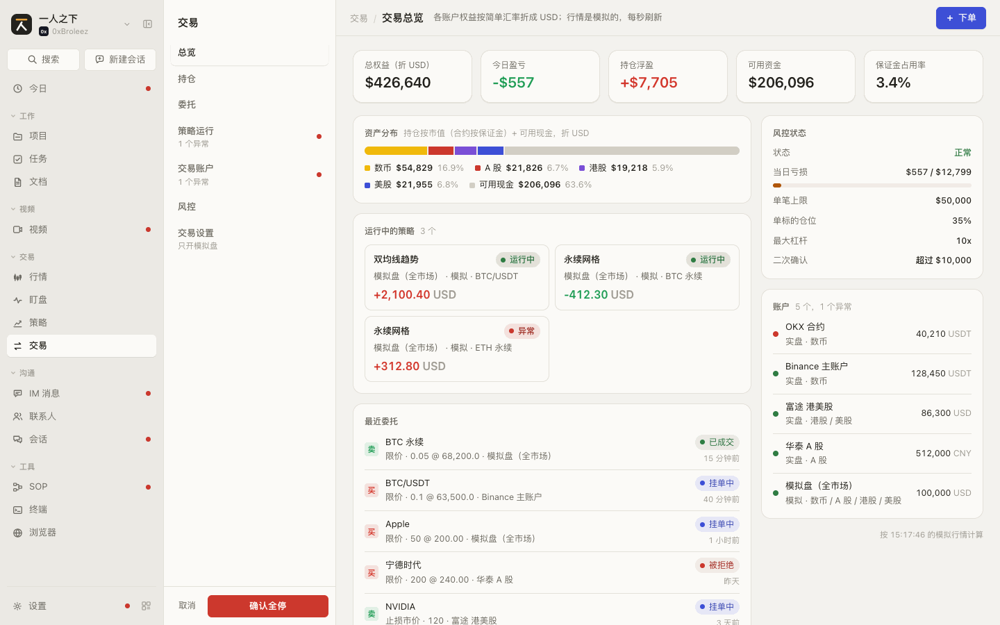 | 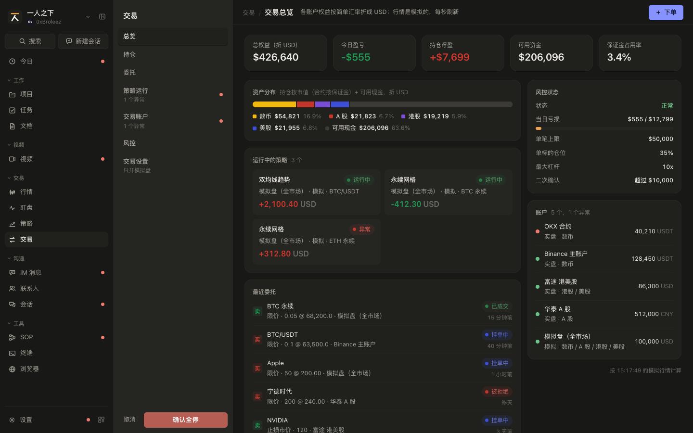 |
| 手机 375 | 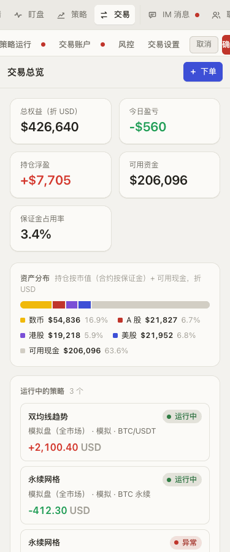 | 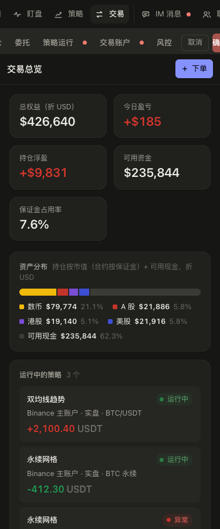 |

全停后进入熔断，每个视图顶上出熔断条：

| | 亮 | 暗 |
|---|---|---|
| 桌面 1440 | 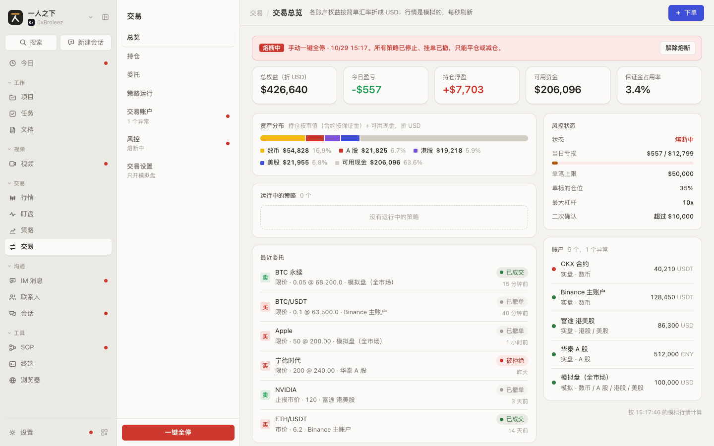 | 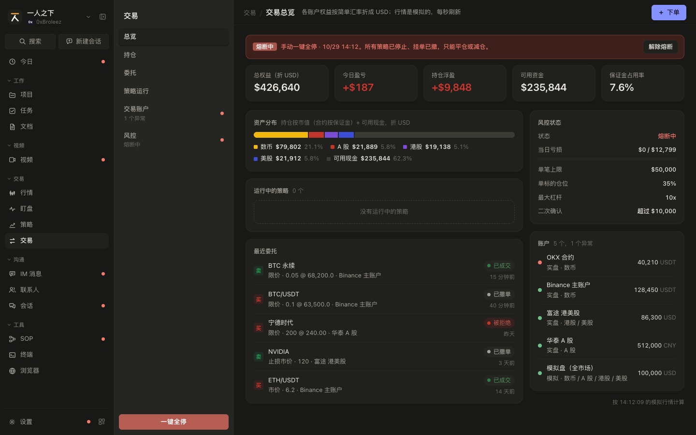 |
| 手机 375 | 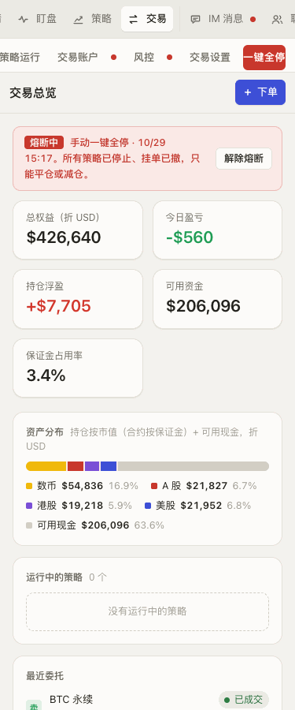 | 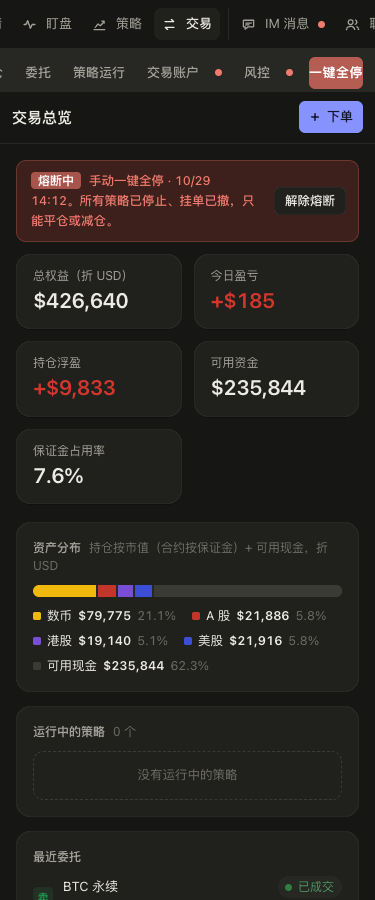 |

熔断条上点「解除熔断」后的确认：

| | 亮 | 暗 |
|---|---|---|
| 桌面 1440 | 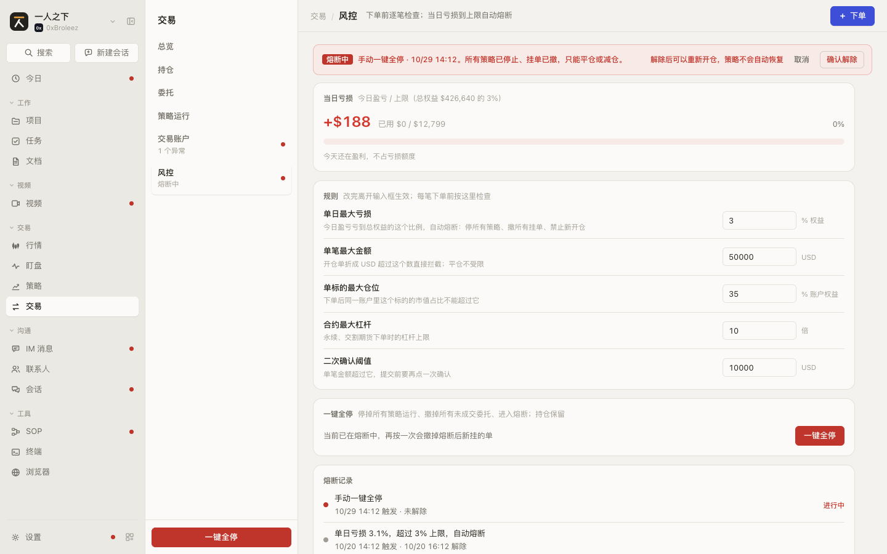 | 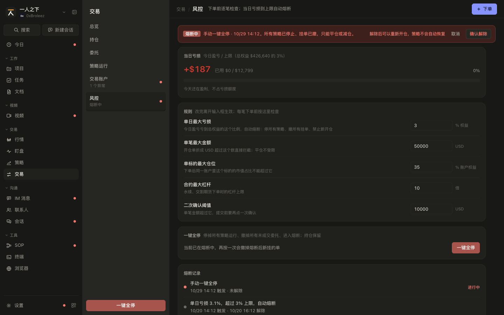 |
| 手机 375 | 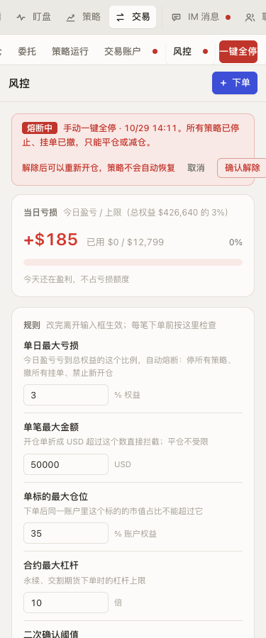 | 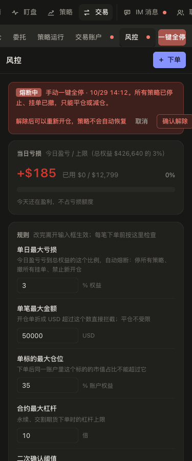 |

### 交互

| 编号 | 元素 | 操作 | 结果 |
|---|---|---|---|
| SPEC-trading-1.1 | 二级菜单 | 看、点击 | 总览、持仓、委托、策略运行（有异常的运行时红点和「N 个异常」，否则有运行中的写「N 个运行中」）、交易账户（有不是已连接的账户时红点和「N 个异常」）、风控（熔断中时红点和「熔断中」）、交易设置（写「只开模拟盘」「实盘已开启」或「插件已停用」）；点击切视图 |
| SPEC-trading-1.2 | 菜单底部「一键全停」 | 点击 | 悬停「停掉所有策略、撤掉所有挂单、进入熔断」；点了变成「取消」「确认全停」 |
| SPEC-trading-1.3 | 「确认全停」 | 点击 | 执行一键全停（原因「手动一键全停」，规则见 `SPEC-trading-10.18`）；持仓不动。正式前端：页面顶上写结果「一键全停完成：停掉 N 个部署，撤掉 N 笔挂单，持仓保留；已进入熔断」 |
| SPEC-trading-1.4 | 标题栏 | 看、点击 | 标题按视图（交易总览、持仓、委托、策略运行、交易账户、风控、交易设置），上级「交易」，说明按视图；右侧「下单」（打开下单抽屉，默认 BTC/USDT 买入），策略运行视图多「新建运行」，交易账户视图多「新增账户」 |
| SPEC-trading-1.5 | 熔断条 | 看 | 熔断时在每个视图的标题下面：「熔断中」标签、原因、时间，「所有策略已停止、挂单已撤，只能平仓或减仓。」 |
| SPEC-trading-1.6 | 熔断条「解除熔断」 | 点击 | 变成确认：「解除后可以重新开仓，策略不会自动恢复」、「解除原因（必填）」输入框、「取消」「确认解除」（没写原因不可点）；确认后熔断解除，熔断记录补上解除时间和原因；停掉的运行不自动恢复 |

### 空状态和异常状态

| 编号 | 场景 | 显示 | 可做的操作 |
|---|---|---|---|
| SPEC-trading-1.7 | 已经在熔断中再点一键全停 | 照常执行：撤掉熔断后新挂的单，熔断原因和时间换成这一次 | 无 |
| SPEC-trading-1.8 | 一键全停失败（正式版后端不可达） | 原型未做，正式前端已做。正式产品：确认条换成红字「全停没有完成：<原因>」和「重试」，并列出还在跑的部署和没撤掉的挂单 | 重试 |

### 数据

`RiskRules`、`StrategyRun`、`Order`、`TradeAccount`（见 `SPEC-trading-0`）。

### 联动

| 方向 | 对方模块 | 触发 | 结果 | 见 |
|---|---|---|---|---|
| 改动 | 策略 | 一键全停 | 运行记录里这些运行变成已停止 | `SPEC-strategy-8` |

## SPEC-trading-2 总览

### 截图

| | 亮 | 暗 |
|---|---|---|
| 桌面 1440 | 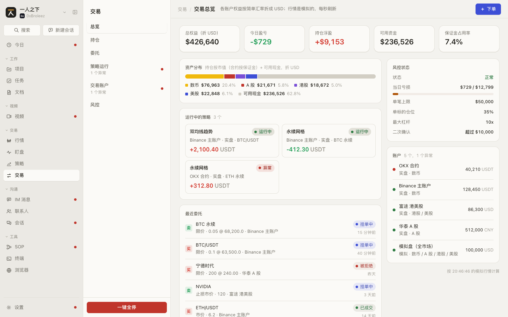 | 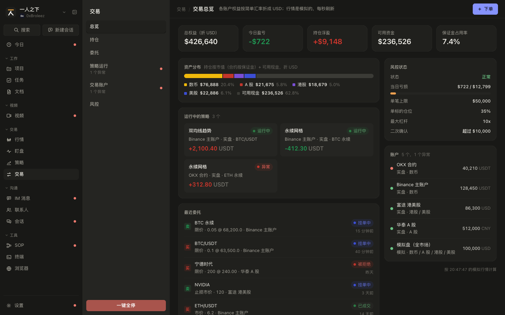 |
| 手机 375 |  |  |

### 交互

| 编号 | 元素 | 操作 | 结果 |
|---|---|---|---|
| SPEC-trading-2.1 | 统计 | 看 | 总权益（折 USD）、今日盈亏、持仓浮盈、可用资金、保证金占用率（保证金除以权益，超过 50% 红色）；金额超过 7 位整数改写成 `$96.1M`、`$1.20B`，悬停看完整值；盈亏涨红跌绿；每 0.5 秒随行情更新 |
| SPEC-trading-2.2 | 资产分布 | 看 | 一条分段条和图例：各市场的持仓（现货按市值、合约按保证金）加可用现金，折 USD，图例带金额和占比；为 0 的不显示 |
| SPEC-trading-2.3 | 运行中的策略 | 看 | 运行中和异常的部署，每个一张小卡：策略名、状态、「账户 · 模拟 / 实盘 · 标的」、盈亏和账户币种 |
| SPEC-trading-2.4 | 最近委托 | 看 | 最近 6 笔：买 / 卖、标的、「类型 · 数量 @ 价格 · 账户」、状态、相对时间 |
| SPEC-trading-2.5 | 风控状态 | 看 | 状态（正常 / 熔断中）、当日亏损「已用 / 上限」和进度条（超过 80% 变红）、单笔上限、单标的仓位、最大杠杆、二次确认「超过 $N」；熔断时整块红框 |
| SPEC-trading-2.6 | 运行中的策略小卡 | 点击 | 打开策略编辑页（`SPEC-strategy-3`） |
| SPEC-trading-2.7 | 账户 | 看 | 「N 个，M 个异常」；异常的在前，先露 6 个：状态点、名称、「模拟 / 实盘 · 市场」、权益和币种 |
| SPEC-trading-2.8 | 「全部 N 个账户」 | 点击 | 超过 6 个时出现，切到交易账户视图（不传切视图回调时就地展开「其余 N 个账户」「收起」） |
| SPEC-trading-2.9 | 页脚 | 看 | 「按 <时分秒> 的模拟行情计算」；正式版写数据时间 |

### 空状态和异常状态

| 编号 | 场景 | 显示 | 可做的操作 |
|---|---|---|---|
| SPEC-trading-2.10 | 没有运行中的策略 | 「没有运行中的策略」 | 去策略运行 |
| SPEC-trading-2.11 | 还没有委托 | 「还没有委托」 | 下单 |
| SPEC-trading-2.12 | 一个账户都没有 | 原型：统计全是 0，账户块空着。正式产品：总览换成空状态「还没有交易账户」，给「开一个模拟盘」和「接入交易所或券商」 | 新增账户 |
| SPEC-trading-2.13 | 某个账户同步失败 | 账户列表里红点在前，统计照常（用最后一次同步的值）。正式产品：统计旁写「N 个账户数据不是最新」 | 去交易账户 |

### 数据

`summarize`：总权益、可用、保证金按账户折 USD 相加；浮盈、今日盈亏、分市场市值按持仓现算。

### 联动

| 方向 | 对方模块 | 触发 | 结果 | 见 |
|---|---|---|---|---|
| 出去 | 策略 | 点运行中的策略 | 编辑页 | `SPEC-strategy-3` |

## SPEC-trading-3 持仓

### 截图

默认（按账户分段）：

| | 亮 | 暗 |
|---|---|---|
| 桌面 1440 |  | 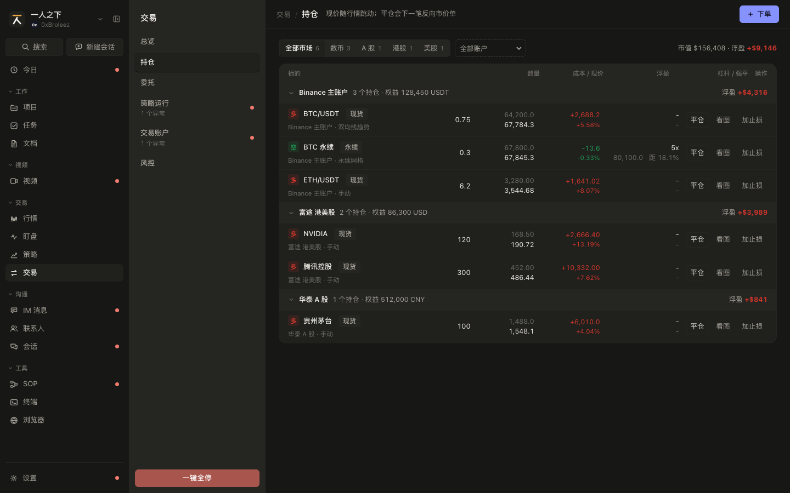 |
| 手机 375 | 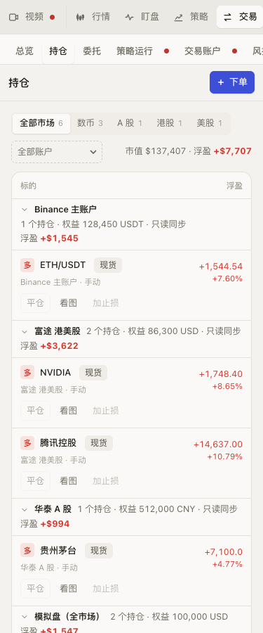 | 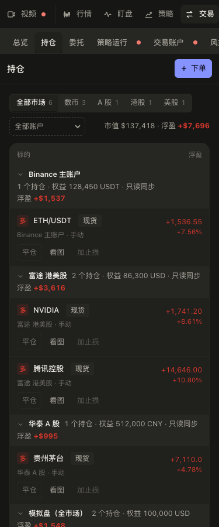 |

点「平仓」后的确认：

| | 亮 | 暗 |
|---|---|---|
| 桌面 1440 | 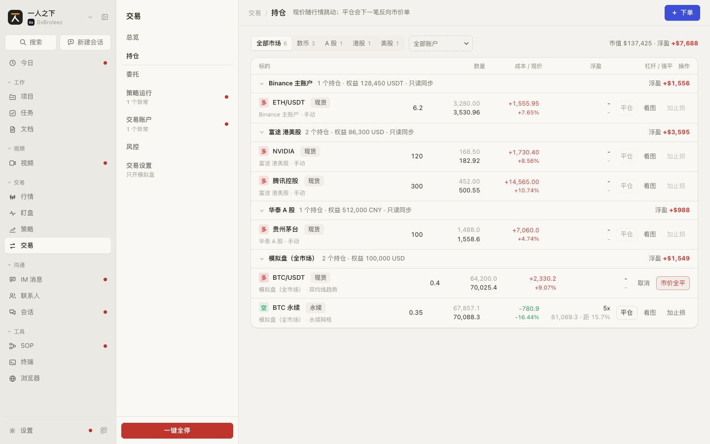 |  |
| 手机 375 | 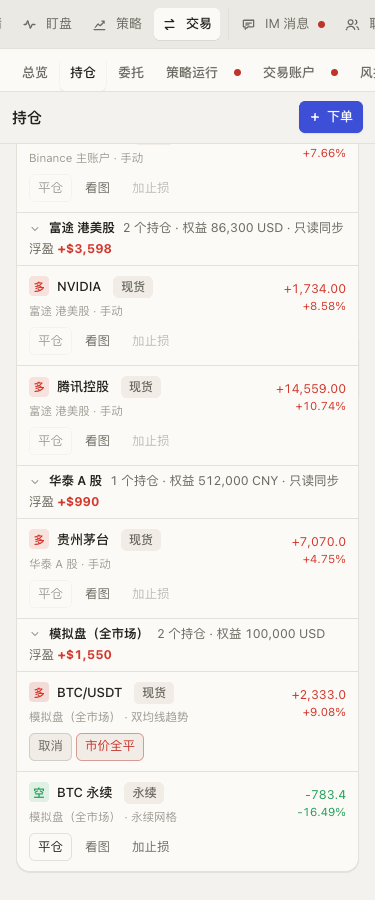 | 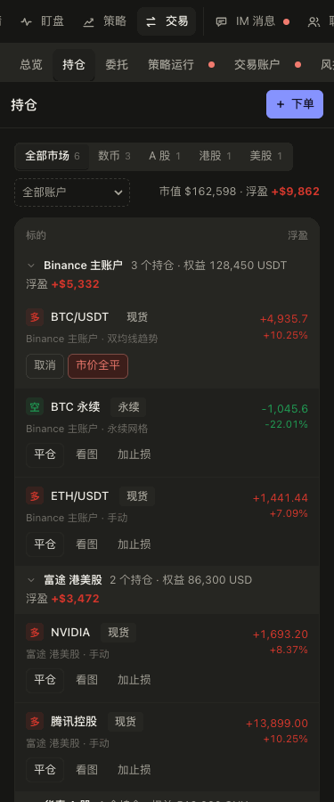 |

点「加止损」：

| | 亮 | 暗 |
|---|---|---|
| 桌面 1440 | 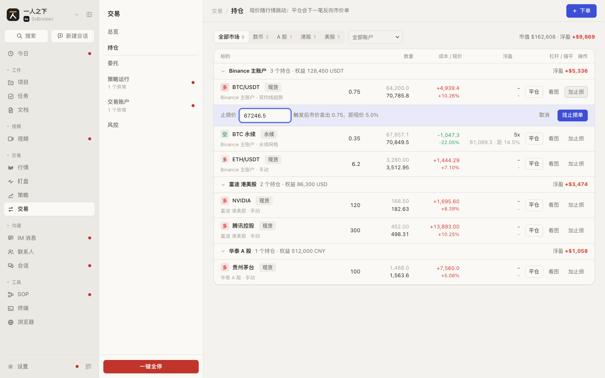 | 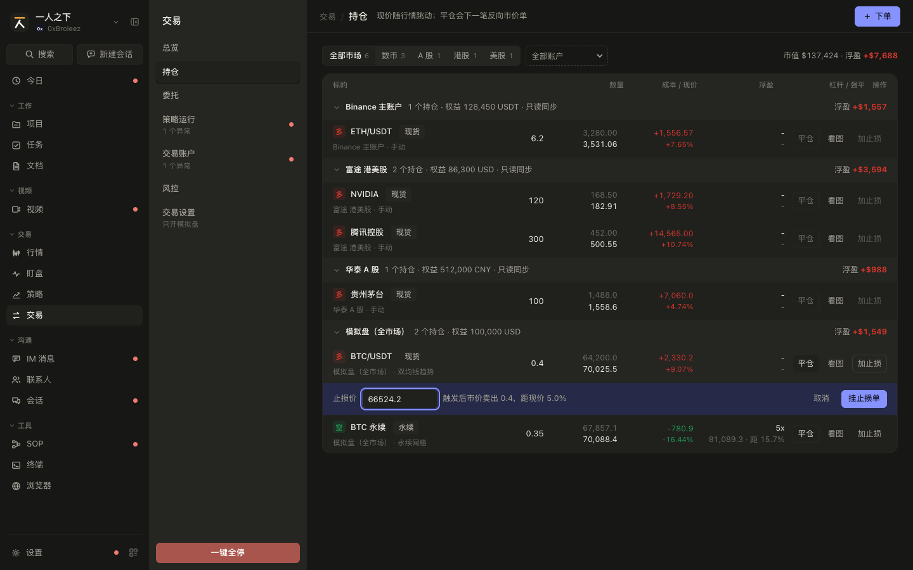 |
| 手机 375 | 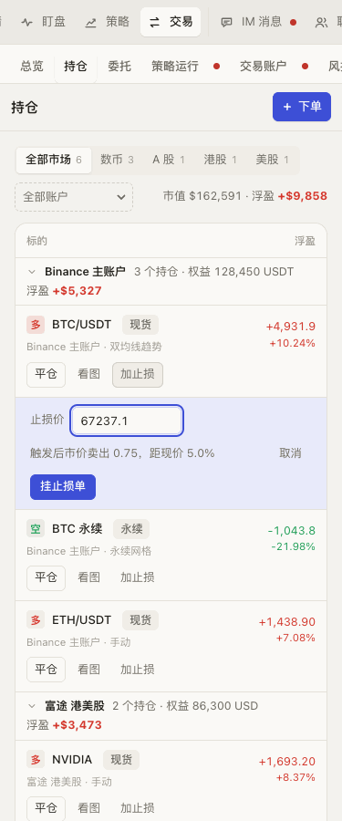 | 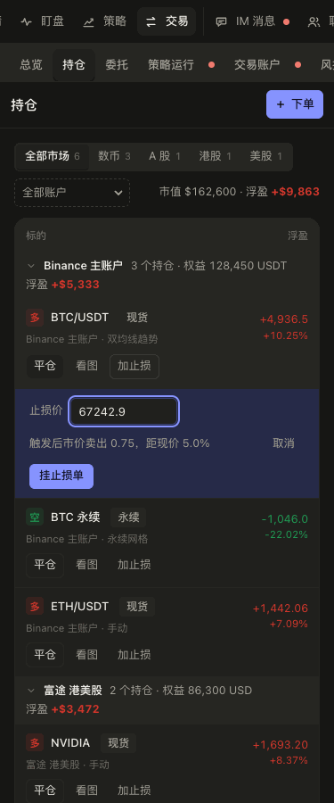 |

### 交互

| 编号 | 元素 | 操作 | 结果 |
|---|---|---|---|
| SPEC-trading-3.1 | 市场筛选「全部市场 / 数币 / A 股 / 港股 / 美股」 | 点击 | 各带持仓数 |
| SPEC-trading-3.2 | 「全部账户」下拉 | 选择 | 只看一个账户；只看一个账户时不分段 |
| SPEC-trading-3.3 | 工具栏右侧 | 看 | 筛选结果的「市值 $N · 浮盈 $N」（折 USD） |
| SPEC-trading-3.4 | 账户段头 | 看、点击 | 账户名、「N 个持仓 · 权益 N 币种」、段内浮盈；点击折叠或展开这一段；账户删了的段写「已删除的账户」 |
| SPEC-trading-3.5 | 持仓行 | 看 | 多 / 空标签、标的名、品种标签；下一行「账户 · 来源」（手动，或策略名）；数量；成本 / 现价；浮盈和浮盈率（浮盈率乘杠杆）；市值和币种；杠杆和「强平价 · 距 N%」（离强平不到 10% 红色，现货写「-」）；操作 |
| SPEC-trading-3.6 | 「看图」 | 点击 | 切到行情打开这个标的（`SPEC-markets-1.16`） |
| SPEC-trading-3.7 | 「平仓」 | 点击 | 这一行的操作换成「取消」「市价全平」 |
| SPEC-trading-3.8 | 「市价全平」 | 点击 | 下一笔反向市价单，数量是全部持仓，合约带「仅减仓」，来源带上原来的运行；委托进「提交中」，交易所会拒的照常被拒（`SPEC-trading-5.22`）。平仓不受熔断、单笔上限、仓位上限限制。实盘开关没开时（`SPEC-trading-11`），实盘账户上的这个按钮不可点，悬停写「实盘未开启：到「交易设置」过评审、打开实盘开关前，实盘账户只读同步」。**【实盘，要过 TRD-08 评审，默认只开模拟盘】** |
| SPEC-trading-3.9 | 「加止损」 | 点击 | 行下面展开：「止损价」输入（默认现价往不利方向 5%）、说明（「触发后市价卖出 / 买入 <数量>，距现价 N%」）、「取消」「挂止损单」 |
| SPEC-trading-3.10 | 「挂止损单」 | 点击 | 下一笔反向止损市价单（触发价是填的止损价，数量全部，合约仅减仓）。实盘开关没开时（`SPEC-trading-11`），实盘账户上的这个按钮不可点，悬停写「实盘未开启：到「交易设置」过评审、打开实盘开关前，实盘账户只读同步」。「加止损」同样。**【实盘，要过 TRD-08 评审，默认只开模拟盘】** |

### 空状态和异常状态

| 编号 | 场景 | 显示 | 可做的操作 |
|---|---|---|---|
| SPEC-trading-3.11 | 还没有持仓 | 「还没有持仓」「下单成交后会出现在这里」和「下单」 | 下单 |
| SPEC-trading-3.12 | 筛选后没有 | 「没有匹配的持仓」，同样带「下单」 | 换筛选 |
| SPEC-trading-3.13 | 止损价不对 | 输入框红框，说明换成「多单止损价要低于现价」或「空单止损价要高于现价」，「挂止损单」不可点 | 改价格 |
| SPEC-trading-3.14 | 账户是只读或异常 | 原型照常能点「市价全平」，委托提交后被拒（「账户只开了只读权限，不能下单」等），记运行异常。正式产品：只读和异常账户的持仓行不出「平仓」「加止损」，写「只读账户」或「账户异常」 | 去交易账户 |

### 数据

`Position`、`positionPnl`（见 `SPEC-trading-0`）；来源的策略名按 `run_id` 找运行再找策略。

### 联动

| 方向 | 对方模块 | 触发 | 结果 | 见 |
|---|---|---|---|---|
| 出去 | 行情 | 「看图」 | 打开标的 | `SPEC-markets-1.16` |

## SPEC-trading-4 委托

### 截图

当前委托：

| | 亮 | 暗 |
|---|---|---|
| 桌面 1440 | 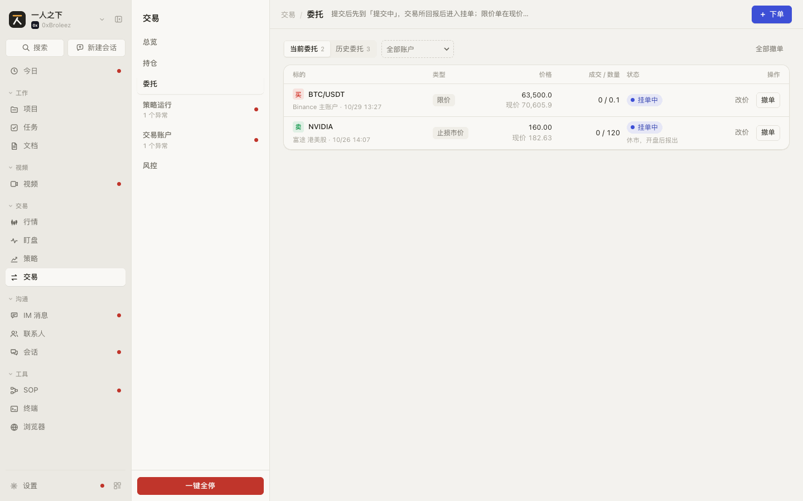 | 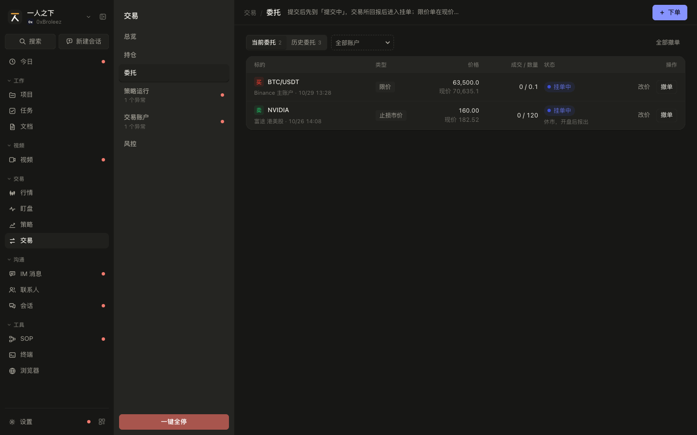 |
| 手机 375 |  | 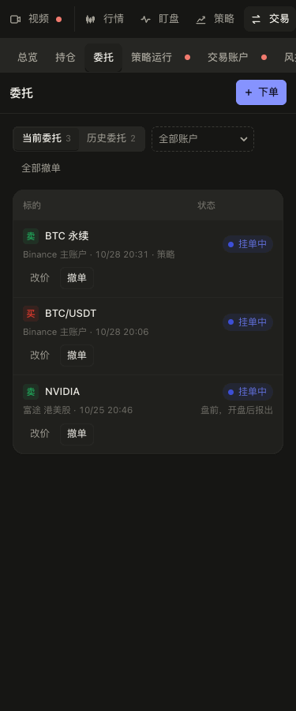 |

改价（模拟盘的 Apple 限价单；实盘账户的委托在实盘开关没开时改价、撤单不可点）：

| | 亮 | 暗 |
|---|---|---|
| 桌面 1440 | 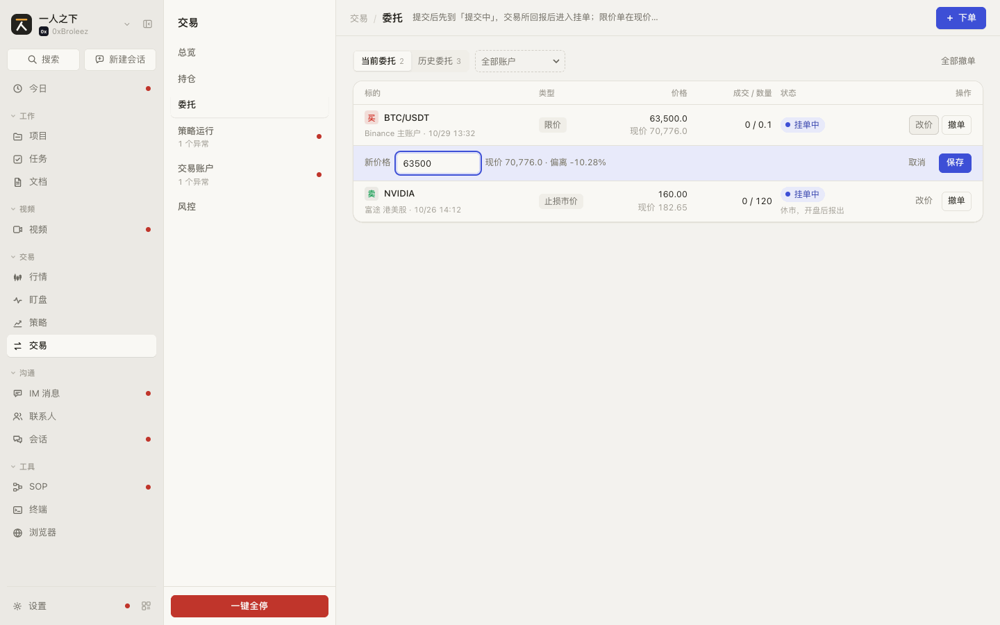 | 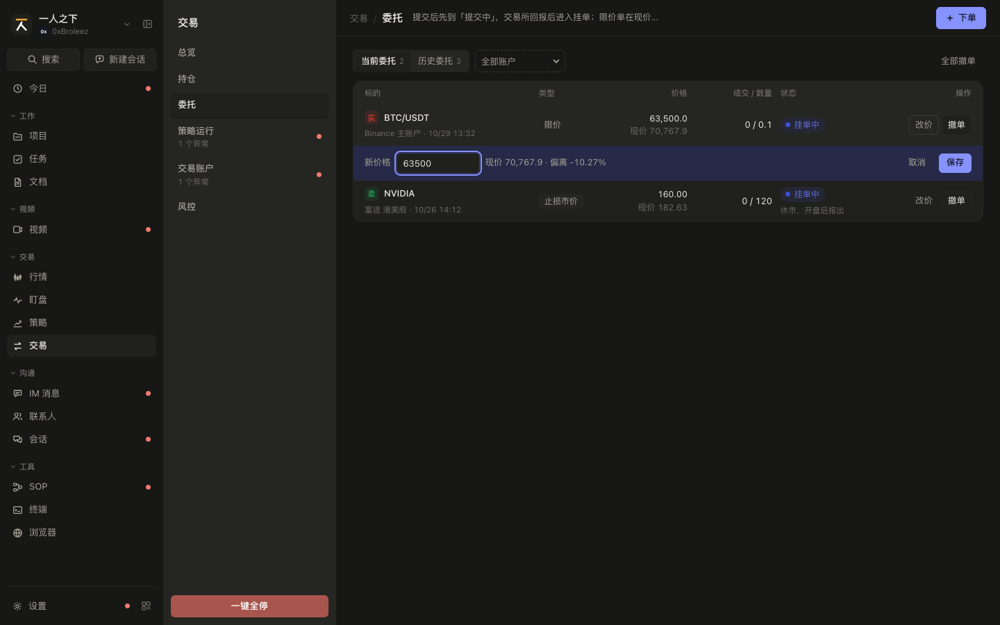 |
| 手机 375 |  | 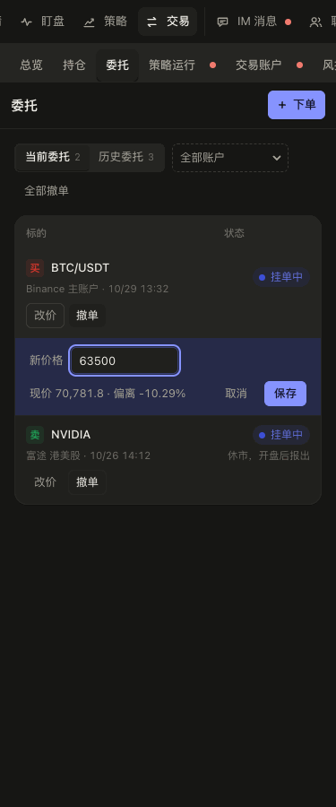 |

历史委托（被拒的写原因）：

| | 亮 | 暗 |
|---|---|---|
| 桌面 1440 | 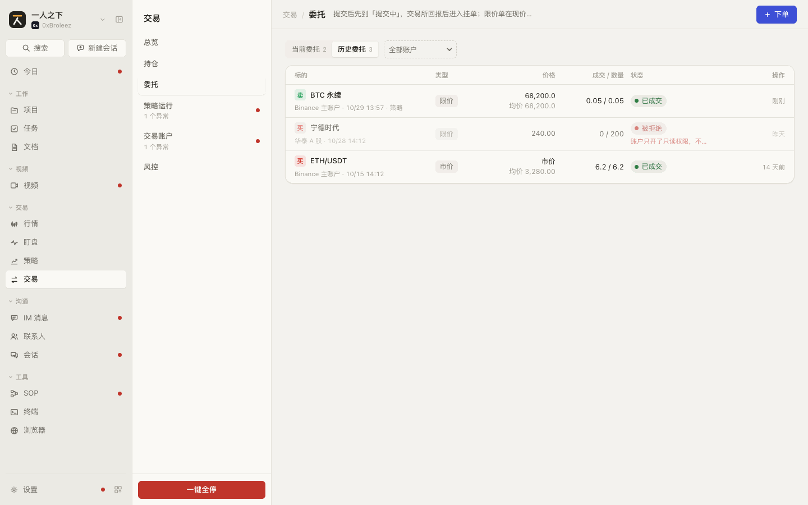 | 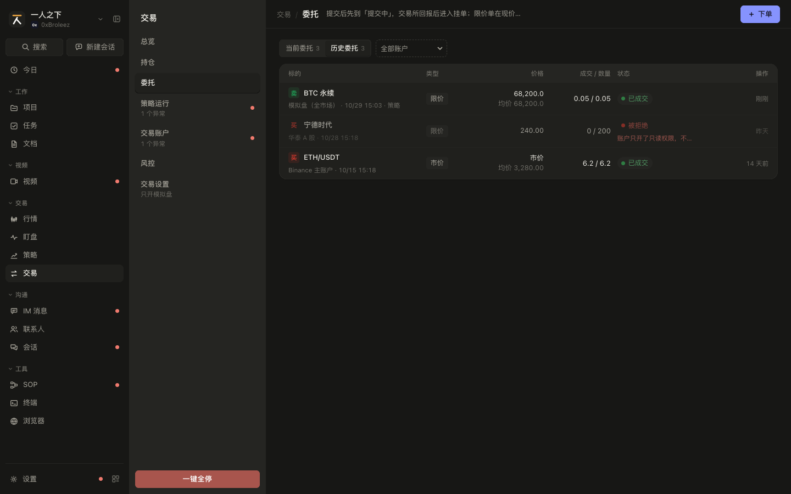 |
| 手机 375 |  | 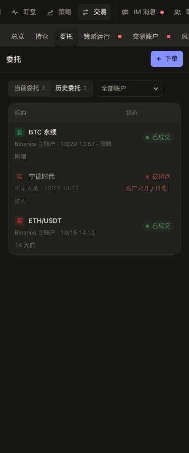 |

### 交互

| 编号 | 元素 | 操作 | 结果 |
|---|---|---|---|
| SPEC-trading-4.1 | 「当前委托 / 历史委托」 | 点击 | 各带条数；当前是提交中、挂单中、部分成交，历史是其余 |
| SPEC-trading-4.2 | 「全部账户」下拉 | 选择 | 按账户筛 |
| SPEC-trading-4.3 | 表 | 看 | 新的在前；列：标的（买 / 卖、名称、合约「仅减仓」标签；下一行「账户 · 时间 · 策略」）、类型、价格（市价写「市价」；第二行：已成交写「均价 N」，止损限价写「触发 N」，未完成写「现价 N」）、成交 / 数量、状态（被拒的后面写原因，悬停看全文；挂单中而市场不在交易中时写「<时段>，开盘后报出」）、操作；已撤单和被拒绝的整行变淡 |
| SPEC-trading-4.4 | 「改价」 | 点击 | 挂单中的限价、止损、止损限价单才有（提交中、市价单没有）；行下面展开「新价格」（止损单是「新触发价」）、现价和偏离、「取消」「保存」，回车保存。止损单改触发价，其余改委托价。实盘开关没开时（`SPEC-trading-11`），实盘账户上的这个按钮不可点，悬停写「实盘未开启：到「交易设置」过评审、打开实盘开关前，实盘账户只读同步」。**【实盘，要过 TRD-08 评审，默认只开模拟盘】** |
| SPEC-trading-4.5 | 「撤单」 | 点击 | 未完成的委托变成已撤单，不二次确认。实盘开关没开时（`SPEC-trading-11`），实盘账户上的这个按钮不可点，悬停写「实盘未开启：到「交易设置」过评审、打开实盘开关前，实盘账户只读同步」。**【实盘，要过 TRD-08 评审，默认只开模拟盘】** |
| SPEC-trading-4.6 | 「全部撤单」 | 点击 | 当前委托多于一条时出现；撤掉筛选结果里的全部未完成委托，不二次确认。实盘开关没开时只撤模拟盘的，按钮写「撤掉模拟盘的 N 笔」，悬停写跳过了几笔实盘的；没有能撤的就不出现。**【实盘，要过 TRD-08 评审，默认只开模拟盘】** |
| SPEC-trading-4.7 | 历史委托的操作列 | 看 | 最近变化的相对时间 |
| SPEC-trading-4.8 | 「再显示 N 条（还有 M 条更早的）」 | 点击 | 历史委托先露 50 条，每次多 50 条；换标签、换账户回到 50 条 |

### 空状态和异常状态

| 编号 | 场景 | 显示 | 可做的操作 |
|---|---|---|---|
| SPEC-trading-4.9 | 没有未完成的委托 | 「没有未完成的委托」「挂单、提交中的委托会在这里」 | 下单 |
| SPEC-trading-4.10 | 没有历史委托 | 「没有历史委托」「成交、撤单、被拒的委托会在这里」 | 无 |
| SPEC-trading-4.11 | 新价格不是正数 | 输入框红框，「保存」不可点 | 改价格 |
| SPEC-trading-4.12 | 改价、撤单失败（交易所拒绝） | 原型未做，改价和撤单都直接生效。正式产品：委托保持原状，行下面红字写交易所返回的原因 | 重试 |

### 数据

`Order`、`ORDER_TYPE`、`ORDER_STATUS`（见 `SPEC-trading-0`）。

### 联动

| 方向 | 对方模块 | 触发 | 结果 | 见 |
|---|---|---|---|---|
| 进来 | 行情 | 「买入」「卖出」 | 切到委托视图并打开下单抽屉 | `SPEC-trading-5` |

## SPEC-trading-5 下单抽屉

右侧滑出。手动下单的唯一入口，下单前在这里做风控检查。

### 截图

默认（BTC/USDT，限价，现价填好）：

| | 亮 | 暗 |
|---|---|---|
| 桌面 1440 | 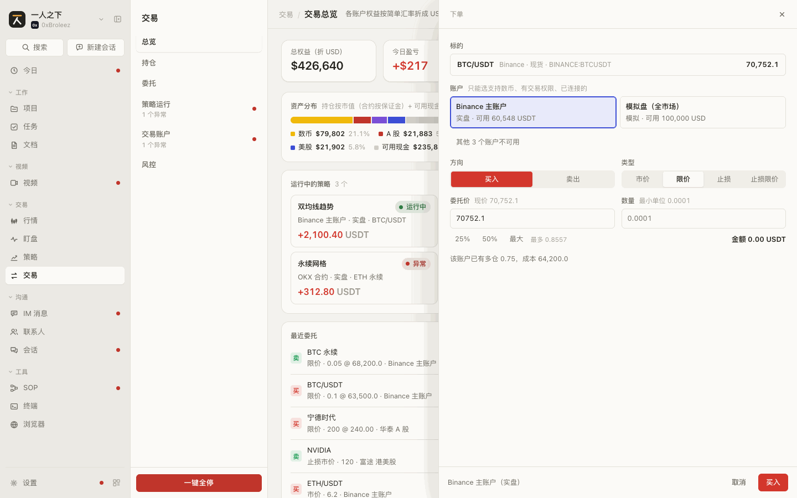 | 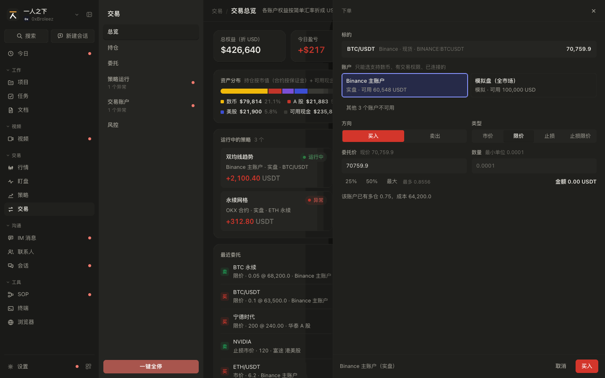 |
| 手机 375 | 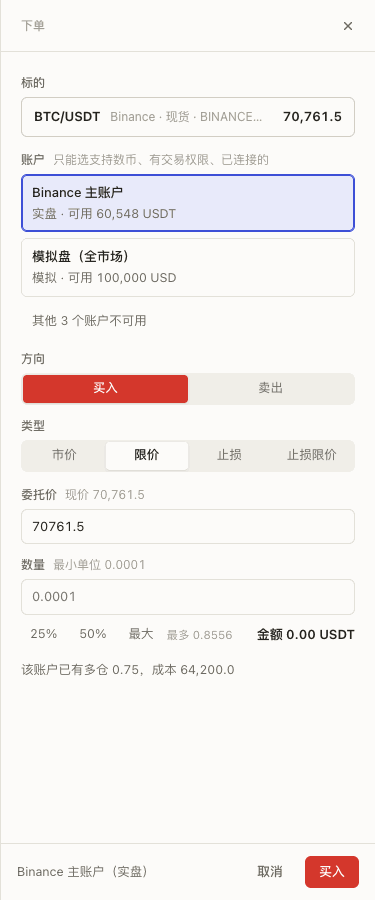 | 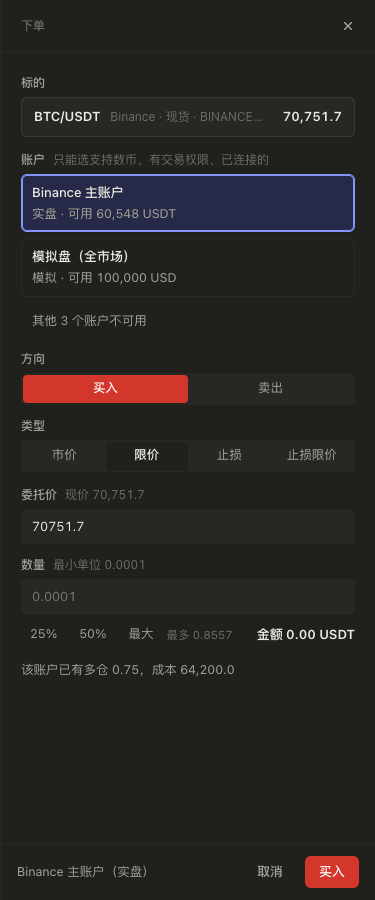 |

数量填 1，风控未通过（单笔超上限、仓位超上限）：

| | 亮 | 暗 |
|---|---|---|
| 桌面 1440 | 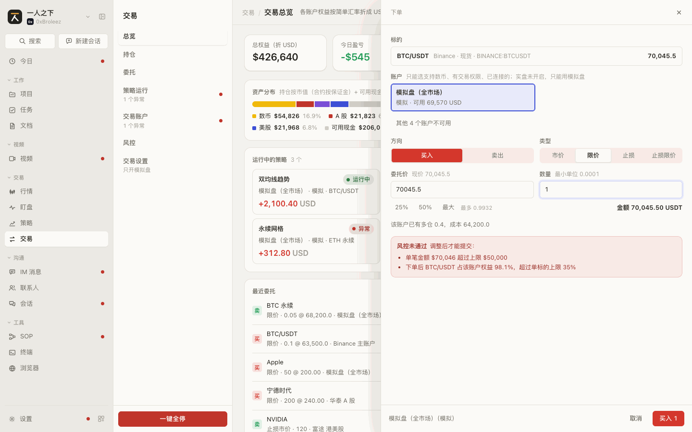 | 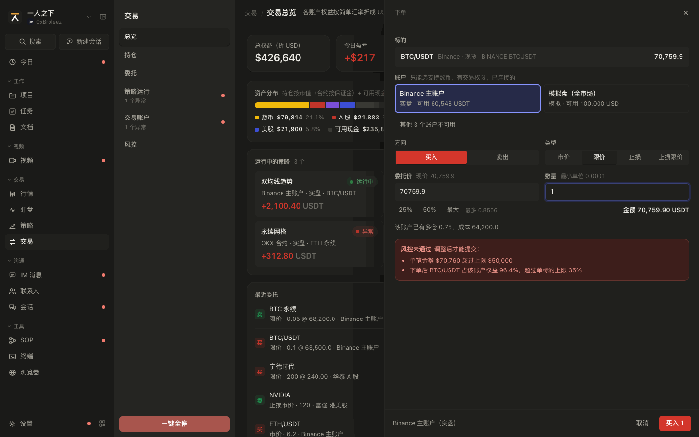 |
| 手机 375 | 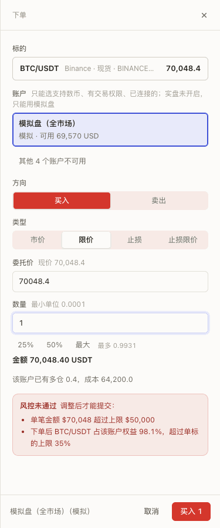 | 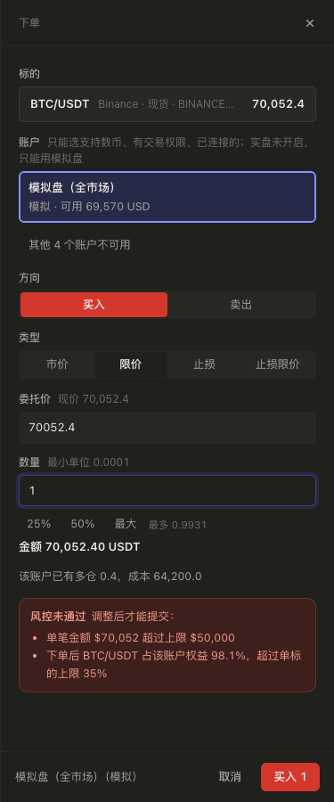 |

换到模拟盘、数量 0.2，金额超过二次确认线，点「买入」后的确认：

| | 亮 | 暗 |
|---|---|---|
| 桌面 1440 | 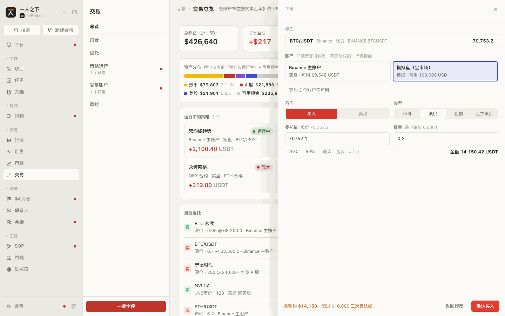 | 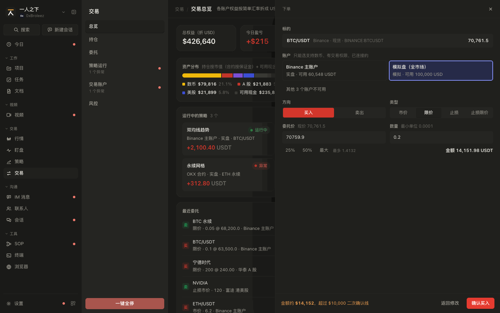 |
| 手机 375 | 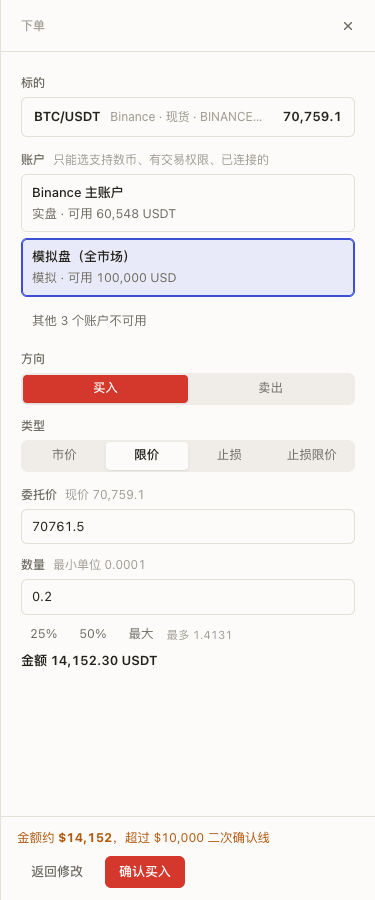 | 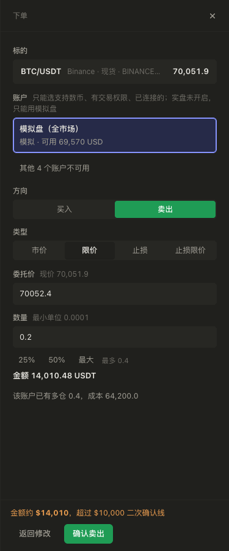 |

从行情的 BTC 永续点「卖出」：合约设置、展开的不可用账户：

| | 亮 | 暗 |
|---|---|---|
| 桌面 1440 | 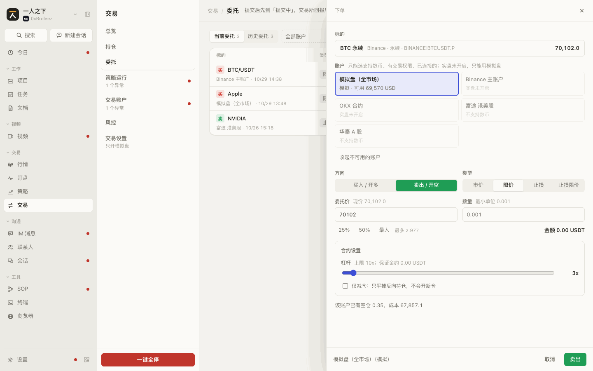 |  |
| 手机 375 |  |  |

### 交互

| 编号 | 元素 | 操作 | 结果 |
|---|---|---|---|
| SPEC-trading-5.1 | 标的 | 选择 | 搜索选择器（代码、名称、交易所、市场、品种，最多 10 条，其余提示继续输入），右侧现价；范围是 `INSTRUMENTS`，期权只能从行情的期权详情带进来。换标的时委托价重填为现价，清掉触发价、数量、仅减仓；当前账户不能交易这个标的时换成第一个能交易的 |
| SPEC-trading-5.2 | 账户 | 看、点击 | 提示「只能选支持 <市场>、有交易权限、已连接的」；能用的账户排在前面，每个写「模拟 / 实盘 · 可用 N 币种」；不能用的收成一行「其他 N 个账户不可用」，点开逐个列出原因（「不支持 <市场>」「只读权限，不能下单」「实盘未开启」「连接异常」「未连接」），不可选；默认第一个能用的模拟盘，没有再取第一个能用的。实盘开关没开时提示后面加「；实盘未开启，只能用模拟盘」，实盘账户都在不可用里。选实盘账户。**【实盘，要过 TRD-08 评审，默认只开模拟盘】** |
| SPEC-trading-5.3 | 方向 | 点击 | 「买入 / 卖出」，合约写「买入 / 开多」「卖出 / 开空」 |
| SPEC-trading-5.4 | 类型 | 点击 | 市价、限价（默认）、止损（止损市价）、止损限价 |
| SPEC-trading-5.5 | 触发价 | 输入 | 止损类才有；提示卖出「跌到这个价触发」、买入「涨到这个价触发」；占位是现价 |
| SPEC-trading-5.6 | 委托价 | 输入 | 限价类才有，默认现价，提示现价；A 股超出涨跌停范围时红框；市价单换成只读的「市价，约 N」 |
| SPEC-trading-5.7 | 数量 | 输入 | 提示「最小单位 N」，合约加「每张 N」；失焦时按最小单位向下取整，取整了下面提示「按最小单位取整为 N」 |
| SPEC-trading-5.8 | 「25% / 50% / 最大」 | 点击 | 按最多能下的数量填；最多能下：卖现货看持仓，其余按账户可用资金（合约乘杠杆）除以单价；为 0 时不可点；旁边「最多 N」 |
| SPEC-trading-5.9 | 金额 | 看 | 「金额 N 币种」，非 USD、USDT 的后面「约 $N」 |
| SPEC-trading-5.10 | 合约设置：杠杆 | 拖动 | 永续、期货才有：1 到 50 倍滑块，提示「上限 N x；保证金约 N 币种」；超过风控上限时倍数红色 |
| SPEC-trading-5.11 | 合约设置：「仅减仓」 | 勾选 | 「只平掉反向持仓，不会开新仓」；期权也有 |
| SPEC-trading-5.12 | 持仓提示 | 看 | 这个账户已有这个标的时：「该账户已有多 / 空仓 N，成本 N」 |
| SPEC-trading-5.13 | 规则提示 | 看 | A 股现货「A 股 T+1：今日买入的股份明日才能卖出」；A 股「涨跌停 ±N%，今日可报价 N - N」；市场不在交易中「<市场><时段>中，委托将在开盘后报出」；有到期日的「到期日 N」 |
| SPEC-trading-5.14 | 底部左侧 | 看 | 当前账户「<名称>（模拟）」或「（实盘）」 |
| SPEC-trading-5.15 | 风控检查 | 看 | 数量大于 0 时实时按风控规则预检查，不通过时显示黄框「预检查：提交后会按同样的规则拦下，以拦截结果为准」和逐条原因（见 `SPEC-trading-10` 规则表的「下单抽屉里的原因」）；不拦提交。提交后被拦下时换成红框「风控未通过 这笔已记成被拒绝的委托，拦下的原因：」和逐条原因（正式版原样取后端返回的 `blocks`），改任何一项回到预检查 |
| SPEC-trading-5.16 | 「买入 N」「卖出 N」 | 点击 | 先校验必填（见下）；风控不通过时这笔记成被拒绝的委托（原因是逐条原因用「；」连起来），抽屉不关，记一条运行异常「下单被风控拦截」；金额超过二次确认阈值时进入确认；都过了就提交：委托进「提交中」，关闭抽屉。**【实盘，要过 TRD-08 评审，默认只开模拟盘】** |
| SPEC-trading-5.17 | 二次确认 | 看、点击 | 底部换成「金额约 $N，超过 $M 二次确认线」「返回修改」「确认买入 / 卖出」；改任何一项都退出确认。**【实盘，要过 TRD-08 评审，默认只开模拟盘】** |
| SPEC-trading-5.18 | 「取消」、关闭、Esc | 点击 | 关闭，不提示 |

### 空状态和异常状态

| 编号 | 场景 | 显示 | 可做的操作 |
|---|---|---|---|
| SPEC-trading-5.19 | 必填没填就提交 | 底部红字只写第一个问题：「选一个可交易的账户」「填委托价格」「填触发价」「填数量」或「数量不足最小单位 N」；对应输入框红框 | 补全 |
| SPEC-trading-5.20 | 没有能交易这个市场的账户 | 「没有能交易 <市场> 的账户」，下面仍可展开看不可用的原因 | 去交易账户 |
| SPEC-trading-5.21 | 标的找不到 | 「找不到标的 <symbol>」和「换成 BTC/USDT」 | 换标的 |
| SPEC-trading-5.22 | 交易所会拒的单 | 抽屉里不拦，提交后 0.6 秒变「被拒绝」并记运行异常「委托被拒」。原因（`exchangeReject`）：「账户只开了只读权限，不能下单」「账户连接异常：<原因>」「账户未连接」「该账户不支持 <市场>」；现货卖出「可卖数量不足：持有 N」「没有可卖的持仓（现货不能卖空）」；A 股「T+1：今日买入的股份明日才能卖出」；仅减仓「仅减仓：没有可减的反向持仓」；A 股限价「委托价超出涨跌停范围（N - N）」 | 看委托的被拒原因 |
| SPEC-trading-5.23 | 熔断中 | 开仓单在风控里被拦（「熔断中：只能平仓或减仓，禁止新开仓」）；平仓、减仓照常 | 平仓，或到风控解除 |

### 数据

`Order`、`RiskRules`、`TradeAccount`、`Position`（见 `SPEC-trading-0`）；提交的委托里不存杠杆，杠杆和预计的拒单原因原型放在模块内存 `orderMeta` 里（正式版杠杆是账户和标的维度的设置，下单时带上）。「是否开仓」（`isOpening`）：现货买入算开仓；合约勾了仅减仓不算；合约方向和已有持仓相反、数量不超过持仓的不算；其余算。

### 联动

| 方向 | 对方模块 | 触发 | 结果 | 见 |
|---|---|---|---|---|
| 进来 | 行情 | 「买入」「卖出」 | 带标的和方向打开 | `SPEC-markets-1.13`、`SPEC-markets-3.6` |
| 改动 | 设置 / 运行异常 | 风控拦截、委托被拒 | warn 级运行异常 | `SPEC-settings-18` |

## SPEC-trading-6 策略运行

每个部署一张卡。异常、运行中、已暂停的在前，已停止的折起来。

### 截图

默认：

| | 亮 | 暗 |
|---|---|---|
| 桌面 1440 |  |  |
| 手机 375 |  |  |

点「停止」后的确认：

| | 亮 | 暗 |
|---|---|---|
| 桌面 1440 |  |  |
| 手机 375 |  |  |

展开已停止的：

| | 亮 | 暗 |
|---|---|---|
| 桌面 1440 |  |  |
| 手机 375 |  |  |

一键全停之后（全部停止，熔断中不能启动）：

| | 亮 | 暗 |
|---|---|---|
| 桌面 1440 |  |  |
| 手机 375 |  |  |

实盘开关开着，实盘运行暂停后点「恢复」的确认：

| | 亮 | 暗 |
|---|---|---|
| 桌面 1440 |  |  |
| 手机 375 |  |  |

### 交互

| 编号 | 元素 | 操作 | 结果 |
|---|---|---|---|
| SPEC-trading-6.1 | 卡片 | 看 | 策略名、状态；「模拟 / 实盘」标签和「账户 · 标的」；异常原因红框；盈亏、分配资金、收益率；「启动于 <时间> · k=v …」；最近 3 条日志（新的在前，时间和文字，warn、error 有颜色）；异常的卡片红框，已停止的变淡 |
| SPEC-trading-6.2 | 策略名 | 点击 | 打开策略编辑页（`SPEC-strategy-3`）；策略删了写「已删除的策略」，不可点 |
| SPEC-trading-6.3 | 「全部 N 条日志」 | 点击 | 展开这张卡的全部日志，再点「收起」 |
| SPEC-trading-6.4 | 「暂停」 | 点击 | 运行中才有：变已暂停，日志加「手动暂停」。正式版暂停只停新信号，不撤已有挂单（和停止一样不平仓） |
| SPEC-trading-6.5 | 「恢复」「启动」 | 点击 | 已暂停的是「恢复」（日志「手动恢复」），已停止和异常的是「启动」（日志「重新启动」）；变运行中，清掉异常原因、停止时间和原因。熔断中或账户不能交易时不可点，悬停写原因（「熔断中，先到风控解除」「账户<原因>」）。实盘开关没开时实盘账户的运行不可点，悬停同 `SPEC-trading-3.8`；开了以后实盘运行点了先出确认条「用真实资金运行：<账户名>，分配 N 币种」「取消」「确认恢复 / 确认启动」，确认后日志写「手动恢复（已确认用真实资金）」或「重新启动（已确认用真实资金）」。**【实盘，要过 TRD-08 评审，默认只开模拟盘】** |
| SPEC-trading-6.6 | 「停止」 | 点击 | 没停的才有；卡片底部换成「停止后不会自动平仓，持仓保留」「取消」「确认停止」；确认后变已停止，记停止时间和原因「手动停止」，日志加一条 |
| SPEC-trading-6.7 | 「已停止 N 个」 | 点击 | 展开已停止的卡片，再点「收起已停止的」 |
| SPEC-trading-6.8 | 心跳 | 每 15 秒 | 运行中的卡片多一条日志、盈亏小幅变动（原型模拟，正式版见 `SPEC-trading-0`「原型里模拟、正式版要真做的」） |
| SPEC-trading-6.9 | 标题栏「新建运行」 | 点击 | 打开新建策略运行抽屉（`SPEC-trading-7`），策略默认第一个 |

### 空状态和异常状态

| 编号 | 场景 | 显示 | 可做的操作 |
|---|---|---|---|
| SPEC-trading-6.10 | 一个运行都没有 | 「还没有策略在跑」「在策略页回测满意后部署，或者直接新建一个运行」和「新建运行」 | 新建运行 |
| SPEC-trading-6.11 | 熔断中 | 卡片上「启动」「恢复」不可点，右下写「熔断中不能启动」 | 到风控解除 |
| SPEC-trading-6.12 | 账户异常导致运行异常 | 卡片红框写原因，「启动」不可点（账户连接异常） | 到交易账户重新连接 |
| SPEC-trading-6.13 | 账户删了 | 写「已删除的账户」，「启动」不可点 | 无 |

### 数据

`StrategyRun`、`RUN_STATUS`、`TradeAccount`、`RiskRules`（见 `SPEC-trading-0`）。账户能不能交易（`acctBlock`）：只读、异常、未连接都不能。

### 联动

| 方向 | 对方模块 | 触发 | 结果 | 见 |
|---|---|---|---|---|
| 出去 | 策略 | 点策略名 | 编辑页 | `SPEC-strategy-3` |
| 进来 | 策略 | 「到交易里管理」 | 本视图 | `SPEC-strategy-8.7` |
| 改动 | 策略 | 启停 | 策略的运行记录和编辑页侧栏跟着变 | `SPEC-strategy-5.10`、`SPEC-strategy-8` |

## SPEC-trading-7 新建策略运行抽屉（部署）

把一个策略部署到一个账户上跑。和 SOP 的「执行」分开建模：部署是长期运行的、有资金和风控的，执行是一次性的流程。

### 截图

从策略「RSI 超卖反弹」点「部署」进来，默认选模拟盘：

| | 亮 | 暗 |
|---|---|---|
| 桌面 1440 |  |  |
| 手机 375 |  |  |

实盘开关没开，展开「其他 N 个账户不可用」，实盘账户写「实盘未开启」：

| | 亮 | 暗 |
|---|---|---|
| 桌面 1440 |  |  |
| 手机 375 |  |  |

走完实盘评审、打开实盘开关后（`SPEC-trading-11`），换成实盘账户（富途），没勾确认就点「启动运行」：

| | 亮 | 暗 |
|---|---|---|
| 桌面 1440 |  |  |
| 手机 375 |  |  |

### 交互

| 编号 | 元素 | 操作 | 结果 |
|---|---|---|---|
| SPEC-trading-7.1 | 策略 | 选择 | 可搜策略名、标的、标签，说明是「周期 · 标的」；从策略带进来的已选好，否则默认第一个。换策略时参数换成新策略的，账户还能用就保留，否则换成默认账户，标的重新取 |
| SPEC-trading-7.2 | 账户 | 看、点击 | 提示「先在模拟盘跑一段再上实盘」（实盘开关没开时写「实盘未开启，只能部署到模拟盘」）；默认第一个能用的模拟盘，没有再取第一个能用的；每个写名称、「模拟 / 实盘」标签、可用资金；不能用的收成「其他 N 个账户不可用」，展开写原因（只读、「实盘未开启」、异常、未连接，或「不支持 <策略的市场>」）。选实盘账户。**【实盘，要过 TRD-08 评审，默认只开模拟盘】** |
| SPEC-trading-7.3 | 标的 | 勾选 | 「只列策略适用、账户支持的」：列出策略全部标的，账户不支持的变淡不可勾（悬停「这个账户不支持该市场」）；换账户时重新取账户支持的全部 |
| SPEC-trading-7.4 | 分配资金 | 输入 | 默认 20000，提示账户币种和可用 |
| SPEC-trading-7.5 | 参数覆盖 | 输入 | 策略有参数时出现，提示「默认值来自策略，只影响这次运行」，每格写「默认 N」 |
| SPEC-trading-7.6 | 「我确认用真实资金运行（<账户名>）」 | 勾选 | 选实盘账户时出现；换账户时取消勾选。**【实盘，要过 TRD-08 评审，默认只开模拟盘】** |
| SPEC-trading-7.7 | 说明 | 看 | 「止损 N% · 止盈 N% · 每次开仓 N%；下单同样走风控检查」（0 写「未设」） |
| SPEC-trading-7.8 | 「启动运行」 | 点击 | 校验通过后新建一个运行中的部署放在最前面，日志第一条「模拟盘 / 实盘启动：<标的>，分配 N 币种」，关闭抽屉。**【实盘，要过 TRD-08 评审，默认只开模拟盘】** |
| SPEC-trading-7.9 | 「取消」、关闭、Esc | 点击 | 关闭 |

### 空状态和异常状态

| 编号 | 场景 | 显示 | 可做的操作 |
|---|---|---|---|
| SPEC-trading-7.10 | 校验不过就点「启动运行」 | 底部红字只写第一条：「熔断中，不能启动新运行；先到风控解除熔断」「选一个策略」「选一个可交易的账户」「至少选一个标的」「填分配资金」「分配资金超过账户可用 N 币种」「参数要填数字」「实盘要勾选确认用真实资金运行」；分配资金没填时输入框红框，实盘没勾确认时确认那一行变红 | 补全 |
| SPEC-trading-7.11 | 熔断中 | 顶上红框「熔断中 不能启动新运行，先到风控解除熔断」，「启动运行」不可点 | 到风控解除 |
| SPEC-trading-7.12 | 还没有策略 | 「还没有策略，先去策略页建一个」 | 去策略 |
| SPEC-trading-7.13 | 策略的市场没有能用的账户 | 账户区只有「其他 N 个账户不可用」 | 去交易账户 |

### 数据

`StrategyRun`、`Strategy`、`TradeAccount`（见 `SPEC-trading-0`、`SPEC-strategy-0`）。

### 联动

| 方向 | 对方模块 | 触发 | 结果 | 见 |
|---|---|---|---|---|
| 进来 | 策略 | 「部署」 | 带策略打开，切到策略运行视图 | `SPEC-strategy-3.2`、`SPEC-strategy-7.4` |
| 改动 | 策略 | 启动运行 | 策略的运行记录多一条 | `SPEC-strategy-8` |

## SPEC-trading-8 交易账户

### 截图

默认（OKX 合约异常）：

| | 亮 | 暗 |
|---|---|---|
| 桌面 1440 |  |  |
| 手机 375 |  |  |

有持仓的账户点「删除账户」被拦：

| | 亮 | 暗 |
|---|---|---|
| 桌面 1440 |  |  |
| 手机 375 |  |  |

点「断开连接」后的确认：

| | 亮 | 暗 |
|---|---|---|
| 桌面 1440 |  |  |
| 手机 375 |  |  |

### 交互

| 编号 | 元素 | 操作 | 结果 |
|---|---|---|---|
| SPEC-trading-8.1 | 卡片 | 看 | 名称、状态（已连接、异常、已断开、连接中）；「模拟 / 实盘」标签和「券商 · 交易所 / 券商 · 市场」；权益、可用、保证金；币种（非 USD、USDT 后面写约多少 USD）；API 提示；权限「读取 + 交易，不开提币」或「只读，不开提币」；「N 个持仓 · 同步于 <相对时间>」；「对账」一行：实盘账户写「一致」「N 处差异」「对账失败」或「还没对过账」加相对时间和「，查看」（不一致的红字），点了打开对账抽屉（`SPEC-trading-12`），模拟盘写「本地撮合，不用对账」；异常的卡片红框 |
| SPEC-trading-8.2 | 异常提示里的「重新连接」 | 点击 | 显示「连接中」，原型 0.8 秒后变已连接、清掉异常 |
| SPEC-trading-8.3 | 「断开连接」 | 点击 | 已连接的才有；底部换成「断开后策略不能下单，持仓不受影响」「取消」「断开」；确认后变已断开 |
| SPEC-trading-8.4 | 「连接」 | 点击 | 已断开的才有；同 8.2。有交易权限的实盘账户连上后就能下单。**【实盘，要过 TRD-08 评审，默认只开模拟盘】** |
| SPEC-trading-8.5 | 「删除账户」 | 点击 | 账户里还有持仓、挂单或没停的部署时，底部写「不能删除：账户里还有 N 个持仓、N 笔挂单、N 个没停的策略部署，先平仓、撤单、停掉部署再删除」和「知道了」；否则写「删除后不能恢复，已停止的运行和成交记录保留」「取消」「删除」 |
| SPEC-trading-8.6 | 只读账户 | 看 | 底部写「只读账户只同步持仓，不能下单」 |
| SPEC-trading-8.7 | 标题栏「新增账户」 | 点击 | 打开新增交易账户抽屉（`SPEC-trading-9`） |
| SPEC-trading-8.8 | 账户异常上报 | 自动 | 账户变异常时记一条运行异常「交易账户异常」「<名称>：<原因>」，每个账户只报一次，恢复后再坏再报 |

### 空状态和异常状态

| 编号 | 场景 | 显示 | 可做的操作 |
|---|---|---|---|
| SPEC-trading-8.9 | 还没有账户 | 「还没有接入交易账户」「接入交易所或券商的 API，或者先开一个模拟盘」和「新增账户」 | 新增账户 |
| SPEC-trading-8.10 | 重新连接失败 | 原型里总是成功。正式产品：保持异常，原因换成这次的错误（如「API Key 已过期」「IP 不在白名单」），并提示去交易所改 | 去交易所处理后再试 |
| SPEC-trading-8.11 | Key 带提币权限 | 原型不检查。正式产品：同步时发现 Key 带提币权限，账户立刻变异常「这个 API Key 开了提币权限，已停止使用；到交易所关掉提币权限后重新连接」，并停掉这个账户上的部署 | 去交易所改权限 |

### 数据

`TradeAccount`（见 `SPEC-trading-0`）；删除拦截由 `App.tsx` 的 `accountBlock` 算，数持仓、未完成委托和没停的运行。

### 联动

| 方向 | 对方模块 | 触发 | 结果 | 见 |
|---|---|---|---|---|
| 改动 | 设置 / 运行异常 | 账户异常 | warn 级运行异常 | `SPEC-settings-18` |
| 改动 | 交易 | 断开、异常 | 下单抽屉和部署抽屉里这个账户不可用；运行不能启动 | `SPEC-trading-5.2`、`SPEC-trading-7.2` |

## SPEC-trading-9 新增交易账户抽屉

### 截图

默认（Binance）：

| | 亮 | 暗 |
|---|---|---|
| 桌面 1440 |  |  |
| 手机 375 |  |  |

什么都没填就测试连接：

| | 亮 | 暗 |
|---|---|---|
| 桌面 1440 |  |  |
| 手机 375 |  |  |

填好后测试通过：

| | 亮 | 暗 |
|---|---|---|
| 桌面 1440 |  |  |
| 手机 375 |  |  |

### 交互

| 编号 | 元素 | 操作 | 结果 |
|---|---|---|---|
| SPEC-trading-9.1 | 交易所 / 券商 | 点击 | 九个：Binance、OKX、Bybit（数币）；富途、老虎、盈透 IBKR（港股、美股）；华泰、中信（A 股）；模拟（全市场）。换了清空已填的凭证和测试结果，名称换成「<名称> 账户」（模拟见 `SPEC-trading-0.7`） |
| SPEC-trading-9.2 | 接入说明 | 看 | 按交易所写怎么创建凭证，如 Binance「在币安「API 管理」创建，勾选读取和现货 / 合约交易，不要勾提币，建议绑 IP 白名单」；模拟「本地模拟撮合，按实时模拟行情成交，不连真实账户」 |
| SPEC-trading-9.3 | 名称 | 输入 | 保存时为空就用「<名称> 账户」 |
| SPEC-trading-9.4 | 凭证字段 | 输入 | 按交易所不同（`BROKERS.fields`）：Binance、Bybit 是 API Key、API Secret；OKX 多 Passphrase；富途是 OpenD 网关地址、交易密码；老虎是 Tiger ID、RSA 私钥；盈透是 TWS / IB Gateway 地址、Client ID；华泰是 QMT 地址、资金账号；中信是 PTrade / QMT 地址、资金账号；模拟是初始资金（USD）。密钥类用密码框；有占位的（网关地址等）不填就按占位。改任何字段都要重新测试 |
| SPEC-trading-9.5 | 权限「只读 / 读取 + 交易」 | 点击 | 模拟盘没有这一项；提示「不开提币权限，资金不会被转走」；默认「只读」；选「读取 + 交易」时下面提示「开了交易权限也要过实盘评审、打开「交易设置」里的实盘开关才能下单；在那之前只读同步」。选「读取 + 交易」。**【实盘，要过 TRD-08 评审，默认只开模拟盘】** |
| SPEC-trading-9.6 | 「测试连接」 | 点击 | 显示「正在连接 <名称>」，原型 0.8 秒后给结果：通过写「连接成功，读取 + 交易 / 只读权限已确认，未检测到提币权限」（模拟写「模拟撮合就绪」） |
| SPEC-trading-9.7 | 「保存」 | 点击 | 测试通过后才能点；新账户加到最后，状态已连接；API 提示按凭证生成（API Key 取后四位「****xxxx」；富途「OpenD <地址>」；盈透「TWS <地址>」；A 股「QMT ****<账号后四位>」；模拟「本地模拟撮合」）；模拟盘权益是填的初始资金，实盘原型给一个演示值，正式版同步回来。实盘账户带交易权限保存。**【实盘，要过 TRD-08 评审，默认只开模拟盘】** |
| SPEC-trading-9.8 | 底部说明 | 看 | 「密钥只保存在本机；列表里只显示后四位」；没测试通过时底部左侧「测试通过后才能保存」 |

### 空状态和异常状态

| 编号 | 场景 | 显示 | 可做的操作 |
|---|---|---|---|
| SPEC-trading-9.9 | 字段没填就测试 | 红点「没填 <字段名>」 | 填上再测 |
| SPEC-trading-9.10 | 交易所 API Key 太短（少于 8 位） | 「API Key 格式不对，交易所返回签名错误」 | 改 Key |
| SPEC-trading-9.11 | 模拟盘初始资金不大于 0 | 「初始资金要大于 0」 | 改资金 |
| SPEC-trading-9.12 | Key 带提币权限 | 原型不检查。正式产品：测试失败「这个 API Key 开了提币权限，不能接入。到交易所关掉提币权限后再试」，不能保存（TRD-07a 验收） | 去交易所改 |
| SPEC-trading-9.13 | 选了「读取 + 交易」但 Key 只有读取权限 | 原型不检查。正式产品：测试结果写「这个 Key 只有读取权限」，保存后账户是只读 | 去交易所加权限，或改选只读 |

### 数据

`TradeAccount`（见 `SPEC-trading-0`）；交易所定义 `BrokerDef`（`trading.tsx`）：`key`、`label`、`kind`、`markets`、`currency`、`fields`（`{ k, label, secret?, placeholder? }[]`）、`note`。正式版凭证存保险箱（`SPEC-settings` 保险箱），日志、错误、接口响应里不出现 Secret 明文。

### 联动

| 方向 | 对方模块 | 触发 | 结果 | 见 |
|---|---|---|---|---|
| 改动 | 交易 | 保存 | 下单、部署抽屉里多一个账户可选 | `SPEC-trading-5.2`、`SPEC-trading-7.2` |

## SPEC-trading-10 风控

单列一节。四项风控规则（单标的仓位上限、单日亏损熔断、单笔金额上限、一键全停）加两项辅助规则（合约最大杠杆、二次确认阈值），都在每笔下单前检查；正式版全部在后端强制（TRD-06a），前端只显示后端给的原因。

### 截图

默认：

| | 亮 | 暗 |
|---|---|---|
| 桌面 1440 |  |  |
| 手机 375 |  |  |

熔断中（一键全停之后）：

| | 亮 | 暗 |
|---|---|---|
| 桌面 1440 |  |  |
| 手机 375 |  |  |

规则填了不合法的值：

| | 亮 | 暗 |
|---|---|---|
| 桌面 1440 |  |  |
| 手机 375 |  |  |

点「一键全停」后的确认：

| | 亮 | 暗 |
|---|---|---|
| 桌面 1440 |  |  |
| 手机 375 |  |  |

### 四项规则和触发后的界面

| 规则 | 字段 | 什么时候检查 | 触发条件 | 下单抽屉里的原因（`riskBlocks`） | 触发后的界面 |
|---|---|---|---|---|---|
| 单标的仓位上限 | `max_position_pct`（% 账户权益） | 每笔开仓单 | 下单后这个账户里这个标的的市值（已有持仓加这一笔，折 USD）占账户权益超过上限 | 「下单后 <标的> 占该账户权益 N%，超过单标的上限 N%」 | 下单抽屉红框「风控未通过」列出原因，点提交不下单，记运行异常「下单被风控拦截」（`SPEC-trading-5.15`、`5.16`）；平仓、减仓不受限。正式版策略下单同样检查，被拦写一条 warn 日志 |
| 单日亏损熔断 | `daily_loss_pct`（% 总权益） | 一直盯着（原型每 0.5 秒） | 今日盈亏亏到总权益（折 USD）的这个比例 | 熔断后开仓单：「熔断中：只能平仓或减仓，禁止新开仓」 | 自动执行一键全停，原因「单日亏损 $N，达到上限 N%，自动熔断」，记运行异常「风控熔断」；之后同一键全停（下一行）。回到上限内之前不再重复触发 |
| 单笔金额上限 | `max_order_value`（USD） | 每笔开仓单 | 这一笔折 USD 超过上限 | 「单笔金额 $N 超过上限 $N」 | 同单标的仓位上限；平仓不受限 |
| 一键全停 | `halted`、`halted_reason`、`halted_at` | 手动（二级菜单底部、本页），或日亏损触发 | 用户确认，或日亏损到上限 | 同上「熔断中：……」 | 所有没停的运行变已停止（原因「一键全停：<原因>」，日志加 warn）；所有提交中、挂单中、部分成交的委托撤单；进入熔断：每个交易视图顶上出熔断条（`SPEC-trading-1.5`），二级菜单「风控」红点和「熔断中」，总览风控状态「熔断中」红框，策略运行的「启动」「恢复」不可点，新建运行不可提交，下单只能平仓减仓；熔断记录加一条。持仓不动 |

两项辅助规则：

| 规则 | 字段 | 触发条件 | 原因 / 表现 |
|---|---|---|---|
| 合约最大杠杆 | `max_leverage`（倍） | 永续、期货下单的杠杆超过上限（不分开平仓） | 「杠杆 Nx 超过上限 Nx」；杠杆滑块上的倍数变红 |
| 二次确认阈值 | `confirm_above`（USD） | 这一笔折 USD 超过阈值 | 不拦，提交前多一步确认（`SPEC-trading-5.17`） |

### 交互

| 编号 | 元素 | 操作 | 结果 |
|---|---|---|---|
| SPEC-trading-10.1 | 当日亏损 | 看 | 提示「今日盈亏 / 上限（总权益 $N 的 N%）」；今日盈亏（涨红跌绿）、「已用 $N / $N」、百分比（超过 80% 红色）、进度条（超过 80% 变红）；下一行：盈利时「今天还在盈利，不占亏损额度」，到上限「已到上限，触发熔断」，否则「再亏 $N 触发熔断」 |
| SPEC-trading-10.2 | 规则 | 看 | 提示「改完离开输入框生效；每笔下单前按这里检查」；五行：单日最大亏损（% 权益）、单笔最大金额（USD）、单标的最大仓位（% 账户权益）、合约最大杠杆（倍）、二次确认阈值（USD），每行带说明 |
| SPEC-trading-10.3 | 规则输入框 | 输入、失焦、回车 | 失焦（回车等于失焦）时大于 0 就保存，否则恢复原值；不是正数时红框 |
| SPEC-trading-10.4 | 「一键全停」区 | 看 | 红框；提示「停掉所有策略运行、撤掉所有未成交委托、进入熔断；持仓保留」；说明「行情异常、策略失控时用」，熔断中时写「当前已在熔断中，再按一次会撤掉熔断后新挂的单」 |
| SPEC-trading-10.5 | 「一键全停」 | 点击 | 换成「确定全部停掉？熔断后要手动解除才能开新仓」「取消」「确认全停」 |
| SPEC-trading-10.6 | 「确认全停」 | 点击 | 执行一键全停，原因「风控页手动一键全停」 |
| SPEC-trading-10.7 | 熔断记录 | 看 | 新的在前：状态点、「手动 / 自动」标签、原因、「<时间> 触发 · 停掉 N 个部署、撤掉 N 笔挂单 · <时间> 解除」，没解除的写「未解除」和「进行中」；解除过的下一行「解除原因：<原因>」 |
| SPEC-trading-10.8 | 熔断条「解除熔断」 | 点击 | 见 `SPEC-trading-1.6` |

### 空状态和异常状态

| 编号 | 场景 | 显示 | 可做的操作 |
|---|---|---|---|
| SPEC-trading-10.9 | 还没熔断过 | 熔断记录写「还没有熔断过」 | 无 |
| SPEC-trading-10.10 | 规则填了 0、负数或非数字 | 红框；离开后恢复原值，不保存 | 填正数 |
| SPEC-trading-10.11 | 改规则的权限 | 原型谁都能改。正式产品：改规则记审计（TRD-08a）；熔断中放宽规则不会自动解除熔断 | 无 |
| SPEC-trading-10.12 | 后端拒绝了前端没拦的单 | 原型不会发生。正式产品：委托直接是被拒绝，原因写后端风控给的文字，和下单抽屉里的写法一致 | 看原因 |

### 一键全停的规则

| 编号 | 规则 |
|---|---|
| SPEC-trading-10.13 | 入口：二级菜单底部（`SPEC-trading-1.2`）、本页（`10.5`），都要先确认；日亏损熔断自动执行，不确认 |
| SPEC-trading-10.14 | 作用范围：全部账户（含模拟盘）、全部策略运行、全部未完成委托；持仓不平 |
| SPEC-trading-10.15 | 原因：二级菜单「手动一键全停」，风控页「风控页手动一键全停」，自动「单日亏损 $N，达到上限 N%，自动熔断」 |
| SPEC-trading-10.16 | 解除：只能手动（熔断条「解除熔断」、写原因并确认）；解除后停掉的运行不自动恢复，要逐个启动 |
| SPEC-trading-10.17 | 插件停用：交易插件停用前必须一键全停，没有在跑的部署、没有挂单才能停用（`SPEC-trading-0`「插件停用」；原型入口在 `SPEC-trading-11.12`） |
| SPEC-trading-10.18 | 纯函数 `killAll({ runs, orders, risk }, reason, at)` 返回改好的三样：运行（已停止的不动）、委托（提交中、挂单中、部分成交改已撤单）、风控（熔断、原因、时间）；正式版在后端一个事务里做，并写审计 |

### 数据

`RiskRules`、熔断记录 `HaltRec`（见 `SPEC-trading-0`）；当日亏损用 `summarize` 的今日盈亏和总权益（`SPEC-trading-2`）。

### 联动

| 方向 | 对方模块 | 触发 | 结果 | 见 |
|---|---|---|---|---|
| 改动 | 交易各视图 | 熔断 | 熔断条、红点、启动不可点、开仓被拦 | 上面「四项规则和触发后的界面」 |
| 改动 | 策略 | 一键全停 | 运行停止 | `SPEC-strategy-8` |
| 改动 | 设置 / 运行异常 | 风控拦截、熔断 | warn 级运行异常 | `SPEC-settings-18` |
| 改动 | 交易设置（正式版是插件管理页） | 停用交易插件 | 先要求一键全停 | `SPEC-trading-11` |

## SPEC-trading-11 交易设置（实盘评审和停用插件）

交易插件装好后只有模拟盘。实盘要三步：评审清单五项都由用户本人确认、申请 `trade:live`（输入插件名二次确认）、打开实盘开关。三步没走完，实盘开关不可点并写原因。停用插件也放在这里（原型没有插件管理页，见 `SPEC-trading-0`「插件停用」）。

### 截图

默认（评审还差三项，开关不可点）：

| | 亮 | 暗 |
|---|---|---|
| 桌面 1440 |  |  |
| 手机 375 |  |  |

还有部署在跑、有挂单时点「停用交易插件」被拦：

| | 亮 | 暗 |
|---|---|---|
| 桌面 1440 |  |  |
| 手机 375 |  |  |

修好 OKX 连接并重新对账、Binance 差异按交易所修正、做一次全停演练后，五项都确认，点「申请 trade:live」：

| | 亮 | 暗 |
|---|---|---|
| 桌面 1440 |  |  |
| 手机 375 |  |  |

输入插件名授予后打开实盘开关：

| | 亮 | 暗 |
|---|---|---|
| 桌面 1440 |  |  |
| 手机 375 |  |  |

### 交互

| 编号 | 元素 | 操作 | 结果 |
|---|---|---|---|
| SPEC-trading-11.1 | 「实盘」一节 | 看 | 说明「开了以后实盘账户才能下单、改单撤单、平仓、部署和启动；没开时实盘账户只读同步」；状态「只开模拟盘」或「实盘已开启」（开着时这一节边框变橙） |
| SPEC-trading-11.2 | 实盘开关 | 看 | 不可点时变灰，下面红字「不能打开：<原因>」，悬停同样写原因。原因按先后：「评审还差 N 项没确认：<项名、项名>」，五项齐了「还没申请 trade:live 权限」。都齐了写「评审和 trade:live 都齐了，可以打开」 |
| SPEC-trading-11.3 | 实盘开关 | 点击 | 打开：记下时间，下面写「<时间> 打开；关掉后实盘账户回到只读，已挂的单不会自动撤」，二级菜单「交易设置」写「实盘已开启」，各处实盘账户的操作恢复可用（下单、部署抽屉的实盘账户可选，启动、恢复要确认，见 `SPEC-trading-6.5`、`SPEC-trading-7.6`）。关掉：直接关，不确认。**【实盘，要过 TRD-08 评审，默认只开模拟盘】** |
| SPEC-trading-11.4 | 评审清单 | 看 | 五项，每项：状态点（已确认绿、条件不满足红、条件满足没确认灰）、名称、说明、现在的情况（满足灰字，不满足红字）。审计日志「委托 N 笔、熔断 N 次，每一步都有记录」；对账「N 个实盘账户最近一次对账都一致」或逐个写「<账户>有 N 处差异没处理」「<账户>对账失败」「<账户>还没对过账」；异常处理「交易的异常都记到「设置 / 运行异常」，模块「交易」」；全停演练「<时间> 全停，<时间> 解除」或「还没演练过：按一次一键全停，确认都停了再解除熔断」；模拟盘两周记录「「<策略名>」在模拟盘连续跑了 N 天」或「模拟盘最长连续跑了 N 天，还差 N 天」 |
| SPEC-trading-11.5 | 「确认通过」 | 点击 | 条件满足才能点（不满足时变灰，悬停写原因）；点了记下确认时间，换成「已确认 · <时间>」和「撤回」 |
| SPEC-trading-11.6 | 「去处理」 | 点击 | 条件不满足的项才有：对账跳交易账户、全停演练跳风控、模拟盘两周记录跳策略运行 |
| SPEC-trading-11.7 | 「撤回」 | 点击 | 悬停「撤回后 trade:live 一并收回、实盘关掉」；不确认，撤回后这项回到没确认，`trade:live` 收回、实盘开关关掉 |
| SPEC-trading-11.8 | 「trade:live 权限」一节 | 看 | 说明「实盘下单，风险最高；安装时不授予，要在这里单独申请」；没申请时左侧写「评审五项都确认后才能申请，还差 N 项」（红字）或「未申请」；授予后写「已授予 · <时间>」和「收回」 |
| SPEC-trading-11.9 | 「申请 trade:live」 | 点击 | 评审五项都确认后才能点；点了展开二次确认：红字「授予后，打开实盘开关就能用真实资金下单。输入插件名「交易套件」确认：」、输入框、「取消」「确认申请」 |
| SPEC-trading-11.10 | 「确认申请」 | 点击、回车 | 输入框和插件名完全一致（去掉首尾空格）才能点；授予，记下时间，收起确认。**【实盘，要过 TRD-08 评审，默认只开模拟盘】** |
| SPEC-trading-11.11 | 「收回」 | 点击 | 不确认；`trade:live` 收回，实盘开关一起关掉 |
| SPEC-trading-11.12 | 「停用插件」一节 | 看 | 说明「停用前必须先一键全停：没有在跑的部署、没有挂单才能停」；「停用后行情、盯盘、策略、交易都不再运行；数据保留，重新启用后照常」和「停用交易插件」 |
| SPEC-trading-11.13 | 「停用交易插件」 | 点击 | 有没停止的部署（运行中、已暂停、异常都算）或未完成的委托时，换成红框「不能停用 还有 N 个部署在跑、N 笔挂单，先到交易里一键全停」（只有一样时只写一样）、「知道了」「去一键全停」（跳风控 `SPEC-trading-10`）；都没有时换成「确定停用交易插件？」「取消」「停用」 |
| SPEC-trading-11.14 | 「停用」 | 点击 | 交易各视图换成「交易插件已停用」「行情、盯盘、策略和交易都不再运行；账户、持仓记录和策略都还在，重新启用后照常使用」和「重新启用」；二级菜单「交易设置」写「插件已停用」，标题栏不再有「下单」。原型只停交易这一个模块的页面，正式版插件停用后行情、盯盘、策略、交易的菜单和扩展点一起消失 |

### 空状态和异常状态

| 编号 | 场景 | 显示 | 可做的操作 |
|---|---|---|---|
| SPEC-trading-11.15 | 开着实盘时撤回评审或收回 `trade:live` | 实盘开关立刻关掉；实盘账户回到只读，已挂的单不撤 | 重新确认、重新申请 |
| SPEC-trading-11.16 | 确认之后条件又不满足了（如新出现对账差异） | 原型不回头检查，已确认的保持。正式产品：对账有差异超过阈值时熔断（TRD-08b），评审记录保留，实盘开关不自动关 | 处理差异 |
| SPEC-trading-11.17 | Agent 或接口代为确认评审、申请 `trade:live` | 原型没有这条路。正式产品：评审确认、`trade:live` 申请、实盘开关只接受用户在界面上的操作，接口直接拒绝并记审计（TRD-08c） | 无 |

### 数据

`LiveReview`、`LIVE_CHECKS`（见 `SPEC-trading-0`）；评审项的条件由 `liveChecks` 现算：对账看 `Reconciliation`，全停演练看熔断记录里有没有手动全停（原因不带「自动」）并且已经解除的，模拟盘两周记录看模拟盘上的运行从启动到现在（停了的到停止时间）有没有满 14 天。停用拦截由 `pluginOffBlock` 算。插件名「交易套件」和 `internal/plugins/trade/plugin.json` 的 `name` 一致。

### 联动

| 方向 | 对方模块 | 触发 | 结果 | 见 |
|---|---|---|---|---|
| 改动 | 交易各视图 | 实盘开关开、关 | 实盘账户上带实盘标记的操作可用、不可用 | `SPEC-trading-3.8`、`SPEC-trading-4.4`、`SPEC-trading-5.2`、`SPEC-trading-6.5`、`SPEC-trading-7.2` |
| 读 | 交易 / 交易账户 | 评审「对账」 | 读每个实盘账户最近一次对账 | `SPEC-trading-12` |
| 读 | 交易 / 风控 | 评审「全停演练」 | 读熔断记录 | `SPEC-trading-10` |
| 读 | 交易 / 策略运行 | 评审「模拟盘两周记录」 | 读模拟盘上的运行 | `SPEC-trading-6` |
| 出去 | 交易 / 风控 | 停用被拦时「去一键全停」 | 切到风控 | `SPEC-trading-10` |

## SPEC-trading-12 对账抽屉

### 截图

Binance 主账户有 1 处差异：

| | 亮 | 暗 |
|---|---|---|
| 桌面 1440 |  |  |
| 手机 375 |  |  |

### 交互

| 编号 | 元素 | 操作 | 结果 |
|---|---|---|---|
| SPEC-trading-12.1 | 入口 | 点击 | 交易账户卡片上实盘账户的「对账」一行（`SPEC-trading-8.1`）；抽屉标题「对账 · <账户名>」，Esc 关闭 |
| SPEC-trading-12.2 | 结果 | 看 | 「一致」（绿）、「N 处差异」（红）、「对账失败」（红）、「还没对过账」；重新对账时「对账中」 |
| SPEC-trading-12.3 | 最近一次、对账项 | 看 | 「<时间>（<相对时间>）」；「N 项：余额、每个持仓、每笔挂单」 |
| SPEC-trading-12.4 | 失败原因 | 看 | 对账失败时红框写原因，如「API Key 已过期，拉不到交易所数据」 |
| SPEC-trading-12.5 | 差异列表 | 看 | 每处一行：状态点（没处理红、处理过绿）、类型标签（余额、持仓、挂单）和对象、「本地 N · 交易所 N」、可能的原因；处理过的变淡并写「<时间> 按交易所修正了本地记录」 |
| SPEC-trading-12.6 | 「按交易所修正」 | 点击 | 没处理的差异才有；不确认；持仓差异把本地持仓数量改成交易所的数，这处标为已处理；处理完最后一处，这次对账变成「一致」，账户卡片和评审「对账」跟着变 |
| SPEC-trading-12.7 | 「重新对账」 | 点击 | 按钮变「对账中」，原型 0.8 秒后出结果：账户不是已连接就记失败（原因用账户的异常原因，或「账户未连接」）；连着就数这次对了多少项（余额 1 项加持仓数加未完成委托数），还有没处理的差异是「有差异」，否则「一致」。失败和有差异都记一条运行异常「交易对账异常」 |
| SPEC-trading-12.8 | 底部 | 看 | 账户不是已连接时左侧写「账户连接异常 / 未连接，对账会失败」；「关闭」「重新对账」；正文底部说明「正式版定时对账；有差异记运行异常「交易对账异常」并通知，差异超过阈值自动熔断」 |

### 空状态和异常状态

| 编号 | 场景 | 显示 | 可做的操作 |
|---|---|---|---|
| SPEC-trading-12.9 | 没有差异 | 差异一节写「没有差异」 | 重新对账 |
| SPEC-trading-12.10 | 对账失败 | 差异一节写「这次没拿到交易所数据，修好账户连接后重新对账」 | 回交易账户重新连接，再重新对账 |
| SPEC-trading-12.11 | 模拟盘账户 | 没有入口，卡片写「本地撮合，不用对账」 | 无 |
| SPEC-trading-12.12 | 差异该以本地为准（如交易所漏回报） | 原型只有按交易所修正。正式产品：差异可以「标为已核实」并写备注，不改本地；差异和处理都记审计（TRD-08a、TRD-08b） | 标为已核实 |

### 数据

`Reconciliation`、`ReconItem`（见 `SPEC-trading-0`）；原型存模块内存，刷新回到演示数据。

### 联动

| 方向 | 对方模块 | 触发 | 结果 | 见 |
|---|---|---|---|---|
| 改动 | 设置 / 运行异常 | 重新对账失败或还有差异 | warn 级运行异常「交易对账异常」「<账户>：对账失败，<原因>」或「<账户>：N 处差异没处理，<对象>本地 N，交易所 N」，指纹 `trade:交易对账异常` | `SPEC-settings-18` |
| 改动 | 交易 / 持仓 | 按交易所修正持仓差异 | 持仓数量改成交易所的数 | `SPEC-trading-3` |
| 改动 | 交易 / 交易设置 | 差异处理完、重新对账一致 | 评审「对账」变成可以确认 | `SPEC-trading-11.4` |
