# 视频 规格（SPEC-videos）

| 项 | 内容 |
|---|---|
| 模块 key | `videos` |
| 原型入口 | 一级菜单「视频」，http://127.0.0.1:7778 |
| 源码 | `web-next/src/videos.tsx`（`VideosTabs`、`VideosListPage`、`StageDist`、`SeriesSettingsDrawer`、`VideoDetail`、`ArtifactDrawer`）、`web-next/src/videopublish.tsx`（`SeriesPage`、`PublishPage`、`NewPublishDrawer`、`PublishDrawer`）、`web-next/src/topics.tsx`（`TopicsPage`、`TopicDrawer`、`ClipsPage`）；接线在 `web-next/src/App.tsx`（`videoView`、`videoFrom`、`makeVideoFromTopic`、`newVideo`、`PublishPage` 的 `channels`） |
| 数据文件 | `web-next/src/videodata.ts`（视频、系列、检查点、产出物、发布记录）、`web-next/src/topicdata.ts`（选题、素材） |
| 截图 | [`shots/videos/`](shots/videos/) |
| 负责任务 | PROTO-04f3 |
| 对应开发任务 | 见下表「引用本规格的开发任务」 |
| 状态 | 已整理 |
| 最后对照 | 2026-10-29，原型提交 `444aee8`（`web-next/src` 最后一次改动 `d164967`） |

### 引用本规格的开发任务

视频插件在 M5 开发，任务按 PLAN-05 拆出的 key 写；带 `p` 后缀的是原型先补的任务，补完要回来更新本规格。

| 任务 | 内容 | 对照的节 |
|---|---|---|
| VID-01a | 视频插件的壳和视频、系列、检查点、发布记录表 | `SPEC-videos-0` 共用数据结构（`Video`、`Series`、`Checkpoint`、`Publish`） |
| VID-01b | 视频产出物：版本、验收记录、来源溯源 | `SPEC-videos-0` 的 `Artifact`、`Review`；`SPEC-videos-12` |
| VID-01c | 视频列表页和视频详情的制作流程 | `SPEC-videos-1`、`SPEC-videos-2`、`SPEC-videos-10`、`SPEC-videos-13` |
| VID-01d | 视频产出物页、产出物抽屉和系列页 | `SPEC-videos-5`、`SPEC-videos-6`、`SPEC-videos-11`、`SPEC-videos-12` |
| VID-02p、VID-02a、VID-02b | 封面比例、横竖两套文稿、字幕 | `SPEC-videos-0` 的 `CoverRatio`、`ARTIFACT_KIND`、`PLATFORMS.cover`；`SPEC-videos-8.10`、`SPEC-videos-9.17`、`SPEC-videos-9.18`、`SPEC-videos-11`、`SPEC-videos-12`（原型已补，VID-02p） |
| VID-03p、VID-03a 到 VID-03d | 阶段执行器（一键跑某个阶段）、SOP 节点和「视频周更」模板 | `SPEC-videos-0` 的 `StageRunner`、`LastRun`；`SPEC-videos-10.19` 到 `10.25`；模板见 `SPEC-sop` 流程库（原型已补，VID-03p） |
| VID-04a 到 VID-04e | 内容平台连接器（B 站、YouTube、抖音） | `SPEC-videos-8`（平台接入情况 `SPEC-videos-8.6` 到 `8.9`）、`SPEC-videos-9` |
| VID-05p、VID-05a 到 VID-05c | 发布记录扩展、按天快照、封面 A/B | `SPEC-videos-7`、`SPEC-videos-9` |
| VID-06p、VID-06a 到 VID-06d | 内容日历和到点发布 | `SPEC-videos-8.15`（定时发布）、`SPEC-videos-9.6` |
| VID-07a、VID-07b | 今日卡片：待验收、待发布、发布失败 | `SPEC-videos-0` 联动总表「今日」一行，原型未做 |
| VID-08a 到 VID-08c | 选题库、素材箱、评论收件 | `SPEC-videos-3`、`SPEC-videos-4` |
| VID-08p、VID-08d | 商单 | 原型未做，补完后加新节 |

## SPEC-videos-0 模块概述

给视频博主用：按 web-video-presentation 技能的制作流程管一集视频（文稿、规划检查、网页开发、第一章验收、其余章节、音频、录屏、分发包），四个检查点要人确认；每一步的产出物带比例、版本和验收记录；多集归成系列共用开场收尾；做完按平台登记发布并回填数据。前面还有选题和素材收件箱两页，负责「做什么」。

模块没有二级菜单，顶栏下面一排六个标签（`VideosTabs`）：全部视频、待我处理、选题、素材收件箱、系列、发布记录。「待我处理」和「素材收件箱」标签后面带数字（停在检查点或被退回的集数、待整理的素材数），一级菜单「视频」在有待处理的集时亮红点。打开某一集时标签栏还在，高亮按从哪进来的算：从系列进来高亮「系列」，其余高亮「全部视频」。

### 页面清单

| 节 | 页面 | 入口 | 说明 |
|---|---|---|---|
| [SPEC-videos-1](#spec-videos-1-全部视频) | 全部视频 | 标签「全部视频」（模块入口） | 按系列分组的视频列表、阶段分布条、搜索和项目筛选 |
| [SPEC-videos-2](#spec-videos-2-待我处理) | 待我处理 | 标签「待我处理」 | 停在检查点上待确认或被退回的集 |
| [SPEC-videos-3](#spec-videos-3-选题) | 选题 | 标签「选题」 | 看板和表格、选题抽屉、打分、立项成视频 |
| [SPEC-videos-4](#spec-videos-4-素材收件箱) | 素材收件箱 | 标签「素材收件箱」 | 收链接和想法、拉热榜和评论、归到选题 |
| [SPEC-videos-5](#spec-videos-5-系列) | 系列 | 标签「系列」 | 系列卡片、新建系列 |
| [SPEC-videos-6](#spec-videos-6-系列详情和系列设置) | 系列详情和系列设置 | 点系列卡片 | 共用部分、待同步、编排集数、改共用部分的影响范围 |
| [SPEC-videos-7](#spec-videos-7-发布记录) | 发布记录 | 标签「发布记录」 | 汇总数字、按视频分组的发布记录、只看一集时的平台对比 |
| [SPEC-videos-8](#spec-videos-8-新建发布) | 新建发布 | 发布记录右上「新建发布」 | 发布弹窗：选视频、平台、比例、封面，按平台接入情况决定能不能自动发 |
| [SPEC-videos-9](#spec-videos-9-发布记录抽屉) | 发布记录抽屉 | 点一条发布记录 | 失败重试、改为立即发布、回填和拉取数据 |
| [SPEC-videos-10](#spec-videos-10-视频详情制作流程) | 视频详情：制作流程 | 点一集视频 | 8 个阶段的时间线、4 个检查点的通过和退回、画面比例 |
| [SPEC-videos-11](#spec-videos-11-视频详情产出物) | 视频详情：产出物 | 视频详情标签「产出物」 | 按类型和比例分栏的产出物、封面 5 个版本、登记表单 |
| [SPEC-videos-12](#spec-videos-12-产出物抽屉) | 产出物抽屉 | 点一个产出物 | 改名称路径、状态、选用封面、验收、升版本、预览 |
| [SPEC-videos-13](#spec-videos-13-视频详情设置) | 视频详情：设置 | 视频详情标签「设置」 | 标题、项目、系列和集数、目录、比例、删除 |

### 共用数据结构

字段名和类型照抄 `videodata.ts`、`topicdata.ts`。时间都是 ISO 字符串。

`Video` 一集视频（`videodata.ts`）

| 字段 | 类型 | 必填 | 说明 | 取值 / 示例 |
|---|---|---|---|---|
| `id` | `string` | 是 | 编号。演示数据 `vd1` 到 `vd4`、`ai_01` 到 `ai_32`；选题立项用 `newId('vd')`，「新建视频」用 `vd_<时间戳>` | `vd2` |
| `title` | `string` | 是 | 标题，可以是空串（显示「未命名视频」） | `第 2 集：SOP 编排像搭积木` |
| `project_id` | `string` | 否 | 所属项目 | `pj_pmw` |
| `series_id` | `string` | 否 | 所属系列；没有就是单集 | `sr_pmw` |
| `episode` | `number` | 否 | 第几集，只有在系列里才有 | `2` |
| `orientations` | `Orientation[]` | 是 | 要出哪几个比例；规划检查通过后锁定 | `['landscape', 'portrait']` |
| `stage` | `StageKey` | 是 | 当前阶段 | 见 `STAGES` |
| `checkpoints` | `Checkpoint[]` | 是 | 四个检查点的状态，新建时四条都是 `pending` | |
| `root` | `string` | 是 | 视频项目目录，产出物路径都相对它 | `videos/ep02-sop` |
| `chapters` | `number` | 是 | 章节数，至少 1 | `6` |
| `runners` | `StageRunner[]` | 否 | 各阶段配的执行器，一个阶段最多一条 | 见下 |
| `last_run` | `LastRun` | 否 | 最近一次执行，整集只记一条 | 见下 |
| `created_at` | `string` | 是 | 创建时间 | |
| `updated_at` | `string` | 是 | 最后更新；改视频、改产出物都会刷新 | |

`Orientation` 画面比例：`landscape` 横屏 16:9 / `portrait` 竖屏 9:16 / `square` 方形 1:1（常量 `ORIENT`：`label`、`ratio`、`w`、`h`）。

`CoverRatio` 封面比例，和舞台方向分开（常量 `COVER_RATIO`：`label`、`w`、`h`）：`16x9`、`4x3`、`9x16`、`3x4`、`1x1`。每个方向默认出哪几种（`DEFAULT_COVER_RATIOS`，第一个和舞台同比例）：横屏 `16x9`、`4x3`；竖屏 `9x16`、`3x4`、`1x1`；方形 `1x1`、`4x3`。没记 `ratio` 的老封面按方向的第一个算（`coverRatioOf`）。

`StageRunner` 阶段执行器（VID-03p）

| 字段 | 类型 | 必填 | 说明 | 取值 / 示例 |
|---|---|---|---|---|
| `stage` | `StageKey` | 是 | 哪个阶段；能配的阶段见 `SPEC-videos-10.19` | `web` |
| `type` | `RunnerType` | 是 | 交给谁跑 | `skill` 技能 / `sop` SOP / `agent` Agent |
| `ref_id` | `string` | 是 | 技能 id、SOP id 或 Agent id | `sk_video`、`sop_video_weekly` |
| `prompt` | `string` | 否 | 交代给它的话，空就不存 | `套 templates/ai100 搭竖屏演示工程，第 1 章做完整` |

`LastRun` 最近一次执行（技能和 Agent 都按 Agent 运行记，SOP 按 SOP 执行记录）

| 字段 | 类型 | 必填 | 说明 | 取值 / 示例 |
|---|---|---|---|---|
| `type` | `'agent' \| 'sop'` | 是 | 指向哪种运行记录 | `agent` |
| `id` | `string` | 是 | 运行记录 id：Agent 运行 `newId('ar')`，SOP 执行 `newId('run')` | `ar_ai27web` |
| `stage` | `StageKey` | 是 | 跑的哪个阶段 | `web` |
| `status` | `RunState` | 是 | 状态 | `running` / `done` / `failed` |
| `started_at` | `string` | 是 | 开始时间 | |
| `ended_at` | `string` | 否 | 结束时间 | |
| `error` | `string` | 否 | 失败原因 | `预览端口 7801 被占用……` |
| `artifact_ids` | `string[]` | 否 | 这次登记或升版的产出物 | |

`StageKey` 和 `STAGES`（顺序就是制作顺序；`checkpoint: true` 的四个是检查点）

| 顺序 | `key` | `label` | 检查点 | `desc` |
|---|---|---|---|---|
| 1 | `script` | 内容编写 | | 口播稿、大纲，一次产出 |
| 2 | `plan` | 规划检查 | 是 | 对齐稿子、大纲、主题、素材、开发方式和画面比例；比例定了就不能改 |
| 3 | `web` | 网页开发 | | 按比例搭演示工程，第 1 章完整做出来 |
| 4 | `ch1` | 第一章验收 | 是 | 第 1 章是后面所有章节的样板，必须验收 |
| 5 | `chapters` | 其余章节 | | 第 2 到 N 章：逐章、顺序或并行开发 |
| 6 | `audio` | 音频合成 | 是 | 决定要不要合成口播音频，按章节出音频 |
| 7 | `record` | 录屏渲染 | | 程序化录屏，合成 mp4 |
| 8 | `distribution` | 分发包 | 是 | 封面（每种封面比例 5 个版本）、简介、章节时间轴 |

`Checkpoint`

| 字段 | 类型 | 必填 | 说明 | 取值 / 示例 |
|---|---|---|---|---|
| `stage` | `StageKey` | 是 | 哪个检查点 | `plan` / `ch1` / `audio` / `distribution` |
| `state` | `CheckpointState` | 是 | 状态 | `pending` 待确认 / `passed` 已通过 / `rejected` 已退回 / `skipped` 已跳过（只有音频合成能跳过，表示不合成音频） |
| `at` | `string` | 否 | 做决定的时间 | |
| `note` | `string` | 否 | 意见；退回时必填 | `第 3 段太长` |

视频状态 `videoState(v)` 返回 `{ label, tone }`，列表、详情、影响范围里的状态都用它：

- 停在分发包且分发包检查点已通过：「已完成」，`ok`；
- 当前阶段是检查点且 `pending`：「待<阶段名>」（如「待第一章验收」），`warn`；
- 当前阶段是检查点且 `rejected`：「退回修改」，`warn`；
- 其余：阶段名，`info`。
- `tone` 是 `warn` 的就是「等我处理」（`needsMe`），进「待我处理」，算进标签和菜单的数字。

`Artifact` 产出物（`videodata.ts`）

| 字段 | 类型 | 必填 | 说明 | 取值 / 示例 |
|---|---|---|---|---|
| `id` | `string` | 是 | 编号，`newId('af')` | `af10` |
| `video_id` | `string` | 是 | 所属视频 | `vd1` |
| `kind` | `ArtifactKind` | 是 | 类型 | 见 `ARTIFACT_KIND` |
| `name` | `string` | 是 | 名称 | `封面 2` |
| `path` | `string` | 是 | 相对视频目录的路径 | `cover/16x9-2.png` |
| `variant` | `Orientation` | 否 | 按比例区分的类型（`perVariant` 为是的）才有 | `landscape` |
| `ratio` | `CoverRatio` | 否 | 只有封面有：封面本身的比例；没有按 `variant` 算 | `3x4` |
| `option` | `number` | 否 | 封面在同一方向、同一封面比例里第几个版本，1 到 5 | `2` |
| `lang` | `string` | 否 | 只有字幕有：语言 | `zh` |
| `version` | `number` | 是 | 版本号，从 1 起，「升版本」加一 | `3` |
| `status` | `ArtifactStatus` | 是 | 状态 | `draft` 草稿 / `review` 待验收 / `final` 已定稿 / `published` 已发布 |
| `duration` | `number` | 否 | 音频、视频的时长，秒 | `602` |
| `source` | `{ type: 'manual' \| 'sop' \| 'agent' \| 'skill'; label: string }` | 是 | 谁产出的；界面显示「手动 / SOP / Agent / 技能 · label」 | `{ type: 'skill', label: 'web-video-presentation' }`，手动登记的是 `{ type: 'manual', label: '手动登记' }` |
| `reviews` | `Review[]` | 是 | 验收记录，按时间追加 | |
| `picked` | `boolean` | 否 | 封面：同一方向、同一封面比例里选用的那张；没标过的，已发布的那张算选用（`isPicked`） | `true` |
| `created_at` | `string` | 是 | 登记时间 | |

`Review`：`at: string` 时间、`ok: boolean` 通过或退回、`comment: string` 意见（通过没写意见存「通过」）。

`ArtifactKind` 和 `ARTIFACT_KIND`（`stage` 是归在哪个阶段，`perVariant` 是不是每个比例一份）

| `key` | `label` | `stage` | `perVariant` |
|---|---|---|---|
| `article` | 原文 | `script` | 否 |
| `script` | 口播稿 | `script` | 是（横版、竖版各一套，各自验收） |
| `outline` | 大纲 | `script` | 是 |
| `presentation` | 演示工程 | `web` | 是 |
| `audio` | 音频 | `audio` | 否 |
| `video` | 视频（界面上叫「成片」） | `record` | 是 |
| `subtitle` | 字幕 | `record` | 是 |
| `cover` | 封面 | `distribution` | 是（再按 `ratio` 分） |
| `description` | 简介 | `distribution` | 是 |
| `chapters` | 章节时间轴 | `distribution` | 是 |

`ARTIFACT_STATUS` 颜色：草稿 `#a19d92`、待验收 `#b0570b`、已定稿 `#2f7d43`、已发布 `#3d4fd6`。

`Series` 系列（`videodata.ts`）

| 字段 | 类型 | 必填 | 说明 | 取值 / 示例 |
|---|---|---|---|---|
| `id` | `string` | 是 | 编号，`newId('sr')` | `sr_pmw` |
| `name` | `string` | 是 | 名称，必填 | `一人之下 10 分钟上手` |
| `desc` | `string` | 是 | 说明，可空 | |
| `intro` | `string` | 是 | 共用开场（路径或说明），可空 | `shared/intro-v2.tsx（5 秒标志动画）` |
| `outro` | `string` | 是 | 共用收尾，可空 | |
| `template` | `string` | 是 | 共用模板，可空 | `templates/pmw-theme（暖灰主题）` |
| `stale` | `string[]` | 是 | 改过共用部分但还没同步到的集（视频 id），界面上叫「待同步」 | `['vd3']` |

`Publish` 发布记录（`videodata.ts`）

| 字段 | 类型 | 必填 | 说明 | 取值 / 示例 |
|---|---|---|---|---|
| `id` | `string` | 是 | 编号，`newId('pb')` | `pb3` |
| `video_id` | `string` | 是 | 发的哪一集 | `vd1` |
| `platform` | `PlatformKey` | 是 | 平台 | 见 `PLATFORMS` |
| `variant` | `Orientation` | 是 | 用了哪个比例 | `portrait` |
| `cover_id` | `string` | 否 | 用的哪张封面（`Artifact.id`）；比例要在平台的 `cover` 里 | `af14` |
| `title` | `string` | 是 | 平台上的标题，必填 | `今日待办一页清` |
| `desc` | `string` | 是 | 平台上的简介，可空 | |
| `status` | `PublishStatus` | 是 | 状态 | `planned` 计划中 / `scheduled` 已定时 / `published` 已发布 / `failed` 发布失败 |
| `scheduled_at` | `string` | 否 | 定时发布的时间 | |
| `published_at` | `string` | 否 | 发布时间 | |
| `url` | `string` | 否 | 平台上的链接 | `https://www.bilibili.com/video/BV1xx` |
| `error` | `string` | 否 | 失败原因 | `封面比例不符合要求：抖音要 3:4 或 9:16，这次用的是 1:1` |
| `metrics` | `Metrics` | 否 | 播放数据 | |

`Metrics`：`views` 播放、`likes` 点赞、`comments` 评论、`shares` 转发（都是 `number`）、`updated_at: string` 最后更新。

`PlatformKey` 和 `PLATFORMS`（`prefer` 是平台推荐的比例；`cover` 是平台收的封面比例，第一个是推荐的，新建发布只列这些比例的封面，发布时不符合就失败；`PLATFORM_TOOL` 把平台对到设置里连接器的工具 key，五个平台 key 和工具 key 相同）

| `key` | `label` | `color` | `prefer` | `cover` | 发布方式（开发计划第 6 节） |
|---|---|---|---|---|---|
| `bilibili` | B 站 | `#fb7299` | `landscape` | `16x9`、`4x3` | 连接器接通后自动上传、定时、拉数据 |
| `youtube` | YouTube | `#ff0033` | `landscape` | `16x9` | 同上 |
| `douyin` | 抖音 | `#161823` | `portrait` | `3x4`、`9x16` | 同上 |
| `channels` | 视频号 | `#07c160` | `portrait` | `9x16`、`3x4` | **只做「登记加回填链接加拉数据」**：平台不开放发布接口，在视频号助手里发完回来填链接；连接器只拉数据和评论 |
| `xiaohongshu` | 小红书 | `#ff2442` | `portrait` | `3x4`、`1x1` | **只做「登记加回填链接加拉数据」**：在 App 或创作者中心发布 |

`PUBLISH_STATUS` 颜色：计划中 `#a19d92`、已定时 `#3d4fd6`、已发布 `#2f7d43`、发布失败 `#c0352b`。

`ChannelState` 平台接入情况（原型定义在 `videopublish.tsx`，不在 data 文件；`App.tsx` 按设置里的连接器算出来传给发布页）

| 取值 | 条件 | 含义 |
|---|---|---|
| `ok` | 有这个平台的连接器、状态 `connected`，且它的工具清单里有可写的上传类工具（名字含 `upload` 或 `create_video`） | 能自动发布、定时发布 |
| `manual` | 已连接，但没有上传类工具（视频号、小红书） | 只能登记；数据能拉 |
| `error` | 连接器状态 `error` | 只能登记；提示修复，带连接器的 `error` |
| `none` | 没有这个平台的连接器，或连接器不是 `connected` 也不是 `error` | 只能登记；提示去接入 |

其余字段：`name`（连接器名称）、`error`（异常原因）。演示数据里 B 站、YouTube 是 `ok`，视频号是 `manual`，抖音是 `error`（授权过期），小红书是 `none`。

`Topic` 选题（`topicdata.ts`）

| 字段 | 类型 | 必填 | 说明 | 取值 / 示例 |
|---|---|---|---|---|
| `id` | `string` | 是 | 编号，`newId('tp')` | `tp_01` |
| `title` | `string` | 是 | 标题，可空（显示「未命名选题」）；立项前必须写 | `Cursor 和 Claude Code 到底怎么选` |
| `angle` | `string` | 是 | 切入角度 | |
| `audience` | `string` | 是 | 目标受众 | |
| `status` | `TopicStatus` | 是 | 状态 | `idea` 想法 / `research` 调研中 / `ready` 可开拍 / `scheduled` 已排期 / `made` 已做成 / `dropped` 放弃 |
| `score` | `TopicScore` | 是 | 打分 | `{ demand: 5, fit: 5, effort: 3 }` |
| `tags` | `string[]` | 是 | 标签 | `['AI 编程', '对比']` |
| `series_id` | `string` | 否 | 打算归到哪个系列 | `sr_ai` |
| `platforms` | `PlatformKey[]` | 是 | 打算发哪些平台；立项时按它们的推荐比例定 `orientations` | `['bilibili', 'youtube']` |
| `outline` | `string` | 是 | 大纲草稿，markdown | |
| `clip_ids` | `string[]` | 是 | 关联的素材 | `['cl_01', 'cl_02']` |
| `planned_at` | `string` | 否 | 计划开做的日期，状态「已排期」时填 | |
| `video_id` | `string` | 否 | 立项生成的视频 | |
| `drop_reason` | `string` | 否 | 放弃原因 | `和账号定位不符，热度也一般` |
| `created_at` | `string` | 是 | | |
| `updated_at` | `string` | 是 | | |

`TopicScore`：`demand` 需求度（有多少人想看）、`fit` 契合度（和账号定位合不合）、`effort` 制作成本（越高越难做），各 1 到 5。优先级 `topicPriority = round(((demand x 0.45 + fit x 0.35 + (6 - effort) x 0.2) / 5) x 100) / 10`，满分 10；8 以上高、6 以上中、其余低（三种颜色）。`TOPIC_FLOW` 是状态的排列顺序，也是看板的列顺序：想法、调研中、可开拍、已排期、已做成、放弃。

`Clip` 素材（`topicdata.ts`）

| 字段 | 类型 | 必填 | 说明 | 取值 / 示例 |
|---|---|---|---|---|
| `id` | `string` | 是 | 编号，`newId('cl')` | `cl_03` |
| `kind` | `ClipKind` | 是 | 类型 | `link` 链接 / `note` 笔记 / `trend` 热榜 / `comment` 评论 / `competitor` 竞品 / `im` IM 消息 |
| `title` | `string` | 是 | 标题 | |
| `content` | `string` | 是 | 内容，可空 | |
| `url` | `string` | 否 | 链接，有就把标题做成外链 | |
| `source` | `string` | 是 | 从哪来：平台名、热榜名、评论所在视频、消息所在群 | `B 站评论 · 第 3 集：Cursor 改代码` |
| `heat` | `number` | 否 | 热度、点赞、播放这类数字 | `860000` |
| `tags` | `string[]` | 是 | 标签 | |
| `starred` | `boolean` | 是 | 收藏 | |
| `topic_ids` | `string[]` | 是 | 已归到的选题 | |
| `triaged` | `boolean` | 是 | 处理过（看过、转选题、归到选题）就不再出现在「待整理」 | |
| `created_at` | `string` | 是 | 收进来的时间 | |

`TREND_POOL`、`COMMENT_POOL`：原型模拟「拉取热榜」「收集评论」用的两批假数据（`Omit<Clip, 'id' | 'created_at'>[][]`），每点一次取下一批，取完就没有新的。正式版由内容平台连接器拉（VID-08b）。

`VideoView`（原型未定义成数据类型，写在 `videos.tsx`）：`all` 全部视频 / `review` 待我处理 / `single` 单集 / `sr:<系列 id>` 系列详情 / `video:<视频 id>` 视频详情 / `series` 系列 / `publish` 发布记录 / `topics` 选题 / `clips` 素材收件箱。

### 联动总表

| 方向 | 对方模块 | 触发 | 结果 | 见 |
|---|---|---|---|---|
| 改动 | 项目 | 视频设置里选「所属项目」 | `Video.project_id` 指向项目；全部视频的行上显示项目名，能按项目筛选。原型里项目详情没有「视频」标签，项目页看不到它的视频 | `SPEC-videos-13.2`、`SPEC-projects-2` |
| 进来 | 项目 | 删除项目 | 这个项目的视频 `project_id` 清空，记录保留；删除前的影响里写「N 个视频会移出项目」 | `SPEC-projects-13.10`、`SPEC-projects-13.11` |
| 出去 | 设置（连接器，内容平台） | 新建发布里平台没接入或异常，点「去接入」「去修复」 | 跳到设置 / 连接器，分类筛到内容平台；已有连接器打开它的抽屉，没有就打开这个平台的新建抽屉 | `SPEC-videos-8.8`、`SPEC-settings-3.3`、`SPEC-settings-5` |
| 进来 | 设置（连接器，内容平台） | 连接器状态、工具清单 | 决定每个平台的 `ChannelState`：能不能自动发、只能登记、提示修复 | `SPEC-videos-0` `ChannelState`、`SPEC-settings-5` |
| 进来 | 设置（工作台与模块） | 工作台模板「视频博主」 | 首页就是视频模块；模块不在当前工作台时一级菜单没有「视频」 | `SPEC-settings-2` |
| 出去 | 浏览器 | 产出物「预览」、发布记录「打开链接」 | 在内置浏览器新开标签：演示工程、成片、封面预览地址是 `http://127.0.0.1:7801/<视频目录>/<路径>`；发布链接直接打开 | `SPEC-videos-12.10`、`SPEC-videos-9.9`、`SPEC-browser-3` |
| 进来 | Agent（技能） | 产出物的来源 | 技能列表里有内置的「网页演示做视频」（`sk_video`，web-video-presentation）和「视频数据复盘」（`sk_video_review`）；产出物 `source.type` 可以是 `skill`、`agent`、`sop`。制作流程里每个阶段可以配技能或 Agent 当执行器，跑完的产出物来源记成它（VID-03p，`SPEC-videos-10.19`） | `SPEC-settings-15`、`SPEC-settings-16`、`SPEC-videos-12.2` |
| 出去 | SOP | 制作阶段交给 SOP 跑、SOP 里的「发布到平台」节点 | 原型：阶段执行器可以选 SOP，流程库里有内置的「视频周更」（`sop_video_weekly`，8 步：文稿处理、规划检查、开发第 1 章、检查第 1 章、并行开发其余章节、音频检查、渲染、分发包检查），SOP 产出的产出物 `source.type = 'sop'`。原型里执行器选 SOP 只模拟跑完，不真的发起一次 SOP 执行；「发布到平台」节点原型未做。正式版：视频插件登记 SOP 节点和模板（VID-03d），节点类型的登记方式按 SOP 的插件节点 | `SPEC-sop-11`、`SPEC-sop-0` |
| 出去 | 今日 | 待验收的视频、待发布、发布失败 | 原型未做：今日页没有视频的分组。正式版（VID-07a、VID-07b）往今日聚合里加一组，点一条跳到对应视频的制作流程或发布记录抽屉；视频插件停用后整组消失 | `SPEC-today-1.4`、`SPEC-today-1.23` |
| 进来 | IM 消息 | 素材类型「IM 消息」 | 原型里只有演示数据（`cl_06`），没有从 IM 消息转素材的入口。正式版 VID-08b 加「转为素材」 | `SPEC-messages-2` |

### 发现的原型问题（待另开修错任务，本条不改原型）

| 编号 | 问题 | 在哪 | 建议 |
|---|---|---|---|
| 1 | 视频号、小红书这类只能登记的平台，登记后是「计划中」，抽屉里只给「改为立即发布」，点了会模拟自动发布、生成假链接，和开发计划第 6 节「只登记加回填链接加拉数据」矛盾；也没有地方回填链接，「回填数据」只在已发布时出现，所以手动平台的记录正常走不到已发布 | `PublishDrawer` | 平台不是 `ok` 时把「改为立即发布」换成「填链接，标为已发布」：填 `url`、`published_at`，之后可以回填和拉取数据。对应 `SPEC-videos-9.6`、`9.7` |
| 2 | 删除视频的确认文案只说删产出物记录，实际还会删掉这一集的发布记录、从系列的待同步里摘掉；立项生成它的选题 `video_id` 留着，选题抽屉里「打开视频」会进「这个视频已经删除」 | `VideoDetail` 设置、`App.tsx` 的 `onDelete` | 文案写全「N 条产出物、N 条发布记录」；删除时清掉选题的 `video_id`，状态回到「可开拍」 |
| 3 | 演示数据：AI 系列第 25 集第一章验收是「已退回」，但没有意见也没有时间，详情里显示「退回意见：没写意见」；AI 系列各集过了网页开发却没有演示工程产出物，第一章验收要验的工程是空的 | `videodata.ts` 的 `aiSeries`、`seedArtifacts` | 给退回补 `note`、`at`；第一章验收以后的集补演示工程产出物 |
| 4 | 手机宽度下模块标签栏一行放不下，「发布记录」在右边看不到，要横向滑动，没有提示 | `VideosTabs`（`.vd-mtabs`） | 跟其它模块的窄屏标签一致：可横向滚动并露出半个标签，或换行 |
| 5 | 原型总览页的视频页面名写的是「系列管理」，标签实际叫「系列」；`VIEW_OF` 里没有视频的编号，规格改成已整理后总览点页面名会落到模块入口 | `overview.tsx` 的 `DRAFT`、`VIEW_OF` | 补 `SPEC-videos-1` 到 `SPEC-videos-7` 对应 `all`、`review`、`topics`、`clips`、`series`、`series`、`publish`，`DRAFT` 改名「系列」 |
| 6 | `VideosNav`（视频的二级菜单）已经不用了还留在代码里；`videos.tsx` 的 `isPicked` 注释说「videodata 的 Artifact 还没有 picked 字段」，其实已经有了；「新建视频」的 id 用 `vd_<时间戳>`，没走 `newId` | `videos.tsx`、`App.tsx` 的 `newVideo` | 删掉 `VideosNav`、改注释、改用 `newId('vd')` |
| 7 | 封面「选用」说「发布时默认用它」，但新建发布里封面默认不选，要手动点 | `NewPublishDrawer` 的 `cover` 初值 | 换比例或打开时默认选这个比例里选用的那张 |

## SPEC-videos-1 全部视频

模块入口。按系列分组看所有视频：每个系列一组，组头是系列名、集数、已完成数、待处理数和这一组的阶段分布条，组里先露等我处理的、再按更新时间补满 4 集；不属于系列的放最后一组「单集」。有搜索词或筛选时不分组，换成一张平铺的表。

### 截图

| | 亮 | 暗 |
|---|---|---|
| 桌面 1440 | 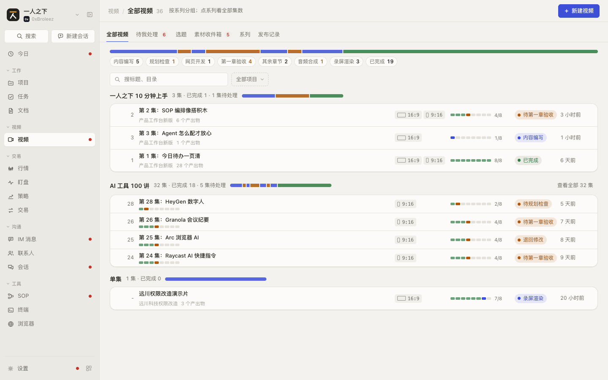 | 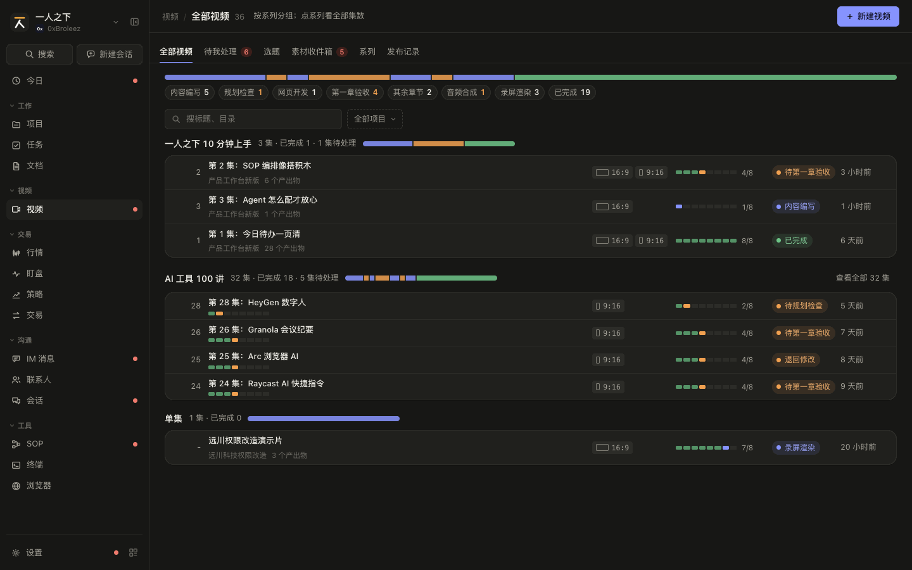 |
| 手机 375 | 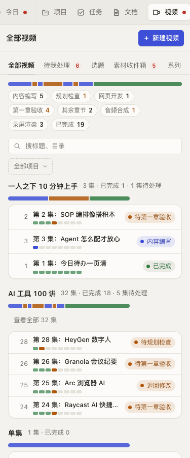 | 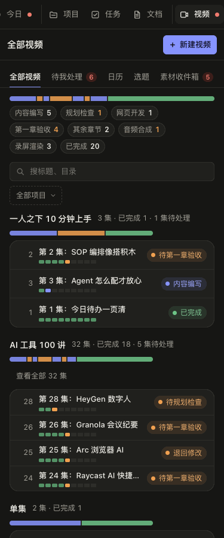 |

模块入口截图（`入口-*.png`）和「全部视频」标签截图是同一页。

### 交互

| 编号 | 元素 | 操作 | 结果 |
|---|---|---|---|
| SPEC-videos-1.1 | 页面标题 | 展示 | 「全部视频」，前面是「视频」，后面是总集数，说明「按系列分组；点系列看全部集数」 |
| SPEC-videos-1.2 | 右上「新建视频」 | 点击 | 新建一集单集视频（标题「新视频」，比例横屏，阶段内容编写，四个检查点待确认，目录 `videos/new-<n>`，章节 3），直接打开它的详情（`SPEC-videos-10`） |
| SPEC-videos-1.3 | 阶段分布条 | 展示 / 点击 | 上面一条按阶段分段、宽度按集数比例：已完成绿色，有等我处理的段橙色，其余蓝色；下面一排「阶段名 + 集数」的小块。点一段或一块按这个阶段筛（再点取消），出现「清除」 |
| SPEC-videos-1.4 | 搜索框 | 输入 | 按标题、目录、集数过滤；有内容时不再分组 |
| SPEC-videos-1.5 | 项目筛选 | 选择 | 「全部项目」/ 某个项目 / 「不属于项目」，可搜索；选了不再分组 |
| SPEC-videos-1.6 | 排序「按集数 / 按更新」 | 点击 | 只在平铺表里出现；默认按更新倒序 |
| SPEC-videos-1.7 | 组头的系列名、组头分布条 | 点击 | 打开这个系列的详情（`SPEC-videos-6`）；「单集」组打开单集列表（`view = single`，同样的表，只列不属于系列的视频） |
| SPEC-videos-1.8 | 组头「查看全部 N 集」 | 点击 | 组里超过 4 集才有，打开系列详情 |
| SPEC-videos-1.9 | 视频行 | 展示 | 集数（没有写「-」）、标题、待同步标签（系列改过共用部分没同步的集，橙色「待同步」）、第二行（系列名、项目名、产出物数，都没有就只有一行）、比例标签（没定写「未定」）、8 段进度条和「n/8」、状态胶囊、相对更新时间 |
| SPEC-videos-1.10 | 视频行 | 点击 | 打开视频详情（`SPEC-videos-10`），标签栏高亮「全部视频」 |

### 空状态和异常状态

| 编号 | 场景 | 显示 | 可做的操作 |
|---|---|---|---|
| SPEC-videos-1.11 | 一个视频都没有 | 「还没有视频」「把一篇文章或口播稿做成网页演示，再录成视频」，没有分布条 | 「新建视频」 |
| SPEC-videos-1.12 | 筛选后没有结果 | 「没有匹配的视频」「换个筛选条件试试」 | 清空搜索、点「清除」 |
| SPEC-videos-1.13 | 视频的项目已删除 | 项目名显示「已删除的项目」 | 在视频设置里改项目 |
| SPEC-videos-1.14 | 加载失败 | 原型未做；正式产品显示错误信息和「重试」 | 重试 |

### 数据

用到 `Video`、`Series`、`Artifact`（只数条数），见 `SPEC-videos-0`。阶段筛选的取值 `StageFilter` 是 `''`、任一 `StageKey` 或 `done`（已完成，`isFinished`）。

### 联动

| 方向 | 对方模块 | 触发 | 结果 | 见 |
|---|---|---|---|---|
| 进来 | 项目 | 项目名、项目筛选 | 读项目列表 | `SPEC-projects-1` |
| 出去 | 本模块 | 点行、点组头 | 视频详情、系列详情 | `SPEC-videos-10`、`SPEC-videos-6` |

## SPEC-videos-2 待我处理

只列「等我动手」的集：停在检查点上待确认，或检查点被退回待修改（`needsMe`）。同一张表，不分组、没有分布条。

### 截图

| | 亮 | 暗 |
|---|---|---|
| 桌面 1440 | 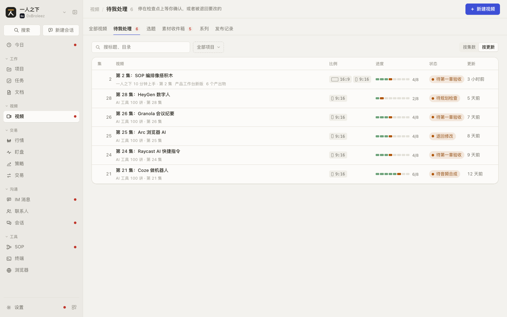 | 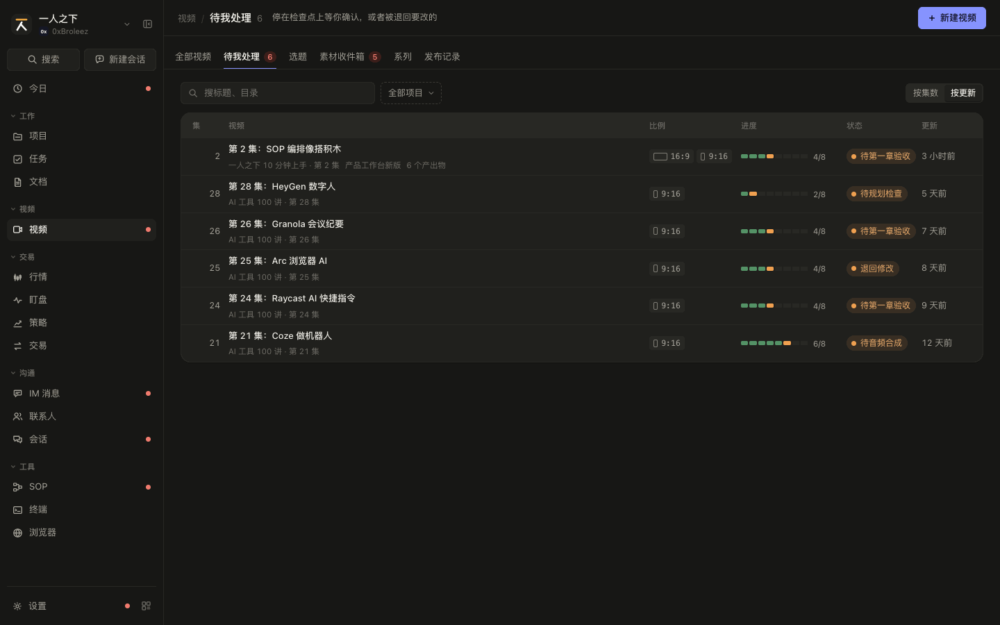 |
| 手机 375 | 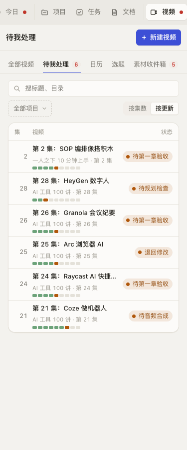 | 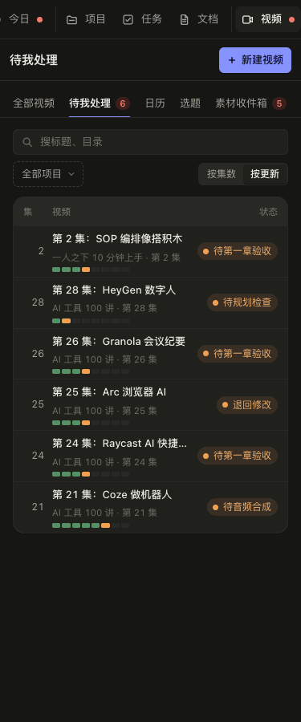 |

### 交互

| 编号 | 元素 | 操作 | 结果 |
|---|---|---|---|
| SPEC-videos-2.1 | 标签「待我处理」的数字 | 展示 | 等我处理的集数，鼠标悬停「N 集停在检查点或被退回」；为 0 不显示。一级菜单「视频」同时亮红点 |
| SPEC-videos-2.2 | 页面标题 | 展示 | 「待我处理」，说明「停在检查点上等你确认，或者被退回要改的」 |
| SPEC-videos-2.3 | 搜索、项目筛选、排序 | 同 `SPEC-videos-1.4` 到 `1.6` | 默认按更新倒序 |
| SPEC-videos-2.4 | 视频行 | 点击 | 打开视频详情的制作流程，当前检查点上有「通过」「退回」（`SPEC-videos-10.6`）；处理完回到这里，那一集不再出现 |

### 空状态和异常状态

| 编号 | 场景 | 显示 | 可做的操作 |
|---|---|---|---|
| SPEC-videos-2.5 | 没有要处理的 | 「没有等你处理的视频」「检查点都确认过了」 | 无 |
| SPEC-videos-2.6 | 筛选后没有结果 | 「没有匹配的视频」 | 清空搜索 |

### 数据

见 `SPEC-videos-0` 的 `Video`、`videoState`。

### 联动

| 方向 | 对方模块 | 触发 | 结果 | 见 |
|---|---|---|---|---|
| 出去 | 今日 | 等我处理的集 | 原型未做；正式版作为今日的「待验收的视频」卡片（VID-07） | `SPEC-today-1.4` |

## SPEC-videos-3 选题

从素材里挑题、打分、想清楚角度，可开拍了就立项成视频。默认看板（按 `TOPIC_FLOW` 分列，「放弃」列默认不显示），可以切成表格。都按优先级从高到低排。

### 截图

| | 亮 | 暗 |
|---|---|---|
| 桌面 1440 | 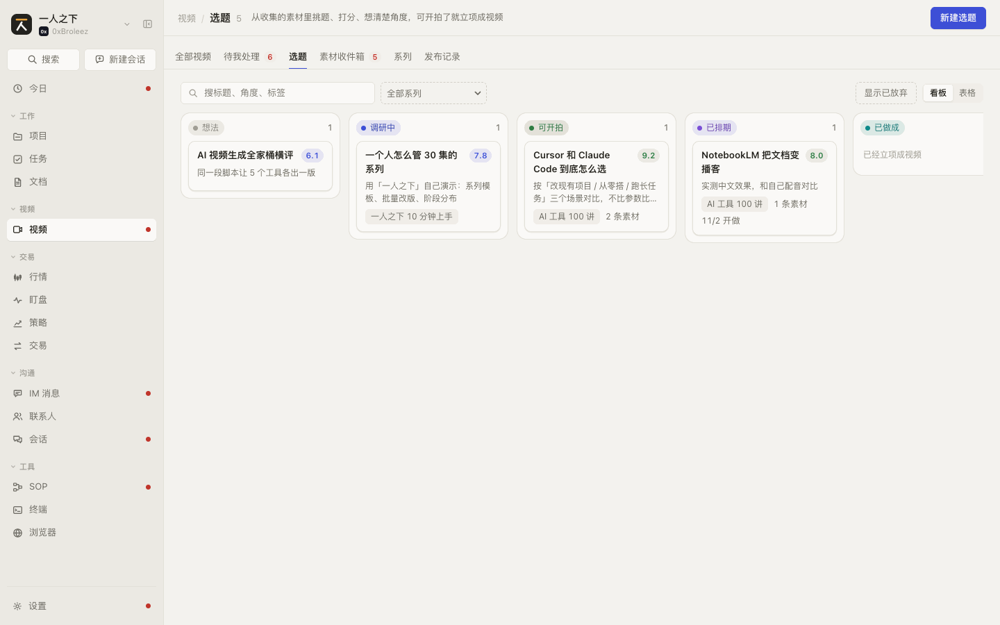 | 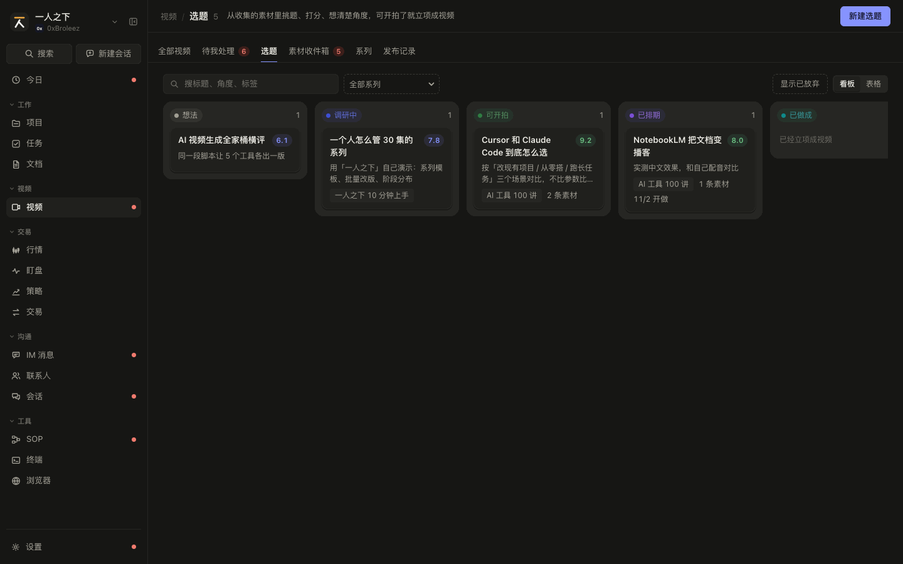 |
| 手机 375 |  | 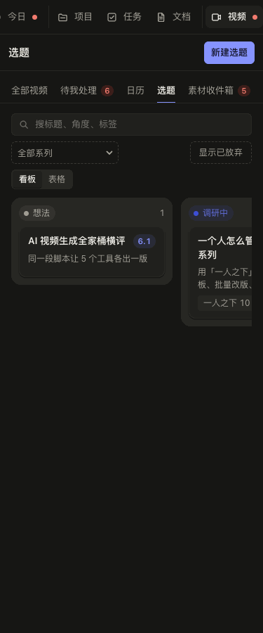 |
| 表格视图 | 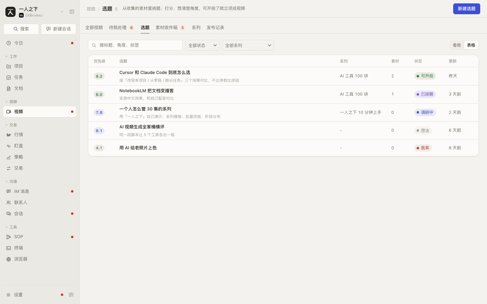 | 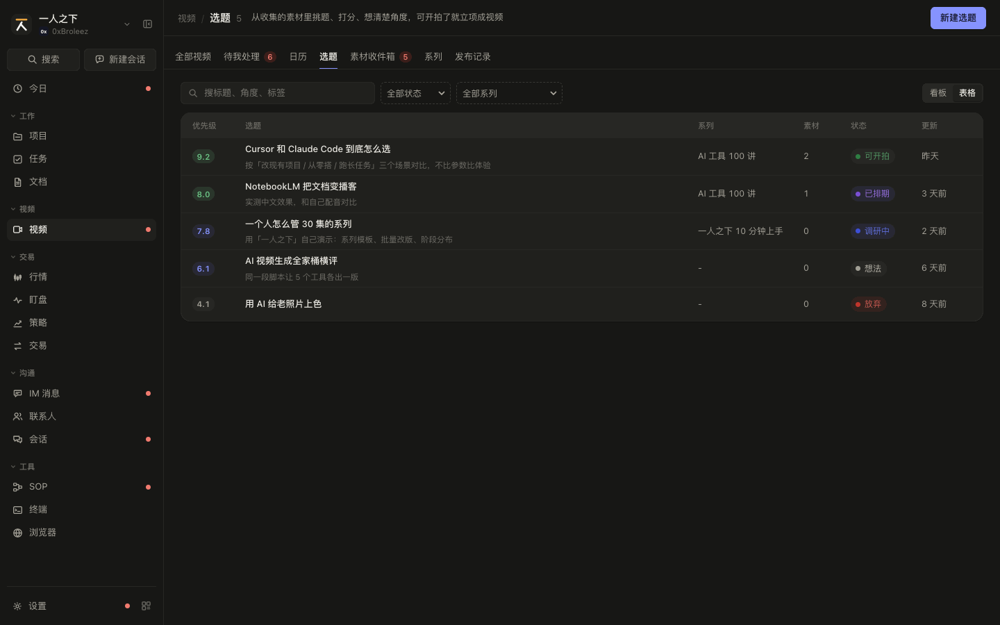 |
| 选题抽屉 | 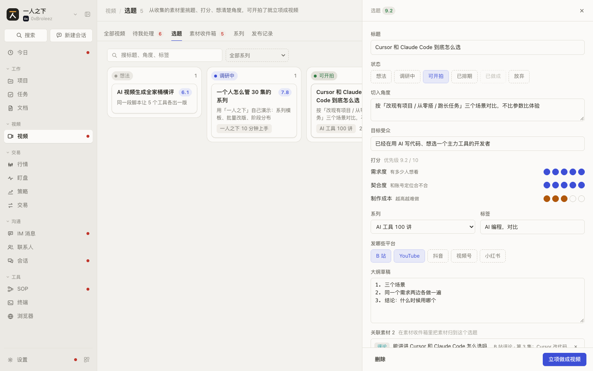 | 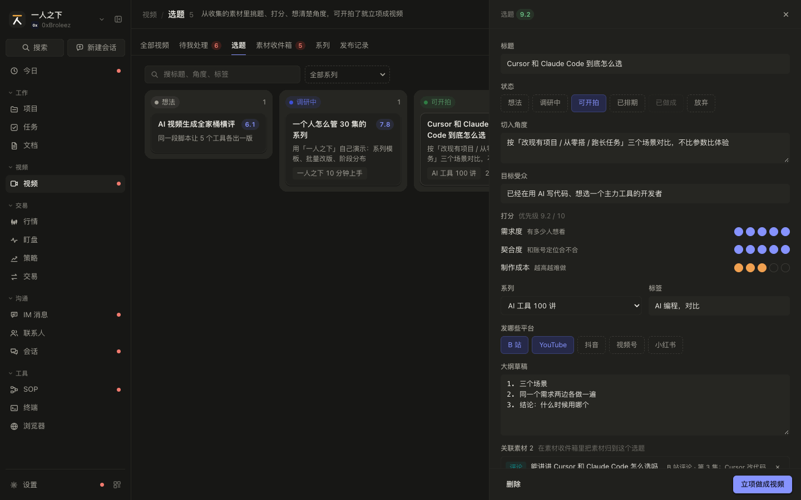 |
| 已放弃的选题 | 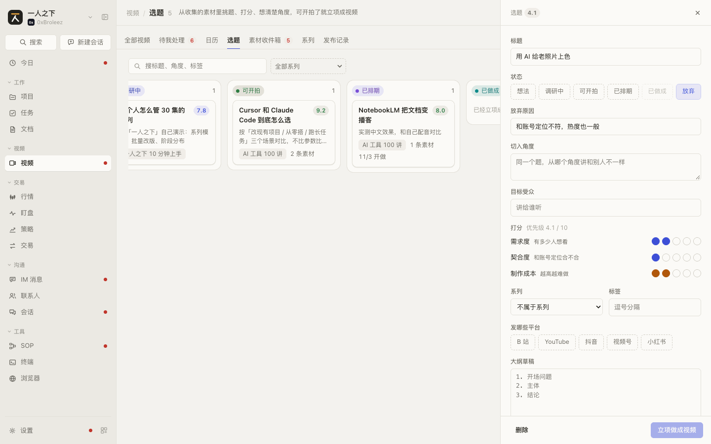 | 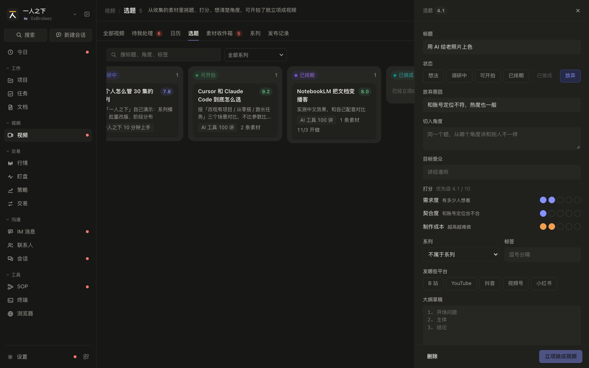 |

### 交互

| 编号 | 元素 | 操作 | 结果 |
|---|---|---|---|
| SPEC-videos-3.1 | 右上「新建选题」 | 点击 | 新建一条（状态想法、三项打分都是 3），放在最前面并打开抽屉，焦点在标题 |
| SPEC-videos-3.2 | 搜索框 | 输入 | 按标题、角度、标签过滤 |
| SPEC-videos-3.3 | 系列筛选 | 选择 | 「全部系列」/ 某个系列 / 「不属于系列」 |
| SPEC-videos-3.4 | 状态筛选 | 选择 | 只在表格视图出现，每个状态后面带条数 |
| SPEC-videos-3.5 | 「显示已放弃」 | 点击 | 只在看板出现，切换「放弃」列 |
| SPEC-videos-3.6 | 「看板 / 表格」 | 点击 | 切视图 |
| SPEC-videos-3.7 | 看板列 | 展示 | 列头是状态胶囊和条数；每列先露 8 张，多了显示「还有 N 个」，点开后「收起」；空列显示该状态的说明（如「先记下来，还没细想」） |
| SPEC-videos-3.8 | 选题卡片 | 展示 / 点击 | 标题、优先级分（三色）、角度、系列标签、素材条数、「M/D 开做」（有计划日期时）、「已立项」；点击打开抽屉 |
| SPEC-videos-3.9 | 表格行 | 展示 / 点击 | 优先级、选题和角度、系列、素材数、状态、更新时间；一次 50 条，「显示更多（还有 N 条）」；点击打开抽屉 |
| SPEC-videos-3.10 | 抽屉：标题、角度、受众、标签、大纲 | 输入 | 边输边存，`updated_at` 刷新；标签用中英文逗号分隔 |
| SPEC-videos-3.11 | 抽屉：状态 | 点击 | 六个状态按钮；「已做成」在没立项时不可点（提示「立项后自动变成已做成」）。选「放弃」多出「放弃原因」，选「已排期」多出「计划开做」日期 |
| SPEC-videos-3.12 | 抽屉：打分 | 点圆点 | 三行各 5 个圆点，制作成本用另一种颜色；标题旁的优先级和抽屉头的分数跟着变 |
| SPEC-videos-3.13 | 抽屉：系列、发哪些平台 | 选择 | 平台可多选，决定立项时出哪几个比例 |
| SPEC-videos-3.14 | 抽屉：关联素材 | 展示 / 点 x | 列出关联的素材（类型、标题、来源）；点 x 取消关联，素材那边的 `topic_ids` 同步去掉 |
| SPEC-videos-3.15 | 抽屉底部「立项做成视频」 | 点击 | 生成一集视频：有系列时排在系列最后一集之后、标题「第 N 集：<选题标题>」；比例按所选平台的推荐比例去重，没选平台就横屏；目录 `videos/<选题 id>`；选题变成「已做成」并记下 `video_id`，关抽屉，打开新视频的详情 |
| SPEC-videos-3.16 | 抽屉底部「打开视频：<标题>」 | 点击 | 已立项的选题显示这个按钮代替立项，打开那一集 |
| SPEC-videos-3.17 | 抽屉底部「删除」 | 点击 | 换成确认条「删除后不能恢复，关联的素材保留」「取消」「删除」；确认后删掉选题，素材上的关联去掉 |
| SPEC-videos-3.18 | Esc、右上 x | 点击 / 按键 | 关抽屉 |

### 空状态和异常状态

| 编号 | 场景 | 显示 | 可做的操作 |
|---|---|---|---|
| SPEC-videos-3.19 | 没有任何选题 | 「还没有选题」「先去素材收件箱收点东西，或者直接新建一个」 | 「新建选题」 |
| SPEC-videos-3.20 | 表格筛选后没有结果 | 「没有匹配的选题」 | 改筛选 |
| SPEC-videos-3.21 | 没写标题就想立项 | 「立项做成视频」不可点，提示「先写标题」 | 写标题 |
| SPEC-videos-3.22 | 已放弃的选题 | 「立项做成视频」不可点，提示「已放弃的选题不能立项」 | 改状态 |
| SPEC-videos-3.23 | 选题的系列已删除 | 卡片上显示「已删除的系列」 | 抽屉里改系列 |

### 数据

见 `SPEC-videos-0` 的 `Topic`、`TopicScore`、`Clip`。

### 联动

| 方向 | 对方模块 | 触发 | 结果 | 见 |
|---|---|---|---|---|
| 进来 | 本模块 | 素材「转为选题」、素材上的选题标签 | 切到选题并打开那条 | `SPEC-videos-4.8`、`SPEC-videos-4.12` |
| 改动 | 本模块 | 立项 | 全部视频里多一集，系列里多一集 | `SPEC-videos-1`、`SPEC-videos-6` |

## SPEC-videos-4 素材收件箱

评论、热榜、竞品、聊天里冒出来的点子先收进来，再挑出值得做的变成选题。按收进来的时间倒序，分「今天 / 昨天 / 本周 / 更早」。

### 截图

| | 亮 | 暗 |
|---|---|---|
| 桌面 1440 | 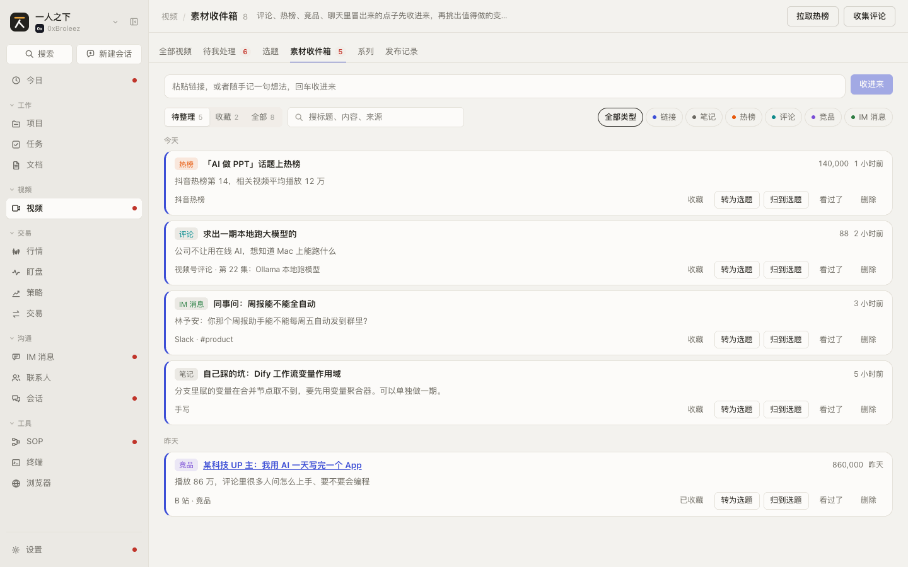 | 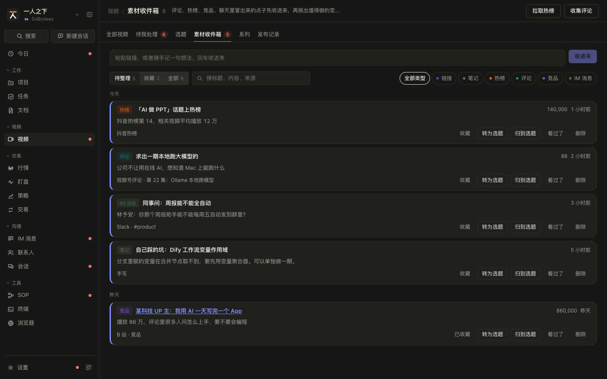 |
| 手机 375 | 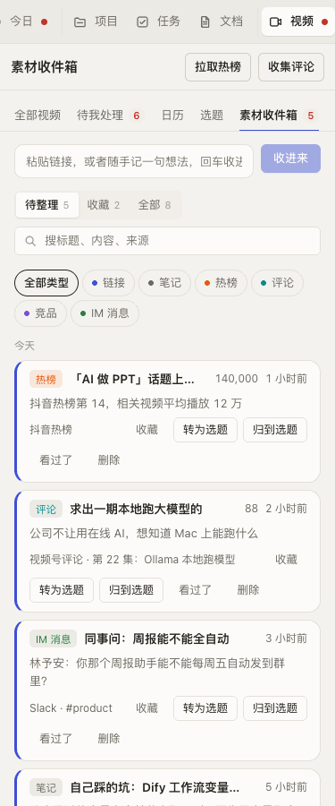 | 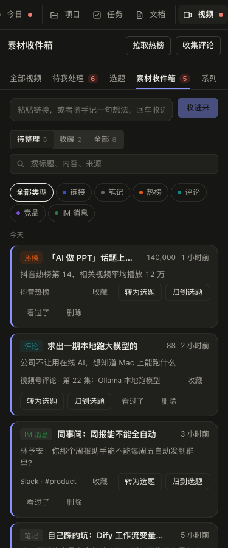 |
| 归到选题 | 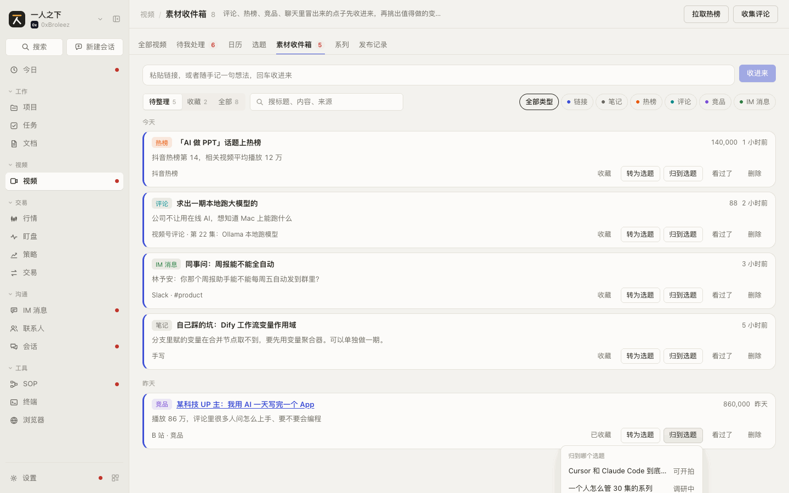 | 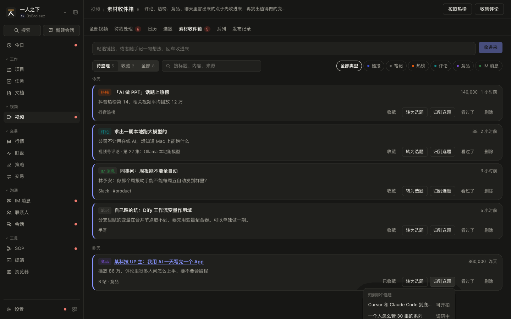 |
| 拉取热榜之后 | 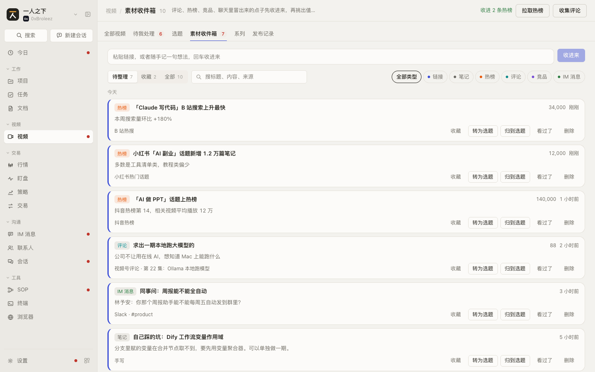 | 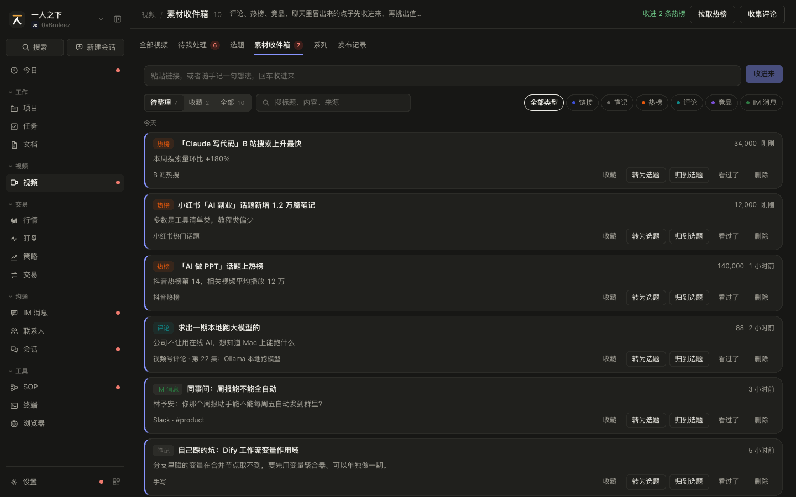 |
| 待整理清空 | 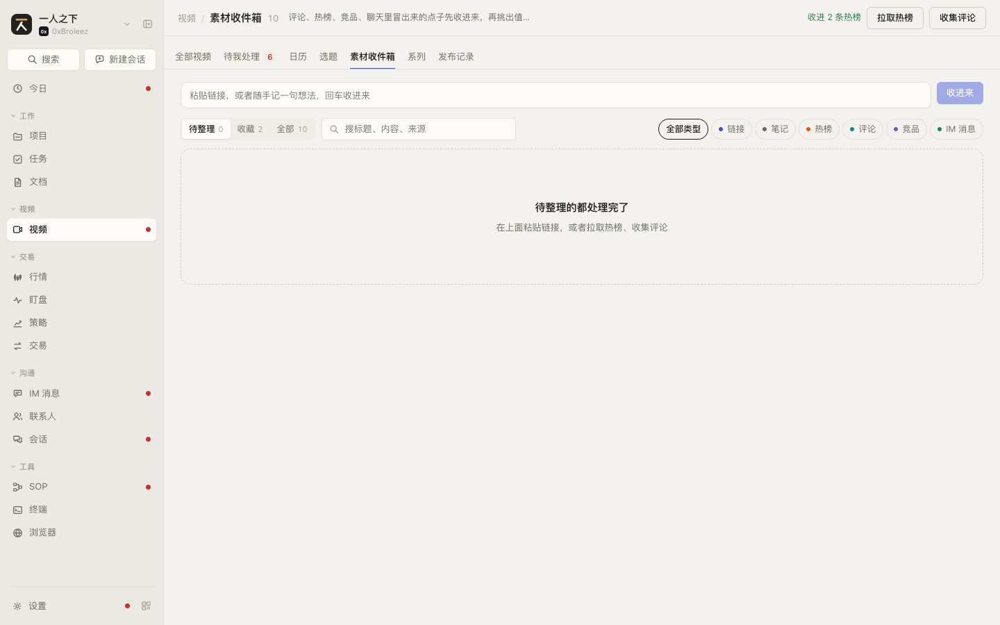 | 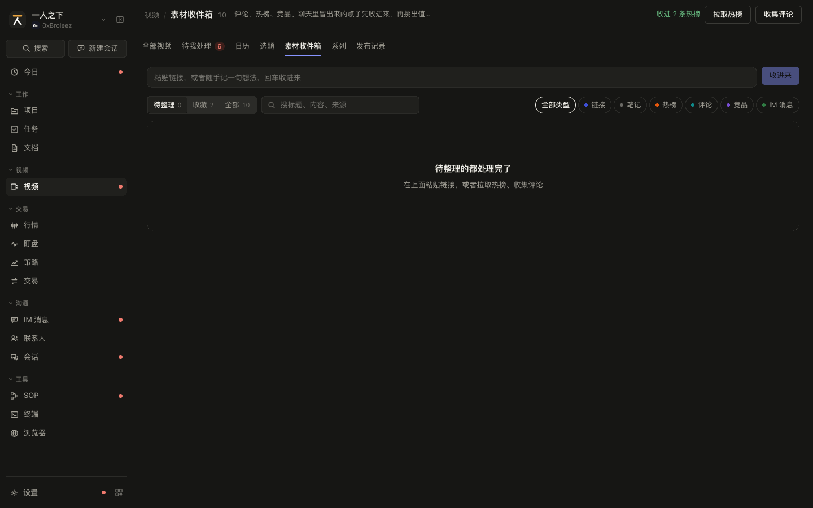 |

### 交互

| 编号 | 元素 | 操作 | 结果 |
|---|---|---|---|
| SPEC-videos-4.1 | 标签「素材收件箱」的数字 | 展示 | 待整理（`triaged = false`）的条数，为 0 不显示 |
| SPEC-videos-4.2 | 顶部输入框和「收进来」 | 输入后回车或点击 | 以 `http://` 或 `https://` 开头的当链接（标题取去掉协议的前 60 个字），否则当笔记（标题取前 40 个字）；来源「手动添加」，进待整理，输入框清空。输入法组字时回车不提交；没内容时按钮不可点 |
| SPEC-videos-4.3 | 右上「拉取热榜」「收集评论」 | 点击 | 按钮变「拉取中…」「收集中…」，两个都暂时不可点；原型约 1 秒后从假数据池取下一批插到最前面，标题旁提示「收进 N 条热榜 / 评论」，取完提示「没有新的热榜 / 评论」。正式版由内容平台连接器拉（VID-08b） |
| SPEC-videos-4.4 | 「待整理 / 收藏 / 全部」 | 点击 | 切换范围，后面带条数 |
| SPEC-videos-4.5 | 搜索框 | 输入 | 按标题、内容、来源、标签过滤 |
| SPEC-videos-4.6 | 类型筛选 | 点击 | 「全部类型」或六种类型之一，再点取消 |
| SPEC-videos-4.7 | 素材卡片 | 展示 | 类型标签、标题（有链接时是外链，新窗口打开）、热度、相对时间、内容（和标题相同就不重复）、来源、已归到的选题标签；待整理的卡片左边有色条 |
| SPEC-videos-4.8 | 「转为选题」 | 点击 | 新建一个选题：标题用素材标题，大纲用素材内容，标签照搬，热度过万需求度给 4、否则 3；素材标为已整理并关联它；切到选题页打开这个选题 |
| SPEC-videos-4.9 | 「归到选题」 | 点击 | 弹出菜单列出进行中的选题（不含已做成、已放弃），超过 8 个时带搜索框；已关联的那条不可点；选一个后两边互相记上，素材标为已整理 |
| SPEC-videos-4.10 | 「收藏 / 已收藏」 | 点击 | 切换 `starred` |
| SPEC-videos-4.11 | 「看过了」 | 点击 | 只在待整理的卡片上；标为已整理，从待整理里消失 |
| SPEC-videos-4.12 | 选题标签「选题：<标题>」 | 点击 | 切到选题页打开那条 |
| SPEC-videos-4.13 | 「删除」 | 点击 | 直接删掉素材，选题上的关联一起去掉（原型没有确认） |
| SPEC-videos-4.14 | 「显示更多」 | 点击 | 一次 50 条，多了再加 50 |

### 空状态和异常状态

| 编号 | 场景 | 显示 | 可做的操作 |
|---|---|---|---|
| SPEC-videos-4.15 | 待整理的都处理完了 | 「待整理的都处理完了」「在上面粘贴链接，或者拉取热榜、收集评论」 | 收素材、拉取 |
| SPEC-videos-4.16 | 收藏、全部或筛选后没有 | 「这里没有素材」 | 同上 |
| SPEC-videos-4.17 | 没有进行中的选题 | 「归到选题」不可点，提示「没有进行中的选题」 | 「转为选题」 |
| SPEC-videos-4.18 | 平台没接入时拉取 | 原型未做（假数据照样能拉）；正式版：内容平台连接器没接或异常时，按钮旁提示并给「去接入」，跳 `SPEC-settings-3` | 去接入 |

### 数据

见 `SPEC-videos-0` 的 `Clip`、`Topic`、`TREND_POOL`、`COMMENT_POOL`。

### 联动

| 方向 | 对方模块 | 触发 | 结果 | 见 |
|---|---|---|---|---|
| 改动 | 本模块 | 转为选题、归到选题 | 选题多一条或多一个关联素材 | `SPEC-videos-3` |
| 进来 | 设置（连接器，内容平台） | 拉热榜、收评论 | 原型模拟；正式版读平台连接器 | `SPEC-settings-5` |
| 进来 | IM 消息 | IM 消息类素材 | 原型只有演示数据；正式版 VID-08b | `SPEC-messages-2` |

## SPEC-videos-5 系列

一个系列一张卡片，只看整体进度；点卡片进系列详情。

### 截图

| | 亮 | 暗 |
|---|---|---|
| 桌面 1440 | 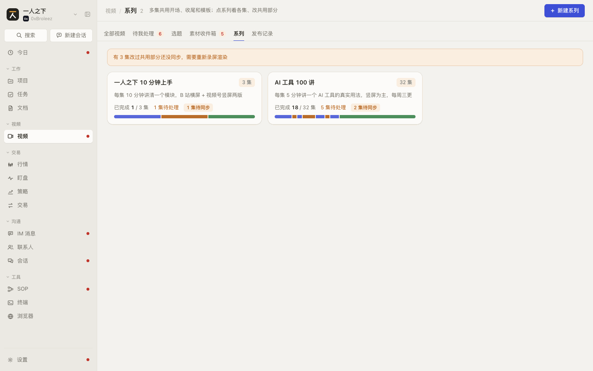 | 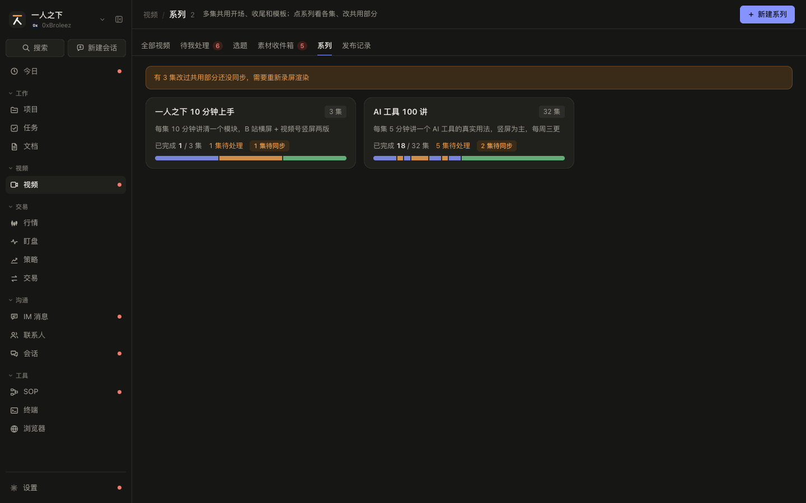 |
| 手机 375 | 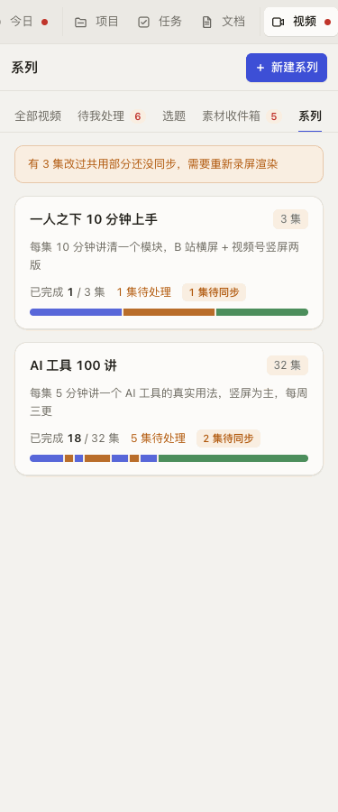 | 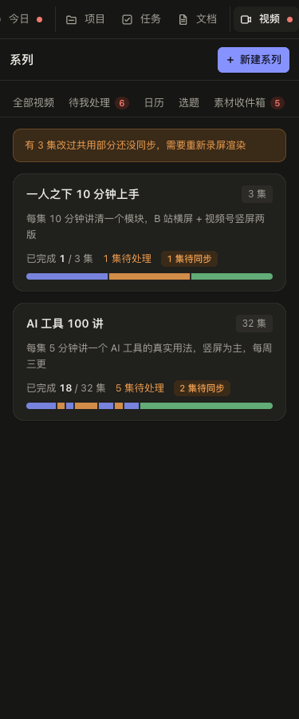 |
| 新建系列，名称没填 | 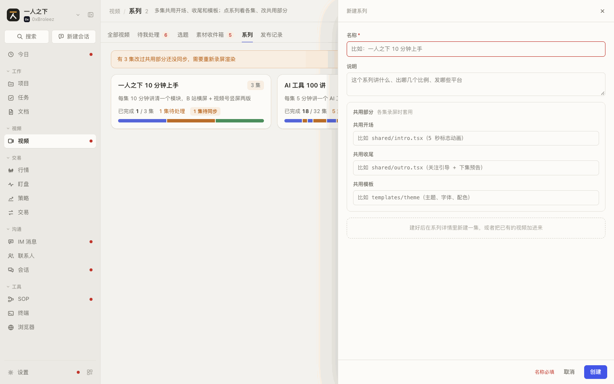 | 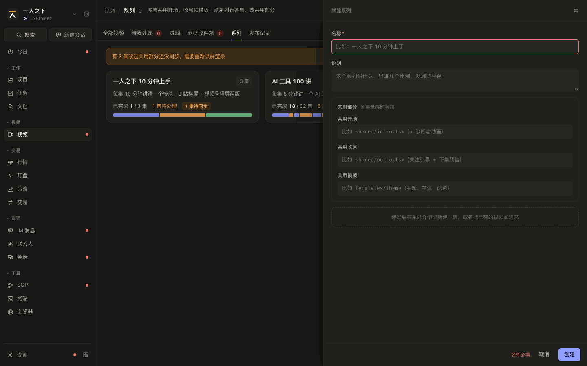 |

### 交互

| 编号 | 元素 | 操作 | 结果 |
|---|---|---|---|
| SPEC-videos-5.1 | 页面标题 | 展示 | 「系列」，系列个数，说明「多集共用开场、收尾和模板；点系列看各集、改共用部分」 |
| SPEC-videos-5.2 | 待同步提示条 | 展示 | 所有系列加起来有待同步的集时显示「有 N 集改过共用部分还没同步，需要重新录屏渲染」 |
| SPEC-videos-5.3 | 系列卡片 | 展示 | 名称、集数、说明（没写显示「还没写说明」）、「已完成 a / b 集」、「N 集待处理」、「N 集待同步」、阶段分布条（只看不筛） |
| SPEC-videos-5.4 | 系列卡片 | 点击、回车、空格 | 打开系列详情（`SPEC-videos-6`） |
| SPEC-videos-5.5 | 右上「新建系列」 | 点击 | 打开新建系列抽屉：名称（必填）、说明、共用开场、共用收尾、共用模板，底部提示「建好后在系列详情里新建一集，或者把已有的视频加进来」 |
| SPEC-videos-5.6 | 抽屉「创建」 | 点击 | 名称去掉首尾空格后不为空才建；建好后打开它的系列详情 |
| SPEC-videos-5.7 | 抽屉「取消」、Esc、x | 点击 | 关抽屉，不保存 |

### 空状态和异常状态

| 编号 | 场景 | 显示 | 可做的操作 |
|---|---|---|---|
| SPEC-videos-5.8 | 没有系列 | 「还没有系列」「把同一主题的几集归成一个系列，共用开场、收尾和模板，批量改版时能看出影响哪几集」 | 「新建系列」 |
| SPEC-videos-5.9 | 系列里还没有集 | 卡片上「还没有归入的集，点开系列新建一集或把视频加进来」 | 点开 |
| SPEC-videos-5.10 | 名称没填就创建 | 名称框标红，底部「名称必填」，抽屉不关 | 填名称 |

### 数据

见 `SPEC-videos-0` 的 `Series`、`Video`。

### 联动

| 方向 | 对方模块 | 触发 | 结果 | 见 |
|---|---|---|---|---|
| 出去 | 本模块 | 点卡片 | 系列详情 | `SPEC-videos-6` |

## SPEC-videos-6 系列详情和系列设置

一个系列的全部集：顶部是共用部分和待同步的集，下面是和全部视频一样的表，默认按集数排；可以编排集数、把单集加进来、改系列设置。

### 截图

| 状态 | 亮 | 暗 |
|---|---|---|
| 系列详情 | 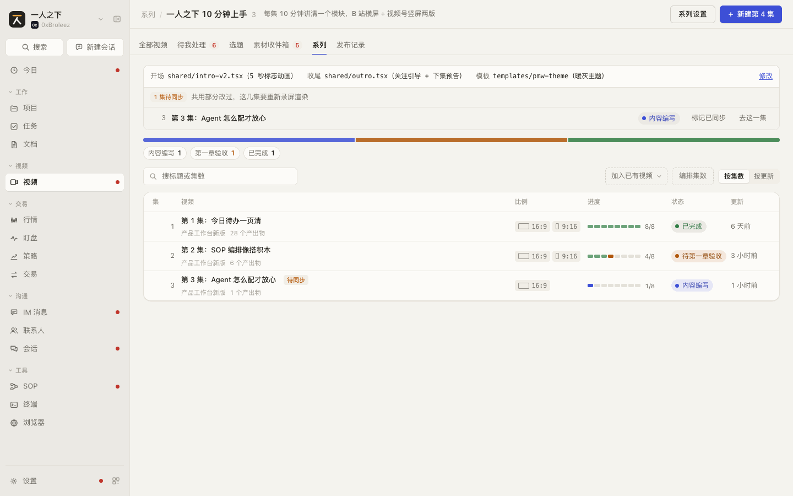 | 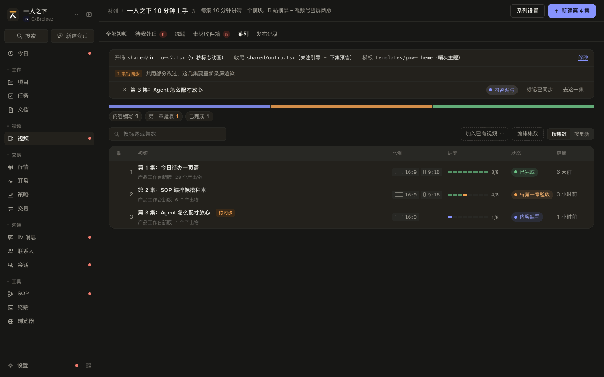 |
| 编排集数 | 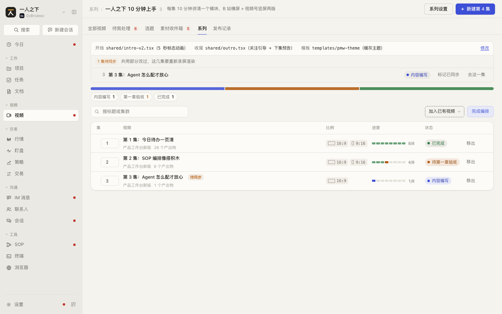 | 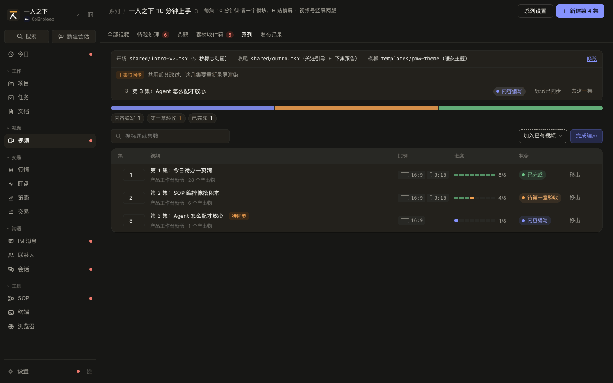 |
| 系列设置，改了共用开场 | 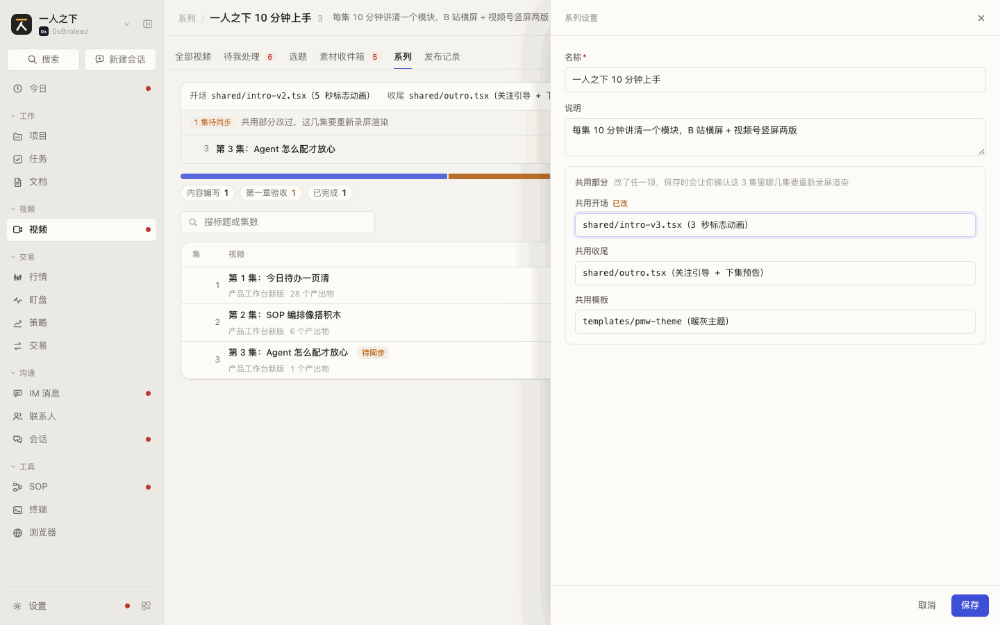 | 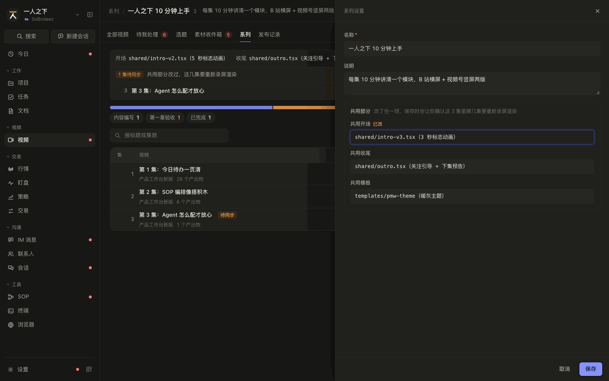 |
| 保存时的影响范围 | 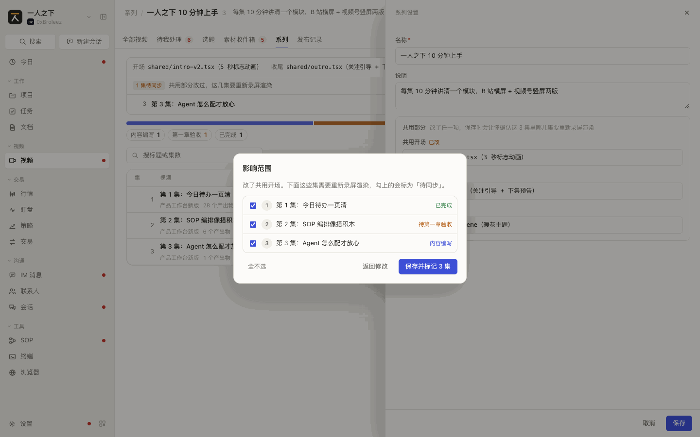 | 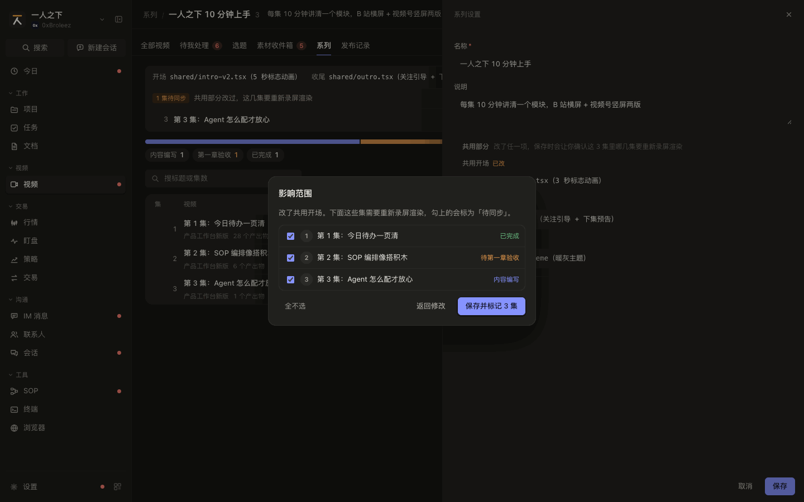 |

手机宽度：系列详情用的是全部视频那张表，窄屏排法同 `SPEC-videos-1` 的手机截图。

### 交互

| 编号 | 元素 | 操作 | 结果 |
|---|---|---|---|
| SPEC-videos-6.1 | 标题前的「系列」 | 点击 | 回到系列列表 |
| SPEC-videos-6.2 | 右上「新建第 N 集」 | 点击 | N 是现有最大集数加一；新建一集（标题「第 N 集：」）并打开详情，标签栏高亮「系列」 |
| SPEC-videos-6.3 | 共用部分一行 | 展示 | 开场、收尾、模板，没设置的写「未设置」；「修改」打开系列设置 |
| SPEC-videos-6.4 | 待同步区 | 展示 | 「N 集待同步」「共用部分改过，这几集要重新录屏渲染」，每集一行：集数、标题、状态、「标记已同步」「去这一集」；多于 1 集时有「全部标记已同步」 |
| SPEC-videos-6.5 | 「标记已同步」「全部标记已同步」 | 点击 | 从 `Series.stale` 里去掉，行上的「待同步」标签消失 |
| SPEC-videos-6.6 | 阶段分布条、搜索 | 同 `SPEC-videos-1.3`、`1.4` | 搜索提示「搜标题或集数」，没有项目筛选 |
| SPEC-videos-6.7 | 「加入已有视频」 | 选择 | 下拉列出没归入任何系列的视频（标题、当前状态，按更新倒序，可搜索），选一个就排在第 N 集 |
| SPEC-videos-6.8 | 「编排集数 / 完成编排」 | 点击 | 进入编排时先按集数排；每行的集数变成输入框，失焦或回车才改（免得边输边重排），小于 1 的不改；行尾换成「移出」 |
| SPEC-videos-6.9 | 编排时「移出」 | 点击 | 这一集变回单集（清掉系列和集数），同时从待同步里去掉 |
| SPEC-videos-6.10 | 编排时集数重复 | 展示 | 重复的输入框标红，表上方红字「有几集集数重复了，改一下」；不拦截保存 |
| SPEC-videos-6.11 | 右上「系列设置」 | 点击 | 打开系列设置抽屉，和新建系列同样的字段；改过的共用项旁标「已改」，说明「改了任一项，保存时会让你确认这 N 集里哪几集要重新录屏渲染」 |
| SPEC-videos-6.12 | 抽屉「保存」 | 点击 | 名称必填；没改共用部分或系列里没有集时直接保存；改了共用部分且有集时弹出「影响范围」 |
| SPEC-videos-6.13 | 影响范围弹窗 | 展示 / 勾选 | 「改了共用开场、…。下面这些集需要重新录屏渲染，勾上的会标为「待同步」」；列出系列全部集（集数、标题、状态），默认全勾；「全选 / 全不选」 |
| SPEC-videos-6.14 | 弹窗「保存并标记 N 集」/「只保存」 | 点击 | 保存系列；勾上的集加进 `stale`（原来已在里面的不重复），没勾的集如果原来在待同步里会被去掉；一集都没勾时按钮叫「只保存」 |
| SPEC-videos-6.15 | 弹窗「返回修改」、点遮罩、Esc | 点击 | 关弹窗回到抽屉；再按 Esc 关抽屉 |

### 空状态和异常状态

| 编号 | 场景 | 显示 | 可做的操作 |
|---|---|---|---|
| SPEC-videos-6.16 | 系列里还没有集 | 「这个系列还没有集」「新建第 1 集，或者用「加入已有视频」把单集归进来」 | 新建、加入 |
| SPEC-videos-6.17 | 没有可加入的单集 | 「加入已有视频」不可点，提示「没有未归入系列的视频」 | 无 |
| SPEC-videos-6.18 | 系列设置名称清空 | 同 `SPEC-videos-5.10` | 填名称 |
| SPEC-videos-6.19 | 系列已删除 | 原型没有删除系列的入口；正式版要补删除，删除时各集变回单集 | |

### 数据

见 `SPEC-videos-0` 的 `Series`、`Video`。

### 联动

| 方向 | 对方模块 | 触发 | 结果 | 见 |
|---|---|---|---|---|
| 改动 | 本模块 | 加入、移出、改集数 | 视频设置里的系列和集数跟着变 | `SPEC-videos-13.3` |
| 出去 | 本模块 | 点行、「去这一集」 | 视频详情，标签栏高亮「系列」，标题前是系列名 | `SPEC-videos-10` |

## SPEC-videos-7 发布记录

每个平台发了哪个比例、哪张封面，发出去以后的数据。全部记录时按视频分组，从视频详情进来时只看一集并多一块「按平台对比」。

### 截图

| | 亮 | 暗 |
|---|---|---|
| 桌面 1440 | 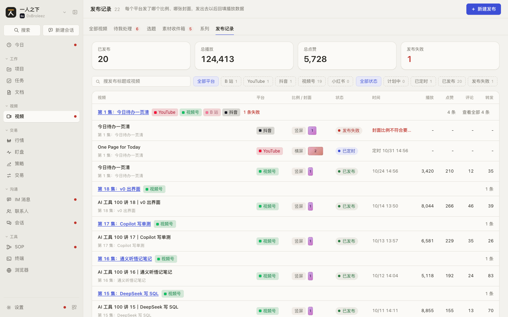 | 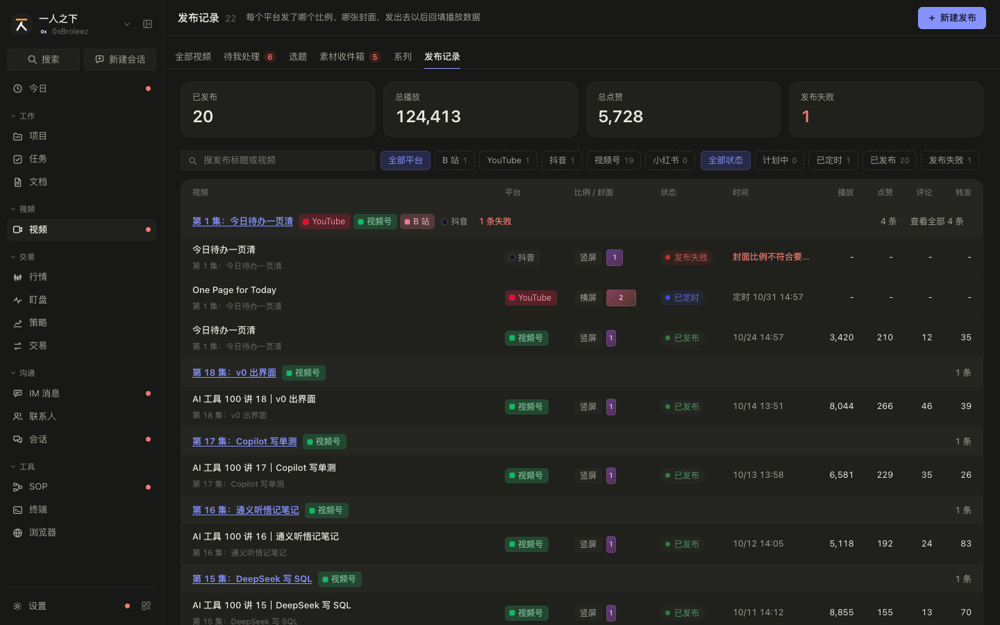 |
| 手机 375 | 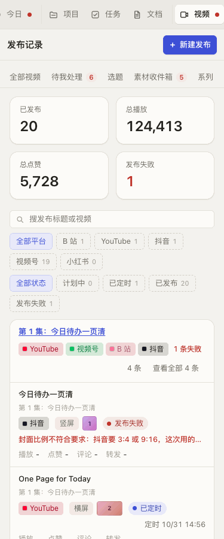 | 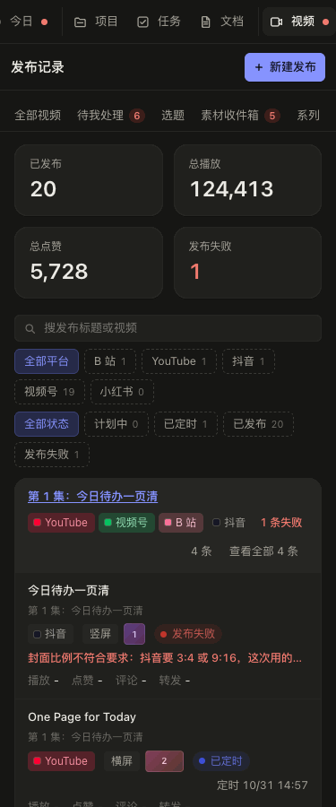 |
| 只看一集 | 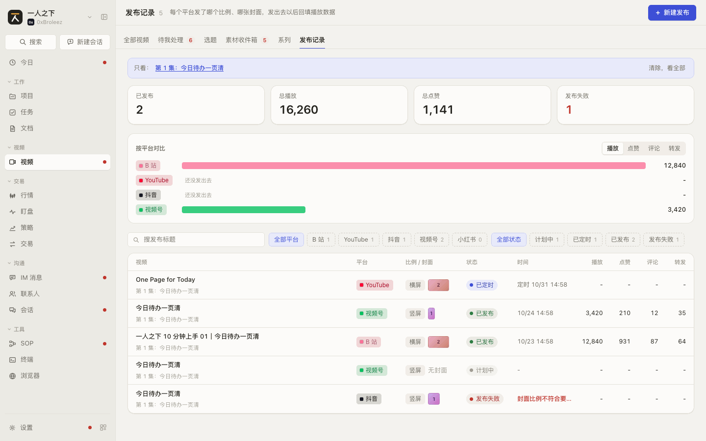 | 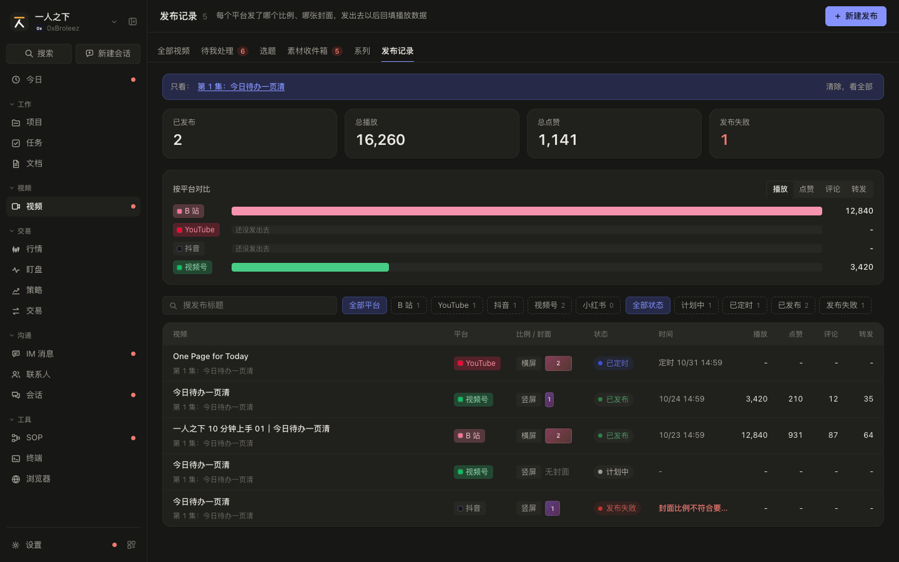 |

### 交互

| 编号 | 元素 | 操作 | 结果 |
|---|---|---|---|
| SPEC-videos-7.1 | 页面标题 | 展示 | 「发布记录」，条数，说明「每个平台发了哪个比例、哪张封面，发出去以后回填播放数据」 |
| SPEC-videos-7.2 | 汇总数字 | 展示 | 已发布、总播放、总点赞、发布失败（大于 0 时红色）；只看一集时只算这一集 |
| SPEC-videos-7.3 | 搜索框 | 输入 | 按发布标题和视频标题过滤（只看一集时只搜发布标题） |
| SPEC-videos-7.4 | 平台、状态筛选 | 点击 | 「全部平台」或五个平台之一、「全部状态」或四个状态之一，后面带条数；再点取消 |
| SPEC-videos-7.5 | 视频分组行 | 展示 / 点击 | 视频标题（点了打开视频详情）、用过的平台、「N 条失败」、条数；组按组里最新一条的时间排，每组先露 3 条，失败的排前面，「查看全部 N 条 / 收起」；一次 30 组，「显示更多视频（还有 N 个）」 |
| SPEC-videos-7.6 | 发布行 | 展示 | 发布标题（没填「未填标题」）和视频标题、平台标签、比例和封面色块（没有写「无封面」）、状态（自动发布进行中显示「发布中…」）、时间（已发布的发布时间、已定时的「定时 MM/DD HH:mm」、失败的红字原因）、播放点赞评论转发（没有数据写「-」） |
| SPEC-videos-7.7 | 发布行 | 点击 | 打开发布记录抽屉（`SPEC-videos-9`） |
| SPEC-videos-7.8 | 右上「新建发布」 | 点击 | 打开新建发布（`SPEC-videos-8`）；只看一集时默认选这一集 |
| SPEC-videos-7.9 | 只看一集：「只看：<标题>」 | 点击标题 / 「清除，看全部」 | 回到这一集的详情 / 去掉过滤看全部 |
| SPEC-videos-7.10 | 只看一集：按平台对比 | 展示 / 切换 | 用过的每个平台一根条，按播放、点赞、评论、转发切换；还没发出去的平台写「还没发出去」 |

### 空状态和异常状态

| 编号 | 场景 | 显示 | 可做的操作 |
|---|---|---|---|
| SPEC-videos-7.11 | 没有发布记录 | 「还没有发布记录」「点右上角「新建发布」，选视频、平台、比例和封面」 | 新建发布 |
| SPEC-videos-7.12 | 筛选后没有 | 「没有匹配的发布记录」 | 改筛选 |
| SPEC-videos-7.13 | 只看的这一集没有记录 | 对比区「这一集还没有发布记录」 | 新建发布 |
| SPEC-videos-7.14 | 发布记录的视频已删除 | 标题显示「已删除的视频」（原型删视频时会把它的发布记录一起删，正常看不到） | 无 |

### 数据

见 `SPEC-videos-0` 的 `Publish`、`Metrics`、`PLATFORMS`、`Artifact`（封面）。

### 联动

| 方向 | 对方模块 | 触发 | 结果 | 见 |
|---|---|---|---|---|
| 进来 | 本模块 | 视频详情右上「发布记录 N」 | 只看这一集 | `SPEC-videos-10.12` |
| 出去 | 今日 | 发布失败、待发布 | 原型未做；正式版今日卡片（VID-07） | `SPEC-today-1.4` |

## SPEC-videos-8 新建发布

发布弹窗（右侧抽屉）。选视频、平台、比例、封面，写标题简介，选立即还是定时。能不能自动发由平台的接入情况决定：接通了上传接口的才自动发，其余只登记一条「计划中」，发完回来填链接。

### 截图

| 状态 | 亮 | 暗 |
|---|---|---|
| 已接入（B 站） | 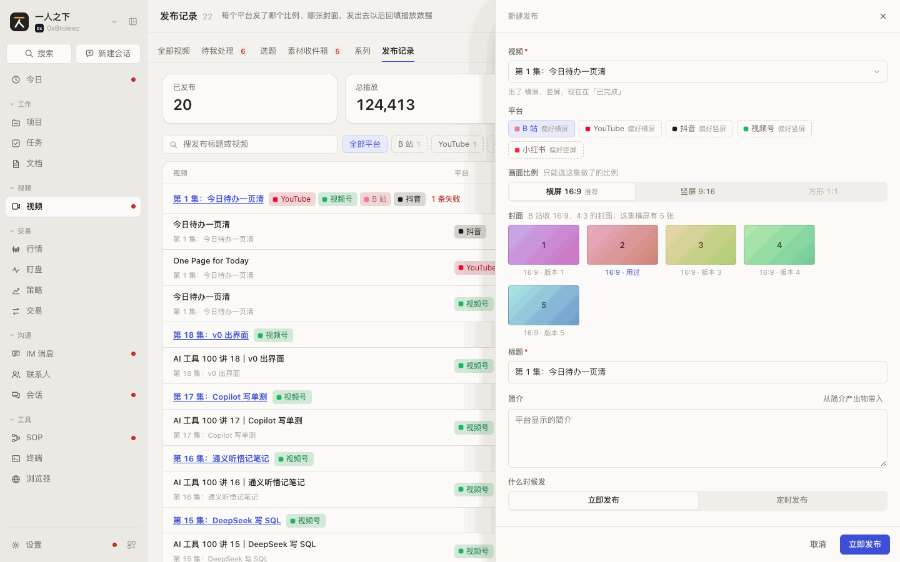 | 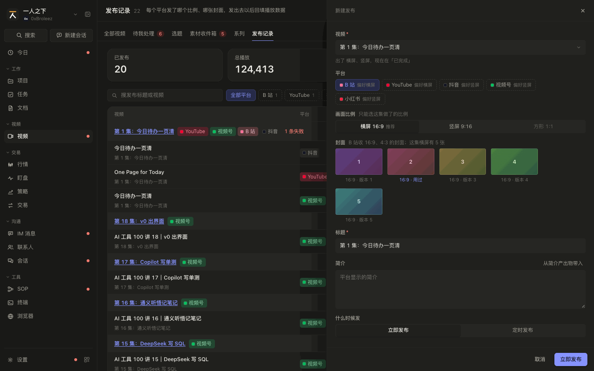 |
| 不开放发布接口（视频号） | 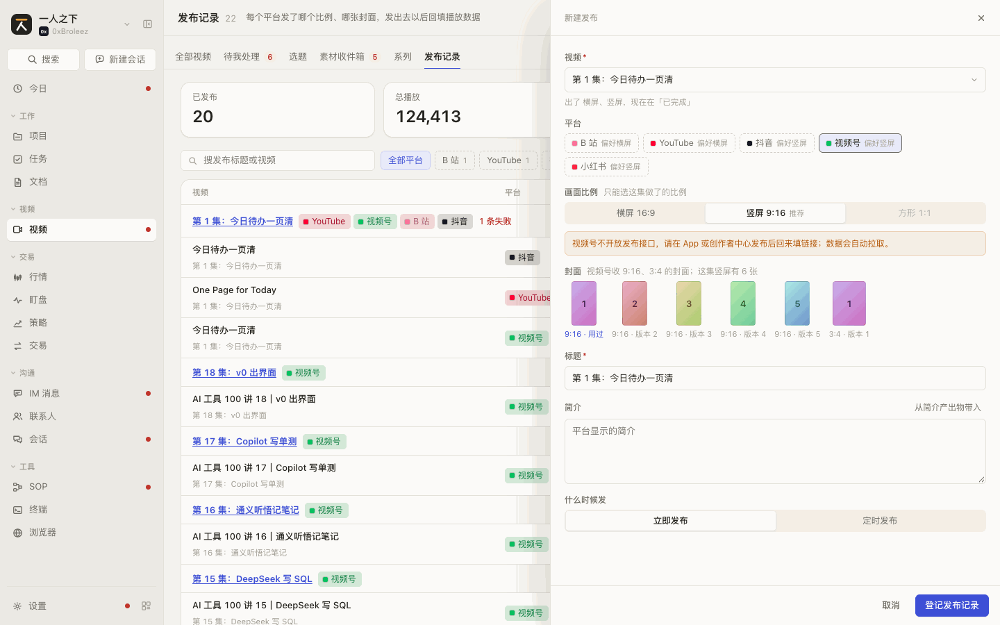 |  |
| 连接异常（抖音） |  |  |
| 未接入（小红书） |  |  |
| 标题没填 |  |  |

### 交互

| 编号 | 元素 | 操作 | 结果 |
|---|---|---|---|
| SPEC-videos-8.1 | 视频（必填） | 选择 | 下拉可搜标题、目录，按更新倒序，每项带当前状态；下面一行「出了横屏、竖屏，现在在「<状态>」」。换视频时标题如果没改过就跟着换，比例重选，封面清空 |
| SPEC-videos-8.2 | 平台 | 点击 | 五个平台单选，每个标「偏好<比例>」；换平台时比例按平台推荐重选（这集有推荐比例就用它，没有用这集的第一个比例），封面清空 |
| SPEC-videos-8.3 | 画面比例 | 点击 | 三个比例，这集没做的不可点（提示「这集没做这个比例」），平台推荐的标「推荐」；换比例时封面清空 |
| SPEC-videos-8.4 | 推荐比例提示 | 展示 | 这集没出平台推荐的比例时：「这集没出竖屏版，抖音建议竖屏」 |
| SPEC-videos-8.5 | 平台接入提示 | 展示 | 平台不是 `ok` 时在比例下面显示，见 `SPEC-videos-8.6` 到 `8.9` |
| SPEC-videos-8.6 | 已接入（`ok`） | 展示 | 没有提示；底部按钮是「立即发布」或「定时发布」 |
| SPEC-videos-8.7 | 不开放发布接口（`manual`，视频号、小红书接了数据连接器） | 展示 | 「<平台>不开放发布接口，请在 App 或创作者中心发布后回来填链接；数据会自动拉取。」没有跳转；底部按钮「登记发布记录」 |
| SPEC-videos-8.8 | 连接异常（`error`） | 展示 / 点「去修复」 | 「<连接器名>连接异常：<原因>。修好之前只能登记。」；「去修复」跳设置 / 连接器 / 内容平台并打开这个连接器的抽屉；底部按钮「登记发布记录」 |
| SPEC-videos-8.9 | 未接入（`none`） | 展示 / 点「去接入」 | 「还没接入<平台>，只能登记发布记录，不能自动上传和拉数据。」；「去接入」跳设置 / 连接器 / 内容平台并打开这个平台的新建抽屉；底部按钮「登记发布记录」 |
| SPEC-videos-8.10 | 封面 | 点击 | 列出这集这个方向下、比例在平台 `cover` 里的封面产出物，推荐的比例排前面（色块按封面比例画，下面「<比例> · 版本 n」，已发布过的写「<比例> · 用过」），单选，再点取消；不选也能发。说明写「<平台>收 <比例>、<比例> 的封面；这集<方向>有 N 张」。例：第 1 集选抖音只列 3:4 和 9:16，选 B 站只列 16:9（还有 4:3 但这集没出） |
| SPEC-videos-8.11 | 标题（必填） | 输入 | 默认是视频标题 |
| SPEC-videos-8.12 | 「从简介产出物带入」 | 点击 | 取这集版本最高的简介产出物，把「<视频标题> + 取自简介产出物 <路径>，第 n 版，已定稿 / 还没定稿」填进简介（原型用占位文字代表文件内容） |
| SPEC-videos-8.13 | 简介 | 输入 | 可空 |
| SPEC-videos-8.14 | 「立即发布 / 定时发布」 | 点击 | 选定时多出日期时间输入，默认明天 10:00 |
| SPEC-videos-8.15 | 底部主按钮 | 点击 | 先校验（`SPEC-videos-8.17` 到 `8.19`，只显示第一条错误）。通过后新建记录放在最前、抽屉换成这条记录的抽屉：已接入且立即发布，状态「计划中」并开始自动发布（原型约 1.2 秒后变「已发布」、生成链接、数据清零）；已接入且定时，状态「已定时」；不能自动发的不管选立即还是定时都是「计划中」，定时的时间照样记下 |
| SPEC-videos-8.16 | 「取消」、Esc、x | 点击 | 关抽屉，不保存 |

### 空状态和异常状态

| 编号 | 场景 | 显示 | 可做的操作 |
|---|---|---|---|
| SPEC-videos-8.17 | 没选视频 | 底部红字「先选一个视频」 | 选视频 |
| SPEC-videos-8.18 | 标题为空 | 标题框标红，底部红字「标题必填」 | 填标题 |
| SPEC-videos-8.19 | 定时时间无效或不晚于现在 | 「选一个定时时间」/「定时时间要晚于现在」 | 改时间 |
| SPEC-videos-8.20 | 一个视频都没有 | 视频下拉写「还没有视频」且不可点，底部主按钮不可点 | 先去新建视频 |
| SPEC-videos-8.21 | 这个方向没有平台收的封面 | 「这集还没有 <比例>、<比例> 的<方向>封面，先在分发包阶段出封面；不选也能发」 | 不选封面 |
| SPEC-videos-8.22 | 没有简介产出物时点带入 | 简介下面提示「这集还没有简介产出物，先在分发包阶段出简介，或者直接手写」 | 手写 |
| SPEC-videos-8.23 | 平台未连接、连接异常 | 见 `SPEC-videos-8.8`、`8.9`；只能登记 | 去接入、去修复 |

### 数据

写入一条 `Publish`（见 `SPEC-videos-0`）。`id` 用 `newId('pb')`，`cover_id` 是选的封面，`title`、`desc` 去掉首尾空格，`scheduled_at` 只在选定时时有。

### 联动

| 方向 | 对方模块 | 触发 | 结果 | 见 |
|---|---|---|---|---|
| 进来 | 设置（连接器） | 平台接入情况 | 决定提示和按钮 | `SPEC-settings-5` |
| 出去 | 设置（连接器） | 「去接入」「去修复」 | 连接器列表筛到内容平台，打开抽屉 | `SPEC-settings-3.3`、`SPEC-settings-5` |
| 进来 | 本模块 | 封面、简介产出物 | 列出可选封面、带入简介 | `SPEC-videos-11` |

## SPEC-videos-9 发布记录抽屉

一条发布记录：状态、去向、简介、数据。失败的能重试，计划中和已定时的能改为立即发布，已发布的能回填或拉取数据、打开链接。

### 截图

| 状态 | 亮 | 暗 |
|---|---|---|
| 发布失败 |  |  |
| 已发布 |  |  |
| 回填数据，格式不对 |  |  |
| 计划中（视频号登记后） |  |  |
| 抖音被打回，换成 3:4 封面 |  |  |
| 换封面后重试成功 |  |  |

### 交互

| 编号 | 元素 | 操作 | 结果 |
|---|---|---|---|
| SPEC-videos-9.1 | 抽屉头 | 展示 | 发布标题、平台标签、状态（发布中显示「发布中…」） |
| SPEC-videos-9.2 | 属性 | 展示 | 视频（链接，点了打开视频详情）、平台（偏好比例）、比例（和平台推荐不一致时提示「平台建议<比例>」）、封面（按封面比例画的色块和路径，没选写「没有选封面」；比例不在平台收的范围里时提示「<平台>不收 <比例>」）、定时时间、发布时间（带相对时间）、链接（没有时：已发布写「没有记链接」，其余「发布后生成」） |
| SPEC-videos-9.3 | 简介 | 展示 | 没填写「没有填简介」 |
| SPEC-videos-9.4 | 失败提示条和「重试」 | 点击 | 「发布失败 <原因>」（没有原因写「平台没有返回原因」）；重试把状态改回计划中、清掉原因和定时时间并重新自动发布；发布中按钮不可点。底部也有同样的「重试」 |
| SPEC-videos-9.5 | 「改为立即发布」 | 点击 | 计划中（且不在发布中）、已定时的记录才有；清掉定时时间，开始自动发布 |
| SPEC-videos-9.6 | 不能自动发的平台（视频号、小红书、未接入或异常） | 应该是 | 原型问题 1：原型照样给「改为立即发布」并模拟发布成功。规格：这类记录不出「改为立即发布」，换成「填链接，标为已发布」：输入平台链接，保存后状态已发布、`published_at` 记当时；已接入的平台到定时时间自动发布由 VID-06 做 |
| SPEC-videos-9.7 | 数据区 | 展示 | 只在已发布时出现：「N 前更新」或「还没回填」，四格播放、点赞、评论、转发 |
| SPEC-videos-9.8 | 「回填数据」 | 点击 | 四个输入框，预填现有数字；「保存」写入并更新时间，「取消」放弃；有不是非负整数的格子标红、提示「只能填非负整数」、保存不可点 |
| SPEC-videos-9.9 | 「打开链接」 | 点击 | 已发布才有，没有链接时不可点（提示「没有记链接」）；在内置浏览器打开 |
| SPEC-videos-9.10 | 「模拟拉取数据」 | 点击 | 原型在现有数字上随机涨一点。正式版换成「拉取数据」，从平台连接器拉（VID-04、VID-05），平台没接入时不显示 |
| SPEC-videos-9.11 | 「删除」 | 点击 | 换成确认条「只删这条记录，平台上已发的内容不受影响」「取消」「删除」 |
| SPEC-videos-9.12 | Esc、x | 点击 | 关抽屉 |
| SPEC-videos-9.17 | 「换封面」 | 点击 | 失败、计划中、已定时且不在发布中时出现；说明「<平台>收 <比例>、<比例>，推荐 <比例>」；列出同一集同一方向、平台收的封面（推荐的比例排前面，色块下「<比例> · 版本 n」），点了直接改这条记录的 `cover_id`，再点取消；一张都没有时「这集还没有 <比例>、<比例> 的<方向>封面，去视频的产出物里登记一张」 |
| SPEC-videos-9.18 | 封面比例把关 | 自动 | 自动发布（新建立即发布、重试、改为立即发布）时，选了封面且比例不在平台 `cover` 里就失败，原因「封面比例不符合要求：<平台>要 <比例> 或 <比例>，这次用的是 <比例>」；没选封面不拦。演示：第 1 集抖音那条用了 1:1 封面被打回，换成 3:4 后重试成功 |

### 空状态和异常状态

| 编号 | 场景 | 显示 | 可做的操作 |
|---|---|---|---|
| SPEC-videos-9.13 | 发布失败 | 红色提示条带原因，列表行上红字原因，汇总「发布失败」红色 | 重试 |
| SPEC-videos-9.14 | 视频已删除 | 视频一栏「已删除的视频」 | 删除记录 |
| SPEC-videos-9.15 | 回填格式不对 | 见 `SPEC-videos-9.8` | 改正 |
| SPEC-videos-9.16 | 拉取时连接器异常 | 原型未做；正式版提示连接器异常并给「去修复」，同 `SPEC-videos-8.8` | 去修复 |

### 数据

见 `SPEC-videos-0` 的 `Publish`、`Metrics`。

### 联动

| 方向 | 对方模块 | 触发 | 结果 | 见 |
|---|---|---|---|---|
| 出去 | 浏览器 | 打开链接 | 内置浏览器新标签 | `SPEC-browser-3` |
| 进来 | 设置（连接器） | 拉取数据 | 正式版读平台连接器 | `SPEC-settings-5` |

## SPEC-videos-10 视频详情：制作流程

一集视频的详情页，三个标签：制作流程、产出物（带条数）、设置。制作流程是 8 个阶段的竖向时间线：做完的打勾，当前的高亮，检查点带标签；停在检查点上等我处理时标签上有红点。

### 截图

| 状态 | 亮 | 暗 |
|---|---|---|
| 桌面 1440，停在第一章验收 |  |  |
| 手机 375 |  |  |
| 退回要写意见（1440） |  |  |
| 退回要写意见（375） |  |  |
| 被退回待修改 |  |  |
| 非检查点阶段 |  |  |
| 规划检查没选比例 |  |  |
| 已完成 |  |  |
| 规划检查通过后，网页开发配好执行器 |  |  |
| 执行器运行中 |  |  |
| 跑完，产出物进待验收 |  |  |
| 执行器跑失败 |  |  |
| 配执行器 |  |  |

### 交互

| 编号 | 元素 | 操作 | 结果 |
|---|---|---|---|
| SPEC-videos-10.1 | 顶栏 | 展示 | 标题（没有写「未命名视频」），前面是系列名（点了进系列详情）或「视频」；说明是「系列 · 第 N 集」或「单集」、项目名、比例（没定写「比例未定」）、状态，用「 · 」连 |
| SPEC-videos-10.2 | 阶段 | 展示 | 序号圆点（做完的打勾）、阶段名、「检查点」标签、「当前」标签、阶段说明；这一阶段的产出物一行一个（类型、名称、比例、版本、状态，演示工程、成片、封面有「预览」）；点产出物打开产出物抽屉 |
| SPEC-videos-10.3 | 检查点结果 | 展示 | 右侧「已通过 · N 前」「已跳过，不合成音频 · N 前」「已退回 · N 前」；通过或跳过时有意见的显示「意见：…」 |
| SPEC-videos-10.4 | 规划检查：画面比例 | 点击 | 没锁定时三个比例可多选（「可多选，每个比例是一个独立的演示工程」），选中的按横、竖、方的顺序存；规划检查通过后锁定，只显示选中的、不可点，下面「比例定了不能改，要换比例得新开工程」 |
| SPEC-videos-10.5 | 第一章验收：要验收的演示工程 | 展示 | 当前在第一章验收或已有演示工程时显示，按比例列出演示工程；一个都没有时「还没登记演示工程。去登记」，点了切到产出物标签并打开登记表单 |
| SPEC-videos-10.6 | 当前检查点「通过」 | 点击 | 记 `passed` 和时间，进入下一阶段；分发包通过后停在分发包、状态变「已完成」。被退回过的按钮叫「改好了，通过」。规划检查没选比例时不可点（提示「先选至少一个画面比例」），旁边提示「通过后比例锁定」 |
| SPEC-videos-10.7 | 当前检查点「退回」 | 点击 | 展开意见输入框（「哪里不行、要怎么改」）、「确认退回」「取消」；没写意见时「确认退回」不可点，旁边「退回要写意见」。确认后记 `rejected`、意见和时间，阶段不动，状态变「退回修改」。被退回过的按钮叫「再次退回」 |
| SPEC-videos-10.8 | 被退回的检查点 | 展示 | 框里先显示「退回意见：<意见>」（没写显示「没写意见」），再是「改好了，通过」「再次退回」 |
| SPEC-videos-10.9 | 音频合成「跳过（不合成音频）」 | 点击 | 只在音频合成检查点有；记 `skipped` 和时间，进入「录屏渲染」，音频合成显示「已跳过，不合成音频」 |
| SPEC-videos-10.10 | 非检查点阶段「这一步做完了，进入「<下一阶段>」」 | 点击 | 当前阶段不是检查点时出现，进入下一阶段；这一步还没登记产出物时上面提示「这一步还没登记产出物。登记一个」 |
| SPEC-videos-10.11 | 右上「查看系列」 | 点击 | 只在制作流程标签、属于系列时出现，打开系列详情 |
| SPEC-videos-10.12 | 右上「发布记录 N」 | 点击 | 这集有发布记录时出现，切到发布记录并只看这一集（`SPEC-videos-7.9`） |
| SPEC-videos-10.13 | 标签「制作流程 / 产出物 / 设置」 | 点击 | 切标签；产出物后面是条数，制作流程在等我处理时有红点 |
| SPEC-videos-10.19 | 执行器框 | 展示 | 能配执行器的阶段：有产出物类型的阶段（内容编写、网页开发、音频合成、录屏渲染、分发包）加「其余章节」；规划检查、第一章验收只有人能做。已完成的集不显示。配了的阶段显示类型标签（技能 / SOP / Agent）、名称（找不到写「已删除的<类型>」）、交代的话；没配的只在当前阶段显示「没配执行器，产出物手动登记」和「配执行器」 |
| SPEC-videos-10.20 | 「配执行器」「修改」 | 点击 | 展开编辑：交给谁跑（技能 / SOP / Agent 三选一，切类型时默认选该类第一个）、下拉选具体哪个（技能来自技能列表，SOP 来自流程库，Agent 来自 Agent 列表）、交代给它的话（可不填）；「保存」写进 `runners`（同阶段替换）、「取消」、已配过的还有「不用执行器」（删掉这条）。「配执行器」默认技能「网页演示做视频」 |
| SPEC-videos-10.21 | 「运行」 | 点击 | 只在当前阶段出现；记一条 `last_run`（`running`），按钮变「运行中…」，下面「正在跑，开始于 N 前；跑完产出物会进「待验收」」；整集同时只跑一个，别的阶段的「运行」不可点（提示「另一个阶段正在跑，等它跑完」），运行中不能修改 |
| SPEC-videos-10.22 | 跑完 | 自动 | 原型约 1.8 秒后按阶段登记产出物：内容编写出口播稿和大纲、网页开发出演示工程（第 1 章）、其余章节给演示工程升版、音频合成出口播音频、录屏渲染出成片和字幕、分发包出简介和章节时间轴；按比例区分的每个比例一份。同类型同比例已有的升一个版本，没有的新建；都改成「待验收」，来源记成执行器（类型和名称）。`last_run` 变 `done`，显示「N 前跑完，登记了 N 个产出物，待验收」；检查点阶段后面加「；检查点还要你来确认」。不自动往下走，阶段推进和检查点仍由人操作 |
| SPEC-videos-10.23 | 跑失败 | 展示 / 点击 | 框变成实线边，显示「运行失败：<原因> · N 前」，按钮叫「重试」。原型能预判的失败：执行器找不到（「找不到<类型>「<id>」，可能已经删掉了，换一个再跑」）、要按比例出的阶段还没定比例；演示：AI 系列第 27 集网页开发因预览端口被占失败，重试成功 |
| SPEC-videos-10.24 | 跑的时候离开详情页 | 自动 | 照常跑完，结果按跑完那一刻的视频和产出物写入 |
| SPEC-videos-10.25 | 演示数据 | 展示 | AI 系列没做完的集（第 19 集以后）内容编写、网页开发、其余章节、录屏渲染都配了技能「网页演示做视频」；一人之下第 3 集内容编写配了 SOP「视频周更」。验收路径：待我处理里打开第 28 集，规划检查通过，网页开发点「运行」，演示工程进待验收 |

### 空状态和异常状态

| 编号 | 场景 | 显示 | 可做的操作 |
|---|---|---|---|
| SPEC-videos-10.14 | 视频已删除（打开的链接失效） | 「这个视频已经删除」 | 切别的标签 |
| SPEC-videos-10.15 | 规划检查没选比例 | 「通过」不可点，提示「先选至少一个画面比例」 | 选比例 |
| SPEC-videos-10.16 | 退回没写意见 | 「确认退回」不可点，「退回要写意见」 | 写意见 |
| SPEC-videos-10.17 | 当前阶段没登记产出物 | 「这一步还没登记产出物。登记一个」；第一章验收没有演示工程时「还没登记演示工程。去登记」 | 去登记 |
| SPEC-videos-10.18 | 一键跑某个阶段 | 原型已补（`SPEC-videos-10.19` 到 `10.25`）。原型只模拟：不真的发起 Agent 运行或 SOP 执行，`last_run.id` 只是生成的编号；正式版执行记录进会话的「运行」或 SOP 执行记录，产出回写 `Artifact`（VID-03a 到 VID-03d） | |

### 数据

见 `SPEC-videos-0` 的 `Video`、`STAGES`、`Checkpoint`、`Artifact`、`StageRunner`、`LastRun`。检查点决定写 `Checkpoint { stage, state, at: 现在, note }`，没有这条检查点记录时追加。执行器写 `Video.runners`、`Video.last_run`，产出物写法见 `SPEC-videos-10.22`。

### 联动

| 方向 | 对方模块 | 触发 | 结果 | 见 |
|---|---|---|---|---|
| 出去 | 浏览器 | 产出物「预览」 | 内置浏览器打开预览地址 | `SPEC-browser-3` |
| 出去 | SOP、Agent、技能 | 执行器「运行」 | 原型模拟跑完并登记产出物；正式版发起真实运行（VID-03） | `SPEC-sop-11`、`SPEC-settings-16` |
| 出去 | 今日 | 停在检查点 | 原型未做（VID-07） | `SPEC-today-1.4` |

## SPEC-videos-11 视频详情：产出物

这集的全部产出物，按类型分块（顺序同 `ARTIFACT_KIND`），没有的类型不出现；按比例区分的类型（口播稿、大纲、演示工程、成片、字幕、封面、简介、章节时间轴）再按比例分栏；封面在每个方向下再按封面比例分组，每组固定 5 格。

### 截图

| 状态 | 亮 | 暗 |
|---|---|---|
| 桌面 1440 |  |  |
| 手机 375 |  |  |
| 封面 5 个版本和选用 |  |  |
| 竖屏的三种封面比例 |  |  |
| 登记 3:4 封面 |  |  |
| 登记产出物（1440） |  |  |
| 登记产出物（375） |  |  |

### 交互

| 编号 | 元素 | 操作 | 结果 |
|---|---|---|---|
| SPEC-videos-11.1 | 类型块的头 | 展示 / 点「加一个」 | 类型名、所属阶段、个数；「加一个」打开这个类型的登记表单 |
| SPEC-videos-11.2 | 产出物行 | 展示 / 点击 | 名称、完整路径（视频目录加路径）、版本、状态、来源、时长（mm:ss）、「验收 N 次」；点击打开产出物抽屉 |
| SPEC-videos-11.3 | 比例分栏 | 展示 | 这集的比例加上已有产出物用到的比例；不在本工程比例里的栏标「（不在本工程比例里）」；某个比例还没有时「这个比例还没有<类型>。登记」 |
| SPEC-videos-11.4 | 封面格 | 展示 / 点击 | 每个方向下按封面比例分组：这个方向的默认封面比例（`DEFAULT_COVER_RATIOS`）加上已登记过的，组头「封面 <比例>  已有数 / 5」；每组 1 到 5 格（有更大的版本号就多出来），色块按封面比例画；有的画状态点和「选用」或版本号，选用的那格高亮，点击打开抽屉；缺的格写「缺」，点击打开登记表单并预填这个方向、封面比例和版本 |
| SPEC-videos-11.5 | 右上「新增产出物」 | 点击 | 只在产出物标签出现；打开登记表单，类型默认是当前阶段的第一个类型 |
| SPEC-videos-11.6 | 登记表单：类型 | 选择 | 十种类型，每项写所属阶段；改类型时名称、比例、封面比例、版本、路径跟着重算 |
| SPEC-videos-11.7 | 登记表单：比例 | 点击 | 按比例区分的类型才有，只列这集的比例（还没定比例时列全部三种）；封面改方向时封面比例回到这个方向的默认（原来的还在这个方向的可选里就保留），版本跳到第一个空着的版本 |
| SPEC-videos-11.16 | 登记表单：封面比例 | 点击 | 只有封面有，列这个方向的 `DEFAULT_COVER_RATIOS`（竖屏是 9:16、3:4、1:1），说明「平台各有要求，抖音要 3:4」；换封面比例时版本跳到这个比例第一个空着的版本，名称、路径跟着变 |
| SPEC-videos-11.8 | 登记表单：名称、第几版、时长 | 输入 | 名称默认「封面 n」「成片」或类型名；封面选第 1 到 5 版；音频、成片填时长（mm:ss 或秒数，可不填，格式不对就不存） |
| SPEC-videos-11.9 | 登记表单：路径 | 输入 | 默认路径：演示工程 `presentation-<比例 key>`、音频 `audio/`、成片 `out/<目录最后一段>-16x9.mp4`、字幕 `subtitle/<目录最后一段>-16x9.srt`、封面 `cover/<封面比例>-<n>.png`（如 `cover/3x4-2.png`）、按比例区分的文稿类 `<类型 key>-<比例 key>.md`（如 `script-portrait.md`）、原文 `article.md`；字幕登记时语言记 `zh`；手动改过路径后再改类型、比例不覆盖 |
| SPEC-videos-11.10 | 「登记」 | 点击 | 新建一条草稿（版本 1，来源「手动登记」），表单收起；提示「登记后是草稿，验收通过才算定稿」 |
| SPEC-videos-11.11 | 「取消」 | 点击 | 收起表单 |

### 空状态和异常状态

| 编号 | 场景 | 显示 | 可做的操作 |
|---|---|---|---|
| SPEC-videos-11.12 | 一个产出物都没有 | 「还没有产出物」「文稿、演示工程、音频、成片、封面、简介、章节时间轴都登记在这里」 | 「新增产出物」 |
| SPEC-videos-11.13 | 有产出物但有些类型没有 | 底部提示「没出现的类型说明还没登记，点右上角「新增产出物」」 | 新增 |
| SPEC-videos-11.14 | 路径为空 / 按比例的类型没选比例 | 「登记」不可点 | 补全 |
| SPEC-videos-11.15 | 还没定比例时登记按比例的类型 | 提示「还没定画面比例，先在规划检查里选好」 | 去制作流程选比例 |

### 数据

写入一条 `Artifact`（见 `SPEC-videos-0`）。登记表单的临时数据原型未定义成数据类型（`videos.tsx` 的 `NewArt`：`kind`、`variant`、`ratio` 封面比例、`option`、`name`、`path`、`duration` 字符串、`touched` 路径是否手动改过）。

演示数据：第 1 集（横竖两版）口播稿、大纲、简介、章节时间轴、字幕都是横竖各一份；横版口播稿 v3、竖版 v2，各有自己的两次验收记录（`SPEC-videos-12.6`）。封面横屏 16:9 五版、竖屏 9:16 五版，另有竖屏 1:1 一版（拿去发抖音被打回）和 3:4 一版（已选用）。

### 联动

| 方向 | 对方模块 | 触发 | 结果 | 见 |
|---|---|---|---|---|
| 出去 | 本模块 | 封面、简介 | 新建发布里可选、可带入 | `SPEC-videos-8.10`、`8.12` |
| 进来 | 技能、Agent、SOP | 产出物来源 | 执行器跑完的产出物来源记成执行器（`SPEC-videos-10.22`）；手动登记的是「手动登记」 | `SPEC-settings-16` |

## SPEC-videos-12 产出物抽屉

一个产出物的详情：改名称路径、改状态、选用封面、验收、升版本、预览、删除。改动边改边存。

### 截图

| 状态 | 亮 | 暗 |
|---|---|---|
| 封面（已选用） |  |  |
| 口播稿，有验收记录 |  |  |
| 删除确认 |  |  |

### 交互

| 编号 | 元素 | 操作 | 结果 |
|---|---|---|---|
| SPEC-videos-12.1 | 抽屉头 | 展示 | 「<类型> · <比例> · 封面 <封面比例> · 第 n 版」（封面比例只有封面有）；封面带按封面比例画的大色块（竖的窄一些）；名称和版本、「<阶段> · N 前登记」、状态 |
| SPEC-videos-12.2 | 属性 | 展示 | 完整路径、来源（「技能 · web-video-presentation」这类）、比例、封面比例（封面）、语言（字幕，`zh` 显示「中文」）、时长 |
| SPEC-videos-12.3 | 名称、路径 | 输入 | 边输边存，视频的更新时间刷新 |
| SPEC-videos-12.4 | 状态 | 点击 | 草稿、待验收、已定稿、已发布四选一，可以直接改 |
| SPEC-videos-12.5 | 封面「选用这张 / 取消选用」 | 点击 | 只在封面有；同一视频同一方向、同一封面比例只能选一张（竖屏的 9:16 和 3:4 各选各的），选这张时同组其余取消；已选用的显示「已选用」。发布时默认用它（原型新建发布还没有默认选上，原型问题 7） |
| SPEC-videos-12.6 | 验收意见和「通过」 | 点击 | 追加一条通过记录（没写意见存「通过」），状态变已定稿（已发布的保持已发布），意见框清空。横版、竖版文稿是两条产出物，各自验收，互不影响 |
| SPEC-videos-12.7 | 「退回」 | 点击 | 没写意见时不可点（提示「退回要写意见」）；追加退回记录，状态回到草稿 |
| SPEC-videos-12.8 | 验收记录 | 展示 | 新的在上：通过或退回、意见（没写显示「没写意见」）、相对时间（悬停看完整时间） |
| SPEC-videos-12.9 | 「升版本」 | 点击 | 版本号加一，状态回到草稿 |
| SPEC-videos-12.10 | 「预览」 | 点击 | 演示工程、成片、封面、音频才有；在内置浏览器打开 `http://127.0.0.1:7801/<视频目录>/<路径>`，标签标题「<视频标题> · <名称>（<比例>）」 |
| SPEC-videos-12.11 | 「删除」 | 点击 | 换成「只删记录，文件不动」「取消」「删除」；确认后删掉，抽屉关闭 |
| SPEC-videos-12.12 | Esc、x | 点击 | 关抽屉 |

### 空状态和异常状态

| 编号 | 场景 | 显示 | 可做的操作 |
|---|---|---|---|
| SPEC-videos-12.13 | 还没验收过 | 「还没验收过」 | 通过 / 退回 |
| SPEC-videos-12.14 | 退回没写意见 | 「退回」不可点 | 写意见 |
| SPEC-videos-12.15 | 预览服务没起 / 文件不存在 | 原型未做（内置浏览器打不开就显示浏览器自己的错误）；正式版先检查文件，没有时提示「文件不在 <完整路径>」 | 改路径 |

### 数据

见 `SPEC-videos-0` 的 `Artifact`、`Review`。

### 联动

| 方向 | 对方模块 | 触发 | 结果 | 见 |
|---|---|---|---|---|
| 出去 | 浏览器 | 预览 | 内置浏览器新标签 | `SPEC-browser-3` |

## SPEC-videos-13 视频详情：设置

### 截图

| 状态 | 亮 | 暗 |
|---|---|---|
| 桌面 1440 |  |  |
| 手机 375 |  |  |
| 删除确认 |  |  |

### 交互

| 编号 | 元素 | 操作 | 结果 |
|---|---|---|---|
| SPEC-videos-13.1 | 标题 | 输入 | 边输边存 |
| SPEC-videos-13.2 | 所属项目 | 选择 | 可搜索，「不属于项目」清空；项目已删除时显示「已删除的项目」 |
| SPEC-videos-13.3 | 系列、第几集 | 选择 / 输入 | 选「单集（不属于系列）」清掉集数，集数输入框不可用；选了系列时集数默认原来的或 1，至少 1 |
| SPEC-videos-13.4 | 章节数 | 输入 | 至少 1 |
| SPEC-videos-13.5 | 视频目录 | 输入 | 等宽字体；文稿、演示工程、音频、成片、封面的路径都相对它 |
| SPEC-videos-13.6 | 画面比例 | 展示 | 只读；没锁定写「在「制作流程」的规划检查里选，通过后锁定」，锁定写「比例定了不能改，要换比例得新开工程」 |
| SPEC-videos-13.7 | 「删除视频」 | 点击 | 换成「会一起删掉 N 条产出物记录，视频目录里的文件不动」「取消」「删除」；确认后删掉视频、它的产出物和发布记录，从系列待同步里摘掉，回到全部视频（原型问题 2：文案没提发布记录，选题的 `video_id` 没清） |

### 空状态和异常状态

| 编号 | 场景 | 显示 | 可做的操作 |
|---|---|---|---|
| SPEC-videos-13.8 | 还没定比例 | 「还没定」 | 去规划检查 |
| SPEC-videos-13.9 | 集数和系列里别的集重复 | 原型不拦；系列详情编排时标红（`SPEC-videos-6.10`） | 改集数 |

### 数据

见 `SPEC-videos-0` 的 `Video`。

### 联动

| 方向 | 对方模块 | 触发 | 结果 | 见 |
|---|---|---|---|---|
| 改动 | 项目 | 选项目 | `project_id` | `SPEC-projects-13.11` |
| 改动 | 本模块 | 删除视频 | 产出物、发布记录、系列待同步跟着清 | `SPEC-videos-7`、`SPEC-videos-6.4` |
