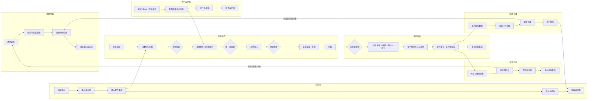

# 视频博主工作全景与「一人之下」功能缺口分析

- 对象：个人或 2 到 5 人小团队，做知识类 / 产品类 / 教程类视频，分发到 B 站、YouTube、抖音、视频号、小红书
- 依据：`web-next/src` 当前代码（数据全在内存）、`~/.claude/skills/web-video-presentation/SKILL.md` v1.13.0 及其 `references/`（COVER.md、RECORDING.md、SERIES-BATCH.md 等）
- 范围：只读代码、只出分析，不改代码
- 证据写法：`文件:行号` 均相对 `web-next/src/`
- 写作时点：`videopublish.tsx` 已有系列页与发布页（765 行）；写作过程中另一代理已把视频模块接进菜单和工作台模板（见 2.0），行号以 2026-10-28 下午的工作区为准，代码仍在变动

---

## 1. 博主的工作全景

### 1.0 全流程图



### 1.1 选题策划

| 工作项 | 频率 | 常用工具 | 痛点 |
|---|---|---|---|
| 灵感收集（评论区提问、私信、自己踩的坑、读到的文章） | 每天随手 | 微信收藏、备忘录、flomo、Notion | 散在五六个地方，回头找不到；评论区里的好问题被刷掉 |
| 热点与竞品扫描（同领域 UP 主新片、平台热榜、搜索联想词） | 每天 / 每周 | 各平台 App、新榜、飞瓜、蝉妈妈、YouTube Studio 的「研究」 | 纯手刷，没有沉淀；竞品数据只能截图 |
| 选题评估（受众、搜索量、自己能不能讲透、能不能做成系列） | 每周一次选题会 | 表格打分、和合作者语音 | 打分标准每次不一样；没有「上次类似选题表现如何」的数据回看 |
| 系列规划（N 集结构、集与集的依赖） | 每季度 / 每个系列开头 | Notion、脑图 | 系列中途改结构，前面几集的术语和后面对不上 |
| 排期进内容日历（哪天发、哪个平台、和商单错开） | 每周 | 飞书多维表格、Notion 日历 | 选题、制作进度、发布时间是三张表，状态不同步 |

### 1.2 内容生产

按 web-video-presentation 的阶段走（SKILL.md「工作流总览」）：

| 工作项 | 频率 | 常用工具 | 痛点 |
|---|---|---|---|
| 资料调研（读文档、跑一遍产品、截图录屏素材） | 每集 1 到 3 天 | 浏览器、Obsidian、截图工具 | 素材和最终用到哪一屏对不上 |
| 口播稿 + 大纲（script.md + outline.md） | 每集 | Claude / ChatGPT、Word | AI 味重；横竖屏要两套节奏（SKILL.md 布局 B：横屏 3 到 8 分钟，竖屏 30 到 90 秒） |
| 规划检查（稿子 / 大纲 / 主题 / 素材 / 开发模式 / 方向，方向一旦定死不能改） | 每集一次 | 人工对齐 | 方向选错要重开工程 |
| 画面制作（网页演示 / PR / 剪映 / Final Cut / AE） | 每集最耗时 | Vite + React（本技能）、剪映 | 第一章不验收就铺开，返工成本大 |
| 第一章验收 + 其余章节开发（逐章 / 顺序 / 并行） | 每集 | 本技能 subagent 模式 C | 并行开发后风格漂移；`check-chapters.mjs` 红线要跑 |
| 配音（TTS 或真人录音） | 每集 | MiniMax、indextts、录音棚 | 多音字读错（SERIES-BATCH.md Part 6）；改一句稿要重合成一段 |
| 录屏渲染 / 剪辑 | 每集 | `render-video.mjs`、OBS、剪映 | 渲染时长长，失败了不知道卡在哪章 |
| 字幕（SRT、烧录 / 外挂、中英双语） | 每集 | 剪映自动字幕、飞书妙记、Whisper | 口播稿已经是现成文本却还在重新识别；校对费时 |

### 1.3 发布分发

| 工作项 | 频率 | 常用工具 | 痛点 |
|---|---|---|---|
| 分发包（5 版封面、≤250 字简介、HH:MM:SS 章节） | 每集 | 本技能 Phase 5、Canva、PS | 每个平台封面比例不同（COVER.md Part 4：16:9 / 4:3 / 9:16 / 3:4 / 1:1） |
| 按平台改写标题、简介、话题标签、分区、合集 | 每集 × 平台数 | 手工复制粘贴 | 5 个平台 5 套规则（字数、标签数、是否可放链接），最容易出错 |
| 定时发布 | 每集 | 各平台创作者后台 | 每个平台单独设定时，不能统一看 |
| 多账号分发（大号 + 封面 AB 小号） | 部分博主 | 多部手机、矩阵工具 | 视频号 / 抖音 / 小红书无原生 AB（COVER.md Part 7），只能靠小号 |
| 发布失败重试（尺寸不对、审核不过、限流） | 偶发 | 平台后台通知 | 失败原因藏在站内信里，经常一天后才发现 |

### 1.4 运营互动

| 工作项 | 频率 | 常用工具 | 痛点 |
|---|---|---|---|
| 评论 / 弹幕回复 | 发布后 48 小时最密，之后每天 | 各平台 App | 5 个平台 5 个入口；前 2 小时的回复率影响推荐，却最忙 |
| 评论分诊（提问 / 夸奖 / 反驳 / 广告 / 商务） | 每天 | 人脑 | 有价值的问题没沉淀成下一期选题 |
| 置顶评论与引导（资料链接、下集预告） | 每集 | 手动 | 忘记置顶 |
| 私信与粉丝群（资料包、答疑） | 每天 | 微信群、QQ 群、B 站私信 | 重复问题反复答 |
| 动态 / 社区帖（预告、投票） | 每周 | B 站动态、YouTube 社区 | 没有排期 |

### 1.5 数据复盘

| 工作项 | 频率 | 常用工具 | 痛点 |
|---|---|---|---|
| 拉数据（播放、点赞、评论、转发、收藏、投币、完播率、平均观看时长、曝光与点击率、涨粉） | 发布后第 1 / 3 / 7 / 30 天 | 各平台数据中心、手抄表格 | 只有当前快照，看不到曲线；跨平台口径不一 |
| 封面 AB 决胜（每张 ≥10K 曝光、观察 ≥7 天、只看 CTR、差距 ≥20% 显著） | 每集 | YouTube 缩略图测试、B 站封面优化 | 需要曝光与 CTR，很多博主根本没记这两个字段 |
| 单集复盘（哪段掉人、标题封面是否起作用、下次怎么改） | 每集 | 观众留存曲线截图 + 文档 | 复盘结论和下一个选题之间没有链接 |
| 周报 / 月报（涨粉、总播放、收入） | 每周 / 每月 | 表格 | 手工汇总 |

### 1.6 商业化

| 工作项 | 频率 | 常用工具 | 痛点 |
|---|---|---|---|
| 商单询价接收（品牌方、MCN、花火 / 星图 / 蒲公英平台单） | 每周若干 | 微信、邮件、平台后台 | 询价散落，没回复就丢单 |
| 报价、排期、合同 | 每单 | 报价表、电子签 | 报价依据（近 30 天均播）要现算 |
| 脚本 / 成片客户审核（通常 2 到 3 轮） | 每单 | 微信发文件、飞书文档 | 意见在聊天记录里，版本混乱 |
| 交付、结款、开票 | 每单 | 表格 | 账期跟踪靠记忆 |
| 结案数据报告 | 每单 | 截图拼 PPT | 数据要从发布记录里再抄一遍 |
| 其他收入（充电 / 会员、课程、带货佣金、平台激励） | 每月 | 各后台 | 没有统一的收入视图 |

### 1.7 资产与团队管理

| 工作项 | 频率 | 常用工具 | 痛点 |
|---|---|---|---|
| 素材库（图片、录屏、BGM、音效、字体）及版权来源 | 持续 | 本地盘、Eagle、网盘 | 不记授权来源，被投诉才发现 |
| 系列模板（开场、收尾、主题、术语表 glossary） | 每个系列 | 本技能布局 C、`<series>-glossary.md` | 改了共用部分不知道要重做哪几集 |
| 分工（编导、剪辑、封面、运营）与审稿 | 每集 | 飞书任务、微信群 | 谁卡在哪一步看不到 |
| 账号管理（各平台账号、绑定手机号、登录态、小号） | 偶发 | 密码管理器 | 小号多了混乱 |
| 成片与工程归档 | 每集结束 | 外接硬盘 | 工程目录命名乱，续集找不到上一集工程 |

---

## 2. 现状对照表

### 2.0 接入现状

- 已接入：`ModuleKey` 含 `videos`（`workspacedata.ts:5-6`），模块说明 `workspacedata.ts:19`；菜单项带「卡在检查点」提醒 `App.tsx:385`（计数 `App.tsx:123`）；列表 / 系列 / 发布 / 详情四个视图的路由 `App.tsx:946-966`
- 已有「视频博主」模板 `workspacedata.ts:49-50`，首页 `videos`（第 4 节在它的基础上给调整建议）
- 还没接：今日页「需要你处理」（`App.tsx:396` 起的 `todayNeeds`）只收 SOP、Agent、IM、运行异常、连接器、模型服务商，不收视频检查点、今天定时的发布、发布失败

### 2.1 对照表

状态口径：已覆盖 = 有数据结构且有可操作界面；部分覆盖 = 只有一部分字段或只有模拟 / 只靠通用模块凑；未覆盖 = 没有。

| 阶段 | 工作项 | 状态 | 落点与证据 |
|---|---|---|---|
| 选题策划 | 灵感收集 | 部分覆盖 | 文档有「笔记 / 摘录」分类 `data.ts:403-408`，IM 消息可摘录成文档（seed `data.ts:490`、`data.ts:503` 的 source 是 IM）；没有「选题」对象，也收不到平台评论 |
| 选题策划 | 热点与竞品扫描 | 部分覆盖 | 连接器有网页搜索 / 网页读取 `data.ts:248`、`data.ts:251`，技能有「竞品分析」`agentdata.ts:77`；无内容平台数据源，无定时扫描结果沉淀处 |
| 选题策划 | 选题评估打分 | 未覆盖 | 无选题模型、无打分字段 |
| 选题策划 | 系列规划 | 部分覆盖 | `Series` `videodata.ts:112-122` 只有名称、说明、共用开场 / 收尾 / 模板、stale；没有计划集数、集间关系、glossary |
| 选题策划 | 内容日历排期 | 未覆盖 | `Video` `videodata.ts:124-140` 没有计划发布日；`Publish.scheduled_at` `videodata.ts:105` 只在建发布记录后才有；无日历视图 |
| 内容生产 | 制作阶段推进 | 已覆盖 | 8 阶段 `videodata.ts:16-26`；流程页逐步推进与「这一步做完了」按钮 `videos.tsx:408-410` |
| 内容生产 | 4 个检查点（规划 / 第一章 / 音频 / 分发包） | 已覆盖 | `Checkpoint` `videodata.ts:73-74`；通过 / 退回必须写意见 / 音频可跳过 `videos.tsx:383-406` |
| 内容生产 | 画面比例锁定 | 已覆盖 | 规划检查通过后锁定 `videos.tsx:350-367`，与 SKILL.md「scaffold 时锁死」一致 |
| 内容生产 | 产出物登记（原文、稿、大纲、工程、音频、视频、封面、简介、章节） | 已覆盖 | `ARTIFACT_KIND` `videodata.ts:29-40`、`Artifact` `videodata.ts:52-71`；产出物 tab 按比例分栏 `videos.tsx:476-500` |
| 内容生产 | 产出物版本与验收记录 | 已覆盖 | `version` / `reviews` `videodata.ts:63-69`；抽屉里通过 / 退回 / 升版本 `videos.tsx:604-705`（退回必须写意见 `videos.tsx:680`） |
| 内容生产 | 稿子与工程的真实生成（调技能跑 Phase 1 / 2） | 未覆盖 | `Artifact.source` 只是标签 `videodata.ts:68`，seed 里全写 `web-video-presentation` `videodata.ts:175`；没有「从这一步发起技能 / Agent / SOP」的按钮 |
| 内容生产 | 资料调研与素材 | 部分覆盖 | 项目材料 `Material` `projectdata.ts:7`、内置浏览器可预览 Drive 视频 `browser.tsx:764`；素材与视频的哪一章没关联 |
| 内容生产 | 第 1 章本地预览 | 部分覆盖 | 产出物可「预览」`videos.tsx:241`、`videos.tsx:705`，走内置浏览器；演示工程的 dev server 启停没接上项目原型 `projectdata.ts:29-40` 和终端 `terminal.tsx:183-184` |
| 内容生产 | 配音合成 | 部分覆盖 | 只能登记音频产出物和时长 `videos.tsx:448`；看不到 `audio-segments.json` 逐段文本，无多音字词表 |
| 内容生产 | 录屏渲染 | 部分覆盖 | 只能登记成片 `videodata.ts:36`；渲染进度、失败章节不可见（可以用终端手跑脚本，但与视频无关联） |
| 内容生产 | 字幕 | 未覆盖 | `ArtifactKind` 无 `subtitle` |
| 内容生产 | 横竖两套口播稿 | 未覆盖 | `ARTIFACT_KIND.script.perVariant = false` `videodata.ts:32`，和技能布局 B「pc / app 两套 script.md / outline.md」矛盾 |
| 发布分发 | 5 版封面与选用 | 已覆盖 | 封面格子 5 个位置 `videos.tsx:25`、`videos.tsx:490-495`，「选用这张」`videos.tsx:669` |
| 发布分发 | 封面 4:3 / 3:4 比例 | 未覆盖 | 封面 `variant` 只能是 3 种 `Orientation` `videodata.ts:9`；技能默认横版出 16x9 + 4x3、竖版出 9x16 + 3x4 + 1x1（SKILL.md Phase 5.2）。seed 里抖音正好因「需要 3:4」发布失败 `videodata.ts:204`，数据结构却表达不了 3:4 封面 |
| 发布分发 | 简介、章节时间轴 | 已覆盖 | 产出物类型 `videodata.ts:38-39`；新建发布时可从简介产出物带入 `videopublish.tsx:519-530` |
| 发布分发 | 按平台改写标题简介 | 部分覆盖 | 每条发布可填 title / desc `videodata.ts:102-103`；无话题标签、分区、合集、字数校验，无 AI 改写 |
| 发布分发 | 平台与比例匹配提醒 | 已覆盖 | `PLATFORMS.prefer` `videodata.ts:77-83`，新建发布时提示比例不匹配 `videopublish.tsx:520` |
| 发布分发 | 定时发布 | 部分覆盖 | `scheduled` 状态与时间 `videodata.ts:85-91`、`videopublish.tsx:545`；发布是 1.2 秒模拟 `videopublish.tsx:363-374`；不走「定时任务」`scheduledata.ts:31-39`，今日页也看不到 |
| 发布分发 | 发布失败与重试 | 已覆盖（模拟） | `failed` + `error` `videodata.ts:108`，重试 `videopublish.tsx:376`；失败不进「运行异常」，`INCIDENT_MODULES` 无视频 / 发布 `incidentdata.ts:14` |
| 发布分发 | 多账号 / AB 小号 | 未覆盖 | `Publish` 无账号字段 `videodata.ts:95-110`；连接器无内容平台类 `data.ts:82-90` |
| 运营互动 | 评论 / 弹幕收集与回复 | 未覆盖 | IM 渠道只有微信、飞书、Slack、Telegram、QQ `data.ts:20-26`；`Metrics.comments` 只是个数 `videodata.ts:93` |
| 运营互动 | 评论分诊 | 部分覆盖 | 「消息分诊」技能 `agentdata.ts:73`、问题分类器节点 `nodetypes.tsx:176` 可复用，但没有评论数据进来 |
| 运营互动 | 私信 / 粉丝群 | 部分覆盖 | 微信 / QQ 群可经 IM 收发 `data.ts:21`、`data.ts:25`，待处理 / 稍后提醒 / 转任务 `messages.tsx:57`、`messages.tsx:110`；没有平台私信渠道 |
| 运营互动 | 置顶评论、动态帖 | 未覆盖 | 无 |
| 数据复盘 | 数据回填 | 部分覆盖 | 手动回填 4 个数 `videopublish.tsx:660`，「模拟拉取」`videopublish.tsx:664`；只有当前快照 `videodata.ts:93`，无曝光、CTR、完播、收藏、投币、涨粉，无按天历史 |
| 数据复盘 | 跨平台汇总 | 已覆盖 | 发布页总播放 / 总点赞 / 失败数 `videopublish.tsx:398-404`，按平台条形 `videopublish.tsx:378-381` |
| 数据复盘 | 封面 AB 决胜 | 未覆盖 | 一条发布只挂一张封面 `videodata.ts:101`，无曝光与 CTR，做不了 COVER.md Part 7 的规则 |
| 数据复盘 | 单集复盘 / 周月报 | 部分覆盖 | 「写周报」技能 `agentdata.ts:72` 只读任务；没有读视频数据的 Agent 能力 `agentdata.ts:12-22` |
| 商业化 | 商单询价接收 | 部分覆盖 | 联系人分组有「客户 / 合作伙伴」`data.ts:3`，IM 消息可转任务 `taskdata.ts:21`；无商单对象 |
| 商业化 | 报价、合同、结款 | 未覆盖 | 无金额、账期、合同字段 |
| 商业化 | 客户审核脚本 / 成片 | 部分覆盖 | 产出物验收记录 `videodata.ts:50`、`videodata.ts:69` 只记「我」的意见，无「外部审核人」；项目干系人有「决策人」角色 `projectdata.ts:49-57` 可借 |
| 商业化 | 结案数据报告 | 未覆盖 | 发布数据与商单没有关联 |
| 商业化 | 其他收入 | 未覆盖 | 无 |
| 资产与团队 | 素材库与版权 | 部分覆盖 | 项目材料 `projectdata.ts:7`（文件 / 文件夹 / 链接 / 笔记 + tags），无授权来源、到期、用在哪集 |
| 资产与团队 | 系列模板与改版影响 | 已覆盖 | 改共用部分后勾选受影响的集标「待同步」`videopublish.tsx:180-181`、`videopublish.tsx:284`，顶部提醒 `videopublish.tsx:87` |
| 资产与团队 | 系列术语表 glossary | 未覆盖 | `Series` 无 glossary 字段 `videodata.ts:112-122` |
| 资产与团队 | 分工与审稿 | 部分覆盖 | 任务有 assignee `taskdata.ts:33`，但视频阶段不产生任务；`Video` 无负责人 |
| 资产与团队 | 平台账号管理 | 未覆盖 | 无 |
| 资产与团队 | 工程归档 | 部分覆盖 | `Video.root` 目录 `videodata.ts:135` 与产出物 path；无归档状态 |

### 2.2 小结

- 制作流程（内容生产后半段 + 分发包）是目前最完整的部分，和技能的 Phase / Checkpoint 一一对应
- 发布与数据只有「记录」没有「连接」：没有内容平台连接器，发布是模拟，数据是手填快照
- 选题、评论互动、商单三块是空白，但都有现成模块可借（文档 + Agent、IM 消息、联系人 + 项目）
- 视频模块和其余模块之间几乎没有串联：不产生任务、不进今日、不进定时、不进运行异常、Agent 没有视频能力

---

## 3. 缺口与建议功能

### P0（不做就跑不通一个完整的周更）

#### P0-1 视频进今日页

- 用户场景：早上打开今日，就看到「第 2 集等你验收第一章」「YouTube 今晚 20:00 定时」「抖音发布失败：封面比例」，不用先点进视频模块
- 功能要点：菜单已接（见 2.0），缺的是今日页；`todayNeeds` 收三类：检查点 `pending` / `rejected` 的视频（复用 `videoState`，`videodata.ts:143-149`）、24 小时内 `scheduled` 的发布、`failed` 的发布；点击直达视频详情或发布抽屉
- 怎么串：照抄 `App.tsx:396` 起 SOP / Agent 那几段的写法；`ALL_MENU` 视频项目前只有 `alert` 没有 `badge`（`App.tsx:385`），补上数字
- 数据：无新结构

#### P0-2 内容日历（复用任务的定时）

- 用户场景：周一排本周：周三 B 站横版、周四视频号竖版、周五商单；一眼看到哪天空着、哪集制作进度赶不上发布日
- 功能要点：
  - 月 / 周视图，格子里是 `Publish`（计划 / 已定时 / 已发布 / 失败）和 `Video.target_date`
  - 制作进度落后预警：距离计划发布日 N 天还没过「第一章验收」就标红
  - 拖动改日期；建发布时同时生成一条 `Schedule`（`scheduledata.ts:31-39`），action 新增 `publish`，到点执行发布、失败时走运行异常
- 怎么串：`ScheduleAction` 加一种 `{ kind: 'publish'; publish_id }`；`SchedulesPage` 已能展示各类动作 `schedule.tsx:14-17`；失败写 `Incident`，`INCIDENT_MODULES` 加「发布」
- 数据草案：

```ts
// videodata.ts
export interface Video {
  // ...已有字段
  /** 计划首发日，用来排日历和算进度是否落后 */
  target_date?: string
  owner?: string
}

// scheduledata.ts
export type ScheduleAction =
  | { kind: 'task'; title: string; desc: string; priority: Priority; assignee: string; due_days: number }
  | { kind: 'sop'; sop_id: string }
  | { kind: 'agent'; agent_id: string; prompt: string }
  | { kind: 'publish'; publish_id: string }

export interface CalendarItem {
  date: string // YYYY-MM-DD
  kind: 'publish' | 'target' | 'deal_deadline'
  ref_id: string
  label: string
  tone: 'ok' | 'warn' | 'danger' | 'muted'
}
```

#### P0-3 内容平台连接器 + 平台账号

- 用户场景：B 站、YouTube、抖音、视频号、小红书各接一次授权，之后发布、拉数据、收评论都走这里；封面 AB 用的小号也挂在这里
- 功能要点：
  - `TOOL_CATEGORIES` 加「内容平台」一类（`data.ts:82-90`），每个平台一个 `appTool`；能力差异写在 catalog 里：YouTube / B 站有官方上传与数据 API，抖音 / 小红书 / 视频号开放能力有限，标为「只拉数据」或「只收评论」，发布退化为「生成发布包 + 打开创作者后台」
  - 一个平台允许接多个账号（`Connector.account` 已经是为此设计的，`data.ts:279`），账号打角色：主号 / AB 小号 / 客户号
  - `Publish` 记录挂 `account_id`
- 怎么串：连接器页的状态、错误、同步间隔全部现成；错误进运行异常（`INCIDENT_MODULES` 已有「连接器」）
- 数据草案：

```ts
// data.ts
export type ContentPlatformCap = 'upload' | 'schedule' | 'metrics' | 'comments' | 'reply' | 'dm'
export interface PlatformAccount {
  id: string
  connector_id: string
  platform: PlatformKey
  handle: string            // 平台昵称 / 频道名
  uid: string
  role: 'main' | 'ab' | 'client'
  caps: ContentPlatformCap[] // 这个平台这个账号实际能做什么
  followers?: number
}

// videodata.ts
export interface Publish {
  // ...已有字段
  account_id?: string
}
```

#### P0-4 数据模型补全：曝光、CTR、完播、按天快照

- 用户场景：发布后第 1 / 3 / 7 / 30 天看曲线；按 COVER.md Part 7 规则判断封面胜负；按近 30 天均播给商单报价
- 功能要点：
  - `Metrics` 增加平台通用的扩展字段，平台不提供的留空
  - 每次拉取 / 回填存一条快照而不是覆盖（当前 `onMetrics` 直接覆盖，`videopublish.tsx:487`）
  - 定时任务每天拉一次（复用 P0-2 的 `Schedule`，action 用 `agent` 或新增 `pull_metrics`）
  - 发布详情画 D1 / D3 / D7 / D30 曲线
- 数据草案：

```ts
export interface Metrics {
  views: number; likes: number; comments: number; shares: number
  impressions?: number      // 曝光
  ctr?: number              // 点击率 0-1
  avg_watch_sec?: number
  completion?: number       // 完播率 0-1
  favorites?: number
  coins?: number            // B 站投币
  followers_gained?: number
  updated_at: string
}
export interface MetricSnapshot extends Metrics {
  publish_id: string
  day: number               // 发布后第几天
  source: 'manual' | 'connector'
}
```

#### P0-5 产出物结构对齐技能（横竖两套稿 + 5 种封面比例）

- 用户场景：做双方向项目时，竖版口播稿要单独写、单独验收；抖音要 3:4 封面
- 功能要点：
  - `script` / `outline` / `description` / `chapters` 改成 `perVariant: true`（技能布局 B 明确 pc / app 各一套）
  - 封面的比例与舞台方向解耦：`Artifact` 加 `ratio`，舞台仍用 `Orientation`
  - `PLATFORMS` 增加平台要求的封面比例，新建发布时按平台过滤可选封面
- 数据草案：

```ts
export type CoverRatio = '16x9' | '4x3' | '9x16' | '3x4' | '1x1'
export const DEFAULT_COVER_RATIOS: Record<Orientation, CoverRatio[]> = {
  landscape: ['16x9', '4x3'],
  portrait: ['9x16', '3x4', '1x1'],
  square: ['1x1', '4x3'],
}
export interface Artifact {
  // ...已有字段
  ratio?: CoverRatio        // 只有封面有
}
// PLATFORMS 每项加：cover: CoverRatio[]，例如 douyin: ['3x4', '9x16']
```

注意：这一条改动 `videodata.ts` 契约，`videos.tsx` 的封面格子 `videos.tsx:476-500` 和 `videopublish.tsx` 的封面选择要一起跟改，建议主会话先改契约再派子代理。

### P1（做了才真正省时间）

#### P1-1 选题库（复用文档 + Agent）

- 用户场景：评论里有人问「知识库怎么喂」，一键收进选题库；周一选题会让 Agent 按历史数据给每个选题打分，挑 3 个进日历
- 功能要点：
  - 选题是一个独立对象，正文落在文档（`ContentItem`，新增分类 `topic`，`data.ts:403-408`），选题对象只存结构化字段
  - 来源可追溯：手写 / IM 消息 / 平台评论 / 网页（复用 `ContentItem.source`）
  - 打分维度固定 4 项（受众需求、搜索热度、自己的把握、可系列化），Agent 填初值，人改
  - 「开始制作」= 新建 `Video`，带上选题 id，文稿阶段的原文直接引用选题文档
  - 相似历史选题：按 tags 找已发布视频，显示其 D7 播放
- 怎么串：新技能「选题评估」放 `SKILLS`（`agentdata.ts:71`）；Agent 加能力 `read_videos`；定时任务每周一跑「热点扫描」Agent，结果写成选题草稿
- 数据草案：

```ts
export type TopicStatus = 'inbox' | 'shortlist' | 'scheduled' | 'producing' | 'done' | 'dropped'
export interface Topic {
  id: string
  title: string
  content_id?: string        // 正文在文档里
  source: { type: 'manual' | 'im' | 'comment' | 'web' | 'agent'; ref?: string; label: string }
  tags: string[]
  series_id?: string
  scores?: { demand: number; search: number; mastery: number; serial: number; by: 'agent' | 'me' }
  status: TopicStatus
  video_id?: string
  created_at: string
}
// Video 加 topic_id?: string
```

#### P1-2 评论收件箱（复用 IM 消息）

- 用户场景：发布后 2 小时内，在一个列表里回完 5 个平台的评论；有价值的问题一键变选题
- 功能要点：
  - 评论按 IM 消息的模型进来：`Message.channel` 用平台 key，`conversation` 填视频标题，新增 `publish_id`
  - 复用 IM 页的待处理 / 稍后 / 已处理 / 忽略、转任务、AI 起草回复（技能「客户回复话术」改一份「评论回复」）
  - 新动作：转选题、标为置顶候选、标为负面
  - 发布详情里显示该条发布的评论数与待回复数
- 怎么串：只给 `IM_CHANNELS`（`data.ts:20-26`）追加平台渠道会让「联系人的 IM 账号」表单也多出 5 列，不合适；建议加 `kind: 'im' | 'comment'` 区分，联系人表单只显示 `im` 类
- 数据草案：

```ts
export interface Message {
  // ...已有字段
  kind?: 'im' | 'comment' | 'danmaku' | 'dm'
  publish_id?: string
  /** 评论楼层、弹幕时间点（秒） */
  anchor?: { floor?: number; at_sec?: number }
  likes?: number
  sentiment?: 'pos' | 'neu' | 'neg'
}
```

#### P1-3 视频阶段直接发起技能 / SOP / Agent

- 用户场景：在「内容编写」这一步点「用技能生成稿子」，Agent 按 web-video-presentation 跑 Phase 1，产出物自动登记、自动进入规划检查
- 功能要点：
  - 每个阶段可配一个执行器（技能 / SOP / Agent），执行记录进会话的「运行」（`sessions.tsx:152`），产出进「产出」（`sessions.tsx:195`）并回写 `Artifact`
  - 检查点仍然由人操作，执行器只负责把产出物推到 `review`
  - 一个内置 SOP 模板「视频周更」：文稿 AI 处理 → 人工检查（规划）→ Agent 开发第 1 章 → 人工检查 → 子流程并行章节 → 人工检查（音频）→ 代码执行（渲染）→ 人工检查（分发包）；节点类型全部现成（`nodetypes.tsx:88`、`nodetypes.tsx:212`、`nodetypes.tsx:255`、`nodetypes.tsx:265`、`nodetypes.tsx:161`）
  - 演示工程登记为项目原型（`projectdata.ts:29-40`），dev server 用现有启停与终端
- 数据草案：

```ts
export interface StageRunner { stage: StageKey; type: 'skill' | 'sop' | 'agent'; ref_id: string; prompt?: string }
export interface Video {
  // ...已有字段
  runners?: StageRunner[]
  /** 最近一次执行，指向 AgentRun 或 SOP run */
  last_run?: { type: 'agent' | 'sop'; id: string; stage: StageKey; status: 'running' | 'done' | 'failed' }
}
// AgentOutput.kind 加 'artifact'，target = Artifact.id
```

#### P1-4 封面 AB 测试

- 用户场景：YouTube 用原生缩略图测试，视频号用两个小号各发一版，7 天后系统按规则提示胜者
- 功能要点：一次测试挂 2 到 5 张封面、每张对应一条发布或一个平台原生测试；显示每张曝光是否到 10K、天数是否到 7、CTR 差距是否到 20%；结束后胜者设为主封面，其余标归档（COVER.md Part 7「其它 4 张归档不要删」）
- 怎么串：依赖 P0-3（小号账号）和 P0-4（曝光、CTR）
- 数据草案：

```ts
export interface CoverTest {
  id: string
  video_id: string
  platform: PlatformKey
  mode: 'native' | 'accounts' | 'utm'
  arms: { cover_id: string; publish_id?: string; impressions?: number; ctr?: number }[]
  started_at: string
  min_days: number          // 默认 7
  min_impressions: number   // 默认 10000
  winner_id?: string
  status: 'running' | 'decided' | 'inconclusive'
}
```

#### P1-5 平台发布包与校验

- 用户场景：一键把同一集改写成 5 个平台的标题、简介、标签，并在发布前拦住「标题超长」「封面比例不对」「简介带外链」
- 功能要点：每个平台一套规则（标题字数、标签数、简介字数、是否可放链接、封面比例）；AI 改写走 Agent（技能「平台改写」）；校验失败不让点发布
- 数据草案：

```ts
export interface PlatformRule {
  platform: PlatformKey
  title_max: number
  desc_max: number
  tags_max: number
  allow_link: boolean
  cover: CoverRatio[]
  duration_max_sec?: number
}
export interface Publish {
  // ...已有字段
  tags?: string[]
  category?: string        // 分区
  collection?: string      // 合集 / 播放列表
  checks?: { key: string; ok: boolean; text: string }[]
}
```

#### P1-6 字幕产出物

- 用户场景：口播稿就是字幕源，渲染完按章节时间点直接出 SRT，再人工校对
- 功能要点：`ArtifactKind` 加 `subtitle`（阶段 `record`，按比例区分）；从 `narrations.ts` 与 step 时间点生成；平台发布时可选外挂
- 数据：`ARTIFACT_KIND.subtitle = { label: '字幕', stage: 'record', perVariant: true }`，`Artifact` 加 `lang?: string`

### P2（规模上来以后）

#### P2-1 商单（复用联系人 + 项目）

- 用户场景：品牌方在微信问报价，转成商单；商单关联一个项目（客户、对接人、决策人都用项目干系人），视频挂到项目下；客户审稿意见记在产出物验收里；发布 7 天后一键出结案报告
- 功能要点：商单状态流转；报价参考近 30 天均播（读 `MetricSnapshot`）；客户审核人作为外部验收人写进 `Review`；账期到期进今日
- 怎么串：联系人分组「客户」`data.ts:3`、干系人角色 `projectdata.ts:49-57`、IM 转任务 `taskdata.ts:21`、视频 `project_id` 已有 `videodata.ts:127`
- 数据草案：

```ts
export type DealStatus = 'inquiry' | 'quoted' | 'signed' | 'producing' | 'client_review' | 'delivered' | 'paid' | 'lost'
export interface Deal {
  id: string
  project_id: string         // 客户、对接人都在项目干系人里
  contact_id: string         // 询价人
  brand: string
  platforms: PlatformKey[]
  deliverables: string       // 1 支横版 + 1 支竖版 + 置顶评论
  quote: number
  currency: 'CNY' | 'USD'
  status: DealStatus
  deadline?: string
  pay_due?: string
  video_ids: string[]
  source_message_id?: string
  report_content_id?: string // 结案报告落在文档
}
export interface Review { at: string; ok: boolean; comment: string; by?: { type: 'me' | 'contact'; id?: string } }
```

#### P2-2 素材库与版权

- 用户场景：BGM 到期前提醒；某张图被投诉时立刻知道用在哪几集
- 数据草案：

```ts
export interface Asset {
  id: string
  kind: 'image' | 'footage' | 'bgm' | 'sfx' | 'font' | 'other'
  path: string
  license: { type: 'own' | 'cc' | 'paid' | 'unknown'; source: string; expires_at?: string }
  used_in: { video_id: string; chapter?: number }[]
  tags: string[]
}
```

#### P2-3 系列术语表与多音字表

- 用户场景：系列第 5 集写稿时 Agent 自动按 glossary 用词；TTS 前按多音字表替换
- 怎么串：glossary 正文落文档，挂成知识库（`kbskills.tsx:35`）给写稿 Agent 用
- 数据：`Series` 加 `glossary_content_id?: string`、`pronunciations?: { word: string; say: string }[]`、`planned_episodes?: number`

#### P2-4 收入总览

- 用户场景：月底看平台激励、充电、商单、课程各多少
- 数据：`Income { id; month; kind: 'platform' | 'deal' | 'membership' | 'course' | 'affiliate'; platform?: PlatformKey; deal_id?: string; amount: number }`

#### P2-5 团队分工

- 用户场景：剪辑和封面外包，阶段推进时自动给负责人建任务，检查点卡住时 IM 通知
- 怎么串：`Video.owner` + 每阶段 `assignee`；推进阶段时建 `Task`，`TaskSource` 加 `{ kind: 'video'; video_id; stage }`（`taskdata.ts:19-24`）；通知用 SOP「发送消息」节点 `nodetypes.tsx:232`

---

## 4. 「视频博主」工作台模板建议

现有模板 `workspacedata.ts:49-50` 是：今日 / 创作（视频、项目、文档）/ 粉丝与合作（IM 消息、联系人）/ 工具（任务、SOP、会话、浏览器），首页 `videos`。首页选对了，分组建议调整四处：

1. 「会话」移进「创作」：稿子、第 1 章、章节并行都是 Agent 在跑，制作时要频繁看运行与产出，放在工具组里太远
2. 「任务」移进「发布与互动」：P0-2 之后内容日历和定时发布都挂在任务 / 定时下面，它是发布的入口而不是杂项工具
3. 「项目」从「创作」移到「合作」：对视频博主来说项目主要承载商单（P2-1），单集视频已经有自己的模块；「终端」加回工具组，渲染和 dev server 要用
4. 「评论」不单独开模块，P1-2 之后做成 IM 消息下的一个视图

调整后：

| 分组 | 模块 | 理由 |
|---|---|---|
| （无标题） | 今日 | 待检查点、今天要发的、发布失败、待回评论、商单到期 |
| 创作 | 视频（默认首页）、文档、会话 | 视频是主线；文档放选题正文与稿件；会话看 Agent 生成稿子与工程的记录 |
| 发布与互动 | IM 消息、任务 | IM 消息里收评论和粉丝群；任务里放定时发布与内容日历 |
| 合作 | 联系人、项目 | 商单客户、品牌对接人；一个商单一个项目 |
| 工具 | SOP、终端、浏览器 | 视频周更 SOP；终端跑渲染与 dev server；浏览器预览演示工程、打开创作者后台 |

```ts
{ id: 'ws_video', role: '视频博主', name: '视频创作工作台', desc: '选题、制作、发布、评论、商单一条线', home: 'videos',
  groups: [['', ['today']], ['创作', ['videos', 'library', 'sessions']], ['发布与互动', ['messages', 'tasks']],
    ['合作', ['contacts', 'projects']], ['工具', ['sop', 'terminal', 'browser']]] },
```

注意：工作台配置存在 localStorage（`workspacedata.ts` 的 `loadWorkspaces`），改模板只影响新建的工作台，已建的不会跟着变。

默认首页的选择：选 `videos` 而不是 `today`。理由是这类用户一天的主体时间在某一集的制作里，打开就该看到「哪集卡在哪个检查点」；今日页仍在第一位，一键可达。视频模块的二级菜单默认视图建议从「全部视频」改为后续的「日历」（P0-2 完成后），因为周更博主最先问的是「这周发什么、来不来得及」。

配套的默认数据（模板新建时一并创建）：

- 一个 SOP「视频周更」（见 P1-3）
- 三个技能：选题评估、平台改写、评论回复
- 一个 Agent「视频助手」：能力 读视频、写产出物、读 IM、起草回复（回复设为需确认）
- 两个定时任务：每天 9:00 拉数据；每周一 10:00 热点扫描写入选题库

---

## 5. 可并行派给子代理的切分建议

前提：`videodata.ts` 是契约文件，按项目惯例由主会话独占修改（文件头注释 `videodata.ts:7` 也写了 videos.tsx / videopublish.tsx 只读它）。所以第 0 步由主会话一次性把下列结构加进契约，之后子代理只读不改。

### 第 0 步（主会话，串行）

- `videodata.ts`：`CoverRatio`、`Artifact.ratio`、`perVariant` 调整、`Metrics` 扩展、`MetricSnapshot`、`PlatformRule`、`Publish.account_id/tags/category/collection/checks`、`Video.target_date/owner/topic_id/runners`、`Topic`、`CoverTest`、`subtitle` 产出物
- `workspacedata.ts`：按第 4 节调整 `ws_video` 模板分组
- `scheduledata.ts`：`ScheduleAction` 加 `publish`
- `App.tsx`：今日页收视频项（P0-1）、给第 1 批的新页面（日历、选题库）预留路由（`App.tsx` 是多方共改的热点文件，只由主会话动）

### 第 1 批（并行，文件互不重叠）

| 子代理 | 任务 | 只改这些文件 | 依赖 |
|---|---|---|---|
| A 制作页 | 封面按 ratio 分格、横竖两套稿、字幕产出物、阶段执行器按钮（先做 UI，执行走回调） | `videos.tsx`、`videos.css` | 第 0 步 |
| B 发布页 | 平台规则校验、标签 / 分区 / 合集、账号选择、指标扩展与 D1/D3/D7/D30 曲线、封面按平台比例过滤 | `videopublish.tsx`、`videopublish.css` | 第 0 步 |
| C 日历 | 新页面：月 / 周日历、进度落后预警、拖动改日期 | 新建 `videocalendar.tsx`、`videocalendar.css` | 第 0 步 |
| D 选题库 | 新页面：选题列表、打分、转视频、相似历史 | 新建 `topics.tsx`、`topics.css`（数据类型已在 `videodata.ts`） | 第 0 步 |
| E 连接器 | 内容平台分类、5 个平台 appTool、多账号与账号角色 | `data.ts` 的连接器段（`TOOL_CATEGORIES` 与 `TOOLS`，约 `data.ts:81-272`）、`connectors.tsx` | 无，可与第 0 步同时 |

注意事项：

- A 和 B 都会用到封面缩略图组件：`videos.tsx` 有 `CoverThumb`（`videos.tsx:580`），`videopublish.tsx` 有 `CoverSwatch`（`videopublish.tsx:37`），已经是两份实现；本批不合并，各改各的，合并留到第 2 批，避免两个代理同时动同一个组件
- E 只动 `data.ts` 的连接器段；P1-2 的 `Message` 扩展也在 `data.ts`，所以评论收件箱放第 2 批，避免与 E 冲突
- 每个代理完成后跑 `npx tsc --noEmit` 与 lint，不碰 `styles.css`（全局样式由主会话统一收）

### 第 2 批（第 1 批合并后）

| 子代理 | 任务 | 只改这些文件 |
|---|---|---|
| F 评论收件箱 | `Message.kind/publish_id`、IM 页加「评论」视图、转选题动作 | `data.ts` 的消息段（`data.ts:328-390`）、`messages.tsx` |
| G Agent 与技能 | 新能力 `read_videos` / `write_artifacts`、3 个新技能、`AgentOutput.kind = 'artifact'` | `agentdata.ts`、`kbskills.tsx` |
| H SOP 模板 | 「视频周更」SOP 种子数据 | `sopflow.ts` |
| I 封面 AB | AB 测试抽屉与决胜规则 | 新建 `covertest.tsx`，在 `videopublish.tsx` 只加一个入口（与 B 错开时间） |
| J 运行异常 | `INCIDENT_MODULES` 加「发布」，发布失败写异常 | `incidentdata.ts`、`incidents.tsx` |

### 第 3 批（P2）

商单（新建 `deals.tsx`，改 `projecttabs.tsx` 加商单 tab）、素材库（新建 `assets.tsx`）、收入总览（新建 `income.tsx`），三者文件互不重叠，可并行；共同需要的类型仍先由主会话进契约。
